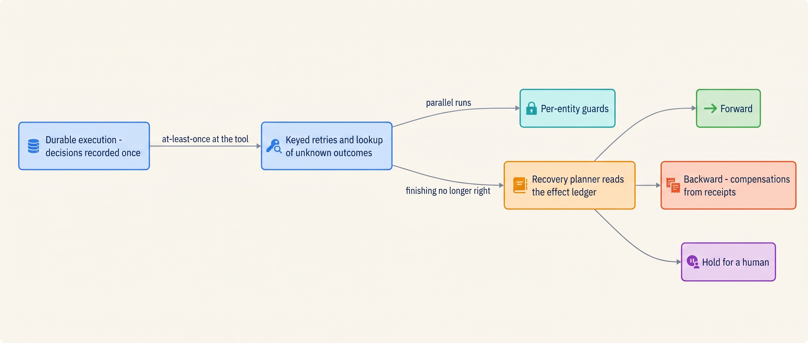
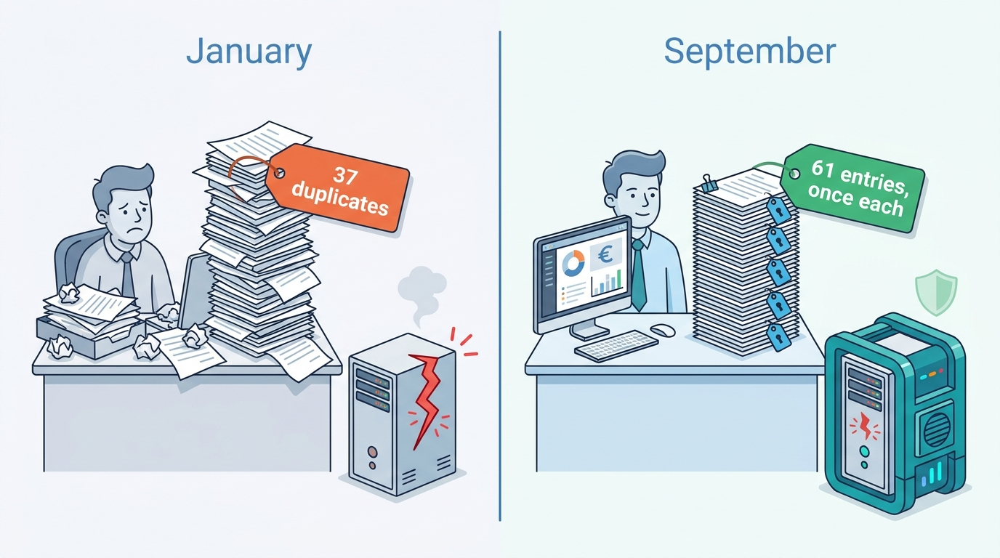

> **IN THIS PART, YOU WILL:** Learn how to keep agent work that lasts minutes to weeks correct through crashes, deploys, timeouts, parallel runs and half-finished jobs.

> **WHY THE BUSINESS CARES:** Agents make doing cheap and undoing expensive. A duplicated posting, a second credit or an action nobody can list costs more in cleanup, audit findings and delayed closes than the controls that prevent it.

> **WHY ARCHITECTS SHOULD CARE:** The model is the one component that will not give the same answer twice, so recovery code that re-runs a step containing a model call makes a new decision. Where decisions are recorded, who mints idempotency keys and who chooses the recovery direction are platform decisions.

> **KEY POINTS:**
>
> * **Record the decision, replay the record.** Run the agent loop as deterministic workflow code, with every model call and every tool call a separate recorded activity, and pin each run to the versions it started on.
> * **Retry the action object, never the model.** A key minted by the orchestrator travels with the action; a timeout is an unknown outcome resolved by lookup; per-entity guards stop two correct runs from making two correct decisions about one customer.
> * **Recovery is a decision made by code from the effect ledger.** Every write tool declares whether it is reversible, compensable or a pivot; the planner chooses forward, backward or hold; kill switches hold work instead of discarding it.

> **[FAILURE PATTERNS THIS PART ADDRESSES](where-agentic-systems-go-wrong.html):**
>
> * **Amnesiac Execution** — replaced by durable history, durable timers and version pinning, so a crash or deploy on day 3 of a five-day run resumes instead of restarting.
> * **The Different Second Answer** — prevented by recording the model's output before anything acts on it and by freezing a step once its action is dispatched.
> * **The Fire-and-Forget Action** — answered by keys, receipts, an unknown state resolved by lookup, and an effect ledger that lists every effect a half-finished run caused.

 
Part V gave tools contracts, a broker, sandboxes and a boundary for effects. It assumed that **an action's intent survives** crashes, deploys, timeouts and a two-day wait for an approver. Part VI makes that assumption true, and says what to do when it cannot be.

The argument is one chain. A run that outlives its process needs **durable execution**: the loop as deterministic code over a recorded history, so recovery returns the model's recorded decision instead of asking again. But every engine runs a side-effecting step at least once, so durability moves the problem to the tool boundary. There, **retries must repeat the recorded action object under its key**, a timeout becomes an unknown outcome resolved by lookup, and a separate guard per entity stops parallel runs from breaking a limit no key can see. Retries only help a run that should finish. When finishing is no longer right, because a receiver rejected an effect later, an approval expired, the model refused or the action was wrong, **deterministic code reads the effect ledger and chooses** to go forward, run compensations attached to the tools, or hold for a human.

**Figure 1:** *The reliability chain of Part VI: durable execution protects the decision, keys and guards protect the effect, and the recovery planner, not the model, decides what happens to a run that cannot finish.*

The thread through the part is Ostrell, the fictional company this book follows. It starts with the **Half-Posted Accrual** of January 2027: a script posting **52** entries crashed after **37**, was re-run, and produced **37 duplicates** worth **€2.84 million** that took **2 days** to reverse. In the September 2027 close on Keelson, all **23** entity runs survived a weekend, a node-pool upgrade and a release, and the same entity's evicted posting left **61 entries, once each**. The **Double Credit** of March 2027 (**212 customers**, **€31,400**) came from a step retry that re-asked the model after a **30-second** timeout; after the fix, a November slowdown produced 11 timeouts and no duplicates. The **Fixture Purge** (**9 PRs**, **2 merged**) became Keelson's first agent incident runbook, and a September drill reversed January's 37 duplicates in about **35 minutes**.

**Figure 2:** *The same crash, two outcomes: in January a re-run script left 37 duplicates worth €2.84 million; in September 2027 a durable, keyed run left 61 entries, once each.*

By the end you should be able to say, for any agent: what runs again after a crash and whether the model is asked again; who mints each idempotency key; what state an action is in after a timeout and who resolves it; which component enforces each per-entity limit; which of its tools are pivots; and what a kill switch stops, holds and lets finish.

## Chapters in this part

[[durable-agent-execution]] decides **how work survives crashes, deploys and waits**: one run per workflow, model and tool calls as separate activities, heartbeats on streaming calls, a timer, escalation and expiry on every wait, cancellation that reports rather than undoes, and runs pinned to their whole version manifest. The case is Closewise's September 2027 close.

[[retries-idempotency-and-concurrency]] decides **what may retry and what guards an entity**: one retrying owner per layer with a budget, keys bound to the action object, unknown outcomes resolved by lookup or a repair queue, and business uniqueness keys, version checks and leases with fencing tokens. The case is the Double Credit and Answerdesk's credits after the fix.

[[partial-failure-and-compensation]] decides **how a half-finished or wrong run is recovered**: reversibility as a registry field, pivots last and gated, compensations generated from receipts, and kill switches, run quarantine and reverts as incident controls. The cases are the Fixture Purge and the Half-Posted Accrual revisited.

Part VII then drops the assumption that the agent is trying to do the right thing. Begin with [[durable-agent-execution]].
