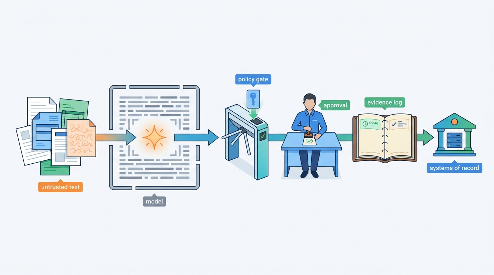
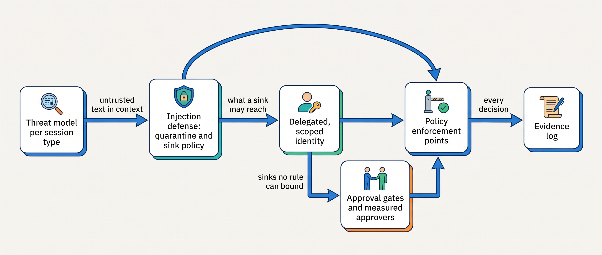

> **IN THIS PART, YOU WILL:** Learn to draw an agent's trust boundaries, design for prompt injection as an unsolved problem, keep each call's authority small, make human oversight measurable, and enforce and prove all of it outside the model.

> **WHY THE BUSINESS CARES:** When an agent is fooled or buggy, the damage is set by what its credentials reach, what its sinks allow and whether a human actually looked. A risk owner signs those facts, and an auditor or regulator will ask to see them.

> **WHY ARCHITECTS SHOULD CARE:** Every control here is a placement decision: which component reads untrusted text, where tokens are minted, what re-checks an approval before dispatch, which store holds the record. Each is cheap in the design and expensive to retrofit.

> **KEY POINTS:**
>
> * **The dangerous unit is the session, and the model is not a boundary.** The context window mixes operator instructions with strangers' text, and adaptive attacks beat most published defenses. Count trifecta legs per session type, and credit only structural separation and sink enforcement.
> * **Authority comes from identity and policy, never from content.** Each call carries the principal and the agent run as delegation, in a short-lived token for one audience and one account; deterministic policy decides at four enforcement points.
> * **Oversight and audit are records that can be measured.** An approval binds a named human to one action object's hash and the evidence shown, approvers are measured like the agent, and a never-sampled evidence log answers audits by query.

> **[FAILURE PATTERNS THIS PART ADDRESSES](where-agentic-systems-go-wrong.html):**
>
> * **Ambient Authority** — replaced by per-run identity, on-behalf-of tokens scoped to one account and minutes of lifetime, and enforcement points on the only path to every tool.
> * **The Lethal Trifecta** — counted per session type, then removed, scoped to one principal or signed as residual risk, with sinks checked by the provenance of each argument.
> * **The Rubber Stamp** — answered by approval cards built from systems of record, risk-tiered review levels, seeded cases, second-reviewer samples and per-approver metrics.

 
Part VI kept an agent's work correct through crashes and half-finished runs, assuming that **the agent is trying to do the right thing**. Part VII drops that assumption: any text the agent reads may carry instructions, any credential it holds may serve a fooled model, and any human checkpoint may decay into a click.

**Figure 1:** *The model may read and follow any text; what it can actually do is decided outside it, at a policy gate, a human approval and an evidence log.*

The argument is one chain. **A threat model drawn per session type** finds the boundary classic models miss, the context window, and the sessions holding all three trifecta legs. Injection cannot be filtered away, so **untrusted text may shape what the model writes but never what the system may do**, and sinks accept arguments only by provenance. A sink check reaches only as far as the authority behind it, so **identity makes that authority delegated, scoped and attributable**. Where no rule can bound a sink, **a human approves**, through a record bound to the exact action. **Enforcement points** outside the model carry every rule, and **an evidence log** proves they ran.

**Figure 2:** *The control chain of Part VII: the threat model finds where text and data cross, injection defense and identity bound what a fooled model can reach, human gates cover what no rule can bound, and enforcement points and the evidence log make every rule real and provable.*

The thread is Ostrell, the fictional company this book follows. In the **Poisoned Ticket** of May 2027, hidden text in an email asked Answerdesk to forward a contract and five invoices outside; a recipient rule never meant as a security control blocked it, and nobody noticed for **6 days**. The June threat model found **4 of 9** session types holding a full trifecta and **14 of 61** exposure paths without a control. By August, Answerdesk's document reach per run had fallen from **9,400 customer accounts to 1**. The **Rubber Stamp** (**4,812** approvals, **99.3%** approved in a median **6 seconds**, **3.1%** unjustified) became a gate with **1.1%** unjustified. In October 2027, auditors got 30 Closewise dossiers in **about two hours**, against **two and a half days** for 10 script-era entries.

By the end you should be able to say, for any agent: which session types hold all three trifecta legs and who signed each residual; which provenance may set each sink argument; whose authority each call carries and for how long; what a human must approve and how you know they look; and which audit question the evidence log cannot yet answer.

## Chapters in this part

[[agent-threat-model]] decides **where the trust boundaries are and what may cross them**: eight boundaries, a computed trifecta check per session type, an exposure-path inventory and a threat-model record per agent version. The case is the Keelson threat model v2.

[[prompt-injection-defense]] decides **how an agent stays safe when it follows injected text**: a quarantined reader, values by handle, sink policy by provenance, rendering as egress and an injection suite in the gate. The case is the Poisoned Ticket and Answerdesk's July 2027 redesign.

[[agent-identity-and-least-privilege]] decides **whose authority each call carries and how small it is**: delegation instead of impersonation, per-call tokens for one audience and one account, and separation of duties in the authorization path. The case is the identity redesign of August to November 2027.

[[human-oversight-and-bounded-autonomy]] decides **where humans approve, intervene or review, and how to keep that real**: five oversight modes, approvals bound to the action hash and evidence shown, review levels, and approvers measured with seeded cards. The case is the Rubber Stamp and the credit-gate redesign.

[[policy-enforcement-and-audit]] decides **how rules are enforced outside the model and proved afterwards**: four enforcement points, policy as code released with a decision replay, guardrails that only tighten, and Logbook as a never-sampled evidence log. The case is the October 2027 audit and the Alias Drift question.

Part VIII then asks how much control each action class needs, and answers with evidence. Begin with [[agent-threat-model]].
