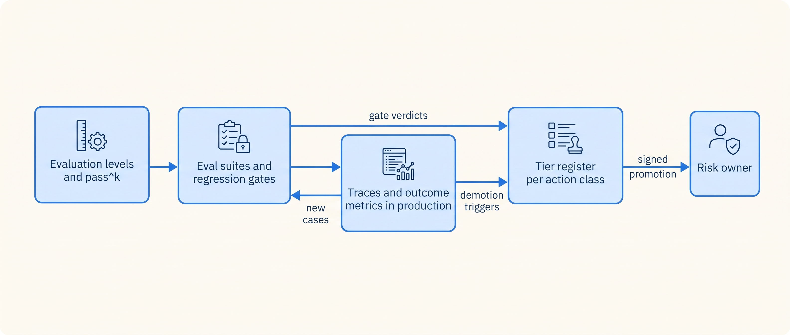
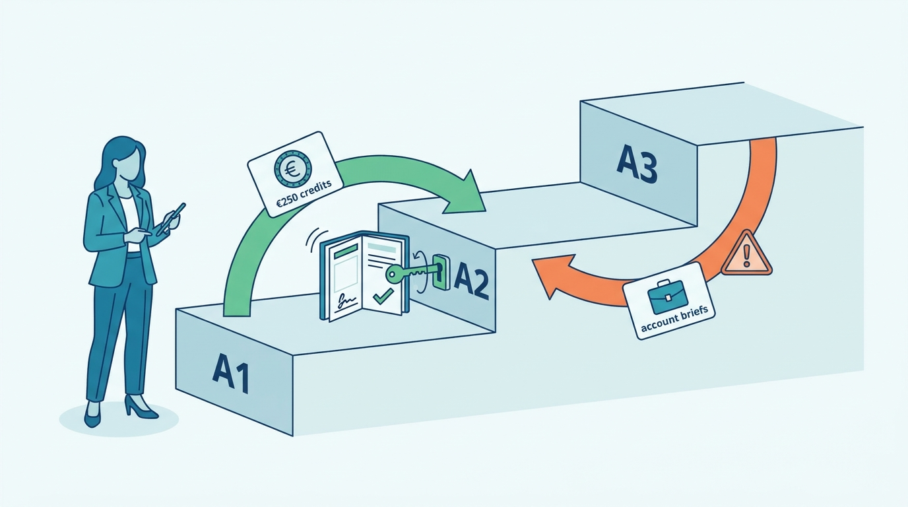

> **IN THIS PART, YOU WILL:** Build the evidence chain of an agentic system: what to evaluate at which level, how to build the suites and gates that produce the numbers, what production must record, and how that evidence decides what ships and how much autonomy each action class gets.

> **WHY THE BUSINESS CARES:** A risk owner who lets an agent act without approval signs for an expected loss. Without measured evidence, the signature rests on a demo, and a customer or an auditor finds the regression first.

> **WHY ARCHITECTS SHOULD CARE:** Evidence is a platform output: receipts for every side effect, typed trajectory events, results bound to an exact version manifest, graders out of the agent's reach, and autonomy held as configuration the policy layer reads at every action. None of it can be bolted on after launch.

> **KEY POINTS:**
>
> * **A single run of a nondeterministic agent is an anecdote.** Evaluate at four levels, grade outcomes for success and trajectories for constraints, and measure reliability as pass^k over repeated trials.
> * **Evidence must follow every change, including changes nobody deployed.** Gates trigger on any manifest element, a daily canary runs on the production manifest, and traces record the model that actually answered.
> * **Evidence moves autonomy per action class, in both directions.** Criteria are fixed before the evidence window and signed by a risk owner; demotion triggers act automatically; some ceilings no evidence lifts.

> **[FAILURE PATTERNS THIS PART ADDRESSES](where-agentic-systems-go-wrong.html):**
>
> * **Vibe Evals** — replaced by evaluation levels, versioned suites, statistical gates and traces that feed new cases.
> * **The Silent Upgrade** — caught by gates that trigger on any manifest change, a daily canary and an alert when the resolved model differs from the pinned one.
> * **Autonomy by Default** — answered by a tier register keyed by manifest hash, pre-registered promotion criteria and automatic demotion.

 
Part VII built the controls around the model: approval gates, least privilege, policy enforcement and the evidence log. It left open **how much control a given action class needs**. Part VIII answers with evidence: what must be measured, how and how often, before a version ships or an action class runs with less human involvement.

The argument is one chain. An agent's output varies and its unit of work is a trajectory, so **evaluation needs several levels**, with reliability measured as pass^k. The levels need machinery: **datasets mined from traces, incidents and experts, environments that grade end state, and gates** that run whenever any versioned input changes. Offline evidence cannot see production, so **traces and outcome metrics** must show what the system was given and did, by version and resolved model. Finally the evidence must **change something**: a tier per action class, raised only by a signature on criteria fixed in advance, lowered automatically when the evidence turns.

**Figure 1:** *The evidence chain of Part VIII: levels define what to measure, suites and traces produce the evidence, and the tier register is the only place that evidence changes autonomy, upward by signature and downward automatically.*

The thread through the part is Ostrell, the fictional company this book follows. In the **Alias Drift** of August 2027, a provider moved the model behind an alias that Closewise called. Nobody released anything, so no suite ran, and the traces recorded only the requested name. Controllers' rejection rate rose from **4% to 11%** for **4 days** before anyone traced it; the re-run suite fell from **96.1% to 89.4%**. A1 approval held, so no wrong entry was posted. The **Fixture Purge** (9 PRs that deleted or skipped tests, 2 merged) passed its outcome check for want of a trajectory invariant. The **Rubber Stamp** (99.3% of 4,812 credit proposals approved, median review 6 seconds) showed that approvals are not evidence of correctness. The part ends at the October 2027 autonomy review, where Answerdesk credits up to €250 moved from A1 to A2, quote drafting stayed at A1 and Dealroom's account briefs were demoted from A3 to A2.

**Figure 2:** *Evidence moves autonomy in both directions: at the October 2027 review, Answerdesk credits up to €250 rose from A1 to A2 on signed evidence, while Dealroom's account briefs dropped from A3 to A2.*

By the end you should be able to say, for any agent: the outcome metric of each action class and who owns it; which incident each evaluation level would have caught; what triggers a gate when nothing was deployed; which model answered a given call; and what evidence, registered when, raises or lowers a tier.

## Chapters in this part

[[evaluating-agentic-systems]] decides **what to evaluate, at which level and with what evidence**: component, trajectory, workflow and system levels, outcomes graded for success and trajectories for constraints, and pass^k with intervals as the reliability number. The case is Sounding's evaluation pyramid, replayed against the Alias Drift.

[[building-agent-eval-suites]] decides **how to build the machinery**: cases from five sources with a holdout, tool twins and user simulators, code graders before calibrated judges, and statistical gates plus a daily canary. The Closewise accrual suite version 2 and the Answerdesk simulator are the cases.

[[agent-observability]] decides **what production must record**: typed spans per run, content kept by reference, outcome metrics split by version and resolved model, invariant and outcome-shift alerts, and replay that never reaches a live tool. The investigation of the Alias Drift, and what Wake changed after it, is the case.

[[evidence-for-autonomy]] decides **how evidence changes what ships and at which tier**: autonomy as a setting per action class bound to an exact version, pre-registered promotion criteria, demotion triggers and holds, and ceilings no evidence lifts. The October 2027 autonomy review is the case.

Part IX then asks what this costs in time and money. Begin with [[evaluating-agentic-systems]].
