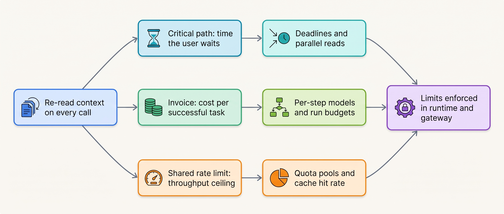
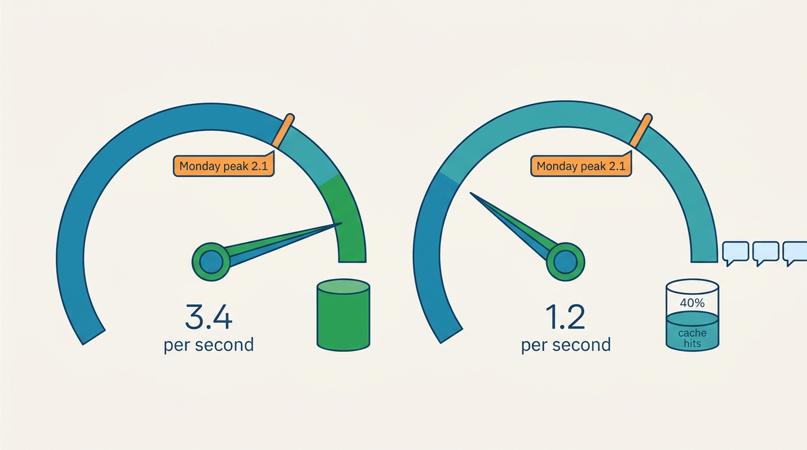

> **IN THIS PART, YOU WILL:** Learn where an agent's time goes and how to budget it per interaction mode, what a successful task really costs and how to choose a model per step, and how prompt caching and context budgets cut both numbers without letting a cache make an answer or an action wrong.

> **WHY THE BUSINESS CARES:** A support agent that is slow on the busiest morning loses customers, and an agent run with no limit can spend a quarter's margin over one weekend. The CFO needs a cost per resolved conversation, closed reconciliation or merged pull request, not a provider invoice per month.

> **WHY ARCHITECTS SHOULD CARE:** Response time, spend and throughput follow from the same choices: how many model calls run in series, which model each step uses, how much context each call re-reads, and which limits stop a run. The controls have to live in the runtime and the gateway; a billing dashboard only reports what they failed to stop.

> **KEY POINTS:**
>
> * **Budget milestones and outcomes, not averages and tokens.** Set a p95 target per user-visible milestone and enforce it with one deadline every call inherits; measure money as cost per successful task, including retries, failed runs, human review and repair.
> * **Structure before paid speed or cheaper models.** Remove serial model calls, parallelize only read-only work, move side effects to durable execution and choose a model tier per step with an evaluation behind it. Each of these is a behavior change.
> * **Limits terminate; caches never decide.** Run budgets, quota pools and context budgets stop or hold work in code. A stable prefix layout cuts cost, latency and rate-limit load together; a cache above the model is correct only if its key carries everything the answer depends on, and no cached value finalizes an action.

> **[FAILURE PATTERNS THIS PART ADDRESSES](where-agentic-systems-go-wrong.html):**
>
> * **The Token Bonfire** — answered with terminating run budgets, a budget hierarchy, cost attribution on every call and a prompt layout that stops paying full price for the same prefix.
> * **The Agent Committee** — each agent hop in series adds a model call to the critical path, and fan-out multiplies spend by the number of contexts, so delegation must earn its time and tokens.
> * **Context Soup** — contained by per-step context budgets, tool results capped at the broker and compaction in large steps with pinned fields.

 
Part VIII built the evidence that decides what an agent may do. Part IX asks **what that agent costs in time, money and shared capacity**, and finds that the three are one problem. An agent re-sends its tools, instructions and history on every model call. Those tokens set how long the user waits, most of what the provider bills, and how much of the shared rate limit each exchange uses up.

Ostrell, the fictional company this book follows, met all three in 2027. In the **Weekend Fan-out** of February, a Scout run with no limits spent €8,700 over 41 hours on an unusable report. In May, a timestamp at the top of Answerdesk's system prompt made caching cost more than no caching at all. And on **2 November**, working day 2 of the close, a Closewise re-run and a Sounding evaluation exhausted the Mid-tier input-token limit that Answerdesk shared with them: chat p95 time to first visible text rose to 14 seconds and abandonment from 9% to 17%.

**Figure 1:** *The same re-read tokens drive latency, cost and capacity, so all three chapters place their controls in the runtime and the gateway.*

The first chapter finds that Answerdesk's rate-limit ceiling depends on the prompt-cache hit rate: 3.4 chat exchanges per second at its normal hit rate, about 1.2 at 40%, against a Monday peak of 2.1. The second shows that human escalation, not tokens, dominates the blended cost of a resolved conversation. The third attacks the re-read input behind both, with the prefix layout that took Answerdesk's cache-read share from 11% to 76%.

**Figure 2:** *Answerdesk's throughput ceiling follows its cache hit rate: about 3.4 chat exchanges per second normally, about 1.2 at 40%, against a Monday peak of 2.1.*

By the end you should be able to say, for any agent, how many model calls sit in series before each milestone, what its throughput ceiling is, what one successful task costs, what stops a run, and what share of its input is read from cache.

Every change in this part passes the evaluation gates of Part VIII, and the layout, routing profile and budgets it produces are configuration that changes with every release, which is where [[part-10]] begins.

## Chapters in this part

[[agent-latency-and-throughput]] decides **how fast an agent must be and how much work the platform can carry**: p95 budgets per milestone, one propagated deadline, parallel reads and quota pools with priority admission. The Close-Day Queue and the rebuilt Answerdesk chat exchange, from 9.6 to 1.8 seconds to first visible text, are the case.

[[agent-cost-and-model-routing]] decides **what a successful task costs and which model each step uses**: per-step tiers, cascades only where a verifier exists, terminating run budgets and attribution on every call. The Weekend Fan-out, replayed under a €90 cap, and Answerdesk's €0.39 agent-side cost per resolved conversation are the case.

[[caching-and-context-budgets]] decides **how to reuse and limit context without serving stale or wrong answers**: the Keelson prefix layout, cache-key rules, per-step context budgets and batch tiers. The timestamp that cost two thirds of Answerdesk's input bill is the case.

Begin with [[agent-latency-and-throughput]].
