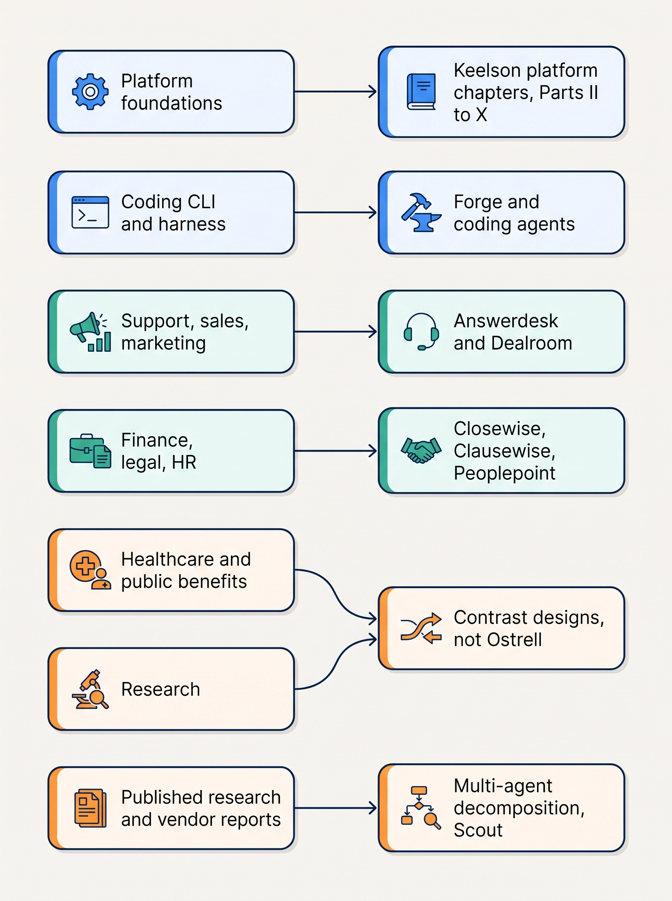

> **IN THIS SECTION, YOU WILL:** Trace every design example in this book back to the interview design it came from: which of the twelve sources, which step, which chapters use it, what the book adopted from it, where the book departs from it and why, and what each source gets wrong. You will also see which topics no interview source covers, and which external research the book used for them instead.

> **KEY POINTS:**
>
> * **All twelve sources are used, unevenly.** Every interview design is cited by at least five chapters. The healthcare (36 chapters), public-benefits (35), coding CLI (31), support (30) and platform-foundations (29) designs carry most of the weight. The marketing design (5 chapters) and the research design (9) are used mostly for contrast.
> * **They are design exercises, not deployed systems.** Each source evolves a naive architecture one failure at a time. The book cites them by path and step, labels them as design examples, treats their numbers as illustrative assumptions, and never presents them as evidence of how a production system behaves.
> * **Where the sources disagree, the book rules once.** Twenty-four consistency rulings settle the conflicts between sources and the internal flaws of single sources: approval semantics, exactly-once effects, sandbox strength, credential brokering, delegation-token claims and more. Each source section below names the rulings that apply to it.

> **[FAILURE PATTERNS THIS SECTION ADDRESSES](where-agentic-systems-go-wrong.html):**
>
> * **The Agent Committee** — no interview source designs a working multi-agent decomposition, and one labels a single worker "hierarchical multi-agent"; this page shows where the book had to rely on published research instead.
> * **Ambient Authority** — three sources let an identity broker execute side effects and one lets a local agent act with the user's full identity; the page records where the book separates deciding from executing.
> * **The Fire-and-Forget Action** — two sources write evidence "in the same transaction" as an external effect or leave the irreversible filing step unmodeled; the page names the chapters that replace these with intent, execution and receipt records.

 
This book draws on **the author's system-design interview project**, a separate body of work that designs systems step by step, from a naive baseline to an evolved architecture. Twelve of its designs are about agentic systems. They gave the book its first vocabulary, most of its contrast designs and many of the mechanisms the chapters build on Ostrell's Keelson platform.

Material borrowed from a design exercise can easily read as if it described a real system. This page keeps the borrowing traceable. For each source it answers four questions: **"What does it design?"**, **"What did the book take, and where?"**, **"Where did the book disagree?"** and **"What is wrong with it?"** The full source list is in [[bibliography]].

## What the Interview Project Is

The interview project is a collection of system-design exercises, each kept as one JSON file, `interview.json`, under `system-design-interviews/data/book/<directory>/`. A file holds requirements, an illustrative capacity estimate, an architecture, an API sketch, a data model, technology choices and an ordered list of **steps**. Each step names the failure of the previous design, adds one mechanism to fix it and records the new risk the fix exposes, with options, deep dives, flows and failure drills.

That structure is why the sources were useful to this book. **A design that grows one failure at a time explains why each mechanism exists**, which is the argument a chapter needs to make. The finance design does not start with a staging store; it starts with "an agent that posts to the ledger", shows why that fails, and adds the staging store as the fix.

Eleven directories also hold a `REVIEW.md`, the author's critique, dated June 2026; the coding harness has none. **The reviews predate the current JSON**, which has since fixed most of their issues, so the book cites the JSON as the design and a review only as critique (ruling 13). The weaknesses below were checked against the current JSON.

### The provenance rule

Every use of an interview design in this book follows one rule, set in the style guide as evidence kind 7, *design example from the interview project*:

- **It is labeled inline** where it first matters in a chapter: "The author's agentic-support-platform interview design (step `action-gate`) gates each proposed action by reversibility."
- **It is cited in Sources and Evidence** under *Design examples from the author's interview project*: *Obrenović, Ž., "Agentic Support Platform", system-design interview design, `system-design-interviews/data/book/agentic-support-platform/interview.json`, 2026*, plus the step or field used.
- **It is never presented as a deployed system** or as evidence of production behavior. A design exercise shows that a mechanism is coherent, not that it works at scale.
- **Its numbers are illustrative assumptions**, the exercise's sizing, not measurements.
- **Third-party claims inside a source** (the harness design's Stripe and OpenAI figures) are cited at the original publisher, never at the interview file.
- **Steps are cited by id** (`cloud`, `citation-gate`), because title numbers such as "3a" or "4a" do not match positions.

The design examples are kept apart from **Ostrell, the fictional field-service software group the book follows** (see [[meet-ostrell]]). Several Ostrell agents borrow mechanisms from an interview design; the clinical and public-benefits designs are not Ostrell at all, and appear as labeled contrast designs, mostly in [[domain-high-stakes-decisions]].

### How this map was built

A chapter **cites** a source when its text or Sources section names the source directory (search of the 44 chapters, 28 October 2026). Steps come from the chapters' Sources entries, checked against each `interview.json`. Part introductions cite none; [[meet-ostrell]] cites healthcare and benefits, [[toolkit]] platform, support and finance, and [[bibliography]] all twelve; these are not in the matrix.

## Coverage Matrix

The matrix lists, for each source, the chapters in each part that cite it. The chapter numbers link to the chapters. Parts: **I** Foundations, **II** Architecture, **III** Orchestration, **IV** Context, **V** Tools, **VI** Reliability, **VII** Control, **VIII** Evidence, **IX** Economics, **X** Evolution, **XI** Domains.

| Source | I | II | III | IV | V | VI | VII | VIII | IX | X | XI | Chapters |
| --- | --- | --- | --- | --- | --- | --- | --- | --- | --- | --- | --- | ---: |
| `agentic-platform-foundations` | [01](what-makes-a-system-agentic.html) [04](workflows-loops-and-autonomous-agents.html) | [05](agentic-reference-architecture.html) [06](models-and-the-model-gateway.html) [07](agent-runtime.html) | [11](routing-and-delegation.html) [12](single-and-multi-agent-designs.html) | [14](context-engineering.html) [16](agent-memory.html) [17](task-state-and-checkpoints.html) | [19](tool-contracts.html) [20](tool-ecosystems-and-mcp.html) [21](sandboxes-and-execution-environments.html) | [23](durable-agent-execution.html) [24](retries-idempotency-and-concurrency.html) | [26](agent-threat-model.html) [27](prompt-injection-defense.html) [28](agent-identity-and-least-privilege.html) [30](policy-enforcement-and-audit.html) | [31](evaluating-agentic-systems.html) [32](building-agent-eval-suites.html) [33](agent-observability.html) [34](evidence-for-autonomy.html) | [35](agent-latency-and-throughput.html) [36](agent-cost-and-model-routing.html) [37](caching-and-context-budgets.html) | [38](versioning-agent-systems.html) [39](staged-rollout-and-rollback.html) [40](owning-agentic-systems.html) | — | 29 |
| `ai-coding-cli` | [01](what-makes-a-system-agentic.html) [03](autonomy-and-consequence.html) [04](workflows-loops-and-autonomous-agents.html) | [06](models-and-the-model-gateway.html) [07](agent-runtime.html) [09](agent-interaction-design.html) | [10](planning-and-decomposition.html) [11](routing-and-delegation.html) [12](single-and-multi-agent-designs.html) | [14](context-engineering.html) [15](retrieval-and-grounding.html) [16](agent-memory.html) [17](task-state-and-checkpoints.html) [18](provenance-and-freshness.html) | [19](tool-contracts.html) [20](tool-ecosystems-and-mcp.html) [21](sandboxes-and-execution-environments.html) | [24](retries-idempotency-and-concurrency.html) [25](partial-failure-and-compensation.html) | [26](agent-threat-model.html) [27](prompt-injection-defense.html) [29](human-oversight-and-bounded-autonomy.html) [30](policy-enforcement-and-audit.html) | [31](evaluating-agentic-systems.html) [32](building-agent-eval-suites.html) | [35](agent-latency-and-throughput.html) [36](agent-cost-and-model-routing.html) [37](caching-and-context-budgets.html) | [38](versioning-agent-systems.html) [39](staged-rollout-and-rollback.html) | [41](domain-coding-agents.html) | 31 |
| `ai-coding-harness` | — | [07](agent-runtime.html) | [10](planning-and-decomposition.html) | [16](agent-memory.html) | [21](sandboxes-and-execution-environments.html) | [23](durable-agent-execution.html) [25](partial-failure-and-compensation.html) | [26](agent-threat-model.html) [27](prompt-injection-defense.html) | [32](building-agent-eval-suites.html) [34](evidence-for-autonomy.html) | [36](agent-cost-and-model-routing.html) | [38](versioning-agent-systems.html) [40](owning-agentic-systems.html) | [41](domain-coding-agents.html) | 14 |
| `agentic-support-platform` | [01](what-makes-a-system-agentic.html) [02](when-agents-are-justified.html) [03](autonomy-and-consequence.html) | [05](agentic-reference-architecture.html) [08](agents-in-the-enterprise.html) [09](agent-interaction-design.html) | [11](routing-and-delegation.html) [13](coordination-and-handoffs.html) | [14](context-engineering.html) [15](retrieval-and-grounding.html) [16](agent-memory.html) [17](task-state-and-checkpoints.html) [18](provenance-and-freshness.html) | [19](tool-contracts.html) [21](sandboxes-and-execution-environments.html) [22](side-effects-and-external-actions.html) | [24](retries-idempotency-and-concurrency.html) [25](partial-failure-and-compensation.html) | [27](prompt-injection-defense.html) [28](agent-identity-and-least-privilege.html) [29](human-oversight-and-bounded-autonomy.html) [30](policy-enforcement-and-audit.html) | [31](evaluating-agentic-systems.html) [32](building-agent-eval-suites.html) [33](agent-observability.html) | [35](agent-latency-and-throughput.html) [36](agent-cost-and-model-routing.html) | [39](staged-rollout-and-rollback.html) [40](owning-agentic-systems.html) | [42](domain-customer-operations.html) | 30 |
| `agentic-sales-platform` | — | [08](agents-in-the-enterprise.html) | [11](routing-and-delegation.html) [12](single-and-multi-agent-designs.html) [13](coordination-and-handoffs.html) | [16](agent-memory.html) [18](provenance-and-freshness.html) | [22](side-effects-and-external-actions.html) | [24](retries-idempotency-and-concurrency.html) [25](partial-failure-and-compensation.html) | [29](human-oversight-and-bounded-autonomy.html) [30](policy-enforcement-and-audit.html) | [31](evaluating-agentic-systems.html) [32](building-agent-eval-suites.html) [33](agent-observability.html) | [35](agent-latency-and-throughput.html) | [40](owning-agentic-systems.html) | [42](domain-customer-operations.html) | 17 |
| `agentic-marketing-platform` | — | — | — | [15](retrieval-and-grounding.html) [16](agent-memory.html) | — | — | [29](human-oversight-and-bounded-autonomy.html) | [32](building-agent-eval-suites.html) | — | — | [42](domain-customer-operations.html) | 5 |
| `agentic-finance-platform` | [01](what-makes-a-system-agentic.html) [02](when-agents-are-justified.html) [03](autonomy-and-consequence.html) [04](workflows-loops-and-autonomous-agents.html) | [05](agentic-reference-architecture.html) [06](models-and-the-model-gateway.html) [08](agents-in-the-enterprise.html) | [10](planning-and-decomposition.html) [11](routing-and-delegation.html) | [17](task-state-and-checkpoints.html) | [19](tool-contracts.html) [21](sandboxes-and-execution-environments.html) [22](side-effects-and-external-actions.html) | [23](durable-agent-execution.html) [24](retries-idempotency-and-concurrency.html) [25](partial-failure-and-compensation.html) | [27](prompt-injection-defense.html) [28](agent-identity-and-least-privilege.html) [29](human-oversight-and-bounded-autonomy.html) [30](policy-enforcement-and-audit.html) | [31](evaluating-agentic-systems.html) [32](building-agent-eval-suites.html) | — | [38](versioning-agent-systems.html) [39](staged-rollout-and-rollback.html) | [43](domain-back-office.html) | 25 |
| `agentic-legal-platform` | — | [06](models-and-the-model-gateway.html) | [13](coordination-and-handoffs.html) | [15](retrieval-and-grounding.html) [16](agent-memory.html) [18](provenance-and-freshness.html) | [22](side-effects-and-external-actions.html) | [25](partial-failure-and-compensation.html) | [26](agent-threat-model.html) [28](agent-identity-and-least-privilege.html) [29](human-oversight-and-bounded-autonomy.html) | [32](building-agent-eval-suites.html) | [35](agent-latency-and-throughput.html) [37](caching-and-context-budgets.html) | [39](staged-rollout-and-rollback.html) | [43](domain-back-office.html) | 15 |
| `agentic-hr-platform` | — | [08](agents-in-the-enterprise.html) | [11](routing-and-delegation.html) [13](coordination-and-handoffs.html) | — | — | [25](partial-failure-and-compensation.html) | [26](agent-threat-model.html) [28](agent-identity-and-least-privilege.html) [29](human-oversight-and-bounded-autonomy.html) | [31](evaluating-agentic-systems.html) | [37](caching-and-context-budgets.html) | — | [43](domain-back-office.html) | 10 |
| `agentic-healthcare-platform` | [01](what-makes-a-system-agentic.html) [03](autonomy-and-consequence.html) [04](workflows-loops-and-autonomous-agents.html) | [05](agentic-reference-architecture.html) [06](models-and-the-model-gateway.html) [08](agents-in-the-enterprise.html) [09](agent-interaction-design.html) | [11](routing-and-delegation.html) [12](single-and-multi-agent-designs.html) [13](coordination-and-handoffs.html) | [14](context-engineering.html) [15](retrieval-and-grounding.html) [16](agent-memory.html) [17](task-state-and-checkpoints.html) [18](provenance-and-freshness.html) | [19](tool-contracts.html) [20](tool-ecosystems-and-mcp.html) [21](sandboxes-and-execution-environments.html) [22](side-effects-and-external-actions.html) | [24](retries-idempotency-and-concurrency.html) [25](partial-failure-and-compensation.html) | [26](agent-threat-model.html) [27](prompt-injection-defense.html) [28](agent-identity-and-least-privilege.html) [29](human-oversight-and-bounded-autonomy.html) [30](policy-enforcement-and-audit.html) | [31](evaluating-agentic-systems.html) [32](building-agent-eval-suites.html) [33](agent-observability.html) [34](evidence-for-autonomy.html) | [35](agent-latency-and-throughput.html) [36](agent-cost-and-model-routing.html) [37](caching-and-context-budgets.html) | [38](versioning-agent-systems.html) [39](staged-rollout-and-rollback.html) | [44](domain-high-stakes-decisions.html) | 36 |
| `agentic-public-benefits-platform` | [01](what-makes-a-system-agentic.html) [02](when-agents-are-justified.html) [03](autonomy-and-consequence.html) [04](workflows-loops-and-autonomous-agents.html) | [05](agentic-reference-architecture.html) [06](models-and-the-model-gateway.html) [07](agent-runtime.html) [09](agent-interaction-design.html) | [10](planning-and-decomposition.html) [11](routing-and-delegation.html) [12](single-and-multi-agent-designs.html) [13](coordination-and-handoffs.html) | [14](context-engineering.html) [15](retrieval-and-grounding.html) [16](agent-memory.html) [17](task-state-and-checkpoints.html) [18](provenance-and-freshness.html) | [22](side-effects-and-external-actions.html) | [23](durable-agent-execution.html) [24](retries-idempotency-and-concurrency.html) [25](partial-failure-and-compensation.html) | [27](prompt-injection-defense.html) [28](agent-identity-and-least-privilege.html) [29](human-oversight-and-bounded-autonomy.html) [30](policy-enforcement-and-audit.html) | [31](evaluating-agentic-systems.html) [32](building-agent-eval-suites.html) [33](agent-observability.html) [34](evidence-for-autonomy.html) | [35](agent-latency-and-throughput.html) [37](caching-and-context-budgets.html) | [38](versioning-agent-systems.html) [39](staged-rollout-and-rollback.html) [40](owning-agentic-systems.html) | [44](domain-high-stakes-decisions.html) | 35 |
| `agentic-research-platform` | [04](workflows-loops-and-autonomous-agents.html) | — | [10](planning-and-decomposition.html) [12](single-and-multi-agent-designs.html) | [15](retrieval-and-grounding.html) [18](provenance-and-freshness.html) | [22](side-effects-and-external-actions.html) | — | [29](human-oversight-and-bounded-autonomy.html) | — | [36](agent-cost-and-model-routing.html) | — | [44](domain-high-stakes-decisions.html) | 9 |

Three things stand out in the matrix.

- **No source is uncited.** The thinnest is marketing (5 chapters), used mainly for the approval that expires when its evidence changes and for consent by purpose; then research (9) and HR (10).
- **The high-stakes designs are cited almost everywhere** although Ostrell does not run them: they are the far end of the consequence range in nearly every "Across Domains" table.
- **Part XI draws on each group separately**: coding designs in [[domain-coding-agents]], support, sales and marketing in [[domain-customer-operations]], finance, legal and HR in [[domain-back-office]], healthcare and benefits in [[domain-high-stakes-decisions]]. The platform design appears in no domain chapter, because it describes what all four share.

### Summary by source

| Source | Steps | Chapters | Mentions | REVIEW.md | Closest Ostrell counterpart |
| --- | ---: | ---: | ---: | --- | --- |
| `agentic-platform-foundations` | 8 | 29 | 80 | 2026-06-23 | The Keelson platform (Runtime, Gateway, Toolyard, Bulkhead, Logbook, Sounding) |
| `ai-coding-cli` | 9 | 31 | 106 | 2026-06-12 | Forge's inner coding loop |
| `ai-coding-harness` | 8 | 14 | 35 | none | Forge's outer harness and pipeline |
| `agentic-support-platform` | 7 | 30 | 75 | 2026-06-24 | Answerdesk |
| `agentic-sales-platform` | 5 | 17 | 31 | 2026-06-24 | Dealroom (which never sends to customers) |
| `agentic-marketing-platform` | 6 | 5 | 9 | 2026-06-24 | None; marketing requests to Answerdesk in [[domain-customer-operations]] |
| `agentic-finance-platform` | 7 | 25 | 64 | 2026-06-23 | Closewise |
| `agentic-legal-platform` | 7 | 15 | 34 | 2026-06-23 | Clausewise |
| `agentic-hr-platform` | 5 | 10 | 23 | 2026-06-24 | Peoplepoint (helpdesk only; Ostrell runs no hiring agent) |
| `agentic-healthcare-platform` | 7 | 36 | 78 | 2026-06-25 | None; a labeled contrast design |
| `agentic-public-benefits-platform` | 7 | 35 | 68 | 2026-06-24 | None; a labeled contrast design |
| `agentic-research-platform` | 8 | 9 | 15 | 2026-06-24 | None; Scout does desk research, not lab work |

*Chapters* counts chapters 01–44. *Mentions* counts every occurrence of the directory name on any page, so a text citation and a Sources entry count twice. The counterpart column is the author's mapping, not a claim that Ostrell implements the source.

**Figure 1:** *Five source groups feed the book's chapters and Ostrell's agents; the high-stakes designs stay outside Ostrell as labeled contrasts, and multi-agent decomposition comes from external research, not from any interview design.*

## Platform and Coding Designs

### Agentic Platform Foundations

**What it designs.** A shared enterprise platform that hosts agents for many teams (runtime, sandbox, identity, memory, guardrails, capacity, evaluation, observability), so that a team "registers config, not infrastructure". It assumes **the model layer is compromisable** and bounds blast radius instead of trusting the model.

**Evolution path.** 1 `naive` — a single hosted agent loop; 2 `runtime` — isolation and credential brokering; 3 `durable` — durable sessions, context and memory; 4 `identity` — tool boundary and identity delegation; 5 `security` — guardrails and data-flow partitioning; 6 `capacity` — inference economics and admission control; 7 `eval-obs` — evaluation and observability; 8 `control-flow` — workflow, agent or hybrid gate.

| Pattern adopted | Step | Chapters |
| --- | --- | --- |
| The harness as deterministic runtime around the model; least-autonomous path; no path-specific bypass | `naive`, `control-flow` | [[what-makes-a-system-agentic]], [[workflows-loops-and-autonomous-agents]], [[agentic-reference-architecture]], [[agent-runtime]] |
| Per-session microVM; credential broker, so the agent uses credentials without reading them | `runtime` | [[sandboxes-and-execution-environments]], [[tool-ecosystems-and-mcp]] |
| Intent and result records with per-effect idempotency keys; execution stream separate from evidence | `durable` | [[task-state-and-checkpoints]], [[durable-agent-execution]], [[retries-idempotency-and-concurrency]], [[agent-observability]] |
| Reversible compaction; memories with provenance, trust tier and TTL | `durable` | [[context-engineering]], [[agent-memory]] |
| Agent principal with delegated, audience-bound tokens; no token passthrough | `identity` | [[agent-identity-and-least-privilege]], [[tool-ecosystems-and-mcp]] |
| Lethal-trifecta removal; deterministic allowlists | `security` | [[agent-threat-model]], [[prompt-injection-defense]], [[policy-enforcement-and-audit]] |
| Terminating budgets; weighted fair admission; prefix caching | `capacity` | [[agent-runtime]], [[agent-latency-and-throughput]], [[agent-cost-and-model-routing]], [[caching-and-context-budgets]] |
| Golden sets from production failures; trajectory evaluation; promotion as a pointer flip gated on eval runs | `eval-obs` | [[evaluating-agentic-systems]], [[building-agent-eval-suites]], [[agent-observability]], [[evidence-for-autonomy]], [[versioning-agent-systems]], [[staged-rollout-and-rollback]], [[owning-agentic-systems]] |
| Orchestrator–workers with per-worker budget and scope | `control-flow` | [[routing-and-delegation]], [[single-and-multi-agent-designs]] |
| Tool manifest hash and risk class; edge gateway separate from inference | `api`, architecture | [[tool-contracts]], [[models-and-the-model-gateway]] |

**Departures and reconciliations.**

- **"Exactly-once side effects"** becomes "exactly-once effect": at-least-once execution, idempotency key, receipt lookup (ruling 4).
- **Evidence "in the same transaction" as an external effect** is impossible; the book writes intent, executes, then writes a receipt and reconciles the unknown state (rulings 4–5; [[policy-enforcement-and-audit]]).
- **Reversed token claims** (`sub=agent, act=user`) follow RFC 8693 instead: `sub` is the principal served, `act` the agent run (ruling 22; [[agent-identity-and-least-privilege]]).
- **The model id is added to the agent version**, so a provider model change meets the evaluation gate (ruling 9; [[versioning-agent-systems]]).
- **Two credential patterns** shown as one, a call proxy and a token mint, are named separately ([[tool-ecosystems-and-mcp]]).

**Weaknesses.** The data model cannot hold the approval states it describes (no pending, expired or expiry time). Promotion history is not recorded. Memory poisoning is only a follow-up question. Traces and eval datasets have no retention model. The EchoLeak example is uncited in the source, so the book cites it at a primary source.

**Path:** `system-design-interviews/data/book/agentic-platform-foundations/interview.json`

### AI Coding Agent CLI

**What it designs.** A terminal coding agent that edits a repository, runs tests in a loop, verifies its work and grows into headless cloud agents that open pull requests. "The model decides, the harness acts and enforces": **policy for intent, an OS sandbox for impact**, and isolation that rises with autonomy.

**Evolution path.** 1 `naive` — one-shot prompt to patch; 2 `agent-loop` — tool use; 3 `context` — context for large repositories; 3a `compaction` — surviving long sessions; 4 `safety` — permissions and sandboxed execution; 5 `extensibility` — commands, skills and MCP servers; 6 `inference` — streaming and the inference backend; 7 `verify` — tests, git and subagents; 8 `cloud` — background and cloud agents.

| Pattern adopted | Step | Chapters |
| --- | --- | --- |
| Turn, token and wall-clock caps; doom-loop detection; tool-call ids so a mutation never runs twice | `agent-loop` | [[what-makes-a-system-agentic]], [[workflows-loops-and-autonomous-agents]], [[agent-runtime]], [[planning-and-decomposition]], [[retries-idempotency-and-concurrency]] |
| Orthogonal primitives; patch edits that fail loudly; denial as a tool result | `agent-loop`, `safety` | [[tool-contracts]] |
| Agentic search before an index; project memory as guidance, not authority | `context` | [[context-engineering]], [[retrieval-and-grounding]], [[agent-memory]] |
| Compaction that pins the task and keeps the transcript; re-read before editing | `compaction` | [[context-engineering]], [[provenance-and-freshness]], [[caching-and-context-budgets]] |
| Permission engine plus sandbox; reads free only while egress is closed; autonomy coupled to isolation | `safety` | [[autonomy-and-consequence]], [[sandboxes-and-execution-environments]], [[agent-threat-model]], [[prompt-injection-defense]], [[human-oversight-and-bounded-autonomy]] |
| Extensions pinned by content hash, with review status and revocation | `extensibility` | [[tool-ecosystems-and-mcp]], [[versioning-agent-systems]] |
| Append-only transcript for prefix caching; model tiering | `inference` | [[models-and-the-model-gateway]], [[agent-latency-and-throughput]], [[agent-cost-and-model-routing]], [[caching-and-context-budgets]] |
| Verifier with a baseline before edits; subagents for context isolation | `verify` | [[routing-and-delegation]], [[single-and-multi-agent-designs]], [[domain-coding-agents]] |
| Leased cloud tasks; branch-per-task retries; PR review as the headless gate; evals gating model changes | `cloud` | [[agent-interaction-design]], [[task-state-and-checkpoints]], [[evaluating-agentic-systems]], [[building-agent-eval-suites]], [[staged-rollout-and-rollback]], [[domain-coding-agents]] |

**Departures and reconciliations.**

- **Containers for unattended model-written code** are replaced by a microVM or gVisor-class boundary (ruling 2; [[sandboxes-and-execution-environments]]).
- **The clone token inside the sandbox** moves to a git proxy outside it; the sandbox holds only a run-scoped token (ruling 3).
- **The whole loop in the sandbox** is split: the inner loop runs in the microVM as one leased activity, while task record, approvals and evidence stay in Keelson Runtime (ruling 20; [[agent-runtime]]).
- **The local agent acting as the user** is named ambient authority, accepted only for local interactive use (ruling 3).
- **"Harness"** keeps one meaning; the eval runner is the "evaluation harness" (ruling 1).

**Weaknesses.** Whole-task retry is idempotent only for git output; a ticket created through an MCP tool would be created again. Interactive permission decisions are audited only in a local transcript ([[policy-enforcement-and-audit]]). Eval gating has no eval data model. The "~10x" caching saving rests on a pricing assumption.

**Path:** `system-design-interviews/data/book/ai-coding-cli/interview.json`

### Coding Agent Harness

**What it designs.** The outer harness an organization wraps around a coding agent it buys: "the agent is bought, the trust is built". Human review is the only sensor until reviewers rubber-stamp, so the design places **feedforward guides and feedback sensors** along the lifecycle and runs a steering loop that turns every escape into a new guide or sensor.

**Evolution path.** 1 `naive` — human review as the only sensor; 2 `guides` — feedforward guides; 3 `sensors` — computational sensors and self-correction; 3a `review-agents` — LLM-as-judge; 4 `lifecycle` — sensors across the lifecycle; 5 `drift` — drift detection; 6 `behaviour` — specs and tests you can trust; 7 `scale` — templates, harnessability and the steering loop.

| Pattern adopted | Step | Chapters |
| --- | --- | --- |
| Inner versus outer harness | `naive` | [[agent-runtime]] |
| Guides as agent memory | `guides` | [[agent-memory]] |
| Sensors under a time budget; assertion-weakening drill | `sensors` | [[sandboxes-and-execution-environments]], [[domain-coding-agents]] |
| Advisory-first judges; same-family blind spots; judges pinned per lens | `review-agents`, `scale` | [[building-agent-eval-suites]], [[versioning-agent-systems]] |
| Spec fidelity scaled to blast radius | `behaviour` | [[planning-and-decomposition]], [[domain-coding-agents]] |
| The pipeline as the durable outer loop | `lifecycle`, `scale` | [[durable-agent-execution]], [[domain-coding-agents]] |
| Promotion by precision; harness health; escape analysis | `scale`, `drift` | [[evidence-for-autonomy]], [[owning-agentic-systems]] |
| Cost order of CPU, tokens and human attention | capacity | [[agent-cost-and-model-routing]] |

**Departures and reconciliations.**

- **No security model.** Hooks and CI run agent-written tests and judges read untrusted diffs, with no sandbox or injection model. The book runs sensors in the sandbox and treats diffs as untrusted ([[agent-threat-model]], [[domain-coding-agents]]).
- **"Positive prompt injection"** is reconciled with "repository content is data" through channel provenance: reviewed harness config is guidance, and no channel grants permissions ([[prompt-injection-defense]]).
- **Auto-merge of "proven no-risk classes"** has no defined evidence or liability; [[evidence-for-autonomy]] defines the evidence, and Ostrell keeps merges human-only.

**Weaknesses.** The coding agent's own model upgrades are not governed. Findings carry no sensor version, and there is no per-lens precision table. Guides lack provenance. Stripe and OpenAI figures appear as talking points from secondary analyses. There is no REVIEW.md; all critique is the digest's own.

**Path:** `system-design-interviews/data/book/ai-coding-harness/interview.json`

## Customer-Facing Designs

### Agentic Support Platform

**What it designs.** Support agents that answer questions and take account actions (refund, cancel, reschedule) during a live conversation, handing off to humans when needed. Its claim: **support gates inside a live loop under a turn-taking latency budget**, where other designs gate before an asynchronous action.

**Evolution path.** 1 `naive` — a bot that answers but can't act; 2 `grounding` — policy and the customer's account; 3 `live-loop` — the real-time loop and latency budget; 4 `action-gate` — actions inside the loop, by reversibility; 5 `txn-safety` — idempotency and rollback; 6 `escalation` — deflect versus escalate; 7 `compliance-eval` — compliance, audit and evaluation.

| Pattern adopted | Step | Chapters |
| --- | --- | --- |
| The loop proposes, a deterministic gate decides, inside the conversation | description, `action-gate` | [[what-makes-a-system-agentic]], [[when-agents-are-justified]], [[agentic-reference-architecture]], [[agent-interaction-design]] |
| Reversibility-tiered gate; a risk score may only lower autonomy; "idempotency is not reversibility" | `action-gate`, `txn-safety` | [[autonomy-and-consequence]], [[routing-and-delegation]], [[tool-contracts]], [[side-effects-and-external-actions]] |
| Two-sided grounding; "the account state wins"; scope before the first read; freshness by data class | `grounding` | [[agents-in-the-enterprise]], [[context-engineering]], [[retrieval-and-grounding]], [[provenance-and-freshness]], [[agent-memory]] |
| Customer text as data, never authority | `grounding`, `txn-safety` | [[prompt-injection-defense]] |
| Exchange deadline; parallel reads; fallback reply and model | `live-loop` | [[agent-latency-and-throughput]], [[agent-cost-and-model-routing]] |
| Provider-scoped idempotency; reconcile before retry; compensation as a forward action | `txn-safety` | [[retries-idempotency-and-concurrency]], [[partial-failure-and-compensation]] |
| Approval versus ownership; no write token while a handoff is open | `escalation` | [[coordination-and-handoffs]], [[agent-identity-and-least-privilege]], [[human-oversight-and-bounded-autonomy]] |
| Action correctness over satisfaction scores; hash-chained audit; kill switch per action class; contain by lowering autonomy | `compliance-eval` | [[evaluating-agentic-systems]], [[building-agent-eval-suites]], [[agent-observability]], [[policy-enforcement-and-audit]], [[staged-rollout-and-rollback]], [[owning-agentic-systems]], [[domain-customer-operations]] |

**Departures and reconciliations.**

- **Approval cannot fit in a turn.** About 50 approvals a second at peak means roughly 1,500 concurrent approvers, which the source never computes. The book makes approval an asynchronous continuation on the same thread ([[domain-customer-operations]]).
- **Time-based expiry** becomes one instance of the single approval rule (ruling 6).
- **A refund is not "compensatable"**: taking it back charges the customer again. Ostrell keeps card refunds at A0.
- **Suppression and consent**, absent here, are both required (ruling 11). Answerdesk's credit limit is one per technician visit (ruling 21).

**Weaknesses.** No cost per conversation ([[agent-cost-and-model-routing]] builds its own). A two-value `risk_tier` beside a three-outcome gate invites confusing tier with decision. Some flows suggest the identity service performs the account action itself.

**Path:** `system-design-interviews/data/book/agentic-support-platform/interview.json`

### Agentic Sales Platform

**What it designs.** Sales-development agents for prospect research, email-first outbound sequences, CRM updates and handoff of replies to reps. Failure burns **sender reputation** and breaks consent law rather than moving money. The agent drafts, a **deterministic send gate** authorizes, and every send is re-checked against a global suppression list at send time.

**Evolution path.** 1 `naive` — an agent that blasts outreach; 2 `enrichment` — the CRM and waterfall enrichment; 3 `send-gate` — suppression, compliance, approve-before-send; 4 `deliverability` — deliverability as infrastructure; 5 `handoff` — qualified handoff, audit and evaluation.

| Pattern adopted | Step | Chapters |
| --- | --- | --- |
| Never clobber the CRM; version conflict check; per-field provenance with `fetched_at` | `enrichment` | [[agents-in-the-enterprise]], [[provenance-and-freshness]], [[agent-memory]] |
| Immutable approval snapshot; send-time re-check | `send-gate` | [[side-effects-and-external-actions]], [[provenance-and-freshness]], [[human-oversight-and-bounded-autonomy]] |
| Idempotent send attempts; callback deduplication | `send-gate` | [[retries-idempotency-and-concurrency]] |
| Identity-resolved suppression; inbox caps as the binding constraint | `send-gate`, `deliverability` | [[domain-customer-operations]] |
| Classify replies before handoff; route to the record owner | `handoff` | [[routing-and-delegation]], [[coordination-and-handoffs]], [[agents-in-the-enterprise]] |
| Fleet pause that holds work | `api` | [[partial-failure-and-compensation]], [[owning-agentic-systems]] |
| Trace ids across the action lifecycle; audit with policy version | `technologyChoices` | [[agent-observability]], [[policy-enforcement-and-audit]] |

**Departures and reconciliations.**

- **Approvals that never expire** are not adopted (ruling 6).
- **Approving every sequence**, about 1,500 approvals per tenant per day, becomes approval at template or policy level with spot checks.
- **"Hierarchical multi-agent" over one worker** is a counter-example in [[single-and-multi-agent-designs]].
- **Opt-out recall**, missing from the source's evaluation, is added in [[evaluating-agentic-systems]] and [[building-agent-eval-suites]]. Consent by purpose is added beside suppression (ruling 11).

**Weaknesses.** Model tokens are missing from the cost model. Phone-call rules (TCPA) appear although phone and SMS are deferred. The fleet of about 67,000 warmed inboxes goes undiscussed.

**Path:** `system-design-interviews/data/book/agentic-sales-platform/interview.json`

### Agentic Marketing Platform

**What it designs.** Agents that turn a campaign brief into channel assets and optimize them live with a bandit loop. Failure is public brand damage. The core is a **brand and claim gate** (deterministic claim checks plus model-judged brand voice), C2PA provenance on synthetic media and risk-tiered approval, around a bandit whose every regenerated variant goes back through the gate.

**Evolution path.** 1 `naive` — generate and publish; 2 `grounding` — the brand kit and asset library; 3 `brand-gate` — brand and claim review, C2PA; 4 `optimize` — bandits over variants; 5 `compliance` — channel compliance and personalization; 6 `eval` — brand-safety and performance evaluation.

| Pattern adopted | Step | Chapters |
| --- | --- | --- |
| Approval that expires when the claim library changes | `grounding`, `brand-gate` | [[retrieval-and-grounding]], [[human-oversight-and-bounded-autonomy]] |
| System-of-record grounding instead of cross-conversation memory | `grounding` | [[agent-memory]] |
| Split brand and claim gate; C2PA; bandit that freezes on stale feeds; consent by purpose | `brand-gate`, `optimize`, `compliance` | [[domain-customer-operations]] |
| Numeric release-gate thresholds | `eval` | [[building-agent-eval-suites]] |

**Departures and reconciliations.** Claim-library expiry becomes one instance of the single approval rule (ruling 6). Consent keyed per tenant cannot express a platform-wide block, so the book adds a global suppression list (ruling 11).

**Weaknesses.** Media is signed before the review it is meant to attest. The audit record has no actor, policy version or hash chain despite seven-year retention. Two components claim the final pre-submit check. Email goes out without the deliverability controls the sales design calls binding.

**Path:** `system-design-interviews/data/book/agentic-marketing-platform/interview.json`

## Back-Office Designs

### Agentic Finance Platform

**What it designs.** Agents for payables, receivables, reconciliation and close, where "money moves and journals post". The central idea is **propose, don't mutate**: bounded model nodes in a deterministic pipeline write a proposed journal to a staging store, a checker who is not the maker approves it, and only then does an idempotent post change the ledger, with payments through an outbox.

**Evolution path.** 1 `naive` — an agent that posts to the ledger; 2 `ledger` — propose, don't mutate; 3 `pipeline` — a deterministic pipeline, not a loop; 4 `maker-checker` — segregation of duties; 5 `idempotency` — idempotent posting and payment; 6 `decision-record` — an immutable decision record; 7 `exceptions` — thresholds, fraud and evaluation.

| Pattern adopted | Step | Chapters |
| --- | --- | --- |
| Propose, don't mutate; invariants on proposals; corrections as reversal proposals | `ledger` | [[what-makes-a-system-agentic]], [[autonomy-and-consequence]], [[agents-in-the-enterprise]], [[tool-contracts]], [[side-effects-and-external-actions]], [[partial-failure-and-compensation]], [[staged-rollout-and-rollback]] |
| Bounded model nodes with typed contracts; a workflow as a harness configuration | `pipeline` | [[when-agents-are-justified]], [[workflows-loops-and-autonomous-agents]], [[planning-and-decomposition]], [[durable-agent-execution]] |
| Intake screening and quarantine | `pipeline` | [[prompt-injection-defense]], [[domain-back-office]] |
| Segregation of duties in the authorization path; batch approval; never auto-post to clear a backlog | `maker-checker` | [[agent-identity-and-least-privilege]], [[human-oversight-and-bounded-autonomy]], [[agents-in-the-enterprise]] |
| Idempotent posting; payment outbox; query before retry; submitted versus settled | `idempotency` | [[task-state-and-checkpoints]], [[retries-idempotency-and-concurrency]], [[partial-failure-and-compensation]], [[durable-agent-execution]] |
| A decision record, not a chain-of-thought dump | `decision-record` | [[policy-enforcement-and-audit]], [[versioning-agent-systems]] |
| "Auto-routed, never auto-authorized"; evaluation against ground-truth bookings | `exceptions` | [[routing-and-delegation]], [[evaluating-agentic-systems]], [[building-agent-eval-suites]] |
| Gateway with no posting authority | `technologyChoices` | [[models-and-the-model-gateway]] |

**Departures and reconciliations.**

- **The identity broker that executes** is split: Bulkhead (the policy enforcement point) decides, Toolyard (the tool broker) executes (ruling 15).
- **The staging store** becomes the book-wide rule for agent proposals (ruling 14); raw reasoning is stored apart from the decision record (ruling 16).
- **Hash-chaining** becomes the default for back-office and high-stakes domains only (ruling 18).
- **Batch approval** is kept with limits on batch size and sampling ([[human-oversight-and-bounded-autonomy]]).

**Weaknesses.** One step still pays straight from ledger to rail, contradicting the outbox. Whether the analyst who started a task may check it is unclear. The payment-event enum lacks `reversed` and `unknown`. A settled wrong payment has no compensation beyond a reversal proposal.

**Path:** `system-design-interviews/data/book/agentic-finance-platform/interview.json`

### Agentic Legal Platform

**What it designs.** Agents for contract review, due diligence and cited research memos, where failure means malpractice or lost privilege. A **two-stage gate** sits on a retrieve, draft, verify pipeline: a machine gate checks every citation for existence, currency and relevance ("a real-but-overruled citation is worse than a fabricated one"), then a licensed attorney approves; "nothing auto-files".

**Evolution path.** 1 `naive` — drafting from model knowledge; 2 `grounding` — authoritative law, not model memory; 3 `pipeline` — retrieve, draft, verify; 4 `citation-gate` — verify every citation; 5 `attorney` — attorney in the loop; 6 `confidentiality` — confidentiality and provenance; 7 `workflows-eval` — workflows at scale and evaluation.

| Pattern adopted | Step | Chapters |
| --- | --- | --- |
| Access policy on the retrieval path: "a walled document is never retrieved" | `grounding` | [[retrieval-and-grounding]], [[agent-memory]], [[domain-back-office]] |
| Existence, currency, relevance; the uncertain band as a flag; freshness SLA | `citation-gate` | [[retrieval-and-grounding]], [[provenance-and-freshness]], [[domain-back-office]] |
| A stale cache entry may never gate an approval | `citation-gate` | [[caching-and-context-budgets]] |
| Approval bound to a licensed attorney principal | `attorney` | [[coordination-and-handoffs]], [[agent-identity-and-least-privilege]], [[human-oversight-and-bounded-autonomy]] |
| Zero retention, no training, ethical walls | `confidentiality` | [[models-and-the-model-gateway]], [[agent-threat-model]] |
| Adjudicated set, shadow eval, baseline-relative gate; canary with pinned prior versions | `workflows-eval` | [[building-agent-eval-suites]], [[staged-rollout-and-rollback]] |
| Draft-only work product until approval | `pipeline`, `attorney` | [[side-effects-and-external-actions]], [[partial-failure-and-compensation]] |

**Departures and reconciliations.**

- **Filing is unmodeled** in the source; [[side-effects-and-external-actions]] names it the external effect that needs intent, idempotency and receipt (rulings 4–5).
- **An attorney override overwrites the machine verdict** in the source's single enum; the book records it as a new linked record (ruling 17).
- **The requester may approve**: kept, but named as a contrast with maker–checker. The identity broker is split as in finance (ruling 15).
- **Corpus grounding labeled "memory"** is called retrieval ([[agent-memory]]).

**Weaknesses.** The review endpoint has no idempotency key. The "deterministic" verifier has a model-judged relevance axis. `approved` and `finalized` are never distinguished. Provenance allows one span per finding, and audit has no hash chain.

**Path:** `system-design-interviews/data/book/agentic-legal-platform/interview.json`

### Agentic HR Platform

**What it designs.** Agents for candidate screening, the employee helpdesk and onboarding against the HR system. **Agents recommend, humans decide every adverse outcome**, with four-fifths-rule adverse-impact monitoring; personal data is scoped by tokens, not prompts; policy is effective-dated and jurisdiction-tagged; HR-system workflows are durable and compensable.

**Evolution path.** 1 `naive` — an agent that screens and rejects; 2 `grounding` — effective-dated, jurisdiction-tagged policy; 3 `privacy` — PII-scoped retrieval and identity; 4 `hiring-gate` — humans decide, adverse impact monitored; 5 `service-eval` — service delivery, compliance and evaluation.

| Pattern adopted | Step | Chapters |
| --- | --- | --- |
| Meaningful review versus a rubber-stamp click; rationale, override, recusal | `naive`, `hiring-gate` | [[human-oversight-and-bounded-autonomy]] |
| Token-scoped service boundary over filters and prompts | `privacy` | [[agents-in-the-enterprise]], [[agent-threat-model]], [[agent-identity-and-least-privilege]] |
| Abstain to an HR case; the gate as a queue | `grounding`, `hiring-gate` | [[coordination-and-handoffs]] |
| Adverse outcomes routed to a human | requirements | [[routing-and-delegation]] |
| Durable workflow with compensated and manual tasks; fairness as its own eval family | `service-eval` | [[agents-in-the-enterprise]], [[partial-failure-and-compensation]], [[evaluating-agentic-systems]] |
| Policy answers cached per jurisdiction and effective date | `grounding` | [[caching-and-context-budgets]] |
| Feature allowlist; protected attributes kept apart; four-fifths monitoring | `hiring-gate` | [[domain-back-office]] |

**Departures and reconciliations.** The source says humans decide every adverse outcome, yet sizes for only about 30% of screenings reaching a human; [[domain-back-office]] uses the contradiction to show that a gate must state what happens to the other 70%. The identity broker is split as in finance (ruling 15). Ostrell runs no hiring agent; Peoplepoint refuses pay, performance and termination questions.

**Weaknesses.** Hiring decisions bypass the throttled workflow queue. Protected attributes may be `inferred`, which the source never discusses. There is no appeal API, no intake quarantine for resumes and no segregation of duties. Regulatory dates are re-verified at primary sources.

**Path:** `system-design-interviews/data/book/agentic-hr-platform/interview.json`

## High-Stakes and Research Designs

### Agentic Healthcare Platform

**What it designs.** Clinical decision support (differentials, dosing, guideline lookup, chart summaries) for licensed clinicians, "at the top of the irreversibility gradient". **Recommend, never act, and abstain rather than guess**: one bounded model node, then a calibrator and a deterministic safety layer the model cannot override; "nothing acts on a patient autonomously".

**Evolution path.** 1 `naive` — answering clinical questions; 2 `grounding` — guidelines and the patient record; 3 `calibration` — knowing when not to answer; 4 `safety` — the deterministic safety layer; 5 `gate` — clinician sign-off; 6 `privacy` — PHI scoping and the safety case; 7 `eval` — workflows and safety evaluation.

| Pattern adopted | Step | Chapters |
| --- | --- | --- |
| One bounded model node; rules bound the model, humans own adverse decisions | description, `safety` | [[what-makes-a-system-agentic]], [[workflows-loops-and-autonomous-agents]], [[agentic-reference-architecture]], [[single-and-multi-agent-designs]] |
| Three-signal calibration, not a self-score; abstention as success | `calibration` | [[autonomy-and-consequence]], [[routing-and-delegation]], [[retrieval-and-grounding]], [[agent-cost-and-model-routing]] |
| Snapshot timestamp; a stale snapshot as a reason to abstain; versions in evidence bundles | `grounding`, `safety` | [[provenance-and-freshness]], [[agent-memory]], [[versioning-agent-systems]] |
| `case_version` concurrency; sign-off idempotency and expiry; `ehr_write_failed`; read-back reconciliation | `gate` | [[tool-contracts]], [[task-state-and-checkpoints]], [[side-effects-and-external-actions]], [[retries-idempotency-and-concurrency]], [[partial-failure-and-compensation]], [[coordination-and-handoffs]] |
| Minimum-necessary context; notes partitioned from write authority; two-layer audit | `privacy` | [[context-engineering]], [[prompt-injection-defense]], [[agent-identity-and-least-privilege]], [[policy-enforcement-and-audit]], [[agent-threat-model]], [[tool-ecosystems-and-mcp]] |
| Managed inference only under BAA, no training, no retention | `technologyChoices` | [[models-and-the-model-gateway]], [[sandboxes-and-execution-environments]] |
| Harm-weighted, sliced evaluation; measuring the human gate; staged rollout | `eval` | [[evaluating-agentic-systems]], [[building-agent-eval-suites]], [[evidence-for-autonomy]], [[staged-rollout-and-rollback]] |
| Queue-age target; queue flooding as alert fatigue | capacity | [[agent-interaction-design]], [[human-oversight-and-bounded-autonomy]] |

**Departures and reconciliations.** Healthcare's "veto", benefits' "decide" and research's "screen" become one pattern (ruling 7), and abstention becomes first-class in every domain (ruling 8). [[domain-high-stakes-decisions]] treats the "deterministic" calibrator's fitted curve as a versioned artifact, runs safety and calibration on every draft, splits the two status vocabularies, and records a `warn` acknowledgement beside the unchanged machine verdict (ruling 17).

**Weaknesses.** CaMeL, Dual-LLM and Plan-then-Execute are named as injection defenses, but the architecture shows none of them. The source marks its own accuracy figures "verify before publishing", and the book quotes none.

**Path:** `system-design-interviews/data/book/agentic-healthcare-platform/interview.json`

### Agentic Public Benefits Platform

**What it designs.** Benefits intake, evidence, eligibility and renewals, where a wrongful denial is a due-process failure. **Contestability by construction**: the model extracts evidence and drafts explanations, a rule engine on effective-dated rule packages decides, a caseworker decides every adverse outcome, and the record is built for appeal.

**Evolution path.** 1 `naive` — an agent that decides eligibility; 2 `grounding` — effective-dated, jurisdiction-tagged rules; 3 `rules` — the model doesn't decide; 4 `gate` — caseworker decides, decision contestable; 5 `audit-appeal` — audit for appeal; 6 `fairness` — consistency across the population; 7 `compliance-eval` — due-process compliance and evaluation.

| Pattern adopted | Step | Chapters |
| --- | --- | --- |
| The model assists, the rule engine decides | `rules` | [[when-agents-are-justified]], [[agentic-reference-architecture]], [[agent-runtime]], [[planning-and-decomposition]] |
| Rule packages pinned per determination; rollback and bounded re-determination | `grounding`, `rules` | [[provenance-and-freshness]], [[versioning-agent-systems]], [[staged-rollout-and-rollback]] |
| Applicant text untrusted; document-injection tests | `grounding`, `compliance-eval` | [[context-engineering]], [[prompt-injection-defense]] |
| Gate by outcome direction; SLA aging; override with supervisor review | `gate` | [[autonomy-and-consequence]], [[coordination-and-handoffs]], [[human-oversight-and-bounded-autonomy]] |
| Appeal clock from notice delivery; appeal packet; versioned replay | `audit-appeal` | [[agent-interaction-design]], [[task-state-and-checkpoints]], [[durable-agent-execution]], [[side-effects-and-external-actions]], [[policy-enforcement-and-audit]] |
| Adverse decisions bound to an accountable caseworker | `naive`, `audit-appeal` | [[agent-identity-and-least-privilege]], [[owning-agentic-systems]] |
| Golden determinations and reviewer replay on every change | `compliance-eval` | [[evaluating-agentic-systems]], [[building-agent-eval-suites]], [[evidence-for-autonomy]] |
| Search indexes as views of a governed registry | `technologyChoices` | [[retrieval-and-grounding]] |

**Departures and reconciliations.** [[domain-high-stakes-decisions]] makes six changes: `confirm_adverse | override_to_eligible | request_more_evidence` replaces the ambiguous `approve | deny`; decisions get an idempotency key, a case version and the hash of the package the caseworker saw (ruling 6); low-confidence extractions route to review (ruling 8); a validator checks explanations against the rule trace; a PII-access audit layer is added from healthcare; and the unreviewed favorable path is named as a risk and sampled. It also gives `remanded` a next state. [[models-and-the-model-gateway]] does not adopt prompt templates in the gateway.

**Weaknesses.** The API's status list omits states the data model has; retention and multi-jurisdiction tenancy are thin; and policy-as-code sits awkwardly in a domain whose rules must be legible to applicants.

**Path:** `system-design-interviews/data/book/agentic-public-benefits-platform/interview.json`

### Agentic Research Platform

**What it designs.** Agents for literature review, hypotheses, experimental design and lab automation, where failure is physical (reagents, equipment, biosafety) or scientific (unreproducible claims). **"The agent proposes; a human authorizes anything physical"**: a structured protocol, a deterministic validator, an expirable authorization bound to the protocol's content hash, and an execution controller that is "the only component allowed to submit lab jobs".

**Evolution path.** 1 `naive` — running experiments autonomously; 2 `grounding` — primary literature and prior data; 3 `validation` — deterministic protocol validation; 4 `gate` — human authorization for any physical run; 4a `execution` — durable lab execution; 5 `reproducibility` — provenance; 6 `biosafety` — dual-use screening; 7 `eval` — scientific-reliability evaluation.

| Pattern adopted | Step | Chapters |
| --- | --- | --- |
| A deterministic pipeline with one bounded model node | architecture | [[workflows-loops-and-autonomous-agents]], [[single-and-multi-agent-designs]] |
| Structured protocol instead of prose; fail-closed validation; authorization bound to a content hash | `validation`, `gate` | [[planning-and-decomposition]], [[human-oversight-and-bounded-autonomy]] |
| Dry-run versus physical-run tiers; side-effect class as the gating predicate | `gate` | [[side-effects-and-external-actions]], [[domain-high-stakes-decisions]] |
| Versioned corpus snapshots; claim-level citation spans; write-time lineage | `grounding`, `reproducibility` | [[retrieval-and-grounding]], [[provenance-and-freshness]] |
| Physical and human capacity as the binding constraint | capacity | [[agent-cost-and-model-routing]] |

**Departures and reconciliations.** The validator's "screen" joins one pattern with veto and decide (ruling 7). The source has no abstention outcome; the book's rule applies (ruling 8). The design is **not multi-agent** (one agent node does all the reasoning), so the book does not use it as evidence for multi-agent research (ruling 12).

**Weaknesses.** Whether one authorization covers one run or several is contradictory; the book reads it as per-run. "Free" dry-runs are free of approval, not of compute. The robot writes results beside the controller's run record, an ordering ambiguity.

**Path:** `system-design-interviews/data/book/agentic-research-platform/interview.json`

## What the Interview Sources Did Not Cover

The twelve designs are strong on **single agents inside deterministic machinery**: gates, staging stores, idempotent execution, approval records, evaluation as a release gate. They say little about several agents working together, about money, or about real deployments. There the chapters used published research, specifications and engineering reports, dated in their own Sources and Evidence sections.

| Gap | What the sources offer | What the book used instead |
| --- | --- | --- |
| **Multi-agent research decomposition** (planner, parallel searchers, critic) | Nothing. The research design has one agent node; its group's files contain no "multi-agent", "subagent", "planner" or "orchestrator-worker". The platform and CLI subagents are about isolation and scope. | [[planning-and-decomposition]] and [[single-and-multi-agent-designs]] use Anthropic's 2025 multi-agent research report, Cognition's posts, OpenAI's practical guide, Kim et al. on scaling agent systems, the MAST failure taxonomy and the debate literature. Scout's fan-out is the book's own example (ruling 12). |
| **Cost per conversation or outcome** | Token budgets per turn; enrichment and per-PR costs | [[agent-cost-and-model-routing]] builds a labeled illustrative cost model. |
| **Human approver capacity** | Approval rates that imply staffing, never computed | [[human-oversight-and-bounded-autonomy]] and [[domain-customer-operations]] compute it. |
| **Memory across conversations** | Grounding in a system of record instead | [[agent-memory]] draws write policy, expiry and poisoning from research and vendor documentation. |
| **Agent-to-agent protocols** | MCP tools only | [[coordination-and-handoffs]] uses the A2A specification. |
| **Evaluating routing decisions** | Missed-escalation rate, named only | [[building-agent-eval-suites]] adds opt-out recall and routing sets. |
| **Real incidents and rulings** | None; the sources are exercises | Primary sources, such as the 2024 Air Canada tribunal decision ([[autonomy-and-consequence]], [[domain-customer-operations]]) and EchoLeak, CVE-2025-32711 ([[agent-threat-model]], [[prompt-injection-defense]]). |
| **Specifications and regulation** | Named, with mid-2026 dates | OpenTelemetry generative-AI conventions ([[agent-observability]]), the Model Context Protocol ([[tool-ecosystems-and-mcp]]), RFC 8693 ([[agent-identity-and-least-privilege]]), the EU AI Act and GDPR, cited at the source with access dates. |

The division is consistent: **the interview designs supplied mechanisms; external sources supplied evidence.** Nothing in the book claims a mechanism works because an interview design includes it.

## How to Use This Map

- **To check a claim**, find the chapter in the matrix and the step in the source's pattern table, then open the `interview.json` at that step id.
- **To see why the book differs**, read the departures; ruling numbers point to the consistency log, which wins over sources and chapters alike.
- **To review a similar system**, use a source's weaknesses as questions. They recur in real designs: approvals without expiry, evidence said to share a transaction with an external effect, an identity service that also executes, a gate whose coverage nobody computed.

The templates built from these patterns are in [[toolkit]].

## Sources and Evidence

### Design examples from the author's interview project

- Obrenović, Ž., "Agentic Platform Foundations", system-design interview design, `system-design-interviews/data/book/agentic-platform-foundations/interview.json`, 2026: steps `naive` to `control-flow`.
- Obrenović, Ž., "AI Coding Agent CLI", system-design interview design, `system-design-interviews/data/book/ai-coding-cli/interview.json`, 2026: steps `naive` to `cloud`.
- Obrenović, Ž., "Coding Agent Harness", system-design interview design, `system-design-interviews/data/book/ai-coding-harness/interview.json`, 2026: steps `naive` to `scale`.
- Obrenović, Ž., "Agentic Support Platform", system-design interview design, `system-design-interviews/data/book/agentic-support-platform/interview.json`, 2026: steps `naive` to `compliance-eval`.
- Obrenović, Ž., "Agentic Sales Platform", system-design interview design, `system-design-interviews/data/book/agentic-sales-platform/interview.json`, 2026: steps `naive` to `handoff`.
- Obrenović, Ž., "Agentic Marketing Platform", system-design interview design, `system-design-interviews/data/book/agentic-marketing-platform/interview.json`, 2026: steps `naive` to `eval`.
- Obrenović, Ž., "Agentic Finance Platform", system-design interview design, `system-design-interviews/data/book/agentic-finance-platform/interview.json`, 2026: steps `naive` to `exceptions`.
- Obrenović, Ž., "Agentic Legal Platform", system-design interview design, `system-design-interviews/data/book/agentic-legal-platform/interview.json`, 2026: steps `naive` to `workflows-eval`.
- Obrenović, Ž., "Agentic HR Platform", system-design interview design, `system-design-interviews/data/book/agentic-hr-platform/interview.json`, 2026: steps `naive` to `service-eval`.
- Obrenović, Ž., "Agentic Healthcare Platform", system-design interview design, `system-design-interviews/data/book/agentic-healthcare-platform/interview.json`, 2026: steps `naive` to `eval`.
- Obrenović, Ž., "Agentic Public Benefits Platform", system-design interview design, `system-design-interviews/data/book/agentic-public-benefits-platform/interview.json`, 2026: steps `naive` to `compliance-eval`.
- Obrenović, Ž., "Agentic Research Platform", system-design interview design, `system-design-interviews/data/book/agentic-research-platform/interview.json`, 2026: steps `naive` to `eval`.
- The author's `REVIEW.md` critiques in eleven of the twelve directories (dated 12–25 June 2026), used only as the author's critique, since they predate the current JSON.

### Book-internal sources

- The book's research digests of the four source groups and its consistency log of 24 rulings, 2026-10-28.
- External sources in the gaps table are cited in full in the chapters that use them and in [[bibliography]].

Ostrell is fictional; architectural recommendations, labeled inferences and labeled assumptions are the author's judgement. The interview designs are design exercises, not deployed systems, and their numbers are illustrative assumptions.
