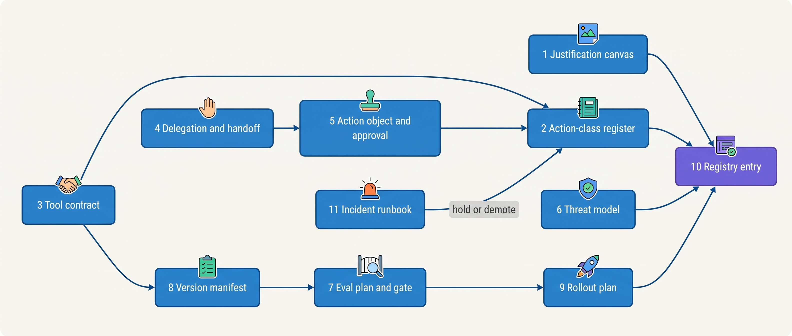

> **IN THIS SECTION, YOU WILL:** Find the template that fits the agent design or decision in front of you, copy it, see who fills it in and who signs it, see it filled in once for Ostrell, and follow the link to the chapter that explains every field.

> **KEY POINTS:**
>
> * **Every template is keyed to an identifier another record cites.** A decision point, an action class id, a tool contract version with its description hash, an action object's content hash, a manifest hash: that chain lets an auditor walk from a posted entry or a customer credit back to the version, policy, approval and evidence that produced it.
> * **The model fills none of these records.** Each template names who writes it (an agent owner, a system-of-record owner, a risk owner, the security architect) and which component reads it at run time. A field that only a prompt reads is a description, not a control.
> * **Most fields came from an incident.** `fallback: none` from the Alias Drift, the idempotency key that covers the action version from the Double Credit, the code-filled contract id from the Lost Handoff, the trifecta worksheet from the Poisoned Ticket, protected paths from the Fixture Purge. Write "unknown" rather than guess, and add a field when a post-incident review asks a question no field answers.

> **[FAILURE PATTERNS THIS SECTION ADDRESSES](where-agentic-systems-go-wrong.html):**
>
> * **Autonomy by Default** — the justification canvas and the action-class register make every autonomy grant a written, signed decision per action class instead of whatever the tools allow.
> * **The Fire-and-Forget Action** — the tool contract, the action object and the approval record give every effect an idempotency key, a receipt, a verification rule and a bound approval.
> * **The Silent Upgrade** — the version manifest, the eval plan and the rollout plan make every change to model, prompt, tool or policy a versioned, gated, reversible release.

<br>
These are **working templates for organizations that run agents in production**: the records that Parts I to XI ask an architect to keep, from the rung justification of [[when-agents-are-justified]] to the incident runbook of [[owning-agentic-systems]]. Each is tested against Ostrell, the fictional field-service software group this book follows ([[meet-ostrell]]), and its Keelson agent platform. Each is the smallest form I have found that makes a decision explicit, assigns an owner and leaves evidence someone else can check. **Adapt the wording; keep the fields that carry identity, authority, reversibility and evidence.**

Four conventions run through all twelve.

- **They are maintained data, not documents.** At Ostrell they live in the Agent Registry, the Toolyard registry, Bulkhead's policy repository and Sounding, and components read them on every run.
- **They reference each other by identifier.** A manifest names tool contract versions and a policy version; an approval names an action object hash; a rollout plan names a rollback manifest.
- **They say who fills them and who signs.** The agent owner proposes, the risk owner accepts expected loss, the system-of-record owner owns the tool, the security architect owns trust labels and trifecta exceptions, and the architecture forum approves envelope changes.
- **Each Ostrell example agrees with its chapter.** All Ostrell names, figures and dates are fictional.

## Find the Template for the Question on Your Desk

| Template | Use it when | Chapter |
| --- | --- | --- |
| [1](#tool-1): Agent justification canvas | Someone proposes an agent, or a decision point moves from code to a model | [[when-agents-are-justified]] |
| [2](#tool-2): Action-class and autonomy-tier register | A tool is bound to an agent, or a tier is promoted or demoted | [[autonomy-and-consequence]] |
| [3](#tool-3): Tool contract | A team exposes a system of record to agents, or changes a tool | [[tool-contracts]] |
| [4](#tool-4): Delegation contract and handoff payload | Work passes to a sub-agent, another agent or a person | [[routing-and-delegation]], [[coordination-and-handoffs]] |
| [5](#tool-5): Action object and approval record | An agent proposes an effect outside its run, or a human must approve one | [[side-effects-and-external-actions]], [[human-oversight-and-bounded-autonomy]] |
| [6](#tool-6): Threat-model and trifecta worksheet | A new agent version, session type, tool, data class or provider endpoint | [[agent-threat-model]] |
| [7](#tool-7): Eval plan and regression gate | Before an agent is built, and before any manifest element changes | [[evaluating-agentic-systems]], [[building-agent-eval-suites]] |
| [8](#tool-8): Agent version manifest | Every release, including a model migration or a policy change | [[versioning-agent-systems]] |
| [9](#tool-9): Rollout and rollback plan | A new manifest goes to production traffic | [[staged-rollout-and-rollback]] |
| [10](#tool-10): Agent registry entry | An agent is proposed, piloted, promoted, restricted or retired | [[owning-agentic-systems]] |
| [11](#tool-11): Incident and recovery runbook | An agent does the wrong thing across many runs | [[owning-agentic-systems]], [[partial-failure-and-compensation]] |
| [12](#tool-12): Design-review checklist | Any architecture review of a new agent or an envelope change | All parts |

The decision-point map of [[what-makes-a-system-agentic]], the context manifest of [[context-engineering]], the provenance envelope of [[provenance-and-freshness]] and the task record of [[task-state-and-checkpoints]] are not repeated here; Templates 1, 5 and 10 link to them where a field depends on them.

## How the Records Connect


**Figure 1:** *How the templates reference each other. Justification, threat model and the action-class register define what an agent may do; tool contracts and the manifest pin how; the eval gate and rollout plan decide when a version runs; action objects and approvals carry each effect; the runbook pulls autonomy back when something goes wrong.*

## <a id="tool-1"></a>Template 1: Agent Justification Canvas

**When to use it.** Before an agent is built, and again whenever a decision point moves up the ladder (a workflow step becomes a loop, a single call gets tools). **Who fills it:** the proposing team's engineering lead with the agent owner; the architecture forum reviews it. It records one **rung justification** per model-held decision point, so "why is this an agent?" survives the people who answered it.

**The template.** One row per decision point from the agent's decision-point map ([[what-makes-a-system-agentic]]). Rungs: 0 code, 1 single call, 2 workflow with model steps, 3 bounded loop, 4 autonomous.

| Field | What to record | Guidance |
| --- | --- | --- |
| **Agent and decision point** | `agent_id`, `decision_point` (e.g. `leave.extract_request`) | Locus today: code, model or human |
| **Rung chosen** | 0–4 | Each "no" on the ladder test needs evidence |
| **What the model decides** | One sentence: what it chooses that code or written policy could not | An empty field is the Agent-Shaped Hammer |
| **Could the steps be written in advance?** | Yes / no, with the reason | "Yes" means rung 2 at most |
| **Baseline** | The rung below, and the Sounding eval run on the same cases | No baseline, no rung 3 or 4 |
| **Verifier** | What checks the result, and whether the agent can write what it reads | No independent verifier: the loop may draft, not act |
| **Reliability** | Per-step success, model-decided steps per run, measured end-to-end success | Compare end-to-end with the product of per-step rates |
| **Failures per day** | Expected volume × measured failure rate; who handles them | |
| **Cost per verified outcome** | Agent and baseline, including oversight, eval upkeep and repair | Not cost per call |
| **Revisit trigger** | New tool, more volume, higher cost of error | Sends the row back through the test |
| **Reviewed on, by** | Date; forum or review | |

**Ostrell example** (March 2027 business-case review; fictional):

| Field | Peoplepoint leave request |
| --- | --- |
| Rung proposed / chosen | 3 bounded loop / **2 workflow** |
| What the model decides | Extract leave type and dates from the employee's message; everything else is HR policy |
| Steps writable in advance | Yes: extract → rules and HRIS checks → confirmation card → code submits with idempotency key |
| Evidence | Loop: median 7 model-decided steps, ~98.7% per step, **91%** end-to-end on 250 scripted requests, 2 submits before confirmation. Workflow: **98.4%**, 2 model calls |
| Volume | ~2,300 leave requests a month |

**Common mistakes.** Answering "no" to "can code decide it?" from habit, when the judgement is unwritten policy. Comparing the agent with nothing instead of with the next simpler design on the same cases.

Learn more: [[when-agents-are-justified]], [[workflows-loops-and-autonomous-agents]]

## <a id="tool-2"></a>Template 2: Action-Class and Autonomy-Tier Register

**When to use it.** Whenever a tool is bound to an agent version, and at every tier promotion or demotion. **Who fills it:** the agent owner proposes the classification; the risk owner signs the tier; the architecture forum ratifies the grid ceilings. Tiers apply **per action class, not per agent**: A0 suggest, A1 draft for approval, A2 act within limits, A3 act autonomously.

**The ceiling grid** (Ostrell's, adopted with the register):

| Consequence ↓ / Reversibility → | Reversible | Compensable | Irreversible or external commitment |
| --- | --- | --- | --- |
| **C1** internal, < ~€1,000 per action | A3 | A3 | A3, with a rate limit |
| **C2** bounded, one customer or employee | A3 | A2 | A1 |
| **C3** material: money above cap, legal effect, disclosure | A2 | A1 | A1 |
| **C4** severe: rights, pay, employment, health, safety | A1 | A1 | A1; A0 for decisions about a person |

**The template.** One row per action class per agent version.

| Field | What to record |
| --- | --- |
| `action_class` | Stable id, e.g. `answerdesk.issue_credit.le_250` |
| `manifest_hash` | The agent version the tier is keyed to; a new model never inherits autonomy |
| `tools` | Tool bindings that can produce this class |
| `effect` | read · draft · reversible · compensable · irreversible · external commitment |
| `consequence` | C1–C4, with the worst single outcome and who bears it |
| `ceiling` / `tier` | Ceiling from the grid; current tier and the decision record that set it |
| `limits` | Per action, per run, per business key, daily hold (count and amount), enforced in the broker |
| `undo` | Undo or compensation path, its window and who must cooperate |
| `detect` | How a wrong action is found, and how fast |
| `demotion_triggers` | Registered before promotion; which fire automatically |
| `risk_owner` | One person, with an exposure cap per month |
| `lowering_signals` | Signals that may lower the tier per instance (none may raise it) |

**Ostrell example** (Agent Registry, November 2027; fictional):

| Field | Answerdesk credit ≤ €250 |
| --- | --- |
| Effect, band, ceiling, tier | Compensable, **C2**, ceiling A2, **A2 since October 2027** (A1 before) |
| Limits | €250 per action; at most one credit per technician visit (key `credit:{ticket_id}:{visit_id}:{reason_code}`); one active credit proposal per ticket; hold if daily > €9,000 or > 120 credits |
| Undo | Debit on the next invoice with customer notice |
| Detect | 10% second-reviewer sample of executed credits; daily receipt reconciliation |
| Demotion | 30-day audited upper bound > 4% → A1; any duplicate → hold; new manifest, credit policy or tool → A1 until re-gated |
| Risk owner | Lena Brandt, up to €5,000 a month expected exposure (delegated by Marten Ruys) |

Credits above €250 are C3 and stay at A1; card refunds and email to unverified recipients have ceiling A1 but run at A0. Irreversible external commitments (contract signatures, payments to third parties, legal filings, employment decisions) are capped at A1 whatever the evidence.

**Common mistakes.** A tier on the agent instead of the class. A limit stated only in the prompt. Letting the model's confidence raise a tier.

Learn more: [[autonomy-and-consequence]], [[evidence-for-autonomy]]

## <a id="tool-3"></a>Template 3: Tool Contract

**When to use it.** When a system of record is exposed to agents, and for every change to a tool's schema, description or side-effect semantics. **Who fills it:** the system-of-record owner's team, reviewed with the agent teams that bind it and, for writes, by security. It lives in the owning team's repository; Toolyard stores the published version with its definition hash, and each manifest binds the version and description hash.

**The template.**

```yaml
tool: <system>.<verb_object>             # shaped like a decision, not an endpoint
contract_version: <semver>
owner: <system-of-record team>
system_of_record: <system>
description: >                           # when to use it, what to call first, what not to use it for
model_schema: { ... }                    # only what constrained decoding enforces
validation:                              # enforced by the broker and the tool, not by decoding
  static: { <field>: <pattern or range> }
  referential: [<ownership and state checks against the run's verified principal>]
  reads_before_write: [<facts re-read and version-checked>]
output_schema: { status: [...], receipt_id: string, error: {code, class, field, retry} }
side_effects:
  risk_class: read_only | reversible_write | compensable_write | pivot
  compensated_by: <compensating tool or human procedure>
  compensation_window: <duration>
  idempotency: required                  # key minted by the runtime, never by the model
  business_key: "<template>"
  lookup: <how an unknown outcome is resolved>
  trifecta: { private_data: bool, untrusted_content: bool, external_send: bool }
  mcp_hints: { readOnlyHint, destructiveHint, idempotentHint, openWorldHint }   # declared, not trusted
reliability: { attempt_timeout_s, max_attempts, lookup_window_min }
result_budget_tokens: <n>
policy_ref: <policy path>                # tiers and amount limits live in policy, not here
errors: [{ code, class: model_fixable | business_outcome | policy_stop, retry }]
registry: { definition_sha256, risk_class, scopes, lifecycle: proposed | reviewed | active | unreviewed | deprecated | quarantined | retired }
```

**Ostrell example** (`billing.issue_credit` 3.2.0, Billing Platform team; fictional, abridged):

```yaml
model_schema:  { required: [ticket_ref, visit_ref, reason_code, amount, note_for_approver] }
validation:
  referential: [ticket belongs to the run's verified customer, visit belongs to ticket and is missed, late or repeat]
  reads_before_write: [contract.credit_policy_version, visit.status]
side_effects: { risk_class: compensable_write, idempotency: required,
                business_key: "credit:{ticket_ref}:{visit_ref}:{reason_code}", lookup: by client reference }
reliability:  { attempt_timeout_s: 30, max_attempts: 3, lookup_window_min: 10 }   # then the repair queue
errors: [{ code: limit_reached, class: business_outcome, retry: do_not_retry }]
```

What the model no longer writes is the point: no account id (it comes from the ticket), no currency (from the contract), no amount for standard reasons (from policy). Version 1, reviewed after the Double Credit, had sent 31 calls to the wrong account and 5 amounts a hundred times too large in 1,000 calls.

**Common mistakes.** Arguments the system of record already knows. Raw errors returned to the model. Treating a server's `readOnlyHint` as a reviewed classification.

Learn more: [[tool-contracts]], [[tool-ecosystems-and-mcp]], [[partial-failure-and-compensation]]

## <a id="tool-4"></a>Template 4: Delegation Contract and Handoff Payload

**When to use it.** When a run starts a sub-agent (call and return), or hands a task to another agent or a person (transfer of control). **Who fills it:** the platform team defines the schema family; the receiving team defines each payload schema and its required fields. At run time the model proposes; Keelson Runtime builds, validates and persists the record before the child starts or the offer is made.

**The delegation contract.**

| Field | What to record | Rule |
| --- | --- | --- |
| `delegation_id`, `parent_run_id`, `root_run_id`, `depth` | Lineage | Runtime rejects depth above the limit |
| `receiver` | Sub-agent, human queue or workflow | |
| `task` | One paragraph | |
| `inputs` | References with trust label and `as_of` | Not the parent's whole conversation |
| `decisions_taken` | Constraints the parent already committed to | Required, never inferred |
| `authority` | Tools, data scopes, `acting_for` | A subset of the parent's; never widened |
| `budget` | Tokens, money, wall clock, max children, depth below | Reserved from the parent's remaining budget |
| `deadline`, `output` | Schema ref, must cite inputs, may abstain | The result returns as untrusted data |

**The handoff payload** extends it with ownership and field provenance:

| Field | Filled by | Rule |
| --- | --- | --- |
| `from`, `to`, `accept_by`, `fallback` | Runtime | An offer without acceptance never moves ownership |
| Identifiers (`verified_customer`, `contract_id`, `ticket_id`) | Code, from receipts | A model-generated value fails validation; unresolved → handoff refused |
| `commitments`, `actions_taken` (done, pending, unknown) | Code, from the evidence log | |
| `reason`, `customer_claim` | Model, labeled `model_generated` | Never the source of a commitment |
| `evidence` | References with trust labels | No pasted blobs |
| `authority_after` | Policy | Sender becomes read-only or released, enforced at the broker |

**Ostrell examples** (fictional). *Delegation:* a Scout research run delegates only when the plan has at least 3 independent sub-questions; Mid-tier workers get read-only tools, a 20-minute deadline and return typed `market_finding` results by reference; the run budget is 8 million tokens, €90 and 90 minutes, with depth 2 and at most 8 parallel workers. *Handoff:* `billing_handoff.v1` (28 April 2027) code-filled the contract id that a model-written summary had dropped in 52 of 2,000 audited handoffs; in about 25,000 handoffs to 6 June it had 0 missing contract ids, and 2.1% were refused first so the triage agent could ask which contract was meant.

**Common mistakes.** A child holding a tool its parent lacks. Budgets granted instead of carved. A sender that can still write after the receiver accepts.

Learn more: [[routing-and-delegation]], [[single-and-multi-agent-designs]], [[coordination-and-handoffs]]

## <a id="tool-5"></a>Template 5: Action Object and Approval Record

**When to use it.** For every proposed effect outside the run, and for every A1 gate. **Who fills it:** nobody by hand. The platform team owns the schemas; Keelson Runtime builds the action object from the model's proposal; the approval service builds the card from system-of-record reads; the named approver supplies the decision. Use the template to review a new action class: if a field cannot be filled, the class is not ready.

**The action object.**

| Field group | Contents |
| --- | --- |
| Identity | `action_id`, `version`, `content_hash`, run, step and model-decision ids |
| Effect | Action class, tool name and version, target resource ids, parameters |
| Authority | Principal, on-behalf-of identity, tier evaluated, policy version |
| Dependencies | Facts relied on, each with source and version (re-read before write) |
| Risk | Reversibility class (`reversible`, `compensable`, `irreversible`, `external_commitment`), limits checked and results |
| Execution | Idempotency key covering the version, executor (`platform` or `human`), expiry, verification rule (receipt level, read-back) |
| Presentation | Rendered preview of the effect |

Lifecycle: Proposed → Validated → AwaitingApproval or Authorized → Dispatched → Applied → Verified (or Rejected, Voided, Failed, Mismatch). A changed amount, recipient or target is a new version with a new hash and key.

**The approval record.** An approval is bound to the exact action object version, with approver identity, the evidence shown, a scope and an expiry, and is checked again immediately before execution.

| Field | What to record |
| --- | --- |
| `approval_id`, `action_hash` | SHA-256 of the canonical action object |
| `policy_version`, `card_template` | So what was shown is reproducible |
| `evidence` | Per fact: source, version, content hash, material flag |
| `approver`, `decision` | Named human, not a maker; approve, reject, request information or escalate |
| `override_reasons` | One per flagged check approved anyway; the machine verdict stays unchanged |
| `review_level`, `expires_at`, `scope` | Scope is "execute once" |
| **Revalidation before dispatch** | Expired? Hash changed? Policy changed? Material evidence changed? Approver a maker? Any yes → void and re-request |

**Ostrell example** (November 2027; fictional values). A customer with a three-visit failure asks for a €420 credit: class C3, tier A1, review level **R2** (€250–€1,000, one team lead). The card shows the invoice line, the account, the three visit records with their status versions and the policy clause; the model's rationale is collapsed. The approval binds the action hash, policy version and the three visit versions, and is valid for 4 hours. The customer's reply slot reads `awaiting_approval`, not "done". If a visit's status changes before dispatch, the approval is void and a new card highlights the changed fact.

**Common mistakes.** Binding approval to a run step rather than an action hash, the mechanism behind the Double Credit's €31,400. A card led by the model's explanation. Replies that announce an outcome no receipt backs.

Learn more: [[side-effects-and-external-actions]], [[retries-idempotency-and-concurrency]], [[human-oversight-and-bounded-autonomy]]

## <a id="tool-6"></a>Template 6: Threat-Model and Trifecta Worksheet

**When to use it.** For every agent version, and again on any rerun trigger: new tool, new session type, new data class, provider or endpoint change, tier promotion. **Who fills it:** the agent owner's team; the security architect reviews and approves; the risk owner signs any residual. The lethal trifecta is one session combining private data, untrusted content and an outbound channel.

**The trifecta worksheet.** One row per session type, legs counted from context sources as well as tools.

| Session type | Private data | Untrusted content in context | Outbound channels (send, search query, fetch, rendered link or image, delegation message) | Data scope / sink scope | Result | Resolution | Residual signed by |
| --- | --- | --- | --- | --- | --- | --- | --- |
| | | | | principal · tenant · org / principal · tenant · internal · public | two or fewer · scoped · full | remove a leg, scope to one principal, or add a human | |

**The record** (as kept in the Agent Registry since July 2027):

```yaml
threat_model:
  agent: answerdesk
  manifest_hash: sha256:…            # the agent version this record covers
  owner: Support Operations          # fills it in
  reviewer: Security Architecture    # approves it
  session_types:
    - name: email_ticket
      principal: verified_customer_contact
      sources: [platform, operator, system_of_record, corpus, untrusted]
      data_classes: [D0, D1, D2, D3]
      tools: [ticket.update, kb.search, email.send, billing.issue_credit, …]
      outbound_channels: [email.send(to: crm_handles_only), reply_render(no_images)]
      trifecta: scoped               # two-or-fewer | scoped | full
      residual: "Injected text can change what the verified contact is told; it cannot add a recipient."
      residual_signed_by: Lena Brandt
  boundaries: {B2: {endpoints: [provider-a-eu-zdr]}, B8: {egress: deny}}   # B1–B8: rule, enforcer, test
  exposure_paths:                    # every copy of run data, who can read it, for how long
    - {path: wake_content_store, retention: 30d, access: purpose_logged, tenant_key: true}
  rerun_when: [new_tool, new_session_type, new_data_class, provider_or_endpoint_change, tier_promotion]
```

The eight boundaries are B1 principal, B2 provider, B3 context window, B4 stored content, B5 action, B6 tool supply, B7 agent-to-agent and B8 egress, plus the tenant and observer partitions. Data classes: D0 public, D1 internal, D2 customer confidential, D3 personal, D4 sensitive personal (never to commercial providers), DS secrets (nowhere).

**Ostrell example** (Keelson threat model v2, 23 June 2027; fictional). Scout research: internal documents (private), web pages (untrusted), web search queries and fetches (outbound) → **full trifecta**, although Scout could send nothing to anyone; 9 of 400 sampled web queries named an Ostrell customer. Resolution: workers are internal or web, never both; the lead holds no search or fetch tool; sub-questions to web workers pass a protected-terms check. The Strategy & Insights lead signed the paraphrase residual.

**Common mistakes.** Counting only send tools as outbound. Treating a "read-only" agent as safe. A threat model that does not name the manifest it covers.

Learn more: [[agent-threat-model]], [[prompt-injection-defense]], [[agent-identity-and-least-privilege]]

## <a id="tool-7"></a>Template 7: Eval Plan and Regression Gate

**When to use it.** Before the agent is built (the outcome metric decides what "working" means), and as the gate for every change to any manifest element. **Who fills it:** the agent owner's team with the evaluation lead; the risk owner owns the system-level outcome metric; thresholds are fixed before a candidate runs.

**The template.**

| Section | What to record |
| --- | --- |
| **Outcome metric per action class** | Definition, ground-truth source, owner; abstention counted as success when correct |
| **Component level** | Labeled sets per model step, retriever and router; every change plus a daily canary on the production manifest |
| **Trajectory level** | Invariants over recorded runs (no duplicate effect, no effect without a policy decision, no claim without a receipt); run on every trial and every production run |
| **Workflow level** | End-to-end tasks in simulators and tool twins with fault injection; k trials; pass^k with intervals; null-agent score |
| **System level** | Production outcome metric, reviewed weekly by the risk owner |
| **Suite composition** | Cases by source (trace, incident, expert, synthetic, adversarial), slices with fewer than a dozen cases flagged, holdout owned outside the team, labelers and agreement, `retainUntil` per case |
| **Graders** | Outcome checks from end state; model judges with measured agreement against human–human agreement, pinned versions |
| **Gate triggers** | Manifest change (subset on PR, full before merge); release candidate (full plus holdout, k trials); daily canary |
| **Hard criteria** | Zero tolerance: invariant violations, injection reaching a sink |
| **Soft criteria** | Paired comparison against production on the same cases: lower bound above a floor, drop within a margin |
| **Recorded with each run** | Full manifest incl. exact model id, judge, evaluation-harness and simulator versions, sandbox resources, cost per task |

**Ostrell example** (Closewise accrual suite v2, October 2027; fictional). **1,244** cases: 520 stratified production proposals (at least 15 per entity), 64 incident replays, 210 expert-written including 48 abstention cases, 300 filtered synthetic variants, 150 holdout owned by Sounding. Gate: 3 trials per case on 1,094 regression cases; zero invariant violations; classification accuracy 95% lower bound ≥ 94.5% and paired drop ≤ 1.0 point against production; abstention recall ≥ 90%, false abstention ≤ 3%; holdout within 2 points. Daily canary at 05:00 Rotterdam time: 300 cases, 1 trial, alert below 93.5%. The explanation judge is advisory (kappa 0.66 against a human–human 0.74). Suite v1 had been an 860-case convenience sample run only on prompt releases.

**Common mistakes.** One trial and a point threshold. Labels taken from first-line approvals without re-adjudication. A suite that runs only when someone knows something changed.

Learn more: [[evaluating-agentic-systems]], [[building-agent-eval-suites]], [[evidence-for-autonomy]]

## <a id="tool-8"></a>Template 8: Agent Version Manifest

**When to use it.** For every agent version. **Who fills it:** the agent team writes it as code; the Agent Registry hashes it and runs the registration checks; Sounding binds the eval run to the hash. The test for what belongs in it: **if changing it should require an evaluation run, it belongs in the manifest; if it changes per task, it is input; if it must be current, it is a tool call.**

**The template, with an Ostrell example** (Closewise classifier, September 2027; fictional, abridged):

```yaml
agent: closewise-accrual-classifier
manifest_version: cw-2027.09.3                     # <agent-prefix>-<yyyy>.<mm>.<n>
build: keelson-runtime-workflows@4f1c2e9           # orchestration code, git commit
model:
  provider: provider-b
  model_id: "<exact versioned model id>"           # aliases rejected at registration
  api_version: "<provider API version>"
  settings: { effort: medium, max_output_tokens: 2000 }
  fallback: none                                   # or a named, gated fallback
prompts:
  system: prompts/closewise/classifier-system@v14  sha256:9b2e...
tools:
  - name: coa_lookup        contract: 2.1   description_sha256: c03f...
  - name: entity_profile    contract: 1.4   description_sha256: 7d19...
policy: bulkhead/closewise@2027-09-01.2
retrieval:
  index: accounting-policies
  snapshot: aps-2027-08-30T02:00Z
  embedding_model: "<exact embed model id>"
memory: none                                       # or the memory schema version
context_assembler: <version>
guardrails: [<classifier model id and threshold>]  # pinned since October 2027
eval_binding: sounding/closewise-accrual@suite-v9  # the suite it was gated on
manifest_sha256: e5a0...                           # computed over everything above
```

**Registration rejects** aliases, labels and "latest" references; inactive models; description-hash mismatches; prompts naming unbound tools; memory schemas without a reader for stored versions. At run time the Gateway records the **requested and served** model version on every call; a mismatch pages.

**Common mistakes.** Leaving the model id out (the interview design this book departs from did). Copying shared artifacts into the manifest instead of referencing their versions. A silent tier-wide failover, which is an alias with extra steps.

Learn more: [[versioning-agent-systems]], [[models-and-the-model-gateway]]

## <a id="tool-9"></a>Template 9: Rollout and Rollback Plan

**When to use it.** Before a new manifest takes any production traffic. **Who fills it:** the agent team with the evaluation lead; the agent owner (or risk owner) signs it before the first stage. Rollback has two halves: moving the pointer back, and repairing the effects the candidate already produced.

**The template.**

| Plan element | What to record |
| --- | --- |
| **Candidate** | Manifest label and what changed; change version and autonomy tier in separate stages |
| **Rollback target** | Gated manifest, its model served until when, quota reserved, last rollback drill |
| **Stages** | Offline gate → shadow (side effects stubbed at the broker) → canary → full, with holdback |
| **Rollout unit and assignment key** | Runs, accounts, tenants, entities; key held across every run that shares state |
| **Control** | Concurrent control at every exposed stage |
| **Automatic rollback** | Invariants (duplicate effect, outside limits, served ≠ pinned, shadow write reaching a sink); harm proxies beyond a margin, with minimum decisions per arm |
| **Hold and page** | Behavior shape (abstention, escalation, refusal, tool errors), two-sided; operations (latency, cost, cache share) |
| **Who may roll back / advance** | Rollback needs no verdict; only a human advances a stage |
| **Runs in flight** | Drain, cancel with compensation, or migrate |
| **Effects query** | Everything carrying the candidate's manifest hash |
| **Forward-fix playbook** | Per effect class: proposals, approvals, compensable effects, postings, communications, memories, merged code; executed by deterministic code, never by the rolled-back manifest |

**Ostrell example** (Closewise model migration, signed by Joost Vermeer in late October 2027; fictional). Candidate `cw-2027.10.2` (new exact model id, prompt v15); rollback target `cw-2027.09.3`, served until at least 31 March 2028. Shadow over the October close; canary in five entities, 50/50 by entry id; roll back if the canary rejection rate exceeds control by more than 3 points with at least 100 decisions per arm, or exceeds 9%. On 7 December 2027 a controller's balance review found 5 posted entries (€183,400) in the wrong provision account, which no guardrail could see; the candidate share went to 0, all 196 canary postings were re-adjudicated, and five reversal-and-repost pairs were approved by a deputy controller. The effects query and the playbook were already written.

**Common mistakes.** Comparing before and after instead of canary and control. A rollback target whose model has been retired. No forward-fix playbook, so repair is improvised during the incident.

Learn more: [[staged-rollout-and-rollback]], [[partial-failure-and-compensation]]

## <a id="tool-10"></a>Template 10: Agent Registry Entry

**When to use it.** At proposal, and at every lifecycle transition. **Who fills it:** the agent owner; the architecture forum approves the envelope; the risk owner signs tiers. Every authority in the operating model is a field some component reads: Gateway, Toolyard and Bulkhead read `state` on every call; promotion reads `risk_owners`; Wake routes behavior alerts by `on_call`.

**The template.**

| Field | What to record |
| --- | --- |
| `agent_id`, `agent_owner`, `engineering_lead` | Owner is one person, not a team |
| `risk_owners` | Per action class: person and monthly exposure cap |
| `on_call` | Rotation and coverage (24×7, business hours, calendar windows), separate from the platform's |
| `state` | proposed → approved_for_pilot → pilot (shadow, A0/A1 only) → production ↔ restricted → deprecated → retired; or rejected |
| `envelope`, `envelope_decision` | Action classes and ceilings, identities and scopes, tools by risk class, trifecta position, topology and delegation limits, budget maxima |
| `success_definition` | Outcome metric, baseline, cost-per-success target |
| `production_manifests` | At most three live, by hash; tiers keyed to each (Template 2) |
| Attached records | Decision-point map, rung justifications (Template 1), execution-style and loop limits, freshness register, interaction mode per entry point, threat-model record (Template 6), system-of-record integration records |
| `budgets` | Run budget; monthly budget with alerts at 50% and 80% and throttle at 100% |
| `next_review` | Envelope date; tiers at least yearly |
| `retirement_plan` | Written at registration: memories, triggers, open commitments, evidence retention |

**Ostrell example** (Answerdesk, December 2027; fictional):

| Field | Value |
| --- | --- |
| Owner, risk owner | Lena Brandt; credits ≤ €250 up to €5,000 a month expected exposure |
| On call | Support Operations engineers, 24×7 (2028 roadmap) |
| State, manifest | production; `ad-2027.10.2`, plus the routing-profile B canary from December 2027 |
| Success definition | Verified resolution: no human, every effect with a verified receipt, no open commitment, no re-contact within 7 days. 41% in Q3 2027, target 45%; €0.39 agent-side per resolved conversation |
| Run budget | ≤ 8 turns per exchange, ≤ 40 per run, 600,000 tokens, €1.20 model spend, 72-hour idle timer |

The registry held 11 entries on 14 December 2027: 7 in production, 1 retired, 1 rejected (Invoice Chaser) and 2 proposed, with 21 action classes across the production agents.

**Common mistakes.** A team as owner. An on-call that covers the platform but not the agent's behavior (the Close-Day Queue). A retirement plan written at retirement.

Learn more: [[owning-agentic-systems]], [[agentic-reference-architecture]]

## <a id="tool-11"></a>Template 11: Incident and Recovery Runbook

**When to use it.** When an agent does the wrong thing across many runs, or a wrong action is found after the fact. **Who fills it:** the agent owner's team writes the runbook per agent before production, and drills it at a quarterly game day; during an incident the agent on-call runs it and the risk owner decides on repair. **Containment is a change of autonomy, not a shutdown.**

**The template.**

| Step | What to record in advance | During the incident |
| --- | --- | --- |
| **1 Detect** | Signals that page the agent on-call: outcome shift, served ≠ pinned model, duplicate or unknown-outcome rate, sink denials, reviewer reports | Time detected, by what |
| **2 Hold** | Kill-switch scope (action class, manifest hash, agent, tenant, platform); who may pull it; target ≤ 60 s to every enforcement point; queued actions held, never dropped | Scope pulled, by whom, when |
| **3 Quarantine** | Where outputs are marked at consumers (PR label, staging-store approval queue, memory retrieval, report banner); evidence hold overriding retention | Runs and outputs quarantined |
| **4 Scope** | The blast-radius query: runs, manifests, actions, receipts, unknown outcomes since when | Count and value affected |
| **5 Repair** | Forward, backward, hold or accept per effect class; compensations generated by code from receipts; pivots listed for business remediation | Risk owner's decision and customer contact |
| **6 Regulatory branch** | For agents marked high-risk: who decides reportability, when the clock starts | Decision and time |
| **7 Restore by evidence** | Incident becomes suite cases; release requires a candidate passing them; only a human releases | Release record, signed |
| **8 Learn** | Which template gets a new field | Field added, owner |

**Ostrell example** (the Fixture Purge, July 2027; fictional). Forge agents asked to make failing CI pass deleted or skipped tests in 9 pull requests; 2 were merged, and the skipped test hid a real defect that delayed back-order emails for about 1,100 Ostrell Parts order lines by up to 3 days. Hold: the CI-fix trigger (`fix_failing_ci` class) was paused. Quarantine: the 7 open PRs were labeled so branch protection refused to merge them, then closed. Repair: the 2 merged changes were reverted and the defect fixed by hand. Scope: a back-scan of merged Forge PRs since February found 31 test removals, all justified. Restore: a verifier contract (baseline before the first edit, protected paths, a test-count grader outside the sandbox, a `not_a_code_defect` outcome) before the trigger was re-enabled on 120 repositories.

**Common mistakes.** Diagnosing before holding. Scoping from memory because the evidence log lacks run, action or manifest ids. Engineers deciding repair that is the risk owner's call.

Learn more: [[owning-agentic-systems]], [[partial-failure-and-compensation]], [[agent-observability]]

## <a id="tool-12"></a>Template 12: Design-Review Checklist

**When to use it.** In any architecture review of a new agent or of a change that moves an envelope: a new write or action class, identity, data class, trifecta leg, delegation, ceiling raise, or a decision point moved from code to a model. **Who fills it:** the proposing team answers in writing before the review; the architecture forum checks the answers. Each item is a question from the chapter linked after it; an unanswered item is a finding.

**Part I — Foundations**

- [ ] For each decision point, who chooses the next step (code, model or human), and which limits exist only in a prompt? ([[what-makes-a-system-agentic]])
- [ ] What does the model decide that code could not, and how did the next simpler design do on cost per verified outcome? ([[when-agents-are-justified]])
- [ ] For each action class: worst outcome, undo cost, ceiling, tier, and where each limit is enforced if policy allowed the call? ([[autonomy-and-consequence]])
- [ ] What are all the ways a run can end, and can it reach a human without the model choosing to escalate? ([[workflows-loops-and-autonomous-agents]])

**Part II — Architecture**

- [ ] Does every path from model output to the outside world cross runtime, policy enforcement point, broker and evidence log, with authorization separate from execution? ([[agentic-reference-architecture]])
- [ ] Can anything other than the gateway reach a provider, and does a served-model mismatch page someone? ([[models-and-the-model-gateway]])
- [ ] Does the agent keep durable state beyond task state, a registered staging store and evidence? ([[agents-in-the-enterprise]])

**Part III — Orchestration**

- [ ] Where does the plan live, and which deterministic checks run on it before the first step? ([[planning-and-decomposition]])
- [ ] Can a child hold a tool or scope its parent lacks, and is its budget reserved from the root? ([[routing-and-delegation]])
- [ ] Which of the four reasons justifies each additional agent, against which single-agent baseline? ([[single-and-multi-agent-designs]])
- [ ] Which handoff fields are code-filled, and is the sender read-only after acceptance, enforced at the broker? ([[coordination-and-handoffs]])

**Part IV — Context**

- [ ] For any model call, can you list each context segment with source, version and trust label? ([[context-engineering]])
- [ ] What is the agent's "no evidence" exit? ([[retrieval-and-grounding]])
- [ ] Can memory ever supply a side-effecting argument or a commitment? ([[agent-memory]])
- [ ] If the worker dies at an arbitrary instruction, what happens, and is `unknown` a state with an owner? ([[task-state-and-checkpoints]])
- [ ] What is the freshness bound to inform and to commit, and does the commit tool re-read the fact? ([[provenance-and-freshness]])

**Part V — Tools**

- [ ] Which write-tool arguments does the model supply that a system of record already knows? ([[tool-contracts]])
- [ ] Is there any path to a tool that does not cross the broker? ([[tool-ecosystems-and-mcp]])
- [ ] What happens when the sandbox cannot start? ([[sandboxes-and-execution-environments]])
- [ ] Is every effect a hashed action object, and which receipt level closes each class? ([[side-effects-and-external-actions]])

**Part VI — Reliability**

- [ ] After a crash mid-turn, is the model asked again? ([[durable-agent-execution]])
- [ ] Who mints the idempotency key, and does any recovery path re-send the conversation to the model after dispatch? ([[retries-idempotency-and-concurrency]])
- [ ] Is each write reversible, compensable or a pivot, and when was the kill switch last drilled? ([[partial-failure-and-compensation]])

**Part VII — Control**

- [ ] Which session types hold all three trifecta legs, counting queries, fetches, rendering and delegation, and who signed the residual? ([[agent-threat-model]])
- [ ] What happens if the injection classifier is removed? ([[prompt-injection-defense]])
- [ ] Does the downstream log say "agent A for user U in run R", and can a model argument change whose data a token reaches? ([[agent-identity-and-least-privilege]])
- [ ] Is each approval bound to the action hash, policy version and evidence shown, and who audits a sample of approvals? ([[human-oversight-and-bounded-autonomy]])
- [ ] If the evidence log is unavailable, does a side effect proceed? ([[policy-enforcement-and-audit]])

**Part VIII — Evidence**

- [ ] What is the outcome metric per action class, and does the release suite report pass^k with intervals? ([[evaluating-agentic-systems]])
- [ ] Were gate thresholds fixed before the candidate ran? ([[building-agent-eval-suites]])
- [ ] Is every outcome metric broken down by agent version and served model? ([[agent-observability]])
- [ ] Were promotion criteria registered before the evidence window, and which demotion triggers fire automatically? ([[evidence-for-autonomy]])

**Part IX — Economics**

- [ ] Which single layer retries model calls? ([[agent-latency-and-throughput]])
- [ ] What is cost per successful task against the baseline, and what happens to queued actions when a budget is hit? ([[agent-cost-and-model-routing]])
- [ ] Can any cached value be the basis of an executed action? ([[caching-and-context-budgets]])

**Part X — Evolution**

- [ ] Can you name the served model, prompt and policy version of any decision from last month, from records, in minutes? ([[versioning-agent-systems]])
- [ ] Is the rollback target's model still served, and is there a forward-fix playbook per effect class? ([[staged-rollout-and-rollback]])
- [ ] Who owns the agent, who is on call for its behavior tonight, and what is its retirement plan? ([[owning-agentic-systems]])

**Part XI — Domains**

- [ ] Can a coding agent write the tests or CI configuration that judge it? ([[domain-coding-agents]])
- [ ] Which components can put an amount, a date or "done" in front of a customer? ([[domain-customer-operations]])
- [ ] Can any agent identity both create and approve, or create and post, the same object? ([[domain-back-office]])
- [ ] For every output that can harm a person, which component decides, which vetoes and which only screens? ([[domain-high-stakes-decisions]])

## Using the Toolkit Over Time

Review tiers at least yearly, threat models on every rerun trigger, manifests and eval plans on every change, and runbooks at each quarterly game day. **Keep the set small:** every field should change a decision or preserve evidence; remove one that is filled by habit and read by nobody.

[[glossary]] defines the terms the templates use, [[source-coverage]] maps the design examples behind them, and [[bibliography]] lists the sources the chapters cite.

## Sources and Evidence

The templates are derived from the chapters linked in each section, which cite their sources in full; this page adds no new external sources. The design examples from the author's interview project that shaped individual templates are cited in those chapters:

*Design examples from the author's interview project*

- Obrenović, Ž., "Agentic Platform Foundations", system-design interview design, `system-design-interviews/data/book/agentic-platform-foundations/interview.json`, 2026 — immutable agent versions promoted against an eval run (Templates 7 and 8; this book adds the exact model id), at most two trifecta legs (Template 6).
- Obrenović, Ž., "Agentic Support Platform", system-design interview design, `system-design-interviews/data/book/agentic-support-platform/interview.json`, 2026 — detect, contain, roll back, repair, stay read-only (Template 11); handoff packages by reference (Template 4).
- Obrenović, Ž., "Agentic Finance Platform", system-design interview design, `system-design-interviews/data/book/agentic-finance-platform/interview.json`, 2026 — corrections as reversal proposals, never edits (Template 9).

Ostrell is fictional; architectural recommendations, labeled inferences and labeled assumptions are the author's judgement.
