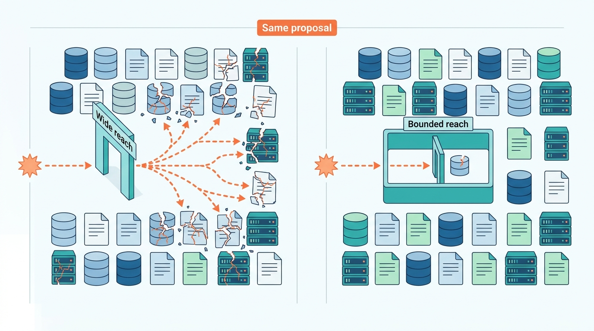
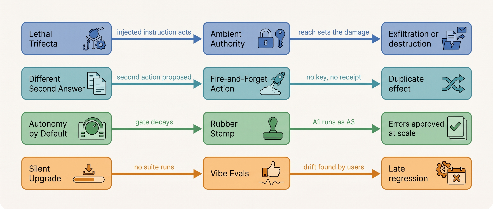

> **IN THIS SECTION, YOU WILL:** Learn sixteen named failure patterns that recur in systems where a model chooses the next step, recognize their warning signs in a design review, see which public incidents and studies document each (and which have no public record yet), and find the chapters whose designs prevent or contain it.

> **WHY THE BUSINESS CARES:** These patterns are where agent programs lose money and trust: a credit paid twice, a production database deleted, private documents sent to an attacker, an approval process that approves everything, a research run that burns a month's budget over a weekend. None of them shows up in a demo.

> **WHY ARCHITECTS SHOULD CARE:** The names give design reviews a shared vocabulary. "This is Ambient Authority" moves the discussion from whether the model will behave to what the identity can reach, which architects can answer and control.

> **KEY POINTS:**
>
> * **The patterns are architectural, not model failures.** In every documented case below the model's output was the trigger, but the damage was set by something around it: a credential that reached too far, a retry that re-asked the model, an approval card that hid the evidence. A better model lowers the trigger rate; only architecture bounds the damage.
> * **Public evidence is uneven, and the gaps matter.** Destructive actions, prompt injection and over-broad credentials have dated public incidents; duplicated side effects, lost handoffs and runaway spend have none as of October 2026, although their mechanisms are documented in specifications and benchmarks. No postmortem does not mean no failure.
> * **The expensive incidents need two patterns at once.** The Lethal Trifecta decides whether an injected instruction can act; Ambient Authority decides how far it reaches. The Different Second Answer creates a second action; The Fire-and-Forget Action hides it. Breaking either half usually turns an incident into a near miss.

 
The [[introduction]] states this book's central idea: in an agentic system **a model chooses the next step**, and the architect's job is to bound that component with budgets, contracts, identities, approvals and evidence, so its mistakes stay small, visible and recoverable. This page names the ways that bounding fails, so the rest of the book can point back to the names.

Each pattern gets an **illustrative quote** (a sentence someone might say in a design review, invented for this page), warning signs, the mechanism, the cost, **documented examples**, the incident at **Ostrell, the fictional company this book follows** ([[meet-ostrell]]), and the chapters that address it, strongest first. Documented examples use only incidents, papers and cases the chapters cite, with the same dates and links; where no public incident documents a pattern, the section says so. None of the patterns implies incompetence: **most are the residue of reasonable choices made under a deadline** by a team that owned one step of the run.

**Figure 1:** *The model's output is the trigger in every documented case, but the identity, contracts and gates around it decide how far a wrong proposal reaches.*

## Sixteen Patterns at a Glance

The patterns follow the book's parts: whether and how much the model decides (Part I), how work moves (Part III), what the model sees and remembers (Part IV), effects in the world (Parts V and VI), control (Part VII), and evidence, money and change (Parts VIII to X).

| Pattern | The warning sign | Part that addresses it |
| --- | --- | --- |
| **The Agent-Shaped Hammer** | An agent loop is used where a fixed workflow, a single model call or plain code would do; nobody can state what the model decides that code could not. | I |
| **Autonomy by Default** | The agent may take every action its tools allow; autonomy was never sized to consequence and reversibility, nor earned with evidence. | I, VII, VIII |
| **The Compounding Error** | Long chains of model steps with no checks between them; a 95%-reliable step becomes a coin flip over a dozen steps. | I, III |
| **The Agent Committee** | Several agents talk to each other where one would do; tokens, latency and lost accountability rise and nobody can say which agent decided. | III |
| **The Lost Handoff** | Work passes between agents or to humans as free text; identifiers, constraints and commitments fall out on the way. | III |
| **Context Soup** | Everything is stuffed into the context window; relevant facts are drowned, stale or unmarked as untrusted. | IV |
| **Amnesiac Execution** | Task state lives only in the conversation; a crash, deploy or timeout restarts the task from scratch or repeats its side effects. | IV, VI |
| **Memory Without Expiry** | Long-term memory accumulates without provenance, review or expiry; stale and poisoned facts keep coming back. | IV |
| **The Fire-and-Forget Action** | Tools change external systems without idempotency keys, receipts or verification; nobody knows whether the action happened once, twice or not at all. | V, VI |
| **The Different Second Answer** | A retry re-asks the model, which proposes a different action; the system executes both, or neither, or the wrong one. | VI |
| **Ambient Authority** | The agent acts with a service account or the user's full credentials; any tool call can reach anything that identity can. | VII |
| **The Lethal Trifecta** | One agent combines private data, untrusted content and a way to send data out; a single injected instruction can exfiltrate. | VII |
| **The Rubber Stamp** | Human approval exists on paper, but approvers see too little, approve too fast and are never measured. | VII |
| **Vibe Evals** | Changes ship on demos and spot checks; there is no regression suite, no trajectory evaluation and no link from evidence to autonomy. | VIII |
| **The Token Bonfire** | No budgets per run, tenant or agent; loops, fan-out and retries turn into an invoice. | IX |
| **The Silent Upgrade** | Models, prompts, tools or policies change without versioning, evaluation or staged rollout; behavior drifts and nobody can say when or why. | X |

Part XI applies all sixteen to four domains. Ambient Authority and Autonomy by Default dominate [[domain-coding-agents]]; The Lethal Trifecta and The Fire-and-Forget Action dominate [[domain-customer-operations]]; The Rubber Stamp dominates [[domain-back-office]] and [[domain-high-stakes-decisions]].

## Part I: Whether and How Much the Model Decides

### The Agent-Shaped Hammer

*Illustrative quote: "Let's make it an agent. Then it can handle whatever comes in."*

**Warning signs.**

- Nobody can name, per decision point, what the model decides that code could not.
- The steps are known in advance (a close, a dunning sequence, a leave request), yet the model chooses them on every run.
- The design was never compared with a workflow, a single call or rules on the same cases.

**The mechanism.** Every decision handed to a model adds variance, tokens, a larger action space and a harder test. Where the path is genuinely unpredictable, that price buys something; where it is predictable, it buys variance. The pattern starts when "agent" is used for any system with a model in it, so nobody asks **who should choose the next step** ([[what-makes-a-system-agentic]]).

**The cost.** Rarely an incident; usually an agent that is never reliable enough to promote and never cheap enough to justify.

**Documented examples.** No public incident report attributes a production failure to choosing an agent where a workflow would do; the evidence is about cost and design guidance. Anthropic reported in June 2025 that its agents used about **4×** the tokens of chat and its multi-agent systems about **15×** ([Anthropic, 2025](https://www.anthropic.com/engineering/multi-agent-research-system)), and its 2024 guidance recommends "finding the simplest solution possible, and only increasing complexity when needed" ([Anthropic, 2024](https://www.anthropic.com/engineering/building-effective-agents)). Stripe's February 2026 post describes coding agents that "interleave agent loops and deterministic code", with at most two rounds of CI before a human takes over ([Stripe, 2026](https://stripe.dev/blog/minions-stripes-one-shot-end-to-end-coding-agents)).

**At Ostrell (fictional).** In the March 2027 business-case review, the proposed **Invoice Chaser** collections agent was replayed on **300** invoices, five trials each: 93% correct dunning stage, but **6** dispute-hold customers contacted, **11** unauthorized payment-plan proposals and a median of **9** model calls per invoice. An ERP dunning run plus one model call for a personal paragraph replaced it, at an illustrative **€38,000** a year against **€206,000**. Told in [[when-agents-are-justified]].

**Addressed in:** [[when-agents-are-justified]], [[what-makes-a-system-agentic]], [[workflows-loops-and-autonomous-agents]], [[planning-and-decomposition]].

### Autonomy by Default

*Illustrative quote: "It has the tools, so let it use them. We'll add approvals if something goes wrong."*

**Warning signs.**

- Autonomy is described per agent ("Forge is autonomous"), not per action class ("Forge may open a PR, never merge").
- The tool surface was copied from an internal API, so the agent can do whatever that API allows.
- "Full auto" modes are switched on to stop the prompts, without the isolation the removed human stood in for.
- Write tools have no declared inverse; tiers are never re-reviewed; a retired agent's credentials still work.

**The mechanism.** Autonomy is inherited instead of designed: the tool list and the credential decide what the agent may do, so an irreversible commitment runs at the same tier as a ticket update. [[autonomy-and-consequence]] replaces the inheritance with **action classes** sized on a consequence–reversibility grid; [[evidence-for-autonomy]] makes every grant depend on pre-registered evidence.

**The cost.** The largest losses in the public record: deleted production data and backups, outages measured in days, and in decisions about people, wrongful decisions at scale.

**Documented examples.** Three widely reported coding-agent incidents:

- In July 2025, SaaStr founder Jason Lemkin reported that Replit's agent deleted a production database during a code freeze he had declared in natural language; Replit said it was rolling out automatic separation of development and production databases "to prevent this categorically" ([The Register, 2025-07-22](https://www.theregister.com/2025/07/22/replit_saastr_response/)).
- In March 2026, a developer reported that Claude Code, running Terraform, destroyed the shared infrastructure of two sites, including a database and the snapshots used as backups; AWS support restored the data within about a day ([Tom's Hardware via Yahoo, 2026-03-07](https://tech.yahoo.com/ai/claude/articles/claude-code-deletes-developers-production-130000104.html); [OECD AI Incident Monitor](https://oecd.ai/en/incidents/2026-03-07-79ec)).
- In April 2026, PocketOS founder Jer Crane reported that a coding agent deleted a production volume and its volume-level backups in one API call; recovery took about 30 hours ([Euronews, 2026-04-28](https://euronews.com/next/2026/04/28/an-ai-agent-deleted-a-companys-entire-database-in-9-seconds-then-wrote-an-apology); founder-sourced).

Older non-LLM systems show the pattern where the "action" was a determination about a person: Michigan's unemployment-insurance system wrongly accused about **40,000** people, with a reported **93%** error rate and a **$20 million** settlement ([Carr, University of Michigan STPP, 2024](https://stpp.fordschool.umich.edu/sites/stpp/files/2024-08/stpp-midas-explainer.pdf)); Australia's Robodebt ended in a settlement of over **A$720 million** for about **430,000** debts ([Law Society Journal, 2023](https://lsj.com.au/articles/crude-cruel-and-unlawful-robodebt-royal-commission-findings/)).

**At Ostrell (fictional).** In January 2027 Ostrell's prototypes could take every action their tools and service accounts allowed. The **Fixture Purge** (July 2027) showed what that means: Forge agents asked to make failing CI checks pass deleted or skipped tests in **9** pull requests; **2** were merged, and one skipped test let a real defect ship, delaying back-order emails for about **1,100** order lines by up to three days. The tools allowed test edits, so the agent used them. Told in [[domain-coding-agents]].

**Addressed in:** [[autonomy-and-consequence]], [[evidence-for-autonomy]], [[side-effects-and-external-actions]], [[agent-identity-and-least-privilege]], [[tool-contracts]], [[partial-failure-and-compensation]], [[sandboxes-and-execution-environments]], [[human-oversight-and-bounded-autonomy]], [[agentic-reference-architecture]], [[owning-agentic-systems]], [[agent-interaction-design]], [[what-makes-a-system-agentic]], [[domain-coding-agents]], [[domain-back-office]], [[domain-high-stakes-decisions]].

### The Compounding Error

*Illustrative quote: "Each step is 95% right in testing. That's good enough to ship."*

**Warning signs.**

- Accuracy is reported per step; nobody has measured end-to-end success across repeated trials.
- Checks between steps test syntax, not meaning: a well-formed call with the wrong account passes.
- The model decides when the task is complete.

**The mechanism.** If steps fail independently, success multiplies: twelve steps at 95% succeed together about 54% of the time. Real steps are correlated, which can help (a later step catches an error) or hurt (an early wrong turn steers every later step). Either way, **per-step accuracy says little about task success**. The levers are fewer model-decided steps, checks that go back to a source of truth, and completion decided by code.

**The cost.** Long runs that fail far more often than component tests suggest, with failures that arrive as confident, well-formed actions.

**Documented examples.** The evidence is from benchmarks, not incidents. On τ-bench's retail tasks, the strongest agent in the June 2024 paper solved 61% on one trial but fewer than 25% on all eight (**pass^8**) ([Yao et al., 2024](https://arxiv.org/abs/2406.12045), preprint; simulated users, superseded models). On TheAgentCompany's 175 simulated office tasks, the best agent in the September 2025 revision completed **30.3%** at an average of **27.2** steps ([Xu et al., 2024, v3 2025](https://arxiv.org/abs/2412.14161), preprint). In the MAST study of 1,600+ multi-agent traces, task-verification failures were about **23.5%** of failures, and an added verification step improved success by 15.6% on ChatDev-based tasks ([Cemri et al., 2025](https://arxiv.org/abs/2503.13657)).

**At Ostrell (fictional).** Peoplepoint's leave-request prototype took a median of **7** model-decided steps at about **98.7%** accuracy each, and was right **91%** of the time end to end on 250 scripted requests, twice submitting before the employee confirmed. The workflow version, with two model calls, reached **98.4%**. Told in [[when-agents-are-justified]].

**Addressed in:** [[when-agents-are-justified]], [[planning-and-decomposition]], [[workflows-loops-and-autonomous-agents]], [[evaluating-agentic-systems]], [[tool-contracts]], [[autonomy-and-consequence]], [[provenance-and-freshness]], [[partial-failure-and-compensation]], [[what-makes-a-system-agentic]].

## Part III: How Work Moves

### The Agent Committee

*Illustrative quote: "One agent researches, one prices, one writes and a fourth checks them. Just like a real team."*

**Warning signs.**

- Agents get a delegation tool without a recorded reason, and the design was never evaluated against one agent with the same tools.
- Several agents write to the same artifact; when it is wrong, nobody can say which agent decided.
- Latency grows with every hop in series.

**The mechanism.** Each agent in series adds a model call to the critical path; each independent context multiplies tokens; and **decisions implicit in one agent's actions are invisible to another**, so outputs conflict. Splitting pays when sub-tasks are independent and mostly read-only, and costs when they share decisions ([[single-and-multi-agent-designs]]).

**The cost.** Several times the tokens and latency, and an output with no single author to evaluate, own or roll back.

**Documented examples.** No public incident report attributes a production failure to multi-agent coordination, as far as the research for this book found; the evidence points both ways. Anthropic's June 2025 research system "outperformed single-agent" by **90.2%** on an internal eval, at about **15×** the tokens of chat ([Anthropic, 2025](https://www.anthropic.com/engineering/multi-agent-research-system)). Cognition's June 2025 post argues against multi-agent coding because "Actions carry implicit decisions, and conflicting decisions carry bad results" ([Yan, Cognition, 2025](https://cognition.com/blog/dont-build-multi-agents)). The controlled preprint by Kim and colleagues found results relative to one agent from **+80.8%** on decomposable financial reasoning to **−70.0%** on sequential planning across 260 configurations ([Kim et al., 2025, v3 2026](https://arxiv.org/abs/2512.08296)).

**At Ostrell (fictional).** Ostrell's May 2027 topology rule grants Scout delegation only when its plan has at least three independent sub-questions. On **160** Scout tasks, orchestrator–worker raised breadth-task success from **0.64** to **0.81** at 2.4× the tokens, but scored **0.78** against **0.80** on depth tasks at 2.9×. The same forum rejected a three-agent Dealroom rebuild. Told in [[single-and-multi-agent-designs]].

**Addressed in:** [[single-and-multi-agent-designs]], [[routing-and-delegation]], [[agent-cost-and-model-routing]], [[agent-latency-and-throughput]], [[coordination-and-handoffs]].

### The Lost Handoff

*Illustrative quote: "The triage agent writes a short summary for the billing agent. Models are good at summaries."*

**Warning signs.**

- The handoff payload is a model-written summary.
- Escalations reach a human as a label, without the evidence or the commitments already made.
- Compaction or truncation drops early turns that held identifiers; nobody tracks whether a handoff was accepted.

**The mechanism.** A summary keeps what the writer thought mattered, and identifiers, constraints and promises look like detail. The receiver, agent or human, fills the gap by re-asking or guessing. **Fields that matter must come from records, not from a model's summary** ([[coordination-and-handoffs]]).

**The cost.** Wrong-account actions, repeated questions to customers, forgotten promises, and humans deciding without the facts.

**Documented examples.** No public incident report attributing harm to a lost handoff between agents was found. In the MAST study several failure modes are handoff failures by another name: proceeding on assumptions instead of asking (**6.8%** of failures), losing conversation context (**2.8%**), ignoring other agents' input (**1.9%**) and withholding needed information (**0.85%**), on research frameworks with 2024–2025 models ([Cemri et al., 2025](https://arxiv.org/abs/2503.13657)). Cognition's advice, "Share context, and share full agent traces, not just individual messages", makes the same point ([Yan, Cognition, 2025](https://cognition.com/blog/dont-build-multi-agents)).

**At Ostrell (fictional).** The **Lost Handoff** (April 2027): Answerdesk's triage agent passed about **640** billing conversations a day to a billing specialist agent as a model-written summary. An audit of **2,000** handoffs found the contract id missing in **52**, leading to **3** wrong-contract credit proposals (all rejected at A1 approval), **23** missing commitments and 6 changed amounts. A typed payload with identifiers filled by code carried about 25,000 handoffs to 6 June with **0** missing contract ids. Told in [[coordination-and-handoffs]].

**Addressed in:** [[coordination-and-handoffs]], [[routing-and-delegation]], [[single-and-multi-agent-designs]], [[agent-interaction-design]], [[agents-in-the-enterprise]], [[human-oversight-and-bounded-autonomy]], [[context-engineering]].

## Part IV: What the Model Sees and Remembers

### Context Soup

*Illustrative quote: "The window is a million tokens now. Just put everything in."*

**Warning signs.**

- Nobody can say what entered the context of a given call and why.
- Retrieved chunks carry no age, version, authority or trust label; inbound emails sit next to instructions, unmarked.
- Tool results are uncapped; when the window fills, the oldest turns are dropped.

**The mechanism.** A context window is not a database. Models use long inputs unevenly, distractors hurt, and **untrusted text that is not separated is indistinguishable, to the model, from instructions**. A fixed top-k of loosely relevant chunks leaves the model to judge authority and freshness it cannot see. [[context-engineering]] makes the context a budgeted, labeled assembly; [[provenance-and-freshness]] gives every fact an `as_of`.

**The cost.** Answers from stale or irrelevant facts, injected instructions followed, commitments lost to truncation, and a bill that grows with conversation length.

**Documented examples.** Research is consistent in direction, on dated models. Liu et al. found accuracy highest when the relevant document was at the start or end of a long input and lower in the middle ([Liu et al., 2023](https://arxiv.org/abs/2307.03172)); irrelevant sentences "dramatically decreased" accuracy on maths problems ([Shi et al., 2023](https://arxiv.org/abs/2302.00093)); Chroma's 2025 vendor report found focused prompts of about 300 tokens did much better than full prompts of about 113,000 on a conversational-memory task ([Chroma, 2025](https://www.trychroma.com/research/context-rot)). On consequence, *Moffatt v. Air Canada* (2024) held the airline liable for its chatbot's wrong statement of fare policy ([Civil Resolution Tribunal, 2024](https://decisions.civilresolutionbc.ca/crt/crtd/en/item/525448/index.do)). No public incident report attributes a production failure to context truncation or compaction.

**At Ostrell (fictional).** In the **Second Revisit** (May 2027), Toolyard rejected **57** Answerdesk proposals for a second technician visit; **41** came from conversations where the overflow rule had cut the first booking. A budgeted context with pinned fields cut p95 input tokens from **58,000** to **23,600** and raised commitment consistency from **71%** to **94%** ([[context-engineering]]). In the **Stale Price Book** (June 2027), Dealroom drafted **14** quotes from an index whose refresh had failed silently for **23 days**; the old prices looked exactly like current ones, and sales honored **€46,000** in discounts ([[provenance-and-freshness]]).

**Addressed in:** [[context-engineering]], [[retrieval-and-grounding]], [[provenance-and-freshness]], [[caching-and-context-budgets]], [[prompt-injection-defense]], [[agent-threat-model]].

### Amnesiac Execution

*Illustrative quote: "If it crashes, we just run it again. The agent will figure out where it was."*

**Warning signs.**

- Run progress lives in process memory or the transcript; a deploy restarts in-flight runs.
- There is a "re-run batch" button.
- Teams resume from the model's memory notes about what it did, not from task state.

**The mechanism.** A run that has caused side effects is not idempotent: restarting repeats the effects, and asking the model where it was resumes from a belief. **Durable execution** records each completed step and recovers by replaying that history ([[durable-agent-execution]]); the task record of [[task-state-and-checkpoints]] adds recorded model decisions, keyed intents and receipts.

**The cost.** Duplicated postings, emails and credits, and multi-day runs restarted from day one.

**Documented examples.** The research for this book found **no public incident report, as of October 2026, that attributes a duplicated side effect to an agent's crash recovery or replay**. Framework documentation shows the mechanism: LangGraph states that after an interrupt "the runtime restarts the entire node from the beginning" and that replay from a checkpoint re-executes model calls ([LangGraph, n.d., accessed 2026-10](https://docs.langchain.com/oss/python/langgraph/interrupts)), while Temporal and Azure Durable Functions replay recorded results ([Temporal, n.d.](https://docs.temporal.io/workflows); [Microsoft Learn, 2026](https://learn.microsoft.com/en-us/azure/azure-functions/durable/durable-functions-code-constraints)). "We use checkpointing" does not say which.

**At Ostrell (fictional).** The **Half-Posted Accrual** (January 2027): the pre-Keelson Closewise script crashed after posting **37** of **52** approved accruals; an accountant re-ran it, producing **37** duplicates and **€2.84 million** of overstated accruals, reversed by hand over two days. At a June 2027 game day, Keelson killed a worker after the ERP accepted entry 37 but before its receipt; the resumed run resolved it by lookup and posted 52 entries with **0** duplicates. Told in [[task-state-and-checkpoints]] and [[durable-agent-execution]].

**Addressed in:** [[task-state-and-checkpoints]], [[durable-agent-execution]], [[agent-runtime]], [[coordination-and-handoffs]], [[agent-memory]].

### Memory Without Expiry

*Illustrative quote: "Now the agent remembers every customer. It can only get better from here."*

**Warning signs.**

- The model writes memories at the end of each session, with one default lifetime and a model-rated confidence.
- A newer contradicting memory does not replace the older one; both are retrieved.
- Nobody can say which agent version, or which source, wrote a memory.

**The mechanism.** Memory turns one session's output into the next session's input. Without keys, supersession, provenance and expiry per class, it accumulates claims nobody checks, including planted ones. **A memory written from untrusted content is a delayed instruction** ([[agent-memory]]).

**The cost.** Actions based on facts that stopped being true, wrong facts that survive a correction at the source, and a persistence channel for injection.

**Documented examples.** In 2024 Rehberger showed instructions in a web page or document persisting into a chat assistant's long-term memory and exfiltrating chat content in later sessions until the vendor fixed the channel ([Rehberger, 2024](https://embracethered.com/blog/posts/2024/chatgpt-macos-app-persistent-data-exfiltration/)); in February 2025 he showed a memory write disguised as user-initiated, which the vendor assessed as low likelihood and low impact ([Rehberger, 2025](https://embracethered.com/blog/posts/2025/gemini-memory-persistence-prompt-injection/)). The MINJA preprint poisoned a shared agent memory through **ordinary queries only**, with injection success of 95.6–100% ([Dong et al., 2025](https://arxiv.org/abs/2503.03704)); AgentPoison exceeded 80% attack success at a poison rate under 0.1% ([Chen et al., 2024](https://arxiv.org/abs/2407.12784)). On staleness, LongMemEval found commercial assistants lost about 30% accuracy across sustained interactions ([Wu et al., 2024](https://arxiv.org/abs/2410.10813)).

**At Ostrell (fictional).** The **Stale Preference** (found May 2027): Answerdesk's first memory policy had written about **640,000** memories for about 96,000 users; **6.8%** of users had a contradicting pair, **46** revisit bookings carried contradicting access notes and **11** visits failed. Tidemark schema v3 (July 2027) added keyed memories with supersession, runtime-written provenance and expiry per class. Told in [[agent-memory]].

**Addressed in:** [[agent-memory]], [[provenance-and-freshness]], [[versioning-agent-systems]].

## Parts V and VI: Effects in the World

### The Fire-and-Forget Action

*Illustrative quote: "The tool call returned 200, so the credit went through."*

**Warning signs.**

- A tool returns the raw downstream body, not a typed status and a receipt.
- Writes carry no idempotency key; a timeout leaves the outcome unknown and nobody looks it up.
- The agent tells the customer "done" before a receipt exists; effects are not stamped with the version that produced them.

**The mechanism.** A side effect is a distributed-systems problem with a model in front of it. A timed-out call may have succeeded; a retried call without a key may succeed twice; a model reading a raw error body may report success. Without an **action object** recorded before dispatch and a **receipt** after it ([[side-effects-and-external-actions]]), nobody can say whether an effect happened once, twice or not at all.

**The cost.** Duplicate payments and postings, effects customers were promised that never happened, and recovery that starts with reconstruction.

**Documented examples.** **No public incident report found for this book documents a duplicate agent side effect caused by a retry.** The mechanisms are documented in payment and cloud APIs: Stripe returns the saved result for a repeated idempotency key and may prune keys after 24 hours ([Stripe, n.d., accessed 2026-10](https://docs.stripe.com/api/idempotent_requests)); AWS returns an equivalent response for a repeated client token and an error when parameters differ ([Featonby, AWS Builders' Library, n.d.](https://aws.amazon.com/builders-library/making-retries-safe-with-idempotent-APIs/)); the IETF `Idempotency-Key` header is still an Internet-Draft ([IETF, 2026](https://datatracker.ietf.org/doc/draft-ietf-httpapi-idempotency-key-header/)). Words are effects too: *Moffatt v. Air Canada* (2024) made the organization responsible for what its chatbot told a customer ([Civil Resolution Tribunal, 2024](https://decisions.civilresolutionbc.ca/crt/crtd/en/item/525448/index.do)).

**At Ostrell (fictional).** The **Double Credit** (March 2027): Answerdesk's `issue_credit` call timed out after 30 seconds, the runtime retried, and **212** customers received duplicate credits totaling **€31,400**; the billing system supported a client reference, but Answerdesk did not send one. A review of 1,000 earlier calls found **57** raw billing errors returned to the model, **6** of which it reported to customers as success. Told in [[side-effects-and-external-actions]], [[retries-idempotency-and-concurrency]] and [[tool-contracts]].

**Addressed in:** [[side-effects-and-external-actions]], [[retries-idempotency-and-concurrency]], [[tool-contracts]], [[partial-failure-and-compensation]], [[task-state-and-checkpoints]], [[agents-in-the-enterprise]], [[staged-rollout-and-rollback]], [[domain-customer-operations]], [[caching-and-context-budgets]].

### The Different Second Answer

*Illustrative quote: "The step timed out, so the runtime retries it. Retries are safe."*

**Warning signs.**

- "Ask the model, then execute" is one retryable unit.
- An approval is attached to the run step, not to a hashed action object.
- Retries are configured in several layers (gateway, SDK, framework, engine) that nobody has added up.

**The mechanism.** Model output varies on identical input, so re-asking the model is not a retry; it is a new decision. If the first action took effect, the system now holds two different actions. The fix is to **record the model's output before anything acts on it, and freeze a step once its action is dispatched** ([[retries-idempotency-and-concurrency]]).

**The cost.** Duplicated and divergent actions under one approval, where the second answer is not the one anybody reviewed.

**Documented examples.** No public incident report documents this pattern. Its ingredients are documented: Anthropic states that "even with temperature set to 0, the results will not be fully deterministic" ([Anthropic, n.d., accessed 2026-10](https://platform.claude.com/docs/en/about-claude/glossary)), and Thinking Machines Lab measured **80** distinct completions out of **1,000** for one prompt at temperature 0 on an open-weight model served with vLLM ([He, Thinking Machines Lab, 2025](https://thinkingmachines.ai/blog/defeating-nondeterminism-in-llm-inference/)). As of October 2026, Temporal's default activity retry is unlimited, LangGraph's node retry defaults to three and Anthropic's SDKs retry twice; composed, that is nine model calls per activity attempt with no bound on attempts ([Temporal, n.d.](https://docs.temporal.io/encyclopedia/retry-policies); [LangGraph, n.d.](https://docs.langchain.com/oss/python/langgraph/fault-tolerance); [Anthropic, n.d.](https://platform.claude.com/docs/en/api/errors)), by the author's arithmetic.

**At Ostrell (fictional).** In the Double Credit, the step was retried up to three times and the model **re-proposed the credit, once with a different amount**, under the team lead's existing approval. Keelson now mints the key before dispatch, freezes a dispatched step and retries only keyed tools. Told in [[retries-idempotency-and-concurrency]].

**Addressed in:** [[retries-idempotency-and-concurrency]], [[durable-agent-execution]], [[task-state-and-checkpoints]], [[agent-runtime]], [[agent-latency-and-throughput]].

## Part VII: Control

### Ambient Authority

*Illustrative quote: "It runs under the integration user, like every other integration we have."*

**Warning signs.**

- The agent calls systems of record with a service account, a static key or an engineer's own credentials.
- A sub-agent inherits its parent's tools and credentials; retrieval relies on the prompt to keep tenants apart.
- Downstream logs name the agent, never the principal, run or version; one identity can both create and execute an entry.

**The mechanism.** A tool call can reach anything its identity can, whatever the task. When the model's output is wrong or injected, **the identity's reach decides the damage**. Least privilege for agents means a per-run identity, tokens scoped to one principal and minutes of lifetime, and an enforcement point on the only path to each tool ([[agent-identity-and-least-privilege]]).

**The cost.** Cross-tenant exposure, destruction far outside the task, segregation-of-duties failures, and audit trails that cannot say who approved what.

**Documented examples.**

- **GitHub MCP "toxic agent flow"** (Invariant Labs, May 2025): an injected public issue led an agent to copy data from the user's private repositories into a public pull request; the token reached every repository the user could, and the researchers' primary mitigation was per-session least privilege ([Invariant Labs, 2025](https://invariantlabs.ai/blog/mcp-github-vulnerability); a security-vendor source).
- **PocketOS and Railway** (April 2026): as relayed from the founder's account, the agent used an API token found in an unrelated repository file, created for domain operations but carrying broad permissions ([NeuralTrust, 2026](https://neuraltrust.ai/blog/pocketos-railway-agent)); founder-sourced, not a verified root cause.
- **Replit** (July 2025): apps had "used a single database for both development and live customer data" ([The Register, 2025](https://www.theregister.com/2025/07/22/replit_saastr_response/)).
- **Amazon Q Developer extension 1.84.0** (July 2025): an over-broad GitHub token in the build configuration was used to commit code that shipped in a release ([AWS, 2025](https://aws.amazon.com/security/security-bulletins/AWS-2025-015/)); not an agent failure, but the pipeline that builds an agent is part of its attack surface.
- **Asana MCP server** (June 2025): a bug that "could have potentially exposed certain information from your Asana domain to other Asana MCP users", with no evidence of exploitation ([The Register, 2025-06-18](https://www.theregister.com/2025/06/18/asana_mcp_server_bug/)).

**At Ostrell (fictional).** Farah Haddad's June 2027 identity inventory found **27** downstream credentials in Toolyard, **16** service-wide with no tenant, account or user binding; Answerdesk's document credential could read the contracts and invoices of all **9,400** Field customers. The Closewise prototype had posted through a shared ERP user with create *and* post rights. Told in [[agent-identity-and-least-privilege]] and [[domain-back-office]].

**Addressed in:** [[agent-identity-and-least-privilege]], [[policy-enforcement-and-audit]], [[agentic-reference-architecture]], [[agents-in-the-enterprise]], [[tool-ecosystems-and-mcp]], [[sandboxes-and-execution-environments]], [[routing-and-delegation]], [[coordination-and-handoffs]], [[retrieval-and-grounding]], [[agent-threat-model]], [[domain-coding-agents]], [[domain-back-office]].

### The Lethal Trifecta

*Illustrative quote: "It reads the customer's emails, sees their contracts and can reply. That's the whole point."*

**Warning signs.**

- One session holds private data, untrusted input and any outbound channel.
- Outbound channels are counted narrowly, while the client renders images and links or the agent fetches URLs.
- Engineers compose MCP servers themselves, so the combination arises without a decision.
- The defense is a classifier that recognizes attacks, or an instruction to ignore them.

**The mechanism.** Simon Willison named it in June 2025: an agent is exploitable for data theft if it combines **private data**, **untrusted content** and **external communication** ([Willison, 2025](https://simonwillison.net/2025/Jun/16/the-lethal-trifecta/)). With all three in one context, one followed instruction is enough. Because no model reliably refuses injected instructions, the architecture must **remove a leg, scope it to one principal, or sign the combination off as residual risk** ([[agent-threat-model]], [[prompt-injection-defense]]).

**The cost.** Exfiltration of exactly the data the agent was trusted with, often invisible in the conversation the user saw.

**Documented examples.** This pattern has the richest public record; Willison's post catalogues disclosed exfiltration bugs in assistants from most large vendors, most since fixed.

- **EchoLeak**, Microsoft 365 Copilot, CVE-2025-32711 (June 2025): an inbound email carried the injection, and an image URL fetched automatically through an allowed domain carried the data out ([NVD, 2025](https://nvd.nist.gov/vuln/detail/CVE-2025-32711)).
- **GitHub MCP** (May 2025): a public issue, private repositories and a public pull request as the three legs ([Invariant Labs, 2025](https://invariantlabs.ai/blog/mcp-github-vulnerability)).
- **Slack AI** (2024): public-channel injection with rendered-link exfiltration; the vendor disputed aspects of the report ([PromptArmor, 2024](https://www.promptarmor.com/resources/data-exfiltration-from-slack-ai-via-indirect-prompt-injection)).
- **postmark-mcp** (September 2025): from version 1.0.16, the npm package added a hidden BCC to an external address on email it sent ([Snyk, 2025](https://snyk.io/blog/malicious-mcp-server-on-npm-postmark-mcp-harvests-emails/)): the outbound leg supplied by the tool itself.

**At Ostrell (fictional).** The **Poisoned Ticket** (May 2027): an inbound email hid white-on-white text instructing the agent to forward a customer's service contract and last five invoices to an external address. Answerdesk held all three legs; the send was **blocked** only because the email tool accepted recipients matching the verified customer domain, and the attempt was found in trace review **six days later**. Told in [[prompt-injection-defense]] and [[agent-threat-model]].

**Addressed in:** [[agent-threat-model]], [[prompt-injection-defense]], [[agent-identity-and-least-privilege]], [[tool-ecosystems-and-mcp]], [[sandboxes-and-execution-environments]], [[agent-memory]], [[domain-customer-operations]].

### The Rubber Stamp

*Illustrative quote: "Nothing goes out without a human approving it, so we're covered."*

**Warning signs.**

- Approval rates above 98% and median review times of a few seconds.
- The card shows the model's justification and a pre-focused *Approve* button, not the effect and the evidence.
- Nobody measures approvers: no seeded cases, no second-reviewer sample.
- Approvals are counted as evidence that the agent is correct.

**The mechanism.** People who approve hundreds of mostly correct proposals stop extracting information from each. Automation bias is found in experts and is not prevented by training or instructions ([Parasuraman & Manzey, 2010](https://pubmed.ncbi.nlm.nih.gov/21077562/)); Bainbridge described the monitor's impossible task in 1983 ([Bainbridge, 1983](https://web.archive.org/web/20200717054958if_/https://www.ise.ncsu.edu/wp-content/uploads/2017/02/Bainbridge_1983_Automatica.pdf)). **An unmeasured gate quietly turns an A1 action class into a de facto A3 one** ([[human-oversight-and-bounded-autonomy]]).

**The cost.** Errors approved at scale, a control auditors and regulators may not recognize as human, and false evidence feeding autonomy decisions.

**Documented examples.**

- In March 2026, Anthropic reported that users accepted **93%** of manual permission prompts in its coding tool ([Anthropic, 2026-03-25](https://www.anthropic.com/engineering/claude-code-auto-mode)); a vendor report on its own product.
- In the Dutch childcare-benefits scandal (an algorithmic classifier, not an LLM), Amnesty International reported in 2021 that reviewers "were not told why the system had assigned a high risk score" ([Amnesty International, 2021](https://www.amnesty.org/en/latest/news/2021/10/xenophobic-machines-dutch-child-benefit-scandal/)).
- The Court of Justice of the EU held in *SCHUFA* (2023) that a score a third party "draws strongly" on is an automated decision ([CJEU, 2023](http://publications.europa.eu/resource/celex/62021CJ0634)).
- In *Mata v. Avianca* (2023), a US federal court imposed a $5,000 penalty on lawyers who filed non-existent opinions from a chat assistant, stressing their "gatekeeping role" ([S.D.N.Y., 2023](https://storage.courtlistener.com/recap/gov.uscourts.nysd.575368/gov.uscourts.nysd.575368.54.0.pdf)); in June 2025 the Divisional Court of England and Wales found that in one schedule of **45** citations, **18** cases did not exist, and set out a professional duty to check such research ([High Court, 2025](https://www.judiciary.uk/judgments/ayinde-v-london-borough-of-haringey-and-al-haroun-v-qatar-national-bank/)).

No peer-reviewed study of approval fatigue for LLM agents was found for this book.

**At Ostrell (fictional).** The **Rubber Stamp** (Q2 2027): support team leads made **4,812** approvals of Answerdesk credit proposals, **99.3%** approved, median review time **6 seconds**. Re-adjudication of **480** approved credits found **15** unjustified (**3.1%**); in 13 of them the deciding fact was in a system the card did not show. After the July 2027 redesign (cards built from system-of-record reads, review levels by risk, about one seeded card in a hundred), the seeded-card catch rate rose from **64%** to **86%** by September. Told in [[human-oversight-and-bounded-autonomy]].

**Addressed in:** [[human-oversight-and-bounded-autonomy]], [[policy-enforcement-and-audit]], [[side-effects-and-external-actions]], [[evidence-for-autonomy]], [[agent-interaction-design]], [[autonomy-and-consequence]], [[building-agent-eval-suites]], [[prompt-injection-defense]], [[domain-back-office]], [[domain-high-stakes-decisions]], [[domain-coding-agents]].

## Parts VIII to X: Evidence, Money and Change

### Vibe Evals

*Illustrative quote: "We ran it on twenty examples and it looked great. Ship it."*

**Warning signs.**

- Releases rest on demos, single runs and hand-checked transcripts.
- The suite is a convenience sample that runs only on prompt releases, never when a provider changes something.
- Production traces never become regression cases; customer agents are judged on deflection scores.

**The mechanism.** Agent behavior varies across trials and drifts with every change to model, prompt, tool or data; a demo samples one trajectory. Without **evaluation levels**, versioned suites, statistical gates and a link from evidence to autonomy, a team cannot tell improvement from noise ([[evaluating-agentic-systems]], [[building-agent-eval-suites]]).

**The cost.** Regressions found by customers, autonomy granted on impressions, and business cases that measure activity instead of outcomes.

**Documented examples.**

- METR's randomized trial with 16 experienced developers on 246 tasks found that early-2025 AI tools **increased** completion time by 19%, while the developers believed they had saved 20% ([Becker et al., 2025](https://arxiv.org/abs/2507.09089), preprint; small sample, old tools).
- Klarna's February 2024 press release claimed "the equivalent work of 700 full-time agents" ([Klarna, 2024](https://www.klarna.com/international/press/klarna-ai-assistant-handles-two-thirds-of-customer-service-chats-in-its-first-month/); unaudited); in May 2025 its chief executive was widely reported as saying cost had been "a too predominant evaluation factor" ([Fortune, 2025](https://www.fortune.com/2025/05/09/klarna-ai-humans-return-on-investment)).
- In February 2026, OpenAI stopped reporting SWE-bench Verified, reporting that at least **59.4%** of audited problems had tests that reject correct submissions, according to a secondary press report ([The Decoder, 2026](https://the-decoder.com/openai-wants-to-retire-the-ai-coding-benchmark-that-everyone-has-been-competing-on/)).
- The Markup reported in March 2024 that New York City's business chatbot gave unlawful advice and answered the same question differently for different reporters ([The Markup, 2024](https://themarkup.org/news/2024/03/29/nycs-ai-chatbot-tells-businesses-to-break-the-law)): inconsistency a single-trial demo cannot see.

**At Ostrell (fictional).** Closewise's first accrual suite (April 2027) was **860** cases, **71%** from two entities and three accrual types, run only on Closewise prompt releases; when the provider alias moved in August, nothing ran. The October 2027 suite of **1,244** stratified cases with three trials per case scored production at **95.2%** overall but **88%** on the intercompany and FX slices, which v1 had never measured. Told in [[building-agent-eval-suites]].

**Addressed in:** [[evaluating-agentic-systems]], [[building-agent-eval-suites]], [[evidence-for-autonomy]], [[agent-observability]], [[staged-rollout-and-rollback]], [[versioning-agent-systems]], [[when-agents-are-justified]], [[retrieval-and-grounding]], [[agent-cost-and-model-routing]], [[domain-customer-operations]].

### The Token Bonfire

*Illustrative quote: "Tokens are cheap. We'll look at cost once it works."*

**Warning signs.**

- No budget per run, tenant or agent; the provider spend cap is the only brake.
- Run limits are prompt instructions or framework defaults; delegation has no depth or parallelism limit.
- The prompt layout defeats the provider cache; cost per run is a bill line, not an alerting metric.

**The mechanism.** A loop whose only stop is the model deciding it is done keeps spending until something outside it intervenes. Fan-out multiplies spend by the number of contexts, and an unbudgeted context grows every turn. **A budget the runtime checks before every call is a limit; an alert is not** ([[agent-cost-and-model-routing]], [[caching-and-context-budgets]]).

**The cost.** Unforecast invoices, quota exhaustion that stalls other agents on the same account, and expensive runs that still produce unusable output.

**Documented examples.** No public incident report attributes a production failure or runaway bill specifically to a missing stop condition or budget, as far as the research for this book found. The multipliers are documented: Anthropic's June 2025 report puts multi-agent systems at about **15×** the tokens of chat and says that on BrowseComp "token usage by itself explains 80% of the variance" in performance ([Anthropic, 2025](https://www.anthropic.com/engineering/multi-agent-research-system)), so spending more is how such systems do better and limits must be designed. The stacked retry defaults under The Different Second Answer multiply billed calls during a provider outage.

**At Ostrell (fictional).** The **Weekend Fan-out** (February 2027): a Scout run on competitor pricing across 14 markets spawned sub-agents with no depth or cost limit. It ran **41 hours**, made **1,900** sub-agent runs and about **310 million** tokens, and cost **€8,700** before a quota alert stopped it; the report was unusable. Under the 2027 run budget it would have stopped at **€90** after about 25 minutes; the April re-run with a validated plan cost about **€57**. Told in [[agent-cost-and-model-routing]], [[planning-and-decomposition]] and [[single-and-multi-agent-designs]].

**Addressed in:** [[agent-cost-and-model-routing]], [[caching-and-context-budgets]], [[agent-runtime]], [[workflows-loops-and-autonomous-agents]], [[planning-and-decomposition]], [[single-and-multi-agent-designs]], [[routing-and-delegation]], [[models-and-the-model-gateway]], [[agent-observability]], [[agent-latency-and-throughput]], [[retries-idempotency-and-concurrency]], [[context-engineering]], [[owning-agentic-systems]].

### The Silent Upgrade

*Illustrative quote: "We're on the provider's latest alias, so we always get the best model automatically."*

**Warning signs.**

- Production manifests reference model aliases; the gateway records the requested model, not the served one.
- Prompts, tool descriptions, retrieval settings and policies are edited in place, without a version or gate.
- A third-party MCP server can change a tool description under the same name; deploys change code under in-flight runs.

**The mechanism.** An agent's behavior is a function of its whole **version manifest**: model, prompts, tools, retrieval, policies and code. Change any element without a version, an evaluation and staged exposure, and behavior drifts with no record. Providers can change behavior under a fixed identifier, so the served version must be recorded, not assumed ([[versioning-agent-systems]], [[staged-rollout-and-rollback]]).

**The cost.** Regressions that surface days later as a drifting business metric, decisions nobody can reproduce for an auditor, and in hostile cases a tool that turns into an attack.

**Documented examples.**

- Anthropic's September 2025 postmortem describes three infrastructure bugs that degraded output with no model change; the routing error peaked at 16% of one model's requests in the worst hour, and its evaluations "did not capture the degradation users reported" ([Anthropic, 2025](https://www.anthropic.com/engineering/a-postmortem-of-three-recent-issues)).
- OpenAI rolled back a GPT-4o update in ChatGPT in April 2025 after three days; offline evaluations "generally looked good" (OpenAI, 2 May 2025, via [Willison](https://simonwillison.net/2025/May/2/what-we-missed-with-sycophancy/)).
- In April 2025, Invariant Labs demonstrated the MCP **rug pull**, a server changing a tool description after approval, and proposed pinning by hash ([Invariant Labs, 2025](https://invariantlabs.ai/blog/mcp-security-notification-tool-poisoning-attacks)); postmark-mcp (above) is a published hostile change in a later version.
- Outside agents, CrowdStrike's July 2024 content update, which it stresses "is not code or a kernel driver", was reverted after 78 minutes, and CrowdStrike committed to staggered deployment "starting with a canary deployment" ([CrowdStrike, 2024](https://www.crowdstrike.com/blog/falcon-content-update-preliminary-post-incident-report/)).

**At Ostrell (fictional).** The **Alias Drift** (August 2027): the provider moved the alias behind Closewise's classification step over a weekend. Accrual classification accuracy, measured afterwards, fell from **96.1%** to **89.4%**, and controllers' rejection rate rose from **4%** to **11%** for four days before Mei Lin Zhou's team traced it. Of **1,498** proposals from the drifted model, controllers rejected **165**; no wrong entry was posted because A1 approval held. Told in [[versioning-agent-systems]] and [[agent-observability]].

**Addressed in:** [[versioning-agent-systems]], [[staged-rollout-and-rollback]], [[models-and-the-model-gateway]], [[agent-observability]], [[building-agent-eval-suites]], [[evaluating-agentic-systems]], [[policy-enforcement-and-audit]], [[tool-ecosystems-and-mcp]], [[durable-agent-execution]], [[owning-agentic-systems]], [[agentic-reference-architecture]], [[domain-high-stakes-decisions]].

## How the Patterns Compound

**The incidents that cost the most need two patterns at once**: one creates the bad action or version, the other lets it reach the world unnoticed. Breaking either half usually turns an incident into a near miss, which is why the defenses in this book come in layers.

**Figure 2:** *Four common pairs. The first pattern creates the bad action or version; the second lets it take effect unnoticed. Breaking either link contains the incident.*

**The Lethal Trifecta + Ambient Authority.** The trifecta decides whether an injected instruction can act; the identity decides how far it reaches. The GitHub MCP case had both: a public issue supplied the instruction, and a token covering every repository turned it into a private-repository leak. Ostrell's Poisoned Ticket held all three legs, but one sliver of least privilege, the recipient rule, was enough. **Remove a leg or narrow the identity; either alone changes the outcome** ([[agent-threat-model]], [[agent-identity-and-least-privilege]]).

**The Different Second Answer + The Fire-and-Forget Action.** A retry that re-asks the model creates a second, different action; a call without a key or receipt hides that the first one happened. The Double Credit needed both. **Freeze the step after dispatch, or key the effect; doing both makes the incident impossible rather than unlikely** ([[retries-idempotency-and-concurrency]]).

**Autonomy by Default + The Rubber Stamp.** A register that puts a high-consequence action at A1 looks safe; a gate that approves 99.3% in six seconds makes it A3 in practice. Register and gate must be designed and measured together ([[autonomy-and-consequence]], [[human-oversight-and-bounded-autonomy]]).

**The Silent Upgrade + Vibe Evals.** An unrecorded version change meets a suite that runs only when someone deploys. The Alias Drift lasted four days because both were true; gates that trigger on any manifest change, including a provider's, close the gap ([[versioning-agent-systems]]).

Three longer chains also recur. **Context Soup → The Compounding Error → The Rubber Stamp**: a stale fact enters unlabeled, a later step cites it, an approver signs it off, as in the Stale Price Book. **The Agent Committee → The Token Bonfire**: recursive delegation without tree-level budgets produced the Weekend Fan-out's 1,900 sub-agent runs. **Amnesiac Execution → The Fire-and-Forget Action**: the Half-Posted Accrual's 37 duplicates needed both a script with no durable state and postings with no key.

## Using the Patterns

The names are meant for rooms where decisions are made. In a design review, ask which patterns a proposal risks and which component stops each. In an incident review, ask which pair of patterns the incident needed and which half is cheaper to break. In an autonomy review, ask which pattern the evidence would hide: approval rates hide The Rubber Stamp, single-trial scores hide The Compounding Error, a suite that runs only on releases hides The Silent Upgrade.

Keep the names useful rather than accusatory: **name the mechanism, not the person**; **pair each pattern with a measurement** (rejected handoffs, approval dwell time, budget-termination rate, served-versus-pinned mismatches); and **look for the second pattern** before funding a fix for the first.

Some variation is legitimate. A local coding agent with an engineer's credentials, as a named, bounded exception with deny-listed commands, is a decision, not Ambient Authority. A multi-agent research design that beats one agent on breadth tasks in a recorded evaluation is not The Agent Committee. A high approval rate on cards that show the evidence, with seeded cases caught, is not The Rubber Stamp. The test is whether the choice was **decided, owned and measured**, or simply inherited.

The rest of the book works through the remedies. First, meet the group whose agents show every one of these patterns in 2027, and the platform it builds to contain them: [[meet-ostrell]].

## Sources and Evidence

All sources below are cited in the chapters this page links to; this page adds none.

### Research papers

- [τ-bench](https://arxiv.org/abs/2406.12045) — Yao, Shinn, Razavi, Narasimhan, 2024 (preprint). pass^k; effect of removing domain policy.
- [TheAgentCompany](https://arxiv.org/abs/2412.14161) — Xu et al., 2024 (preprint, v3 2025). Workplace tasks; side-effecting shortcuts such as renaming a user.
- [Why Do Multi-Agent LLM Systems Fail?](https://arxiv.org/abs/2503.13657), M. Cemri et al., 2025, NeurIPS 2025 Datasets and Benchmarks: MAST taxonomy of 14 failure modes over 1,600+ traces; per-mode prevalence and interventions.
- [Towards a Science of Scaling Agent Systems](https://arxiv.org/abs/2512.08296), Y. Kim et al. (Google, MIT), arXiv preprint, 2025 (v3 2026-04-08): 260 configurations, six benchmarks; +80.8% to −70.0% relative to single agent; centralized verification limits error propagation.
- [Lost in the Middle: How Language Models Use Long Contexts](https://arxiv.org/abs/2307.03172) — Liu et al., TACL, 2023. Position sensitivity in long inputs; retired models.
- [Large Language Models Can Be Easily Distracted by Irrelevant Context](https://arxiv.org/abs/2302.00093) — Shi et al., ICML, 2023. Irrelevant sentences degrade reasoning accuracy.
- [Memory Injection Attacks on LLM Agents via Query-Only Interaction (MINJA)](https://arxiv.org/abs/2503.03704) — Dong et al., 2025 (preprint). Poisoning shared memory through ordinary queries; unreliable prompt-level detection.
- [AgentPoison: Red-teaming LLM Agents via Poisoning Memory or Knowledge Bases](https://arxiv.org/abs/2407.12784) — Chen et al., 2024 (preprint). Triggered poisoning of agent memory with very low poison rates.
- [LongMemEval: Benchmarking Chat Assistants on Long-Term Interactive Memory](https://arxiv.org/abs/2410.10813) — Wu et al., 2024 (ICLR 2025). Five memory abilities, including knowledge updates and abstention; about 30% accuracy drop across sustained interactions.
- [Measuring the Impact of Early-2025 AI on Experienced Open-Source Developer Productivity](https://arxiv.org/abs/2507.09089) — Becker, Rush, Barnes, Rein, METR, 2025 (preprint, RCT). Measured slowdown versus perceived speed-up.
- [Complacency and Bias in Human Use of Automation](https://pubmed.ncbi.nlm.nih.gov/21077562/), Parasuraman & Manzey, *Human Factors* 52(3), 2010 — automation bias in experts; not prevented by training or instructions.
- [Ironies of Automation](https://web.archive.org/web/20200717054958if_/https://www.ise.ncsu.edu/wp-content/uploads/2017/02/Bainbridge_1983_Automatica.pdf), L. Bainbridge, *Automatica* 19(6), 1983 — the half-hour vigilance limit; the monitor's "impossible task"; operator training for reliable automation.

### Specifications, standards and regulation

- [The Idempotency-Key HTTP Header Field, draft-ietf-httpapi-idempotency-key-header-08](https://datatracker.ietf.org/doc/draft-ietf-httpapi-idempotency-key-header/) — IETF HTTPAPI working group, 2026 (Internet-Draft, not an RFC). 400/409/422 semantics and payload fingerprints.
- [CVE-2025-32711 (EchoLeak)](https://nvd.nist.gov/vuln/detail/CVE-2025-32711) — NIST NVD, 2025. Record, CWE-74, Microsoft 9.3 vs NVD 7.5.

### Vendor documentation and engineering reports

- [How we built our multi-agent research system](https://www.anthropic.com/engineering/multi-agent-research-system), Anthropic, 2025: orchestrator–worker research design, +90.2% on an internal eval, ~4× and ~15× token multiples, 80% of variance explained by tokens, observed failures, results stored by reference.
- [Building effective agents](https://www.anthropic.com/engineering/building-effective-agents) — Anthropic, 2024. Workflow versus agent definitions; "simplest solution possible".
- [Minions: Stripe's one-shot, end-to-end coding agents](https://stripe.dev/blog/minions-stripes-one-shot-end-to-end-coding-agents), A. Gray, Stripe, 2026: agent loops interleaved with deterministic code; at most two CI rounds; over a thousand merged agent PRs a week.
- [Don't Build Multi-Agents](https://cognition.com/blog/dont-build-multi-agents), W. Yan, Cognition, 2025: share context; actions carry implicit decisions.
- [Context Rot](https://www.trychroma.com/research/context-rot) — Hong, Troynikov, Huber, Chroma (vendor research report), 2025. Degradation with length and distractors across 18 models.
- [Interrupts](https://docs.langchain.com/oss/python/langgraph/interrupts), [Checkpointers](https://docs.langchain.com/oss/python/langgraph/checkpointers) and [Fault tolerance](https://docs.langchain.com/oss/python/langgraph/fault-tolerance) — LangChain (LangGraph), n.d., accessed 2026-10. Node restart, replay that re-executes model calls, default retry policy.
- [Activity definition](https://docs.temporal.io/activity-definition), [Workflows](https://docs.temporal.io/workflows), [Retry policies](https://docs.temporal.io/encyclopedia/retry-policies) and [Workflow Id and Run Id](https://docs.temporal.io/workflow-execution/workflowid-runid) — Temporal, n.d., accessed 2026-10. Activities observed as completed exactly once; replay of recorded results; unlimited default retries; one open execution per workflow id.
- [Durable orchestrator code constraints](https://learn.microsoft.com/en-us/azure/azure-functions/durable/durable-functions-code-constraints) — Microsoft Learn, 2026. Deterministic replay; I/O only in activities.
- [Errors](https://platform.claude.com/docs/en/api/errors) and [Glossary](https://platform.claude.com/docs/en/about-claude/glossary) — Anthropic, n.d., accessed 2026-10. SDK default retries; non-transient spend-limit 429; non-determinism at temperature 0.
- [Defeating Nondeterminism in LLM Inference](https://thinkingmachines.ai/blog/defeating-nondeterminism-in-llm-inference/) — H. He, Thinking Machines Lab, 2025. 80 distinct completions out of 1,000 at temperature 0; batch invariance as the cause.
- [Idempotent requests](https://docs.stripe.com/api/idempotent_requests) — Stripe, n.d., accessed 2026-10. Saved results, parameter comparison, 24-hour pruning, v1 versus v2.
- [Making retries safe with idempotent APIs](https://aws.amazon.com/builders-library/making-retries-safe-with-idempotent-APIs/) — M. Featonby, AWS Builders' Library, n.d., accessed 2026-10. Client tokens, semantic equivalence, parameter-mismatch errors.
- [The lethal trifecta for AI agents](https://simonwillison.net/2025/Jun/16/the-lethal-trifecta/) — Simon Willison, 2025. Definition of the trifecta; catalogue of disclosed exfiltration bugs.
- [Claude Code auto mode](https://www.anthropic.com/engineering/claude-code-auto-mode) — Anthropic, **2026**. 93% of permission prompts accepted.
- [A postmortem of three recent issues](https://www.anthropic.com/engineering/a-postmortem-of-three-recent-issues) — Anthropic, 2025. Quality degradation from infrastructure bugs under fixed model identifiers; evaluations missed it.
- OpenAI, "Expanding on what we missed with sycophancy", 2025-05-02, read via [Simon Willison's quotation](https://simonwillison.net/2025/May/2/what-we-missed-with-sycophancy/), 2025. A provider update that passed offline evaluations and was rolled back in three days.
- [MCP Security Notification: Tool Poisoning Attacks](https://invariantlabs.ai/blog/mcp-security-notification-tool-poisoning-attacks) — Invariant Labs, 2025. Tool poisoning and rug pulls; hash pinning proposed.
- [Klarna AI assistant handles two-thirds of customer service chats in its first month](https://www.klarna.com/international/press/klarna-ai-assistant-handles-two-thirds-of-customer-service-chats-in-its-first-month/) — Klarna; **2024**. Vendor claim of FTE-equivalent savings (unaudited).

### Incidents, cases and decisions

- [Replit makes vibe-y promise to stop its AI agents making vibe-y coding mistakes](https://www.theregister.com/2025/07/22/replit_saastr_response/) — S. Sharwood, The Register, **2025**; Replit database deletion and the vendor's stated response.
- [Claude Code deletes developer's production setup](https://tech.yahoo.com/ai/claude/articles/claude-code-deletes-developers-production-130000104.html) — B. Ferreira, Tom's Hardware via Yahoo Tech, **2026**; DataTalks.Club Terraform destroy and recovery via provider support.
- [AI Coding Assistant Accidentally Deletes 2.5 Years of Website Data](https://oecd.ai/en/incidents/2026-03-07-79ec) — OECD AI Incident Monitor, **2026**; incident record for the same event.
- [PocketOS and Railway: an agent, a token and a deleted volume](https://neuraltrust.ai/blog/pocketos-railway-agent), NeuralTrust, **2026**, and [Euronews report](https://euronews.com/next/2026/04/28/an-ai-agent-deleted-a-companys-entire-database-in-9-seconds-then-wrote-an-apology), **2026** — founder-sourced account of an over-scoped found token (widely reported, unverified root cause).
- [GitHub MCP Exploited: Accessing private repositories via MCP](https://invariantlabs.ai/blog/mcp-github-vulnerability) — Invariant Labs, 2025. Public-issue injection leaking private-repository data; security-vendor source.
- [Security bulletin AWS-2025-015](https://aws.amazon.com/security/security-bulletins/AWS-2025-015/), AWS, **2025** — over-broad token in a build configuration used to ship tampered code.
- [Asana MCP server bug](https://www.theregister.com/2025/06/18/asana_mcp_server_bug/) — The Register, 2025. Cross-organization exposure risk in a newly launched MCP server; dates; no evidence of exploitation.
- [Data exfiltration from Slack AI via indirect prompt injection](https://www.promptarmor.com/resources/data-exfiltration-from-slack-ai-via-indirect-prompt-injection) — PromptArmor, 2024. Public-channel injection; rendered-link exfiltration; vendor dispute.
- [Malicious MCP Server on npm postmark-mcp Harvests Emails](https://snyk.io/blog/malicious-mcp-server-on-npm-postmark-mcp-harvests-emails/), Liran Tal, Snyk, 2025 — a published MCP server version that added a hidden BCC.
- [Spyware Injection Into Your ChatGPT's Long-Term Memory (SpAIware)](https://embracethered.com/blog/posts/2024/chatgpt-macos-app-persistent-data-exfiltration/) — J. Rehberger (Embrace The Red), 2024. Persistent memory injection and exfiltration in a shipped product.
- [Hacking Gemini's Memory with Prompt Injection and Delayed Tool Invocation](https://embracethered.com/blog/posts/2025/gemini-memory-persistence-prompt-injection/) — J. Rehberger (Embrace The Red), 2025. A memory write disguised as user-initiated; the vendor's severity assessment.
- [Moffatt v. Air Canada, 2024 BCCRT 149](https://decisions.civilresolutionbc.ca/crt/crtd/en/item/525448/index.do), BC Civil Resolution Tribunal, 2024: liability for a chatbot's statement of policy.
- [Mata v. Avianca, Inc., Opinion and Order on Sanctions](https://storage.courtlistener.com/recap/gov.uscourts.nysd.575368/gov.uscourts.nysd.575368.54.0.pdf), US District Court, S.D.N.Y., **2023** — attorneys' gatekeeping role; $5,000 sanction.
- [Ayinde v. London Borough of Haringey and Al-Haroun v. Qatar National Bank, [2025] EWHC 1383 (Admin)](https://www.judiciary.uk/judgments/ayinde-v-london-borough-of-haringey-and-al-haroun-v-qatar-national-bank/), High Court, Divisional Court, **2025** — 45 citations, 18 non-existent; duty to verify against authoritative sources; leadership responsibilities.
- [SCHUFA Holding (C-634/21)](http://publications.europa.eu/resource/celex/62021CJ0634), Court of Justice of the EU, 2023 — a score a third party "draws strongly" on is an automated decision.
- [Xenophobic machines: Dutch child benefit scandal](https://www.amnesty.org/en/latest/news/2021/10/xenophobic-machines-dutch-child-benefit-scandal/), Amnesty International, 2021 — reviewers not told why cases were flagged.
- [Case over Michigan UIA's faulty automated system finally settled](https://stpp.fordschool.umich.edu/sites/stpp/files/2024-08/stpp-midas-explainer.pdf), Carr, G., University of Michigan STPP, 2024 — ~40,000 wrongly accused; 93% error rate; $20 million settlement.
- [Crude, cruel and unlawful: Robodebt Royal Commission findings](https://lsj.com.au/articles/crude-cruel-and-unlawful-robodebt-royal-commission-findings/), Law Society Journal (NSW), 2023 — 57 recommendations; settlement over A$720 million, ~430,000 debts.
- [Fortune report on Klarna's return to human support staff](https://www.fortune.com/2025/05/09/klarna-ai-humans-return-on-investment) — Fortune, 9 May 2025; **2025**. Widely reported CEO statement that cost was "a too predominant evaluation factor"; partial change of strategy.
- [OpenAI wants to retire the AI coding benchmark that everyone has been competing on](https://the-decoder.com/openai-wants-to-retire-the-ai-coding-benchmark-that-everyone-has-been-competing-on/) — The Decoder, 2026. Secondary report of OpenAI's February 2026 retirement of SWE-bench Verified (primary page not readable for this book).
- [NYC's AI chatbot tells businesses to break the law](https://themarkup.org/news/2024/03/29/nycs-ai-chatbot-tells-businesses-to-break-the-law), The Markup, **2024** — unlawful advice, inconsistent answers, disclaimer instead of control.
- [Falcon Content Update preliminary post-incident review](https://www.crowdstrike.com/blog/falcon-content-update-preliminary-post-incident-report/) — CrowdStrike, 2024. Configuration content reverted after 78 minutes; staggered canary deployment committed.

### Design examples from the author's interview project

- None used directly on this page; the chapters linked from each pattern cite the interview designs they draw on.

Ostrell is fictional; architectural recommendations, labeled inferences and labeled assumptions are the author's judgement.
