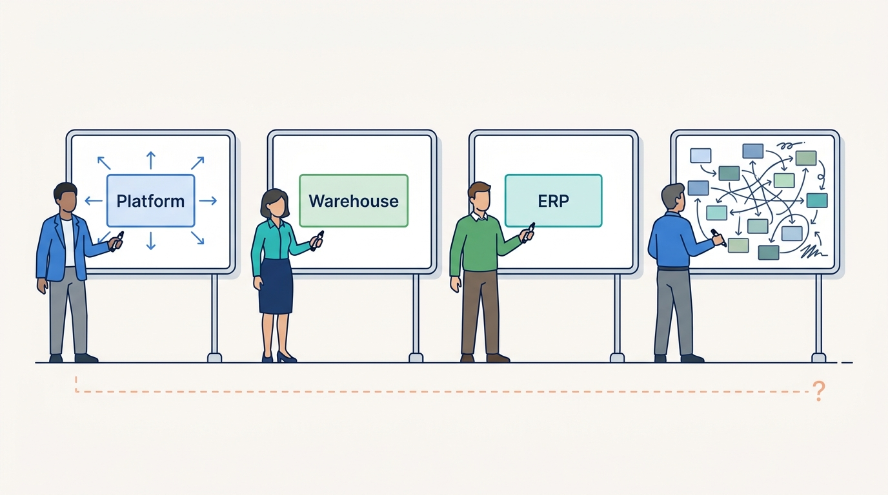
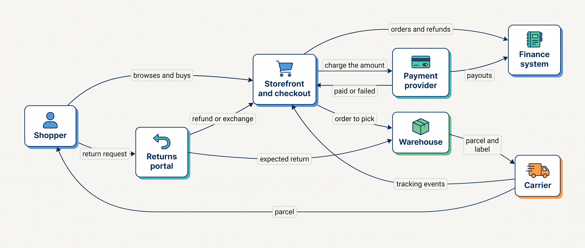
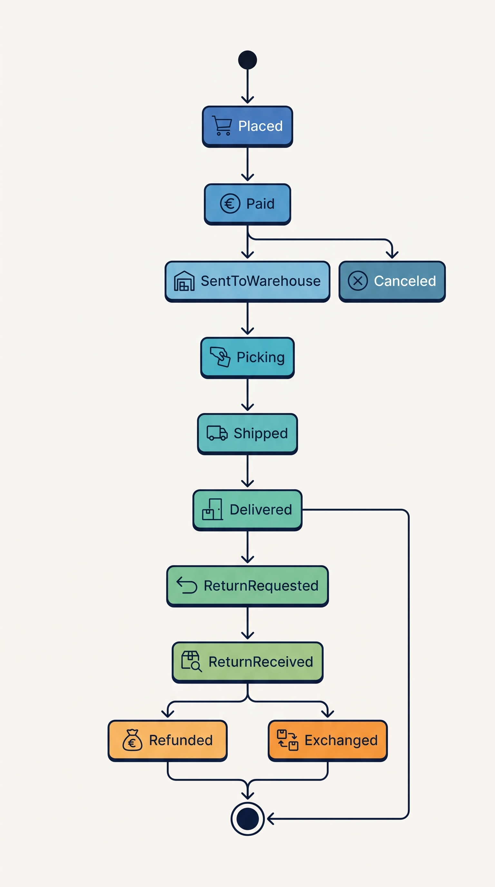
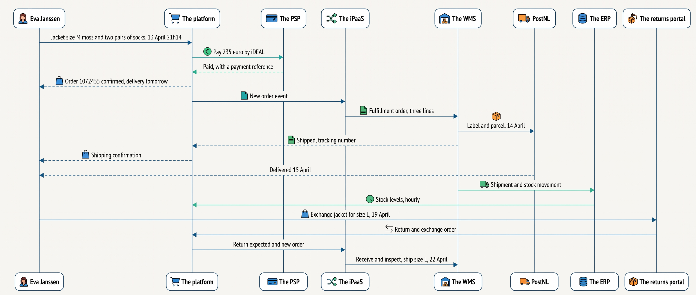
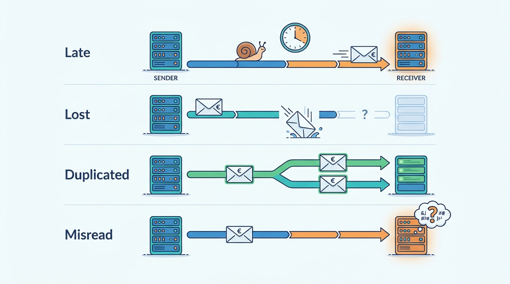

> **IN THIS CHAPTER, YOU WILL:** Follow one online order through every step and every system it touches, and learn the words the rest of the book uses for the things, the promises and the handoffs along the way.

> **KEY POINTS:**
>
> * **An order is a chain of promises, not a database row.** Between "buy" and "delivered" the shop promises a product, a price, an availability, a delivery date, a return right and a refund. Each promise is made by one system and has to be kept by another, often owned by a different team or vendor.
> * **Every step hands the order to a different system, and a handoff is a message.** Storefront, payment provider, warehouse, carrier, returns portal and finance system each hold their own copy of the order. Messages between them can be late, lost, duplicated or misread, and nearly every commerce failure is one of those four.
> * **The order has three status lines, not one.** Money, goods and returns each move through their own states. Reducing them to one "status" string is how a support agent ends up with three systems that disagree.

> **[FAILURE PATTERNS THIS CHAPTER ADDRESSES](where-commerce-platforms-go-wrong.html):**
>
> * **Schrödinger's Order** — the order's three status lines live in three systems, and an integration that flattens them into one word makes them disagree.
> * **The Message in a Bottle** — every handoff in the journey is a message sent from one system to another, and a message sent once and trusted is the cheapest way to lose or duplicate an order.
> * **The Phantom Stock** — the first promise in the journey, "in stock", is made by the storefront from a number the warehouse produced up to two hours earlier.

 
Ask a shopper what happens when they press "buy" and they will say: the money leaves my account and a parcel arrives. Ask the people who run a merchant and you get a different answer from each one. The ecommerce manager sees an order in the storefront's admin screen. The warehouse sees a pick list. The finance director sees an invoice and, days later, a payout. The support agent sees a ticket asking where the parcel is. **They are all describing the same order, and none of them can see the whole of it.**

That gap is the subject of this book, and this chapter is its map. An online order passes through about thirteen steps, from the moment a shopper searches for a jacket to the moment the accountant closes the month. At most of those steps the order moves from one system to another: storefront to payment provider and back, storefront to warehouse, warehouse to carrier, carrier to the customer's phone, and, if the jacket does not fit, back again through a returns portal, the warehouse and the finance system. **At every step a promise is made to the customer, and at almost every step the system that made the promise is not the one that has to keep it.**

This is the gentlest chapter in the book, deliberately. It introduces the things an order is made of, the systems that hold them, and two words the rest of the book leans on: **promise** and **handoff**.

**Where we are in the order's journey.** This chapter covers the whole of it. Eva Janssen's jacket, the order the book follows from [[meet-kestrel-and-pine]] onward, is walked here end to end for the first time, system by system; the chapters of [[part-9]] walk it again in full detail once the parts in between have explained each system.

## Setting the Scene at Kestrel & Pine: Four Drawings of One Order

In her second week as Head of Engineering, in January 2027, Noor Visser asked four colleagues at Kestrel & Pine to draw what happens to an online order. She gave each a whiteboard and twenty minutes.

Milan Petrov, who runs the storefronts and marketplaces, drew the platform (the hosted software-as-a-service commerce platform that runs the web shop) in the middle, with arrows to the payment provider and to "the warehouse". Daniel Okafor, Head of Operations, drew the warehouse system at Duiven in the middle, with orders arriving from "the integration thing" and parcels leaving with PostNL. Sanne de Wit, the Finance Director, drew the ERP (the enterprise resource planning system that keeps the books) in the middle, with invoices going out and payouts coming in. Ruben Alves, the lead integration engineer, drew thirty-four boxes and did not finish.

**Four drawings, four centers, and not one of them wrong.** Each person drew the part of the journey their system owns, which is the part they can see. What nobody had drawn, because nobody owned it, was the order's path *between* the boxes: which message carries it from one to the next, what each message promises, and what happens when a message is late.

**Figure 1:** *Four people drew the same order around four different centers; none of them drew the path between the boxes, because nobody owned it.*

Noor's response was to pick one order and follow it, with a notebook, through every system it touched. The order the book uses for that walk is Eva's jacket, placed in April 2027. Before following it, the chapter needs the thirteen steps, the things an order is made of, and the two words that describe how it moves.

## The Journey in Thirteen Steps

Every consumer order, on every platform, passes through roughly the same steps. The names vary by company; the shape does not. The table lists each step, what happens, the **promise** the merchant makes to the customer at that step, and which system usually has to keep it.

| # | Step | What happens | The promise made | Who must keep it |
| --- | --- | --- | --- | --- |
| 1 | **Discovery** | The shopper finds the product through search, a category page, an advertisement or a marketplace listing | "We sell this, and it is what the page says" | Product information, search ([[commerce-search-and-discovery]]) |
| 2 | **Product page** | Price, sizes, colors, images, stock and delivery promise are shown | "This price, this variant, in stock, delivered by then" | Pricing, inventory, delivery promise |
| 3 | **Cart** | The shopper collects items; the cart is a draft, not a commitment | "We will hold this draft for you" | The platform |
| 4 | **Checkout** | Identity, address, delivery option, final price with tax and shipping, payment method | "You pay exactly this, delivered there, by then" | Pricing, tax, shipping rates, availability |
| 5 | **Payment** | The payment service provider (PSP) takes the money or reserves it | "Your money is safe and matches the order" | The PSP, the platform |
| 6 | **Order creation** | The order record is created, numbered and confirmed; stock is committed to it | "The order exists and is being kept" | The platform or an order management system |
| 7 | **Fulfillment** | The warehouse picks, packs and labels the parcel | "What you ordered is in the box" | The warehouse system |
| 8 | **Shipping** | The carrier collects the parcel and scans it along the way | "It is on its way, here is where" | The carrier, the shipping service |
| 9 | **Delivery** | The parcel is handed over, left at a pickup point, or delivery fails | "Delivered when we said" | The carrier, the notification layer |
| 10 | **Service** | The customer asks "where is my order", changes an address or cancels | "We know where your order is" | Service tools over all of the above |
| 11 | **Return** | The customer sends an item back; the warehouse receives and inspects it | "You can send it back within 14 days" | Returns portal, warehouse |
| 12 | **Refund or exchange** | Money goes back or a replacement ships | "Your money is back within 14 days" | The PSP, the platform, the warehouse |
| 13 | **Accounting** | Invoice, credit note, payout reconciliation, month-end | "The books agree with what happened" | The ERP, finance |

Three things about the table matter before any technology is named. **The promises are made early and kept late**: steps 1 to 6 take minutes, steps 7 to 13 take days or weeks. **The system that makes a promise is rarely the one that keeps it**: the product page promises "in stock" from a number it was given, and the warehouse has to find the unit. And **steps 10 to 13 exist for every order**, not only the problem ones: at Kestrel & Pine, 24% of items sold online came back in 2026, and every order became an invoice. A journey that ends at "delivered" is half a journey.

## The Things an Order Is Made Of

Before following an order through systems, it helps to name the things the systems hold. These are the **entities** of commerce: the nouns that every platform, in its own words, keeps records of.

| Thing | In plain words | Where the book explains it |
| --- | --- | --- |
| **Product** | What the shop sells, as the shopper thinks of it: "the Ridgewalker jacket" | [[product-information]] |
| **Variant** or **SKU** | One sellable version of a product: the Ridgewalker jacket, women's, size M, color moss. SKU (stock keeping unit) is the identifier of that one thing. Kestrel & Pine has 3,400 products and 26,000 SKUs | [[product-information]] |
| **Price** | What a variant costs in one channel, country and currency, including or excluding tax | [[pricing-architecture]] |
| **Stock** or **inventory** | How many units of a SKU exist at a location, and how many of those may still be promised | [[inventory-and-availability]] |
| **Cart** | The shopper's draft: a list of variants and quantities with no commitment on either side | [[cart-and-checkout]] |
| **Order** | The record of what was bought, by whom, for how much, to be delivered where. It gets a number, and it is the thing every later system refers to | [[order-management]] |
| **Payment** | The money side of the order: what was reserved, taken, refunded, and the references the payment provider gave for each | [[commerce-payments]] |
| **Fulfillment order** | The instruction to one warehouse: ship these lines of this order to this address | [[warehouse-and-fulfillment]] |
| **Shipment** | A physical parcel with a carrier label and a tracking number, and the stream of carrier scans that follow it | [[shipping-and-delivery]] |
| **Return** | The customer's request to send items back, and the warehouse's record of what arrived and what was done with it | [[returns-and-exchanges]] |
| **Invoice** and **credit note** | The legal documents: what was sold, with how much tax, under which sequential number; and the mirror document that reduces it after a return | [[tax-invoicing-and-ledger]] |
| **Customer** | The person or company behind the order, as each system knows them | [[identity-and-master-data]] |

Two of these are often merged by newcomers. **A cart is not an order.** A cart is a draft that commits nobody, and most are abandoned: the Baymard Institute's running average across fifty studies published between 2006 and 2025 is a 70.22% cart-abandonment rate (page updated 28 October 2026). An order is a commitment on both sides. **An order is not a shipment.** One order can become two parcels from two locations, and the fulfillment order is the piece in between: the warehouse's unit of work.

## Promises and Handoffs

Two words carry the argument of this book, and this chapter owns their definitions.

A **promise** is a statement the merchant makes to the customer that some system will later have to make true. "In stock" is a promise. "€199" is a promise. "Ordered before 22:00, delivered tomorrow" is a promise. "Free returns within 14 days" is a promise. Promises are made by the systems closest to the customer (the storefront, the checkout, the returns portal) and kept by the systems closest to the goods and the money (the warehouse, the carrier, the payment provider, the finance system). **A commerce platform, in the sense this book uses, is the whole set of systems that make and keep those promises**, not one product with that name on the invoice.

A **handoff** is the moment responsibility for the order passes from one system to another. A handoff is always carried by a message: an API call, a file, a webhook, a queue entry, an EDI document (electronic data interchange: a structured document exchanged between two companies' systems), sometimes an e-mail. The storefront hands the order to the payment provider ("charge €235"); the payment provider hands the result back ("paid"); the storefront hands the order to the warehouse ("pick these three lines"). Each handoff has a sender, a receiver, a message format, a timing and, if things are done well, an owner.

**Figure 2:** *The order's journey as handoffs: every arrow is a message from one system to another, and every message can be late, lost, duplicated or misread.*

Each handoff carries requirements the business sets, usually without saying so: how fresh the information must be, how consistent with the sender's copy, how fast it must arrive, and what happens if the receiver is down. The table states them for the main handoffs of a consumer order; the targets are illustrative, and a real merchant sets them from its own promises.

| Handoff | Freshness the promise needs | Consistency | Speed | If the receiver is down |
| --- | --- | --- | --- | --- |
| Warehouse stock → storefront "in stock" | Seconds to minutes during a sale; hours on a quiet Tuesday *(assumption)* | The storefront's number may lag but must never exceed the warehouse's | Urgent in aggregate, not per message | The storefront keeps selling from a stale number: the Phantom Stock |
| Checkout → payment provider → checkout | Immediate | Exactly one charge per order | Seconds; the shopper is waiting | Checkout cannot complete; the shopper leaves |
| Storefront → warehouse (order to pick) | Before the cut-off the delivery promise depends on | Every paid order, exactly once, with the right lines | Minutes; it decides whether "tomorrow" holds | Orders queue; the promise slips silently |
| Warehouse → storefront (shipped, tracking number) | At label print | One shipment record per parcel | Minutes; it triggers the customer's e-mail | The customer sees "being prepared" after the parcel has left |
| Returns portal → warehouse → payment provider (refund) | On inspection, not on request | Exactly one refund per return | Within 14 days by EU law | A refund issued by hand in the PSP console: the Double Refund |
| Storefront → finance system (invoice, payment, refund) | Daily is usually enough | Every order, invoice and credit note exactly once, with stable identifiers | Hours to a day | Month-end does not reconcile |

Every merchant has all of these rows; what differs is whether anyone has written them down. That is why [[part-6]] is about integration.

## One Order, Three Status Lines

A newcomer's instinct is to give an order one status: *new*, *paid*, *shipped*, *delivered*, *returned*. Platforms learned long ago that this does not work, because the money, the goods and the return move independently.

Shopify's documentation (n.d., accessed November 2026) keeps three status families on one order: an *order status* (open, archived, canceled), a *payment status* (from authorized through paid to refunded, eight values) and a *fulfillment status* (from unfulfilled through in progress to fulfilled, six values). commercetools' order documentation (n.d., accessed November 2026) does the same with an `OrderState`, a `PaymentState` and a `ShipmentState`, plus separate states for each returned item. Neither vendor's "fulfilled" means "delivered"; delivery is known only if the carrier's events are fed back.

In plain words: an order can be *paid and not shipped*, *shipped and not paid* (an invoice customer), *delivered and partly refunded*, or *returned and not yet refunded*, and each of those is a normal state, not an error. The goods line alone, for a simple order, looks like this:

**Figure 3:** *The goods line of a simple consumer order; money and returns have their own lines, and a support agent needs all three to answer "where is my order".*

The Three-Status Order at Kestrel & Pine was exactly this. Order #1052877, a fleece and a pair of socks, shipped in two parcels because the socks were short in the pick location: the fleece on 7 December 2026, the socks a week later. The integration flow that connected the platform to the WMS had no notion of a partial shipment, so it marked the whole order fulfilled on the first shipment confirmation, and the platform showed *Delivered* once the carrier scanned the fleece. The warehouse management system (the WMS) tracks an order as a whole and showed *In picking* until the socks shipped. The ERP invoices on a WMS "order complete" message and showed *Not invoiced*. All three were true. None was the order's status, because no system held the order's status; each held one line of it, and no system could produce the sentence "your order ships in two parcels". [[order-management]] explains how an order management system becomes the place that holds all three, and [[customer-service-and-notifications]] follows the eleven tickets.

## Eva's Jacket, System by System

Now the walk. Kestrel & Pine is fictional, and so is Eva Janssen, a customer in Nijmegen; every number below is fixed for the whole book, so it will match every later chapter.

On **Tuesday 13 April 2027 at 21:14**, Eva orders on the Dutch storefront: one Ridgewalker shell jacket, women's, size M, color moss, at **€199**, and two pairs of merino hiking socks at **€18** each. The total is **€235**; shipping is free because the order is over €75. She pays by **iDEAL**, the Dutch bank-transfer method. The order number is **#1072455**. Because she ordered before the 22:00 cut-off on the storefront, the confirmation promises delivery tomorrow, Wednesday. The iPaaS in the figure is the integration tool that carries messages between Kestrel & Pine's systems; step 6 explains it.

**Figure 4:** *Eva's jacket crosses seven systems in nine days; every arrow is a handoff, and each one is a place where a later chapter's problems live.*

**Steps 1 and 2, discovery and product page (the platform).** Eva searched for "waterproof jacket" on the Dutch storefront. The product page showed the moss color in size M as in stock, at €199, deliverable tomorrow. The price came from the platform's own price list. The stock number came from the platform's inventory field, which the ERP updated up to an hour earlier from a number the WMS gave it up to fifteen minutes before that. The delivery promise came from a static rule in the theme (the storefront's page templates): before 22:00 means tomorrow. Three promises, three sources, and only the price is the platform's own.

**Steps 3 and 4, cart and checkout (the platform).** The cart held three lines. At checkout the platform asked for Eva's address, offered home delivery by PostNL at €0, computed the total of €235 including Dutch VAT (value-added tax) at the standard rate of 21%, and offered iDEAL, cards, PayPal, Klarna, Bancontact and Apple Pay. This is the step the book calls **checkout orchestration**: in a few seconds the platform has called pricing, promotions, tax, availability, shipping rates and the payment provider, and turned a draft into a set of promises.

**Step 5, payment (the PSP).** The platform asked the payment provider (the **PSP**, payment service provider: the company that takes the shopper's money and later pays it out to the merchant) to collect €235 by iDEAL. iDEAL is different from a card: Mollie's documentation (n.d., accessed November 2026) describes it as an instant charge, captured automatically, with no chargeback and a 15-minute session timeout. So within a minute the PSP told the platform, by a **webhook** (a message the PSP pushes to a web address the merchant registered), that the payment was complete, with a reference. For a card payment this step has two halves, an **authorization** that reserves the money and a **capture** that takes it, which [[commerce-payments]] explains.

**Step 6, order creation (the platform).** Strictly, the platform created order #1072455 a moment before the iDEAL result arrived, with the payment *pending*, and the webhook then marked it paid; steps 5 and 6 overlap. It committed one moss M jacket and two pairs of socks from its own available quantity, sent Eva a confirmation e-mail and published an order event to the **iPaaS** (integration platform as a service: the hosted tool Kestrel & Pine uses to move data between systems). The order now exists in one system. Within an hour it will exist in three.

**Step 7, fulfillment (the WMS).** The iPaaS created a **fulfillment order** in the warehouse management system (the **WMS**, the software that runs the physical work at Duiven: where stock sits, who picks what, into which box). On Wednesday 14 April the jacket and the socks were picked in a morning wave, packed in one box and labeled. The WMS reported the shipment and the tracking number back through the iPaaS to the platform, which sent Eva a shipping confirmation, and to the ERP, which recorded the stock movement.

**Steps 8 and 9, shipping and delivery (PostNL).** PostNL collected the parcel on Wednesday evening and delivered it on **Thursday 15 April**. Its scans (accepted, sorted, out for delivery, delivered) reached the platform through the shipping service inside the WMS flow, and the order status page moved to *Delivered*. The promise made on Tuesday evening was broken by a day. The "before 22:00" rule dates from the years when a third-party warehouse in Tiel shipped the orders; at Duiven the last pick wave starts at 21:00, so an order placed at 21:14 is picked the next morning and leaves with the evening collection. Nobody updated the sentence on the page, and Eva did not complain, which is why nobody noticed. [[shipping-and-delivery]] replaces the rule with a computed promise.

**Step 10, service.** Eva did not call. Had she asked "where is my order" on Wednesday evening, the agent would have worked from what the support team calls "the five tabs": the platform's order screen, the WMS, the shipping service's tracking page, the PSP console and the returns portal, with the ERP visible only to finance.

**Step 11, return (the returns portal and the WMS).** On **Monday 19 April** Eva used the returns portal to request an **exchange** of the jacket for size L: too small. The portal, a separate SaaS (software as a service) product, issued a PostNL return label and told the platform, through its API, that a return was expected and a new order for size L should be created. The portal has made two promises: that Eva may return the jacket, which EU law backs (Directive 2011/83/EU gives a consumer 14 days from receiving goods to withdraw from a distance purchase without giving a reason), and that size L will ship, which depends on size L being in stock.

**Step 12, exchange (the WMS, the platform).** The return was received at Duiven on **22 April**, inspected and graded resellable; the WMS reported the receipt, the platform closed the return, and the held exchange order for size L shipped the same day. Had Eva chosen a refund, the PSP would have returned €199 by iDEAL reversal and the ERP would have issued a credit note.

**Step 13, accounting (the ERP).** On dispatch, the ERP generated an invoice for order #1072455: €235 gross, of which €194.21 net revenue and €40.79 VAT at 21%. When the PSP paid out Tuesday's sales a few days later, finance matched the payout batch to the orders in it, fees deducted. The exchange produced a credit note for the size M jacket and a new invoice for size L, netting to zero. Under the accounting standard IFRS 15, revenue is recognized when the goods are delivered, not when Eva paid, which is why finance cares about step 9 and not only step 5. [[tax-invoicing-and-ledger]] owns this.

The table says what each system knew at each moment. Read it down a column and you see one system's world; across a row, why Noor's colleagues drew four pictures.

| Moment | The platform | The PSP | The WMS | The ERP | The returns portal |
| --- | --- | --- | --- | --- | --- |
| Tue 21:14, paid | Order #1072455, paid, unfulfilled | Payment, €235, complete | Nothing yet | Nothing yet | Nothing |
| Wed morning, picked | Paid, unfulfilled | Complete | Fulfillment order in picking | Order copy, not invoiced | Nothing |
| Wed afternoon, shipped | Paid, fulfilled, tracking number | Complete | Shipped | Invoice issued, stock reduced | Nothing |
| Mon 19 April | Delivered, return open, exchange order held | Complete | Return expected | Invoiced | Return requested, label issued |
| 22 April | Return closed, exchange shipped | Complete | Return received, resellable; size L shipped | Credit note and new invoice | Return complete |

Six systems, six copies of the order, each correct about its own part. That is normal. The question the book keeps asking is which copy is the one to believe when two disagree, and how the others learn when it changes. [[boundaries-and-systems-of-record]] names that copy the **system of record**.

## Why the Joins Are Where Things Break

Each arrow in Figure 2 is a message. Messages can go wrong in only four ways, and all four have happened at Kestrel & Pine.

**Late.** The stock number on the product page was up to two hours old because it had traveled WMS → ERP → platform → marketplace connector in fifteen-minute and hourly hops. On the evening of Black Friday 2026 the Ridgewalker jacket sold out in the warehouse at 19:40 and the storefronts and marketplaces kept selling it for up to two hours: 1,340 units oversold, 1,120 orders canceled or delayed, about €96,000 in cost. The same evening the queue carrying orders to the WMS backed up for four hours.

**Lost.** In February 2027 the marketplace connector (the software that sends listings and stock to marketplaces such as bol, the Dutch and Belgian marketplace, and brings their orders back) retired an API version on a published date. The agency script that pushed the platform's stock figures into the connector still used the retired version, so the connector kept sending bol its last figures for two days. A message that is not sent produces no error.

**Duplicated.** Over three weeks in January 2027, 212 returns were refunded twice: once by the returns portal through the platform's API, and once by a support agent in the PSP's console who could not see that the first refund had happened. €19,400 went out twice; most was recovered. Two senders, one receiver, no shared record of what had already been done.

**Misread.** The Three-Status Order was three systems reading the same two-parcel order differently, each consistently with the messages it had received: "shipped" meant "all shipped" to one and "first parcel shipped" to another.

**Figure 5:** *Every handoff is a message, and a message can fail in only four ways: late, lost, duplicated or misread.*

Two ideas, introduced here and worked in [[events-consistency-and-reconciliation]], are the field's answer. **Idempotency** means that receiving the same message twice has the same effect as receiving it once: a second "refund order #1072455" request must not produce a second refund. Stripe's documentation (n.d., accessed November 2026) describes the mechanism on the payment side: a client sends an idempotency key with each request, and a retry with the same key returns the saved result instead of acting again. **Reconciliation** means regularly comparing two systems' copies and listing the differences: the platform's orders against the WMS's shipments, the returns against the refunds, the PSP's payouts against the invoices. The first weekly reconciliation Kestrel & Pine ran, in May 2027, found 2.3% of active variants with different stock quantities in the WMS and the platform. Neither idea is advanced; both are routinely skipped, because each integration was built to make the happy path work.

## In Practice: What the Public Record Says

Vendor documentation and regulation describe the journey's steps with surprising precision.

**Payment success is learned by message, not by page.** Stripe's checkout fulfillment guide (n.d., accessed November 2026) says a merchant "can't rely on triggering fulfillment only from your checkout landing page, because it's not guaranteed customers visit that page", and that the fulfillment function must "correctly handle being called multiple times with the same Checkout Session ID". commercetools' checkout documentation (n.d., accessed November 2026) creates the order *before* the payment provider has answered, with the payment pending, and warns to start fulfilling "only if the Payment contains a Transaction" with a successful state. In both designs the handoff at step 5 is asynchronous: the order waits for a message.

**Messages arrive more than once and out of order.** Stripe's webhook documentation (n.d., accessed November 2026) retries delivery "for up to three days", "doesn't guarantee the delivery of events in the order that they're generated", and warns that endpoints "might occasionally receive the same event more than once", so receivers should track event identifiers. Mollie's webhook (n.d., accessed November 2026) carries only a payment identifier and no status, so that a forged call can never mark an order paid; the receiver must fetch the status, and Mollie retries ten times over about 26 hours. These are the vendors' own descriptions of the Message in a Bottle, and of its remedy.

**The warehouse handoff is a handshake.** Shopify's fulfillment-service documentation (n.d., accessed November 2026) sends a fulfillment request that the warehouse's service must accept or reject; fulfillments "can't be created for a fulfillment order before the fulfillment service accepts", and once accepted, a cancellation becomes a *request* the warehouse may refuse. That handshake is what closes the order's edit window.

**Tracking is the customer's view of the journey.** Shopify's customer-notification page (n.d., accessed November 2026) lists the default messages: order confirmation (which cannot be switched off), shipping confirmation at fulfillment, and "out for delivery" and "delivered" when a carrier reports them. Its order-status page warns that "if you fulfill an order without a tracking number, then no shipping updates are received". Gorgias, a helpdesk vendor, reported from its own customer base that "where is my order" requests were about 18% of incoming support contacts (article updated November 2023; one vendor's data, now approaching three years old).

**The law fixes the outer bounds of three promises.** Directive 2011/83/EU on consumer rights (2011, in force) requires delivery "not later than 30 days from the conclusion of the contract" unless agreed otherwise (Article 18); gives the consumer 14 days from receiving the goods to withdraw without reason (Article 9); and requires the trader to reimburse "not later than 14 days" after being informed, by the same means of payment, while allowing the trader to wait until the goods or proof of sending arrive (Article 13). Each clause is a date the order record must be able to compute.

**The books are the last handoff.** Odoo's accounting documentation (version 18, accessed November 2026), representative of how ERPs behave, assigns an invoice its number from a sequence on confirmation, after which "an invoice can no longer be updated"; a credit note "is the only legal method for canceling, refunding, or modifying a validated invoice". Eva's exchange therefore produced two new documents, not an edit.

## Across Scale Stages: When It Fits and When It Limits

The thirteen steps do not change with the size of the merchant; what changes is how many systems share them and how many channels feed them. At the **Starting** stage (Kestrel & Pine in 2016–2018) one hosted platform makes and keeps most promises itself, and the PSP, a third-party warehouse and the carrier are the only outside systems. At the **Growing** stage (2019–2022) a second channel creates orders outside the platform, an ERP or a 3PL (a third-party logistics provider that warehouses and ships for the merchant) holds a copy of orders and stock, and "which system is right?" is asked for the first time. At the **Omnichannel** stage (2023 onward) four channels create orders in four systems and stock sits in a warehouse, six stores and a marketplace's fulfillment center; the joins carry the business, and an order hub, an availability service and written integration contracts become necessary. At the **Group** stage several brands or countries run the journey over shared services with local differences. Kestrel & Pine is at stage 3, and its 2027 problems are stage-3 problems: not any one system, but the handoffs between a dozen. [[commerce-business-models]] defines the stages; [[commerce-scaling-stages]] works them.

## When It Goes Wrong at Each Step

None of these needs a disaster; all happen on normal weeks.

| Step | Ordinary failure | How it is detected | How it is recovered |
| --- | --- | --- | --- |
| Product page | Stock shown is stale; price differs from another channel | Oversell cancellations; a marketplace's price-parity warning | Stock events instead of periodic sync; one price owner ([[pricing-architecture]]) |
| Checkout | Payment succeeded but no order was created (the shopper closed the tab) | Payments in the PSP with no matching order | A job that finds paid-without-order and creates or refunds; the webhook as the trigger |
| Payment | Webhook arrives twice or never; the PSP pauses the account (the Card-Testing Night, 40 minutes) | Duplicate order numbers; orders stuck in *pending* | Idempotent handling by event identifier; a daily PSP-to-orders reconciliation |
| Order to warehouse | Order arrives late, never, or twice | Orders paid but not picked past the cut-off; two parcels for one order | Queue monitoring on age, not only on errors; the request-accept handshake |
| Fulfillment and shipping | Wrong item picked; tracking number not passed back; parcel lost | Returns marked "wrong item"; "where is my order" tickets; carrier exceptions | Scan-to-verify at pack; tracking number required on the shipped message |
| Return and refund | Refund issued twice; refund without receipt; restock without inspection | Returns-to-refunds reconciliation; PSP refunds not linked to a return | One refund path, triggered by the inspection event; one refund per return |
| Accounting | Invoice skipped or duplicated; payout does not match orders | Month-end three-way match of orders, PSP payouts and bank | Idempotent order-to-invoice posting; credit notes, never edits |

The common thread: **detection is a comparison** between two systems' copies, and **recovery is a message sent again safely**. A merchant that can compare and can safely resend is most of the way to a reliable journey; one that can do neither will meet every pattern in [[where-commerce-platforms-go-wrong]] in turn.

## What to Take Away

**Established.**

- An order's money, goods and return move through separate states; the major platforms model them as separate status families on one record (Shopify's order, payment and fulfillment statuses; commercetools' order, payment and shipment states), and "fulfilled" never means "delivered" without carrier events.
- Payment outcomes arrive as messages that can be delayed, duplicated and reordered; payment providers document this and tell receivers to deduplicate by event identifier and to treat the message, not the landing page, as the trigger for fulfillment.
- EU consumer law fixes three promises for every distance sale: delivery within 30 days unless agreed, a 14-day right of withdrawal from receipt, and a refund within 14 days of notice (Directive 2011/83/EU).
- Invoices are numbered sequentially at posting and never edited; a return produces a credit note.

**Depends on context.**

- Whether the platform, an ERP or an order management system should hold the order record depends on how many channels create orders and how many locations fulfill them. One channel and one warehouse: the platform's order is enough. Several of each: an order hub becomes necessary ([[order-management]]).
- Whether a static delivery promise is acceptable depends on how often it is broken. "Before 22:00, tomorrow" served Kestrel & Pine for years; it fails for every order placed after Duiven's last pick wave, Eva's included, and worst when the warehouse queue backs up, which is when the promise matters most ([[shipping-and-delivery]]).
- How fresh stock must be on the product page depends on how fast the merchant sells its last units. Hourly is fine for a slow-moving catalog and ruinous on a peak evening ([[inventory-and-availability]]).

**The author's synthesis.**

- I treat a commerce platform as the whole set of systems that make and keep promises to a customer, and I judge an architecture by its handoffs, not by its boxes: ten good systems with no owner for the messages between them make a worse platform than five ordinary systems with written contracts for every arrow.
- Before any ownership decision, I follow one real order through every system with a notebook, as Noor did. The table of what each system knows at each moment is the cheapest architecture document a merchant can produce, and the one most merchants have never produced.

## Questions to Ask

Take these into your first week, a design review or a vendor demo.

1. Can someone draw the order's path through every system, with the message that carries each handoff and the person who owns it?
2. For a given order number, which systems hold a copy, and which copy is believed when they disagree?
3. How does the storefront learn that the warehouse sold the last unit, and how long does that take on the busiest evening of the year?
4. What triggers fulfillment: a page, a webhook or a scheduled job? What happens when the trigger arrives twice, or never?
5. When the warehouse starts picking, what stops an order edit, a cancellation or a second fulfillment order?
6. How many ways can a refund be issued, and do they share a record of what has already been refunded?
7. Which of the merchant's promises (stock, price, delivery date, return right) are computed from data, and which are rules someone typed in years ago?
8. When was the last time anyone compared two systems' copies of the same orders, and what did they find?

The journey is the same for every merchant, but the systems that run it and the promises they make differ sharply by who is selling what to whom. A brand selling its own jackets to consumers, a wholesaler shipping pallets to a retail chain, a marketplace seller and the marketplace itself run different journeys over the same thirteen steps, with different economics pulling on every one of them. [[commerce-business-models]] takes that up next.

## Sources and Evidence

*Company, product and investor sources*

- [Checkout fulfillment](https://docs.stripe.com/checkout/fulfillment), Stripe, n.d., accessed 2026-11. Fulfillment must not rely on the landing page; the fulfillment function must handle repeated calls with the same session identifier.
- [Receive Stripe events in your webhook endpoint](https://docs.stripe.com/webhooks), Stripe, n.d., accessed 2026-11. Retries for up to three days, no ordering guarantee, duplicate deliveries, deduplication by event identifier.
- [Idempotent requests](https://docs.stripe.com/api/idempotent_requests), Stripe, n.d., accessed 2026-11. Idempotency keys and saved responses on retry.
- [Webhooks](https://docs.mollie.com/docs/webhooks), Mollie, n.d., accessed 2026-11. Identifier-only payload, ten retries over about 26 hours.
- [iDEAL](https://docs.mollie.com/docs/ideal), Mollie, n.d., accessed 2026-11. Instant charge, automatic capture, no chargeback, 15-minute session timeout.
- [Capture a payment](https://docs.adyen.com/online-payments/capture/), Adyen, n.d., accessed 2026-11. Authorization reserves funds; capture by default immediately or manually on shipment.
- [Payments lifecycle](https://docs.commercetools.com/checkout/payments-lifecycle), commercetools, n.d., accessed 2026-11. Order created with a pending payment; fulfill only on a successful transaction.
- [Orders](https://docs.commercetools.com/api/projects/orders), commercetools, n.d., accessed 2026-11. Separate order, payment, shipment and return-item states.
- [Order status](https://help.shopify.com/en/manual/fulfillment/managing-orders/order-status), Shopify, n.d., accessed 2026-11. Order, payment and fulfillment status families.
- [Build for fulfillment services](https://shopify.dev/docs/apps/build/orders-fulfillment/fulfillment-service-apps/build-for-fulfillment-services), Shopify, n.d., accessed 2026-11. The fulfillment request handshake; cancellations after acceptance are requests.
- [Customer notifications](https://help.shopify.com/en/manual/fulfillment/setup/notifications/customer-notifications), Shopify, n.d., accessed 2026-11. Default transactional messages and the events that trigger them.
- [Understanding order status pages](https://help.shopify.com/en/manual/fulfillment/setup/order-status-page/understanding-order-status-pages), Shopify, n.d., accessed 2026-11. Five customer-facing states; no updates without a tracking number.
- [Customer invoices](https://www.odoo.com/documentation/18.0/applications/finance/accounting/customer_invoices.html) and [Credit notes and refunds](https://www.odoo.com/documentation/18.0/applications/finance/accounting/customer_invoices/credit_notes.html), Odoo, version 18 documentation, accessed 2026-11. Sequential numbering on confirmation, immutability, credit notes as the only correction.
- [How to automate WISMO requests](https://www.gorgias.com/blog/automate-wismo-requests), Gorgias, 2023 (updated November 2023). "Where is my order" at about 18% of incoming requests in one helpdesk vendor's data.

*Standards, regulation and official documentation*

- [Directive 2011/83/EU on consumer rights](http://publications.europa.eu/resource/celex/32011L0083), European Union, Official Journal, 2011. Delivery within 30 days (Article 18), 14-day withdrawal (Article 9), refund within 14 days (Article 13), passing of risk (Article 20).
- [VAT rates and exemptions](https://business.gov.nl/regulation/vat-rates-exemptions/), Netherlands Enterprise Agency (business.gov.nl), n.d., accessed 2026-11. Dutch standard VAT rate of 21%.
- [IFRS 15 Revenue from Contracts with Customers](https://www.ifrs.org/issued-standards/list-of-standards/ifrs-15-revenue-from-contracts-with-customers/), IFRS Foundation, n.d., accessed 2026-11. Revenue recognized when the performance obligation is satisfied.

*Research and practitioner sources*

- [50 cart abandonment rate statistics](https://baymard.com/lists/cart-abandonment-rate), Baymard Institute, 2026 (updated 28 October 2026). Average documented abandonment rate of 70.22% across fifty studies.

Kestrel & Pine is fictional; architectural recommendations, labeled inferences and labeled assumptions are the author's judgement.
