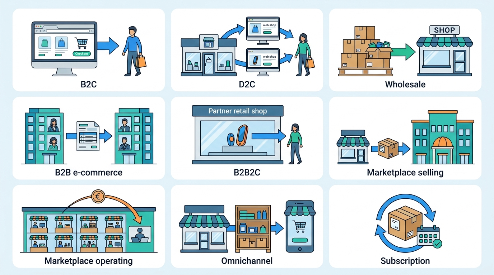
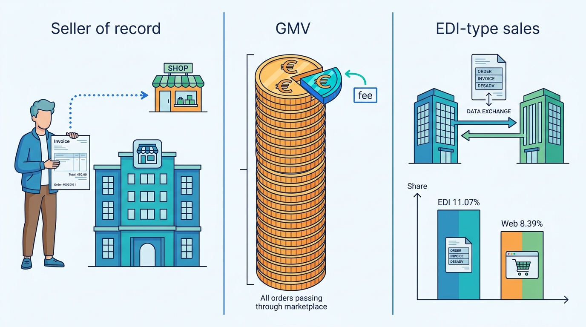
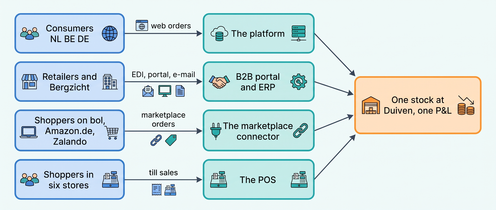
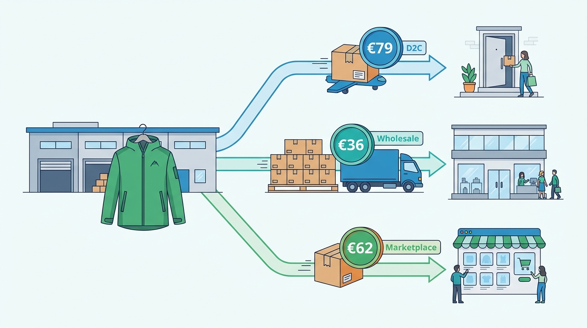
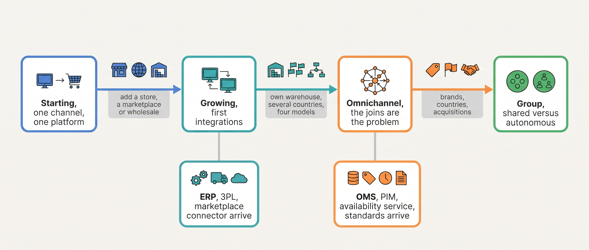
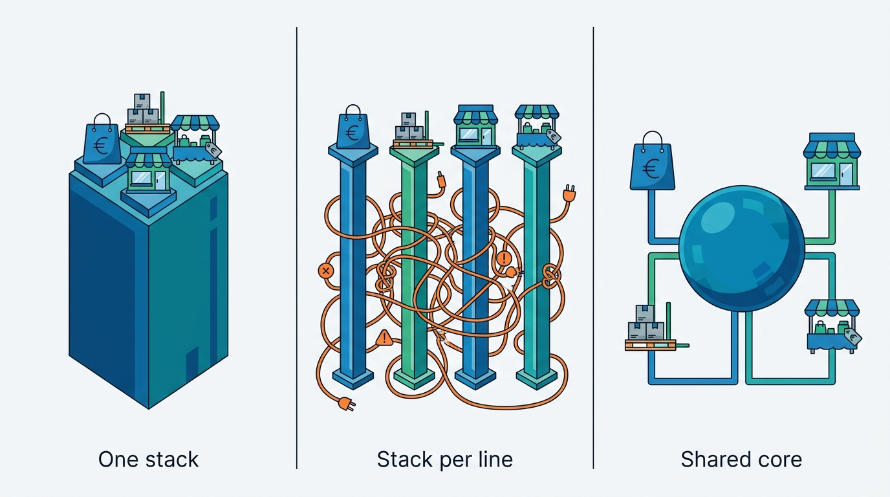

> **IN THIS CHAPTER, YOU WILL:** Learn the commerce business models, the unit economics of an order and the four scale stages, and see how each one pulls on the architecture behind it.

> **KEY POINTS:**
>
> * **A business model is a decision about who makes which promise.** Selling to consumers, to retailers, through a marketplace or as a marketplace changes who captures the order, who sets the price, who is the legal seller, who holds the stock and who ships. The systems follow from that, not from the technology.
> * **Each number in the unit economics of an order pulls on a different part of the platform.** Conversion pulls on checkout, basket size on promotions, margin on price control, returns on the reverse flow, payment fees on the provider choice, and the peak day on capacity. A merchant that knows its numbers knows where its architecture must be strong.
> * **Scale stages are defined by shape, not revenue.** A merchant moves from Starting to Growing to Omnichannel to Group by adding channels, locations and brands, and vendors' own price tiers confirm it. Each transition turns the joins between systems into the problem, which is why the order hub, the product hub and integration standards arrive together.

> **[FAILURE PATTERNS THIS CHAPTER ADDRESSES](where-commerce-platforms-go-wrong.html):**
>
> * **One Size Fits None** — business lines with different promises are forced onto one stack, or kept apart, before anyone has worked out what they share.
> * **The Giant's Boots** — an architecture is copied from a marketplace operator or a hundred-times-larger retailer whose business model, and therefore whose problems, the merchant does not have.
> * **The First Snowfall** — seasonality is a property of the business model, and the merchant that has not measured its peak meets it in production.

 
A brand's web shop sells a jacket to a shopper; its wholesale team sells the same jacket to a retail chain. The shopper expects an agreed price, a delivery date and a return right. The chain may require a contract price, correctly labeled pallets and an invoice its systems can read. Software built for the first sale can accept the second order yet fail to meet its conditions.

Marketplace sellers must also meet the marketplace's rules or face penalties. The marketplace operator has a different job: coordinate the shopper's experience across sellers and pay those sellers. Similar-looking orders can create very different obligations.

This chapter explains the business models through those obligations, then follows the money an order earns and costs. Its practical question comes from Kestrel & Pine, the fictional outdoor brand: **what should four business lines share, and what must stay separate?** The four scale stages introduced here help answer that question as the company grows.

**Where we are in the order's journey.** Eva's Ridgewalker jacket is a consumer purchase. The same jacket also leaves Kestrel & Pine through a wholesale reorder from retail chain Bergzicht Outdoor, an Amazon.de order, or a sale in the Antwerp store. Each needs a different route from order to payment and delivery. [[journey-of-an-order]] traces the consumer route.

## Setting the Scene at Kestrel & Pine: One Jacket, Four Ways to Sell It

In February 2027, Head of Engineering Noor Visser reviewed the accounts with Finance Director Sanne de Wit before proposing **Waypoint**, the company's program to improve its commerce systems. Kestrel & Pine's 2026 revenue was **€48.0 million**, with a **54%** gross margin: €27.0 million online, €12.0 million wholesale, €6.0 million through six stores and €3.0 million through three marketplaces. All four lines shared one warehouse in Duiven and a catalog of 3,400 products.

Then Noor asked each head of a business line what they needed from technology in 2027.

Milan Petrov, responsible for storefronts and marketplaces, wanted more shoppers to complete checkout, credible delivery dates and fresher marketplace stock. Wholesale lead Lea Moreau needed correct contract prices and fewer orders typed from email into the enterprise resource planning system (ERP), which keeps the books and wholesale orders. Manual entry still accounted for 38% of wholesale orders. She also wanted Bergzicht's electronic data interchange (EDI), the exchange of structured business documents, to stop producing chargebacks.

Operations lead Daniel Okafor needed pallets and parcels to stop competing for the same pickers, and the web shop to see store stock. Sanne needed one definition of an order so finance could close the month faster.

**Each request exposed a different business obligation.** The systems served individual needs but did not carry each order reliably from sale to completion. Noor's proposal had to identify the facts the four lines could share and the rules each needed to keep.

## The Business Models, Defined by the People Who Report Them

Marketing uses the model names loosely. Statistics agencies and annual reports use them precisely, because they have to count something. The table lifts their definitions.

| Model | Working definition | Who reports it that way |
| --- | --- | --- |
| **B2C** (business to consumer) | Sales to private consumers over websites or apps | Eurostat counts "web sales" to private consumers separately from sales to enterprises and public authorities (data extracted February 2026) |
| **D2C** (direct to consumer) | A brand selling through channels it operates itself: its own web shop, its own stores | VF Corporation's fiscal 2026 annual report (May 2026): direct-to-consumer "includes VF-operated retail stores, brand e-commerce sites, concession retail locations and other digital platforms", 44% of its revenue |
| **Wholesale** (B2B for a brand) | Selling to retailers and distributors who resell | Columbia Sportswear's 2025 annual report (February 2026) separates its wholesale channel (department store chains, internet retailers, international distributors) from its direct-to-consumer stores and sites |
| **B2B e-commerce** (business to business) | Business buyers ordering electronically, by web shop or by structured messages between systems | Eurostat splits "web sales" from "EDI-type sales": in 2024, EDI-type sales were 11.07% of EU enterprise turnover and web sales 8.39%, so most business ordering is still by structured message, not by web shop |
| **B2B2C** (business to business to consumer) | A brand sells through a partner's consumer channel while keeping control of its product, content and price | Zalando's 2025 annual report (March 2026) describes a partner business that lets brands sell on Zalando "while maintaining full control over their offer, content and pricing" |
| **Marketplace selling** | Selling on someone else's marketplace | Eurostat: web sales through marketplaces were 1.30% of EU enterprise turnover in 2024, against 7.08% through own websites or apps |
| **Marketplace operating** | Running the marketplace and taking a fee from sellers | Amazon's 2025 annual report (February 2026): "We offer programs that enable sellers to sell their products in our stores, and fulfill orders using our services. We are not the seller of record in these transactions"; third-party seller services were $172.2 billion of net sales |
| **Omnichannel** | Stores and digital channels sharing stock, orders and customers | Target's fiscal 2025 annual report (March 2026): stores fulfilled 97.6% of its merchandise sales, including shipment from stores, order pickup and same-day delivery |
| **Subscription** | Recurring orders under a standing agreement, or a paid membership that changes the promises | Amazon reports "subscription services" of $49.6 billion in 2025 (Prime and digital subscriptions); Target's paid Target Circle 360 membership gives "unlimited same-day delivery on eligible orders over $35" |

**Figure 1:** *The nine business models at a glance: each is a different answer to who sells, to whom, and through whose channel, and a merchant usually runs several at once.*

Three terms in the table need plain words. The **seller of record** is the party that legally sells to the customer: the one whose name is on the invoice, who owes the VAT (value-added tax) and who answers for the consumer's rights. A marketplace operator usually is not, which is why Amazon says so in its annual report. **GMV** (gross merchandise value) is the value of orders passing through a platform, including what the platform does not keep: Shopify's 2025 annual report (February 2026) defines it as "the total dollar value of orders facilitated through our platform" net of refunds. **EDI-type sales** are orders received as structured messages between systems, which [[edi-and-e-invoicing]] explains; the point here is that for business customers they are the majority.

**Figure 2:** *Three terms in pictures: the seller of record is the name on the invoice, GMV counts every order but the marketplace keeps only its fee, and in the EU more business turnover arrives by structured message (11.07%) than through web shops (8.39%) (Eurostat, 2024 data).*

The models are not exclusive. Kestrel & Pine runs four at once, which is what "omnichannel" means in practice, and most merchants above the Starting stage run at least two.

## What Each Model Changes in the Promise Chain

[[journey-of-an-order]] listed the promises an order carries: a product, a price, an availability, a delivery, a return right, a refund, an invoice. A business model is a decision about who makes and keeps each of them. The table says who, per model; the architectural consequence follows in the last column.

| Promise | D2C brand | Wholesale | Marketplace seller | Marketplace operator | Store (omnichannel) |
| --- | --- | --- | --- | --- | --- |
| Who captures the order | The brand's storefront | The buyer's system (EDI, punchout) or the brand's B2B portal | The marketplace; the seller imports it | The marketplace, for thousands of sellers | The till (the POS, point of sale) |
| Who sets the price | The brand, per market | Negotiated per account; price lists and terms | The seller, under parity rules and repricing pressure | The sellers; the operator sets fees | The brand, but often a separate price list |
| Who is seller of record | The brand | The brand (to the retailer) | The seller | Usually not the operator | The brand |
| Who holds the stock | The brand's warehouse or a 3PL (a third-party logistics warehouse) | The brand's warehouse; pallets, not parcels | The seller, or the marketplace's fulfillment program | The sellers; the operator in its fulfillment program | The store, as a location of its own |
| Who ships | The brand via carriers | The brand to a distribution center, with labels the buyer requires | The seller or the marketplace | The sellers or the operator | The customer carries it; or the store ships |
| Who handles returns | The brand's portal and warehouse | Rare; defects and chargebacks instead | The marketplace's policy, debited to the seller | The operator's policy | The store, often for online orders too |
| Who invoices | The brand, per order | The brand, per shipment, often electronically | The seller (or the marketplace on its behalf) | The operator invoices fees to sellers | The till, with fiscal rules per country |
| **Architecture consequence** | The brand owns the whole chain and every system in it | Order capture moves into the buyer's systems; prices and terms per account are the hard part | Someone else's catalog format and order format become the contract | Tenancy, payouts and seller-of-record questions; a different book ([[marketplaces-and-channel-integration]] and LISTED's [[marketplace-regulation]]) | Store stock becomes sellable online; the till becomes a system |

A few words in the table need plain definitions. **Punchout** lets a business buyer open the supplier's catalog from inside the buyer's own purchasing system and send the filled cart back there for approval. **Parity rules** are a marketplace's terms that a seller may not offer the same product cheaper elsewhere; **repricing** is the automatic adjustment of marketplace prices against competing sellers. **Tenancy** is the vendor's job of running many sellers or merchants on one shared system while keeping their data apart.

Two rows deserve emphasis. **Who captures the order** decides where the order record is born; a merchant with orders born in four systems needs a fifth to hold them ([[order-management]]). **Who holds the stock** decides how many locations the availability calculation must cover; a marketplace's fulfillment program is a location the merchant can see but not count ([[inventory-and-availability]]).

**Figure 3:** *Kestrel & Pine's four business lines capture orders in four systems and draw on one stock and one profit-and-loss statement; what the lines share is the stock and the money, and what they do not share is the promise.*

The **merchant's view and the vendor's view** of the same platform differ in the same way. Shopify's 2025 annual report (February 2026) notes that while most of its merchants subscribe to its Basic and Grow plans, the majority of its GMV comes from merchants on Shopify Plus and enterprise offerings. For the vendor, the product is a tenancy and GMV is the metric. For the merchant, the platform is one system among a dozen and the order is the metric. A merchant reading a vendor's roadmap should remember which metric it was written for.

## The Unit Economics of an Order

How much money does one order make? The answer decides which promises a merchant can afford, and each number in it pulls on a different part of the architecture. The table gives the metrics, a dated public benchmark for each, Kestrel & Pine's own figure, and the part of the platform the metric pulls on.

| Metric | In plain words | Public benchmark (dated) | Kestrel & Pine 2026 | What it pulls on |
| --- | --- | --- | --- | --- |
| **Conversion rate** | Purchases divided by visits | Median 1.3%, mean 1.9% across 438 Shopify stores in the 90 days to 31 October 2026 (Littledata, November 2026) | Not recorded *(assume about 1.8%)* | Storefront speed, checkout steps, visible total cost ([[cart-and-checkout]], [[storefront-architecture]]) |
| **Cart abandonment** | Carts started and not bought | 70.22% average of 50 studies, 2006–2025 (Baymard, October 2026); top reasons: extra costs 40%, slow delivery 20%, forced account 18%, site errors 17% | — | The same: the top reasons are architecture failures, not design failures |
| **Average order value (AOV)** | Revenue per order | Shopify merchants' average cart $114.70 over the 2025 Black Friday weekend (December 2025); Zalando's average basket €62.8 in 2025 (March 2026) | €92 online, €70 marketplaces, €51 stores, €1,277 wholesale | Promotions, bundles, free-shipping thresholds ([[commerce-promotions]]); a wholesale order is a different object, not a bigger basket |
| **Gross margin** | Revenue minus cost of goods, as a share of revenue | VF 54.8% (FY2026), Columbia 50.5% (2025), Nike 42.9% (FY2026), Zalando 39.9% (2025), Target 27.9% (2025) | 54% | Markdown and price control: one price owner ([[pricing-architecture]]) |
| **Return rate** | Share of items or orders that come back; say which | 19.3% of US online sales projected for 2025 (the National Retail Federation, NRF, with Happy Returns, October 2025); 24.4% of online apparel orders in a 2023 survey (Coresight; evidence age) | 24% of items, 19% of orders online; 72,000 return parcels; 61% resold as new | The reverse flow: restock, refund, credit note across systems ([[returns-and-exchanges]]) |
| **Shipping cost and threshold** | What a parcel costs and when it is free | Extra costs are the top abandonment reason (Baymard); Zalando charges a "minimum order fee" on small orders (2025 annual report) | Free over €75; 336,000 parcels | The delivery promise and carrier choice ([[shipping-and-delivery]]) |
| **Payment fees** | What the PSP (payment service provider) keeps per transaction | EU interchange capped at 0.2% debit and 0.3% credit for consumer cards since 9 December 2015 (Regulation 2015/751); Dutch list prices, n.d., accessed November 2026: Stripe 1.5% + €0.25, Mollie 1.80% + €0.25, Shopify Payments 1.9% to 1.4% + €0.25, iDEAL about €0.29–0.32 per payment | Not recorded | PSP choice and platform tier ([[commerce-payments]]) |
| **Customer acquisition cost** | Marketing spend per new customer | Warby Parker spent $110.2 million on marketing against $871.9 million revenue in 2025 (12.6%), up from 11.7% in 2023 (annual report, February 2026) | Not recorded | Analytics and identity: knowing who is new ([[commerce-data-and-analytics]]) |

Two observations follow for the newcomer. First, **the abandonment reasons are an architecture list.** Unknown shipping costs until the last step, slow delivery promises, forced account creation and site errors are each a failure of a system to make a promise early and keep it. Second, **payment fees are an architecture decision disguised as a finance one.** For a merchant at €27 million online revenue, the gap between 1.9% and 1.4% plus a fixed fee is six figures a year, and whether the platform forces its own payment gateway, and at what fee, is one of the platform's pricing levers.

## The Same Jacket in Three Lines: A Worked Example

Kestrel & Pine's Ridgewalker jacket sells at **€199** to a consumer (including 21% Dutch VAT), at **€95** excluding VAT to a wholesale account, and at €199 on Amazon.de; its landed cost is **€58**. The table works one unit through three lines. Unmarked figures are Kestrel & Pine's own (fictional); everything marked *(assumption)* is illustrative and not a benchmark.

| Line | Online D2C (Netherlands) | Wholesale (Bergzicht) | Marketplace (Amazon.de, seller-fulfilled) |
| --- | --- | --- | --- |
| Price the customer pays | €199 incl. VAT | €95 excl. VAT | €199 incl. VAT |
| Net revenue after VAT | €164.46 | €95.00 | €167.23 at German VAT of 19% |
| Landed cost | €58.00 | €58.00 | €58.00 |
| Gross profit per unit | €106.46 (65% of net) | €37.00 (39%) | €109.23 |
| Payment or channel fee | iDEAL, about €0.30 *(from list prices)* | None; invoice on 30-day terms | Referral fee: Amazon's US pricing page lists 15% for most categories (n.d., accessed November 2026); *(assume 15% of €199, €29.85)* |
| Outbound shipping | One parcel, *(assume €5.50)* | 240 units on three pallets, *(assume €0.60 per unit)* | One parcel, *(assume €7.50 cross-border)* |
| Returns | 24% of items; *(assume €7.50 per return in carriage and handling, €1.80 per unit sold)* | Rare; chargebacks instead (€14,200 in Q3 2026) | Marketplace policy; *(assume as D2C)* |
| Marketing | *(assume 12% of net revenue, in the range Warby Parker reports: €19.74)* | A sales team, not per order | Sponsored listings; *(assume 5%, €8.36)* |
| **Contribution per unit** *(illustrative)* | **about €79** | **about €36** | **about €62** |
| What the line needs from the platform | Fast checkout, computed delivery date, one price per market, a returns flow that restocks and refunds once | Contract prices per account, electronic order capture, pallet picking with the labels the buyer demands, an invoice the buyer's system reads | A listing in the marketplace's format, stock per channel with a buffer, parity with the storefront price, the marketplace's return and performance rules |

Read across, the table says why the four heads of business lines asked for different things. The D2C unit earns the most and spends it on marketing, parcels and returns, so its platform must convert, promise and take returns well. The wholesale unit earns less than half as much but ships 240 at a time, on one invoice, with no returns, so its platform must get prices and documents right and nothing else. The marketplace unit pays a fee for the traffic D2C buys with marketing, and lives under rules it did not write. **One jacket, three businesses, three sets of promises, and the architecture has to serve all three without pretending they are the same.**

**Figure 4:** *One Ridgewalker jacket, three businesses: about €79 per unit online, €36 wholesale and €62 on a marketplace, each with its own promises for the platform to keep.*

## Seasonality and the Peak

Every consumer model has a peak, and the peak is the design load. The US Census Bureau's quarterly e-commerce release (August 2026) shows the shape in one number: e-commerce was 18.3% of retail sales in the fourth quarter of 2025, not seasonally adjusted, against 15.8% in the third. Adobe Analytics reported $44.2 billion of US online spending in Cyber Week 2025, with $16 million per minute between 8 and 10 pm on Cyber Monday (December 2025). Shopify reported $14.6 billion of GMV over the 2025 Black Friday weekend with a peak of $5.1 million per minute (December 2025), which is the moment a hosted platform earns its fee and a self-run one needs a load test.

Kestrel & Pine's peak is smaller and no gentler. Black Friday week 2026 brought **31,000** online orders, **10.6%** of the year's, and the peak hour on Friday 27 November carried **2,300** orders, **38 per minute**, with storefront traffic about **41 times** an average hour. The platform held. The stock sync chain and the warehouse queue did not, and the Black Friday Oversell followed. Two architectural facts come out of this. **Capacity is a property of the whole chain**, including every integration, not of the storefront, which [[peak-load-and-reliability]] works. And **the peak sets the calendar**: Hobbycraft, a UK retailer, postponed a website relaunch from before Christmas 2012 to 2013 because, in its chief executive's words, "we felt it was too risky to launch the website in peak trading" (Retail Week, February 2013; evidence more than a decade old, and still the rule). Wholesale has its own seasons, set by retailers' buying calendars; Bergzicht's spring reorder in April is one.

## The Four Scale Stages

The book compares every decision across four **scale stages**. This chapter owns the term: a scale stage is a **shape of business**, described by how many channels create orders, how many locations hold stock, how many countries and brands are served, and who runs the technology. The revenue bands are rough markers; the shape decides.

| Stage | Typical size | Shape | Business models typically run | What becomes necessary | Warning signs of outgrowing it |
| --- | --- | --- | --- | --- | --- |
| **1 — Starting** | Under about €2 million | One channel, a hosted platform, founder-run operations, a 3PL or a back room | One model: D2C, or a single marketplace, or a small B2B shop | The platform's built-in features; an accounting export; a PSP | Orders keyed by hand into anything; the founder as the integration |
| **2 — Growing** | About €2–20 million | Two or three channels, first store or wholesale line, first integrations, a small team and an agency | A second model is added, usually wholesale, a marketplace or a store | An ERP or accounting system, a 3PL or warehouse system, a marketplace connector; one agreed order number | The first oversell between two systems; an agency script nobody owns |
| **3 — Omnichannel** | About €20–200 million | Stores, wholesale, marketplaces and several countries; own warehouse; a dozen or more systems | Three or four models on one stock and one catalog | An order hub (an OMS, order management system), a product hub (a PIM, product information management system), an availability service, integration standards, one metric definition | Orders in four systems; two-hour stock lag; three definitions of "order"; support agents with five tabs |
| **4 — Group** | Over about €200 million, or several brands or business units | Multiple brands, countries or units; platform teams; acquisitions | All models, per brand or country, with different mixes | Shared services where the benefit is measured; autonomy where it is not; vendor-scale concerns (tenancy, extensibility) | A brand forced onto a shared stack that does not fit, or kept apart at twice the cost |

Kestrel & Pine passed through the first three: Starting in 2016–2018 with one Dutch web shop and a 3PL, Growing from 2019 with the first store, Belgium, Germany, the marketplace connector and the integration platform, and Omnichannel from 2023 with its own warehouse, the ERP, more stores and wholesale on the platform's business-to-business features. The Omnichannel stage is where its 2027 problems live, because that is the stage at which three or four models share one stock and one catalog, and the joins between a dozen systems become the business.

**Figure 5:** *Each stage transition adds a channel or a location and, with it, a join between systems; the hubs arrive at the Omnichannel stage because that is where the joins outnumber the boxes.*

**Vendors confirm the stages in their price lists.** Shopify's pricing page (n.d., accessed November 2026) runs from Basic at €28 a month (€21 paid yearly) to Plus "from €2,100" a month on one- or three-year terms, and its fee for using a third-party payment gateway falls from 2% on Basic to 0.2% on Plus. Shopware's pricing page (n.d., accessed November 2026) makes the Community Edition free until the shops linked to an account exceed €1 million of GMV in a year, after which a paid plan starts "from €600" a month, and states that pricing "is based on your gross merchandise value". Shopify's annual report says most merchants are on its two smallest plans while most GMV comes from Plus and enterprise. In plain words: a merchant crosses from a self-service plan to a negotiated contract at about the Growing-to-Omnichannel transition, and the fee cliffs and feature gates in a vendor's tiers are a map of which decisions the vendor expects at each size.

**When the hubs arrive.** Public sources do not establish a revenue threshold for buying an order, product or warehouse management system. Look at the work instead. Akeneo, a product information management (PIM) vendor, points to scattered content, slow manual channel launches and inconsistent product data (undated guidance, accessed November 2026). Practitioner guides for order management systems (OMS) emphasize multiple sales channels and stock locations.

My judgment is to consider a PIM when a third channel brings another content format: one approved product record can replace repeated manual corrections. An OMS becomes useful when orders need allocation across a second stock location; a warehouse management system (WMS) when receiving, picking and packing outgrow the ERP's stock module. These are reasons to investigate, not purchase thresholds. The coordination benefit must justify another system to operate. Kestrel & Pine's Waypoint program adds a PIM, an OMS and availability management at its Omnichannel stage. [[commerce-scaling-stages]] examines each transition.

## The Choices: One Stack, Many Stacks or a Shared Core

A merchant running several business models has three realistic ways to arrange its systems. Each is right somewhere.

**One stack for every line.** The consumer platform also runs the wholesale portal, the stores on its own point-of-sale product and the marketplace listings through its channel features; everything shares one catalog, one stock figure and one order list. It is the simplest to run and the cheapest to integrate, and it fits while the lines are small and alike. It limits when one line's promises do not fit the platform's model: contract prices per account with approvals, pallets with the buyer's labels, fiscal receipt rules in a store, or marketplace order formats the connector does not speak.

**A stack per line.** Each line buys the systems its model needs, each with its own orders, prices and stock, and gets the best fit for its promises. The cost is the joins: four order records, four prices for one jacket and four stock figures, which is Kestrel & Pine in January 2027 and the origin of the Price Drift, the Three-Status Order and the Store Stock Mirage.

**A shared core with line-specific edges.** The facts every line shares, the product, the price list, the stock and the order record, are owned once, in systems that serve all lines: a product hub, a pricing source, an availability service and an order hub. The promises that differ per line are made at the edges: the consumer checkout, the B2B portal, the till, the marketplace listing. This is the Waypoint shape, and the one most Omnichannel merchants arrive at. It costs more systems and more integration discipline than one stack, and it only pays once the joins have become the problem.

**Figure 6:** *One stack is simplest while the lines are alike, a stack per line multiplies the joins, and a shared core owns the common facts once while each line keeps its own edge.*

| Criterion | One stack for every line | A stack per line | Shared core, line-specific edges |
| --- | --- | --- | --- |
| Number of order records | One | One per line | One, in the hub; the edges keep their own views |
| Fit of each line's promises | Only as good as the platform's model of that line | Best per line | Edges fit the line; the core fits all |
| Integration load | Lowest | Highest and unplanned | High but designed: every join has an owner and a contract |
| Typical stage | Starting, early Growing | Late Growing by accident | Omnichannel by decision; Group with per-brand edges |
| Warning sign | A line's team working around the platform in spreadsheets | Two prices for one jacket; support with five tabs | A core that becomes a bottleneck for every change |
| Kestrel & Pine | 2016–2018 | 2021–2026 | Waypoint, 2027– |

My recommendation, with its conditions: **stay on one stack as long as every line's promises fit it, and move to a shared core the moment a second system starts writing a fact the platform also writes**, because that is the moment the joins start costing money. Do not move to a stack per line on purpose; it is only ever where a merchant ends up by buying one good system per need. And do not copy the shape of a marketplace operator, which runs tenancy, payouts and seller-of-record logic a brand never needs: the Giant's Boots.

## In Practice: What the Public Record Says

**Stores are the larger channel, and the architecture must treat them as one.** Online sales were 13.5% of German retail in the latest HDE Online-Monitor (2026 edition, for 2025) and 17.1% of US retail in the second quarter of 2026 (Census Bureau, August 2026, seasonally adjusted). For a retailer with stores, the store is still where most sales happen; Target's annual report (March 2026) says its stores fulfilled 97.6% of its merchandise sales, including digital orders shipped from stores, picked up or delivered same-day. That is an order management decision at national scale, though Target does not name its system.

**D2C is a channel mix with its own economics, and it can shrink.** Nike's fiscal 2026 annual report (July 2026) reports NIKE Direct revenue of $17.7 billion against $18.8 billion the year before, "primarily driven by a decrease in traffic", and attributes its gross margin movement partly to "channel mix". VF's direct-to-consumer share is 44%. The lesson for an architect is that a brand's mix of D2C and wholesale moves year to year, and the platform must serve both without a replatform each time.

**Marketplace operating is a different business.** Amazon is not the seller of record for third-party sales and earned $172.2 billion from seller services in 2025 (annual report, February 2026); Marketplace Pulse estimated third-party sellers at about 61–62% of Amazon's units and 69% of an estimated $830 billion of 2025 GMV (February 2026; an analyst estimate). Zalando's partner business was 32.1% of its GMV in 2025 (annual report, March 2026). An operator's platform is built around sellers, listings, fees and payouts, which is why the book leaves it to [[case-amazon]], [[case-zalando]] and LISTED.

**Business customers order by message, not by web shop.** Eurostat's enterprise statistics (data extracted February 2026) put EDI-type sales at 11.07% of EU enterprise turnover against 8.39% for web sales; Forrester's 2022 forecast (evidence age: more than three years) expected US B2B e-commerce to reach about $3 trillion by 2027 while tracking EDI separately at about a fifth of transactions. A wholesale line meets EDI before it meets a B2B web shop, as Kestrel & Pine's did.

**Growth has normalized.** The Dutch Thuiswinkel Markt Monitor (March 2026) reported Dutch online consumer spending of €35.7 billion in 2025, down 1%, and the German bevh (January 2026) reported online goods sales of €83.1 billion, up 3.2%. With growth in single digits, the Growing and Omnichannel stages compete on margin, returns and operations rather than on traffic, which is why the chapters on orders, returns and data matter more than they did in 2021.

## When It Goes Wrong

Each model fails in its own way when it shares systems with another, and Kestrel & Pine has lived most of them.

**Two lines, one jacket, two prices.** The Price Drift of October 2026: a price-list sync to the German storefront failed silently, and the jacket sold at €179 for nine days while the marketplaces and stores charged €199. 410 orders, about €8,200 of margin, and a price-parity warning from a marketplace whose rules forbid a seller's own site undercutting the listing. Detection came from the marketplace, not from Kestrel & Pine. The remedy is one price owner per market and a reconciliation that compares channels daily ([[pricing-architecture]]).

**Wholesale on a consumer platform.** The platform's B2B features carry 62% of wholesale orders; the other 38% arrive by e-mail and phone and are keyed into the ERP by Lea's team, so a third of the wholesale line's orders are born in a system the consumer line never sees. The ASN Chargeback of Q3 2026, €14,200 deducted by Bergzicht because the pallet labels did not match the despatch advice (the electronic advance shipping notice, ASN, that tells the buyer what is on each pallet), is a wholesale promise (the labels the buyer's warehouse requires) that no consumer system knows how to make ([[b2b-commerce]], [[edi-and-e-invoicing]]).

**The store as an afterthought.** Store stock reached the ERP nightly and never reached the platform, so the Utrecht click-and-collect pilot promised 37 items in December 2026 that the store had already sold: the Store Stock Mirage. The store line carries no parcel and no return parcel per order, and its stock was invisible to the channel that could have sold it ([[stores-and-omnichannel]]).

**Returns across lines.** 24% of online items come back, and in January 2027 212 of them were refunded twice, once by the returns portal and once by hand, because two tools, the returns portal and the PSP's console, could each issue a refund and neither could see the other's. A return rate that high is a business-model fact, and the platform's reverse flow has to be designed for it, not bolted on ([[returns-and-exchanges]]).

Detection in every case was the same: someone compared two systems' copies of the same fact. Recovery in every case was the same: decide who owns the fact and make the others consumers of it, which is [[boundaries-and-systems-of-record]].

## What to Take Away

**Established.**

- The models are defined operationally by the companies and agencies that report them: D2C as brand-operated channels (VF, Nike), wholesale as sales to resellers (Columbia), marketplace operating as not being the seller of record (Amazon), B2B2C as the partner owning the storefront while the brand keeps the offer and price (Zalando), omnichannel as stores fulfilling digital orders (Target, 97.6%).
- Business electronic ordering is mostly by structured message: EDI-type sales exceeded web sales as a share of EU enterprise turnover in 2024 (Eurostat).
- The order's economics are measurable and public benchmarks exist for each: conversion around 1–2%, cart abandonment about 70%, online return rates around a fifth and higher for apparel, interchange capped in the EU, PSP list prices published; the peak quarter carries a visibly larger share of sales (Census, Adobe, Shopify).

**Depends on context.**

- Whether one stack can serve several lines depends on whether each line's promises fit the platform's model; a small wholesale line on a consumer platform's business features works until contract pricing, approvals, pallets or EDI appear.
- Whether a merchant has reached the Omnichannel stage depends on shape, not revenue: three or four models on one stock, several locations and a dozen systems. Vendors' tier boundaries (Shopify Plus, Shopware's €1 million GMV threshold) are a reasonable proxy, not a definition.
- Whether payment fees are worth negotiating depends on volume and method mix; at a €92 basket and 293,000 orders, a half-point difference is material; at the Starting stage it is not.

**The author's synthesis.**

- I define a business model, for architecture purposes, as the answer to "who makes which promise": once that table is filled in for every line, the systems-of-record decisions mostly write themselves, and a vendor's model label stops mattering.
- I treat the unit-economics table as a map of where the architecture must be strong: a merchant with a 24% return rate must design the reverse flow first, and one with a 41-times peak hour must design the whole chain's capacity, not the storefront's.

## Questions to Ask

1. For each business line, who captures the order, who sets the price, who is the seller of record, who holds the stock, who ships, who takes returns and who invoices?
2. Which facts do the lines share (product, price list, stock, order, customer), and which system owns each today?
3. What are the conversion rate, basket, margin, return rate, shipping cost and payment fee per line, and which of them has nobody measured?
4. What is the busiest hour of the year, how many times an average hour is it, and has every integration, not only the storefront, been tested at that load?
5. Which stage is the business in by shape, and which transition is next: a new channel, a new location, a new country, a new brand?
6. Where in the vendor's price list does the business sit, and which fee cliff or feature gate is nearest?
7. If a line's promises do not fit the shared stack, is the team working around it in spreadsheets, and who knows?
8. Which architecture is being copied, from whom, and does that company have the same business model?

The models and the numbers say what a commerce platform must do; they do not yet say what its parts are. The next chapter lays out the capability map: every part of a commerce platform, what each owns, and how they usually connect, so that the four business lines can be placed on it and the gaps seen. Continue with [[commerce-capability-map]].

## Sources and Evidence

*Company, product and investor sources*

- [VF Corporation Form 10-K, fiscal 2026](https://www.sec.gov/Archives/edgar/data/103379/000010337926000030/vfc-20260328.htm), VF Corporation / SEC, 2026. Definition of direct-to-consumer; 44% of revenue; gross margin 54.8%.
- [NIKE, Inc. Form 10-K, fiscal 2026](https://www.sec.gov/Archives/edgar/data/320187/000032018726000088/nke-20260531.htm), NIKE / SEC, 2026. NIKE Direct revenue decline driven by traffic; channel mix; gross margin 42.9%.
- [Columbia Sportswear Form 10-K, 2025](https://www.sec.gov/Archives/edgar/data/1050797/000105079726000028/colm-20251231.htm), Columbia Sportswear / SEC, 2026. Wholesale vs direct-to-consumer channels; gross margin 50.5%.
- [Zalando SE Annual Report 2025](https://corporate.zalando.com/sites/default/files/media-download/zalando-se_annual-report-2025_eng_261003_s.pdf), Zalando SE, 2026. Partner business definition and 32.1% share of GMV; average basket €62.8; minimum order fee; gross margin 39.9%.
- [Amazon.com, Inc. Form 10-K, 2025](https://www.sec.gov/Archives/edgar/data/1018724/000101872426000004/amzn-20251231.htm), Amazon / SEC, 2026. Not the seller of record for third-party sales; third-party seller services $172.2 billion; subscription services $49.6 billion.
- [Amazon GMV surpassed $800 billion in 2025](https://www.marketplacepulse.com/articles/amazon-gmv-surpassed-800-billion-in-2025), Marketplace Pulse, 2026. Analyst estimate of third-party share of units and GMV.
- [Target Corporation Form 10-K, fiscal 2025](https://www.sec.gov/Archives/edgar/data/27419/000002741926000016/tgt-20260131.htm), Target / SEC, 2026. Stores fulfilled 97.6% of merchandise sales; Target Circle 360; gross margin 27.9%.
- [Shopify Inc. Form 10-K, 2025](https://www.sec.gov/Archives/edgar/data/1594805/000159480526000007/shop-20251231.htm), Shopify / SEC, 2026. GMV definition; most merchants on Basic and Grow, most GMV from Plus and enterprise.
- [Shopify pricing](https://www.shopify.com/pricing), Shopify, n.d., accessed 2026-11. Plan prices in euros, Plus from €2,100, third-party gateway fees by tier, Shopify Payments rates.
- [Shopware pricing](https://www.shopware.com/en/pricing/), Shopware, n.d., accessed 2026-11. Community Edition free to €1 million GMV; Rise from €600; GMV-based pricing.
- [BFCM data 2025](https://www.shopify.com/news/bfcm-data-2025), Shopify, 2025. $14.6 billion GMV, $5.1 million per minute peak, $114.70 average cart.
- [Adobe: Cyber Monday hits record $14.25 billion](https://news.adobe.com/news/2025/12/adobe-cyber-monday-hits-record), Adobe, 2025. Cyber Week $44.2 billion; $16 million per minute.
- [Warby Parker Form 10-K, 2025](https://www.sec.gov/Archives/edgar/data/1504776/000150477626000006/wrby-20251231.htm), Warby Parker / SEC, 2026. Marketing expense 12.6% of revenue; gross margin 54.0%.
- [Stripe pricing (Netherlands)](https://stripe.com/nl/pricing), [Mollie pricing](https://www.mollie.com/pricing) and [Adyen pricing](https://www.adyen.com/pricing), n.d., accessed 2026-11. Card and iDEAL list prices.
- [Amazon selling fees](https://sell.amazon.com/pricing), Amazon, n.d., accessed 2026-11. Referral fee of 15% for most categories (US page).
- [Top 3 signs you need a PIM](https://www.akeneo.com/blog/top-3-signs-you-need-a-pim/), Akeneo, n.d., accessed 2026-11 (vendor content). Signs a PIM is needed.
- [Hobbycraft to complete delayed digital roll-out by summer](https://retail-week.com/general-merchandise/crafts-retailer-hobbycraft-to-complete-delayed-digital-roll-out-by-summer/5046363.article), Retail Week, 2013. Relaunch postponed past peak trading (evidence age).

*Standards, regulation and official documentation*

- [E-commerce statistics (enterprises)](https://ec.europa.eu/eurostat/statistics-explained/index.php?title=E-commerce_statistics), Eurostat, 2026 (data extracted February 2026). Web sales vs EDI-type sales; marketplace vs own-site shares; B2B vs B2C web sales.
- [Quarterly Retail E-Commerce Sales, 2nd Quarter 2026](https://www.census.gov/retail/mrts/www/data/pdf/ec_current.pdf), US Census Bureau, 2026. 17.1% adjusted share; 18.3% vs 15.8% not adjusted in Q4 and Q3 2025.
- [Regulation (EU) 2015/751 on interchange fees](http://publications.europa.eu/resource/celex/32015R0751), European Union, Official Journal, 2015. Caps of 0.2% and 0.3% for consumer cards, applied from 9 December 2015.
- [HDE Online-Monitor](https://einzelhandel.de/online-monitor), Handelsverband Deutschland, 2026. Online share of German retail 13.5%.
- [VAT rates and exemptions](https://business.gov.nl/regulation/vat-rates-exemptions/), Netherlands Enterprise Agency, n.d., accessed 2026-11, and [§ 12 UStG](https://www.gesetze-im-internet.de/ustg_1980/__12.html), German Federal Ministry of Justice, consolidated text. Dutch 21% and German 19% standard VAT rates used in the worked example.

*Research and practitioner sources*

- [Average ecommerce conversion rate](https://www.littledata.io/average/ecommerce-conversion-rate), Littledata, 2026. Median 1.3%, mean 1.9% across 438 Shopify stores.
- [50 cart abandonment rate statistics](https://baymard.com/lists/cart-abandonment-rate), Baymard Institute, 2026. 70.22% average; reasons for abandonment.
- [2025 Retail Returns Landscape](https://nrf.com/research/2025-retail-returns-landscape), National Retail Federation and Happy Returns, 2025. 19.3% of online sales returned.
- [The true cost of apparel returns](https://coresight.com/research/the-true-cost-of-apparel-returns/), Coresight Research, 2023. 24.4% online apparel return rate (survey of 100; evidence age).
- [Forrester: US B2B e-commerce will reach an estimated $3 trillion by 2027](http://www.forrester.com/press-newsroom/forrester-us-b2b-e-commerce-will-reach-an-estimated-3-trillion-by-2027/), Forrester, 2022. B2B e-commerce forecast; EDI tracked separately (evidence age).
- [Thuiswinkel Markt Monitor 2025](https://nielseniq.com/global/nl/news-center/2026/meer-online-productaankopen-minder-uitgaven-aan-reizen-en-evenementen-in-2025/), NielsenIQ for Thuiswinkel.org, 2026. Dutch online spending €35.7 billion, down 1%.
- [bevh press releases](https://www.presseportal.de/nr/52922), bevh, 2026. German online goods sales €83.1 billion in 2025.
- [8 signs your brand needs an order management system](https://opollo.onpoint.vn/blog/8-signs-your-brand-needs-an-order-management-system-oms), Opollo, n.d., accessed 2026-11 (vendor content). Channel and location count as OMS triggers.

Kestrel & Pine is fictional; architectural recommendations, labeled inferences and labeled assumptions are the author's judgement.
