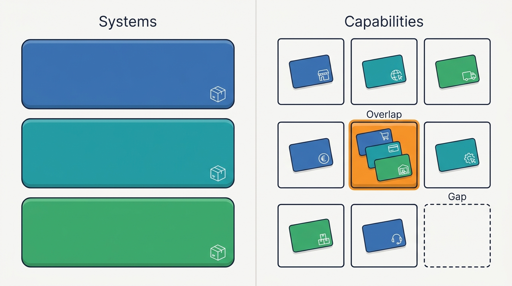
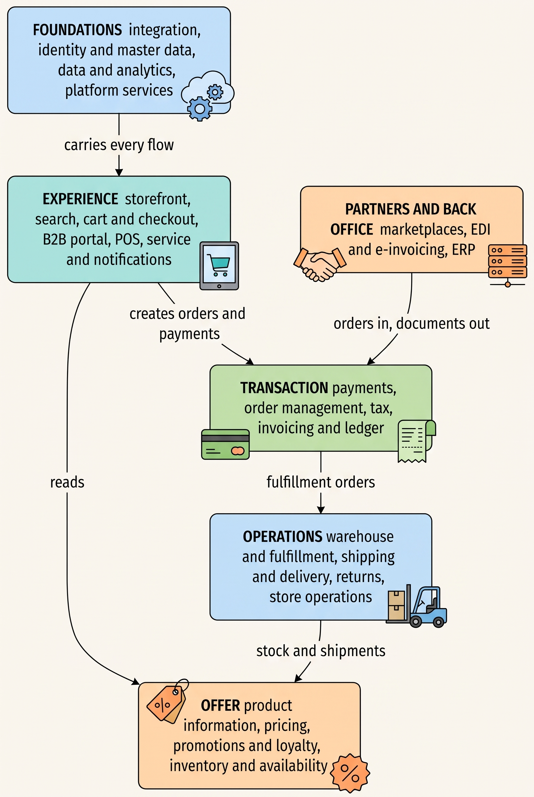
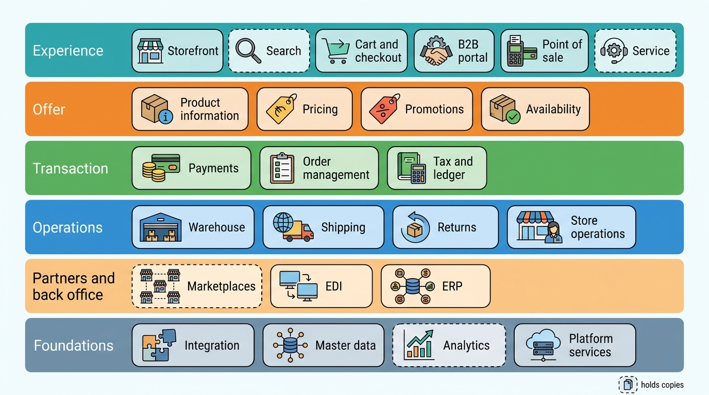
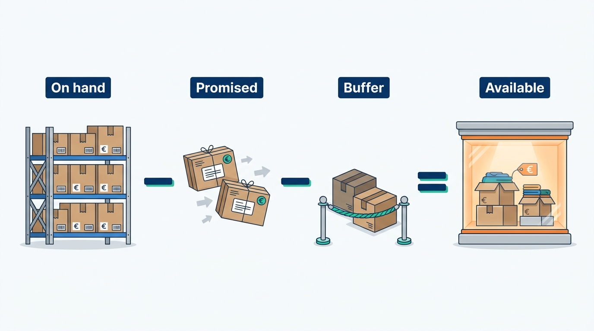
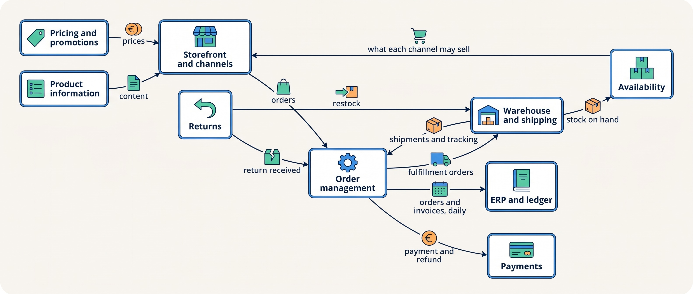
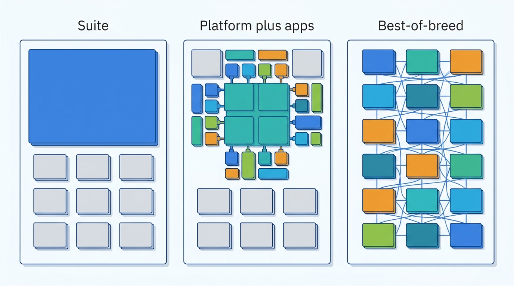
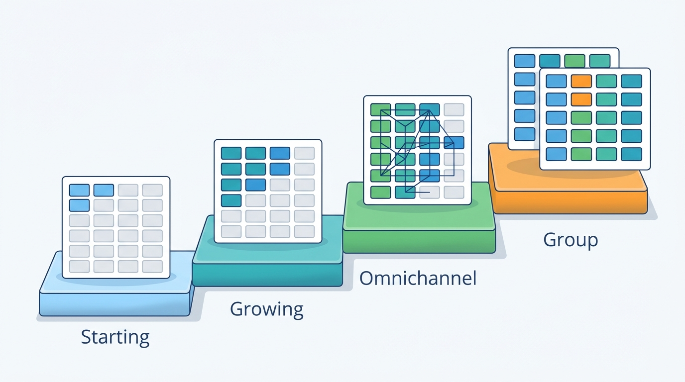
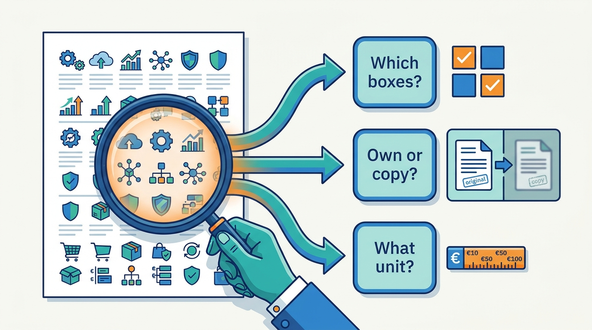
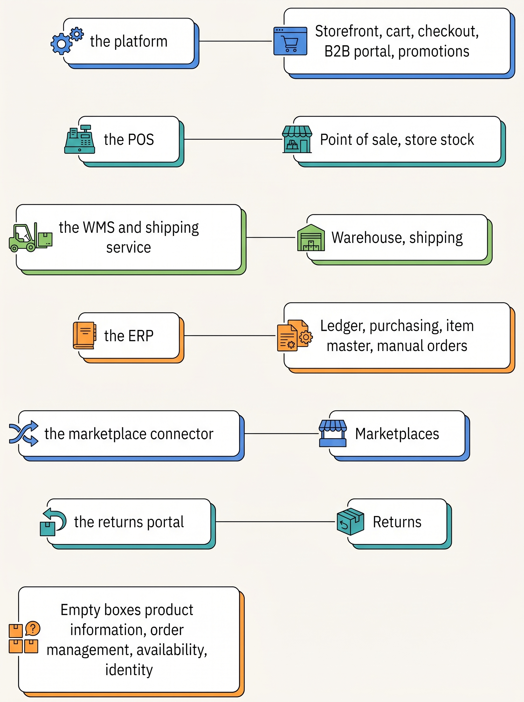
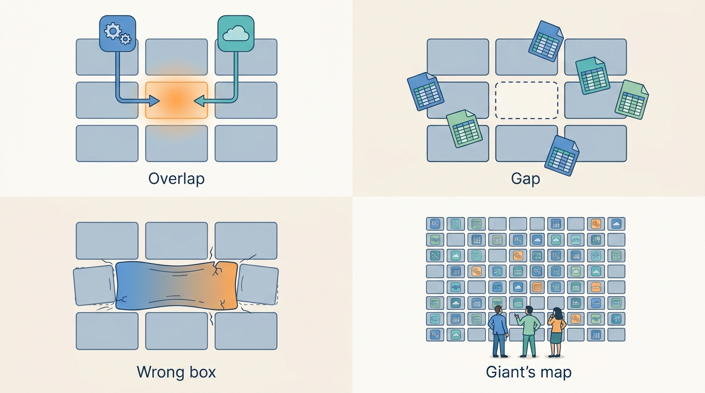

> **IN THIS CHAPTER, YOU WILL:** Learn the capabilities a commerce platform is made of, what each one owns, how they connect, and how to place any vendor or system on the map.

> **KEY POINTS:**
>
> * **A capability is a job the business needs done, not a product.** "Know what we can still sell" is a capability; the warehouse system, the finance system and an app are three systems that may each claim it. Draw the map in capabilities first, then place systems on it, and the gaps and overlaps appear by themselves.
> * **Every capability owns one kind of business fact, and most of the others only copy it.** Product content, price, stock, order, payment, shipment, return, invoice and customer each need one home; the flows between capabilities are how the copies learn about changes. Where two systems both believe they own a fact, that is where the money leaks.
> * **Vendors cover the map in three ways, and none covers all of it.** A suite covers many boxes with one vendor's data model; a platform plus apps covers the center and rents the edges; a best-of-breed assembly buys one product per box and makes the joins your problem. The right mix depends on the business shape and the stage, and a vendor's product page is read best with the map beside it.

> **[FAILURE PATTERNS THIS CHAPTER ADDRESSES](where-commerce-platforms-go-wrong.html):**
>
> * **The Spaghetti Junction** — connectors multiply when nobody has drawn which capability feeds which, so every new need gets its own wire.
> * **The Giant's Boots** — a map copied from a far larger company fills boxes that a smaller merchant does not need and cannot run.
> * **The Lynchpin** — a capability that nobody has placed on the map is usually running through one vendor, one script or one person without anyone noticing.

 
When a merchant asks for store pickup, checkout, the store and the stock system all need to cooperate. Buying a pickup app will help only if it can get stock reserved and tell store staff what to prepare. To work out what must change, start with the business jobs involved. A **capability** is one such job, such as pricing a product or fulfilling an order; several systems may contribute to it.

The same approach helps with more frequent marketplace stock updates or one reliable order count. Which capability must change? Which system handles it now? Who depends on its answer? Without that shared view, teams can buy overlapping tools and leave the handoff between them unowned. Kestrel & Pine, the fictional outdoor brand used here, reached 34 integrations and 41 apps through individually reasonable decisions.

The map below groups the capabilities, names the facts they handle and shows their connections. Use it to identify gaps and overlaps before comparing vendors. [[boundaries-and-systems-of-record]] explains how to settle ownership when several systems hold a fact; [[commerce-platform-landscape]] covers vendor categories.

**Where we are in the order's journey.** Eva's jacket passes through search, pricing, checkout, delivery and possibly a return. Each step is a capability on this map. Each handoff is a connection that someone must build and own. [[journey-of-an-order]] follows those steps in sequence.

## Setting the Scene at Kestrel & Pine: A Whiteboard in February 2027

When Noor Visser joined Kestrel & Pine as Head of Engineering in January 2027, the company had thirteen systems and no shared picture of them. Lead integration engineer Ruben Alves tracked the 34 integrations. Storefront lead Milan Petrov knew the 41 apps. Finance Director Sanne de Wit knew what reached the enterprise resource planning system (ERP). Their knowledge needed to be brought together.

In February, Noor drew the jobs needed to sell a jacket: show it, price it, check stock, take the order and payment, pick, ship, accept a return, invoice and count the sale. Only then did she place the thirteen systems into those boxes. **Starting with the jobs made the gaps visible.**

Three things were visible within an hour that had not been visible in five years of buying systems one at a time:

- **Two boxes were empty.** No system held the enriched product record (a product information management system, PIM); product content lived in the platform, the item master of the ERP (the enterprise resource planning system: the books, purchasing and stock valuation), shared spreadsheets and the marketplace connector. No system held every order (an order management system, OMS); orders lived in the platform, the connector, the ERP and the point-of-sale system (POS, the store's till software).
- **One box had six writers.** Warehouse stock was written by the WMS feed, by hand in the ERP, by hand in the platform and by three apps, with the POS writing store stock separately. The Black Friday Oversell of November 2026 (1,340 units oversold, 1,120 orders canceled or delayed, about €96,000) and the App That Wrote Stock of March 2026 (phantom reservations on 600 variants) were both on that box.
- **Two more boxes were nobody's.** Customer identity (is the store customer the online customer?) and availability (what each channel may still sell) had no system and no owner. So, in a smaller way, did the delivery promise: a sentence on the web page, "ordered before 22:00, delivered tomorrow", computed from nothing and owned by the shipping box only on paper.

The whiteboard became the first working document of the Waypoint program approved in March. The rest of this chapter is that whiteboard, generalized.

## What a Capability Is, and Why It Comes Before the Systems

A **capability** is a job the business needs done, named without reference to who does it. "Calculate the price a given customer pays for a given product today" is a capability. So is "know how many units of a variant are physically on a shelf in Duiven". A **system** is a piece of software that does one or more of those jobs; a **vendor product** is a system someone sells, usually claiming several capabilities at once. A **layer** is a group of capabilities that share a purpose and a rhythm: the ones a shopper touches, the ones that describe what is for sale, the ones that move money and orders, the ones that move boxes, the ones that talk to partners, and the ones underneath everything.

The distinction matters because systems and vendor products overlap, and capabilities do not. The ERP, the WMS and the commerce platform all have a stock field; there is still only one job called "know what is physically on the shelf", and only one system should be doing it. When you draw the map in capabilities, an overlap shows as one box with two names in it, and a gap shows as an empty box. When you draw it in systems, overlaps and gaps are invisible, because every system looks complete from the inside.

**Figure 1:** *Drawn as systems, every box looks complete; drawn as capabilities, an overlap shows as one box with several names and a gap as an empty box.*

Two more terms. A **business fact** is something the business needs to be true about the world: this variant has this GTIN (the Global Trade Item Number behind its barcode), this customer pays this price, this order has shipped. Most capabilities exist to create or keep one kind of fact. And a **flow** is the movement of a fact, or a request about it, from one capability to another: the order flows from checkout to order management to the warehouse; the stock level flows back. The map is boxes (capabilities) and arrows (flows), and later chapters are mostly about one box or one arrow each.

## The Map: Six Layers

The map below is the author's synthesis, built from how the specialist vendors describe their own products (an OMS vendor's and a PIM vendor's definitions are quoted later in this chapter) and from the capability inventories of several commerce product families. It is a teaching map, not a standard: other authors cut the layers differently, and a vendor's architecture diagram will usually show its own product as the center.

**Figure 2:** *Six layers of a commerce platform: the experience layer reads the offer layer and creates transactions, transactions become operations, operations feed stock back into the offer, partners inject orders and documents from outside, and the foundations carry everything.*

From the shopper inward: the **experience** layer is everything a shopper, store customer, wholesale buyer or service agent touches. The **offer** layer says what is for sale, at what price, under which promotion and whether it is available; it makes the promises the rest must keep. The **transaction** layer is the order and the money. The **operations** layer is the physical world: warehouse, carrier, store shelf, return parcel. The **partners and back office** layer holds systems that belong to other organizations or to finance: marketplaces, trading partners that speak EDI (electronic data interchange, the long-established standard for exchanging orders and invoices between companies' systems) and the ERP (enterprise resource planning system: the books, purchasing, stock valuation). The **foundations** are what no shopper sees and every layer depends on.

### What each capability owns

This table is the chapter's main deliverable. For each capability it gives the job in plain words, the business fact it should own (the thing it is the natural home for), and the chapter that works it out. Terms used in the table are defined in those chapters; the one-line jobs are enough to place a system.

| Layer | Capability | The job, in plain words | The fact it is the natural home for | Chapter |
| --- | --- | --- | --- | --- |
| Experience | Storefront | Show products and content to shoppers on web and app, fast and accessible | Pages and themes (not the product data they show) | [[storefront-architecture]] |
| Experience | Search and discovery | Let shoppers find products by query, filter and recommendation | The search index, a rebuildable copy of the catalog | [[commerce-search-and-discovery]] |
| Experience | Cart and checkout | Hold a shopper's draft order and turn it into a paid order in a few steps | The cart (short-lived) and the checkout session | [[cart-and-checkout]] |
| Experience | B2B (business-to-business) buyer experience | Let a company's buyers order at their prices, with approvals, quotes and reorders | Company accounts, buyer roles, quotes | [[b2b-commerce]] |
| Experience | Point of sale | Sell in a store, offline if needed, with receipts and store stock | Store transactions and store stock | [[stores-and-omnichannel]] |
| Experience | Customer service and notifications | Tell the customer what is happening and show an agent one view of it | Notification events sent; the service view (a copy) | [[customer-service-and-notifications]] |
| Offer | Product information | Hold products, variants, attributes, media and translations once, publish to every channel | Product content and the product identifiers | [[product-information]] |
| Offer | Pricing | Compute the price a given customer pays for a given product in a given channel today | Price lists, contract prices, effective dates | [[pricing-architecture]] |
| Offer | Promotions and loyalty | Apply discounts, coupons, points and store credit without breaking price or margin | Promotion rules; store credit and gift card balances (liabilities) | [[commerce-promotions]] |
| Offer | Inventory and availability | Know what is physically where, and compute what each channel may still sell | Available-to-promise per channel (derived from physical stock) | [[inventory-and-availability]] |
| Transaction | Payments | Take the shopper's money, refund it, and reconcile it with payouts | Payment transactions (in the PSP, the payment service provider; the order keeps a reference) | [[commerce-payments]] |
| Transaction | Order management | Hold every order from every channel, in one state model, and steer it to fulfillment and back | The order record and its state | [[order-management]] |
| Transaction | Tax, invoicing and ledger | Turn an order into tax, a legal invoice and entries in the books | Invoices, credit notes, ledger postings | [[tax-invoicing-and-ledger]] |
| Operations | Warehouse and fulfillment | Receive, store, pick, pack and confirm shipment of physical goods | Physical stock on hand and its movements | [[warehouse-and-fulfillment]] |
| Operations | Shipping and delivery | Choose carriers, print labels, track parcels, promise a delivery date | Shipments, tracking events, the delivery promise | [[shipping-and-delivery]] |
| Operations | Returns and exchanges | Take goods back, inspect, grade, refund or exchange, restock | Return requests, inspection results, dispositions | [[returns-and-exchanges]] |
| Operations | Store operations | Run the shelf: store stock counts, transfers, click-and-collect, in-store returns | Store stock (shared with POS) | [[stores-and-omnichannel]] |
| Partners | Marketplaces and channel integration | List, sell and fulfill on other companies' platforms, in their formats | Listings and marketplace orders (copies of product and order) | [[marketplaces-and-channel-integration]] |
| Partners | EDI and e-invoicing | Exchange orders, despatch advices and invoices with large partners and tax authorities as structured documents | Sent and received documents (immutable once sent) | [[edi-and-e-invoicing]] |
| Back office | ERP and back office | Keep the books, buy from suppliers, value the stock, hold the item and customer masters | Ledger, purchasing, stock value, item identity | [[erp-and-back-office-integration]] |
| Foundations | Integration | Move facts between systems reliably: styles, contracts, retries, reconciliation | The integration inventory and each flow's contract | [[integration-styles]], [[events-consistency-and-reconciliation]], [[api-contracts-and-versioning]] |
| Foundations | Identity and master data | Decide that two records are the same customer or product, and keep masters in step | Customer identity; the cross-reference of product identifiers | [[identity-and-master-data]] |
| Foundations | Data and analytics | Count the same thing the same way everywhere | Metric definitions; the warehouse (a copy of everything) | [[commerce-data-and-analytics]] |
| Foundations | Platform services | Serve many merchants on shared infrastructure: tenancy, extensibility, peak capacity, security | The platform's own configuration, apps and limits | [[multi-tenancy-and-isolation]], [[extensibility-and-app-ecosystems]], [[peak-load-and-reliability]], [[commerce-security]] |

Two columns deserve a note. The "fact it is the natural home for" column is the hinge to the next chapter: when two systems both hold a fact, the capability map says which one *should* be its home, and [[boundaries-and-systems-of-record]] says how to make that decision stick. And several entries say "a copy": the search index, the service view, the listing, the data warehouse. Those capabilities hold copies by design, which is fine as long as everyone knows they are copies and they are rebuilt from the home, never edited in place.

**Figure 3:** *The capability map as a checklist: twenty-four capabilities in six layers, each the natural home of one business fact; the dashed boxes (search, the service view, marketplace listings and analytics) hold copies by design and are rebuilt from the home, never edited in place.*

### Facts that are derived, not recorded

Some capabilities own a calculation. **Availability** is one: the warehouse records physical stock, but a channel needs to know what it can still sell. That is **available-to-promise (ATP)**: stock on hand, minus commitments to unshipped orders, minus any buffer held back.

The calculation needs both warehouse stock and existing sales commitments. It may run inside an order management system (OMS), the commerce platform or a separate service. Give it one owner whichever product runs it. The delivery promise works similarly: it combines cut-off times, carrier lead times and location. Hand-editing either result bypasses the calculation and can make the storefront promise something the warehouse cannot deliver.

**Figure 4:** *Stock on hand is counted; what a channel may still sell is computed from on hand, what is already promised and the buffer, so its owner is the computation.*

## How the Pieces Talk: The Typical Flows

Boxes are half the map. The arrows between them carry a small number of fact types, each with its own rhythm. The table below lists the flows almost every merchant above the first stage runs, the direction they usually take, and the requirements that decide how they should be built. "Freshness" is how old a copy may be before it causes harm; "consistency" is whether the copies must agree exactly or only eventually; the last two columns say what happens when the flow is slow or down. The requirements are the author's judgement from industry practice; the next chapters refine them.

| Flow | From → to | Freshness needed | Consistency | If slow | If down |
| --- | --- | --- | --- | --- | --- |
| Product content | Product information → storefront, marketplaces, EDI partners | Minutes to hours | Eventual; completeness matters more than speed | A new product appears late | Channels keep yesterday's catalog |
| Prices | Pricing → storefront, POS, marketplaces, B2B portal | Minutes; exact at a promotion's start and end | Exact across channels (a stale price is a broken promise, and on marketplaces a parity breach) | The Price Drift | Channels sell at the last known price |
| Stock and availability | Warehouse, stores, external locations → availability → every channel | Seconds to minutes at peak | Eventual, with a buffer and a reconciliation | Oversell window grows with the lag | Channels sell blind or stop selling |
| Orders | Checkout, marketplaces, EDI, POS → order management → warehouse, ERP | Seconds to minutes | Exact: never lost, never doubled | Late picking, missed cut-off | Orders queue; nothing ships |
| Payments | Checkout → PSP → order management, ledger | Seconds at authorization; days at settlement | Exact to the cent, reconciled against payouts | Checkout slows, conversion drops | Checkout stops |
| Shipments and tracking | Warehouse and carriers → order management → notifications, service | Minutes | Eventual | "Where is my order" tickets rise | Customers unaware; service blind |
| Returns and refunds | Returns portal → warehouse, order management, PSP, ledger | Hours | Exact for money; eventual for stock | Refunds late, complaints | The Boomerang begins |
| Finance | Order management, PSP → ERP ledger | Daily batch is normal | Exact, reconciled per period | Month-end slips | Books lag, nothing else does |

Two patterns stand out. **Only three flows need exactness in near real time: prices, orders and payments.** Everything else tolerates lag if there is a reconciliation (a job that compares two systems' copies and reports the differences) behind it. And **finance works in periods, not seconds**: the ledger can be fed nightly and nobody loses a sale, which is why [[erp-and-back-office-integration]] argues that the ERP's rhythm must never become the storefront's availability rhythm.

**Figure 5:** *The flows of a typical merchant: product, price and availability flow outward to the channels; orders flow inward to order management and down to the warehouse; stock, shipments and returns flow back; finance receives a daily batch.*

Every arrow is a place where one system's fact becomes another system's copy, and a copy can be late, lost or duplicated, which is why the joins, not the boxes, are where commerce platforms fail. [[part-6]] is about the arrows.

## Three Ways to Cover the Map

No merchant builds all of this, and no vendor sells all of it, whatever the brochure says. In practice the map is covered in one of three ways, often mixed.

**A suite.** One vendor supplies most of the experience, offer and transaction layers, and sometimes order management and POS, in one data model. On 6 July 2026 Salesforce described its Agentforce Commerce release as one platform across B2C, B2B, point of sale and order management, with agents "natively connected to catalog, inventory, and orders". Adobe's October 2026 information center lists three ways to run Adobe Commerce (on-premises, on Adobe's cloud infrastructure, or as a fully managed cloud service) and a separate SaaS, Commerce Optimizer, that "can work alongside an existing Adobe Commerce or third-party commerce backend". The suite's promise is that the joins inside the covered boxes are the vendor's problem. Its limit is that the warehouse, the carriers, the PSP, the marketplaces, the EDI partners and the ERP are still outside, and the vendor's data model decides what "order" and "product" mean for everything inside.

**A platform plus apps.** A hosted SaaS platform (software the vendor runs for thousands of merchants at once, rented by the month) covers storefront, catalog, cart, checkout, basic inventory and basic order handling, and an app store rents the rest: reviews, returns, search, subscriptions, pre-orders, loyalty. Shopify's pricing page in November 2026 lists plans from €28 to a Plus tier "from €2,100" a month, with lower card rates on higher tiers; the platform is also a payments company, as is the POS vendor Lightspeed, whose fiscal 2026 results showed transaction-based revenue of $815.1 million against subscription revenue of $370.7 million. Hosted platforms tend to retreat from the operations layer: Shopify completed the sale of most of Shopify Logistics to Flexport on 6 June 2023 (an old event, but the direction has held). The center is excellent and cheap to start; the apps are many small vendors, each writing into your data (Kestrel & Pine's 41 apps, three of them writing stock), and the operations and partner layers are yours to assemble.

**Best-of-breed, or composable.** One product per box, chosen for that box, joined by APIs and an integration platform. The MACH Alliance (founded in June 2020 by commercetools, Contentstack, EPAM and Valtech; the acronym stands for microservices, API-first, cloud-native and headless; headless means the storefront is a separate application that talks to the commerce engine only through APIs) made this the named alternative to the suite. The specialist layers are real products with their own definitions: Manhattan describes an OMS as a platform "designed to track and manage the lifecycle of an order from start to finish", and Akeneo describes a PIM as a system "to centralize, manage, enrich, and distribute product information for commerce" (both n.d., accessed November 2026). Each box is best in its class and replaceable; the cost is the joins. The Alliance's own February 2026 survey of 600 enterprise technology leaders found 37% naming integration complexity as a primary concern, a figure against the interest of the people who published it.

**Figure 6:** *Three ways to cover the same map: a suite covers many boxes with one data model, a platform covers the center and rents the rest as apps, and best-of-breed picks one product per box and pays for the joins.*

Two variants are worth naming. **ERP-centered commerce** makes the ERP the center and the storefront a front end; Microsoft's documentation of 22 September 2026 says its Business Central Shopify Connector "is preinstalled for all new sign-ups and trials", which is the clearest public sign that ERP plus hosted storefront is a mainstream small-merchant shape. And a **specialist group** pre-integrates several best-of-breed products under one owner: Katapull, a Dutch group, announced on 31 March 2025 that five companies had joined forces and on 7 October 2026 added a WMS vendor as its eighth label, listing on its site an ERP-and-webshop product, a POS, a WMS, a marketplace integrator, an EDI provider, a returns product, a shipping product and an online-performance agency. On the map that is six operational and partner boxes from one group, with the storefront platform still bought elsewhere; the public pages give no figures beyond customer and user counts, and the book uses nothing else about it.

### Trade-offs

| | Suite | Platform plus apps | Best-of-breed | Specialist group |
| --- | --- | --- | --- | --- |
| Boxes covered by one vendor | Many (experience, offer, transaction, often OMS and POS) | The center (storefront to basic orders) | One each | Operations and partners, pre-joined |
| Where the joins live | Inside the vendor, except operations and partners | Between platform and apps; all of operations and partners | Everywhere; the integration layer is the architecture | Inside the group; the join to the storefront is yours |
| Who defines "order" and "product" | The suite | The platform, with app fields bolted on | You, per box | The group's ERP or hub |
| Cost shape | Negotiated, often linked to sales | Subscription plus payment fees plus apps plus agency | Per product, per order, per request; plus integration | Per product |
| Time to first sale | Months | Days | Months | Weeks |
| Fits | Group-stage and large omnichannel retailers with implementation partners | Starting and Growing merchants; Omnichannel merchants who surround the platform | Omnichannel and Group merchants with a platform team | Growing and early Omnichannel merchants in the group's home market |
| Limits | The vendor's model; cost at scale; upgrade projects when customized | App sprawl; the operations layer is unassembled; fees grow with sales | Integration cost and skills; vendor count | One owner across several layers; exit from the group |

The table is the author's judgement. My rule for a merchant that is not a vendor: **cover the center with one product you do not customize, cover operations with products built for operations, and own the joins yourself.** Kestrel & Pine's Waypoint decision W4, stay on the SaaS platform and surround it with an OMS, a PIM and an availability service, is that rule applied; [[build-buy-or-assemble]] works the economics.

## Across Scale Stages: When It Fits and When It Limits

The map does not change with scale. What changes is how many boxes have their own system, and which ones. The table uses the four stages defined in [[commerce-business-models]].

| Stage | Boxes with their own system | Typical shape | Warning sign that the shape is ending |
| --- | --- | --- | --- |
| 1 — Starting | Three or four: a hosted platform covers experience, offer and transaction; a PSP; an accounting package; the portal of a 3PL (a third-party warehouse that ships on the merchant's behalf) | The platform is the map | A second channel (first store, first marketplace) with its own order source |
| 2 — Growing | Six to nine: an ERP or accounting system claims items and finance; a marketplace connector; a POS; an integration tool | Platform plus apps, with the ERP as a second center | Two systems writing stock; a spreadsheet as the product master |
| 3 — Omnichannel | Twelve or more: own WMS, returns portal, shipping service, EDI provider, data warehouse; then OMS, PIM, availability | The joins become the architecture; the empty boxes (OMS, PIM, availability) must be filled | Support checks three systems for one order; a sync chain measured in hours |
| 4 — Group | The same map per brand or country, with some boxes shared (PIM, OMS, data, integration) and some kept separate | Shared services versus brand autonomy | Brands forced onto one stack before the benefit is measured, or kept apart when they should share |

Kestrel & Pine is at stage 3 with four boxes still empty. The judgement: fill a box with a dedicated system when the capability has more than one producer and more than one consumer and the system that holds it today cannot carry the workflow. A PIM is unnecessary at stage 1 and overdue at stage 3 with four channels; an OMS is overkill with one channel and one warehouse and overdue the day a second order source appears.

**Figure 7:** *The map does not change with scale; the number of boxes with their own system does, from three or four at the Starting stage to twelve or more at Omnichannel, and shared boxes across brands at Group.*

## Reading a Vendor's Product Page Against the Map

A product page lists features. The map lets you turn a feature list into three questions.

1. **Which boxes does it claim?** Mark them. A channel-integration product that claims "order management" usually means it imports marketplace orders and pushes status back; that is a flow on the map, not the order-management box. A platform that claims "inventory" usually means it holds a stock number per location; that is a copy of the warehouse's fact, not the warehouse.
2. **Which fact does it own, and which does it copy?** For each claimed box, ask whether the product would be the home of that fact or a reader of it. Fluent Commerce, an OMS vendor, states the boundary on its own site: "your ERP stays the system of record" (n.d., accessed November 2026). A vendor that cannot answer the question for its own product is telling you something.
3. **What is the unit behind the numbers?** Vendor claims count different things. "1,300 marketplaces" (ChannelEngine's site, November 2026) counts connectors that exist, not connections that are maintained. "4,500+ customers" and "27,500+ users" (Katapull's about page) differ by a factor of six because users are seats. GMV (gross merchandise value, the value of orders passing through a platform before refunds and before the vendor's cut) is sales volume, not the vendor's revenue; Shopify's reported 2025 GMV of about $378 billion is roughly thirty times its revenue of about $11.6 billion. Ask for the unit, the date and the definition before comparing two vendors; [[commerce-platform-landscape]] has the full list of traps.

The same three questions apply inside your own company, to the systems you already have. Most landscapes contain a system that was bought for one box and has quietly grown into three.

**Figure 8:** *Reading a vendor page against the map comes down to three questions: which boxes it claims, whether it owns each fact or copies it, and what unit sits behind its numbers.*

## In Practice: Kestrel & Pine's Systems on the Map

This is Noor's February whiteboard as a table, reduced to the boxes that were not simply covered. The platform covers storefront, search, cart, checkout, promotions and the B2B portal; the WMS, the shipping service, the returns portal, the marketplace connector, the EDI provider and the ERP each cover their own box; the platform vendor supplies the platform services. Systems are named by role, as the book does throughout.

| Capability | System in January 2027 | Status on the map |
| --- | --- | --- |
| Product information | **Nobody.** Platform, ERP item master, spreadsheets, connector | **Empty box, four copies** |
| Order management | **Nobody.** Orders in the platform, the connector, the ERP, the POS | **Empty box, four order sources** |
| Inventory and availability | **Nobody computes availability.** Stock on hand in the WMS, ERP, platform, POS | **Empty box for availability; six writers of stock** |
| Identity and master data | **Nobody** | **Empty box**; Eva Janssen exists four times |
| Pricing | Platform price lists; ERP for wholesale; connector for marketplaces | Overlap: three writers; the Price Drift (€179 for nine days, about €8,200 lost) |
| Payments | The PSP online; a terminal provider in stores | Covered, but refunds also issued by hand in the PSP console (the Double Refund, €19,400) |
| ERP and back office | The ERP (since 2023) | Covered, and also used as order entry and stock master: five jobs in one box |
| B2B buyer experience | The platform's B2B features | 62% of wholesale orders; 38% keyed into the ERP by hand |
| Point of sale, store operations | The POS (separate vendor, since 2019) | Store stock reaches the ERP nightly; no link to the platform |
| Shipping and delivery | The shipping service inside the WMS flow | The delivery promise is static text, computed from nothing |
| EDI and e-invoicing | The EDI provider, for Bergzicht Outdoor and for Peppol (the European network for exchanging e-invoices) | One consultant knows the mappings (The Lynchpin) |
| Integration | The iPaaS (integration platform as a service, a hosted tool for building the flows between systems) plus agency scripts and vendor connectors; 34 integrations | Covered without standards |
| Data and analytics | The data warehouse and a BI (business intelligence) reporting tool | Three definitions of "order" |

**Figure 9:** *Kestrel & Pine's thirteen systems fill most of the map, but four boxes have no system: product information, order management, availability and customer identity. Every 2026 incident sits on an empty box or on a box with several writers.*

The Waypoint decisions read as a plan to fill the empty boxes and thin the overlaps: a PIM for product information (W3, Q3 2027), an OMS for order management with an availability service as one of its modules (W1 and W2, Q4 2027), the WMS as the single writer of physical stock (W1), and integration standards for the arrows (W5). Identity remains open; [[identity-and-master-data]] takes it up.

## When It Goes Wrong

The map fails in four ways, and each shows up on the map before it shows up in the business.

**Figure 10:** *The map fails in four ways, each visible on the map before it shows in the business: two writers for one fact, a fact with no home, a system holding boxes it was not bought for, and a map copied from a giant.*

**An overlap: two systems own one fact.** The App That Wrote Stock is the textbook case. A pre-order app adjusted inventory in the platform while the WMS feed also wrote it; for two weeks 600 variants carried phantom reservations. Detection is a *write audit*: for each box, list every system, app, script and person that can change its fact. If the list has more than one entry for a recorded fact, that is an overlap. Recovery is to name the single writer and re-publish the fact from it, which is exactly what the first weekly reconciliation in May 2027 did when it found 2.3% of active variants with a different quantity between the WMS and the platform (an illustrative figure).

**A gap: nobody owns the fact.** The gap fills itself with spreadsheets and with copies that start acting as records. Kestrel & Pine's product content lived in four places because no box was named for it; its order status lived in four places because none was. Detection is the empty box on the map. Recovery is to name a home before buying a system for it, because a bought OMS fed by four unreconciled order sources is a fifth copy.

**A box held by a vendor who sells a different box.** A channel connector that is also used as the stock master, or an ERP used as the order hub, works at the stage it was bought in and becomes the bottleneck later, when the warehouse needs stock in minutes and the ERP posts hourly. Detection: compare the box the system was bought for with the boxes it now holds. The ERP that holds purchasing, the ledger, the item master, manual wholesale orders and the stock master is doing five jobs, two of them badly.

**The map copied from a giant.** A merchant at stage 2 that draws a stage-4 map, with a system per box and a platform team to run them, has bought the Giant's Boots. The boxes are the same; the number of systems that should fill them is not. Below the producer-and-consumer test above, the box stays inside the platform.

## What to Take Away

**Established.**

- A commerce platform is a set of capabilities spread over several systems, not one system; the specialist layers (OMS, PIM, WMS, returns, search, channel integration, iPaaS, payments) are distinct product categories with their own vendors and definitions, as the vendors' own November 2026 pages show.
- No vendor covers the whole map. Suites stop at the warehouse, the carrier, the PSP, the marketplace and the ERP; hosted platforms have retreated from logistics (Shopify's 2023 sale of Shopify Logistics) and earn largely from payments (Lightspeed's fiscal 2026 revenue mix); composable assemblies make integration the architecture (the MACH Alliance's own 2026 survey: 37% cite integration complexity).
- Business-to-business ordering is a first-class capability, not an add-on: Eurostat's 2024 figures put EDI-type sales at 11.07% of EU enterprise turnover against 8.39% for web sales.

**Depends on context.**

- How many boxes get a dedicated system depends on the stage and the shape: one channel and one warehouse can live inside a hosted platform; four channels and an own warehouse need an OMS, a PIM and an availability service. The trigger is the producer-and-consumer test, not revenue.
- Suite versus platform-plus-apps versus best-of-breed depends on the team: a suite needs an implementation partner, best-of-breed needs a platform team, platform-plus-apps needs app governance. A fourteen-person team should expect to own joins, not boxes.
- Whether a specialist group (several pre-integrated labels under one owner) is a good deal depends on how much of the operations layer you need from one owner and what leaving the group would cost.

**The author's synthesis.**

- Draw the map in capabilities before systems, and mark three things on it: empty boxes, boxes with more than one writer, and boxes whose fact is derived. Those marks predict the next incident better than any vendor roadmap.
- For a merchant that is not a vendor, the durable shape is a center you do not customize, operations products built for operations, and joins you own. Covering a box is cheap; owning the joins between boxes is the work, and it is the work nobody can buy for you.

## Questions to Ask

In a design review, a vendor demo or your first week:

1. Which capability on the map is this system or product for, and which other boxes has it quietly grown into?
2. For each fact it holds, is it the home or a copy? If a copy, where is the home and how does the copy learn about changes?
3. Which boxes on our map are empty, and what fills them today (a spreadsheet, a person, a habit)?
4. Which boxes have more than one writer? List every system, app, script and person that can change the fact.
5. Which of our facts are derived (availability, the delivery promise, a price after promotions), and which computation owns each one?
6. Which flows need exactness in near real time (prices, orders, payments), and which only need a reconciliation behind them?
7. What unit is behind each number on the vendor's page (GMV, merchants, users, implementations, connectors), and as of what date?
8. If this vendor disappeared, which boxes would go dark, and which joins would have to be rebuilt?
9. Which box would we fill next if we grew one stage, and what sign would tell us it is time?

The map says what the parts are and what each should own. It does not yet say what happens when two parts hold the same fact and disagree, which is Kestrel & Pine's actual condition in 2027 and the subject of [[boundaries-and-systems-of-record]].

## Sources and Evidence

**Company, product and investor sources**

- [As AI Agents Transform Commerce, Salesforce Unleashes Its Biggest Agentforce Commerce Release Yet](https://www.salesforce.com/ap/news/press-releases/2026/07/06/as-ai-agents-transform-commerce-salesforce-unleashes-its-biggest-agentforce-commerce-release-yet/), Salesforce, 2026 — a suite covering B2C, B2B, POS and order management in one platform.
- [Adobe Commerce: Platform and services](https://experienceleague.adobe.com/en/docs/commerce/information-center/explore-platforms-and-services/platform-and-services), Adobe, 2026 — three deployment options and Commerce Optimizer working beside an existing backend.
- [Shopify pricing](https://www.shopify.com/pricing), Shopify, n.d., accessed 2026-11 — plan tiers, card rates and transaction fees of a hosted platform.
- [Shopify Completes Sale of Shopify Logistics to Flexport](https://www.shopify.com/news/shopify-completes-sale-of-shopify-logistics-to-flexport), Shopify, 2023 — a hosted platform's retreat from the operations layer (older than three years; the direction has held).
- [Shopify Q4 2025 financial results](https://www.shopify.com/news/shopify-q4-2025-financial-results), Shopify, 2026 — 2025 revenue; GMV as reported by [Digital Commerce 360](https://www.digitalcommerce360.com/2026/02/17/shopify-revenue-gmv-q4-2025/), 2026.
- [Lightspeed fourth quarter and full year 2026 results](https://www.lightspeedhq.com/news/lightspeed-announces-fourth-quarter-and-full-year-2026-financial-results-and-provides-outlook-for-fiscal-2027/), Lightspeed, 2026 — transaction revenue versus subscription revenue.
- [Get started with the Shopify Connector](https://learn.microsoft.com/en-us/dynamics365/business-central/shopify/get-started), Microsoft, 2026 — the ERP connector preinstalled for new Business Central sign-ups.
- [What is an OMS?](https://www.manh.com/solutions/omnichannel-software-solutions/order-management-system/what-is-an-oms), Manhattan Associates, n.d., accessed 2026-11 — an OMS vendor's definition of the order-management capability.
- [Akeneo](https://www.akeneo.com/), Akeneo, n.d., accessed 2026-11 — a PIM vendor's definition of the product-information capability.
- [Fluent Commerce order management system](https://fluentcommerce.com/order-management-system/), Fluent Commerce, n.d., accessed 2026-11 — "your ERP stays the system of record".
- [ChannelEngine](https://www.channelengine.com/), ChannelEngine, n.d., accessed 2026-11 — "over 1,300 marketplaces" as an example of a connector-count claim.
- [Katapull](https://katapull.nl/) and [Over Katapull](https://katapull.nl/over-katapull/), Katapull, n.d., accessed 2026-11; [Katapull breidt Commerce Hub uit met overname van Picqer](https://katapull.nl/katapull-breidt-commerce-hub-uit-met-overname-van-picqer/), Katapull, 2026; [Vijf softwarebedrijven bundelen krachten in Katapull](https://www.dutchitchannel.nl/news/603618/vijf-softwarebedrijven-bundelen-krachten-in-katapull), Dutch IT Channel, 2025 — the specialist-group shape, from public pages only.
- [EPAM joins the MACH Alliance as a founding member](https://s202.q4cdn.com/436759741/files/doc_news/2020/06/24/12951.pdf), EPAM, 2020 — the founding of the MACH Alliance and the acronym's expansion.
- [MACH Alliance Enterprise Technology Report](https://machalliance.org/insights-hub/mach-alliance-research-6x-more-organizations-achieve-ai-roi-with-a-composable-foundation), MACH Alliance, 2026 — 37% of respondents cite integration complexity.

**Standards, regulation and official documentation**

- [E-commerce statistics](https://ec.europa.eu/eurostat/statistics-explained/index.php?title=E-commerce_statistics), Eurostat, 2026 (2024 reference year) — EDI-type sales 11.07% versus web sales 8.39% of EU enterprise turnover.

**Research and practitioner sources**

- None beyond the vendor and official sources above; the layers, the flows table and the trade-offs are the author's synthesis.

Kestrel & Pine is fictional; architectural recommendations, labeled inferences and labeled assumptions are the author's judgement.
