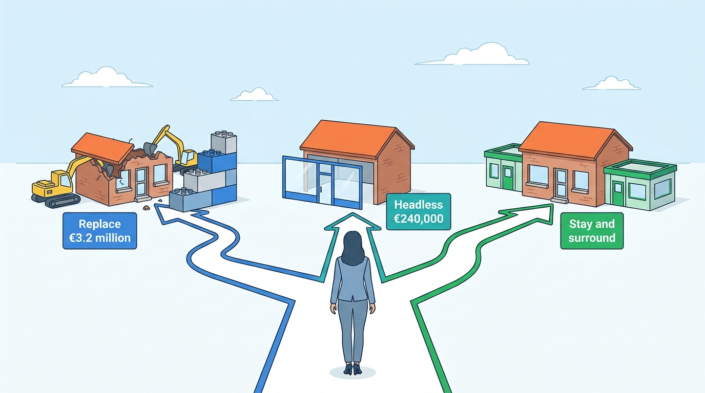
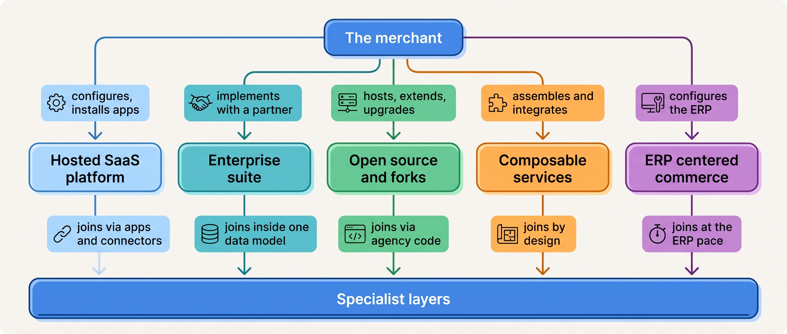
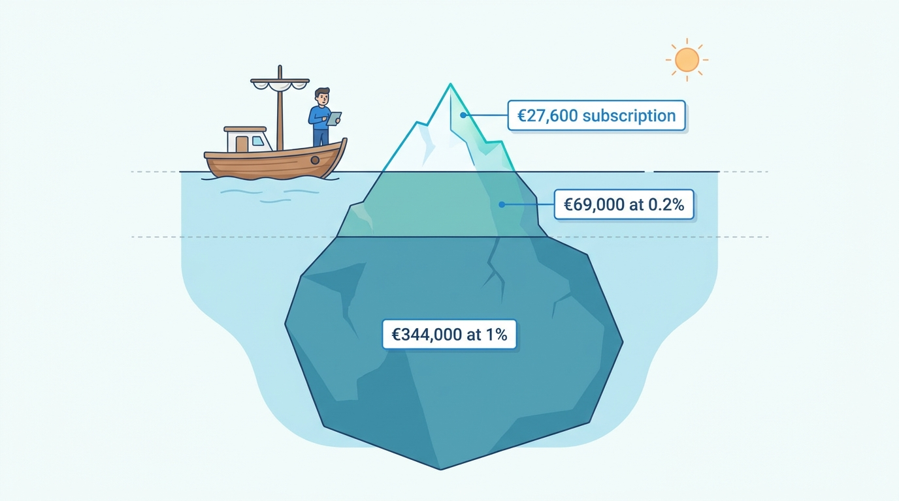
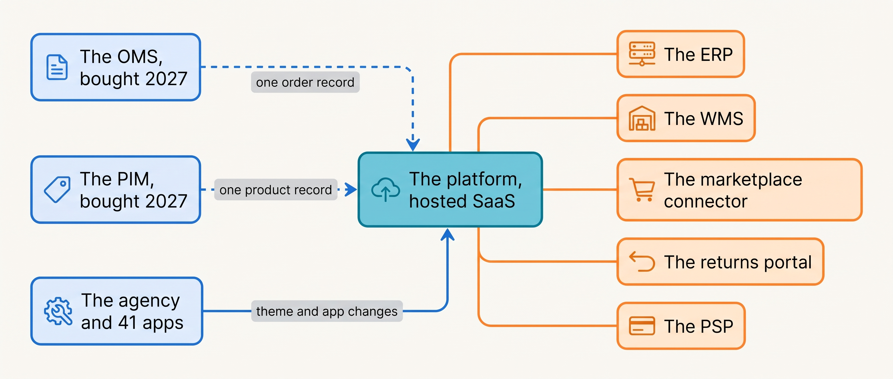

> **IN THIS CHAPTER, YOU WILL:** Learn the seven kinds of commerce platform, how each is priced, what changed between 2023 and 2026, and how to read a vendor's claims before comparing two of them.

> **KEY POINTS:**
>
> * **The category decides where the work lands.** A hosted platform keeps the core in the vendor's hands and pushes variation to apps; a suite keeps integration inside one vendor's data model; open source moves hosting and upgrades to you; composable moves the integration burden to you. Pick the category by who you have to carry that work.
> * **Commerce platforms are priced on your sales, not on their software.** Shopify's FY2025 filing puts 76% of its revenue in fees that move with merchant sales; Lightspeed's FY2026 transaction revenue is more than twice its subscriptions; Shopware, Saleor and BigCommerce tie their plans to gross merchandise value. The subscription is the entry ticket.
> * **Between 2023 and 2026 the market converged on "keep your backend, add a layer".** commercetools, Adobe and Salesforce now sell modules that sit beside an existing stack, Shopware absorbed integration and payments into the platform, and Commerce.com reported that replatforming demand is soft. Read every 2026 pitch, "composable" and "agentic" included, as a layer to add, not a reason to move.

> **[FAILURE PATTERNS THIS CHAPTER ADDRESSES](where-commerce-platforms-go-wrong.html):**
>
> * **The Giant's Boots** — the landscape is full of architectures built for companies a hundred times larger; this chapter sorts them by the merchant they fit.
> * **The Forked Platform** — the categories differ in who applies upgrades, and the ones that let you change the core are the ones that let you lose the upgrade path.
> * **The Lynchpin** — a vendor's revenue mix, ownership and strategic reviews are public signals of how long a capability will be funded; this chapter shows where to read them.

 
Every merchant runs on a commerce platform, and most people who join a merchant are told its name on the first day and nothing else. The name is not the useful fact. The useful fact is **what kind of thing it is**: whether the vendor or the merchant runs the servers, whether the storefront and the engine are one product or two, whether the price is a flat fee or a share of sales, and whether the vendor will still fund the product in three years. Two platforms with similar feature lists can have opposite cost curves and opposite exit paths.

This matters in money. A platform that charges a percentage of sales is cheap at €1 million of revenue and expensive at €50 million. A platform that lets an agency change its core is flexible in year one and unupgradable in year four. None of this appears in a feature comparison, and all of it decides what the platform costs and how long it lasts.

This chapter is a map. It sorts the market into **seven categories**, explains how each is priced, lists what changed between 2023 and 2026 with dates and sources, and ends with a reading guide for vendor claims. It recommends no product; the decision method belongs to [[build-buy-or-assemble]]. The map builds on [[commerce-capability-map]] and the ownership rules of [[boundaries-and-systems-of-record]].

**Where we are in the order's journey.** This chapter sits off the order's path. Eva's jacket, the recurring order of [[journey-of-an-order]], starts life on Kestrel & Pine's platform: the storefront shows it, the cart holds it, the checkout takes the €235. Which category that platform belongs to decides which later steps the platform can do itself and which must be bought and joined on.

## Setting the Scene at Kestrel & Pine: Two Pitches in One Week

Kestrel & Pine, the fictional outdoor brand this book follows ([[meet-kestrel-and-pine]]), runs its storefronts, cart, checkout and wholesale portal on **the platform**: a hosted SaaS commerce platform used since 2016, on the enterprise tier since 2023, at **€2,300 a month plus payment and transaction fees**, with three localized storefronts in one tenant and 41 installed apps. Around it sit a dozen systems bought one at a time: the ERP (the finance and purchasing system), the WMS (the warehouse system), the POS (the store tills), the marketplace connector, the returns portal, the iPaaS (the integration tool) and more. Technology spend in 2026 was about **€2.6 million**, 5.4% of revenue.

In the second week of February 2027, Noor Visser, Head of Engineering since January, sat through two pitches. On Tuesday an outside consultancy proposed replacing the platform with a **composable** assembly: an API-only commerce engine, a separately built storefront, a search service, a content system and an integration layer, about **€3.2 million** over eighteen months (illustrative), with the promise that Kestrel & Pine would "own its architecture". On Thursday the agency that has built the storefront theme since 2017 proposed something smaller: keep the platform, but rebuild the three storefronts as a **headless** application (a storefront that is a separate program talking to the platform only through its API) on the platform vendor's own hosting, with a separate content system behind it, about **€240,000** and nine months (illustrative). Both decks used the Black Friday Oversell of November 2026 (1,340 units oversold, about €96,000 in cost) as the reason to act.

Mara Lindqvist, the CEO, asked Noor three questions afterwards. *What kind of platform are we on now? What would each of these cost us in year three? And what would a move fix that nothing else fixes?* Noor did not have the vocabulary for the first question on the spot, which is why this chapter exists. By March her answer had become Waypoint decision **W4: stay and surround**. What follows is the map she drew.

**Figure 1:** *Two pitches in one week: a €3.2 million replacement and a €240,000 headless rebuild, against the third answer Noor reached by March, Waypoint's W4, stay and surround.*

## Seven Kinds of Platform

A **commerce platform** is the software that shows products, holds a cart, takes an order and the payment, and hands the order to whoever fulfills it. Some products stop there; others bundle warehouse, order management or finance too. The market sells this in seven shapes. The table is my synthesis; the categories overlap, and several vendors sell in more than one (Adobe sells on-premises, platform-as-a-service and SaaS).

| Category | What you buy | Who runs it | Where the integration work lands |
| --- | --- | --- | --- |
| **Hosted SaaS platform** (Shopify, BigCommerce, Lightspeed, CCV Shop) | A storefront, cart, checkout and app store shared with many merchants | The vendor | On apps, webhooks and connectors you install |
| **Enterprise suite** (SAP, Salesforce, Adobe) | One vendor's bundle of commerce, order management and content modules | The vendor's cloud, via a partner | Inside the vendor's data model, while you stay inside it |
| **Open source and its forks** (Magento and Mage-OS, WooCommerce, Shopware, PrestaShop) | Source code to host, extend and upgrade yourself; paid editions optional | You or your agency | On your agency, with upgrades as the recurring cost |
| **Composable and headless vendor** (commercetools, Elastic Path, Medusa, Saleor) | API-only commerce services; you assemble the rest | The vendor for the services; you for the rest | On you, by design |
| **ERP-centered commerce** (Odoo, JTL, PlentyONE, Business Central, NetSuite) | A storefront attached to the ERP that already owns stock, orders and finance | The vendor's cloud or your servers | Inside the ERP, while its pace is fast enough |
| **Specialist layer** (OMS, PIM, WMS, returns, search, channel, iPaaS, payments vendors) | One capability | The vendor | On the connectors between the layer and your platform |
| **Specialist group** (Katapull) | Several specialist products under one owner, pre-integrated | The group | Among the group's products; on you at its edge |

Four terms carry the table. **SaaS** (software as a service) is software the vendor runs for many customers at once; you configure it and the vendor upgrades everyone on the same day. A **suite** is one vendor's set of modules designed to work together. **Headless** means the storefront (what shoppers see) is separated from the commerce engine (catalog, cart, orders) and talks to it only through an **API** (application programming interface: the contract by which one program calls another). **Composable** means buying commerce as separate services, from one or several vendors, and assembling them. A **webhook**, which several tables mention, is a notification a platform sends to another system when something changes.

The column that matters most is the fourth. **Every category moves the integration work somewhere; none removes it.** Kestrel & Pine's 34 integrations exist because it chose a hosted platform and bought specialist layers around it. A suite would have fewer joins and one larger contract; a composable assembly more joins, all its own. The choice is who carries the work, at what price, with what freedom to change.

**Figure 2:** *Each platform category asks the merchant for a different kind of work and joins the specialist layers in a different place; the integration burden moves, it never disappears.*

### Hosted SaaS platforms

The hosted platform is the default for a merchant that starts online, and the category with the most public evidence, because two of its vendors are listed. **Shopify**'s annual report for the year ended 31 December 2025 (filed 11 February 2026) reports gross merchandise volume (**GMV**, the total value of orders through the platform, which is not the vendor's revenue) of **$378.4 billion** and revenue of **$11.56 billion**. Its euro pricing page in November 2026 lists plans from Basic at €28 a month to Plus "starting at €2,100 a month", card rates from 1.9% + €0.25 down to 1.4% + €0.25, and a fee of 2% down to 0.2% on orders paid through another payment provider; larger Plus merchants may pay "a variable platform fee based on your revenue and business model". The same filing says most merchants are on the two cheapest plans while most GMV comes from Plus and enterprise merchants: one product, two populations ([[case-shopify]] takes this apart).

**BigCommerce** renamed its parent **Commerce.com** on 31 July 2025, keeping BigCommerce as the engine. Its November 2026 pricing page assigns plans by trailing-twelve-month GMV, with a 0.9% charge above $33,333 a month on the Scale plan: a subscription that upgrades you when you sell more is a GMV price in disguise. Its results for the quarter ended 30 June 2026 (filed 6 August 2026) showed revenue of $84.5 million, up 0.1%, and management saying B2C replatforming "remains softer than historically".

**Lightspeed** closed a strategic review on 6 February 2025 and chose to "focus on growing retail in North America and hospitality in Europe"; its FY2026 results (21 May 2026) showed transaction-based revenue of $815.1 million against subscription revenue of $370.7 million. Its Dutch eCom product still sells (€68 to €259 a month, November 2026).

> **INFERENCE, NOT DOCUMENTED:** Lightspeed has announced no change to its European e-commerce product. Reading the strategic review as a vendor-risk signal for a Dutch merchant on it, because European online retail is outside the vendor's stated growth engines, is my inference.

Below these sit the Dutch **CCV Shop** (€36 to €129 a month, "not a percentage of your sales") and the site builders.

### Enterprise suites

A suite sells to large merchants through implementation partners, with negotiated prices, so its public evidence is thinner. **SAP Commerce Cloud** is described here only from its open-source storefront project Spartacus, which talks to the platform through its REST API (accessed November 2026), and from an October 2026 analyst note on SAP Connect 2026 that reports an "SAP Commerce Cloud, cloud ERP edition" for midsize organizations and warns buyers to "separate products that are available now from forward-looking demonstrations". SAP's product page refused automated fetching; I quote no feature list for it.

**Salesforce** announced on 6 July 2026 "its biggest Agentforce Commerce release yet": one platform across B2C, B2B, point of sale and order management, with three generally available agents "natively connected to catalog, inventory, and orders". Its pricing page shows "Contact for pricing" for every edition; the trade describes Salesforce as priced on a percentage of GMV, but the only written source here is a competitor's page, so treat that as industry belief.

**Adobe Commerce** is the clearest public example of one product in three deployment shapes. Adobe's information center (updated 21 October 2026) lists "Adobe Commerce on-premises" (you run everything), "Adobe Commerce on cloud infrastructure" (platform-as-a-service: Adobe runs the hosting, you own custom code) and "Adobe Commerce as a Cloud Service" (fully managed SaaS with continuous updates). Beside them, **Adobe Commerce Optimizer** is a SaaS for storefront, catalog and merchandising that "can work alongside an existing Adobe Commerce or third-party commerce backend"; partner reports place both launches in June 2025. The middle option is where the **Forked Platform** pattern lives: the vendor runs the servers, the merchant owns the code, and deep customization can block every upgrade ([[extensibility-and-app-ecosystems]]).

### Open source and its forks

**Open source** means the code is published under a license that lets you run and change it. It does not mean free: hosting, upgrades, security patches and the agency that applies them are the recurring price. Adobe bought Magento in 2018 and renamed Magento Commerce to Adobe Commerce in 2021; **Magento Open Source** continues, and a community **fork** (a copy maintained separately) called **Mage-OS** describes itself as an "independent, community-driven distribution of Magento Open Source", run by an association founded in 2022. Mage-OS 4.0.0 shipped on 30 October 2026; 3.6.0, two weeks earlier, was a security port of an Adobe patch, which is the dependency chain an open-source merchant lives with: Adobe publishes a fix, the distribution ports it, the agency applies it, the merchant tests it. **WooCommerce**, the open-source commerce plugin for WordPress, claims "more than 4 million stores" and prices hosting at $25 to $350 a month (November 2026).

**Shopware**, from Germany, has the most public evidence and the most instructive pricing. Its Community Edition is free; the paid plans (Rise "from €600 a month", Evolve "from €2,400 a month", November 2026) are "based on your gross merchandise value", and a fair-usage rule requires a paid plan once the shops on one account pass €1 million of GMV in a rolling year. So "open source" is free below the Growing stage and GMV-priced above it. The EHI Retail Institute's 2026 report found 12.5% of the 1,000 largest German B2C shops on Shopware, first place for the fifth year. In October 2025 PayPal raised its stake to more than 40%; on 10 June 2026 Shopware launched **Shopware Payments** on PayPal's infrastructure and **Nexus**, an orchestration layer it positions as replacing middleware. [[case-composable-movement]] follows Shopware in detail.

### Composable and headless vendors

**commercetools**, founded in Munich in 2006 and the best-known composable vendor, reported on 22 April 2026 that it had passed a "$100B GMV run-rate" with more than 600 million orders a year (a run-rate annualizes a recent period; it is not a full-year figure). On 26 February 2025 it had cut about 10% of staff after missing growth targets; on 21 January 2026 it launched **AgenticLift**, which lets companies "layer agentic commerce capabilities on top of your existing commerce solution"; on 15 July 2026 it began selling its cart-and-order engine and its product catalog as standalone modules that integrate "with their existing technology stack". The flagship of composable now sells layers for stacks that are not composable. **Saleor**, an open-source entry, prices its cloud from $1,599 a month up to $200,000 of monthly GMV with 0.8% above (November 2026): API-only vendors price on GMV too.

**MACH** is the acronym a vendor alliance coined in June 2020 for Microservices, API-first, Cloud-native SaaS and Headless; the MACH Alliance's founders were commercetools, Contentstack, EPAM and Valtech. By November 2026 its principles page lists three principles (Open, Composable, Connected) and no longer defines microservices or headless. Here it is enough to know that "composable" and "MACH" name a category and a sales argument, not a verdict; the movement's rise, turn and own survey data are the subject of [[case-composable-movement]].

### ERP-centered commerce

An **ERP** (enterprise resource planning system) keeps the books: purchasing, stock valuation, invoices, the general ledger. ERP-centered commerce makes the ERP the owner of products, stock and orders and treats the webshop as a front end. **Odoo** sells its eCommerce app free within a per-user ERP price (€19.90 or €35.90 per user per month, November 2026): the webshop costs nothing, the seats do. **JTL** (Germany) markets the ERP as the core with shop, WMS, marketplaces, EDI and POS around it; **PlentyONE** (formerly plentymarkets, renamed November 2024) bundles PIM, OMS, WMS and a free shop; **NetSuite SuiteCommerce** is described in Oracle's help pages as three products on one account. The strongest signal that this category is mainstream comes from Microsoft: its documentation dated 22 September 2026 says the Shopify Connector app "is preinstalled for all new sign-ups and trials" of Dynamics 365 Business Central. An ERP vendor shipping a connector to a hosted platform by default is "ERP as hub, storefront in front" declared as the expected shape.

The strength of this category at the Starting and Growing stages is one system and no integration problem. Its limit arrives at the Omnichannel stage, when stores, marketplaces and a warehouse each need stock in near real time and the ERP's batch cadence cannot serve them ([[erp-and-back-office-integration]]).

### Specialist layers and specialist groups

Every category above is surrounded by **specialist layers**, each owning one capability and selling to every platform. The book's vocabulary comes from them, so the table defines each once.

| Layer | What it owns, in plain words | Examples (vendor pages, accessed November 2026) |
| --- | --- | --- |
| **OMS** (order management system) | The order after checkout: which warehouse or store fulfills it, what to promise, how to route a return | Manhattan Active Omni; Fluent Commerce ("150+ implementations"); Kibo |
| **PIM** (product information management) | The product record: attributes, completeness rules, enrichment, distribution to channels | Akeneo; inRiver ("1,600+ brands") |
| **WMS** (warehouse management system) | Physical stock and its movements: receiving, put-away, picking, packing | Manhattan; Picqer (NL, €379 a month with 3,000 orders, then €0.28 per order) |
| **Returns** | The reverse order: portal, rules, exchanges, labels, refunds | Loop ("5,000+ brands"); Narvar; Returnista (NL) |
| **Search and discovery** | Query understanding, ranking, merchandising rules | Algolia ($0.50 per 1,000 extra requests); Constructor |
| **Channel integration** | Listings, offers, stock and orders across marketplaces | ChannelEngine (NL, "over 1,300 marketplaces"); Rithum; Mirakl |
| **iPaaS** (integration platform as a service) | The flows between systems: connectors, mapping, retries, errors | Celigo; Boomi; Workato |
| **PSP** (payment service provider) | Taking the payment and settling the money | Adyen (interchange + 0.60% + $0.13); Stripe (1.5% + €0.25 on EEA cards in NL); Mollie (iDEAL €0.32) |

OMS and PIM are the two layers Kestrel & Pine lacks and the two Waypoint buys (W2 and W3). An OMS decides which location fulfills an order and what to promise; a WMS decides where goods sit and how to pick them; [[order-management]] and [[warehouse-and-fulfillment]] keep the two apart.

A **specialist group** is a third shape beside suite and composable: several specialist products under one owner, kept as separate brands but pre-integrated. The Dutch group **Katapull** is the public example. Its site (accessed November 2026) names eight labels, one per role: Logic4 (ERP and webshop), Vendit (POS, point of sale: the store till software), Picqer (WMS), EffectConnect (marketplaces), DeliveryMatch (shipping), Returnista (returns), Transus (EDI, electronic data interchange: structured business documents between trading partners) and Highbiza (an online-performance agency). Five companies joined forces on 31 March 2025; Transus joined at a date no public page gives; Returnista followed on 16 February 2026 and Picqer, the eighth label, on 7 October 2026. The about page claims "4,500+ customers in 40+ countries"; no revenue, GMV or ownership figures are public, and I infer none. The group reduces the joins a merchant must build, at the cost of one owner across several layers.

## How Platforms Are Priced, and What the Price Tells You

A platform's price is an architectural fact, because it tells you what the vendor's product really is. Seven pricing models recur across all seven categories.

| Model | How it works | Dated examples | What it means for you |
| --- | --- | --- | --- |
| **Flat subscription tier** | Fixed monthly fee; limits rise with the tier | Shopify Basic €28 to Advanced €384; CCV Shop €36 to €129; Lightspeed eCom NL €68 to €259 (all Nov 2026) | Cheap to start; limits force upgrades |
| **Subscription with GMV thresholds** | Your tier is set by trailing sales; a percentage applies above a cap | BigCommerce 0.9% above $33,333 a month; Saleor 0.8% above $200,000 a month; Shopware paid above €1 million of GMV (Nov 2026) | Cost grows with revenue; the vendor takes a share once you are large |
| **GMV share (enterprise)** | A negotiated percentage of sales, often with a floor | Shopify Plus "variable platform fee" above a $2,300 to $2,500 base (Nov 2026); Salesforce, widely described as 1% to 3% (unconfirmed) | Raises exit cost; wholesale (large orders, low margin) must negotiate separately |
| **Payment fee share** | The platform earns on card processing and charges a **transaction fee** per order when you use another PSP | Shopify 0.2% to 2% third-party fee; BigCommerce 0.6% to 2%; Lightspeed $815 million transaction revenue against $371 million subscriptions (FY2026) | Payments are the platform's core revenue; your PSP choice is constrained by the platform contract |
| **Per order, user, request** | A fee per unit above an included quota | Picqer €0.28 per extra order; Odoo €19.90 per user; Algolia $0.50 per 1,000 extra searches; Shopware Nexus €10 per 1,000 executions (Nov 2026) | Peak days and catalog size cost money |
| **Per transaction (payments)** | One blended rate, or **interchange** (the card schemes' part of the fee) plus a margin | Adyen interchange + 0.60% + $0.13; Stripe NL 1.5% + €0.25; Mollie iDEAL €0.32 (Nov 2026) | Blended is simpler; interchange-plus is cheaper at volume but needs reconciliation ([[commerce-payments]]) |
| **Free core, paid services** | Open-source software with hosting, extensions or editions sold | WooCommerce 0% revenue share; Mage-OS; Medusa ("no extra licenses or GMV-based tax") | Cost moves to the agency and to operations; you own upgrades |

The pattern across the rows: **a vendor prices on the thing it sits in the path of.** GMV pricing assumes the vendor owns checkout; per-order pricing assumes it sees every order; per-request pricing assumes it is in the request path. This is why Shopify's FY2025 filing reports 76% of revenue as "merchant solutions" that are "directionally correlated with the level of GMV", with 65.6% of GMV through its own payment service, and why Lightspeed is, by revenue mix, a payments company with software attached.

**A Kestrel & Pine illustration.** Kestrel & Pine's records put the platform at €2,300 a month, €27,600 a year, "plus payment and transaction fees". Assume (an illustration, not one of Kestrel & Pine's records) that the platform's checkout carries the €27.0 million of D2C (direct-to-consumer) revenue plus the 62% of wholesale orders placed through the B2B (business-to-business) portal, about €7.4 million: roughly €34.4 million of GMV a year. At a 0.2% third-party transaction fee, the kind a top-tier hosted plan charges when the merchant brings its own PSP, that is about €69,000 a year, two and a half times the subscription; at a negotiated 1% platform fee on GMV, about €344,000, twelve times. Neither is what Kestrel & Pine pays; the point is that **the subscription line is the smallest line**, and a comparison that puts "€2,300 a month" against a competitor's list price compares entry tickets. [[build-buy-or-assemble]] builds the full cost model.

**Figure 3:** *The subscription line is the smallest line: on about €34.4 million of GMV a year, a 0.2% fee is two and a half times the €27,600 subscription and a 1% fee twelve times.*

## What Changed, 2023 to 2026

The three years before this book's research cut-off (7 November 2026) moved in one direction: vendors retreated from physical logistics, pulled payments into the platform, and began selling layers beside a merchant's existing stack rather than replacing it.

| Date | Event | What it tells a merchant |
| --- | --- | --- |
| 6 June 2023 | Shopify completed the sale of most of Shopify Logistics to Flexport for a 13% equity stake | Platform vendors keep orchestration and push physical logistics to partners |
| 26 February 2025 | commercetools cut about 10% of staff after missing growth targets (TechCrunch) | Pure composable stopped selling itself |
| June 2025 | Adobe shipped Commerce as a Cloud Service and Commerce Optimizer, the latter "alongside an existing … third-party commerce backend" | A suite vendor sells SaaS layers beside a kept backend |
| 21 January 2026 | commercetools launched AgenticLift "on top of your existing commerce solution" | The composable founder sells a layer for non-composable stacks |
| 10 June 2026 | Shopware launched Nexus (orchestration replacing middleware) and Shopware Payments | An open-source platform absorbs integration and payments |
| 6 July 2026 | Salesforce shipped three agents "natively connected to catalog, inventory, and orders" | A suite vendor sells agents, not decomposition |
| 15 July 2026 | commercetools began selling its order engine and catalog as standalone modules "without replacing their existing platforms" | The composable flagship sells itself by the piece |
| 6 August 2026 | Commerce.com reported flat revenue and B2C replatforming "softer than historically" | Replatforming demand itself is weak |

The newest surface is the **AI assistant as a channel**. Shopify's Agentic plan (accessed November 2026) has "no monthly fee" and syndicates products to ChatGPT, Gemini, Copilot and Perplexity so shoppers "check out in conversations", with "no Shopify online store required". For a merchant this is one more channel, priced as a channel; [[ai-and-agentic-commerce]] separates what is available from what is announced.

## How to Read a Vendor's Claims

Comparing two vendors starts with the **unit, the date and the definition** behind every number.

| Claimed unit | Dated example | The trap |
| --- | --- | --- |
| **GMV** | Shopify $378.4 billion in 2025; commercetools "$100B run-rate" in April 2026 | A run-rate is not a full year; BigCommerce's plan GMV is "gross order value minus 10%", not its reported GMV |
| **Merchants, customers, brands, users** | Shopify's filing counts a merchant as a paying shop, so one brand with three stores counts three times; commercetools "500+ enterprises" in April 2026 and "more than 600" in July; Katapull "4,500+ customers" and "27,500+ users" | Dormant installs inflate open-source counts; "users" exceeds "customers" by a factor of five to ten |
| **Marketplaces, integrations, apps** | ChannelEngine "over 1,300 marketplaces"; Shopify "more than 21,000 apps" (31 December 2025) | A listing proves a connector exists, not that it is maintained or used |
| **Surveys, analyst charts, performance claims** | MACH Alliance, February 2026: 78% of mature adopters see "clear ROI from AI"; Gartner's 2025 quadrant rated 19 vendors, Forrester's Q3 2026 wave 10; Shopware Nexus "cut integration costs by 40%" (June 2026) | The vendor chose the sample; vendor counts change yearly and absence is not a verdict; unaudited claims are marketing |

Market-share data need the same care. W3Techs, which crawls websites, reported on 7 November 2026 that WooCommerce runs 47.3% of sites with a detectable e-commerce technology, Shopify 32.5% and Shopware 0.2%; the EHI study of the 1,000 largest German shops put Shopware first. Both are true; they count different populations. One official statistic reframes the landscape: Eurostat's enterprise figures for 2024 (published February 2026) put web sales at 8.39% of EU enterprise turnover and sales by **EDI**-type messages (the business documents of [[edi-and-e-invoicing]]) at 11.07%. By value, more European enterprise e-commerce runs over EDI than over webshops, which is why Part V is not a side topic.

## The Trade-offs Between Categories

The categories differ on five criteria a newcomer can check. The table is my judgment, from the evidence above and from patterns common among growing merchants.

| Criterion | Hosted SaaS | Enterprise suite | Open source | Composable | ERP-centered | Specialist group |
| --- | --- | --- | --- | --- | --- | --- |
| **Time to first sale** | Days | Months | Weeks to months | Months; a storefront must be built | Weeks | Weeks |
| **Who upgrades** | The vendor, everyone at once | The vendor or partner, per release | You or your agency | The vendor for services; you for what you built | The vendor | Each label's vendor |
| **Integration burden** | On apps and connectors | Low inside; high at the edge | On your agency | On you, by design | Low until the ERP's cadence is too slow | Low among labels; on you at the edge |
| **Cost shape** | Subscription plus a share of sales and payments | Negotiated, often GMV-linked, plus partner fees | Agency and hosting; GMV-priced editions above a threshold | Subscription with GMV caps plus the build | Per user plus ERP license | Per product |
| **Exit cost** | Moderate: export, rebuild theme and apps | High: one contract, one data model | Moderate to high: custom code tied to the core | High: every join is yours to rebuild | High: the ERP is the hub | High across several labels at once |

**The rule I use:** choose the category by the team you have, not the team you want. A composable assembly needs people who build and run storefronts, integrations and services. A hosted platform with specialist layers needs people who own connectors and contracts. A suite needs a budget and a vendor manager. The category you cannot staff is the wrong one, whatever its feature list says.

## Across Scale Stages: Which Categories Fit Which Stage

The four stages are the book's (Starting, Growing, Omnichannel, Group); [[commerce-business-models]] defines them and [[commerce-scaling-stages]] works them.

| Stage | Typical category | What becomes necessary | Warning signs of outgrowing it |
| --- | --- | --- | --- |
| **1 — Starting** (under about €2M) | Hosted SaaS or a site builder; an ERP-centered package for stock-heavy sellers; a 3PL (third-party logistics provider: a warehouse that ships for you) | The platform's own apps and payment service | The first store, wholesale account or marketplace; the first spreadsheet holding product data the platform cannot |
| **2 — Growing** (about €2M to €20M) | Hosted SaaS with the first specialist layers (accounting or ERP, a channel connector, a returns tool); open source with an agency | A named owner per integration; the platform's GMV tier and transaction fee reviewed against a PSP of your own | Pricing thresholds crossed in one year; the agency's customizations block an upgrade; stock in three systems |
| **3 — Omnichannel** (about €20M to €200M) | Hosted SaaS or open source surrounded by OMS, PIM, WMS and channel layers; a specialist group; a suite for the partner-led | Systems of record per fact; an OMS and a PIM; integration standards; composable layers per capability around a kept core | The joins fail at peak; a replatforming pitch after every incident; nobody knows how many apps write stock |
| **4 — Group** (over about €200M, or several brands) | A suite with a platform team, or a composable core with product teams | Tenancy and isolation; shared services against brand autonomy; versioned contracts for in-house APIs | One stack forced on every brand before the benefit is measured (One Size Fits None); a platform team that cannot keep the assembled services upgraded |

The judgment: **at the Starting and Growing stages, "composable" is a vendor category, not an instruction**; at the Omnichannel stage it is something you do per capability, around a core you keep; only at the Group stage, with a platform team, is an API-only core realistic. The layers the 2026 vendors now sell beside existing stacks are the shape an Omnichannel merchant can absorb.

## Kestrel & Pine's Place on the Map

Noor's answer to Mara's first question fits in one figure. The platform is a hosted SaaS product (€2,300 a month plus fees); the ERP (€3,900 a month) is an ERP-centered product used as the back office, not as the hub; the WMS (€2,100), the marketplace connector (€900), the returns portal (€650 plus €0.95 per return), the iPaaS (€1,200), the POS, the PSP, the EDI provider and the shipping service are specialist layers; and the two things Kestrel & Pine lacks, an OMS and a PIM, are specialist layers too.

**Figure 4:** *Kestrel & Pine is a hosted platform surrounded by specialist layers; Waypoint adds the two layers it lacks beside the platform rather than replacing the center.*

Read against the landscape, the two February pitches look different. The composable pitch asked a 14-person technology team, three of whom work on storefront and apps, to build and run a storefront, a search integration, a content system and every join between them. It would have fixed the Black Friday Oversell only through an availability service mentioned in one bullet, and that service can be bought as a module of the OMS and connected to the existing platform (W1). That is **The Giant's Boots**: an architecture from a company with a product-engineering organization, proposed to a merchant with an integration team. It also had one date for the move, the cutover from the old platform to the new: **The Burned Bridge**. The headless pitch kept the platform but added a second application to build and run, and it would not have touched the stock chain that caused the Oversell at all. Its argument was speed; when Noor measured how fast the product pages responded for real shoppers, the slow part traced to scripts from eleven installed apps, not to the storefront's architecture, and a quarter of agency time on a performance pass fixed it ([[storefront-architecture]]). Noor declined both.

W4 says stay on the hosted platform, add the OMS, the PIM and the availability service beside it, and review in 2029. The honest cost is the one the trade-off table names: the fee grows with sales, the PSP choice is constrained by the platform contract, and every added layer is a join that W5 must govern. Noor's note to Mara ended: *we are not choosing a platform; we are choosing which work we are willing to own.*

## When It Goes Wrong

A platform category fails slowly, in four ways the public record illustrates.

**The vendor stops funding your region or product.** Lightspeed's February 2025 strategic review named two growth engines, neither of them European online retail. Detection: read your vendors' results, strategic reviews and ownership changes once a year, and watch the revenue mix; a vendor whose transaction revenue outgrows its subscriptions will steer product toward payments. Recovery: an exit plan per platform, written before it is needed ([[build-buy-or-assemble]]).

**The core is forked and cannot upgrade.** Platform-as-a-service deployments and every open-source platform let the merchant or its agency change the core; the **Forked Platform** is the result when each release becomes a project and each security patch arrives months late. Detection: ask how many vendor releases behind the platform is. Recovery: move extensions to sandboxed or API-based mechanisms ([[extensibility-and-app-ecosystems]]).

**The price crosses three thresholds in one year.** A merchant moving from Growing to Omnichannel typically crosses the platform's GMV tier, the PSP's volume pricing and its WMS and channel tools' per-order quotas at about the same time, and discovers that "€2,300 a month" was never the price. Detection: a yearly total-cost review listing every GMV-, order- and request-priced line. Recovery: negotiate on actual GMV, with the B2B share separated.

**An acquisition changes the product.** PayPal's stake in Shopware became Shopware Payments within eight months; Katapull added two labels in 2026. Neither is a failure, but each changes what the platform will push. Detection: ownership in the yearly vendor review. Recovery: contracts that name the capability you depend on and its support period, so **The Lynchpin** has a date attached.

## What to Take Away

**Established.**

- The market sells commerce in seven shapes, and the shape decides who runs the servers, who applies upgrades and where the integration work lands (Adobe's three deployment options, October 2026; Shopware's editions, November 2026).
- Platforms are priced mainly on sales and payments, not on software: Shopify's FY2025 filing (76% of revenue correlated with GMV), Lightspeed's FY2026 revenue mix, and the GMV-based plans of BigCommerce, Saleor and Shopware (November 2026).
- Between 2023 and 2026 the leading vendors moved to selling layers beside existing stacks (Adobe Commerce Optimizer, June 2025; commercetools AgenticLift, January 2026, and standalone modules, July 2026; Salesforce agents, July 2026), while Commerce.com reported replatforming demand "softer than historically" (August 2026).

**Depends on context.**

- A hosted platform with specialist layers fits from Starting through Omnichannel **if** the merchant can staff integration ownership; it limits when the GMV fee and the PSP constraint outgrow the margin, a Group-stage question.
- ERP-centered commerce fits Starting and Growing merchants with heavy stock and few channels; it limits at the Omnichannel stage, when stores, marketplaces and a warehouse need stock faster than the ERP's batch cadence.
- A composable core fits a Group-stage merchant with product and platform teams; at any smaller stage, adopt composable per capability (search, OMS, PIM) around a kept core.
- A specialist group reduces joins and concentrates vendor risk in one owner; it fits where one exit plan covering several layers is acceptable.

**The author's synthesis.**

- Choose the category by the work you can own, because every category moves the integration burden rather than removing it, and the burden you cannot staff fails on your busiest day.
- Treat every 2026 pitch, "composable" and "agentic" included, as a layer to add beside the stack you have, because that is what the vendors themselves now sell and what a merchant below the Group stage can absorb.

## Questions to Ask

1. Which of the seven categories is our platform, and on which deployment option: who runs the servers, and who applies upgrades?
2. What did we pay the platform last year in total, including transaction and payment fees, and what share of that is a percentage of sales?
3. When did we last read our platform vendor's annual results, ownership changes and strategic announcements, and what did its revenue mix tell us?
4. How many vendor releases behind is our platform, and what blocks the upgrade?
5. For every "500+ customers" or "1,300 marketplaces" in a vendor deck, what is the unit, the date and the definition?
6. Which capabilities do we lack as layers (OMS, PIM, availability), can each be added beside the platform, and who of the people we have would own the joins?

Part I ends here, with the business, the capability map, the ownership of facts and the market in view. [[part-2]] starts the catalog: the product record, the price, the promotion, the search result and the stock figure that every channel shows, beginning with [[product-information]] and the PIM Kestrel & Pine buys in Q3 2027.

## Sources and Evidence

**Company, product and investor sources**

- [Shopify Annual Report on Form 10-K for the fiscal year ended 31 December 2025](https://www.sec.gov/Archives/edgar/data/1594805/000159480526000007/shop-20251231.htm), Shopify Inc. via SEC EDGAR, 2026 — GMV and merchant definitions, FY2025 figures, revenue mix, Shopify Payments penetration, plan mix, app count.
- [Shopify pricing (EUR)](https://www.shopify.com/pricing), Shopify, n.d., accessed 2026-11 — plan prices, card rates and third-party transaction fees.
- [Shopify Plus plan](https://help.shopify.com/en/manual/intro-to-shopify/pricing-plans/plans-features/shopify-plus-plan), Shopify Help Center, n.d., accessed 2026-11 — Plus base price and the variable platform fee.
- [Shopify Agentic plan](https://www.shopify.com/agentic-plan), Shopify, n.d., accessed 2026-11 — the no-monthly-fee agentic channel plan.
- [Shopify completes sale of Shopify Logistics to Flexport](https://www.shopify.com/news/shopify-completes-sale-of-shopify-logistics-to-flexport), Shopify, 2023 — the retreat from physical logistics (more than three years old; the event, not the current state, is cited).
- [Commerce.com Q2 2026 results, exhibit 99.1](https://www.sec.gov/Archives/edgar/data/0001626450/000119312526336701/bigc-ex99_1.htm), Commerce.com via SEC EDGAR, 2026 — revenue, GMV, the "softer than historically" replatforming remark.
- [BigCommerce rebrands as Commerce.com](https://www.digitalcommerce360.com/2025/07/31/bigcommerce-rebrands-commerce-dot-com/), Digital Commerce 360, 2025 — the rename and the three brands.
- [BigCommerce pricing](https://www.bigcommerce.com/essentials/pricing/), BigCommerce, n.d., accessed 2026-11 — GMV-threshold plans, plan GMV definition and payment-provider fees.
- [Lightspeed announces results of strategic review and Q3 FY2025 results](https://www.lightspeedhq.com/news/lightspeed-announces-results-of-strategic-review-and-third-quarter-2025-financial-results/), Lightspeed, 2025 — the two growth engines.
- [Lightspeed Q4 and full-year FY2026 results](https://www.lightspeedhq.com/news/lightspeed-announces-fourth-quarter-and-full-year-2026-financial-results-and-provides-outlook-for-fiscal-2027/), Lightspeed, 2026 — transaction versus subscription revenue.
- [Lightspeed eCom pricing (NL)](https://www.lightspeedhq.nl/ecommerce/prijzen/), Lightspeed, n.d., accessed 2026-11 — Dutch tiers.
- [CCV Shop pricing](https://www.ccvshop.nl/prijzen), CCV Shop, n.d., accessed 2026-11 — flat tiers, "not a percentage of your sales".
- [Spartacus repository](https://github.com/SAP/spartacus), SAP on GitHub, n.d., accessed 2026-11 — SAP Commerce Cloud's composable storefront.
- [SAP's CX vision gets GA timeline at Connect 2026](https://www.softwarereviews.com/vendor-technology-notes/sap-s-cx-vision-for-its-autonomous-enterprise-gets-product-general-availability-timeline-at-connect-2026), SoftwareReviews, 2026 — the cloud ERP edition and the "available now versus demonstrations" warning.
- [Salesforce's biggest Agentforce Commerce release yet](https://www.salesforce.com/ap/news/press-releases/2026/07/06/as-ai-agents-transform-commerce-salesforce-unleashes-its-biggest-agentforce-commerce-release-yet/), Salesforce, 2026 — the three agents and the "AI influenced 20%" statistic.
- [Salesforce Commerce pricing](https://www.salesforce.com/commerce/pricing/), Salesforce, n.d., accessed 2026-11 — "Contact for pricing" on every edition.
- [Adobe Commerce platforms and services](https://experienceleague.adobe.com/en/docs/commerce/information-center/explore-platforms-and-services/platform-and-services), Adobe Experience League, 2026 — the three deployment options and Commerce Optimizer.
- [Adobe Commerce as a Cloud Service overview](https://experienceleague.adobe.com/en/docs/commerce/cloud-service/overview), Adobe Experience League, 2026 — managed SaaS with continuous updates.
- [Demystifying Adobe Commerce as a Cloud Service](https://www.rightpoint.com/thought/article/demystifying-adobe-commerce-as-a-cloud-service), Rightpoint, 2025 — the June 2025 launch timing (partner report).
- [Magento](https://en.wikipedia.org/wiki/Magento), Wikipedia, 2026 — the 2018 Adobe acquisition and the 2021 rename.
- [Mage-OS home](https://mage-os.org/) and [about](https://mage-os.org/about/), Mage-OS Association, n.d., accessed 2026-11 — the distribution, the association, releases 3.6.0 and 4.0.0.
- [WooCommerce pricing](https://woocommerce.com/pricing/), WooCommerce / Automattic, n.d., accessed 2026-11 — free core, hosting and extension costs; the competitor remark on Salesforce pricing.
- [PrestaShop](https://www.prestashop.com/en), PrestaShop, n.d., accessed 2026-11 — the open-source platform named in the category table.
- [Shopware pricing](https://www.shopware.com/en/pricing/), Shopware, n.d., accessed 2026-11 — GMV-based plans and the fair-usage threshold.
- [Shopware Community Day 2026](https://www.shopware.com/en/press/press-releases/shopware-community-day-2026-shopware-becomes-the-open-commerce-infrastructure-for-the-agentic-era/), Shopware, 2026 — Nexus, Shopware Payments, MCP coverage and the integration-cost claims.
- [Shopware remains market leader in Germany 2026 (EHI)](https://www.shopware.com/en/press/press-releases/for-the-fifth-year-in-a-row-shopware-remains-the-market-leader-in-germany-among-commerce-platforms-in-2026/), Shopware, 2026 — 12.5% of the top 1,000 German B2C shops.
- [Shopware a Visionary in the 2025 Gartner Magic Quadrant](https://shopware.com/en/press/press-releases/shopware-recognized-as-a-visionary-in-the-2025-gartner-magic-quadrant-for-digital-commerce/), Shopware, 2025 — report date and vendor count.
- [PayPal increases stake in Shopware](https://ecommercenews.eu/paypal-increases-stake-in-shopware/), Ecommerce News Europe, 2025 — the stake rising to about 41%.
- [commercetools reports strong Q1 2026](https://commercetools.com/press-releases/commercetools-reports-strong-q1-2026), commercetools, 2026 — the $100B run-rate, orders, countries, the CEO.
- [commercetools launches AgenticLift](https://commercetools.com/press-releases/commercetools-launches-agenticlift), commercetools, 2026 — the "on top of your existing commerce solution" layer.
- [commercetools launches modular commerce offerings](https://commercetools.com/press-releases/commercetools-launches-modular-commerce-offerings), commercetools, 2026 — standalone Core Commerce and Product Catalog modules; the "more than 600" boilerplate.
- [commercetools lays off dozens of staff](https://techcrunch.com/2025/02/26/commercetools-a-pioneer-in-headless-commerce-lays-off-dozens-of-staff), TechCrunch, 2025 — the February 2025 cut and its stated reasons.
- [Elastic Path](https://www.elasticpath.com/), [Medusa](https://medusajs.com/) and [Saleor pricing](https://saleor.io/pricing), vendor pages, n.d., accessed 2026-11 — positioning, licensing and GMV-capped pricing.
- [Odoo pricing](https://www.odoo.com/pricing-plan), [JTL](https://www.jtl-software.com/) and [PlentyONE](https://www.plentyone.com/), vendor pages, 2026 — per-user pricing and ERP-centered positioning.
- [Get started with the Shopify Connector](https://learn.microsoft.com/en-us/dynamics365/business-central/shopify/get-started), Microsoft Learn, 2026 — the connector preinstalled in Business Central.
- [SuiteCommerce solutions](https://docs.oracle.com/en/cloud/saas/netsuite/ns-online-help/bridgehead_4411478210.html), Oracle NetSuite help, n.d., accessed 2026-11 — the three SuiteCommerce products.
- [Katapull home](https://katapull.nl/), [about](https://katapull.nl/over-katapull/) and [Picqer acquisition](https://katapull.nl/katapull-breidt-commerce-hub-uit-met-overname-van-picqer/), Katapull, 2026 — the eight labels, the claimed counts, the October 2026 deal.
- [Vijf softwarebedrijven bundelen krachten in Katapull](https://www.dutchitchannel.nl/news/603618/vijf-softwarebedrijven-bundelen-krachten-in-katapull), Dutch IT Channel, 2025, and [Katapull breidt e-commerce platform uit met overname Returnista](https://www.dutchitchannel.nl/news/724827/katapull-breidt-e-commerce-platform-uit-met-overname-returnista), Dutch IT Channel, 2026 — the formation and the Returnista acquisition.
- Specialist-layer vendor pages, n.d., accessed 2026-11: [Manhattan Active Omni](https://www.manh.com/products/order-management), [Fluent Commerce](https://fluentcommerce.com/), [Kibo, Forrester Wave Q3 2026](https://kibocommerce.com/news/forrester-wave-commerce-solutions-leader-2026/), [Akeneo](https://www.akeneo.com/), [inRiver](https://www.inriver.com/), [Picqer pricing](https://picqer.com/en/pricing), [Loop](https://www.loopreturns.com/), [Algolia pricing](https://www.algolia.com/pricing), [ChannelEngine](https://www.channelengine.com/), [Celigo](https://www.celigo.com/), [Adyen pricing](https://www.adyen.com/pricing), [Stripe pricing (NL)](https://stripe.com/pricing), [Mollie pricing](https://www.mollie.com/pricing) — the definitions, claims and prices in the specialist-layer table.

**Standards, regulation and official documentation**

- [E-commerce statistics (enterprises)](https://ec.europa.eu/eurostat/statistics-explained/index.php?title=E-commerce_statistics), Eurostat, 2026 — web sales versus EDI-type sales as shares of EU enterprise turnover, 2024 reference year.
- [EPAM joins the newly formed MACH Alliance as a founding member](https://s202.q4cdn.com/436759741/files/doc_news/2020/06/24/12951.pdf), EPAM Systems, 2020 — the acronym's origin and founding members (more than three years old; cited as the founding document).
- [MACH principles](https://machalliance.org/mach-principles/), MACH Alliance, n.d., accessed 2026-11 — the three principles as stated in 2026.
- [MACH Alliance Enterprise Technology Report](https://machalliance.org/insights-hub/mach-alliance-research-6x-more-organizations-achieve-ai-roi-with-a-composable-foundation), MACH Alliance, 2026 — the survey figures used as an example of commissioned-survey claims.

**Research and practitioner sources**

- [Usage statistics of e-commerce technologies](https://w3techs.com/technologies/subdetails/ecommerce), W3Techs, 2026 — website-based usage shares and their limits.
- [BigCommerce named a Challenger in the 2025 Gartner Magic Quadrant](https://www.nasdaq.com/press-release/bigcommerce-named-challenger-2025-gartnerr-magic-quadranttm-digital-commerce), GlobeNewswire via Nasdaq, 2025 — the 19-vendor count.

Kestrel & Pine is fictional; architectural recommendations, labeled inferences and labeled assumptions are the author's judgement.
