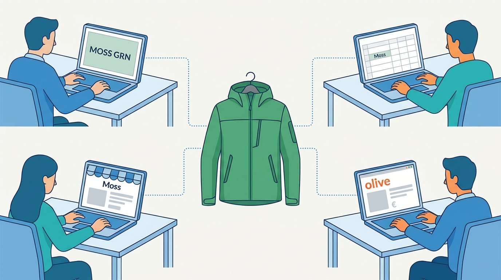
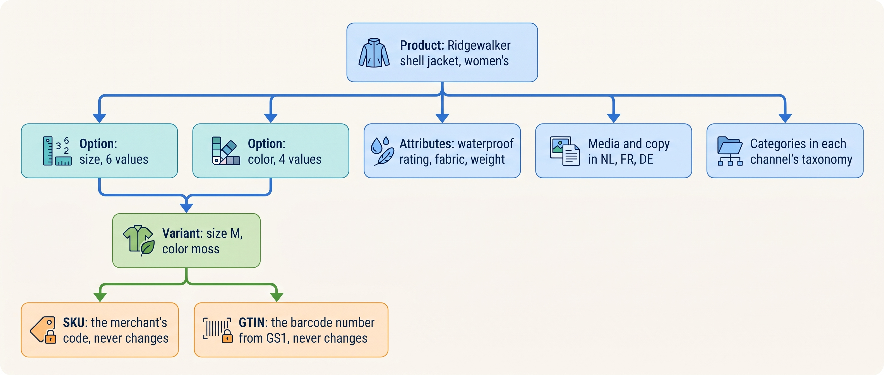
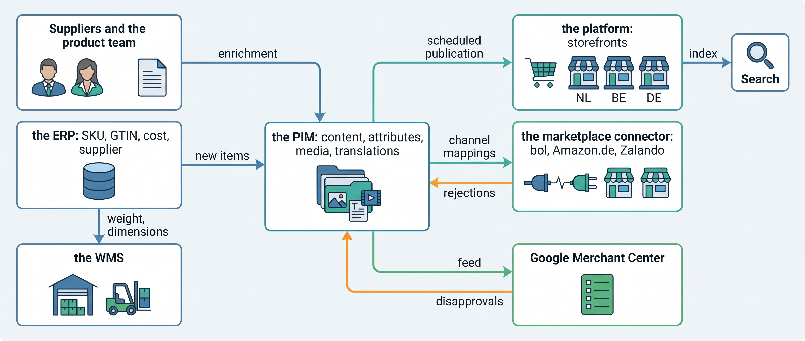
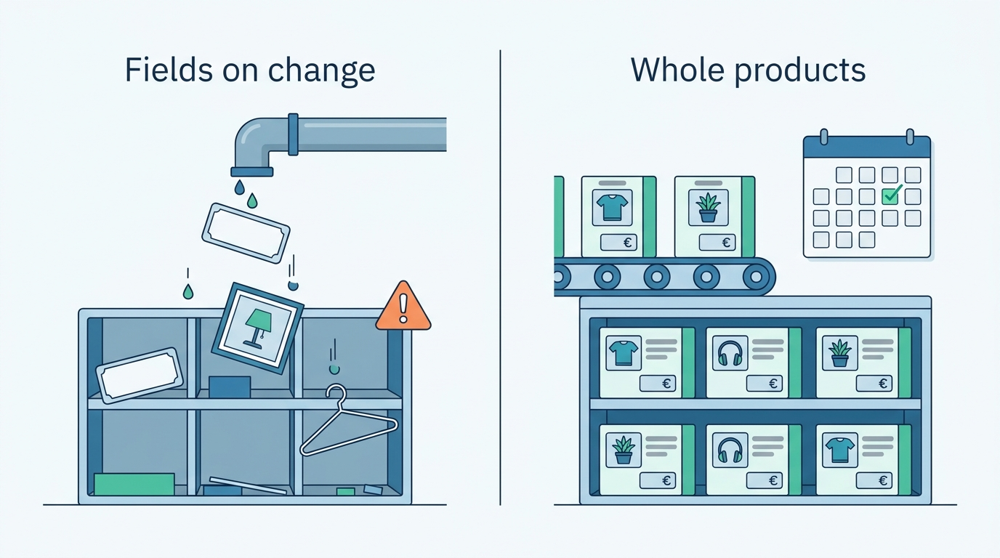

> **IN THIS CHAPTER, YOU WILL:** Learn how products, variants, identifiers and attributes are modeled, who should own each piece of product data, and when a PIM (product information management system) earns its place.

> **KEY POINTS:**
>
> * **A product is four things, and only two of them may ever change.** The product is what the shopper browses, the variant is what they buy, the stock keeping unit (SKU) is the merchant's code for it and the Global Trade Item Number (GTIN) identifies it across organizations. Titles and copy change freely; SKUs and GTINs never do, because orders, warehouses and marketplaces are keyed on them.
> * **Product data has many producers and many consumers, so it needs one owner per attribute.** Purchasing, marketing, translators and suppliers write it; storefronts, marketplaces, search, the warehouse and wholesale read it. The design question is not which tool, but which system may change which field and how the others learn of it.
> * **Every channel validates product data against its own rules and rejects quietly.** Google wants a stable id and a correct GTIN, bol wants a barcode identifier and a classification "chunk", a storefront wants a translation. Syndication needs a per-channel outbox, a rejection report and a loop back to the owner.

> **[FAILURE PATTERNS THIS CHAPTER ADDRESSES](where-commerce-platforms-go-wrong.html):**
>
> * **The Spaghetti Junction** — each channel gets product data through its own hand-built import, feed or spreadsheet, each with its own owner or none.
> * **The Pulled Rug** — a marketplace changes its content rules or retires an API version and listings go offline before anyone is told.
> * **The Giant's Boots** — a product information system is bought because larger brands have one, before the merchant has more than one producer and one consumer of product data.

 
The Ridgewalker women's jacket comes in six sizes and four colors: twenty-four variants, each needing an internal code and barcode. Its descriptions, images and attributes must also reach several channels in three languages. If a corrected waterproof rating reaches only the web shop, marketplace buyers can still receive the wrong information about the same jacket.

Product data often begins wherever it is first needed: purchasing data in accounting, descriptions in the storefront, seasonal plans in spreadsheets and listings in a marketplace tool. The copies agree until someone renames a color, fixes a translation or adds a required field. **Give each field an owner and let the channels consume its value.** Otherwise every correction becomes another round of manual entry.

**Where we are in the order's journey.** Before Eva can find a jacket at Kestrel & Pine, the fictional outdoor brand, the Ridgewalker women's M in moss needs a title, image and Dutch description. It also needs a **SKU** (stock keeping unit, its internal variant code) and **GTIN** (Global Trade Item Number, the identifier encoded in its barcode). That record supports every later step in [[journey-of-an-order]].

## Setting the Scene at Kestrel & Pine: The Season That Was Typed Four Times

Kestrel & Pine sells **3,400 products** in **26,000 variants**, with about **17,000 active** and **1,200 new variants** each season. In January 2027, descriptions live in the platform, costs and purchasing data in the enterprise resource planning system (ERP), and translations and seasonal details in spreadsheets. The marketplace connector holds another copy.

There is no **product information management system (PIM)**: a shared place to prepare product content for publication to all channels.

In February 2027, Noor Visser, the new Head of Engineering, sat in on the Spring/Summer 2027 launch and wrote down what happened to one new variant of the Ridgewalker shell jacket on its way to being sold. The details are illustrative.

1. **Purchasing** created the item in the ERP: SKU, GTIN, supplier, landed cost (€58, what the item costs once delivered to the warehouse), purchasing unit. The color field said `MOSS GRN`.
2. **Teun Baas's product team** filled the "season sheet", a spreadsheet with the marketing name, the Dutch description, the fabric, the waterproof rating and the image file names. Color: `Moss`.
3. **The agency** imported the season sheet into the platform, a two-day job each season. The 20,000 mm waterproof rating stayed behind in the sheet; it never reached the platform as a field, so the storefront could not filter on it and search could not find "waterproof jacket" ([[commerce-search-and-discovery]]).
4. **A translator** worked from a second spreadsheet. The German storefront launched with about **310 variants** still showing Dutch copy, for three weeks.
5. **Milan Petrov's marketplace team** re-mapped the new variants to bol's attribute model by hand in the connector. bol declined about **140 of the new variants** for missing mandatory attributes; the first anyone heard of it was the upload report, a day later. On the listings that went live, the color read `olive`, chosen from bol's list in 2024 and never revisited.

Four teams typed one color four times, in three forms. A marketplace rejected a tenth of the season. **Without an owner for product content, every channel created its own version.** Waypoint, Kestrel & Pine's improvement program, addresses this in decision W3: introduce a PIM in Q3 2027 for content and attributes. The ERP keeps costs and purchasing; the platform and marketplace connector consume published content.

**Figure 1:** *One color typed four times, three ways, by four teams: with no owner for product content, every consumer of it became a producer.*

## What a Product Is: Four Things That Share a Name

The first thing a newcomer needs is that a "product" is a stack of four concepts, each identified differently and each stable to a different degree.

| Term | What it is | Who assigns it | May it change? |
| --- | --- | --- | --- |
| **Product** | The sellable concept a shopper browses: "Ridgewalker shell jacket, women's" | The merchant | Title, copy and images change freely |
| **Variant** | One buyable combination of option values: size M, color moss | The merchant, from the options | Must stay stable once it has been sold |
| **SKU** | The merchant's own stock-keeping code for that variant, the thing you count on a shelf and put in a parcel | The merchant (usually the ERP) | Never |
| **GTIN** | The Global Trade Item Number under the barcode, licensed from GS1, the barcode standards body, so that every company's systems mean the same item by it | A GS1 member organization | Never, and never reused for a different item |

An **option** is a dimension of choice (size); an **option value** is one choice (M). A variant is one point in the grid the options define. The platforms and the standards all make this split. Shopify's developer documentation (n.d., accessed November 2026) describes the product as "the container for all product information (title, description, vendor)" and says "each variant represents a specific combination of option values, like 'Red / Small'". The schema.org vocabulary, which search engines read from web pages, models the same thing in version 30.1 (September 2026): a `ProductGroup` is a family that differs "only along defined dimensions, such as size or color", each variant linked by `isVariantOf`.

The identifiers are where newcomers get hurt. A **SKU** is the merchant's code; nobody outside the company understands it, which is its strength. A **GTIN** is the global one. GS1, the standards body that runs the barcode system, says a GTIN is "unique, global and verifiable within the GS1 system" and that "only a GS1 Member Organisation can provide you with a GS1 GTIN" (GS1 support article, updated August 2024). The format on European retail barcodes is the 13-digit **EAN-13** (GTIN-13); a 14-digit GTIN-14 identifies a trade unit such as a carton of twelve, which is why wholesale and EDI need it and a web shop does not. Every distinct item and every packaging configuration gets its own GTIN. Kestrel & Pine has carried a GTIN on every own-brand SKU since 2021.

commercetools' product documentation (n.d., accessed November 2026) gives integrators the rule in one line: "treat the sku values as immutable identifiers". **The rule I use:** a SKU and a GTIN are promises to every other system, so they are assigned once, before the first sale, and a mistake is retired, never corrected in place. A reused SKU is a stock count that belongs to two items; a reused GTIN is a marketplace listing that shows the wrong product.

**Figure 2:** *One product is a grid of variants, each with two permanent identifiers, plus attributes, media and categories that change with the season; the model separates what may change from what may not.*

### Attributes, attribute sets and taxonomies

An **attribute** is a typed field on a product or a variant: waterproof rating in millimeters, fabric, weight, care instructions, CE marking (the label that says a product meets EU safety rules). An **attribute set** is the list of fields a product of a given kind must carry: a jacket has a waterproof rating, a boot has a sole material, a stove has a fuel type. Attribute sets are the contract between the catalog and everything that reads it. A storefront filter, a search facet ([[commerce-search-and-discovery]]) or a marketplace listing can only use an attribute that is filled consistently for every product of that kind. Kestrel & Pine's waterproof rating, living only in a spreadsheet, is invisible to all three.

A **taxonomy** is a fixed tree of categories a channel understands. Every channel has its own. Google's product taxonomy, the one its Shopping feeds use, is a file headed with version 2021-09-21 listing 5,595 categories; a feed may submit the numeric id or the full path such as "Apparel & Accessories > Clothing > Dresses" (Google Merchant Center help, n.d., accessed November 2026). bol, the largest Dutch and Belgian marketplace, describes its content model as a JSON file of more than 4,000 product classifications it calls "chunks", each defining the attributes a product must carry and which are mandatory (bol Retailer API documentation, n.d., accessed November 2026). The merchant therefore needs an internal taxonomy, the one it merchandises by, and a **mapping** per channel: a table that translates its categories and attribute values into each channel's. The mapping is data, not code, and it has an owner.

### Bundles, digital goods, translations and lifecycle

Four product shapes need more than a size-and-color grid:

- A **bundle or kit** sells components together, such as a tent and footprint. Each component keeps its identity and stock. The sale must allocate the bundle price back to those components ([[inventory-and-availability]], [[commerce-promotions]]).
- A **configurable product** groups purchasable variants under a parent. Adobe Commerce's October 2026 documentation distinguishes that parent from the simple products, each with its own SKU.
- A **digital good**, such as a download or license, skips warehouse and carrier processing and needs its own fulfillment and tax treatment.
- A **gift card product** creates a prepaid balance when sold. Finance records the obligation to honor that balance ([[tax-invoicing-and-ledger]]).

Translation is per product, per language, and often per channel. Shopify's documentation puts it from the merchant's side: "each published language gets its own URLs, and your store displays the translated version when translations exist" (Shopify Help Center, n.d., accessed November 2026). Kestrel & Pine sells in three countries and two languages in Belgium alone, so every description exists at least three times by design, and each translation has its own completeness status.

A product also has a **lifecycle**: draft, active, end of season, discontinued. A product is never deleted once it has been sold: orders, returns, invoices and analytics reference it for years, so "discontinued" is a state, not a deletion. commercetools enforces this mechanically: it separates staged from published data and "you can only delete unpublished products". And lifecycle is per channel: Google Merchant Center's `availability` takes `in_stock`, `out_of_stock`, `preorder` or `backorder`, and an item that is out of stock must still show its price on the landing page (product data specification, n.d., accessed November 2026). A variant can be end-of-season on the storefront and still listed on a marketplace clearing the last units.

## Who Owns Which Field: Producers, Consumers and the System of Record

Now the architectural problem. Product data has **many producers**: purchasing creates the item; the product team describes it; translators localize it; suppliers provide specifications for third-party brands; the marketplace team adapts it to each channel. And it has **many consumers**: the storefronts, the search index, the marketplaces and feeds, the warehouse (which needs weight and dimensions to pick a box), the wholesale portal, the data warehouse, and, from 2027, AI agents that need accurate product data before they can shop ([[ai-and-agentic-commerce]]).

[[boundaries-and-systems-of-record]] introduces the **system of record**: for each fact, the one system whose value is the truth when copies disagree. For product data, that decision must be made **per attribute**, not per product, because the attributes have different natural owners. The table below is the one the book uses; it is an industry-typical arrangement, not a law.

| Data | System of record | Who produces it | Who reads it | Why here |
| --- | --- | --- | --- | --- |
| Item identity: SKU, GTIN, supplier, purchasing unit, landed cost | **The ERP** | Purchasing | PIM, platform, WMS (warehouse management system), EDI (electronic data interchange with wholesale customers), finance | The item must exist and be valued before it can be bought, counted or sold |
| Logistic attributes: weight, dimensions, customs code | The ERP (or the PIM, if the ERP cannot hold them) | Purchasing, the warehouse at first receipt | WMS, carriers, customs | Measured once, needed for every parcel |
| Product content: names, descriptions, attributes, media, translations, internal categories | **The PIM** (the platform at the Starting and Growing stages) | Product team, translators, suppliers | Platform, marketplaces, feeds, search, wholesale, print | Many producers, many consumers; needs a workflow |
| Channel mappings: category and attribute translations per channel | The PIM (or the feed tool) | The marketplace team | Connector, feed tool | Changes when a channel changes its rules |
| Storefront presentation: collections, theme blocks, landing pages | The platform | Ecommerce team | Storefront only | Belongs to one channel |
| Listings: the channel-specific product page | The channel, via the connector | Derived from the PIM and the mappings | Shoppers on that channel | A copy, by design |
| Price | See [[pricing-architecture]] | | | Changes at a different cadence |
| Stock | The WMS and the availability service, see [[inventory-and-availability]] | | | Changes every minute |

The last two rows explain why price and stock have their own chapters: they are product-related data with different freshness needs. A description can be a day old. A price that is a day old is a broken promise with legal weight. A stock figure that is an hour old is the Black Friday Oversell. **Product content, prices and stock travel on separate paths** even when they end up in the same marketplace feed.

Read against this table, Kestrel & Pine in January 2027 has no owner for the "product content" row. The platform holds content because the storefront needs it; the spreadsheets because the product team works there; the ERP a name because an item must have one; the connector a re-mapped copy because bol needs its chunk. Four producers, no system of record. This is the **Spaghetti Junction**: every pair of systems has its own path, each with its own owner or none.

### Requirements per flow

When product data moves between systems, the flows have different requirements ([[integration-styles]] asks for this table whenever flows are discussed).

| Flow | How fresh | How consistent | How fast | Availability need |
| --- | --- | --- | --- | --- |
| New season into the ERP (identity, cost) | Weeks before launch | Exact: one SKU, one GTIN per variant | Batch is fine | Office hours |
| Enrichment into the PIM (content, media, translations) | Continuous during the season build | Workflow states: draft, enriched, translated, approved | Human speed | Office hours |
| Publication to the storefront and search | Minutes after approval, or on a scheduled date | Whole product at once: never a title without its variants | Minutes | Launch day matters |
| Syndication to marketplaces and feeds | Hours is usually acceptable for content | Per channel's rules; rejections reported back | Asynchronous, with a report | Launch and peak weeks |

Two things stand out. Content tolerates lag but demands completeness: a product published with a missing size or an untranslated description is worse than one published an hour later. And syndication is **asynchronous by nature**: the channel decides later whether it accepts the product. bol's documentation says an upload report may take an hour; Google disapproves a product with an incorrect GTIN. The architecture must expect a "no" to arrive after the "sent".

## How the Pieces Fit Together With a PIM

A **PIM** (product information management system) is the editorial system where product data is created, enriched, translated and approved before it is published to channels. **Enrichment** is adding the marketing, technical and media content a channel needs beyond what the ERP holds. **Syndication** is publishing product content to each channel in that channel's format and under its rules. A **feed** is a file or API stream of product records in a channel's format; **structured data** is product information embedded in the web page itself (schema.org) so that search engines can read it.

The vendor descriptions converge. Akeneo calls a PIM "a system or solution that helps businesses manage, centralize, and distribute product information", a "central source of truth" that collects "data from your ERP, MDM, PLM, and other systems" (master data management and product lifecycle management, the systems where products are designed), enriches it and manages "catalogs for every sales channel in one system of record" (Akeneo, n.d., accessed November 2026). Pimcore describes an "open core platform for Product Experience Management" (GitHub, version 2026.1, accessed November 2026). These are vendor pages; none gives a testable threshold for when a PIM pays off. The threshold comes later in this chapter.

**Figure 3:** *With a PIM, the ERP still creates the item and keeps its cost, the PIM owns everything a shopper reads, every channel is a consumer, and each channel's rejections flow back to the owner instead of dying in an upload report.*

Three design rules make this picture work, and they are rules about ownership, not about the tool.

**Rule 1: each attribute flows in one direction.** The ERP creates the SKU; the PIM may not. The PIM owns the description; the platform may not edit it, only display it. Microsoft's documentation for the Business Central Shopify connector states this bluntly for a two-system case: "decide which system is the system of record for product data" before configuring the sync, choosing the direction per field, with the Shopify SKU or barcode as the mapping key (Microsoft Learn, 16 October 2026). A field that can be edited in two places will be.

**Rule 2: publish whole products on a schedule, not fields on change.** Content changes constantly during a season build and nobody wants half-enriched products on the storefront. Waypoint's integration standard (W5) says products move "by scheduled publication" while stock, orders and prices move by **events** (a message sent the moment something changes). commercetools builds the same idea into its product model with staged and current data; Shopify's `productSet` mutation is designed for the case where "an external system is the source of truth" and replaces a product's options and variants in one operation (Shopify developer documentation, n.d., accessed November 2026). A PIM publication needs exactly that: a whole product, atomically.

**Figure 4:** *Content changes all through a season build, so products are published whole on a schedule while stock, orders and prices move by events.*

**Rule 3: every channel's answer comes back to the owner.** A syndication path has an outbox per channel (what was sent, when, under which version of the channel's rules), a validation step that runs the channel's known rules before sending, and a rejection report that lands in the PIM as a task for a person ([[marketplaces-and-channel-integration]] owns the listing operations behind it). Without the loop, 140 declined variants are a line in a report nobody reads.

## The Choices

There are four realistic ways to arrange product data.

**1. The platform is the catalog.** Product data is created and edited in the commerce platform; the ERP gets a copy or just a SKU and a price; marketplaces are fed from the platform through a connector. This is every merchant's starting point, and for one channel and one language it is right.

**2. The ERP is the product master.** The ERP creates the item and holds its name, attributes and sometimes its description; the platform receives items by connector ([[erp-and-back-office-integration]]). Common where the ERP came first (wholesalers, manufacturers). It works for identity and cost. It fails for content, because ERP item masters were designed for purchasing, not for marketing copy in three languages with images and a translation workflow; the content ends up in spreadsheets beside the ERP, which is Kestrel & Pine's situation.

**3. Spreadsheets with discipline.** The honest name for what most Growing-stage merchants do: a season sheet, an import, a translation sheet. Cheap and flexible. Its limit is not size but the number of hands: once more than two teams write to the sheet and more than two systems read from it, there is no record of who changed what, no workflow state and no validation.

**4. A PIM as the system of record for content.** The ERP keeps identity and cost; the PIM owns content, attributes, media, translations and channel mappings, with a workflow (enrichment status, approvals, completeness per channel) and syndication; the platform and the connector become consumers. This is Waypoint's W3. It is right under the conditions the next table makes explicit, and the Giant's Boots when they do not hold.

A fifth option, a full master data management platform spanning products, customers, suppliers and locations, belongs to the Group stage and to [[identity-and-master-data]].

## Trade-offs

| | Platform as catalog | ERP as product master | Spreadsheets with discipline | PIM as system of record |
| --- | --- | --- | --- | --- |
| **Right when** | One or two channels, one language, one team editing | ERP-first business, few channels, thin content (industrial parts, wholesale-only) | Two or three channels, a small product team, content richer than the platform holds | Several channels and languages, more than one producing team, channel rules to track |
| **Cost** | Included in the platform | Included in the ERP; connector by the ERP partner | Nearly free in licenses; expensive in people at every launch | A subscription *(assumption: a few hundred to a few thousand euros a month at mid-market)* plus implementation and migration |
| **Workflow and approvals** | Minimal (draft and active) | None for content | None; versions by file name | Built in: states, completeness, per-channel readiness |
| **Translations** | Per storefront, via apps or CSV | Rarely supported well | A second sheet | Native, per locale and channel |
| **Channel validation** | The connector's, after sending | None | None | Rules per channel before sending; rejection loop |
| **Warning sign of outgrowing it** | The first marketplace rejects products in bulk; the first second language | Content lives in spreadsheets beside the ERP | A launch takes longer than two weeks; nobody knows which sheet is current | Rare; the risk is buying it too early and running it as a spreadsheet with a login |

**My recommendation,** with its conditions. A PIM becomes necessary when product data has **more than one producer** (buying, marketing, suppliers, translators) **and more than one consumer** (web, marketplaces, print, wholesale, stores), and the platform's product record can no longer hold the workflow between them. Below that line, the platform or a disciplined spreadsheet is cheaper and the PIM is the Giant's Boots: a workflow tool for a workflow that does not exist yet. Above it, the absence of a PIM shows up as channel-specific copies that drift, and the cost of the drift (declined listings, untranslated launches, a two-week season import) usually exceeds the subscription within a season. Kestrel & Pine crossed the line around 2021–2022, when it added marketplaces (2021) and a third country (2022) to a Belgian storefront that already ran in two languages.

Two assumptions sit under that recommendation. The ERP keeps item identity and cost, so the PIM is bought for content, not as a second item master. And the merchant can name one owner for product content with authority over the product team, the translators and the marketplace team at once; at Kestrel & Pine that is Teun Baas, who owns the catalog and the seasons. Without such an owner the PIM becomes a fifth copy.

## Across Scale Stages: When It Fits and When It Limits

The four stages are the ones this book uses throughout (see [[meet-kestrel-and-pine]] and, in depth, [[commerce-scaling-stages]]).

| Stage | What is typical | What becomes necessary | Warning signs you have outgrown it |
| --- | --- | --- | --- |
| **1 — Starting** (under about €2M; Kestrel & Pine 2016–2018) | The platform is the catalog; SKUs typed by hand; GTINs bought in a block; the platform's built-in Google feed; one language | SKU and GTIN discipline from day one: one SKU per variant, never reused, never corrected in place | Variants split into separate products to get around a limit; SKUs that encode the price or the season |
| **2 — Growing** (about €2M–€20M; 2019–2022) | An ERP with its own item master; the first marketplace through a connector; a season spreadsheet; the first second language | A written ownership rule per field between platform and ERP; a mapping table per channel; the item created in the ERP before it is sold anywhere | The first marketplace declines products in bulk; the same color has three spellings; the season import takes days; translations lag launches |
| **3 — Omnichannel** (about €20M–€200M; 2023 onward) | Stores, wholesale, three marketplaces, several countries; a dozen systems reading product data; four copies | A PIM as system of record for content, the platform demoted to a channel; attribute sets as a contract with search and filters; syndication with a rejection loop; product data as a prerequisite for EDI, marketplace rules and agents | A season launch is the slowest project of the year; a marketplace rule change takes listings offline before anyone knows; the data warehouse counts products three ways |
| **4 — Group** (over about €200M or several brands) | Several brands, each with a catalog; shared marketplaces and retailers; print and B2B (business-to-business) catalogs | A group taxonomy with brand extensions; shared syndication with brand-level channel accounts; a master data function that allocates identifiers across brands | Two brands list the same third-party product with different GTINs; one brand's PIM becomes everyone's bottleneck; a retailer receives two feeds from one group |

The judgement: **identifier discipline does not change with scale; everything else does.** A SKU and a GTIN assigned correctly at the Starting stage save a migration at every later one. The ownership rule changes once, at the Growing-to-Omnichannel boundary, when content gets its own system; after that the question is how many brands share it.

## In Practice

### What the platforms and channels document

**Variant limits shape catalogs.** As of November 2026: Shopify's historic limit was 100 variants per product; new GraphQL product APIs supporting 2,048 shipped in API version 2024-04, and on 15 October 2025 the 2,048 limit opened to all merchants, with a warning that apps not on the supported APIs "may have a downgraded or broken experience" (Shopify changelog, 15 October 2025). commercetools' 2026 release notes describe two catalog models: the Classic model keeps variants embedded in the product with a 100-variant limit, while the Modular Catalog, generally available from 29 September 2026, makes variants first-class resources with up to 10,000 per product (commercetools release notes, 2026). Both are recent and will move. The lesson is older than either: an apparel catalog of sizes times colors routinely passes 100 combinations, and a merchant that split products to fit a limit poisoned its search, feeds and analytics for years after the limit was lifted.

**Channels validate, and reject.** Google Merchant Center's product data specification requires `id` (at most 50 characters; "keep it stable"), `title`, `description`, `link`, `image_link`, `price` and `availability`; `gtin` is strongly recommended and "if you submit a product with an incorrect GTIN value, your product will be disapproved"; variants need `item_group_id`; and from 31 January 2027 a 500 × 500 pixel minimum image will be enforced (Google Merchant Center help, n.d., accessed November 2026). As of November 2026, bol requires an EAN for every product, declines content without one, makes its first two enrichment levels mandatory, takes products offline where a required CE marking is missing, and updates its data model "daily". Every one of these is a rule that changes on the channel's schedule, which is the Pulled Rug seen from the catalog side.

**Ownership direction is a documented setting.** The Business Central Shopify connector (Microsoft Learn, 16 October 2026) asks the merchant to choose a direction per product field ("If you manage item names, descriptions, and pricing in Business Central, choose the To Shopify direction. If your merchandising team maintains product content in Shopify ... choose From Shopify") and maps by SKU or barcode. That page is this chapter's argument in two sentences.

### Kestrel & Pine: what W3 means in practice

Waypoint W3 introduces a bought PIM in Q3 2027 as the system of record for product content and attributes. The sequence below is this chapter's reading of that decision, with illustrative dates consistent with the rest of the book.

**Ownership first.** In April 2027, building on the entity–owner table of March ([[boundaries-and-systems-of-record]]), Noor, Teun and Milan wrote the attribute-level ownership table for the Ridgewalker as a one-page document before any vendor demo. The ERP keeps SKU, GTIN, supplier, landed cost (€58 for the Ridgewalker), purchasing unit, weight and dimensions. The PIM owns the marketing name, the descriptions in Dutch, French and German, the attribute set for jackets (waterproof rating, breathability, fabric, care, CE and other markings), media, the internal category and the mappings to Google's, bol's, Amazon.de's and Zalando's taxonomies. The platform owns collections and landing pages and nothing else about the product. The connector owns nothing; it derives listings. Color values are a controlled list in the PIM: `moss` has one spelling and a mapping to `olive` where a channel's list has no moss.

**One direction per field.** The ERP creates items and the PIM imports them nightly; the PIM cannot create a SKU. The PIM publishes whole products to the platform on a schedule, with a launch date per season, and the agency's season-sheet import is retired. The platform's product editor is read-only for owned fields.

**Syndication with a loop.** The PIM syndicates to the connector and to the Google feed; each channel's rejections return as tasks on the product, with the channel's rule quoted. A completeness score per channel (how many mandatory attributes are filled) is visible before launch, so a repeat of bol's 140 declines becomes a list to clear before launch, not a surprise in the next day's upload report.

**Migration consumer by consumer.** The PIM is loaded in July 2027 from the four copies, and the load itself is a reconciliation: about **1,900 variants** with conflicting attributes are listed and resolved before anything is published. The DE storefront becomes the first consumer in August, the NL and BE storefronts and the connector follow in September, and the spreadsheets go read-only ([[replatforming-and-migration]] treats this as the small migration it is). The Spring/Summer 2028 season is the first built in the PIM from the start. The PIM is also the first prerequisite of **W8**, agent readiness: an AI shopping agent needs product data that is accurate, complete and the same in every channel, and the PIM is where that becomes checkable.

The numbers that matter are small. The season import drops from two agency days to a scheduled publication. The DE storefront launches with no untranslated variants because the completeness score blocks a product that is not translated. And one spelling of `moss` reaches four channels.

## When It Goes Wrong

Product data fails quietly. The failures below are the ones to detect on purpose.

**Silent rejection.** A channel declines a product in an asynchronous report nobody reads, and the product is simply not for sale there. *Detection:* a listing status per variant per channel (sent, accepted, rejected with reason, live, offline) reconciled against what the channel reports; a daily count of variants that should be live but are not. *Recovery:* the rejection becomes a task on the owner's queue.

**Identifier drift.** A SKU reused for a new item, a GTIN with a wrong check digit, a variant deleted and recreated with a new id. The warehouse counts two items as one; a marketplace shows the wrong product; orders lose their link. *Detection:* a weekly cross-reference check (SKU to GTIN to platform id to connector id) across the ERP, the PIM, the platform and the connector. *Recovery:* retire the identifier, create a new one, map the old one for history; never edit in place.

**The split product.** Variants modeled as separate products to get around a limit, or because a color launched late. Search shows the jacket four times, `item_group_id` is wrong in feeds, analytics count four products. *Detection:* products that share a name and a brand but not a group id. *Recovery:* a merge that keeps the old URLs and ids mapped, which is a migration, not an edit.

**Stale translation.** A fixed Dutch description republished while the German one still carries the old claim. *Detection:* completeness per locale as a blocking state before publication. *Recovery:* publish the whole product again, in all locales.

**The pulled rug.** A marketplace changes its data model (bol's is updated daily), adds a mandatory attribute or retires an API version on a published date. Kestrel & Pine's **Deprecated Endpoint** of February 2027 was stock, not content, but the mechanism is the same: the agency script that pushed stock to the connector called a retired API version, and bol's figures were stale for two days. *Detection:* the channel's changelog and deprecation notices read by a named owner, and a weekly listing status check that would show listings going offline. *Recovery:* the mapping is data, so a new mandatory field is a mapping change, not a code change; [[api-contracts-and-versioning]] owns the versioning side.

The common thread is the one [[events-consistency-and-reconciliation]] develops for every copy in the landscape: a copy is acceptable only with a reconciliation that compares it to its system of record on a schedule and lists the differences for a person.

## What to Take Away

**Established.**

- A product is a product, its variants, their SKUs and their GTINs, and the identifiers are permanent. Shopify's product model, commercetools' "treat the sku values as immutable identifiers", schema.org's `ProductGroup` and GS1's GTIN rules all say so.
- Channels validate product data against their own rules and reject asynchronously: Google disapproves a wrong GTIN and requires a stable id, bol declines content without an EAN and takes products offline for missing markings. Syndication must expect and route the "no".
- Products with sales history are never deleted; "discontinued" is a lifecycle state.

**Depends on context.**

- The platform is the right catalog at the Starting stage and often at the Growing stage; it stops being right when there is more than one producing team and more than one consuming channel. That boundary, not revenue, is the test for a PIM.
- The ERP should own item identity and cost. Whether it also owns logistic attributes depends on whether it can hold them and whether the WMS already reads from it; at Kestrel & Pine it can and it does.
- Mappings to channel taxonomies live in the PIM when there is one and in the feed tool or connector when there is not; what must not change with the choice is that the mapping is data with an owner.
- Variant limits are a platform fact that changes (Shopify 2,048 since October 2025; commercetools 100 or 10,000 depending on model since September 2026); whether a limit matters depends on the catalog's shape, and apparel and footwear catalogs are the ones that hit it.

**The author's synthesis.**

- Decide the ownership table before choosing a PIM, because the PIM only works if each field has one owner and one direction; a PIM bought without the table becomes a fifth copy with a login.
- Treat syndication as an integration with an outbox, a validation step and a rejection loop, not as a feed; the "no" that arrives a day later is the message most worth routing.

## Questions to Ask

1. For the product the shopper sees on your storefront, how many systems hold a copy of its description, and which one is right when they disagree?
2. Can anyone edit a product's name or description in two places? Which fields in the platform are read-only, and which should be?
3. When a SKU is typed wrong, is it corrected in place or retired and reissued? Has a SKU or a GTIN ever been reused?
4. Which attributes does a jacket (or your equivalent) carry as fields, and which live inside description text? Can the storefront filter on every attribute a shopper would filter on?
5. When a marketplace declines a product, who finds out, how long after, and where does the task land?
6. How long does a season launch take from the first item in the ERP to live listings on every channel, and which step is manual?
7. Which channel's rules changed in the last twelve months, and how did you learn of it?
8. If an AI shopping agent read your product data tomorrow, would it find the same jacket, in the same color, at the same completeness, in every channel?

With the product described once and owned per field, the next promise is the one the shopper reads under the title. A price is also product-related data, but it changes at a different cadence, it carries legal weight in Europe, and it is copied into more systems than any other fact. [[pricing-architecture]] takes it up with Kestrel & Pine's Price Drift of October 2026.

## Sources and Evidence

*Company, product and investor sources*

- [New product model (GraphQL Admin API)](https://shopify.dev/docs/apps/build/graphql/migrate/new-product-model), Shopify developer documentation, n.d., accessed 2026-11 — the product, option and variant model and the `productSet` mutation for an external source of truth.
- [The product variant limit is now 2,048 for all merchants](https://shopify.dev/changelog/the-product-variant-limit-is-now-2048-for-all-merchants), Shopify changelog, 2025-10-15 — the variant limit and the warning to apps.
- [2,048 variants](https://www.shopify.com/blog/2048-variants), Shopify blog, 2025-10-15 — why the REST API could not carry high-variant products.
- [Variants](https://help.shopify.com/en/manual/products/variants) and [Markets: languages](https://help.shopify.com/en/manual/markets/languages), Shopify Help Center, n.d., accessed 2026-11 — variants in merchant terms; translations and per-language URLs.
- [Standard Product Taxonomy](https://github.com/Shopify/product-taxonomy), Shopify, versioned 2026-10, accessed 2026-11 — an open-source taxonomy with categories, attributes and values.
- [Products](https://docs.commercetools.com/api/projects/products), commercetools documentation, n.d., accessed 2026-11 — immutable SKUs, staged and published data, deletion only when unpublished.
- [Introduced Modular Catalog in public beta](https://docs.commercetools.com/api/releases/2026-06-26-introduced-modular-catalog-in-public-beta), 2026-06-26, and [Modular Catalog is now generally available](https://docs.commercetools.com/api/releases/2026-09-29-modular-catalog-is-now-generally-available-and-product-search-for-modular-catalog-is-available-in-public-beta), 2026-09-29, commercetools release notes — the two catalog models and the 100 and 10,000 variant limits.
- [Create a product](https://experienceleague.adobe.com/en/docs/commerce-admin/catalog/products/product-create), Adobe Experience League, updated 2026-10-08 — simple, configurable, grouped, bundle, virtual, downloadable and gift-card product types.
- [What is a PIM](https://www.akeneo.com/what-is-a-pim/), Akeneo, n.d., accessed 2026-11 — a vendor's definition of PIM, enrichment and syndication.
- [pimcore/pimcore](https://github.com/pimcore/pimcore), Pimcore, version 2026.1, accessed 2026-11 — an open-core PIM and master-data platform.
- [Synchronize items and inventory](https://learn.microsoft.com/en-us/dynamics365/business-central/shopify/synchronize-items), Microsoft Learn, 2026-10-16 — "decide which system is the system of record for product data"; mapping by SKU or barcode.
- [Product Content API v10](https://api.bol.com/retailer/public/Retailer-API/v10/functional/retailer-api/product-content-api.html), bol, n.d., accessed 2026-11 — the EAN requirement, the 4,000+ "chunks", mandatory enrichment levels, asynchronous upload reports and the daily data-model update.

*Standards, regulation and official documentation*

- [Product](https://schema.org/Product), schema.org, version 30.1, 2026-09-16 — `sku`, `gtin`, `ProductGroup`, `isVariantOf` and inheritance of features.
- [What is a GS1 GTIN](https://support.gs1.org/support/solutions/articles/43000734120-what-is-a-gs1-gtin-), GS1 support, updated 2024-08-30 — the GTIN as unique, global and verifiable, issued only by a GS1 member organization.
- [Global Trade Item Number](https://en.wikipedia.org/wiki/Global_Trade_Item_Number), Wikipedia, accessed 2026-11 — the GTIN-8, -12, -13 and -14 formats and the rule that each trade item and packaging configuration gets its own GTIN (secondary source; GS1's own site blocked fetching).
- [Product data specification](https://support.google.com/merchants/answer/7052112) and [google_product_category](https://support.google.com/merchants/answer/6324436), Google Merchant Center help, n.d., accessed 2026-11 — required fields, the GTIN disapproval rule, `item_group_id`, availability values and the image minimum from 2027-01-31.
- [Google product taxonomy](https://www.google.com/basepages/producttype/taxonomy-with-ids.en-US.txt), Google, version 2021-09-21 — the 5,595-category tree still in use.
- [Merchant listing structured data](https://developers.google.com/search/docs/appearance/structured-data/merchant-listing), Google Search Central, n.d., accessed 2026-11 — variant URLs and `priceValidUntil`.

*Research and practitioner sources*

- None beyond the documentation above; no independent study of when a PIM pays off was found, and the threshold given in this chapter is the author's judgement.

Kestrel & Pine is fictional; architectural recommendations, labeled inferences and labeled assumptions are the author's judgement.
