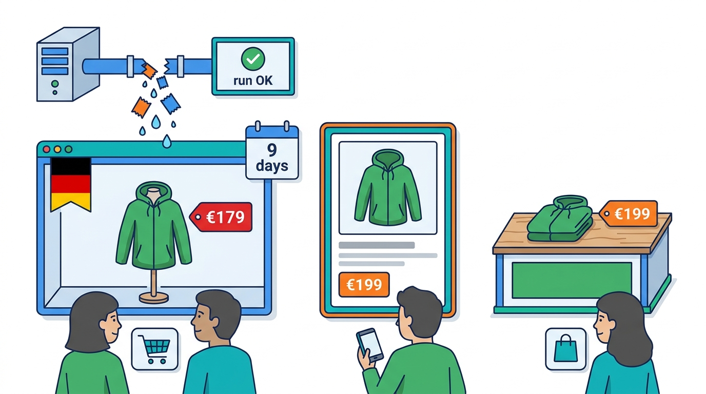
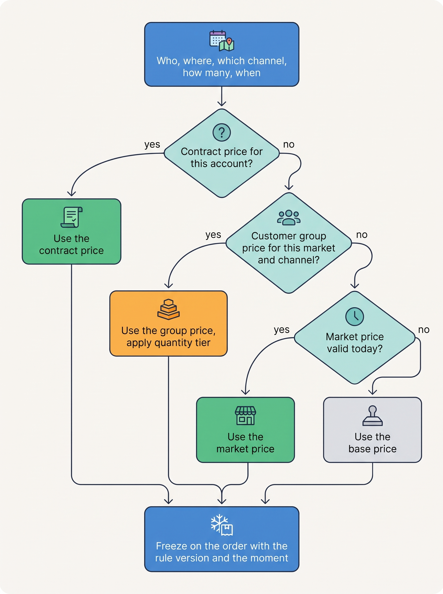
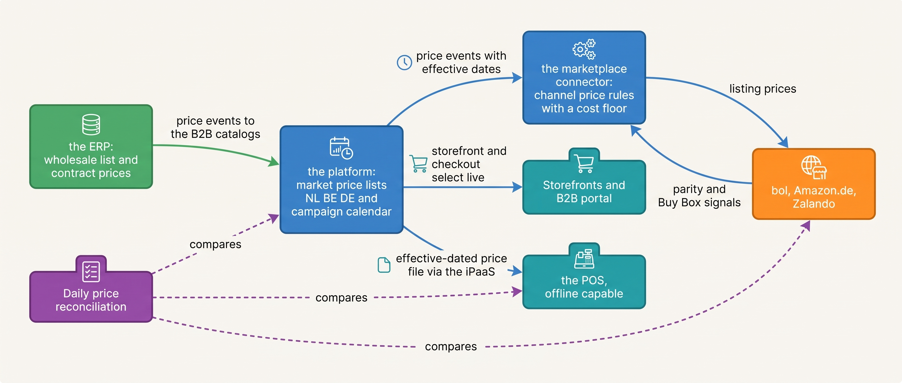
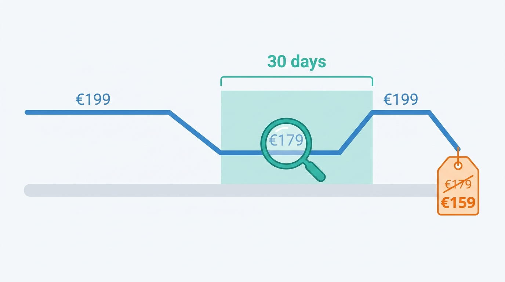

> **IN THIS CHAPTER, YOU WILL:** Learn what a price is made of, where it should be selected, how it reaches every channel, and what European price rules require of its history.

> **KEY POINTS:**
>
> * **A price is a promise with a selection rule.** One stock keeping unit (SKU, a sellable variant) carries many prices (market, currency, customer group, channel, quantity, validity). What makes them one price is a deterministic, documented rule that picks one at a defined moment, and that moment must be the same for the storefront, the checkout and the invoice.
> * **Separate the engine that selects a price from the copies that show it.** Channels that cannot call the engine (marketplaces, the point of sale, structured electronic orders from wholesale customers) receive copies, and every copy needs a source, an effective date (the date from which the price applies) and a reconciliation. Kestrel & Pine's Price Drift was a copy whose restore failed silently.
> * **In the EU, price history is a legal record.** Consumer prices must be shown including tax, and any announced reduction must name the lowest price of the previous 30 days, so the pricing system must answer "what did we charge, where, when" for every SKU.

> **[FAILURE PATTERNS THIS CHAPTER ADDRESSES](where-commerce-platforms-go-wrong.html):**
>
> * **The Price Nobody Can Explain** — the same product carries different prices in different channels and nobody can say which system set which price or why.
> * **The Message in a Bottle** — a price change is sent to a channel once and trusted; the channel that missed it keeps selling at the old price.
> * **The Secret Agent** — a repricing rule in a connector, an app or a spreadsheet import changes prices without a named owner, a floor or a person's approval.

 
At Kestrel & Pine, the fictional outdoor brand, the Ridgewalker jacket costs consumers **€199**, including local value-added tax (VAT), and wholesale buyers **€95**, excluding VAT, before negotiated terms. These are legitimate prices for different sales. The difficulty is ensuring that each channel selects the right one: a wrong price can either lose the sale or leave the merchant honoring an unintended discount.

Because several prices are valid at once, each sale needs a rule that selects one, and the rule needs explicit inputs: buyer, country, channel, quantity and date. Assign an owner to the rule so teams can explain a price and update it consistently. Typing separate prices into each system lets them drift as soon as one changes.

[[product-information]] gave every product attribute one owner and left the price out of that table. The price is different: it changes more often than a description, it carries legal weight in Europe, and it is copied into more systems than any other fact about the product.

**Where we are in the order's journey.** Eva sees €199 on the product page and pays that jacket price at checkout on 13 April 2027. The shop platform records it on order #1072455. The invoice and any later refund must use that recorded price, even after the price list changes. [[commerce-promotions]] covers discounts, and [[tax-invoicing-and-ledger]] follows the price into the books.

This chapter starts with the Price Drift, the incident in which one of Kestrel & Pine's channels kept a campaign price for nine days. It then explains what a price is made of and the rule that selects one, what tax, markets and currencies do to a single shelf price, and what European rules require a merchant to keep. With that vocabulary it separates the engine that selects a price from the copies that show it, and says who may change a price. It compares four arrangements for where prices live, weighs their trade-offs and follows them through the four scale stages. Platform documentation and Kestrel & Pine's 2027 design then check the argument, and the last section lists how pricing fails and what detects each failure.

## Setting the Scene at Kestrel & Pine: The Price Drift

In October 2026 the German storefront sold the Ridgewalker at **€179** for **nine days** while the marketplace listings and the stores charged **€199**. A price-list sync had failed silently. **410 orders** went out at the low price, about **€8,200** of margin was lost, and one marketplace sent a price-parity warning, a notice that the jacket was cheaper elsewhere than on its listing. [[meet-kestrel-and-pine]] records the incident; what follows is this chapter's reconstruction of the mechanism, with illustrative details.

The illustrative reconstruction starts with a German autumn campaign at €179, running from 25 September to 4 October. In 2026, the German consumer price list (the set of prices for German consumers) lived in the enterprise resource planning system (ERP), which also ran finance and purchasing. A connector copied it to the shop platform hourly.

Milan Petrov's storefront team entered the same campaign dates separately in the marketplace connector. The stores did not run the campaign; their point-of-sale (POS) tills received a weekly price file, and none of the stores was in Germany.

On 5 October, the update restoring €199 failed. The connector logged an error but reported success. Because it sent only changes since the last run, later runs never retried the missing price. The marketplace connector restored €199 from its own calendar, leaving only the German storefront at €179.

Nothing compared the prices. On 14 October, a marketplace warned Milan about the difference, and Finance Director Sanne de Wit's margin report exposed the loss. By then, 410 orders had each lost €20 of margin.

**Figure 1:** *The Price Drift: one restore failed silently, so for nine days one copy kept the campaign price while every other channel had moved back to €199.*

The storefront price was corrected in October, but the cause was wider than one connector. Six months later, in April 2027, Head of Engineering Noor Visser listed every place where the Ridgewalker's price lived. The shop platform held three market price lists (NL, BE, DE) and four B2B price lists (wholesale NL, BE, DE and one for Bergzicht Outdoor). The ERP held the wholesale and contract prices again, for invoicing, and the consumer lists that fed the DE storefront and the POS file. The marketplace connector held a channel price per marketplace. The campaign spreadsheet held the dates. **One jacket, eleven prices, seven places, no rule saying which was the source of which.** That is the Price Nobody Can Explain.

## What a Price Is Made Of

Eleven prices for one jacket are not in themselves the fault. A newcomer's first surprise is that a price is not a number on a product. It is a number selected from many by a rule. The dimensions below are the ones the major platforms document; the vocabulary in bold is the chapter's.

| Dimension | Plain meaning | Kestrel & Pine example |
| --- | --- | --- |
| SKU | The variant being priced | Ridgewalker women's, M, moss |
| **Market** (country, region) | Where the buyer is | NL, BE, DE |
| Currency | What the price is denominated in | Euro throughout |
| **Customer group** | Which kind of buyer | Consumer; wholesale; one named wholesale account |
| **Channel** | Through which sales path | Storefront, store, bol, Amazon.de, Zalando, B2B portal, EDI |
| Quantity tier | How many are bought | Wholesale price breaks per carton |
| **Validity window** | From when until when | Autumn campaign 25 September to 4 October 2026 |
| **Tax basis** | Whether the number includes tax, and which tax | €199 includes 21% Dutch VAT; €95 excludes VAT |

A **price list** (Shopify calls it a catalog, SAP Commerce a set of price rows, commercetools a set of standalone prices) is a named set of prices for a group of customers or a market. A **base price** is the list price for the general public. A **customer-specific price** applies to a customer group, such as wholesale. A **contract price** is agreed with one named account and outranks the list; Bergzicht Outdoor, Kestrel & Pine's largest wholesale customer, buys on a contract price list negotiated by Lea Moreau each season. A **tiered price** (volume pricing) changes with quantity. A **quote** is an offer at a stated price with a validity date that the buyer can accept into an order; it is the one place a price becomes a promise with an expiry written on it ([[b2b-commerce]] owns quotes).

### The selection rule

With these dimensions, several prices can match one purchase, so a platform needs a **price selection rule**: the order in which it tries the dimensions and what it does when more than one price still matches. commercetools documents its rule in full: a price is defined per SKU and per scope (currency, country, customer group, channel), selection walks an eight-step fallback from the most specific combination to the least, time-bound prices beat open-ended ones, and when several still match "the cheapest is selected" (commercetools pricing overview, n.d., accessed November 2026). Adobe Commerce scopes quantity tiers per website and customer group (Adobe Experience League, n.d., accessed November 2026), and SAP Commerce's long-lived Europe1 model matches price rows by product, customer group, quantity, currency and date range (SAP Javadoc for release 1811, 2018; eight years old, but the model persists).

**Figure 2:** *A price is selected, not looked up: the rule tries the most specific price first, falls back to the base price, and freezes the result on the order together with when and by which rule it was chosen.*

The rule must be **deterministic** (the same inputs give the same price in every system that selects) and **written down** where the people who type prices can read it, because "cheapest wins" and "most specific wins" give different answers when a campaign price and a contract price overlap.

### The moment of selection

A price is also selected at a **moment**, and the moment is part of the promise. A storefront shows a price when the page loads; a cart holds it; checkout selects the price it will charge; the order freezes it; the invoice copies it. If any two of these select at different moments with different rules, the shopper sees one price and pays another.

SAP's support knowledge base records the generic bug: a campaign price that "does NOT expire after the validity end date has passed", because the validity is compared with the cart creation date, not the checkout date (SAP KBA 2267117, n.d., accessed November 2026). Adobe Commerce documents the same behaviour as a rule for purchase orders (a business buyer's formal orders), keeping the original price if it changes after the order is created (Adobe Experience League, n.d., accessed November 2026). Keeping an earlier price is correct for a negotiated order and wrong for a cart.

**The rule I use:** display prices are selected at page load and may change; the price that counts is selected once, at order placement, from the same rule and the same data the storefront used, and is frozen on the order with the rule version and the timestamp. Quotes and purchase orders freeze earlier, for a stated validity. The invoice never selects; it copies.

## Tax, Markets and Currencies: Why €199 Is Three Different Prices

One dimension in the table, the tax basis, changes what a stored number means. **Tax-inclusive** means the shown price is what the consumer pays; **tax-exclusive** means tax is added later. The design consequence is that a stored price must say which it is.

In Europe a consumer price includes tax by law. Directive 98/6/EC of 16 February 1998 (published 18 March 1998) defines the selling price as "the final price for a unit of the product ... including VAT and all other taxes" and requires that it "shall be indicated for all products" and be "unambiguous, easily identifiable and clearly legible". In the United States there is no federal equivalent, and sales tax depends on the delivery address, so it is added at checkout. Google's Merchant Center specification states the split operationally: for the US and Canada, prices "shouldn't include tax"; for all other countries, "include value added tax (VAT) or Goods and Services Tax (GST) in the price" (Google Merchant Center help, n.d., accessed November 2026).

Kestrel & Pine sells the Ridgewalker at **€199 including VAT in all three countries**, but VAT differs: 21% in the Netherlands and Belgium, 19% in Germany (standard rates as of November 2026). So the net revenue per jacket, the amount left after VAT, is €164.46 in Nijmegen and €167.23 in Munich, and the margin differs by country at the same shelf price. The alternative, one net price with the gross (VAT-inclusive) price derived, would give the shopper €199.00 in Nijmegen and €195.71 in Munich, and would break the one-price-everywhere story that marketplaces compare against. Either choice is defensible; a price stored without its tax basis is not, because then every consumer of the number guesses.

Which country's VAT applies is a tax question that [[tax-invoicing-and-ledger]] owns. The one fact a pricing design must carry is that since 1 July 2021 the EU's One Stop Shop (OSS) lets a merchant report the VAT of every EU country of delivery in one return at home, once its cross-border consumer sales pass €10,000 a year (European Commission OSS page, n.d., accessed November 2026). Kestrel & Pine passed that threshold years ago, so a €199 sale to Antwerp carries Belgian VAT inside the same €199. A wholesale sale to the same city with a valid VAT number carries none; the €95 is net and the invoice says why.

Currencies add a second axis. Kestrel & Pine prices in euros everywhere; a merchant selling in several currencies must choose between **converted prices** (base price times today's rate, rounded) and **fixed prices per market**; Shopify, for example, converts at the current exchange rate by default and rounds automatically, with fixed per-market prices as the alternative (Shopify Help Center, n.d., accessed November 2026). Converted prices move with the rate, which suits a storefront and not a marketplace that compares yesterday's price with today's. **Rounding is not cosmetic:** marketplaces compare prices to the cent, and so do the price rules of the next section.

## The Price Rules Europe Writes Into the System

The tax-inclusive price is not the only thing Europe writes into the pricing system. Two more follow: a rule on announced price reductions, which turns pricing from a merchandising choice into a record-keeping duty, and competition decisions on how marketplaces compare prices. Their dates matter, because "we did not know" is the Long Fuse.

**The prior-price rule.** A displayed discount compares today's price with an earlier one, and the law says which earlier one. Directive (EU) 2019/2161 of 27 November 2019, known as the Omnibus directive, inserted Article 6a into the 1998 price directive: "any announcement of a price reduction shall indicate the prior price", meaning "the lowest price applied by the trader during a period of time not shorter than 30 days prior to the application of the price reduction". It applies from **28 May 2022**; for widespread cross-border infringements the maximum fine must be at least 4% of annual turnover, or €2 million where turnover is unknown. Germany transposed it in § 11 of its 2022 price indication ordinance (PAngV). The Netherlands' consumer authority ACM supervised the rule from **1 January 2023**, with a worked example (6 December 2022): a price raised from €50 to €70 and cut by 35% after 25 days is really a 9% discount on the €50 reference. On 11 June 2024 ACM published fines against five web shops, among them Leen Bakker, JYSK and the Dutch Tommy Hilfiger store, because "consumers were therefore shown a fake discount" (ACM, 2024, translated).

The architectural reading is simple and demanding. **The pricing system must keep an effective-dated price history (every price stored with the date from which it applied) per SKU, per market and per channel, and must answer "lowest price in the last 30 days" at the moment a reduction is published.** The prior price, also called the reference price and usually shown struck through as the "was" price, is itself a syndicated field, because marketplaces and feeds show it too. A merchant whose prices live in seven places cannot answer the question reliably, which is the strongest legal argument for one source per kind of price in Europe.

**Marketplace price comparison.** Marketplaces compare a merchant's listing against its own web shop and against other sellers, continuously, and the legal boundary keeps moving. In November 2013 Amazon deleted its **price parity** clauses, which had forbidden sellers to sell cheaper elsewhere, after a German competition case (Bundeskartellamt, 2013; historical). On 5 February 2026 the Bundeskartellamt prohibited the opposite: Amazon's **price control mechanisms**, which removed or hid offers it judged too expensive; its case overview does not say whether the decision is final (accessed November 2026). Amazon's selling-partner API shows the mechanism from the seller's side: a `PRICING_HEALTH` notification says an offer is "ineligible for the Featured Offer (Buy Box) because its price is uncompetitive", the Buy Box being the default "add to cart" offer (Amazon SP-API documentation, n.d., accessed November 2026).

For the architecture, **channel price rules** (the rules that derive a channel's price from the base price, within bounds) **must be configuration, not code**, because the rules that bound them change on regulators' dates, and marketplace price-state events (Buy Box lost, offer suppressed, parity warning) are operational signals the pricing system should receive, not e-mails to the marketplace manager.

## How the Pieces Fit Together

The rule, the moment, the dated history and the channel rules each need a place to live. Four components make a pricing architecture, even when two of them live inside one product; the fifth row of the table is what they feed, the copies. The examples in the last column come from the design Kestrel & Pine adopted in 2027; the sections that follow argue for it.

| Component | What it is | What it owns | Example at Kestrel & Pine (2027 design) |
| --- | --- | --- | --- |
| **Price data** (price lists) | The numbers, with their dimensions and validity windows | The prices themselves, per kind | Market price lists in the shop platform; wholesale and contract lists in the ERP |
| **Pricing engine** | The code that applies the selection rule to a request | The rule, its version, the moment | The shop platform's checkout and B2B portal; the ERP's order entry for manual and EDI orders |
| **Price history** | Every price, per SKU, market and channel, with effective dates | The 30-day reference, audit of who changed what | Kept with the price data; queried when a campaign is published |
| **Channel price rules** | Derived prices for channels that cannot call the engine | Marketplace price = base price plus uplift, within a lowest and a highest allowed price (a floor and a ceiling) | Configured in the connector, with a floor per product group set from the ERP's landed costs |
| **Copies** | What each channel actually shows | Nothing; they are promises made on the source's behalf | The POS price file, the marketplace listings, the EDI order confirmation |

The distinction that organizes everything is **the engine versus the copies**. A channel that can call the engine at the moment of sale (the storefront, the B2B portal) needs no copy. A channel that cannot (the POS, which must work offline; a marketplace, which holds its own listing; an EDI partner, which sends its own price in the order) receives a copy, and **every copy is a promise that can drift**. The design question per channel is whether it can call or must receive, and if it must receive, from which source, with what effective date, and who reconciles it. At Kestrel & Pine the copies travel through the iPaaS (integration platform as a service, the hosted tool that runs its integrations). The table below states the answer per flow.

### Requirements per flow

| Flow | How fresh | How consistent | How fast | When it fails |
| --- | --- | --- | --- | --- |
| Storefront display | Seconds to minutes after a change | Must match what checkout will select | Page load | A campaign starts at midnight on the page and at 00:15 in checkout |
| Checkout selection | Live | Authoritative; frozen on the order | Under the checkout's clock, with tax and availability | A cart keeps a price a campaign ended |
| Marketplace listings | Minutes after a change *(assumption)* | Within channel rules and the floor | Asynchronous feeds, acknowledged | The Price Drift |
| Point of sale | Daily file, effective-dated | Must work offline with the last valid file | Overnight | A store sells yesterday's price for a day, by design |
| EDI orders | The partner's price arrives in ORDERS (the EDI order message) | Must match the contract list or be flagged | Per document | A mismatch discovered on the INVOIC (the EDI invoice), as a deduction |
| Invoice | Copies the order | Immutable | Batch | An invoice recomputes and differs from the order |

Three rows carry the design. Marketplace copies are asynchronous and must be **acknowledged**: the channel confirms the price it now holds, and that confirmation, not the sending, closes the loop. The POS copy is deliberately a day old, acceptable because it is effective-dated and reconciled, and because a till that cannot sell offline is worse than one that sells at yesterday's price. The EDI copy runs the other way: the partner sends the price it holds, so that price is checked against the contract list when the order arrives.

### Who may change a price

A **price change** should be an event with the SKU, the scope, the old and new values, the effective date, the author and the reason, published once by the source and consumed by every copy. Three kinds of author need rules: people, file imports and automated repricers (programs that change a channel's price by themselves, usually to follow competitors).

**Control every way a price can change.** Merchandising sets consumer and campaign prices, wholesale sets contract prices, and finance approves prices below the cost floor (the lowest price that still covers the product's cost). Give those rights in the source system and make copies read-only, so a channel cannot silently override an approved price and create a different offer.

Spreadsheet imports can overwrite prices just as an application can. Validate floors, dates and the rows that restore a price after a campaign, then review the result so a campaign file cannot quietly restore an obsolete price.

Automated repricers need an identity, owner, log and limits. ChannelEngine, a vendor of marketplace integration software, describes 'margin guardrails' in its undated guidance, accessed November 2026: limits of this kind are a product feature a merchant can ask for. Bound the channel price using costs and fees while keeping the base price unchanged; otherwise a channel adjustment can become the price other channels inherit. The same discipline applies to agents ([[ai-and-agentic-commerce]]).

## The Choices

The components say what must exist; they do not say which system holds the price data. Four arrangements cover what merchants actually do.

**1. The shop platform is the price source.** Prices are typed into the shop platform's market and customer-group price lists; the ERP receives the price on each order; marketplaces and the POS receive copies from the shop platform. Right for a merchant whose prices are consumer prices and whose wholesale is small. Its limit is wholesale: contract prices, quantity breaks and the invoice's need for a price per account live naturally in the ERP, and a platform-only source forces them into a shape built for consumers.

**2. The ERP is the price source.** All price lists live in the ERP; the shop platform, the POS and the connector receive them. Common in ERP-first businesses, and the natural home of wholesale and contract prices. Its limit is the consumer side: campaigns with hourly start times, market-specific prices and promotion interplay need a cadence and a vocabulary ERPs do not have, and the copy to the shop platform becomes the slowest link at exactly the moments (a launch, Black Friday) when it matters most.

**3. A pricing service beside the shop platform.** A dedicated engine, bought or built, holds all price lists and the rule, exposes an API every channel calls, and publishes events to channels that cannot call. The cleanest answer and the most expensive: it adds a system, a call in the checkout path and an owner. Right when prices are genuinely complex (many markets and currencies, many customer groups, dynamic rules) or when many storefronts and apps must agree. The Giant's Boots for a merchant with three markets and one currency.

**4. Split by kind of price, with events.** Consumer prices and the campaign calendar in the shop platform; wholesale and contract prices in the ERP; each the system of record for its kind, because that is where the team that sets it works; everything else a consumer fed by effective-dated price events and compared daily. Two sources, but one rule and one history per kind. This is what Kestrel & Pine chose in 2027.

**Per-channel pricing**, where each channel owns its price, is what merchants drift into rather than choose; as a design it survives only as derived channel prices under arrangement 4.

## Trade-offs

| | Platform as source | ERP as source | Pricing service | Split by kind, with events |
| --- | --- | --- | --- | --- |
| **Right when** | Consumer-led, wholesale small, one or two markets | Wholesale-led, few campaigns, ERP-first | Many markets, currencies, groups; many storefronts | Mixed consumer and wholesale; a hosted (SaaS) platform; Omnichannel stage |
| **Consumer campaigns** | Native: scheduled prices, markets | Slow; cadence is batch | Native | Native, in the shop platform |
| **Contract and tiered prices** | Possible (B2B catalogs), awkward at scale | Native | Native | Native, in the ERP |
| **Price history for the 30-day rule** | If the shop platform keeps it; often only current prices | Usually kept, per list | Designed in | Must be kept in both sources |
| **Copies to reconcile** | ERP, POS, connector | Platform, POS, connector | Only channels that cannot call | POS, connector, EDI |
| **Cost** | Included | Included | A system plus an owner *(assumption: the costliest option)* | Integration work and a reconciliation job |
| **Warning sign of outgrowing it** | Wholesale prices typed twice; invoices disagree with orders | Campaigns need a developer; the copy lags a launch | Rare; the risk is buying it early | The two sources start pricing the same thing (a consumer price in the ERP) |

On these seven criteria, **my recommendation,** with its conditions, is arrangement 4 for a merchant like Kestrel & Pine, resting on three assumptions. The shop platform supports per-market and per-customer-group price lists with validity windows and keeps (or exports) a price history; without that, the 30-day rule has no data. The ERP invoices wholesale, so contract prices and invoices share a source. And every copy is fed by events with effective dates and compared daily, which is Waypoint's W5 applied to prices. Drop any of the three and arrangement 3 becomes the honest answer.

## Across Scale Stages: When It Fits and When It Limits

The recommendation fits a merchant at Kestrel & Pine's stage; the table shows what fits before and after it. The four stages are the ones this book uses throughout ([[meet-kestrel-and-pine]]; in depth, [[commerce-scaling-stages]]).

| Stage | What is typical | What becomes necessary | Warning signs you have outgrown it |
| --- | --- | --- | --- |
| **1 — Starting** (under about €2M; Kestrel & Pine 2016–2018) | One price list in the shop platform; one country; tax-inclusive prices; campaigns typed by hand | A tax basis on every price; a written rule for what counts as a discount, because the 30-day rule applies from the first sale | A second country or a first wholesale customer priced in a spreadsheet |
| **2 — Growing** (about €2M–€20M; 2019–2022) | Market prices; the first wholesale list; a marketplace copy through a connector; the ERP arrives with its own lists | One source per kind of price; the first channel price rule (marketplace = base plus uplift); a reconciliation between shop platform and marketplace | The first marketplace shows how fast a copy drifts; the same price typed in the shop platform and the ERP; a campaign restore that someone has to remember |
| **3 — Omnichannel** (about €20M–€200M; 2023 onward) | Several markets, wholesale with contract prices, stores, three marketplaces; seven places that hold a price | Price events with effective dates; price history per SKU, market and channel; channel price rules as configuration with a cost floor; daily reconciliation; the moment of selection fixed at checkout | The Price Drift; a parity warning nobody routes; a Black Friday reference price computed by hand; the invoice differing from the order |
| **4 — Group** (over about €200M or several brands) | Several brands and currencies; per-country legal rules; group-wide marketplace accounts; a pricing team | A pricing service shared across brands with per-country rules as configuration; converted versus fixed prices per market as policy; price governance (who may change what, floors, approvals) | Two brands undercut each other on one marketplace; a currency move changes margins nobody sees; a regulator's rule implemented in three stacks |

The judgement: **the tax basis and the 30-day history do not change with scale; the number of sources and copies does.** The source decision changes at the Growing stage, when the ERP arrives and the merchant must say which prices it owns, and again only at the Group stage, if several brands share a pricing service; between the two the work is in the copies.

## In Practice

### What the platforms document

The recommendation's first assumption was that the shop platform can hold the price lists the merchant needs. That has to be checked in the vendor's documentation. One variant may need different prices for several markets, buyer groups and quantities. Platform limits therefore constrain which combinations the merchant can represent and how checkout selects among them.

Shopify's B2B feature prices by **catalog**, with percentage adjustments, fixed prices and volume pricing, and below the Plus plan allows "up to 3 active catalog assignments across active B2B markets" (Shopify Help Center, n.d., accessed November 2026; plan rules change). commercetools allows up to 100 embedded prices per variant or 50,000 standalone prices (commercetools documentation, n.d., accessed November 2026).

The pattern: **the number of prices grows multiplicatively** (SKUs times markets times groups times windows), so every platform moves prices out of the product into a separate store, and documents a selection rule because the growth makes one necessary.

### Kestrel & Pine: the price of one jacket on 13 April 2027

In April 2027, Noor, Milan, wholesale lead Lea Moreau and Sanne agreed the owners. **The shop platform's market price lists own consumer prices and campaign dates** in the Netherlands, Belgium and Germany. The ERP retains wholesale list and contract prices; consumer prices no longer pass through it.

**Figure 3:** *Two sources, one per kind of price: the shop platform owns consumer prices and the campaign calendar, the ERP owns wholesale and contract prices; every other system receives effective-dated price events and is compared back to its source every day.*

The ERP publishes wholesale price changes to the shop platform's business catalogs and, once live in Q4 2027, the order management system (OMS). Storefronts do not read the ERP directly. The shop platform publishes consumer price changes, and the store tills and the marketplace connector consume them. All price events carry effective dates through the integration platform, as required by Waypoint decision W5. The connector's floors use landed costs from the ERP.

A daily comparison of all price copies starts in May 2027, and the old connector's price flow is retired.

On the day of Eva's order, the Ridgewalker women's, size M, moss, is priced like this:

| Where | Price | Basis | Source | How it got there |
| --- | --- | --- | --- | --- |
| NL storefront, checkout | €199 | Incl. 21% VAT; net €164.46 | Shop platform, NL market list | Selected live at 21:14, frozen on #1072455 |
| DE storefront | €199 | Incl. 19% VAT; net €167.23 | Shop platform, DE market list | Selected live |
| bol, Amazon.de, Zalando | €199 | Incl. VAT of the marketplace's country | Connector rule: the market price of the marketplace's country, uplift 0%, floor €95 *(illustrative, from the €58 landed cost plus fees)* | Price event, acknowledged by the connector |
| Six stores | €199 | Incl. VAT of the store's country | Shop platform NL and BE market lists | Effective-dated daily file via the iPaaS |
| B2B portal, an independent shop | €95 | Excl. VAT | ERP wholesale list NL | Price event to the shop platform's B2B catalog |
| Bergzicht Outdoor, by EDI | Contract price | Excl. VAT | ERP contract list | The ORDERS price is checked against the list on receipt |
| Eva's invoice | €199 | Incl. 21% VAT | Copied from #1072455 | Never recomputed |

The last row makes Eva's exchange on 19 April work ([[journey-return-and-exchange]]): it reuses the frozen €199, whatever the list price is that day.

**The Black Friday test.** Suppose the NL autumn campaign of 2027 runs 20 October to 3 November at €179 (illustrative). A Black Friday reduction announced on 26 November must show the prior price as the lowest price of the previous 30 days, 27 October to 26 November, which includes a week at €179. The "was" price is **€179, not €199**, and a Black Friday price of €159 is an 11% reduction, not 20%. Before the 2027 design that answer required someone to remember the campaign; after it, the shop platform's price history answers it when the reduction is scheduled.

**Figure 4:** *The 30-day rule reads history, not memory: a campaign inside the window makes the was-price €179, not €199, so €159 is an 11% reduction, not 20%.*

**What changed about the Price Drift.** Under the 2027 design the German campaign is one row in the shop platform with a start and an end, so no hourly push has to carry the restore, and the daily reconciliation would have shown any channel still at €179 against the DE market list at €199 on the morning of 5 October. The margin at risk falls from nine days to one.

## When It Goes Wrong

The 2027 design does not stop pricing from failing; it makes a failure visible sooner. Five failures recur, each with a way to detect it.

**The silent restore.** A campaign's end price never arrives, or arrives and is dropped. *Detection:* a daily reconciliation of every copy against its source; an expected-price check at campaign end; acknowledgement from each channel. *Recovery:* republish the current price as a new event; the copies are idempotent, so a repeat does no harm.

**The repricer that undercuts the storefront.** A connector rule chases a competitor's price below the merchant's own site, and the margin disappears. *Detection:* a floor from cost and fees; an alert when a channel price falls below the base price. *Recovery:* channel rules bounded by configuration, never writing to the base price.

**The reference price nobody kept.** A reduction is announced against last week's list price when a cheaper campaign ran within 30 days. *Detection:* the pricing system computes the reference from history when the reduction is scheduled and blocks a higher one. *Recovery:* correct the strike-through price in every channel, which is itself a syndicated field, and record why.

**The EDI price that differs.** Bergzicht's ORDERS carries the price it believes; the invoice carries the contract list's price; the difference becomes a deduction on payment. *Detection:* price validation on ORDERS receipt against the contract list; a mismatch is a task before shipment, not a discovery on the INVOIC ([[edi-and-e-invoicing]]).

**Two moments of selection.** The last failure is of a different kind, because no comparison of copies finds it. The cart holds a campaign price that checkout no longer offers, or the reverse; the SAP cart-creation-date bug is the documented case. *Detection:* a test that opens a cart before a campaign boundary and checks out after it. *Recovery:* one rule, one moment, at order placement.

Most of these are found the same way: something compares a price a channel holds with the record it should match, on a schedule, and gives a person a list. That component is a reconciliation. [[events-consistency-and-reconciliation]] builds it for every kind of copy in the landscape.

## What to Take Away

The chapter opened with one jacket at €199 for a consumer and €95 for a wholesale buyer. Both prices are right, because each has a source and a rule that selects it. What went wrong in the Price Drift was not a price but a copy that nothing compared with its source. The remedy and the legal duty need the same record: a price kept once per kind, with the dates from which and until which it applies. That record ends a campaign without a restoring message, gives the daily comparison something to compare each copy against, and answers the 30-day question. A merchant that keeps it can explain every price it shows, to a customer, a marketplace or a regulator.

**Established.**

- A price is selected by a rule from several candidates that differ by market, customer group, channel, quantity and validity; commercetools, Adobe Commerce and SAP Commerce each document such a rule, and every platform separates price data from the product as the count grows.
- In the EU, consumer prices must be shown including VAT and all other taxes (Directive 98/6/EC, 1998), and any announced reduction must name the lowest price of the previous 30 days (Directive 2019/2161, applied from 28 May 2022; enforced in the Netherlands from 1 January 2023 with fines published in June 2024).
- Marketplaces compare prices continuously and act on the result; Amazon dropped its price parity clauses in 2013 after a German competition case, its price-control mechanisms were prohibited in Germany in February 2026 (finality not stated as of November 2026), and the Buy Box is decided partly on price.

**Depends on context.**

- Whether the shop platform or the ERP is the source of a given kind of price depends on who prices it and who invoices it: consumer prices and campaigns belong with the storefront; wholesale and contract prices with the system that invoices wholesale. A merchant with no wholesale needs one source; a merchant with no consumer campaigns may need only the ERP.
- A dedicated pricing service is right for many markets, currencies and storefronts, and the Giant's Boots for a merchant with three euro markets.
- One gross price in every market (Kestrel & Pine's choice) simplifies marketplace comparison and costs margin where VAT is higher; one net price with derived gross does the reverse. The choice is a policy; the requirement is that the tax basis is stored with the price.

**The author's synthesis.**

- Treat every copy of a price as a promise made on the source's behalf: it gets a source, an effective date, an acknowledgement and a daily comparison, or it does not get made.
- Fix the moment of selection at order placement, freeze the price on the order with the rule version, and let the invoice copy; everything else about pricing can be reorganized later, but a price that differs between order and invoice cannot be explained to a customer or an auditor.

## Questions to Ask

These questions apply the take-aways to the prices of one product at your own company.

1. For one product, how many systems hold a price, and which one is the source for each kind of price (consumer, wholesale, contract, channel)?
2. Is the selection rule written down? When a campaign price and a contract price both apply, which wins, and does every system agree?
3. At which moment is the price that will be charged selected, and can a cart keep a price that checkout would no longer give?
4. Does every stored price say whether it includes tax, and which tax?
5. Can the system answer "the lowest price we charged for this SKU in this country in the last 30 days" at the moment a reduction is scheduled?
6. When a campaign ends, how does each channel learn, how do you know it learned, and what compares the channels the next morning?
7. Which automations change prices (repricers, apps, imports), who owns each, and what floor bounds them?
8. When a marketplace warns about a price, where does the warning land?

The price on the product page is only the start of what the shopper will pay. Coupons, bundles, free-shipping thresholds and loyalty points change it at checkout and must still respect the floor, the 30-day reference and the books. [[commerce-promotions]] takes the frozen price from this chapter and shows what may be subtracted from it at checkout, in which order, and how the discount reaches the invoice and the refund.

## Sources and Evidence

*Company, product and investor sources*

- [B2B catalogs](https://help.shopify.com/en/manual/b2b/catalogs), Shopify Help Center, n.d., accessed 2026-11 — catalogs as price lists, volume pricing, the three-assignment limit below Plus.
- [Markets: pricing](https://help.shopify.com/en/manual/markets/pricing) and [Rounding prices](https://help.shopify.com/en/manual/international/pricing/rounding), Shopify Help Center, n.d., accessed 2026-11 — converted versus fixed market prices and automatic rounding.
- [Pricing and discounts overview](https://docs.commercetools.com/api/pricing-and-discounts-overview) and [Standalone Prices](https://docs.commercetools.com/api/projects/standalone-prices), commercetools documentation, n.d., accessed 2026-11 — price scopes, the eight-step selection fallback, "the cheapest is selected", 100 embedded and 50,000 standalone prices.
- [Quotes](https://docs.commercetools.com/api/projects/quotes), commercetools documentation, n.d., accessed 2026-11 — quotes as "legally binding custom offers".
- [Tier pricing](https://experienceleague.adobe.com/en/docs/commerce-admin/catalog/products/pricing/product-price-tier), [Shared catalogs](https://experienceleague.adobe.com/en/docs/commerce-admin/b2b/shared-catalogs/catalog-shared) and [Purchase order flow](https://experienceleague.adobe.com/en/docs/commerce-admin/b2b/purchase-orders/purchase-order-flow), Adobe Experience League, 2026 and n.d., accessed 2026-11 — tier precedence, one public shared catalog, "the original price is used".
- [Europe1PriceFactory](https://help.sap.com/doc/a4265d5ea8314eb2929e6cf6fb8e35a5/1811/en-US/de/hybris/platform/europe1/jalo/Europe1PriceFactory.html) and [PriceRowModel](https://help.sap.com/doc/a4265d5ea8314eb2929e6cf6fb8e35a5/1811/en-US/de/hybris/platform/europe1/model/PriceRowModel.html), SAP Commerce Javadoc, release 1811, 2018 (evidence age: eight years) — price-row matching and the dimensions of a price row.
- [KBA 2267117: price does not expire after validity end](https://userapps.support.sap.com/sap/support/knowledge/en/2267117), SAP Support, n.d., accessed 2026-11 — validity compared with the cart creation date.
- [Notification type values](https://developer-docs.amazon/sp-api/docs/notification-type-values), Amazon Selling Partner API documentation, n.d., accessed 2026-11 — `PRICING_HEALTH` and `ANY_OFFER_CHANGED`.
- [ChannelEngine](https://www.channelengine.com/), ChannelEngine, n.d., accessed 2026-11 — repricing with "margin guardrails" as a connector feature.

*Standards, regulation and official documentation*

- [Directive 98/6/EC on consumer protection in the indication of the prices of products](http://publications.europa.eu/resource/celex/31998L0006), European Parliament and Council, 1998-02-16 (OJ 1998-03-18) — the selling price "including VAT and all other taxes".
- [Directive (EU) 2019/2161](http://publications.europa.eu/resource/celex/32019L2161), European Parliament and Council, 2019-11-27 (OJ 2019-12-18) — Article 6a, the 30-day prior price, application from 2022-05-28, minimum fines.
- [§ 11 PAngV](https://www.gesetze-im-internet.de/pangv_2022/__11.html), German price indication ordinance, 2022, accessed 2026-11 — the German transposition.
- [ACM wil einde aan nepkortingen](https://www.acm.nl/nl/publicaties/acm-wil-einde-aan-nepkortingen-na-komst-strengere-regels), ACM, 2022-12-06 — supervision from 2023-01-01 and the €50 to €70 example.
- [ACM publiceert boetebesluiten webwinkels voor nepkortingen](https://www.acm.nl/nl/publicaties/acm-publiceert-boetebesluiten-webwinkels-voor-nepkortingen), ACM, 2024-06-11 — the five fines.
- [One Stop Shop](https://vat-one-stop-shop.ec.europa.eu/one-stop-shop_en), European Commission, n.d., accessed 2026-11 — OSS from 2021-07-01 and the €10,000 threshold.
- [Product data specification](https://support.google.com/merchants/answer/7052112), Google Merchant Center help, n.d., accessed 2026-11 — tax-exclusive prices for the US and Canada, tax-inclusive elsewhere.
- [Proceedings against Amazon terminated](https://www.bundeskartellamt.de/SharedDocs/Meldung/EN/Pressemitteilungen/2013/26_11_2013_Amazon-Verfahrenseinstellung.html), Bundeskartellamt, 2013-11-26 (historical) — the end of price parity clauses in the EU.
- [Proceedings against Amazon (overview)](https://www.bundeskartellamt.de/EN/Digital_economy/proceedings_against_large_digital_companies/Amazon/Amazon.html), Bundeskartellamt, accessed 2026-11 — the 2026-02-05 prohibition of price control mechanisms and the initial €59 million disgorgement; the page does not state whether the decision is final.

*Research and practitioner sources*

- None beyond the documentation above; the reconstruction of the Price Drift's mechanism and the 2027 ownership decision are the author's illustration.

Kestrel & Pine is fictional; architectural recommendations, labeled inferences and labeled assumptions are the author's judgement.
