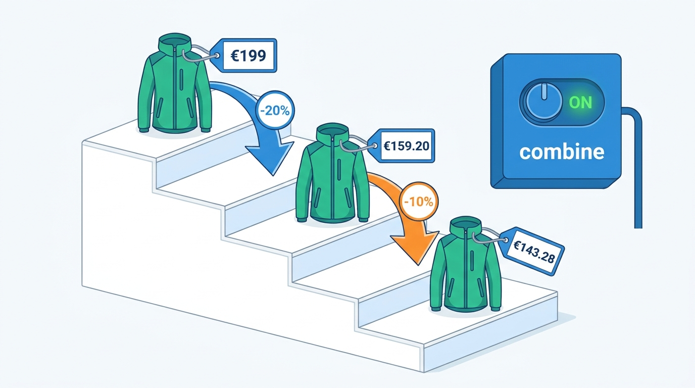
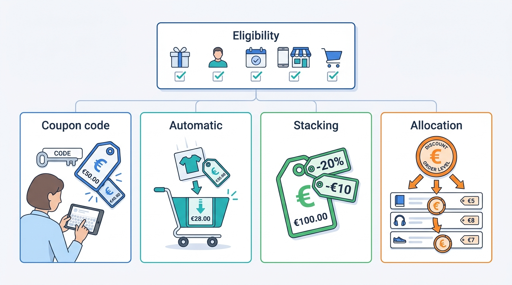
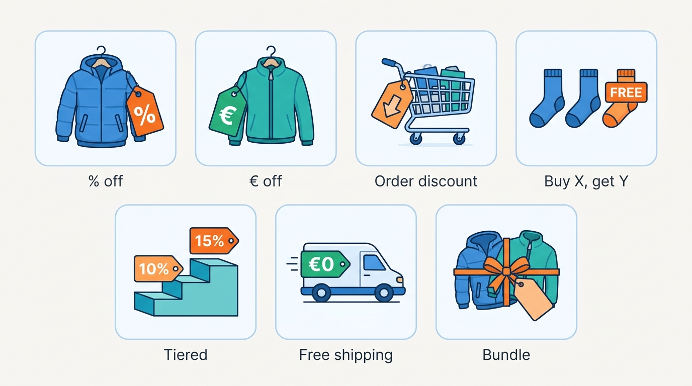
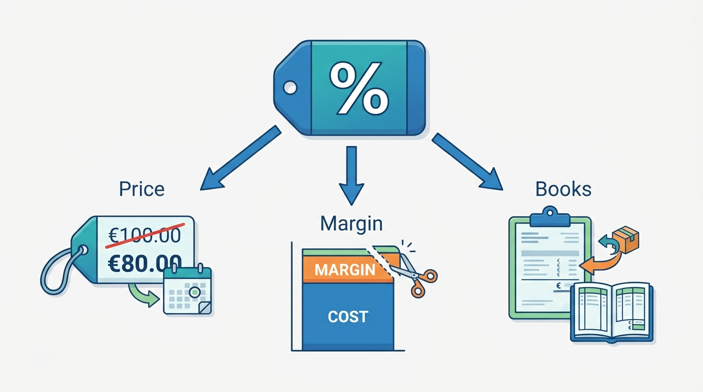
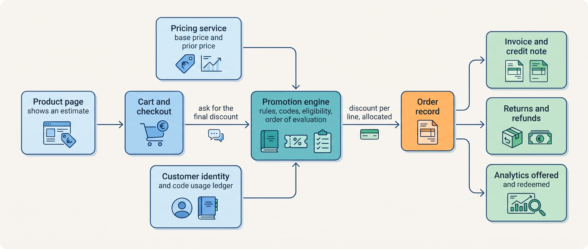
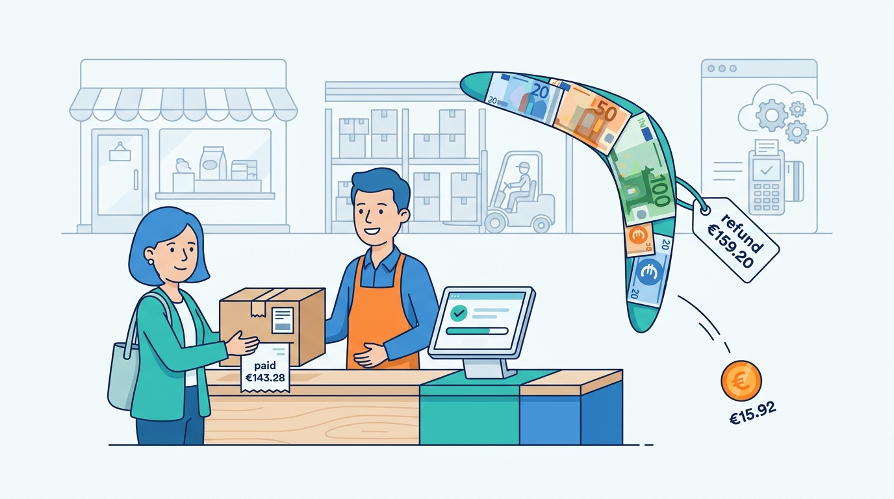
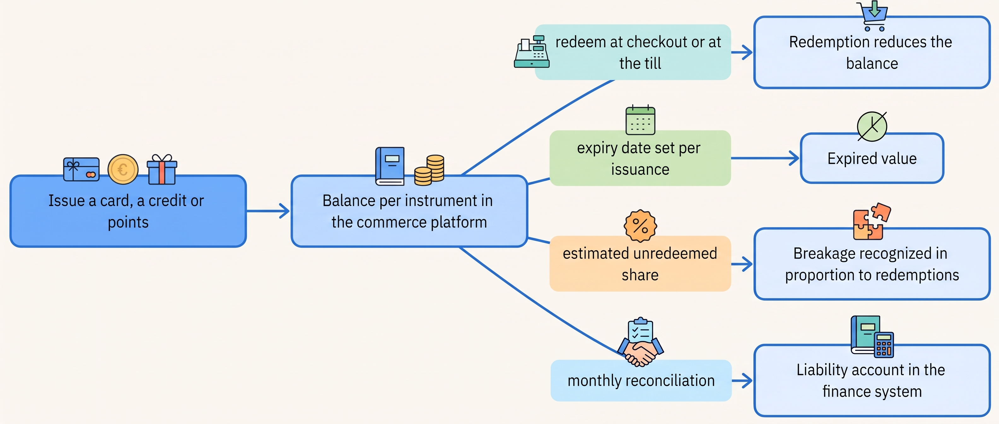

> **IN THIS CHAPTER, YOU WILL:** Learn how promotions, coupons, gift cards and loyalty points are modeled, where the final discount must be computed, and how a discount reaches the invoice, the refund and the books.

> **KEY POINTS:**
>
> * **A promotion is a rule evaluated in one place, at cart time.** The product page shows an estimate; the cart engine computes the final discount from the rules, the codes and the customer's eligibility, in a declared order, with a rule that says when stacking stops. Every platform that takes promotions seriously has converged on this shape.
> * **A discount is not finished until it is allocated to lines.** Returns, partial refunds, invoices and tax all work per line, so an order-level discount must be spread across the lines at order time. Skip that step and every return refunds too much.
> * **Gift cards, store credit and points are money you owe, not marketing.** They are ledgers with balances that finance must reconcile to a liability account every month; the rules for when unredeemed value becomes revenue are accounting standards, not product decisions.

> **[FAILURE PATTERNS THIS CHAPTER ADDRESSES](where-commerce-platforms-go-wrong.html):**
>
> * **The Price Nobody Can Explain** — a cart whose total nobody can reconstruct from the rules is a price with no owner.
> * **The Boomerang** — refunds computed from the undiscounted line price give the discount back twice.
> * **The First Snowfall** — Black Friday is the first time all the promotion rules meet all the customers at once.

 
A shopper uses a welcome code to buy a jacket and socks, then returns the jacket. How much should the merchant refund? The answer depends on how the discount was shared across the items. If the returns system uses the jacket's list price, it can refund more than the shopper paid for it. A promotion therefore needs a recorded calculation that checkout, returns and finance can all use.

Gift cards and loyalty points create a different obligation: track the balance customers can still spend. Treating that balance as an ordinary discount can lose the record of what the merchant owes.

Offers can also interact before payment. Two valid discounts may combine into a price below cost, and a cart may qualify for a different offer after the shopper adds an item or address. The promotion rules must specify which combinations apply so that the advertised saving, checkout total and later refund agree.

The chapter explains how a **promotion engine** evaluates offers, how **stacking** combines them, and how **discount allocation** shares a saving across items. It also separates discounts from stored balances the merchant owes customers. Related detail sits in [[pricing-architecture]], [[cart-and-checkout]], [[tax-invoicing-and-ledger]], [[returns-and-exchanges]] and [[identity-and-master-data]].

**Where we are in the order's journey.** Eva buys from Kestrel & Pine, the fictional outdoor brand, on 13 April 2027. Her €199 jacket and two €18 pairs of socks total €235. She gets no item discount, but qualifies for free shipping over €75. That is a promotion too: checkout must evaluate it and record the result.

## Setting the Scene at Kestrel & Pine: The Black Friday Stacking Bug

Kestrel & Pine runs three countries' storefronts on a hosted software-as-a-service (SaaS) platform. For **Black Friday week, 23–29 November 2026**, Ecommerce and Marketplaces Manager Milan Petrov configured three promotions:

- an **automatic 20% discount on all outerwear** (jackets, fleeces, trail trousers), applied to every cart without a code, valid for the week;
- the standing **welcome code**, 10% off a first order, sent to every new newsletter subscriber;
- the standing rule of **free shipping on orders over €75**.

The welcome code was meant to give a first-time customer the better offer, without combining with the outerwear discount. But the platform's **discount combination setting** still allowed both. The agency had enabled it for an October fleece campaign and left it on. Nobody checked the setting against the new campaign plan. The figures below are illustrative.

| What happened in the week of 23–29 November 2026 | Figure *(illustrative)* |
| --- | --- |
| Online direct-to-consumer (D2C) orders in the week (see [[meet-kestrel-and-pine]]) | 31,000 |
| Orders that received both the 20% outerwear discount and the 10% welcome code | 2,860 |
| Ridgewalker jacket price after both: €199 → €159.20 → €143.28 | €15.92 extra discount per jacket |
| Margin given away beyond the plan (about €15 per affected order) | about €43,000 |
| Orders whose discounted subtotal fell under €75 and were charged €4.95 shipping after the product page had promised it free | 1,140 |
| Shipping refunded by hand after complaints | about €5,600 |
| Returned Black Friday jackets refunded at €159.20 instead of €143.28, because the order-level 10% had not been allocated to the lines the returns portal reads | 190 returns, about €3,000 over-refunded |
| Total cost | about €52,000 |

Three things went wrong, and they are the three things this chapter is about. The **stacking** was not what the business intended, because the rule that decides it lived in a setting, not in the campaign. The **free-shipping threshold** was evaluated on the discounted subtotal in the cart while the product page promised it on the list price. And the **order-level discount was never allocated to the lines**, so the returns portal, which reads line prices, refunded the discount back. Noor Visser, Head of Engineering since January 2027, put the incident next to the Price Drift of October 2026 and drew the same conclusion: **a price that nobody can reconstruct from the rules is a price with no owner.**

**Figure 1:** *The stacking bug: a combination setting left on from October let the welcome code stack on the outerwear discount, taking the jacket from €199 to €143.28.*

## What a Promotion Is, and What It Touches

In plain words, a **promotion** is a rule that lowers the price a customer pays under stated conditions. A **coupon code** is a promotion the customer unlocks by typing a string; an **automatic discount** applies when the conditions are met with no code. **Eligibility** is the set of conditions: which products, customers, period, channel, minimum cart. **Stacking** is applying more than one promotion to the same cart or line. **Discount allocation** is spreading an order-level discount over the lines so that each line, and later each invoice line and return, carries its share.

**Figure 2:** *The five words of promotions: eligibility decides who and what qualifies, a coupon code or an automatic rule applies the discount, stacking combines several, and allocation spreads an order-level discount over the lines that will be invoiced and returned.*

The table lists the shapes every platform supports and what each needs from the rest of the system.

| Promotion type | Example | What it needs to compute | What it changes |
| --- | --- | --- | --- |
| Percentage off a product or set | 20% off outerwear | The product's current price and category | Line price |
| Fixed amount off a product | €10 off the Trailhead fleece | The product's price | Line price |
| Percentage or fixed amount off the order | 10% off a first order with a code | The subtotal after product discounts; the customer's order history | Order total, to be allocated to lines |
| Buy X, get Y | Three pairs of socks for the price of two | Quantities per line; which unit is the free one | One line's price |
| Tiered | 10% over €150, 15% over €250 | The subtotal | Order total, allocated |
| Free or reduced shipping | Free shipping over €75 | The subtotal and the shipping method | Shipping line |
| Bundle | Jacket plus fleece for €279 | The presence of both items | Two lines, with a fixed total allocated between them |

**Figure 3:** *The seven shapes every platform supports: product discounts change a line, order discounts change the total and must be allocated, and shipping and bundle offers change the lines they touch.*

Every row touches three things the business cares about: the **price** the customer sees and pays, which in the EU must obey the prior-price rule described later; the **margin**, which disappears silently when promotions combine (the Ridgewalker at €143.28 still cleared its €58 landed cost, but gave up about a sixth of its planned Black Friday unit margin); and the **books**, because the invoice must show the net price per line with the VAT on it, and a refund must give back what was paid for that line, not what was listed.

**Figure 4:** *Every promotion touches three things: the price the customer sees, which EU rules tie to the prior price; the margin, which combined promotions erode silently; and the books, where each invoice line and each refund must carry the net price actually paid.*

Two things that look like promotions are not. **Gift cards**, **store credit** and **loyalty points** are value the merchant has been paid for or has promised and not yet delivered: money it owes. They are ledgers, not rules, and get their own section.

## How the Pieces Fit Together

A promotion system has five parts, whether it is a platform feature, an app or a service. The diagram shows them around the decision that matters: the final discount is computed once, in the cart, and written to the order with its allocation.

**Figure 5:** *The product page shows an estimate; the promotion engine computes the final discount once, at cart time, from the base price, the rules and the customer's eligibility, and writes it to the order allocated per line so that the invoice, the refund and the analytics all read the same number.*

### The five parts

**Promotion definitions.** Each promotion is a record: its type, conditions, validity window, channel, budget or usage cap, and its position in the **order of evaluation**. The platforms that document this best make the order explicit. Shopify evaluates product discounts first, then order discounts on the revised subtotal, then shipping discounts; its help center (accessed November 2026) notes that two combined percentage *order* discounts are both calculated on the original subtotal, so 10% plus 20% on €100 gives €70, not €72. commercetools gives every cart discount a unique `sortOrder`, a stacking mode that can stop further discounts after a given one, and discount groups in which only the best saving applies. Adobe Commerce applies the highest-priority rule first and has a "Discard subsequent rules" switch. One idea, three vendors: **promotions are data with a declared order and a stop rule.**

**Eligibility and identity.** "First order", "members only" and "once per customer" all need to know who the customer is. On Kestrel & Pine's platform the welcome code's "first order" check looked at the e-mail address, so a customer with two addresses was a first-time customer twice. Promotions are one of the first places a merchant discovers it has no single customer identity: the Familiar Stranger pattern, owned by [[identity-and-master-data]].

**The code ledger.** Every code has a usage record: how many uses are allowed in total and per customer, and how many have happened. It must be strongly consistent at redemption: two checkouts redeeming the last use of a single-use code in the same second must not both succeed. It is the one part of a promotion engine that behaves like a bank account, and the reason bulk-generated single-use codes with usage caps (Adobe generates them in batches; Shopify allows 5 product or order codes and 1 shipping code per order) are the baseline defense against code sharing.

**Evaluation in the cart.** The engine takes the cart's lines, prices, shipping method and customer, applies the promotions in order, stops where the stop rule says, and returns a discount per line and per shipping line. Some conditions can only be evaluated late: Adobe's documentation notes that conditions on the shipping or payment method "are met only in checkout after the specific shipping/payment methods are selected". That is why the product page can only show an **estimate**, and why the estimate and the final must come from the same rules.

**Allocation and events.** The final step writes the discount to the order *per line*. commercetools makes the choice explicit: an absolute cart discount is distributed proportionately, evenly or individually across the lines. However it is distributed, each line then carries its net price, which the invoice and the refund read. The engine also emits events: promotion applied, code redeemed, promotion offered but not taken. The last is the one analytics needs most and platforms rarely record.

### What each interaction needs

Promotions are evaluated at several moments with different requirements.

| Interaction | Freshness | Consistency | Latency | Availability |
| --- | --- | --- | --- | --- |
| Product page strike-through price | Start and end to the minute; prior price per the EU's 30-day rule | An estimate; may differ from the cart | Served from cache *(assumption)* | Must not block the page; show the list price if the engine is down |
| Cart evaluation | Current rules and base prices | Final; the same result on every re-evaluation | Under about 300 ms, on every cart change *(assumption)* | Checkout must not fail because promotions fail; degrade to no discount with a message, or hold the checkout, by business decision |
| Code redemption | Current usage count | Strongly consistent; one redemption per allowed use | As the cart | As the cart |
| Gift card or store credit redemption | Current balance | Strongly consistent; idempotent per checkout attempt | As the cart | Decline the card if the balance service is down; never guess |
| Promotion publication | Scheduled start; tested against active promotions | All channels see the same rule set | Minutes | Stores and marketplaces receive a copy |
| Analytics | Daily | Offered and redeemed both recorded | Batch | — |

The two rows that behave like money (code redemption and stored value) cannot be eventually consistent; everything else can be a cached copy with a known delay. It is the distinction [[boundaries-and-systems-of-record]] draws for every fact: decide which system holds the truth, and let the copies be copies.

### How a discount reaches the invoice and the books

A discount leaves the order in three documents. The **invoice** shows each line at its net price after allocation, with VAT on that net amount; an order-level discount across lines with different VAT rates (a jacket at 21% and a book at 9%) must be allocated before the tax can be right, which makes allocation a tax problem as much as a promotions problem. The **credit note**, issued on a return, reverses the line at the same net price. The **ledger** records revenue net of the discount: a promotion is not an expense but revenue never earned. [[tax-invoicing-and-ledger]] walks the entries; RECONCILED's [[payments-to-ledger]] goes deeper on reconciliation.

Here is the allocation on Eva's order, had she used a 10% code (she did not; the prices are her order's, the code is hypothetical):

| Line | List price | Share of €235 | Allocated discount | Net line price |
| --- | --- | --- | --- | --- |
| Ridgewalker jacket, women's M, moss | €199.00 | 84.7% | €19.90 | €179.10 |
| Merino hiking socks × 2 | €36.00 | 15.3% | €3.60 | €32.40 |
| **Total** | **€235.00** | | **€23.50** | **€211.50** |

When Eva returns the jacket, the refund is **€179.10**, not €199. The 190 over-refunded Black Friday returns were this calculation skipped: the returns portal read the line price (€159.20 after the product discount) because the order-level 10% had never been written to the lines, and gave back €15.92 per jacket the customer had never paid. That is the Boomerang in one table row.

**Figure 6:** *The Boomerang: because the order-level 10% was never allocated to the lines, each Black Friday jacket return gave back €15.92 the customer had never paid.*

## Gift Cards, Store Credit and Points: Ledgers, Not Promotions

A **gift card** is value the customer paid for in advance. **Store credit** is value the merchant granted, typically as a refund alternative or a goodwill gesture. **Loyalty points** are value the customer earned by buying. All three share a property that no promotion has: **they are a liability on the balance sheet**, money or value the merchant owes, until they are redeemed or expire.

**Figure 7:** *Stored value is a ledger: every issuance, redemption, expiry and breakage estimate changes a balance per instrument in the commerce platform, and the sum of those balances must agree with the liability account in the finance system every month.*

The accounting is settled and drives the data model. Under IFRS 15, the international accounting standard for revenue (issued May 2014, effective from 1 January 2018, replacing IFRIC 13 on loyalty programs) and its US twin ASC 606, the sale of a gift card is a contract liability, not revenue; revenue is recognized on redemption. The part that will never be redeemed is **breakage**; the standard requires the merchant to *estimate* it and recognize it "in proportion to the pattern of exercised rights" rather than wait for cards to expire, and unclaimed value owed to a government is a liability, not revenue. Loyalty points that give the customer a **material right** (a benefit valuable enough to count as something they paid for) are a separate performance obligation, with revenue deferred until they are used.

Starbucks' FY2025 annual report (fiscal year ended 28 September 2025) shows what this means at scale: amounts loaded onto stored value cards are recorded as deferred revenue; the stored value card and loyalty liability stood at **$1,751.7 million**; breakage recognized in company-operated stores was **$200.4 million** in the year; Stars are deferred at their estimated selling price "as each Star is earned" and "generally expire after six to twelve months, depending on the market". Starbucks is a coffee chain, but the obligation has the same shape for a merchant with €200,000 outstanding.

Four design rules follow:

- **Every instrument is a ledger.** Issuance, each redemption, each expiry and each breakage estimate is an immutable record per card, credit or points account; a balance is derived, never edited (RECONCILED's [[designing-financial-ledgers]] gives the pattern).
- **Expiry is an attribute of the issuance, not a global setting**, because rules differ by country and, in the US, by state. Shopify's store credit documentation (accessed November 2026) models it that way: "Store credit expiration is set per issuance".
- **Redemption is idempotent:** a repeated request has the same effect as one. The idempotency key (a unique id that lets a retried request be recognized and applied once) that protects the payment ([[commerce-payments]]) must also cover the stored-value debit.
- **The platform holds the balance, finance holds the liability, and they are reconciled monthly**; a difference is a bug or a fraud.

**Paid membership programs** (Prime-style: a fee in exchange for delivery and other benefits) are a different thing again, often confused with loyalty. They are a subscription with its own revenue line and its own promises (free delivery, early access) that the promotion engine reads as eligibility conditions. Amazon's annual report for 2025 (filed February 2026) reports subscription services net sales of $49.6 billion and describes Prime benefits as "effective worldwide marketing tools" it intends "to continue offering indefinitely"; Target's FY2025 report describes its paid Target Circle 360 membership with "unlimited same-day delivery on eligible orders over $35". For a merchant of Kestrel & Pine's size the architectural point is modest: a membership is a customer attribute with a start and end date, and a liability for benefits paid for but not yet delivered.

### Kestrel & Pine's stored value in 2027

Kestrel & Pine sells gift cards online and through store point-of-sale (POS) tills. The systems are separate, so **neither can redeem the other's cards** *(illustrative)*. At 31 December 2026, outstanding balances were about **€186,000 online** and **€41,000 in stores**. Finance Director Sanne de Wit reconciles two exports to the liability account each month.

Stores have a loyalty list; the online shop has no loyalty program. Noor and Milan deferred one until they could recognize the same customer across channels. Otherwise points could accumulate in an account the redemption system cannot identify. A shared balance service remains a goal after Waypoint, to be considered in the 2028 store-system evaluation under decision W4.

## The Choices

A merchant can run promotions in four ways. The fourth is listed because it is common, not because it is good.

**The platform's built-in promotions.** Hosted platforms ship discounts, codes, automatic promotions, gift cards and, increasingly, store credit, with documented combination rules and limits. Shopify allows at most 25 active automatic discounts (apps included); commercetools allows 100 active code-less cart discounts per project plus 100 per store, and 10 codes per cart. The limits are design signals: promotion interaction is the most common source of margin bugs. It fits any merchant whose promotions fit the platform's vocabulary.

**The platform plus a promotion or loyalty app.** When the business wants what the platform does not model (a tiered loyalty scheme, referral rewards, cross-channel vouchers), an app or a specialist SaaS adds it, usually by creating discounts in the platform on the customer's behalf. The app becomes a second writer of the price, with its own rules, its own view of the customer and its own failure modes. Kestrel & Pine's pre-order app wrote stock; a loyalty app is the same shape of risk, which is why [[extensibility-and-app-ecosystems]] treats apps as integrations.

**A dedicated promotion engine shared across channels.** A separate service (bought or, rarely, built) holds the definitions and evaluates them for the web storefront, the POS and the B2B portal through one API. It is the only option in which a store and the web shop run the same promotion from the same rule, and in which a wholesale contract price and a consumer promotion are kept apart by design. It costs an integration into every checkout and a team that owns the rules.

**Rules hard-coded in the theme, a script or a marketplace listing.** The agency makes a banner compute "20% off" in the browser; a script adjusts marketplace prices for a sale; store staff key their own discount into the POS. Each copy drifts, nobody can say what the price was on a given day, and the Price Nobody Can Explain follows. It is not a design but the absence of one.

| Criterion | Platform built-in | Platform plus app | Dedicated engine | Hard-coded rules |
| --- | --- | --- | --- | --- |
| Where the final discount is computed | Platform cart | Platform cart, rules written by the app | The engine, called by every channel | Several places |
| Order of evaluation and stop rule | Documented by the vendor; set per shop | Partly inside the app | Yours to define | Undefined |
| Same promotion in web, store and marketplace | Web only; stores and marketplaces get copies | Web and sometimes POS of the same vendor | Yes, by design | No |
| Discount allocation to lines | Vendor-defined | As the platform does it | Yours to define, must be exported | Usually missing |
| Stored value across channels | Within the platform's channels | App-dependent | A balance service | No |
| Fits | Starting, Growing; most Omnichannel merchants | Growing merchants with one specific need | Omnichannel with stores and B2B on different systems; Group | Nobody |

My rule: **use the platform's promotions until a promotion must be the same rule in two systems the platform does not control.** For Kestrel & Pine that moment has arrived for the stores (a separate POS) and will arrive for the B2B portal if wholesale promotions start; it never arrives for marketplaces, whose promotions stay in the marketplace's own tools. Until then the cheapest improvement is governance, not software: one owner for the combination settings, one calendar, and a rollout test against the promotions already active, which Shopify offers as a feature and any merchant can do in a staging copy.

## Across Scale Stages: When It Fits and When It Limits

| Stage | What is typical | What becomes necessary | Warning signs of outgrowing the approach |
| --- | --- | --- | --- |
| **1 — Starting** | A few codes and a free-shipping threshold in the platform; platform gift cards reconciled by finance from an export | A naming convention for codes and a note of who created each promotion | A code from an old campaign still works; nobody knows which promotions are active |
| **2 — Growing** | Automatic discounts plus codes; a welcome code; the first Black Friday with several promotions at once; store credit for refunds | An explicit combination decision per campaign; single-use bulk codes; a first breakage estimate with the accountant | The first stacking surprise; disputed refunds of discounted items; the "first order" check fooled by a second e-mail address |
| **3 — Omnichannel** | Web, stores, marketplaces and B2B each run their own promotions; stored value split by channel; two loyalty lists | One promotion calendar across channels; allocation exported to the OMS (order management system), the returns tool and the ERP (enterprise resource planning system, which invoices); a central stored-value balance, or a decision not to cross channels yet; identity resolved before a loyalty program | Store staff keying discounts the web shop does not know; a marketplace promotion undercutting the web shop; gift cards that work in one channel only |
| **4 — Group** | Several brands or countries with their own calendars; a shared loyalty platform; a liability ledger per legal entity | A promotion engine or shared service with per-brand rules; a group stored-value ledger reconciled per entity; holdouts as standard | Brands competing for one customer with conflicting offers; a group voucher no single system can honor; breakage estimated differently per country |

The judgement: the promotion *engine* changes little with scale; evaluating a thousand rules is the same problem as evaluating ten. What changes is **how many systems must agree on the result** and **how much money the stored-value ledger holds**. Kestrel & Pine at stage 3 has the first problem acutely (three channels with their own discounts, two gift-card pools) and the second mildly (about €227,000 outstanding), so its order is ownership and allocation first, a cross-channel balance second, a loyalty program last.

## In Practice

### Dated, sourced examples

**The prior-price rule turns promotions into a data requirement.** Directive (EU) 2019/2161, the Omnibus Directive, applied by member states from 28 May 2022, requires any announced price reduction to show the **prior price**: the lowest price the trader applied in the 30 days before the reduction. The Dutch regulator ACM announced on 6 December 2022 that it would supervise the rule from 1 January 2023, with a worked example: a price raised from €50 to €70 and cut by 35% after 25 days is really a 9% discount on the €50 reference. On 11 June 2024 ACM published fines against Leen Bakker, G-Star Raw eStore, JYSK, PVH Brands Netherlands (Tommy Hilfiger) and Koopjedeal for discounts shown against a misleading reference price; Germany's § 11 PAngV transposes the same rule. For architecture this means an effective-dated price history per SKU per country that can answer "lowest price in the last 30 days" when a promotion is published, and a strike-through price that is itself a syndicated field. Had Kestrel & Pine's Price Drift run into November, the German strike-through price for the Ridgewalker would legally have been €179, not €199.

**Stored value is a liability with accounting rules.** Unused gift-card balances and loyalty rights can remain obligations to customers. Deciding when unredeemed value becomes revenue, called breakage, therefore requires an accounting rule as well as a balance in the commerce system.

Starbucks' FY2025 10-K, above. PwC's revenue guide on unexercised rights (accessed November 2026) states the ASC 606 position that estimated breakage is recognized "in proportion to the pattern of exercised rights", that breakage not expected to occur is recognized only when the likelihood of redemption becomes remote, and that amounts due under unclaimed-property law are never breakage revenue. The IFRS Foundation's page confirms IFRS 15 replaced IFRIC 13 on customer loyalty programs; the matching IFRS 15 paragraphs B44–B47 are cited here from a secondary source, because the standard's own text was not checked for this chapter.

**Promotion abuse is an identity problem.** Ravelin's 2020 article on promotion abuse (older than three years, but the taxonomy holds) names multi-accounting for sign-up offers, self-referral and guessable codes as the main forms; its figure that 53% of merchants saw more abuse in a year is a vendor survey without a published sample, so treat it as directional.

**Incrementality needs a holdout.** Gubela, Lessmann and Jaroszewicz (EJOR, 2019) argue that coupon campaigns should be judged on revenue uplift, not conversions, because customers differ in spending and most exposed customers do not buy; Gubela and Lessmann (2021) report that of several coupon types tested, only a €15 coupon produced positive incremental revenue. Redemption rate is not incrementality, because many redeemers were already at checkout; the honest measure is the difference between an exposed group and a **holdout group** deliberately not given the offer. For the platform this means recording which promotions were *offered*, flagging holdout customers in the engine, and one customer identity to assign them with; [[commerce-data-and-analytics]] takes it from there.

### Kestrel & Pine's Black Friday 2027 plan

For Black Friday 2027 Milan and Noor wrote the promotion plan as a table, each row with an owner, an order of evaluation and a stop rule, and tested it against every active promotion in a staging copy of the platform in early November (illustrative):

| Promotion | Type | Order | Combines with | Stop | Owner |
| --- | --- | --- | --- | --- | --- |
| 20% off outerwear | Automatic product discount | 1 | Free shipping only | Yes | Milan |
| Welcome code 10% | Order code | 2 | Free shipping only; never with row 1 (the better one applies) | — | Milan |
| Free shipping over €75 | Shipping | 3 | Everything; threshold on the *discounted* subtotal, stated on the product page | — | Daniel Okafor |
| Store promotion, same 20% | POS discount keyed by store managers from this table | — | — | — | Daniel |
| Marketplace deals | Each marketplace's own tool, priced at the web price after discount plus fee uplift | — | — | — | Milan |

Two changes matter more. The order export to the WMS (warehouse management system), the returns portal and the ERP now carries the **allocated net price per line**, so a return refunds what was paid; Ruben Alves added it to the integration contract under decision W5. And every change to the platform's promotion settings, including the combination setting, needs a second person's approval. Neither cost software; both cost the week in which the bug was understood.

## When It Goes Wrong

**Unintended stacking.** Detection: a daily report of orders with more than one discount, with the discount depth (discount as a share of list price) per order, and a threshold alert in the peak week. Recovery: honor the orders already placed, fix the setting, and compute the margin given away from the order lines, which is only possible if the allocation was written.

**Estimate and final disagree.** The page says free shipping, the cart charges €4.95; the page says "20% off", the cart shows 10% because the code replaced the automatic discount. Detection: log what the page rendered and what the cart computed per session, and watch abandonment at the shipping step ([[cart-and-checkout]]). Recovery: state thresholds in the terms the cart uses, and let the page ask the engine for an estimate when the customer is logged in.

**The discount comes back twice.** A return refunds the list price of a discounted item (the Boomerang), or a gift-card purchase is refunded to the card *and* to the payment method. Detection: a weekly reconciliation of refunds against the allocated net price of the returned lines. Recovery: a credit-note correction per case, and the allocation added to every order export.

**Codes leak or are guessed.** A generic code on a coupon site, or a sequential format a script can enumerate. Detection: redemptions per code per hour against the expected rate, and per identity signal (device, payment instrument, address) rather than per e-mail (LISTED's [[fraud-prevention]]). Recovery: disable the code, issue single-use replacements, and accept that placed orders are placed.

**Stored value debited twice, or not at all.** A checkout retried after a timeout debits a gift card twice; a payment webhook (the message the payment provider sends when a payment completes) arrives late and the order is created without the debit. Detection: ledger entries per instrument that reference the checkout attempt, so a duplicate shows as two entries with one key. Recovery: one idempotency key per checkout attempt covering the payment and the stored-value debit, and a daily job matching debits to orders ([[events-consistency-and-reconciliation]]).

**A promotion ends but a copy does not.** A cached page, a marketplace listing updated hourly, a price-comparison feed or a POS still showing last week's 20%. Detection: an end-of-promotion check that reads the price on every channel; a marketplace parity warning is the expensive version. Recovery: a scheduled end that every copy receives as an event, with its delivery promise in the integration contract.

## What to Take Away

**Established.**

- Promotions are data with an explicit order of evaluation and a stop rule, computed once in the cart; the storefront shows an estimate. Shopify, commercetools and Adobe Commerce document this shape independently (accessed November 2026).
- An order-level discount must be allocated to lines at order time, because invoices, VAT, returns and partial refunds work per line.
- Gift cards, store credit and loyalty points are contract liabilities under IFRS 15 and ASC 606; breakage is estimated and recognized in proportion to redemptions (PwC's guide; Starbucks' FY2025 10-K as the worked example).
- In the EU, an announced price reduction must show the lowest price of the preceding 30 days (Directive 2019/2161, applied from 28 May 2022; Dutch fines published June 2024).

**Depends on context.**

- Use the platform's built-in promotions until one promotion must be the same rule in two systems the platform does not control (a separate POS, a separate B2B portal); then a shared engine earns its integration cost. Marketplace promotions stay the marketplace's own in every case.
- A central stored-value balance is worth building once customers expect to use a card in any channel and the outstanding balance makes two reconciliations a month a risk; below that, two pools and an honest sign at the till are acceptable.
- Launch a loyalty program only after the customer identity is unified across channels; a single-channel business already meets that condition.
- Measure incrementality with holdouts when the promotion budget is large enough that a 10% error in its effect costs more than withholding the offer from a few percent of customers.

**The author's synthesis.**

- The cheapest promotion architecture is governance: one owner for the combination settings, one calendar with an order of evaluation per campaign, and a rollout test against everything already active, because almost every promotion incident I have seen was a setting, not a system.
- Treat the allocated net line price as the order's primary price and the list price as metadata; every downstream system that reads the list price will eventually refund it.

## Questions to Ask

1. Which system computes the final discount, and does the product page show that rule's estimate or its own?
2. What is the order of evaluation, where does stacking stop, and who may change that setting?
3. Does the order export carry the allocated net price per line to the warehouse, the returns tool and the ERP?
4. How does "first order" identify the customer, and what happens with a second e-mail address?
5. Can the pricing system answer "lowest price in the last 30 days" for any SKU and country when a promotion is published?
6. Where do gift-card and store-credit balances live, and who reconciles them to the liability account, how often?
7. Is a gift-card debit idempotent with the checkout attempt, or can a retry debit twice?
8. Which promotions were *offered* last quarter, not only redeemed, and could we run a holdout?
9. When a promotion ends, how does each copy (stores, marketplaces, feeds, cached pages) learn of it, and how do we check?
10. What did last Black Friday's promotions cost beyond the plan, and can we compute that from the order lines alone?

The price is now decided. The next question is how the customer found the product in the first place, and what has to be true of the catalog for a search box to answer "waterproof jacket": [[commerce-search-and-discovery]].

## Sources and Evidence

*Company, product and investor sources*

- [Combining discounts](https://help.shopify.com/en/manual/discounts/discount-combinations) — Shopify Help Center, n.d., accessed 2026-11; discount classes, combination rules, order of application, the 25-automatic and 5 + 1 code limits.
- [Discounts](https://help.shopify.com/en/manual/discounts) — Shopify Help Center, n.d., accessed 2026-11; discounts applied before tax, scheduled rollouts tested against existing discounts.
- [Store credit](https://help.shopify.com/en/manual/customers/store-credit) — Shopify Help Center, n.d., accessed 2026-11; expiry set per issuance.
- [Pricing and discounts overview](https://docs.commercetools.com/api/pricing-and-discounts-overview) — commercetools docs, n.d., accessed 2026-11; product vs cart discounts, sort order, stacking mode, discount groups, best-deal mode.
- [Cart Discounts](https://docs.commercetools.com/api/projects/cartDiscounts) — commercetools docs, n.d., accessed 2026-11; value types and the proportionate, even and individual allocation modes.
- [Limits](https://docs.commercetools.com/api/limits) — commercetools docs, n.d., accessed 2026-11; active cart discounts and codes per cart.
- [Create a cart price rule](https://experienceleague.adobe.com/en/docs/commerce-admin/marketing/promotions/cart-rules/price-rules-cart-create) and [Cart price rules](https://experienceleague.adobe.com/en/docs/commerce-admin/marketing/promotions/cart-rules/price-rules-cart) — Adobe Experience League, n.d., accessed 2026-11; priority, discard subsequent rules, coupon usage caps, late-evaluated conditions.
- [Starbucks Form 10-K, fiscal 2025](https://www.sec.gov/Archives/edgar/data/829224/000082922425000114/sbux-20250928.htm) — Starbucks Corp. via SEC EDGAR, 2025; stored value liability, breakage, Stars deferral and expiry.
- [Amazon Form 10-K, fiscal 2025](https://www.sec.gov/Archives/edgar/data/1018724/000101872426000004/amzn-20251231.htm) — Amazon.com, Inc. via SEC EDGAR, 2026; subscription services net sales and the framing of Prime benefits.
- [Target Form 10-K, fiscal 2025](https://www.sec.gov/Archives/edgar/data/27419/000002741926000016/tgt-20260131.htm) — Target Corp. via SEC EDGAR, 2026; the Target Circle 360 paid membership.

*Standards, regulation and official documentation*

- [Directive (EU) 2019/2161 (Omnibus)](http://publications.europa.eu/resource/celex/32019L2161) — Publications Office of the EU, 2019; Article 6a prior price, 30-day window, application from 28 May 2022.
- [ACM wil einde aan nepkortingen](https://www.acm.nl/nl/publicaties/acm-wil-einde-aan-nepkortingen-na-komst-strengere-regels) — Autoriteit Consument & Markt, 2022; supervision from 1 January 2023 and the worked example.
- [ACM publiceert boetebesluiten webwinkels voor nepkortingen](https://www.acm.nl/nl/publicaties/acm-publiceert-boetebesluiten-webwinkels-voor-nepkortingen) — Autoriteit Consument & Markt, 2024; the June 2024 fines.
- [§ 11 PAngV](https://www.gesetze-im-internet.de/pangv_2022/__11.html) — Bundesministerium der Justiz, n.d., accessed 2026-11; the German transposition.
- [IFRS 15 Revenue from Contracts with Customers](https://www.ifrs.org/issued-standards/list-of-standards/ifrs-15-revenue-from-contracts-with-customers/) — IFRS Foundation, n.d., accessed 2026-11; issue and effective dates, replacement of IFRIC 13.
- [Unexercised rights (breakage), Revenue guide 7.4](https://viewpoint.pwc.com/dt/us/en/pwc/accounting_guides/revenue_from_contrac/revenue_from_contrac_US/chapter_7_options_to_US/74unexercised_rights_US.html) — PwC Viewpoint, n.d., accessed 2026-11; the ASC 606 breakage rules.
- [Revenue from customers' unexercised rights](https://ifrscommunity.com/knowledge-base/revenue-from-customers-unexercised-rights-breakage/) — IFRScommunity.com, 2024; secondary summary of IFRS 15 B44–B47 and material rights.

*Research and practitioner sources*

- [Response Transformation and Profit Decomposition for Revenue Uplift Modeling](https://arxiv.org/abs/1911.08729) — Gubela, Lessmann and Jaroszewicz, 2019; revenue uplift as the objective for coupon targeting.
- [Interpretable Multiple Treatment Revenue Uplift Modeling](https://arxiv.org/abs/2101.03336) — Gubela and Lessmann, 2021; several coupon types, one with positive incremental revenue.
- [Promotion abuse in ecommerce](https://www.ravelin.com/blog/promotion-abuse-ecommerce) — Ravelin, 2020; abuse taxonomy and a vendor survey figure.
- [What is incrementality](https://www.uniqodo.com/glossary/what-is-incrementality) — Uniqodo, 2024; holdout method, vendor content.

Kestrel & Pine is fictional; architectural recommendations, labeled inferences and labeled assumptions are the author's judgement.
