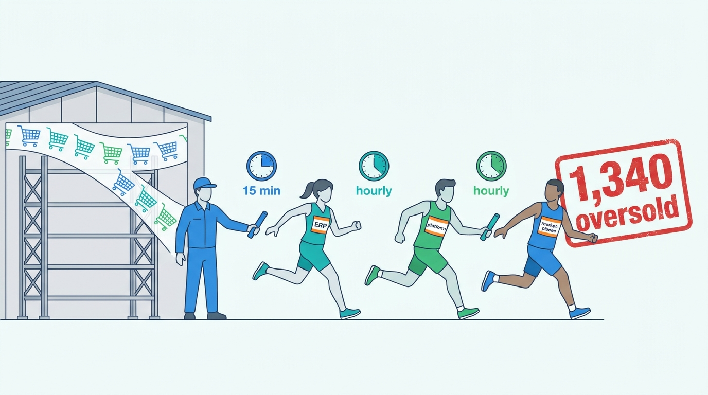
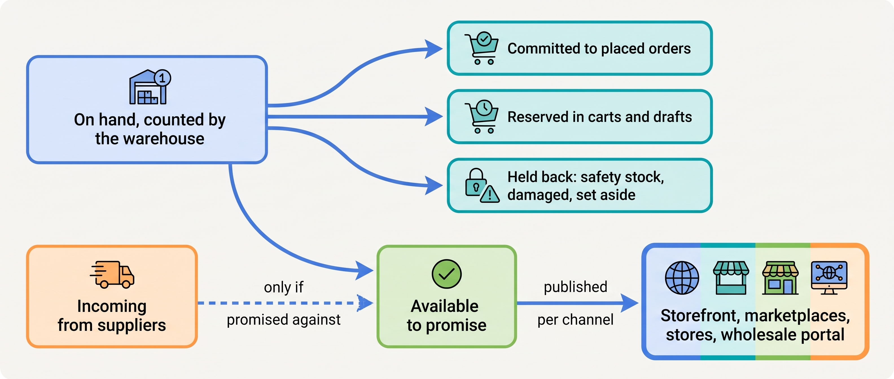
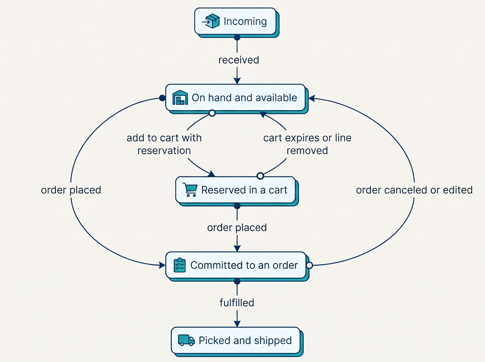
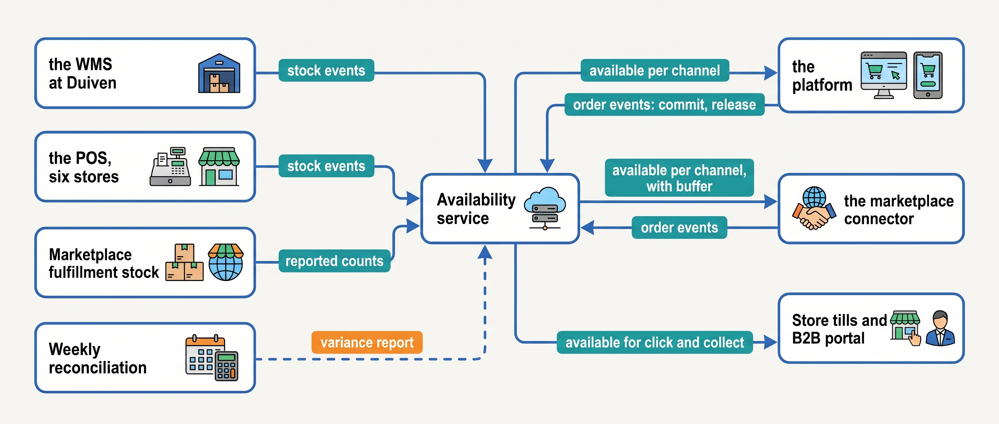

> **IN THIS CHAPTER, YOU WILL:** Learn what "in stock" really means, who should compute it, and why Kestrel & Pine oversold 1,340 jackets on one Friday evening.

> **KEY POINTS:**
>
> * **"In stock" is a computed promise, not a count.** Physical stock (on hand) is a fact owned by whoever counts it. What a channel may still sell (available-to-promise) is derived: on hand minus units promised to orders minus units held back on purpose. Every oversell is a disagreement between the fact and the derivation.
> * **Oversells come from writers and lag, not from bad luck.** Several systems writing the same stock number, periodic copying instead of events, and reservation windows let two channels sell the same last unit. The fix is one writer per stock state and stock events that travel in seconds.
> * **One availability service, many channels, each with its own buffer.** With more than one location and more than one channel, availability belongs to a service that receives stock events, applies per-channel rules and publishes an available figure per channel. Kestrel & Pine buys it as a module of its order management system (Waypoint W1).

> **[FAILURE PATTERNS THIS CHAPTER ADDRESSES](where-commerce-platforms-go-wrong.html):**
>
> * **The Phantom Stock** — two channels sold the same last Ridgewalker because each learned of the other's sales up to two hours late.
> * **The First Snowfall** — the stock sync chain had never met a Friday with 38 orders a minute; at that rate a one-hour copy interval is 2,300 orders of blindness.
> * **The Secret Agent** — in the App That Wrote Stock, a pre-order app wrote inventory in the platform while the warehouse feed wrote it too, and for two weeks nobody owned the number.

 
A web shopper and a store customer try to buy the last jacket within the same minute. Both channels show it as available, but there is only one unit on the shelf. If each sale relies on its own stock count, both can succeed and the merchant must disappoint one customer. The channels need a shared way to decide which sale commits that unit.

A shelf count alone cannot answer the question. Some units already belong to unshipped orders; others are held back as buffers, damaged goods or units set aside for wholesale customers. Cart reservations and incoming deliveries add further conditions. **Availability must combine those facts before a channel commits to a sale.** Copying a stock number along a chain of scheduled updates leaves channels selling from different answers.

**Where we are in the order's journey.** Search has just shown Eva a Ridgewalker jacket marked "in stock", and she is about to add it to her cart. Availability supplies that label, the cart's stock check and the commitment at checkout that prevents another shopper buying her unit. [[cart-and-checkout]] covers order creation; [[warehouse-and-fulfillment]] covers picking it.

The label, the cart check and the commitment all failed on the worst evening of 2026 at Kestrel & Pine, the fictional outdoor brand, and the chapter starts there: the Black Friday Oversell. It then takes "in stock" apart into the numbers behind it, explains when a unit becomes promised, and adds several locations and channels. From there it describes the availability service: who writes which number, what each step of a purchase needs, and why stock changes should travel as events, not scheduled copies. It compares four ways of computing availability, weighs their trade-offs and says which fits which scale stage. It ends by working the Oversell through again with the remedy in place, listing the ways stock integrations fail, and checking the count itself against a study of inventory records. The evidence throughout is the Oversell, the vendors' platform documentation and that study.

## Setting the Scene at Kestrel & Pine: Friday 27 November 2026, 19:40

In January 2027 Noor Visser, Kestrel & Pine's new Head of Engineering, asks Ruben Alves, the lead integration engineer, and Daniel Okafor, Head of Operations, to reconstruct the Black Friday Oversell minute by minute. The mechanism was never written down. What they draw on the whiteboard is a chain.

Duiven's **warehouse management system (WMS)** knows which bin holds each unit and directs picking. It reduces physical stock when a unit is picked. In 2026, it sent counts every 15 minutes to the **enterprise resource planning system (ERP)**, which handles finance, purchasing and stock valuation (what the stock is worth in the books, a number that stays in the ERP; [[erp-and-back-office-integration]]). The ERP copied them hourly to the shop platform; the platform copied them on, on its own schedule, to the marketplace connector for bol, Amazon.de and Zalando.

A storefront sale lowered the shop platform's own count at once, and nothing else. The warehouse's count and marketplace sales reached the platform only through the chain; storefront sales reached the marketplaces the same way. So each channel kept selling units another had sold. A sale took up to two hours to reach every channel.

On Friday 27 November the Ridgewalker jacket, the hero product, was the deal of the week. The timeline's times are illustrative, its totals those recorded in [[meet-kestrel-and-pine]]. Of the 1,340 units oversold that evening, about 790 were sold on the storefronts and 550 on the marketplaces (illustrative split); the marketplace share carried the penalties.

| Time (27 Nov 2026) | What happened | What the channels believed about the Ridgewalker |
| --- | --- | --- |
| 19:40 | The WMS picks the last units; physical on hand reaches zero | Storefronts and marketplaces: in stock |
| 19:45 | WMS sends stock to the ERP (15-minute run) | ERP: zero. Platform and marketplaces: in stock |
| 20:00–21:00 | Peak hour: 2,300 orders, 38 per minute | Marketplaces keep selling it; storefronts until about 20:30 |
| about 20:30 | ERP sends stock to the platform (hourly run) | Storefronts: sold out at last |
| 21:05 | Milan Petrov, alerted by the warehouse through Daniel Okafor, sets the Ridgewalker to zero in the marketplace connector by hand; the next scheduled platform-to-connector run would have arrived later still | Marketplaces: sold out once the marketplaces process the push |
| Saturday | Support discovers what was sold against zero stock | 1,340 units oversold, 1,120 orders affected |

**Figure 1:** *The Black Friday Oversell as a relay: each hand-off waited for its schedule, so the channels kept selling for up to two hours after Duiven ran out, and 1,340 units were oversold.*

Two things made it worse. The order queue from the platform to the WMS backed up for four hours that evening ([[warehouse-and-fulfillment]]), so the WMS's count fell later than the sales it reflected. And three of the shop platform's 41 installed apps could write inventory, so the warehouse feed was not the number's only writer; with the connector's sync, those apps used about half the platform's API budget that evening ([[multi-tenancy-and-isolation]]). One, a pre-order app, had already caused the App That Wrote Stock in March 2026: two weeks of wrong stock figures on about 600 variants, because the app and the WMS feed both wrote the same number and each undid the other.

Mara Lindqvist, the CEO, asked the question every CEO asks after an oversell: "Why did the website not know?" Noor's answer, which became Waypoint decision W1, was that the website could not know, because nobody had decided who owned the number and nothing carried changes fast enough. This chapter is that answer in full.

## What "In Stock" Means: Five Numbers, Not One

Noor's "number" is five numbers and a calculation. Every system that tracks stock separates the units that are physically present from the units it may still promise. The names differ between vendors; the arithmetic does not.

- **On hand** is the number of units physically at a location right now. It is a fact, owned by whichever system counts it: a WMS, an ERP's warehouse module, a point-of-sale system (**POS**, the till software) for a store, or the platform itself for a merchant with a back room.
- **Committed** (also **allocated**) is the part of on hand already claimed by placed orders that have not shipped. Eva's jacket becomes committed when her order is confirmed and stays committed until it ships.
- **Reserved** is a temporary claim before an order is final: a unit in a cart during a limited-stock sale, or in a draft order a sales rep is building. Reservations expire; commitments do not.
- **Held back** covers units present but deliberately not for sale: a **safety stock** buffer against counting errors and sync lag, damaged units, units awaiting quality control, units set aside for a wholesale customer.
- **Incoming** is stock on the way in: a supplier's shipment or a transfer from another location. It is not on hand until received.

From these, the number a channel may actually sell is derived. In planning vocabulary that derived number is **available-to-promise (ATP)**: the uncommitted portion of stock, and sometimes of incoming stock, that can be promised to new orders. Commerce platforms implement a simple version of it that looks only at stock today, usually called "available" or "salable". As industry practice, the formula is:

> available-to-promise = on hand − committed − reserved − held back (+ incoming, only if you promise against it)

**Figure 2:** *On hand is the one counted fact; committed, reserved and held-back units are claims against it; available-to-promise is what remains, and it is a derivation that each channel should receive, not a number each channel should keep.*

The vendors' own vocabularies show that this is not one platform's idea. The table aligns four of them; the alignment is the author's, none of the vendors publishes such a mapping. Note that three of the four say "reserved" or "reservation" for what this chapter calls committed: a claim by a placed order.

| Concept | Shopify (developer docs, n.d.) | commercetools (API docs, n.d.) | Adobe Commerce (docs, updated 2026-08) | SAP Commerce (2022 API docs) |
| --- | --- | --- | --- | --- |
| Physical units at a location | `on_hand` | `quantityOnStock` | source quantity | actual stock level per warehouse |
| Promised to placed orders | `committed` | reserved, implicit | reservations against salable quantity | reserved via `reserve()` |
| Sellable now | `available` | `availableQuantity` | salable quantity per sales channel | available amount |
| Held back deliberately | `safety_stock`, `damaged`, `quality_control` | none built in | none built in | none built in |
| Location | location | supply channel | source, grouped into stocks | warehouse |

Shopify's developer documentation (n.d., accessed November 2026) states the arithmetic plainly: on hand "equals the sum of inventory quantities that are in the available, committed, reserved, damaged, safety_stock, and quality_control states", and incoming is not part of on hand. Its POS gained "On hand" and "Unavailable" states on 9 February 2023, with the stated aim of reducing accidental overselling.

Each of these numbers needs an owner, and the rule is short. **The warehouse owns on hand. The order-taking system owns committed. Nobody should own "available", because it is a computation.** Most oversells begin when a system stores "available" as a fact and lets another system overwrite it.

The owner of a number also controls what it means. On 5 August 2026 Shopify moved the units held for draft orders and transfers from its `reserved` state to `committed`, while `available` and `on_hand` stayed the same. An integration that computed its own figure by subtracting `reserved` got a different answer that day without any change to its code ([[api-contracts-and-versioning]]).

## When a Unit Becomes Promised: Reservations and Allocations

The platforms disagree about *when* a unit leaves the available number: when it goes into a cart, when the order is created, or when the warehouse picks it. This is a business choice with a cost on each side, and the vendors expose it as configuration.

Three vendors show the range. commercetools lets each cart choose an inventory mode (API documentation, n.d., accessed November 2026): `TrackOnly` lets an order be created "even if the Inventory Entry quantity is zero or negative"; `ReserveOnOrder` reserves line items "only for the duration of the ordering transaction" and returns an out-of-stock error if a line is gone when the order is created; `ReserveOnCart` reserves units at add-to-cart, releases them on removal and expires them after a configurable 1 to 44,640 minutes. The same documentation states that quantities driven by carts and orders agree with the availability used for reservations only after a delay of up to 10 seconds. Adobe Commerce reserves "when submitting an order", creates a compensating reservation (one that cancels the first) on cancellation and deducts from the specific source when the order ships (documentation, updated 20 August 2026). Shopify commits units at order creation and keeps them committed while an order is on hold (help center, n.d.).

Each of the three moments protects something different and costs something different.

| Moment the unit is promised | Protects | Costs | Fits |
| --- | --- | --- | --- |
| **Add to cart** (reserve-on-cart, with expiry) | The shopper's promise: what is in the cart will be there at checkout | Stock tied up in abandoned carts; expiry and release logic | Scarce-stock drops (timed limited releases), limited editions |
| **Order creation** (reserve-on-order, which in this chapter's terms commits the unit; the default in Adobe Commerce and Shopify, and one of commercetools' modes) | Stock utilization: only real orders claim units | "Sold out" at the last click; a window of seconds in which two checkouts can both succeed | Most merchants, most of the time |
| **Allocation at fulfillment** (the warehouse claims units when it releases the pick) | Warehouse flexibility: the location is chosen late, substitutions are possible | Orders accepted that cannot be fulfilled; the oversell surfaces at the pick | Wholesale flows and orders for stock not yet on hand, where confirmation comes later |

**Figure 3:** *A unit's life from the merchant's point of view: it is available until a cart reserves it or an order commits it, returns to available if the cart expires or the order is canceled, and leaves the count when it ships.*

commercetools' 10-second window is small, published and honest. It is also enough to oversell a hot item during a drop: at Kestrel & Pine's peak rate of 38 orders a minute, 10 seconds is six orders. **Every platform has such a window; most do not publish it.** Ask.

All three moments promise units on hand; two cases promise units not yet there. A **backorder** accepts an order for a unit that is out but expected; a **pre-order**, for a unit not yet released. Both are legitimate only if the incoming quantity is tracked and the date is honest; Directive 2011/83/EU, Article 18, requires delivery within 30 days unless agreed otherwise, so an open-ended backorder is a legal risk too.

## Many Locations, Many Channels

Everything above assumes one shelf and one shop. Kestrel & Pine has neither. Its stock sits at Duiven, in six stores of about 1,800 variants each, and in a German warehouse of a marketplace's fulfillment program, which ships about 40% of the units Kestrel & Pine sells on that marketplace in Germany. Two new concepts enter.

A **location** is any place from which stock can be promised and shipped: an own warehouse, a store, a third-party logistics provider (**3PL**, a company that stores and ships on the merchant's behalf), or a marketplace's fulfillment center. Each location has its own on-hand count and its own counting system. The marketplace's warehouse is the hardest case: the merchant sees the count the marketplace reports but cannot count it, so it must be modeled as an external location with its own buffer.

A **channel** is a place where a promise is made: a storefront, a marketplace listing, a store till, the B2B portal (business-to-business: the wholesale portal), a click-and-collect option (order online, pick up in a store). Availability is published per channel, and one physical pool may be promised to several channels at once. Three consequences follow, all industry practice rather than any vendor's doctrine.

**Availability per channel, with a buffer per channel.** A marketplace oversell is not just a cancellation; it is a seller-performance penalty and, repeated, a suspended listing. So marketplaces usually get the largest safety buffer, so that the last units are sold where an oversell costs least. The buffer costs margin on the units it withholds, which is why it is a business setting, not an engineering constant.

**Figure 4:** *One pool, many promises: every channel reaches into the same stock, so availability is published per channel, with the largest buffer where an oversell costs most.*

**Sourcing is a separate decision.** Once a line can be fulfilled from more than one location, someone must decide which. Adobe Commerce ships two source-selection algorithms, source priority (a configured list) and distance priority (nearest source to the shipping address), per its documentation updated 20 August 2026. Shopify assigns groups of lines to a location through a *fulfillment order* (developer docs, n.d.). The moment sourcing needs capacity, cut-off times, carrier cost or split-shipment limits, the decision moves to an order management system, [[order-management]]'s subject.

**Wholesale needs allocations, not just availability.** A wholesale buyer who ordered 240 jackets for spring should not compete with Friday-evening shoppers for them. An **allocation** here reserves part of the pool for a customer, a season or a channel in advance, so the storefront sees on hand minus committed minus allocations. This is a second sense of the word: earlier, "allocated" and "allocation at fulfillment" meant assigning a unit to a placed order; a wholesale allocation sets units aside before any order exists. None of the four platforms above holds per-customer allocations; they are order management territory ([[b2b-commerce]] covers the commercial side).

## How the Pieces Fit: The Availability Service

With several locations and channels, the clean arrangement separates three responsibilities (counting stock, taking orders and deriving availability) and connects them with events. A **stock event** is a message sent the moment a stock quantity changes, saying which stock-keeping unit (**SKU**, one sellable variant such as the Ridgewalker women's M in moss), at which location, changed by how much, why, and when. A **queue** holds events until each consumer has processed them. A **reconciliation job** compares, on a schedule, the service's copies with the systems that count and commit.

| Component | Responsibility | Writes | Never writes |
| --- | --- | --- | --- |
| **Stock-counting systems** (the WMS at Duiven, the POS in each store, the marketplace fulfillment program's reports) | Count physical units; emit stock events on receipt, pick, adjustment, count | On hand per SKU per location | Committed, available |
| **Order-taking systems** (the platform, the marketplace connector, later the order management system, OMS) | Commit units at order creation; release on cancellation; emit order events | Committed per SKU | On hand |
| **Availability service** | Hold the latest on hand and committed per SKU per location; apply reservations, allocations and per-channel buffers; compute and publish available per channel | Available per channel (a derived, republished value) | On hand, committed |
| **Reconciliation job** | Compare each counting system's on hand and each order system's committed with the service's copies; report differences | A variance report | The numbers it compares |

**Figure 5:** *The Waypoint target: counting systems send stock events, order-taking systems send commitments, one availability service derives available per channel and publishes it back, and a reconciliation job checks the copies against the counts.*

This is Waypoint decision W1 drawn as a diagram. The WMS is the system of record for physical stock at Duiven (the **system of record** is the one system whose value is the truth when copies disagree; [[boundaries-and-systems-of-record]] owns the idea). The POS is the system of record for store stock. The marketplace's program stock is a tracked external location. W1 buys the availability service, rather than building it, as a module of the OMS that W2 introduces, and the hourly chain is retired by Q4 2027. The service holds a buffer per channel and is reconciled with the WMS on a schedule.

### Requirements per interaction

Different moments need different freshness, and over-specifying is as expensive as under-specifying. The targets below are the author's illustrative figures, not Kestrel & Pine facts.

| Interaction | How fresh | How consistent | How fast | If the service is down |
| --- | --- | --- | --- | --- |
| Product listing page, "In stock" badge | Seconds to a minute behind the service; stale is tolerable | Per-channel available, cached | Served from the storefront's cache; under 50 ms *(assumption)* | Show the cached value; never block the page |
| Add to cart | Seconds | Check against the service's current available | Under 200 ms *(assumption)* | Allow the add; re-check at checkout |
| Checkout, order creation | Now | Commit atomically (all or nothing); the last unit goes to exactly one order | Under 500 ms *(assumption)* | Degrade to the platform's own committed count with a small buffer; alert |
| Marketplace stock push | Minutes; the marketplace sets the cadence | Available minus the marketplace buffer | Batched per rate limit | Push the last known value; widen the buffer |
| Click-and-collect at a store | Minutes behind the store till | Store on hand minus store commitments | Under 1 s *(assumption)* | Fall back to "call the store" for that store only |

The checkout row carries the design. It is the only place where the last unit must go to exactly one order, so it is the one place that must call the service synchronously (ask and wait) and where the commit must be atomic (the order is created and the unit committed, or neither). Everything else can read a slightly stale copy under eventual consistency: the promise that if updates stop, all copies will agree soon, while for a short time they may differ ([[events-consistency-and-reconciliation]] owns the idea). **Consistency where money changes hands; eventual consistency everywhere else.**

### Events versus periodic sync

Those stale copies stay usable only if changes reach them, and a stock event differs from an hourly sync in more than speed. A sync copies a snapshot, which must be applied carefully into a system that has its own claims (committed units): if the snapshot overwrites the receiving system's available figure, the commitments made since the count are erased. An event describes a change: it can be applied as a delta (add or subtract the change), kept in order per SKU and location, and deduplicated by its id.

Public examples show both ends. Shopify polls a fulfillment service's stock endpoint for on hand per SKU hourly (developer docs, n.d., accessed November 2026). Picqer, a Dutch warehouse system for small and mid-size merchants, documents a `products.free_stock_changed` webhook "to support real-time stock updates in a store" (n.d., accessed November 2026); a **webhook** is a push notification the source sends to a receiver's URL when something changes. Microsoft's inventory sync between Business Central, its ERP product, and Shopify (documented 14 October 2026) is the careful middle: it compares "Shopify Stock" with "Last Calculated Stock" per variant and location and sends an update only when they differ.

At group scale the same design appears with industrial tooling. A 2020 account of Walmart's inventory backend, by its then director of engineering on Confluent's blog (4 May 2020; the author's views, not Walmart's endorsement), describes more than ten event sources normalized into one canonical inventory event, where "Each item-store combination always maps to one specific partition, so only one consumer processes it" (a partition is one ordered sub-stream of the event stream). The account is six years old; its idea, one ordered stream per SKU and location, is the point.

## The Choices

The availability service of the previous section is one of four realistic ways a growing merchant can compute availability, and it is not the right one for every merchant. Each is right for a stage, and each becomes a limit at the next.

**1. The platform's own stock.** The platform's inventory fields are the system of record for on hand, committed and available; apps, a same-vendor POS and a 3PL connector write to it. This is how Kestrel & Pine ran in 2016–2018 with its Tiel 3PL, and how most merchants start. It works while there is one location and the platform is the only system that takes orders.

**2. The ERP or WMS as the stock master, with periodic sync.** An ERP or WMS counts on hand; a connector copies it to the platform and from there to channels on a schedule. This is still Kestrel & Pine's landscape in January 2027, and it is the most common arrangement at the Growing stage, because every ERP and WMS vendor ships such a connector. Its limit is structural: the copy is a snapshot, the schedule is a lag, and each hop adds its own clock. The Oversell is what it does at peak.

**3. An event-driven availability service.** Counting systems emit stock events; order systems emit commitments; one service derives available per channel and publishes it. This is W1. It can be bought (a module of an OMS, a feature of an enterprise platform, a standalone inventory service) or built (a small service over a queue). The cost is integration work on every counting and ordering system, and the discipline of one writer per state.

**4. A fulfillment provider's shared pool.** The merchant hands physical stock to a logistics provider that promises it to several channels from one pool. ZEOS, Zalando's fulfillment service, announced in November 2024 that it would fulfill most continental-European direct-to-consumer orders of NEXT, a British fashion retailer, through "a unified stock pool and an advanced order management system"; by March 2026 it reported 24 markets and 18 sales channels (letter to shareholders, 12 March 2026). This moves the availability problem to the provider, at the price of the merchant's control over the count and the buffer.

## Trade-offs

The four options differ on five points: how fast the other channels learn of a sale, how many systems write "available", whether buffers and allocations are possible, what the integration costs, and how the option breaks.

| Criterion | 1. Platform stock | 2. Stock master plus sync | 3. Availability service | 4. Provider pool |
| --- | --- | --- | --- | --- |
| Lag between a sale and the other channels knowing | Seconds (one system) | Minutes to hours, multiplied by hops | Seconds | Seconds within the provider; the merchant's own channels depend on the provider's feed |
| Number of writers of "available" | Platform plus apps (the risk) | Every connector in the chain (the risk) | One | One, not the merchant |
| Per-channel buffers and wholesale allocations | Basic or none | Usually none | Yes | The provider's rules |
| Integration cost | Low | One connector per hop | One event feed per counting and ordering system | One contract; high exit cost, the stock is physically there |
| When it breaks | Two apps write the same number | Peak day; a failed sync run | A lost or duplicated event; a stuck queue | The provider's outage or policy change |

In the table only the availability service combines seconds of lag, one writer and the merchant's own buffers. That does not make it every merchant's first step. I would keep platform stock management until another system starts taking orders or counting stock, and then assign owners for physical and committed stock before building a connector between the two. Without that agreement, the connector can faithfully copy two incompatible answers and leave both channels selling the same unit.

Consider a separate availability service when any two conditions apply: multiple locations, multiple order channels, location-specific promises such as store pickup, or wholesale allocations. Kestrel & Pine met that test in 2023 but kept extending the slow copying chain instead. Waypoint decision W1 replaces it with clear stock ownership and an availability service. A provider's stock pool can suit a brand selling mainly through that provider; it is less useful when the merchant's own channels dominate. The table below gives the same advice stage by stage.

## Across Scale Stages: When It Fits and When It Limits

| Stage | What is typical | What becomes necessary | Warning signs the approach is outgrown |
| --- | --- | --- | --- |
| **1 — Starting** (Kestrel & Pine 2016–2018) | The platform's own stock fields; a 3PL or back room counts through the platform's app; reserve-on-order | A weekly count against the platform; at most one app with permission to write inventory | A 3PL or an accounting system starts "correcting" the platform's number by hand |
| **2 — Growing** (2019–2022) | An ERP or 3PL system counts on hand; a vendor connector syncs it to the platform on a schedule; the first marketplace gets a copy of the copy | A written owner for on hand and for committed; a daily reconciliation; a safety buffer on the marketplace | Out-of-stock cancellations cluster in busy weeks; two systems can both write inventory; the first "why did the website not know" |
| **3 — Omnichannel** (2023–, now) | Own warehouse on a WMS, stores on a POS, a marketplace program holding stock, several channels; the chain of copies | One availability service (bought or built) fed by stock events; per-channel buffers; wholesale allocations; reconciliation weekly, daily at peak | An oversell at peak; click-and-collect checked by phone; apps writing stock; sync lag in hours; cycle counts (rolling partial stock counts) finding double-digit variances |
| **4 — Group** | Several brands or countries, several warehouses, possibly several WMS vendors after acquisitions; a provider's pool for some markets | A shared availability service with per-brand segmentation; one ordered event stream per SKU and location; capacity-aware sourcing in the OMS | Brands competing for one pool with no allocation rules; the availability service becomes a bottleneck shared by every storefront |

The approach changes with scale more than most topics in this book, because stock is the fact the most systems copy. What does not change: on hand is counted by one system per location, available is derived, and the last unit at checkout is committed atomically. A Starting merchant gets all three from the platform for free; an Omnichannel merchant must arrange them deliberately.

## In Practice

### Kestrel & Pine, worked

Kestrel & Pine is the Omnichannel merchant that had not arranged these things. Seen from later in 2027, the opening scene's reconstruction shows three causes of the Oversell, and W1 answers each.

**Cause 1: lag by design.** Three hops, each on its own clock, up to two hours end to end. At 38 orders a minute, one hour of blindness is 2,300 orders, any of which could contain a Ridgewalker. W1 replaces the chain with stock events from the WMS to the availability service, carried by the iPaaS instead of passing through the ERP; the service republishes available to the platform and the connector within seconds.

**Cause 2: several writers.** Six writers could change Duiven stock: three apps, the WMS feed (reaching the platform through the ERP's hourly sync), hand adjustments in the ERP and hand edits in the platform admin. Four of them, the three apps and the hourly sync, were automated flows into the platform, so its number could change four ways without anyone deciding. W1 names one writer per state: the WMS writes on hand for Duiven, the POS for each store, the platform and the connector write committed, the service writes available. The apps lose their inventory permission; the pre-order app, if it survives the app review of [[extensibility-and-app-ecosystems]], gets a pre-order allocation in the service instead.

**Cause 3: no buffer, no reconciliation.** Every channel sold down to the last unit, and nothing compared the WMS with the platform, so the copies drifted apart unseen; the first weekly reconciliation, in May 2027, found 2.3% of active variants with a different quantity, most left behind by the apps. After W1 the service holds a per-channel safety buffer, illustratively 3 units per SKU for marketplaces and 1 for the storefronts, and reconciliation runs weekly, daily in November.

Had W1 existed on 27 November 2026: the pick at 19:40 emits an event; the service recomputes the Ridgewalker's availability within seconds; the storefront badge flips to sold out and the connector pushes zero to the marketplaces on its next run, minutes later rather than two hours. The marketplace buffer would have pulled the listing a few sales before the shelf emptied. The oversell shrinks from 1,340 units to the handful of marketplace sales that outran even the buffer before the marketplace processed the zero. **No availability design reaches zero oversells; the goal is to make the window seconds wide and the buffer deliberate.**

## When It Goes Wrong

Even the remedy lets some oversells through, and stock integrations fail in a small number of recurring ways. Each has a detection and a recovery.

| Failure | What it looks like | Detection | Recovery |
| --- | --- | --- | --- |
| **Duplicated stock event** | The same pick applied twice; on hand too low; a sellable unit shown as sold out | Event id seen before; reconciliation variance in the "too low" direction | Idempotent handling: store processed event ids per SKU and location and skip repeats (the rule of [[events-consistency-and-reconciliation]]) |
| **Out-of-order events** | A receipt applied before the pick that preceded it; a brief negative or inflated count | Event timestamps or sequence numbers decreasing | Order events per SKU and location (one partition per key); reject events older than the last applied; re-fetch the current count from the counting system |
| **Snapshot overwrite** | A periodic sync sets the platform's *available* to the warehouse's on hand, erasing the platform's own commitments; every sync run "un-commits" the hour's sales | Oversells that cluster right after sync runs | Set on hand, never available, from the outside, and let the platform derive available (Shopify's `inventorySetQuantities` can set either; set `on_hand`) |
| **Two writers** | The App That Wrote Stock: wrong stock figures on 600 variants for two weeks | An app inventory with write-inventory permissions; variance that follows app activity | One writer per state; remove the permission; reconcile |
| **Counting system outage** | The WMS is down or its queue is stuck (the four-hour backlog); available goes stale | Queue depth; lag between order creation and WMS acknowledgment | The service keeps committing from order events and widens buffers; replay when the WMS returns |
| **Identifier mismatch** | `RW-M-MOSS` in the WMS and `rw-m-moss` in the platform; stock lands on the wrong or no variant | Events rejected or applied to unknown SKUs | One identifier per SKU across systems, mapped once ([[identity-and-master-data]]); Shopify's documentation warns that SKU strings are case-sensitive |
| **The count is wrong** | The shelf has 3, the WMS says 5; the third order does not ship | Cycle counts; short picks (the picker finds fewer units than the system expects) | Cycle counting; safety stock sized to the measured error rate |

Two rows, the duplicated event and the two writers, are detected by a variance between a copy and its source, which is what the reconciliation job finds. **A stock integration without a reconciliation job is not finished**, because every delivery mechanism a merchant will meet (a webhook, a queue, a connector's retry) delivers at least once and sometimes not at all. Shopify's webhook documentation says delivery "isn't always guaranteed" and tells apps to "use reconciliation jobs to periodically fetch data" (n.d., accessed November 2026). Waypoint W5 makes the reconciliation job a condition of every integration.

A reconciliation compares every copy with the count. It cannot tell whether the count itself is right, and research finds that it often is not: this is the last row of the table. DeHoratius and Raman found 65% of nearly 370,000 inventory records inaccurate across 37 stores of one US retailer (*Management Science*, April 2008). This is an old study of one retailer, made before radio-frequency identification (RFID) tags were used to count stock, not a current industry rate; later reviews report 20% to 67% across studies.

Counting accuracy therefore needs its own controls. Cycle counting checks a small part of physical stock on a rolling schedule so discrepancies can be found and corrected; safety buffers reduce the risk while uncertainty remains.

## What to Take Away

The web shopper and the store customer of the opening could both be sold the last jacket because each channel kept its own number. Give each location one counted fact, give each claim on it one writer, derive in one place what each channel may sell, and commit the unit to exactly one order at checkout: then one of the two gets the jacket and the other sees "sold out" before paying. None of this needs a faster copy. It needs a written decision about who writes each number, how a change travels and what compares the copies, and that decision can be made before any product is bought.

**Established.**

- On hand is a counted fact owned by one system per location; committed and reserved are claims; available is a derivation. All four vendor models in this chapter separate them, under different names.
- When a unit becomes promised is a configurable business choice (cart, order, fulfillment); Adobe Commerce and Shopify commit at order creation by default, and commercetools, which offers that as one of its modes, publishes its consistency window as 10 seconds.
- Counted stock is itself often wrong (65% of records in the 2008 DeHoratius and Raman study; 20–67% across later studies), so cycle counting and safety buffers are standard practice, not pessimism; and delivery of stock changes is at least once at best, so vendors instruct receivers to deduplicate and reconcile.

**Depends on context.**

- Keep stock in the platform while it is the only order-taking and counting system; this fails the day a 3PL, an ERP or a second channel arrives.
- A periodic sync from an ERP or WMS is acceptable at the Growing stage if the interval is minutes, the sync sets on hand rather than available, and a daily reconciliation exists; it fails at peak rates where an hour of lag is thousands of orders.
- Reserve-on-cart with short expiry is right for scarce-stock sales and wrong for ordinary catalogs, where it ties stock to abandoned carts.
- Buy the availability service as a module of an OMS when the OMS is coming anyway (Kestrel & Pine's case); build a small one when there is a strong integration team and no OMS on the horizon; use a provider's pool when the business sells mainly through that provider.

**The author's synthesis.**

- "Who owns the stock number" must be answered in writing before the first connector is built, because every oversell I have seen reconstructed came down to two writers or a copy on a schedule, never to a platform that could not count.
- Size the per-channel buffer from the measured count error and sync lag, and revisit it before every peak; an unmeasured buffer costs margin on quiet days and still oversells on busy ones.

## Questions to Ask

1. Which system is the system of record for on hand at each location, and which system is the only writer of committed?
2. Which systems, apps and scripts can write inventory, and who owns each one?
3. At what moment does a unit leave "available": add to cart, order creation or fulfillment? What is the platform's documented consistency window?
4. How does a sale on one channel reach the others, by event or by schedule, and how long does it take at peak rate?
5. Does the outside feed set on hand or available? If available, what happens to the platform's own commitments on each run?
6. What is the safety buffer per channel, who set it, and from what measurement?
7. When did the last reconciliation between the counting system and the platform run, what variance did it find, and who fixed it?
8. What happens to checkout if the availability service is down for ten minutes?

This chapter's answer about stock closes Part II. The part opened with a product page on which a description, a price and a stock badge sit side by side and change at different speeds. Its five chapters each started from a Kestrel & Pine incident: the season typed four times, the Price Drift, the Stacking Bug, the jacket nobody could find and the Oversell. They look like five problems in five tools. They are one problem: a system showed or used a value it did not own, and nothing compared that value with the system that did own it.

Each chapter's remedy has the same three parts: one writer per fact, a declared path to each channel, and a comparison of every copy with its source. None of Kestrel & Pine's 2027 remedies replaces the shop platform. For product content, price, discount and stock, write down the owner, who may write, how each channel learns of a change and what compares the copy with the source. Start with stock, the fact that changes fastest.

Eva's jacket is in stock, and the unit she is about to buy will be committed to her order and to nobody else's. The next part follows that click, the step at which the product, the price, the discount and the available unit are fixed into an order and money is taken: the cart as a draft, the checkout as a timed orchestration of every promise so far, and the payment that turns a promise into an order. Continue with [[part-3]] and [[cart-and-checkout]].

## Sources and Evidence

*Company, product and investor sources*

- [Inventory management apps: inventory quantity names and arithmetic](https://shopify.dev/docs/apps/build/orders-fulfillment/inventory-management-apps), Shopify developer documentation, n.d., accessed 2026-11 — the eight quantities, the on-hand sum, `inventorySetQuantities`.
- [Inventory states](https://help.shopify.com/en/manual/products/inventory/fundamentals/inventory-states), Shopify Help Center, n.d., accessed 2026-11 — the five merchant-facing states and their arithmetic.
- [New On hand and Unavailable inventory states in POS](https://changelog.shopify.com/posts/new-on-hand-and-unavailable-inventory-states-in-pos), Shopify changelog, 2023-02-09 — dating of the states and the stated aim of reducing oversells.
- [Draft order and transfer shipment inventory is moving from reserved to committed](https://shopify.dev/changelog/draft-order-and-transfer-shipment-inventory-is-moving-from-reserved-to-committed), Shopify developer changelog, 2026-08-05 — a stock state's semantics changing under integrations.
- [Build for fulfillment services](https://shopify.dev/docs/apps/build/orders-fulfillment/fulfillment-service-apps/build-for-fulfillment-services), Shopify developer documentation, n.d., accessed 2026-11 — hourly stock polling and case-sensitive SKUs.
- [Order management apps: fulfillment orders](https://shopify.dev/docs/apps/build/orders-fulfillment/order-management-apps) and [FulfillmentOrder object](https://shopify.dev/docs/api/admin-graphql/latest/objects/FulfillmentOrder), Shopify developer documentation, n.d., accessed 2026-11 — assigned location and when it may change.
- [Order status](https://help.shopify.com/en/manual/fulfillment/managing-orders/order-status), Shopify Help Center, n.d., accessed 2026-11 — committed stock on held orders.
- [Webhooks](https://shopify.dev/docs/apps/build/webhooks), Shopify developer documentation, n.d., accessed 2026-11 — delivery not guaranteed; reconciliation jobs.
- [Inventory (InventoryEntry)](https://docs.commercetools.com/api/projects/inventory), [Carts (InventoryMode)](https://docs.commercetools.com/api/projects/carts) and [Inventory APIs overview](https://docs.commercetools.com/api/inventory-apis-overview), commercetools documentation, n.d., accessed 2026-11 — quantities, the three inventory modes, reservation expiry, the 10-second window.
- [Introduction to Inventory Management](https://experienceleague.adobe.com/en/docs/commerce-admin/inventory/introduction) (updated 2026-08-14) and [Source algorithms and reservations](https://experienceleague.adobe.com/en/docs/commerce-admin/inventory/basics/selection-reservations) (updated 2026-08-20), Adobe Commerce documentation — sources, stocks, salable quantity, reservations, sourcing algorithms.
- [StockService, SAP Commerce 2205 Javadoc](https://help.sap.com/doc/9fef7037b3304324b8891e84f19f2bf3/2205/en-US/de/hybris/platform/stock/StockService.html), SAP, 2022 — reserve, release and actual stock level per warehouse; 2022 documentation, the model is long-lived.
- [Synchronize inventory (Business Central and Shopify)](https://learn.microsoft.com/en-us/dynamics365/business-central/shopify/synchronize-inventory), Microsoft Learn, 2026-10-14 — compare-then-send sync with timestamps.
- [Picqer product and API pages](https://picqer.com/en/api), Picqer, n.d., accessed 2026-11 — the `products.free_stock_changed` webhook.
- [Walmart's real-time inventory management using Kafka](https://www.confluent.io/blog/walmart-real-time-inventory-management-using-kafka/), Suman Pattnaik on Confluent's blog, 2020-05-04 — one partition per item and store; a six-year-old account of one company's design.
- [ZEOS becomes fulfilment partner of NEXT in continental Europe](https://corporate.zalando.com/en/convenience/zeos-becomes-fulfilment-partner-choice-british-fashion-retailer-next-continental-europe), Zalando SE, 2024-11-21, and [Letter to shareholders 2025](https://corporate.zalando.com/en/investor-relations/letter-to-shareholders-2025), Zalando SE, 2026-03-12 — the shared stock pool; 24 markets and 18 channels.

*Standards, regulation and official documentation*

- [Directive 2011/83/EU on consumer rights, Article 18](http://publications.europa.eu/resource/celex/32011L0083), Publications Office of the EU, 2011 — delivery within 30 days absent agreement.

*Research and practitioner sources*

- [Inventory Record Inaccuracy: An Empirical Analysis](https://econpapers.repec.org/RePEc:inm:ormnsc:v:54:y:2008:i:4:p:627-641), Nicole DeHoratius and Ananth Raman, *Management Science* 54(4), 2008 — 65% of about 370,000 records inaccurate at one retailer; the classic finding, pre-RFID.
- [Open-access review citing inventory inaccuracy rates of 20–67%](https://www.scielo.br/j/prod/a/m5fWPJPb6sYv74PhTDJbnKw/), *Production* journal, 2018 — range across empirical studies.
- The alignment of vendor vocabularies and the grouping of oversell causes in this chapter are the author's synthesis, not any vendor's.

Kestrel & Pine is fictional; architectural recommendations, labeled inferences and labeled assumptions are the author's judgement.
