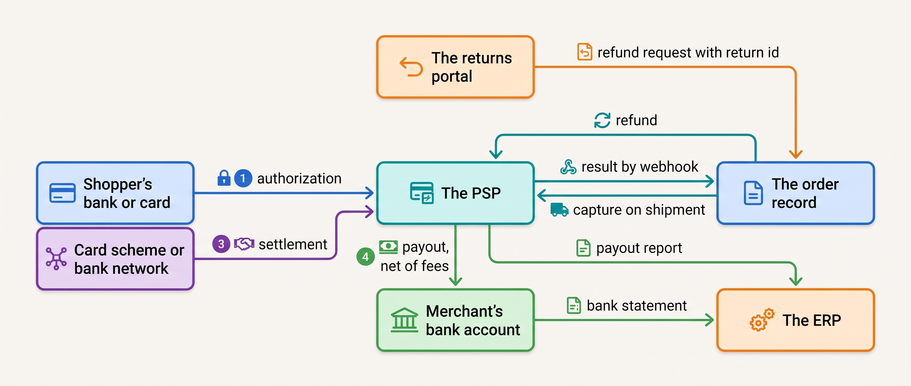
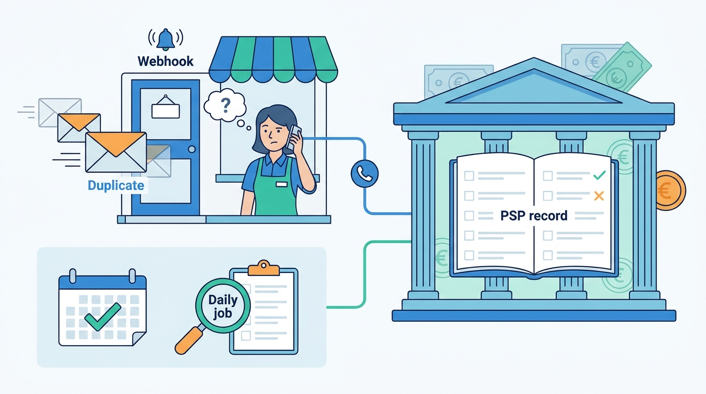
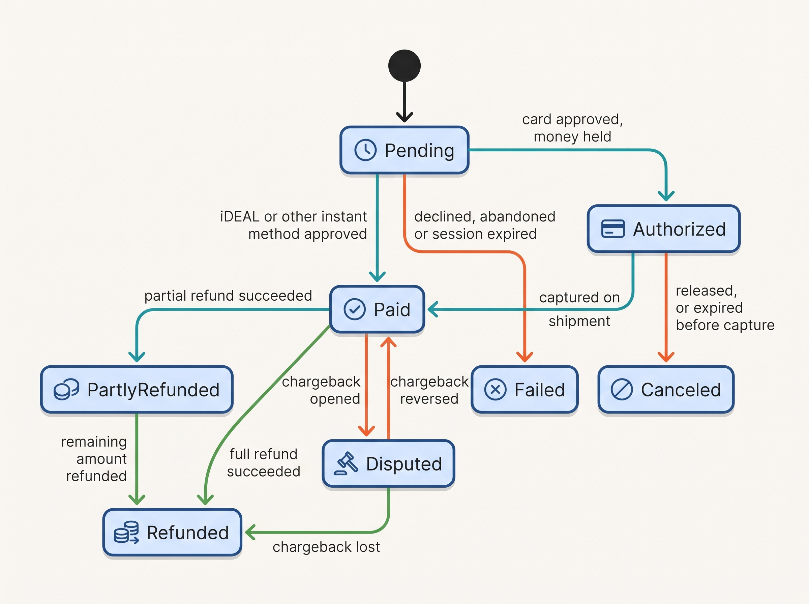
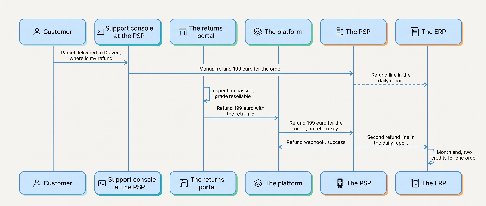
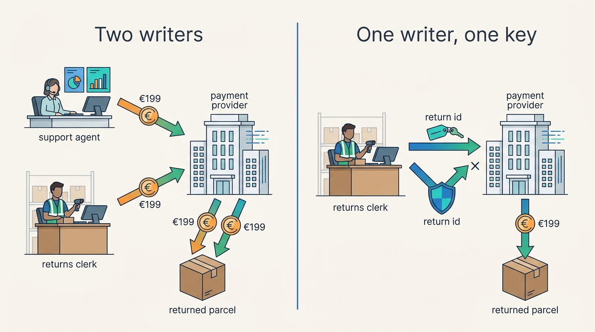

> **IN THIS CHAPTER, YOU WILL:** Follow Eva's €235 from her bank to Kestrel & Pine's account and learn why the order must treat the payment provider's answer as the truth and every refund as a one-owner action.

> **KEY POINTS:**
>
> * **Payment is a state machine whose truth lives outside your systems.** The payment service provider, not the checkout, decides whether money moved, and its answer arrives by webhook: late, unordered and sometimes twice. The order keeps a small vocabulary (pending, authorized, paid, refunded, disputed) with the provider's references beside it, never a flag that says "paid: true".
> * **Money moves in four stages, and each payment method bends them differently.** Authorization reserves, capture takes, settlement moves money between banks, payout lands it in the merchant's account. A card authorization expires in days; iDEAL has no capture and no chargeback; buy-now-pay-later holds for weeks. A design that assumes one method's behavior breaks on the others.
> * **Every action that moves money has one writer and one key.** The Double Refund cost Kestrel & Pine €19,400 twice because two systems could refund the same return and neither sent a key the provider could recognize. Idempotency keys, a daily reconciliation against the provider's records and a card number that never touches your servers are the three disciplines this chapter is built on.

> **[FAILURE PATTERNS THIS CHAPTER ADDRESSES](where-commerce-platforms-go-wrong.html):**
>
> * **The Boomerang** — a refund issued from two systems for one return is reconciled by hand after the money has gone, and the second one cannot be pulled back.
> * **The Message in a Bottle** — a payment result sent once and trusted, or a refund request retried without a key, produces unpaid shipments and paid-twice customers.
> * **The Lynchpin** — one payment provider carries every online sale; when its account is paused for 40 minutes, the checkout is dark and nobody has rehearsed the switch.

 
Everything a commerce platform does before this point is a promise. **Taking the money is the first moment the merchant receives something back**, and the first moment it depends on a system it does not own, run by a company it does not control, talking to banks it has never heard of. The money moves through that chain in stages, and the merchant's systems learn about each stage by message.

That dependence produces a quiet kind of failure. A stock problem is visible: a shelf is empty. A payment problem is not: a refund goes out twice, an authorization expires before anyone captures it, a webhook never arrives. **Payment mistakes are discovered in the books, weeks later, by the people least able to fix the cause.**

This chapter owns the terms **PSP**, **authorization and capture**, **SCA** (strong customer authentication), **payment webhook** and **refund**. The checkout before the payment belongs to [[cart-and-checkout]]; the money in the books to [[tax-invoicing-and-ledger]]; the deeper payment operations, from interchange to orchestration across providers, to the sibling book RECONCILED in [[payments-fundamentals]], [[adyen]] and [[stripe]], which this chapter points to rather than repeats.

**Where we are in the order's journey.** Eva's jacket (the recurring order from [[meet-kestrel-and-pine]]) was placed on Tuesday 13 April 2027 at 21:14 and paid by iDEAL. This chapter is the minute before, 21:13, when Eva is redirected to her bank's app, and the days after, when the money settles, is paid out and is matched in the books. It returns on 22 April for the refund variant of her return, which is where the Double Refund lives.

## Setting the Scene at Kestrel & Pine: Three Weeks in January

Kestrel & Pine, the fictional outdoor brand this book follows, has used one **PSP** since 2016: a payment service provider, the company that offers the shopper a choice of payment methods, collects the money through the banks and card networks behind each method, and pays the merchant one net amount a day. It handles iDEAL (the Dutch method that pays by bank transfer from the shopper's banking app), cards, PayPal, Klarna, Bancontact and Apple Pay for the three storefronts; the six stores use a separate **terminal provider** at the till; wholesale customers pay invoices by bank transfer within 30 days.

In January 2027 Sanne de Wit, the Finance Director, closed the month and found orders with **two credits** against them in the ERP (enterprise resource planning system: the back-office system that keeps the books). Over three weeks, **212 returns had been refunded twice**: once by the returns portal through the platform's API, and once by support agents, by hand, in the PSP's own console. **€19,400** had gone out twice; most of it was recovered by asking customers to transfer the second amount back, because a bank-transfer refund cannot be recalled. The mechanism, reconstructed by Noor Visser in February, was ordinary; the days are a Kestrel & Pine illustration.

| Day | What happened | Which system acted |
| --- | --- | --- |
| 0 | A returned parcel arrives at Duiven; the customer sees PostNL's "delivered" scan | The carrier |
| 0–3 | The customer writes to support: "my return arrived, where is my refund?" | The customer |
| 1 | The agent opens the PSP console, sees the payment and no refund, and refunds €199 to be helpful | Support, in the PSP console |
| 2–5 | The warehouse grades the item resellable; the returns portal, which refunds on inspection, calls the platform's API; the platform instructs the PSP, which accepts a request that names only the order and an amount | The returns portal, the platform, the PSP |
| 31 | Finance finds two credits per order when matching the PSP's payout report to the ERP | The ERP |

Two systems could refund, neither sent a key that named the business event, and the only place the two paths meet is the ledger. Noor's whiteboard question in February is the chapter's: **who may move money, with what key, and how does the order find out what the PSP actually did?**

A second finding sharpened it. On the Card-Testing Night of August 2026, bots fired **48,000** stolen card numbers at the guest checkout, costing **€2,900** in fees for declined authorizations and a **40-minute** pause of the PSP account, and of every online sale. [[commerce-security]] owns the defense; this chapter owns the fact that one provider carried every sale.

## What a Payment Service Provider Does

When Eva pays, at least five parties take part.

| Party | In plain words | In Eva's iDEAL payment |
| --- | --- | --- |
| **The shopper** | Pays with a card, a bank account or a wallet | Eva, in her bank's app |
| **The issuer** | The shopper's bank, which holds her money or her credit | Eva's Dutch bank |
| **The scheme or network** | The rules and rails a method runs on: Visa, Mastercard, iDEAL, SEPA, PayPal's own network | The iDEAL scheme |
| **The acquirer** | The licensed institution that accepts payments on the merchant's behalf and receives the money from the issuer | Part of the PSP |
| **The PSP** | The merchant's single counterparty: one API, many methods, fraud screening, authentication, a balance, payouts and reports | Kestrel & Pine's PSP |

A PSP hides the other four behind one contract; most PSPs serving European merchants are also acquirers or partner with one (a reference-architecture description, not a fact about any one company). Adyen's, Stripe's and Mollie's documentation (all n.d., accessed November 2026) describe the same four-stage flow: **authorization, capture, settlement, payout**, with **refund** and **chargeback** flowing backward.

Even a platform that appears to take payments itself works this way: Shopify's processor list (n.d., accessed November 2026) names Stripe, PayPal and Adyen as the processors behind Shopify Payments in the Netherlands, Belgium and Germany, and its European payment terms state that no Shopify entity is "licensed as a bank, payment institution, or money services business". "The platform's own payments" is a commercial wrapper over PSPs, and the four stages apply underneath.

### The four stages

**Figure 1:** *Money moves in four stages the merchant does not control; the order learns the result by webhook, triggers capture and refunds through one path, and finance matches the payout to the orders it contains.*

| Stage | Who acts | In plain words | What the order record keeps |
| --- | --- | --- | --- |
| **Authorization** | The issuer approves; the PSP reserves | "The money is there and held for you" | PSP reference, amount, method, authentication result, expiry |
| **Capture** | The merchant, or the PSP automatically | "Now take it"; Adyen: manual capture "lets you settle funds on fulfillment, when an order is shipped" | Captured amount, capture reference, link to the shipment |
| **Settlement** | The scheme or bank moves money to the PSP | The merchant's systems do nothing | Nothing |
| **Payout** | The PSP pays the merchant's bank | One batch per sales day, net of fees, refunds and chargebacks | Batch id, net amount, fees; matched by finance, not by the order system |

The windows matter. Stripe lists card authorizations as valid for seven days for Visa, Mastercard, American Express and Discover when the shopper initiates an online payment; if the authorization expires before capture "the funds are released and the payment status changes to canceled". Klarna must be captured within 28 days at Stripe and Mollie. **"Capture on shipment" is a promise with a deadline**: if the warehouse ships on day eight, the card money is gone and the parcel is a gift.

Payout timing is separate: Adyen's default is "sales day payout", all funds from one sales day in one batch with a two-business-day delay, and Stripe's initial settlement timing in most EU countries is seven calendar days, moving to three business days. The batch report, listing the payments, refunds, chargebacks and fees it nets, is what finance matches against orders ([[tax-invoicing-and-ledger]]; in depth, [[payments-to-ledger]]).

### Methods are not interchangeable

Kestrel & Pine sells in three countries, and each pays differently; across the euro area cards still lead at 48% of online payments by number (the European Central Bank's SPACE 2024 study), so the card path is the one to get right first. The figures are the latest dated public ones; the last column is the author's judgement.

| Country | Dominant online method | Evidence | What it means for the design |
| --- | --- | --- | --- |
| **Netherlands** | **iDEAL**, a transfer from the shopper's own bank account | Dutch Payments Association, February 2025: 1.47 billion iDEAL payments worth €141 billion in 2024; the ECB's SPACE 2024 study puts "e-payment solutions" at 76% of Dutch online payments by number | Instant and irrevocable, no separate capture, no chargeback, a 15-minute session; a refund is a new transfer back |
| **Belgium** | **Bancontact**, a card scheme paid mostly through its app | Bancontact Payconiq Company, February 2025: 382 million online payments in 2024, 90% from a smartphone | Card-like: authorized then captured; refunds and disputes follow card rules |
| **Germany** | **PayPal**, **purchase on account** (*Kauf auf Rechnung*) and direct debit | EHI's "Online-Payment 2024" study as reported by Ecommerce News, April 2024 (data for 2023): PayPal 27.7%, invoice 26.7%, bank transfer 16.7% | "Payment" may be a 30-day receivable or a buy-now-pay-later loan; the lender captures late and bears the credit risk |

As of November 2026 the iDEAL scheme's own site brands itself "iDEAL | Wero", reflecting its move under the European Payments Initiative's wallet; what that changes for integrations is not documented there, so this chapter uses Mollie's documented semantics (instant charge, automatic capture, partial refunds for 365 days, no chargeback, 15-minute session) and flags the name as in motion.

Costs differ too. Adyen's indicative price list (n.d., accessed November 2026) charges "$0.13 + €0.22" for iDEAL, "$0.13 + Interchange++ + 0.60%" for Visa and Mastercard and "$0.13 + 2.99%" for Klarna in Germany; **interchange**, the fee the merchant's side pays the cardholder's bank, is capped in the EU at 0.2% for consumer debit and 0.3% for consumer credit cards (Regulation (EU) 2015/751, in force since 9 December 2015). A buy-now-pay-later sale can cost ten times an iDEAL sale, a pricing decision before it is a technical one.

## The Order Depends on a Message It Does Not Control

The rule the rest of the chapter builds on: **nothing in the merchant's own systems knows whether a payment succeeded.** The checkout sent a request. The shopper left for her bank's app or a 3-D Secure challenge (the card networks' extra authentication step, explained below) and may never come back. The PSP learns the outcome from the issuer and tells the merchant by **webhook**: an HTTP call to an address the merchant registered, saying "something happened to payment X". The order's job is to wait for that message and to be safe when it arrives twice or not at all.

The documentation is blunt about that message. Stripe (n.d., accessed November 2026): "Stripe doesn't guarantee the delivery of events in the order that they're generated"; "Webhook endpoints might occasionally receive the same event more than once"; and every event is signed, because "Without verification, an attacker could send fake webhook events to your endpoint to trigger actions like fulfilling orders." Mollie's webhook carries only an id, so "fake calls to your webhook will never result in orders being processed without being actually paid"; the merchant must fetch the status; and Mollie retries ten times over 26 hours before giving up.

Three consequences follow, and I would write them into the integration contract of any order system:

1. **Persist every event id and treat a repeat as a no-op.** The second "payment succeeded" changes nothing; so does the second "refund succeeded".
2. **When the decision matters, fetch the object rather than trust the payload.** The webhook is the doorbell; the PSP's record is the truth.
3. **Run a daily job for everything still pending.** Webhooks stop retrying, after 26 hours at Mollie and three days at Stripe. A job that lists every order whose payment has not reached a final state within the method's expiry window, and asks the PSP, is the floor under the design. [[cart-and-checkout]] placed the same job at the end of checkout; [[events-consistency-and-reconciliation]] generalizes it.

**Figure 2:** *The webhook is only the doorbell: the order trusts the PSP's record, ignores a repeated ring, and runs a daily job for every payment still pending.*

The order should keep its **own small payment vocabulary** and map the PSP's statuses (Mollie has seven, Stripe's PaymentIntent six) into it inside the adapter, so that a merchant that changes PSP changes an adapter, not every downstream system.

**Figure 3:** *The order's payment vocabulary: a few states every channel and system understands, moved only by the PSP's confirmed events, with the PSP's raw status and references stored beside them.*

Each flow between the order and the PSP has its own requirements; the latencies are assumptions for a merchant of Kestrel & Pine's shape.

| Flow | How fresh | How consistent | How fast | If the other side is down |
| --- | --- | --- | --- | --- |
| Payment outcome (webhook in) | As soon as the PSP knows | Applied once; duplicates ignored by event id | Seconds, but tolerate hours *(assumption)* | The daily pending-payments job settles it |
| Capture (out, on shipment) | Within the authorization window | One capture per fulfillment, keyed by it | Minutes *(assumption)* | Retry with the same key; alert before the window closes |
| Refund (out, on inspection) | Within the legal 14 days ([[returns-and-exchanges]]) | Exactly one per return, keyed by return id | Hours *(assumption)* | Never retry blindly; check the PSP's refund list first |
| Payout report (in) | Daily batch | Every line matched to an order, refund, fee or dispute | A day | Finance waits; nothing else does |

## Strong Customer Authentication and 3-D Secure

**PSD2**, the second Payment Services Directive (Directive (EU) 2015/2366, applied from 13 January 2018), defines **strong customer authentication** (SCA) in Article 4(30) as authentication using two or more of knowledge, possession and inherence, and Article 97 requires it when a payer initiates an electronic payment. The detailed rules are in Commission Delegated Regulation (EU) 2018/389, applied from **14 September 2019**, which sets the exemptions: contactless at the terminal up to €50 (Article 11), trusted beneficiaries (Article 13), recurring transactions after the first (Article 14), low-value remote payments up to €30 (Article 16) and transaction risk analysis up to €500 for PSPs with low fraud rates (Article 18).

For cards the protocol that performs SCA is **3-D Secure 2** (3DS): low-risk transactions pass "frictionless" and higher-risk ones require "a challenge, such as a one-time passcode" (EMVCo, n.d., accessed November 2026). Two rules follow from Stripe's SCA page. Exemptions belong to the PSP and the issuer, not the merchant: "Exemptions aren't guaranteed." And the **liability shift**: "If a cardholder disputes a 3DS payment as fraudulent, the liability typically shifts from you to the card issuer"; where an exemption was applied, "liability shift doesn't apply". An exemption buys conversion at the price of fraud liability, so the order should store the authentication result and the liability flag. A **merchant-initiated transaction** (MIT), one the merchant triggers later without the shopper present under a prior agreement, is what a split shipment captured late, a pre-order or "charge on dispatch" past the authorization window relies on; it needs an SCA-authenticated first interaction flagged for future use.

What comes next is not yet law. **PSD3** and the Payment Services Regulation reached provisional agreement on 27 November 2025 (PSPs liable for customers' losses where fraud prevention was inadequate, mandatory payee-name checks, all charges disclosed before payment, per the European Parliament's press release of 21 November 2025); the Council published compromise texts on 23 April 2026, and both files were still open in its state of play of 29 October 2026. As of 7 November 2026 neither is in the Official Journal. The Instant Payments Regulation (Regulation (EU) 2024/886) is in force: euro-area PSPs had to receive instant credit transfers by 9 January 2025 and send them by 9 October 2025, with payee verification free of charge, which makes instant transfer a plausible checkout and refund rail.

## Refunds, Cancels and Chargebacks: Money Flowing Backward

A refund looks like an undo. It is not. **A refund is a new payment in the opposite direction**, with its own state, failure modes and fees.

- **You can only refund what was captured.** Adyen: "You can only refund a payment after it has been captured"; an uncaptured authorization is *canceled* instead. Stripe's cost advice points the same way: businesses that refund soon after the sale should capture manually and cancel before capture "rather than processing a refund", because "Stripe's processing fees from the original transaction aren't returned."
- **A refund is asynchronous and can fail later.** Adyen: a webhook with `success: true` means the request went to the scheme, and "Although rare, a refund can fail after you received" it; for iDEAL, Bancontact and bank transfers a REFUNDED_REVERSED event means the money came back because the account was invalid; funds can take "up to 40 business days" to reach the shopper. Stripe: the customer "sees the refund as a credit approximately 5-10 business days later".
- **Refunds go only to the original method, and partial refunds are bounded** (Stripe; Adyen). Store credit is a different instrument with its own ledger ([[commerce-promotions]]).

The sequence shows how the Double Refund happened, and where one key would have stopped it.

**Figure 4:** *The Double Refund: two writers, two paths, no shared key; the PSP cannot refuse the second request because nothing in it says it is for the same return, and the two paths meet only in the ledger.*

The fix Waypoint adopted in February 2027, which [[events-consistency-and-reconciliation]] describes from the integration side, has three parts. **One writer per money action**: refunds are issued by the returns portal through the platform, and support's PSP console access becomes read-only. **One key**: every refund request carries the return id as its **idempotency key**, a unique token sent with a request so that a retry does nothing twice; Stripe's implementation is the public reference (it "saves the status code and body of the first request made with a given idempotency key" and returns it on retries, and may prune keys after 24 hours, so the merchant's own key store must outlive the PSP's). **One daily check**: refunds issued by the PSP against refunds recorded by the platform, by order number and amount, with exceptions to Sanne de Wit's team.

**Figure 5:** *The fix for the Double Refund: one writer per money action and one key per business event, so the PSP refuses a repeat instead of paying twice.*

**Chargebacks** are the other backward flow, and not the merchant's decision: a dispute "occurs when a cardholder questions your payment with their card issuer"; the issuer "immediately reverses the payment", and the PSP "debits your balance for the payment amount and dispute fee" (Stripe). Adyen's flow runs from a notification of chargeback that opens the defense period through the chargeback, the supplied defense and a possible reversal, and Adyen auto-defends a dispute "that was already refunded". Cardholders "can dispute a charge up to 120 days after a payment was made", so a month's dispute ratio keeps changing for four months. The ratio has teeth: Visa's Acquirer Monitoring Program (fact sheet, May 2025) counts fraud reports plus disputes over settled transactions, with the excessive-merchant line lowered to 150 basis points on 1 April 2026. A slow refund path pushes customers to dispute instead, a second reason to get refunds right; iDEAL has no chargeback at all.

## Fraud and Card Data: Keep the Attack Out and the Card Number Out

[[commerce-security]] owns the defense in depth and the sibling book LISTED covers scoring in [[fraud-prevention]]; this chapter keeps to what shapes the payment design.

**Fraud screening is a ratio problem, so it belongs before authorization.** Stripe's card-testing page (n.d., accessed November 2026) describes what hit Kestrel & Pine: attackers "use scripts to test a large amount of card information at once"; the symptoms are "A spike in failed or blocked payments" and small payments "with nonsensical customer names and emails"; the costs are authorization fees, disputes and monitoring programs. Its controls: the PSP's rate limiters and models, CAPTCHA triggers, requiring login ("The easier it's for fraudulent actors to reach your payment form (for example, using guest checkout), the easier it's for them to execute card testing attacks"), per-IP limits and velocity rules. The addition I insist on is a **kill switch**: a setting, not a deploy, that disables guest card payments or one method while leaving iDEAL and logged-in customers alone.

**Card data is a scope decision.** **PCI DSS** is the card industry's security standard for anyone who stores, processes or transmits card data; version 4.0.1 was published on 11 June 2024, and its future-dated requirements took effect on 31 March 2025. The merchant's obligations depend on which systems can see a card number, and the design goal is that none of the merchant's can. The mechanism is **hosted fields**: the PSP draws the card-number box inside the merchant's page from its own domain, or redirects to its own page, so the number never touches the merchant's code or servers. Stripe's PCI guide maps the integration to the self-assessment questionnaire (SAQ) the merchant signs: hosted checkout or hosted fields to **SAQ A**, a merchant-hosted form posting via the PSP's script to **SAQ A-EP**, direct API with raw card data to **SAQ D**, where a business "might be required to meet more than 300 security controls". Adyen adds the boundary: "Adyen is solely responsible for the security of cardholder data only as soon as Adyen receives the data." Since 30 January 2025 the PCI Security Standards Council has replaced the two payment-page-script requirements in SAQ A with an eligibility statement that the site "is not susceptible to attacks from scripts", so every analytics, chat and testing script on the payment page remains the merchant's risk. The rule: **never store, log or transmit a card number; use the PSP's token; keep a list of every script on the payment page.**

## The Choices: Four Ways to Take Payments

**1. The platform's built-in payments.** A hosted platform offers its own payment service, a wrapper over one or more PSPs, with a hosted checkout, automatic capture, refunds from the admin screen and payouts to the merchant's bank; Shopify Payments is the public example. Nothing to integrate, SAQ A, one payout feed. The limits: the method mix and fees are the platform's, and any second system that must move money goes through the platform's API or not at all.

**2. One external PSP through the platform's connector.** The merchant contracts with a PSP and uses its app or the platform's native integration; the PSP's hosted page or drop-in component renders the methods. Kestrel & Pine's setup since 2016: the PSP's local methods, pricing and risk tools, SAQ A if the page stays hosted, and ownership of the relationship, the webhook endpoint and the question of who else may call the PSP.

**3. A custom integration with hosted fields.** A headless or heavily customized checkout ([[storefront-architecture]]) calls the PSP's API directly and embeds its hosted fields: full control of capture on shipment, partial captures and MITs; SAQ A if the eligibility criteria hold; and a checkout team that handles every property of the webhook itself.

**4. A payment service of the merchant's own, over several PSPs.** An internal service presents one payment API to every channel, routes each payment to one of several PSPs and reconciles across them. [[payments-fundamentals]] covers the trade-offs; it is worth its complexity only when volume, countries or resilience demand it.

| Criterion | 1. Platform's own payments | 2. One PSP via connector | 3. Custom with hosted fields | 4. Own payment service, several PSPs |
| --- | --- | --- | --- | --- |
| Time to first sale | Hours | Days | Weeks to months | Months |
| Method mix and pricing | The platform's | The PSP's, negotiable at volume | The PSP's | Best per method and country |
| PCI scope | SAQ A | SAQ A | SAQ A or A-EP | SAQ A-EP to SAQ D |
| Capture on shipment, partial capture, MIT | What the platform exposes | Via the connector's settings | Full | Full |
| Who else may move money | The platform's API only | Whoever holds the PSP's API key | The payment adapter | The payment service, by policy |
| Resilience to a provider outage | None | None | None without a second PSP | Routing to another PSP |
| Fits | Starting; one country | Growing; Omnichannel with discipline | Omnichannel with a checkout team | Group, or very high volume |

My rule for a merchant of Kestrel & Pine's size: **stay on option 2 and spend the effort on discipline, not orchestration.** One PSP, local methods per country, capture on shipment for cards, one refund path, verified webhooks handled by an adapter, a daily reconciliation, and a rehearsed fallback for one method rather than an orchestration layer a 14-person team would have to run.

## Stores, Wholesale and Marketplaces: Four Feeds, Not One

Online is one of four ways money reaches Kestrel & Pine.

**Stores** take cards through the terminal provider, where SCA is chip-and-PIN or the contactless limit, the PCI questionnaire is a different one (SAQ C or a validated point-to-point encryption solution), and the payout is a separate daily feed into the ERP. A web order refunded at the till is the store's version of the Double Refund ([[stores-and-omnichannel]]).

**Wholesale** customers do not pay at checkout. Bergzicht's spring reorder was invoiced on 9 April 2027 and is due on 9 May: "payment" is a **receivable**, an amount owed and tracked in the ERP, settled by a bank transfer that finance matches to the invoice ([[b2b-commerce]], [[tax-invoicing-and-ledger]]).

**Marketplaces** collect the shopper's money and pay the seller out, net of fees, on their own schedule: a third payout feed ([[marketplaces-and-channel-integration]]).

**Online** is the PSP's daily batch. Four feeds, four reconciliations, and the reason Waypoint's W5 says finance moves by daily batch: the books need completeness, not speed. Where four feeds meet, a payments sub-ledger earns its place ([[designing-financial-ledgers]]).

## Across Scale Stages: When It Fits and When It Limits

| Stage | What is typical | What becomes necessary | Signs the stage is ending |
| --- | --- | --- | --- |
| **1 — Starting** (under about €2M) | The platform's own payments or one PSP on a hosted page; automatic capture; refunds from the admin screen; one country's methods | Two-step authentication on the PSP and admin logins; someone who reads the decline rate | Refunds done by hand in the PSP console; a second country whose shoppers want a method the setup lacks |
| **2 — Growing** (about €2M–€20M) | One PSP with local methods per country; the first custom integrations (a returns portal, an ERP connector) that can call the PSP; card testing as the first incident | Capture on shipment for cards; one writer per money action; a webhook endpoint that is owned and verified; an edge rate limit and a kill switch for guest card payments | Two systems can refund; an agency script handles webhooks and nobody knows how; a dispute lost for want of a stored 3DS result |
| **3 — Omnichannel** (about €20M–€200M) | Four feeds: online PSP, terminal provider, marketplaces and wholesale receivables; payment states on an order hub | The order hub's payment vocabulary and adapter; refund keys; a rehearsed PSP fallback; a payment-page script inventory; a payments sub-ledger | Payout matching takes days each month; a PSP account pause stops every channel; fee lines nobody can explain per country |
| **4 — Group** (over about €200M, or several brands) | Several PSPs or an orchestration layer; network tokens so saved cards are not locked to one PSP; a central regulatory calendar | A payment service with routing and one reconciliation pipeline; a deliberate decision whether any system may touch card numbers | Each brand negotiating its own PSP contract; a tokenized card base that cannot move |

The judgement: the payment *mechanism* does not change with scale. What changes is **how many systems can move money and how many feeds finance must match**; stage 2 is where the Double Refund happens, because it is the stage at which the first integration beyond the platform gets a PSP key.

## In Practice

**Kestrel & Pine: Eva's €235, start to finish.** On Tuesday 13 April 2027 at 21:13 the platform created an iDEAL payment for €235 at the PSP and redirected Eva to her bank's app. At 21:14 the platform created order #1072455 with the payment *pending*; seconds later the PSP's webhook reported success and the order became *paid* ([[cart-and-checkout]] walks the checkout). There was no capture step: iDEAL is captured at approval, and no chargeback can follow. Assume the PSP charges about €0.30 per iDEAL payment *(assumption; Adyen's indicative price is $0.13 + €0.22)*. Tuesday's sales were paid out as one batch on Thursday 15 April *(assumption, modeled on a two-business-day sales-day payout)*, net of fees and of refunds of earlier orders; Sanne's team matched the batch to the day's orders in the ERP by the PSP's reference, which the order carried from the webhook. Had Eva paid by card, Tuesday's authorization would have been captured on Wednesday 14 April when the label printed, inside Visa's seven-day window, with the fulfillment order id as the capture's key.

**The refund variant.** Had Eva chosen a refund instead of size L on 19 April, the returns portal would have waited for the inspection on 22 April, then asked the platform to refund €199 with the return id as the key; the platform would have instructed the PSP; the PSP would have made a new iDEAL transfer back to Eva's account and reported it by webhook; the ERP would have booked a credit note against the invoice ([[tax-invoicing-and-ledger]]). The refund appears as a deduction in a later payout batch, which is why the batch for 22 April does not equal the sales of 22 April, and why matching is by line, not by total. Support, since February 2027, could have seen all of this in the returns portal and issued nothing in the PSP console.

## When It Goes Wrong

**The duplicate refund.** Two systems, no key. Detection: a daily list of refunds at the PSP against refunds in the platform by order and amount. Recovery: ask for the money back, because bank transfers cannot be recalled, and block the writer. Prevention: one writer, the return id as idempotency key, read-only console access for everyone else.

**The lost outcome.** The shopper paid and never returned; the webhook failed; the PSP stopped retrying. Detection: the daily job for payments pending beyond their method's expiry (15 minutes for iDEAL, 30 for cards at Mollie). Recovery: query the PSP, settle the order either way.

**The expired authorization.** The warehouse shipped on day eight and the capture failed. Detection: an alert when an authorized order approaches its window uncaptured. Prevention: capture at label print, and a fulfillment hold when the window is close.

**The provider outage or account pause.** The Card-Testing Night: 40 minutes with no online sales. Detection: a checkout health check that watches the PSP's error rate, not only its status page. Recovery: a rehearsed fallback for one method, a kill switch for the attacked method, an honest storefront message. Prevention: edge rate limits and velocity rules before authorization, so the PSP never has to pause you.

## What to Take Away

**Established.**

- Money moves in four stages, authorization, capture, settlement and payout, with refunds and chargebacks flowing backward; capture must happen inside an authorization window of days, and a refund is a new payment that can fail later (Adyen, Stripe and Mollie documentation, n.d., accessed November 2026).
- The payment outcome arrives by webhook, at least once, in no guaranteed order, and must be verified; the merchant persists event ids, fetches the object when the decision matters, and runs a daily job for everything still pending (Stripe and Mollie documentation).

**Depends on context.**

- Capture on shipment is right for cards where cancellations before dispatch are common, because it saves refund fees and ties money to goods; it does not exist for iDEAL and other instant methods, and it is a liability if the warehouse cannot ship inside the window.
- One PSP with disciplined integration is right up to the Omnichannel stage; orchestration across PSPs is right at Group scale or where one provider's outage would stop several brands, and it changes the PCI scope if the merchant's service ever sees a card number.
**The author's synthesis.**

- I treat payments as a problem of writers and keys before a problem of providers: name one system that may refund, one that may capture, one that may create a payment, give each action a business key the PSP will remember, and reconcile daily; everything else about the PSP can be changed later.
- The order's payment vocabulary should be the merchant's, not the PSP's: five or six states, moved only by confirmed events, with the provider's raw status beside them, so that changing provider changes one adapter.

## Questions to Ask

1. Which systems hold a credential that can refund, capture or create a payment at the PSP, and who approved each one?
2. What is the idempotency key for a refund, a capture and a payment creation, and what does the PSP do when it sees the same key twice?
3. Where does the order store the PSP's reference, the authentication result and the liability-shift flag?
4. How long is the authorization window for each method, and what happens when a shipment approaches it uncaptured?
5. If the PSP's account is paused for an hour, what still sells, and who flips which switch?
6. How many payout feeds does finance match each month, by line or by total, and how long does it take?
7. Which regulatory changes (PSD3, 3-D Secure versions, PCI DSS) are on a calendar with an owner?

The money is in, and the webhook has told the order so. The order now has a life of its own, across the platform, the warehouse, the carrier and, when Waypoint delivers it, an order management system that holds every channel's orders in one record. [[order-management]] follows the order from "paid" onward.

## Sources and Evidence

*Company, product and investor sources*

- [Capture](https://docs.adyen.com/online-payments/capture/), [Adjust authorisation](https://docs.adyen.com/online-payments/adjust-authorisation/), [Refund](https://docs.adyen.com/online-payments/refund/), [Sales day payout](https://docs.adyen.com/account/sales-day-payout.md), [Dispute process and flow](https://docs.adyen.com/risk-management/understanding-disputes/dispute-process-and-flow), [Webhooks](https://docs.adyen.com/development-resources/webhooks/), [Batch-level reconciliation](https://docs.adyen.com/reporting/settlement-reconciliation/batch-level), [PCI DSS compliance guide](https://docs.adyen.com/development-resources/pci-dss-compliance-guide/) and [SAQ A eligibility](https://docs.adyen.com/development-resources/pci-dss-compliance-guide/saq-a-eligibility), Adyen documentation, n.d., accessed 2026-11 — authorization and capture semantics, expiry windows, asynchronous refunds, payout batches, dispute stages, the PCI responsibility boundary.
- [Pricing](https://www.adyen.com/pricing), Adyen, n.d., accessed 2026-11 — indicative per-method fees (volatile).
- [Place a hold on a payment method](https://docs.stripe.com/payments/place-a-hold-on-a-payment-method), [Refunds](https://docs.stripe.com/refunds), [Disputes](https://docs.stripe.com/disputes), [Measuring disputes](https://docs.stripe.com/disputes/measuring), [Monitoring programs](https://docs.stripe.com/disputes/monitoring-programs), [Strong Customer Authentication](https://docs.stripe.com/strong-customer-authentication), [CITs and MITs](https://docs.stripe.com/payments/cits-and-mits), [Idempotent requests](https://docs.stripe.com/api/idempotent_requests), [Webhooks](https://docs.stripe.com/webhooks), [Payouts](https://docs.stripe.com/payouts), [Payout reconciliation](https://docs.stripe.com/reports/payout-reconciliation), [Security guide](https://docs.stripe.com/security/guide), [Card testing](https://docs.stripe.com/disputes/prevention/card-testing) and [PCI compliance guide](https://stripe.com/guides/pci-compliance), Stripe documentation, n.d., accessed 2026-11 — authorization windows, refund behavior and fees, dispute mechanics and thresholds, SCA exemptions and liability shift, MITs, idempotency keys, webhook delivery, settlement timing, reconciliation reports, SAQ mapping, card-testing controls.
- [iDEAL](https://docs.mollie.com/docs/ideal.md), [Place a hold for a payment](https://docs.mollie.com/docs/place-a-hold-for-a-payment.md), [Refunds](https://docs.mollie.com/docs/refunds.md), [Webhooks](https://docs.mollie.com/docs/webhooks), [Handling payment status](https://docs.mollie.com/docs/handling-payment-status.md) and [Settlement report](https://docs.mollie.com/docs/settlement-report.md), Mollie documentation, n.d., accessed 2026-11 — iDEAL semantics, hold periods, duplicate-refund blocking, id-only webhooks with ten retries over 26 hours, status model and expiry per method, settlement contents.
- [Shopify Payments Terms of Service (Ireland)](https://www.shopify.com/legal/terms-payments-ie) and [Processor list](https://www.shopify.com/legal/processor-list), Shopify, n.d., accessed 2026-11; [Form 10-K for fiscal 2025](https://www.sec.gov/Archives/edgar/data/1594805/000159480526000007/shop-20251231.htm), Shopify Inc., 2026-02-11; [Shopify Payments supported countries](https://help.shopify.com/en/manual/payments/shopify-payments/supported-countries), Shopify Help Center, n.d., accessed 2026-11 — a platform's payments as a wrapper over licensed PSPs; Payments penetration; country availability.
- [Annual turnover iDEAL and PIN payments](https://www.betaalvereniging.nl/en/news/annual-turnover-ideal-pin-payments/), Dutch Payments Association, 2025-02-18 — 2024 iDEAL volumes; [iDEAL | Wero](https://www.ideal.nl/en/), Currence iDEAL, n.d., accessed 2026-11 — the scheme's current branding.
- [2.5 billion payments with Bancontact and Payconiq in 2024](https://www.bancontact.com/en/news/2-5-billion-payments-with-bancontact-and-payconiq-in-2024-2-5-billion-times-thank-you-for-your-trust-in-us), Bancontact Payconiq Company, 2025-02-12 — Belgian online volumes.
- [PayPal remains most popular online payment method in Germany](https://ecommercenews.eu/paypal-remains-most-popular-online-payment-method-in-germany/), Ecommerce News reporting EHI's "Online-Payment 2024", 2024 — German method shares for 2023 (secondary source).

*Standards, regulation and official documentation*

- [Directive (EU) 2015/2366 (PSD2)](http://publications.europa.eu/resource/celex/32015L2366), Official Journal, 2015-12-23 — the SCA definition (Article 4(30)) and requirement (Article 97); applied from 13 January 2018.
- [Commission Delegated Regulation (EU) 2018/389](http://publications.europa.eu/resource/celex/32018R0389), Official Journal, 2018-03-13 — the RTS on SCA, applied from 14 September 2019, and its exemptions.
- [Regulation (EU) 2015/751 on interchange fees](http://publications.europa.eu/resource/celex/32015R0751), Official Journal, 2015-05-19 — the 0.2% and 0.3% caps (older than three years; still in force).
- [Regulation (EU) 2024/886 on instant credit transfers](http://publications.europa.eu/resource/celex/32024R0886), Official Journal, 2024-03-19 — receive and send deadlines, free payee verification.
- [Payment services deal: more protection from online fraud and hidden fees](https://www.europarl.europa.eu/news/en/press-room/20251121IPR31540/payment-services-deal-more-protection-from-online-fraud-and-hidden-fees), European Parliament, 2025-11-21, and [State of play of legislative files](https://data.consilium.europa.eu/doc/document/ST-15005-2026-INIT/en/pdf), Council of the EU, 2026-10-29 — PSD3 and PSR content and status.
- [EMV 3-D Secure](https://www.emvco.com/emv-technologies/3-d-secure/), EMVCo, n.d., accessed 2026-11 — frictionless and challenge flows.
- [Just published: PCI DSS v4.0.1](https://blog.pcisecuritystandards.org/just-published-pci-dss-v4-0-1), PCI Security Standards Council, 2024-06-11; [Important updates announced for merchants validating to SAQ A](https://blog.pcisecuritystandards.org/important-updates-announced-for-merchants-validating-to-self-assessment-questionnaire-a), PCI SSC, 2025-01-30; [PCI DSS](https://www.pcisecuritystandards.org/standards/pci-dss/), PCI SSC, n.d., accessed 2026-11 — versions, dates, scope, the SAQ A change.
- [Visa Acquirer Monitoring Program fact sheet](https://corporate.visa.com/content/dam/VCOM/corporate/visa-perspectives/security-and-trust/documents/visa-acquirer-monitoring-program-fact-sheet-2025.pdf), Visa, 2025-05 — VAMP ratio and thresholds (volatile).
- [Study on the payment attitudes of consumers in the euro area (SPACE 2024)](https://www.ecb.europa.eu/stats/ecb_surveys/space/html/ecb.space2024~19d46f0f17.en.html), European Central Bank, 2024-12 — online payment shares by method and country.

*Research and practitioner sources*

- [[payments-fundamentals]], [[adyen]], [[stripe]], [[payments-to-ledger]], [[designing-financial-ledgers]] and [[traceability-and-reconciliation]] in RECONCILED — the deeper treatment of parties, pricing, orchestration, tokens, the payments sub-ledger and reconciliation this chapter points to.
- [[fraud-prevention]] in LISTED — scoring and velocity controls beyond the basics given here.

Kestrel & Pine is fictional; architectural recommendations, labeled inferences and labeled assumptions are the author's judgement.
