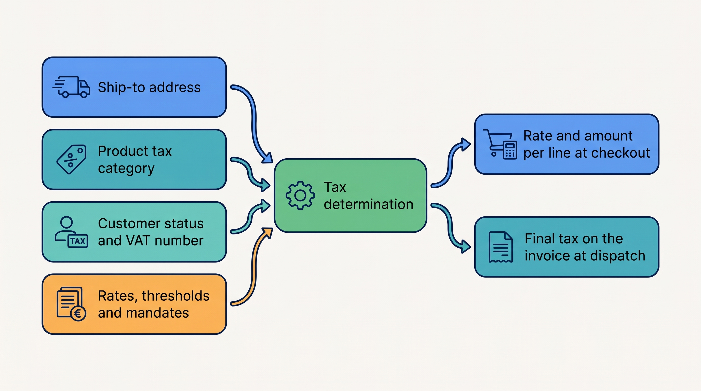
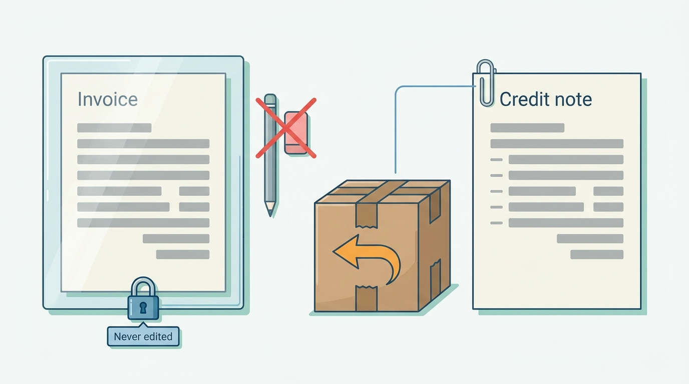
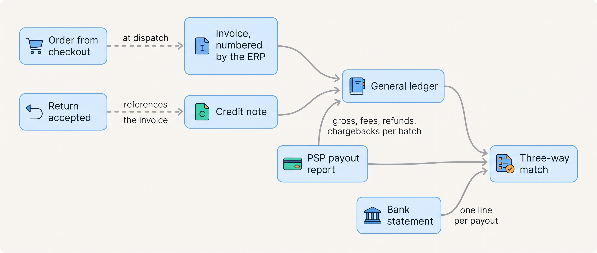
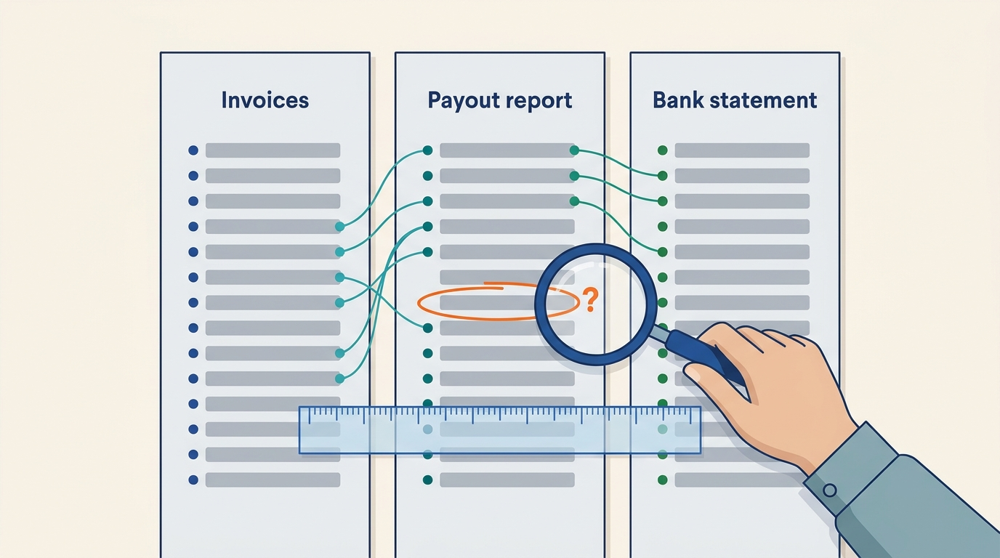
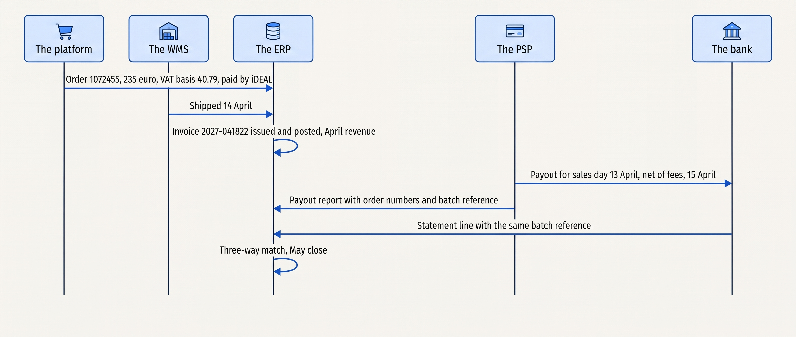

> **IN THIS CHAPTER, YOU WILL:** Follow one order from the tax shown at checkout to the invoice, the credit note and the ledger entries, and learn what finance needs from the shop.

> **KEY POINTS:**
>
> * **Tax is computed from facts the shop owns and rules it should not own.** The ship-to address, the product's tax category and the customer's status (consumer or VAT-registered business) decide the rate; the rates, thresholds and mandates belong to a tax engine or one rate table, maintained once for every channel.
> * **The invoice is a legal document, not a receipt.** It carries a gap-free sequential number, cannot be changed once issued, and is corrected only by a credit note that references it; one system per legal entity issues it, and in Belgium since January 2026 a business invoice travels as structured data over Peppol.
> * **The books agree with the shop only when someone proves it.** Orders, the payment provider's payout reports and the bank statement are three views of the same money; a monthly three-way match, keyed on stable identifiers, turns a commerce platform's promises into accounts an auditor will sign.

> **[FAILURE PATTERNS THIS CHAPTER ADDRESSES](where-commerce-platforms-go-wrong.html):**
>
> * **The Boomerang** (here, the Double Refund) — refunds, credit notes and restocking that are matched by hand after the return, and sometimes twice, because no document references the one it corrects.
> * **Schrödinger's Order** (here, the Three-Status Order) — the order that is *Delivered* in the shop platform and *Not invoiced* in the finance system for six days, because the invoice waits for an "order complete" message that a short pick prevents, and nobody watches for it.
> * **The Long Fuse** — an e-invoicing mandate with a published date that becomes a project only when the first business customer refuses a PDF.

 
A customer pays for an order, but the amount reaching the merchant's bank may be smaller because the payment provider deducted a fee. A later refund changes the position again. Finance needs to connect the tax calculation, invoice, fee, refund and bank receipt to explain the difference. Without those links, accountants must reconstruct it in spreadsheets and may struggle to distinguish normal deductions from missing money.

Kestrel & Pine, the fictional outdoor brand used here, must do this for 293,000 online orders, 43,000 marketplace orders, 118,000 store transactions and 9,400 wholesale orders a year, across three countries. Manual explanation does not scale with that workload.

**Where we are in the order's journey.** The previous chapter left Eva's €235 order with one home, one number and its goods status per shipment. From dispatch onward each shipment produces financial records: an invoice, a payout from the payment provider and ledger entries, followed by any return adjustments. Finance reconciles those records and reports the value-added tax (VAT), Europe's consumption tax, charged at every sale and reclaimed by business buyers, in the Dutch VAT return.

This chapter's answer is that an order reaches the books through documents, not events. The tax is computed from three facts the shop owns, under rates kept in one place for every channel. One system per legal entity issues an invoice for each shipment at dispatch, never edits it and corrects it only with a credit note. The ledger is posted from those documents and the payout reports. The shop owes finance the facts and identifiers these documents need, so that a monthly match of invoices, payouts and bank lines can explain each difference.

The chapter starts from Sanne de Wit's April close and her two questions, then covers what the shop owes finance, VAT and the two moments tax is computed, the invoice and the e-invoice, the entries the ERP posts to the books, and the matching of invoices, payouts and the bank. It follows Eva's order and a Belgian wholesale invoice sent over **Peppol**, a network for exchanging structured invoices, into the books, compares the choices and the scale stages, and ends with what goes wrong. The evidence is EU and national tax rules, payment-provider and ERP documentation, and Kestrel & Pine's month-end. Further detail sits in [[commerce-payments]], [[edi-and-e-invoicing]], [[erp-and-back-office-integration]], [[payments-to-ledger]] and [[designing-financial-ledgers]].

## Setting the Scene at Kestrel & Pine: Sanne's April Close

Finance Director Sanne de Wit closes April 2027 in the second week of May. Four payment routes must reconcile with the ERP, and each needs its own matching rules before she can trust the close:

- The online **payment service provider (PSP)** pays daily batches after fees, refunds and chargebacks, the reversals made by cardholders' banks. Assume about thirty batches of 800 orders each.
- A terminal provider settles card payments from six stores separately.
- Three marketplaces pay on different schedules after commission.
- **1,100 wholesale accounts** pay invoices on 30-day terms. Some pay short, twice or with references the ERP cannot match.

Two winter incidents show what the close must catch. January's **Double Refund** sent **€19,400** twice across **212 returns**, once through the portal and again through support. The ERP's credit notes, the documents that correct an invoice after a return, were correct; nobody compared them with the actual refunds.

December's **Three-Status Order**, #1052877, showed *Delivered* while the ERP waited six days to invoice. The warehouse could not report "order complete" until missing socks were replenished. No report flagged the dispatched fleece as uninvoiced.

A third thing is new. Since 1 January 2026, businesses established in Belgium must exchange invoices with each other as structured electronic documents over the Peppol network. Kestrel & Pine's Belgian business customers expect a Peppol invoice, so since then its ERP has sent them one through its EDI provider. The sources this book relies on do not settle whether the obligation itself reaches a supplier with no Belgian establishment ([[edi-and-e-invoicing]] reads the scope).

In April Ardennes Trail Co., a wholesale customer in Namur, rejected an invoice because the buyer reference it had asked for was missing. Sanne asks Noor Visser, the Head of Engineering, two questions: **which system is allowed to issue an invoice, and how do we prove, every month, that the orders, the payouts and the bank agree without reading them one by one?**

## What the Commerce System Owes Finance

Sanne's questions start from what the shop owes finance. In business terms it owes three outcomes. **The right tax**: every sale carries the VAT of the right country at the right rate; tax authorities enforce it. **A valid invoice**: numbered in sequence, never edited and kept for years; auditors and business customers, whose VAT deduction depends on it, enforce it. **Books that match the bank**: the ledger (the ERP's book of accounts), the PSP's reports and the bank statement agree; the auditors and the board enforce it at every close.

A handful of documents carry those outcomes, and each has one owner. This is the chapter's version of the entity–owner table from [[boundaries-and-systems-of-record]].

| Document | Created when | Owner (system of record) | References |
| --- | --- | --- | --- |
| **Order** | Checkout completes | The shop platform, or an order management system (OMS) once there is one | Cart, payment reference |
| **Tax calculation** | At checkout (estimate) and at invoicing (final) | The tax engine or rate table; recorded on the order and the invoice | Ship-to address, product tax category, customer status |
| **Invoice** | At dispatch of each shipment (goods) or at order (digital goods) | The ERP, one numbering sequence per legal entity | Order number, shipment id |
| **Credit note** | When a return is accepted or an invoice is wrong | The ERP, same sequence family | The invoice it corrects |
| **Payment event** | When the PSP authorizes, captures, refunds | The PSP; mirrored on the order | Order, invoice or credit note |
| **Payout report** | When the PSP pays the merchant's bank | The PSP | Every payment, refund, fee and chargeback in the batch |
| **Ledger entries** | When documents are posted | The ERP's general ledger | All of the above, through their identifiers |

Two rules follow from the table and carry the rest of the chapter. **The shop does not issue invoices**: it issues order confirmations, which look like invoices to a consumer and are not; the ERP issues the legal document. **Nothing posts to the ledger from a webhook**: payment events update the order; the ledger is fed from documents, in batches, with identifiers that let every entry be traced back.

What the shop owes finance is therefore the facts and identifiers those documents need: the tax basis frozen on the order, a shipment confirmation that carries the shipment id, the buyer references an e-invoice must carry, the order number passed to the PSP, and refunds from one writer.

## VAT in Plain Words

The first outcome, the right tax, rests on four facts about VAT and one contrast.

**Rates differ by country and by product category.** EU law sets a minimum standard rate of 15% and lets each Member State apply reduced rates to listed categories (European Commission VAT rates page, n.d., accessed November 2026). Kestrel & Pine's three markets:

| Country | Standard rate | Reduced rates | Source |
| --- | --- | --- | --- |
| Netherlands | 21% | 9%; 0% for exports and intra-EU supplies | business.gov.nl, n.d., accessed 2026-11 |
| Germany | 19% | 7% | § 12 UStG, consolidated text, accessed 2026-11 |
| Belgium | 21% | 12%, 6%, 0% | PwC Worldwide Tax Summaries, September 2026 (the official page could not be fetched) |

Kestrel & Pine's clothing and equipment carry the standard rate everywhere.

**Tax-inclusive and tax-exclusive prices.** An inclusive amount already contains VAT; an exclusive amount needs tax added to calculate the total payable. Eva's €199 jacket uses the first basis; Kestrel & Pine's €95 wholesale jacket price uses the second. Each stored price must declare its basis so checkout and invoicing calculate the same total. Stripe Tax documents inclusive pricing as common for B2C outside the US and exclusive pricing as common in the US, Canada and B2B markets; its tax-behavior setting cannot be changed after creation (documentation, n.d., accessed November 2026). [[pricing-architecture]] explains the choice.

**Cross-border consumer sales are taxed where the customer is.** Once a merchant's sales to consumers in other EU countries exceed €10,000 a year, it charges the *destination* country's VAT, and since 1 July 2021 the EU's One Stop Shop (OSS) lets it report all of that VAT in one quarterly return at home (European Commission OSS page, n.d., accessed November 2026). Kestrel & Pine's €8.5 million of Belgian and German online sales passed that threshold years ago, so a Belgian shopper pays 21% Belgian VAT, a German one 19% German VAT, and both are reported through the Dutch OSS return. The shop must know the destination rate per product category *at checkout*.

**Business sales to another EU country carry no VAT.** With a valid customer VAT number, checked in the EU's VIES service, the seller charges 0% and the buyer accounts for the VAT in its own return, the **reverse charge** (Your Europe cross-border VAT page, n.d., accessed November 2026). The invoice states both VAT numbers and the reverse-charge mention. Ardennes Trail Co.'s order, below, is this case.

**The United States is the contrast.** There is no VAT; each state levies its own sales tax, and since *South Dakota v. Wayfair* (21 June 2018) a state may require a remote seller to collect it once sales into the state pass a threshold (South Dakota's was $100,000 or 200 transactions), regardless of physical presence, a link called **economic nexus**. Rates vary by state, county and city, which is why **tax engines** exist: Avalara's product page claims rules across "12,000+ U.S. sales and use tax jurisdictions" (n.d., accessed November 2026). A Dutch merchant that opens a US storefront inherits all of this on day one.

## Tax at Checkout and Tax at Invoice

The tax a shopper sees at checkout is a **promise**, computed from the ship-to address, the product category and the customer's status at that moment. The tax that matters legally is the one on the **invoice**, computed when the supply happens, which for goods is dispatch. Between the two, a line may be removed, an order split or a rate changed on 1 January. The order system has two honest options: re-run the determination at invoicing and treat the checkout figure as an estimate, or freeze the checkout result as the tax basis on the order, kept to compare against the invoice, and reconcile any difference explicitly. It must never let the two drift silently. Recomputing suits a merchant whose addresses and baskets change before dispatch; freezing suits a consumer shop that ships whole orders within a day. Kestrel & Pine freezes the checkout result on the order and lists any difference at invoicing. Tax engines are commonly used in the same two steps: a calculation at checkout that records nothing, and a recorded calculation at invoicing. The table compares the two flows.

| Flow | How fresh | How consistent | How fast | If it is down |
| --- | --- | --- | --- | --- |
| Tax at checkout | Per address and cart, at the price review step | Recorded on the order as the basis | Under 200 ms *(assumption)* | Fall back to the shop platform's rate table, flagged for finance |
| Tax at invoicing | At dispatch, from the shipped lines | Final; the invoice is immutable | Batch | Hold the invoice, not the shipment |

**Figure 1:** *Three facts the shop owns and one set of rules it should not own decide the tax, once as a promise at checkout and once as the legal amount on the invoice.*

Freezing the basis also freezes how shared amounts are split across lines. When a cart mixes rates, the shipping charge and any basket-wide discount must be split; Stripe Tax documents two methods: in proportion to the lines' amounts, or at the cart's highest rate. Even at Kestrel & Pine's single rate, a basket-wide discount's split decides what the credit note for one returned line is worth ([[commerce-promotions]]).

## The Invoice as a Legal Document

The tax computed at dispatch ends up on the invoice. An **invoice** states what was sold, to whom, when, for how much and with how much VAT, and its content is prescribed. The Dutch tax authority's invoice requirements page (n.d., accessed November 2026) lists both parties' names and addresses, the supplier's VAT identification number (and the customer's for reverse-charge and intra-EU supplies), the invoice number and date, the date of supply, the quantity and nature of the goods, and per rate the net amounts, the rate and the VAT amount. Germany's § 14 UStG (consolidated text, accessed November 2026) requires the same and spells out the number: "eine fortlaufende Nummer mit einer oder mehreren Zahlenreihen", a consecutive number from one or more number series, unique to the invoice.

Three properties follow from that content, and a fourth rule follows from the date of supply. Each is an architectural rule.

**The number is sequential and gap-free within its series.** So it is assigned by the system of record at the moment the invoice is posted, never pre-allocated by checkout, never reused, and never taken from an order-number sequence that has cancellations in it.

**An issued invoice is never edited.** Finance needs an enduring record of what was billed, even when a later return changes the amount owed. Odoo creates an invoice in draft, assigns its number on confirmation and then prevents edits (accounting documentation, version 18.0, accessed November 2026). Corrections belong in linked adjustment documents so the original sale and the later change remain explainable.

**Corrections are documents.** The same documentation states that "issuing a credit/debit note is the only legal method for canceling, refunding, or modifying a validated invoice". A **credit note** is the invoice's mirror image: it references the invoice, reverses some or all of its lines, and carries its own sequential number. A return never edits the invoice; it produces a credit note that references it, and a refund that references both, and the three reconcile to zero: the credit note cancels the invoice line and the refund returns the money. The Double Refund happened because the second refund referenced nothing.

**Figure 2:** *An issued invoice is immutable: a return never edits it but produces a credit note that references it and carries its own number.*

**One invoice per shipment, not per order.** The fourth rule follows from the date of supply. When an order ships in two parcels, Kestrel & Pine issues two invoices, each for the lines in its parcel, dated at its dispatch and carrying the one order number; wholesale follows the same rule, one invoice per delivery. The supply happens per shipment, so an invoice per shipment carries the right date of supply, while an invoice that waits for the whole order waits for the slowest line, which is how #1052877 sat *Not invoiced* for six days. The trigger is the warehouse's shipment confirmation, idempotent on the shipment id. Invoicing per order works only for a merchant that never splits.

Invoices are kept for years: seven for basic records in the Netherlands (Belastingdienst retention page, n.d., accessed November 2026), eight for invoices in Germany (§ 14b UStG) and ten for books (§ 147 AO). The invoice must outlive the shop platform, one reason the ERP, not the shop, is its system of record ([[replatforming-and-migration]]).

## E-Invoicing at a Glance

An **e-invoice** is an invoice issued, transmitted and received as structured data (XML) that the receiver's software can process; a PDF by e-mail is not one. The European standard EN 16931 defines what it contains; **Peppol** is the open network through which a business reaches any other participant, each side connecting through its own accredited **access point** (OpenPeppol, n.d., accessed November 2026). Credit notes travel the same way.

The dates are the requirement, and they differ per country. Belgium made structured e-invoices mandatory for domestic business-to-business transactions from 1 January 2026, over Peppol (einvoice.belgium.be, 18 September 2024). Germany has required every business to be able to *receive* e-invoices since 1 January 2025 and phases in the obligation to *issue* them from 2027, or 2028 for issuers with prior-year turnover up to €800,000 (Federal Ministry of Finance FAQ, accessed November 2026). The Netherlands has no domestic mandate; the cabinet announced on 11 September 2026 that it intends one from 1 July 2030. The EU's ViDA package, adopted in March 2025, requires digital reporting based on e-invoicing for cross-border business transactions from 1 July 2030 (European Commission, accessed November 2026). For Kestrel & Pine the Long Fuse, a mandate noticed only when it bites, is now lit by the German issuing dates, the next to arrive. [[edi-and-e-invoicing]] owns the formats and the mandates; [[commerce-regulation]] owns the calendar.

What matters here is ownership. An e-invoice has a transmission status (sent, delivered, rejected by the receiver's validator) that a PDF never had, so the system that issues the invoice must also hold that status and the archive. At Kestrel & Pine that is the ERP; Ardennes Trail Co.'s rejection was a missing buyer reference (Peppol's BT-10 field) that the B2B portal never asked for, a checkout change rather than a finance one.

## From Order to Ledger: What Gets Posted

A **ledger** (the general ledger) is the book of accounts in which every transaction is recorded twice, as a debit and a credit, so that the books always balance. The ERP posts from documents, not from events, under three accounting rules.

**Revenue is recognized when control of the goods passes to the customer, not when the order is placed or paid.** IFRS 15, effective from 1 January 2018, recognizes revenue when a performance obligation is satisfied, which for goods is the transfer of control, in practice dispatch or delivery depending on the terms (IFRS Foundation, n.d., accessed November 2026).

Kestrel & Pine recognizes consumer revenue at delivery and wholesale revenue at delivery to the customer's shop or distribution center; "shipped" is the operational milestone, not the accounting one.

Because the invoice is issued at dispatch, finance makes a cut-off adjustment at month end that moves parcels invoiced but not yet delivered into the next month: an order shipped on 30 April and delivered on 3 May is May revenue on an April invoice. This is why the shop's "sales today" dashboard and the ledger never agree to the euro ([[commerce-data-and-analytics]]).

Under the revenue rule, a consumer order paid through a PSP posts these standard entries (account names vary by company). The invoice row posts revenue at dispatch; the cut-off moves undelivered parcels to the next month.

| Event | Debit | Credit |
| --- | --- | --- |
| Invoice at dispatch | Accounts receivable, PSP (gross) | Revenue (net), VAT payable |
| PSP payout received | Bank (net); payment fees (expense) | Accounts receivable, PSP (gross) |
| Credit note after a return, refund deducted from a later payout | Revenue (reversal), VAT payable (reversal) | Accounts receivable, PSP |
| Chargeback | Dispute expense (or a receivable while the merchant contests it), dispute fee | Accounts receivable, PSP |
| Gift card sold | Bank or PSP receivable | Gift-card liability (no revenue yet) |

**A right of return is a liability.** With a 19% order return rate, Kestrel & Pine expects one order in five to come back in part; under IFRS 15 the expected refunds are a liability estimated at period end (the author's reading of the standard).

**Gift cards are liabilities until redeemed.** Selling a €50 gift card is €50 owed, not revenue, until the card pays for goods; the part never redeemed (breakage) follows rules that depend on the jurisdiction (RevenueHub's summary of the US rules, n.d.). The gift-card balance is a finance fact, and only one system may change it ([[commerce-promotions]]).

**Figure 3:** *Documents, not events, feed the ledger: the invoice at dispatch, the credit note on return, the payout report per batch, and the bank line that the monthly match ties them to.*

## Reconciliation: Orders, Payouts and the Bank

Entries posted from documents still have to be proved against the money. **Reconciliation** is proving that two records of the same money agree, line by line, and explaining every difference. Commerce has a three-way version: the ERP's invoices and credit notes, the PSP's payout reports, the bank statement.

**Figure 4:** *Reconciliation lines up the ERP's documents, the PSP's payout report and the bank statement on shared keys, and every unmatched line needs an explanation.*

Stripe's payout reconciliation report (n.d., accessed November 2026) lists "every payment, refund, dispute, fee, and other balance transaction included in the payout", can carry the merchant's own order id, and gives a `trace_id`, "a unique identifier generated by bank for the Stripe payouts", that matches the bank line. Adyen's batch-level reconciliation keys everything on a batch number, and Mollie's settlement report does the same per settlement. In all three, the join keys are the merchant's order reference on the way in and the PSP's batch or trace reference on the way out. **A merchant that does not pass its order number to the PSP cannot reconcile at the order level**; it can only reconcile totals.

| What does not match | Why | How to catch it |
| --- | --- | --- |
| Captured in April, paid out in May | Settlement delay (Adyen's default two business days; Stripe's EU default several days) | Reconcile by sales day, not by calendar month alone |
| Payout smaller than the day's sales | Fees netted inside the batch; earlier refunds and chargebacks deducted | Post fees from the report, not from a rate card |
| A refund in the bank with no credit note | Someone refunded in the PSP console (the Double Refund) | A daily job listing PSP refunds without a matching credit note |
| A credit note with no refund | The return was accepted but the refund call failed | The same job, in the other direction |
| A failed refund returning weeks later | Adyen notes refunds can fail after acceptance; Stripe says the money returns in up to 30 days | A refund state on the order that is not terminal until the PSP says so |
| Four payout feeds | Online PSP, terminal provider, marketplaces, B2B receivables | One reconciliation job per feed, one owner (W5: finance by daily batch, a reconciliation job per flow) |

The Double Refund is the table's third row. The fix had two parts: one writer for refunds (the returns portal, through the shop platform; the ownership rule from [[returns-and-exchanges]]), and a daily comparison of PSP refunds against credit notes, a reconciliation job in the sense of [[events-consistency-and-reconciliation]]. RECONCILED's [[traceability-and-reconciliation]] treats the discipline in full.

## Eva's Order in the Books, and Ardennes Trail Co.'s Peppol Invoice

Two orders show the rules at work. **Eva's jacket.** Order #1072455, placed Tuesday 13 April 2027 at 21:14 on the Dutch storefront: a Ridgewalker jacket at €199 and two pairs of merino socks at €18, €235 in all, free shipping, paid by iDEAL (the Dutch bank-transfer method most online shoppers there use). Dutch consumer prices include 21% VAT, so net is gross ÷ 1.21, and the tax basis frozen on the order at checkout is:

| Line | Gross | Net | VAT (21%) |
| --- | --- | --- | --- |
| Ridgewalker jacket, women's M, moss | €199.00 | €164.46 | €34.54 |
| Merino hiking socks × 2 | €36.00 | €29.75 | €6.25 |
| Shipping | €0.00 | €0.00 | €0.00 |
| **Total** | **€235.00** | **€194.21** | **€40.79** |

The payment: iDEAL has no separate authorization and capture; the money moves when Eva confirms in her bank app at 21:14, and the PSP's webhook marks the order paid. Assume a PSP fee of about €0.30 for an iDEAL payment *(assumption, in the range of published PSP price lists)*.

The invoice: on Wednesday 14 April the WMS (the warehouse management system) confirms the shipment; that evening the ERP connector's daily batch creates invoice 2027-041822 *(illustrative number)* from the order, with the order number on it, and the ERP posts: debit PSP receivable €235.00; credit revenue €194.21; credit VAT payable €40.79. April revenue, because PostNL delivered the parcel in April, on 15 April.

The payout: the PSP pays out each sales day in one batch two business days later *(assumption, matching one PSP's documented default)*. Thursday 15 April's payout for the 13 April sales day contains Eva's €235 among some 800 orders, net of fees. Finance posts it from the PSP's report: debit bank and payment fees, credit PSP receivable. The bank line carries the PSP's batch reference, which is how Sanne's April close, done in May, ties the three together.

**Figure 5:** *Eva's order reaches the ledger as an invoice at dispatch and a payout batch two days later; the order number and the batch reference are the keys that let the April close prove the three records agree.*

The exchange: on 19 April Eva asks through the returns portal to exchange the jacket, which is too small, for size L; on 22 April the size M jacket is received and graded resellable and the size L ships. In the books this is a credit note referencing invoice 2027-041822 for the jacket line (net €164.46, VAT €34.54) and a new invoice for the size L at the same amounts; no money moves. In the refund variant the credit note is the same, the returns portal triggers a €199 iDEAL refund through the shop platform, the PSP deducts it from a later batch, and the daily refund-versus-credit-note job sees one of each.

**Ardennes Trail Co.'s invoice.** On Wednesday 21 April 2027 Ardennes Trail Co. (fictional), an outdoor shop in Namur, Belgium, orders 40 Ridgewalker jackets at the wholesale price of €95 through the B2B (business-to-business) portal, €3,800 excluding VAT *(illustrative order, at Kestrel & Pine's wholesale price)*; it ships from Duiven by bpost. The portal validates its Belgian VAT number in VIES; the order is an intra-EU business supply, so the VAT line is 0% with the reverse-charge mention, and payment is on 30-day terms, so no PSP is involved.

The ERP issues the invoice at dispatch on 23 April from the same Dutch sequence, with both VAT numbers, the buyer reference (BT-10), which the portal now asks for, and the order number, and sends it as a Peppol BIS Billing 3.0 invoice (Peppol's standard invoice format) through the EDI provider's access point, recording the delivery receipt.

The entry is debit trade receivable €3,800, credit revenue €3,800 (April revenue once bpost delivers), no VAT; the receivable is due 23 May and is cleared when the bank transfer arrives quoting the invoice number. The Dutch VAT return reports the supply in the intra-EU sales listing.

## The Choices

Each rule the two orders followed leaves a merchant a decision about where to apply it. Three decisions shape the handoff, each with three realistic answers.

**Where is tax computed?** In the shop platform's rate tables, in a **tax engine** (Avalara, Vertex, TaxJar and others) called from checkout and invoicing, necessary for the United States, or in the ERP at invoicing only, which is wrong for a consumer shop that must show the final price.

**Where is the invoice issued?** By the shop platform, by the ERP, or by an invoicing service in front of several ERPs, the Group answer where some countries run **state clearance** (the tax authority's platform must accept an invoice before it is valid, as in Italy and Poland).

**How does the ledger learn?** From one posting per paid order, from documents in a daily idempotent batch (W5 at Kestrel & Pine), or from summary journals with the detail in a **sub-ledger**, a detailed book of every order whose totals feed the general ledger ([[designing-financial-ledgers]]).

| Decision | Simplest answer and its risk | Usual answer and its risk | Scaled answer |
| --- | --- | --- | --- |
| Tax computed | Shop platform rate tables; a rate maintained in four places, one per channel | Tax engine or one rate service behind every channel; cost per call | Engine plus nexus tracking per entity |
| Invoice issued | The shop platform; a second numbering authority once the ERP exists | The ERP, one sequence per legal entity; connector failures hide invoices | An invoicing service in front of several ERPs |
| Ledger fed | Posting per order on payment; revenue before dispatch, duplicates on retry | Documents in a daily idempotent batch; a failed batch must be noticed | Summary journals plus a sub-ledger; detail outside the general ledger |

The author's recommendation for a merchant at Kestrel & Pine's Omnichannel stage is the usual answer in each row: destination rates maintained once, invoices and credit notes from the ERP only, documents posted in a daily idempotent batch with a job that lists the orders that should have been invoiced and were not. The Three-Status Order was six days of *Not invoiced* because that last job did not exist.

## Across Scale Stages: When It Fits and When It Limits

The shape of the handoff does not change with scale: documents, identifiers, one issuer, one match. What changes is the number of feeds and legal entities, and whether anyone can still do the match by eye. Kestrel & Pine's answer is W5: finance moves by daily batch, with a reconciliation job per flow.

| Stage | What is typical | What becomes necessary | Warning signs of outgrowing it |
| --- | --- | --- | --- |
| **1 — Starting** (under about €2M) | The shop platform's tax tables and tax-inclusive home-market prices; the shop platform's invoice or an accounting package fed by order export; one PSP payout feed matched by the bookkeeper | Gap-free, immutable invoice numbers; the order number passed to the PSP | The €10,000 OSS threshold crossed without noticing; invoices edited after issue |
| **2 — Growing** (€2M–€20M) | OSS registration; destination rates per market; an ERP or accounting system as the invoice's system of record, fed by a connector; VIES checks and reverse-charge invoices for business customers | The connector idempotent per shipment and per return; invoices at dispatch, not at payment; a daily job for orders not invoiced; refunds from one writer | Month-end takes a week; refunds reconciled by hand; revenue posted before dispatch; the first Peppol request from a Belgian customer |
| **3 — Omnichannel** (€20M–€200M) | Four payout feeds (online PSP, terminals, marketplaces, B2B); invoicing out of the shop entirely, one sequence per legal entity across every channel; a tax engine or one rate service behind every channel; Peppol from the ERP | A reconciliation job per feed with a named owner; order-level matching or a sub-ledger so the general ledger stays readable; a regulatory calendar for three countries' mandates | The Double Refund; three definitions of "revenue" (shop, ERP and payouts each giving a different total) |
| **4 — Group** | Several legal entities and countries, some with state clearance systems; US nexus tracking; an invoicing service in front of several ERPs; a finance data pipeline consuming PSP reporting APIs | The order-to-ledger contract versioned and tested like any integration; one chart-of-accounts mapping per entity; intercompany invoices for stock moved between entities | Each brand's shop computes VAT its own way; month-end depends on one spreadsheet; an acquisition brings a second numbering authority |

## When It Goes Wrong

Not every order goes as Eva's and Ardennes Trail Co.'s did. **The tax that differs.** The invoice VAT differs from the checkout VAT because the address, the lines or the rate changed in between. Compare the order's frozen tax basis with the invoice at posting and list the differences. The invoice is right by definition; if the customer was promised a lower gross price, the difference is a commercial discount, not a tax correction.

**The invoice that never came.** The next two failures are in the invoice itself. The invoice waits for a trigger that does not arrive: an "order complete" message that a short pick prevents (the Three-Status Order), or a connector batch that fails on one order and continues with the rest. The order is *Delivered* in the shop platform and *Not invoiced* in the ERP for days. Detect it with a daily list of shipped orders older than one day with no invoice, the single most valuable report in this chapter; recover by invoicing the listed shipments, which requires the trigger to be idempotent per shipment.

**The invoice that came twice.** The connector retried after a timeout and the ERP created two invoices for one order. Detect it as two invoices referencing one order number; recover with a credit note against the duplicate, never a deletion, because the sequence must stay gap-free; prevent it with an idempotency key per shipment on the invoice-creation call.

**The mandate discovered late.** The e-invoice adds a failure of its own. A Belgian or German customer rejects a PDF, and the ERP partner quotes four months to add Peppol. A regulatory calendar with the mandates per country, their dates and an owner ([[commerce-regulation]]) is the detection; an access point in front of the existing ERP is usually faster than the partner's quote. The Long Fuse is a governance failure.

**The refund that doubled, and the payout that does not match.** The last two failures are in the money, and both are the reconciliation table above: one writer for refunds, a daily job comparing PSP refunds with credit notes in both directions, and every payout residual investigated in the same month, because a residual carried forward becomes next quarter's write-off.

## What to Take Away

Eva's payment reached the bank inside a smaller payout, net of fees and other customers' refunds, and finance can still account for every euro because each order leaves documents with identifiers. The ERP alone issues invoices and credit notes, one invoice per shipment and each credit note referencing the invoice it corrects; the payout report lists every payment, fee and refund; and the order number and the batch reference join them to the bank line. That answers Sanne's two questions: the ERP issues the invoice, and the proof is the monthly match on those identifiers, backed by the two daily checks.

**Established.**

- VAT follows the destination for cross-border consumer sales above the €10,000 OSS threshold, is reverse-charged for business sales to another EU country with a valid VAT number, and differs by country and category (European Commission and national tax authority pages, accessed November 2026).
- An invoice has prescribed content and a sequential gap-free number, is immutable once issued and is corrected only by a credit note that references it (Belastingdienst; § 14 UStG; Odoo documentation describing standard ERP behavior).
- Revenue for goods is recognized when control transfers, at dispatch or delivery depending on the terms, not at order or payment (IFRS 15; Kestrel & Pine uses delivery); gift cards are liabilities until redeemed.
- Belgium requires structured business-to-business e-invoices over Peppol since 1 January 2026; Germany phases in issuing from 2027; the Netherlands plans 2030; ViDA requires cross-border digital reporting from 1 July 2030.

**Depends on context.**

- The shop platform's own tax tables suffice for one or two countries with standard-rate products; a tax engine becomes necessary with many categories, many countries or any US sales, at a cost per call.
- The shop platform may issue invoices at the Starting stage if numbering is gap-free and immutable; from the Growing stage, one issuer per legal entity (usually the ERP) for every channel, because stores, marketplaces and EDI customers otherwise bring their own numbering.
- Summary journals with a sub-ledger are the right ledger shape at high volume or across several entities; at Kestrel & Pine's volume, order-level postings in a daily batch keep the general ledger readable.
- Whether to recompute or freeze the tax basis depends on how often addresses and baskets change before dispatch (see Tax at Checkout and Tax at Invoice).

**The author's synthesis.**

- The order-to-ledger handoff is a small set of documents with stable identifiers, nothing more: shipment → invoice at dispatch, return → credit note, payout report → bank. Every failure in this chapter is a document issued by the wrong system, twice, or without a reference.
- The report that lists shipped orders with no invoice, and the job that compares PSP refunds with credit notes, are worth more than any finance dashboard; build them in the first month of any finance integration, before larger projects such as the OMS.

## Questions to Ask

1. Which system issues our invoices, and is there exactly one numbering sequence per legal entity across web, stores, marketplaces and EDI?
2. Is the invoice created at dispatch or at payment? What does our revenue figure mean on the last day of the month?
3. Which facts decide the tax at checkout, and in how many places are the rates maintained?
4. Are we registered for the One Stop Shop, and does the checkout charge the destination country's rate per product category?
5. Do we pass our order number to the PSP, and does its payout report come back with it and with the bank's batch reference?
6. How many payout feeds do we reconcile, who owns each, and how long did the last close take?
7. Which e-invoicing mandates apply to our customers by country, from which dates, and who owns the calendar?

This chapter closes Part III. The part opened with a shopper who had paid while the order still read unpaid, a warehouse that could not tell whether to dispatch, and support that could not answer. Its four chapters each started from a Kestrel & Pine case: Eva's order created while her iDEAL payment was still pending, the Double Refund, the Three-Status Order, and Sanne's April close with its rejected Peppol invoice. They look like four problems in four systems: checkout, the payment provider, the order record and the ERP. They are one problem. After the cart, each fact about an order is first known by a system the merchant does not control, and it reaches the other systems by message.

The systems therefore agree only where four rules hold: the order has one home with three status lines, every action that moves money or issues a legal document has one writer, every message carries a business key, and a scheduled comparison checks every copy against its source. Across the part, most of Kestrel & Pine's remedies are rules, not purchases: a read-only provider console, so support can no longer refund by hand, the return id as the refund's key, so a repeated request cannot pay twice, one invoice per shipment, a daily list of shipped orders without an invoice, and a decision about the order's home taken before the OMS was bought. Before any product is discussed, take one order at your own company and name the system that creates it, the one that knows whether it is paid, the one that holds its status per shipment and the one that issues its invoice, with the key and the comparison at each handoff. Start with the two daily checks.

Part III has followed Eva's order as a record and as money: created once, paid, invoiced per shipment and accounted for. Keeping the promise behind that record is physical work: picking, shipping, delivery and the way back, done by the warehouse, the carriers, the stores and the returns flow. The next part begins there: [[part-4]], starting with [[warehouse-and-fulfillment]].

## Sources and Evidence

*Company, product and investor sources*

- [Specify product tax codes and tax behavior](https://docs.stripe.com/tax/products-prices-tax-codes-tax-behavior), Stripe Tax documentation, n.d., accessed 2026-11 — tax-inclusive versus tax-exclusive pricing and shipping allocation methods.
- [Payout reconciliation report](https://docs.stripe.com/reports/payout-reconciliation), Stripe documentation, n.d., accessed 2026-11 — report contents, merchant order ids and the bank trace id.
- [Refund and cancel payments](https://docs.stripe.com/refunds), Stripe documentation, n.d., accessed 2026-11 — refund timing and failed refunds.
- [Batch-level reconciliation](https://docs.adyen.com/reporting/settlement-reconciliation/batch-level) and [Sales day payout](https://docs.adyen.com/account/sales-day-payout.md), Adyen documentation, n.d., accessed 2026-11 — batch numbers, net credit and the default payout delay.
- [Refund](https://docs.adyen.com/online-payments/refund/), Adyen documentation, n.d., accessed 2026-11 — refunds that fail after acceptance.
- [Settlement report](https://docs.mollie.com/docs/settlement-report.md), Mollie documentation, n.d., accessed 2026-11 — settlement totals and line items.
- [AvaTax calculations](https://www.avalara.com/us/en/products/calculations.html), Avalara, n.d., accessed 2026-11, and [TaxJar API reference](https://developers.taxjar.com/api/reference/), TaxJar, n.d., accessed 2026-11 — what a tax engine takes and returns (vendor pages).
- [Customer invoices](https://www.odoo.com/documentation/18.0/applications/finance/accounting/customer_invoices.html) and [Credit notes and refunds](https://www.odoo.com/documentation/18.0/applications/finance/accounting/customer_invoices/credit_notes.html), Odoo documentation 18.0, 2024–2025 — draft-to-confirmed numbering, immutability and credit notes as the only correction.
- [Synchronize orders](https://learn.microsoft.com/en-us/dynamics365/business-central/shopify/synchronize-orders), Microsoft Learn, 2026 — how a documented ERP connector creates sales orders, invoices and credit memos from shop orders and retries pending refunds.
- [ERP integration](https://www.shopify.com/enterprise/blog/erp-integration), Shopify, updated 2026-08-28 — financials in real time or daily batch; name the system of record per field.

*Standards, regulation and official documentation*

- [VAT rates](https://taxation-customs.ec.europa.eu/taxation/vat/vat-rates_en), European Commission, n.d., accessed 2026-11 — the 15% minimum standard rate and reduced-rate rules.
- [VAT rates and exemptions](https://business.gov.nl/regulation/vat-rates-exemptions/), business.gov.nl, n.d., accessed 2026-11 — Dutch rates.
- [§ 12 UStG](https://www.gesetze-im-internet.de/ustg_1980/__12.html), [§ 14 UStG](https://www.gesetze-im-internet.de/ustg_1980/__14.html) and [§ 14b UStG](https://www.gesetze-im-internet.de/ustg_1980/__14b.html), gesetze-im-internet.de, consolidated text, accessed 2026-11 — German rates, invoice content and numbering, eight-year invoice retention.
- [§ 147 AO](https://www.gesetze-im-internet.de/ao_1977/__147.html), gesetze-im-internet.de, consolidated text, accessed 2026-11 — German retention of books and records.
- [Belgium: other taxes](https://taxsummaries.pwc.com/belgium/corporate/other-taxes), PwC Worldwide Tax Summaries, 2026 — Belgian VAT rates (secondary source; the official page could not be fetched).
- [Cross-border VAT](https://europa.eu/youreurope/business/taxation/vat/cross-border-vat/index_en.htm), Your Europe, n.d., accessed 2026-11 — reverse charge and VIES.
- [One Stop Shop](https://vat-one-stop-shop.ec.europa.eu/one-stop-shop_en), European Commission, n.d., accessed 2026-11 — the 1 July 2021 scheme and the €10,000 threshold.
- [Invoice requirements](https://www.belastingdienst.nl/wps/wcm/connect/bldcontenten/belastingdienst/business/vat/vat_in_the_netherlands/vat_administration/invoice_requirements), Belastingdienst, n.d., accessed 2026-11 — Dutch invoice content.
- [Hoe lang moet u uw administratie bewaren](https://www.belastingdienst.nl/wps/wcm/connect/bldcontentnl/belastingdienst/zakelijk/btw/administratie_bijhouden/administratie_bewaren), Belastingdienst, n.d., accessed 2026-11 — seven-year retention of basic records, ten for immovable property.
- [South Dakota v. Wayfair, Inc.](https://www.law.cornell.edu/supremecourt/text/17-494), US Supreme Court via Cornell LII, 2018 — economic nexus.
- [IFRS 15 Revenue from Contracts with Customers](https://www.ifrs.org/issued-standards/list-of-standards/ifrs-15-revenue-from-contracts-with-customers/), IFRS Foundation, n.d., accessed 2026-11 — the five-step model and effective date.
- [About Peppol](https://peppol.org/about/), OpenPeppol, n.d., accessed 2026-11, and [Peppol BIS Billing 3.0](https://docs.peppol.eu/poacc/billing/3.0/bis/), OpenPeppol, 2026 — the four-corner model, document types 380 and 381.
- [Structured electronic invoices between companies are compulsory in 2026](https://einvoice.belgium.be/en/article/structured-electronic-invoices-between-companies-are-compulsory-2026), FPS Finance Belgium, 2024 — the Belgian mandate.
- [FAQ E-Rechnung](https://www.bundesfinanzministerium.de/Content/DE/FAQ/e-rechnung.html), German Federal Ministry of Finance, n.d., accessed 2026-11 — receipt since 2025 and the phased issuing obligation.
- [Kabinet kiest voor invoering e-facturatie en rapportage voor bedrijven](https://www.rijksoverheid.nl/actueel/nieuws/2026/09/11/kabinet-kiest-voor-invoering-e-facturatie-en-rapportage-voor-bedrijven), Rijksoverheid, 2026 — the Dutch plan for 1 July 2030.
- [VAT in the Digital Age (ViDA)](https://taxation-customs.ec.europa.eu/taxation/vat/vat-digital-age-vida_en), European Commission, n.d., accessed 2026-11 — adoption in March 2025 and the 2030 reporting date.

*Research and practitioner sources*

- [Unexercised rights (breakage)](https://www.revenuehub.org/article/unexercised-rights), RevenueHub, n.d., accessed 2026-11 — gift-card breakage under the US standard, used as a proxy for the IFRS wording.
- [Payment reconciliation 101](https://stripe.com/resources/more/payment-reconciliation-101), Stripe, 2025 — reconciliation as comparing transaction data with the books and investigating differences.

Kestrel & Pine is fictional; architectural recommendations, labeled inferences and labeled assumptions are the author's judgement.
