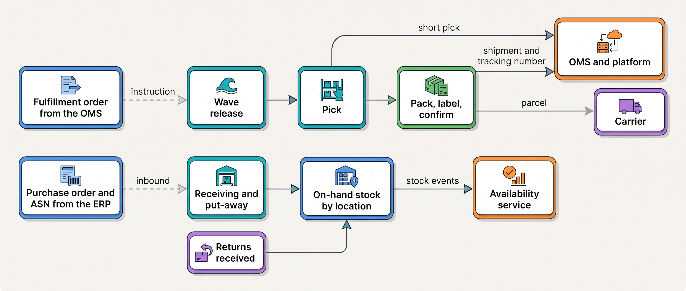
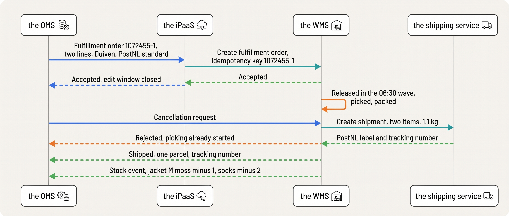
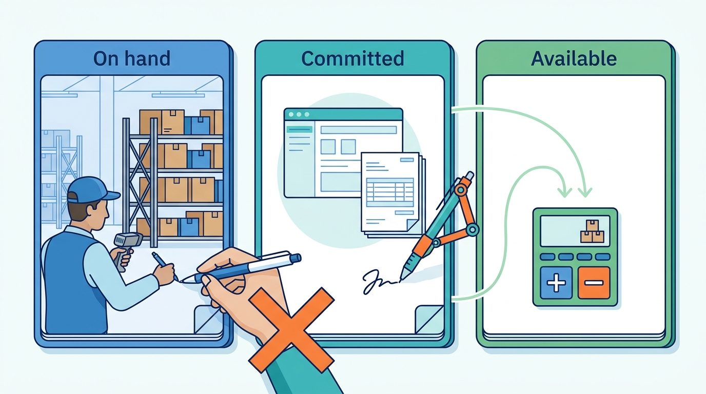
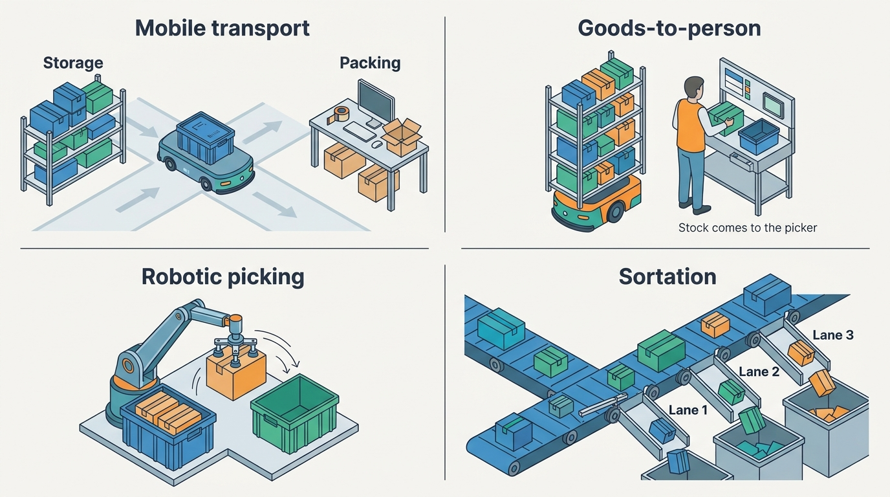
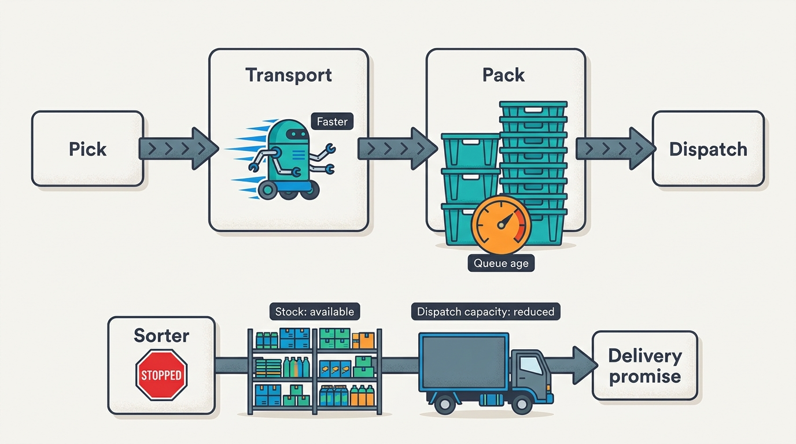
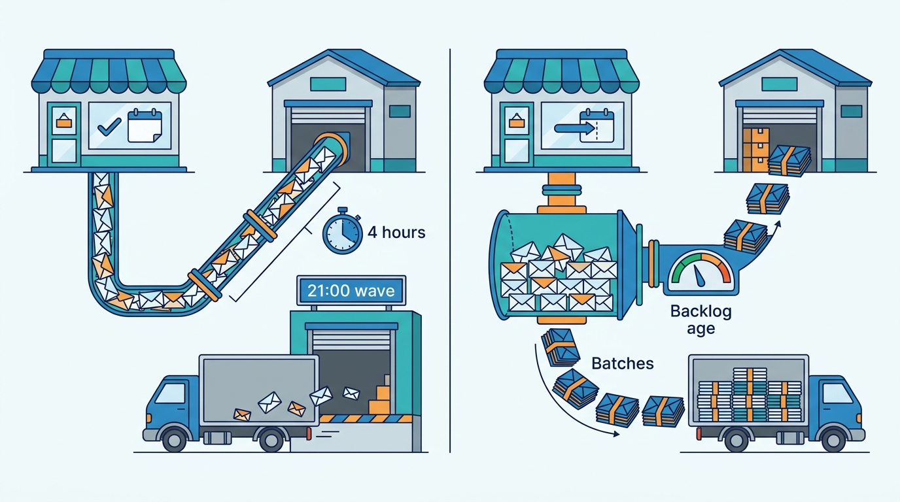

> **IN THIS CHAPTER, YOU WILL:** Follow an order through picking, packing and shipping, see where automation and robotics fit, and learn what the warehouse system must receive, own and report.

> **KEY POINTS:**
>
> * **A fulfillment order tells the warehouse what to ship.** Its lifecycle runs from request through acceptance, work and completion. After acceptance, cancellation needs the warehouse's agreement.
> * **The warehouse system owns the physical stock count.** Other systems use its reported changes to calculate what customers may still buy; they must not overwrite the count.
> * **Delivery promises depend on capacity, cut-off times and how work is released.** Whether the warehouse uses scheduled picking waves or releases work continuously, an order must arrive with enough time and capacity left to make the carrier collection.

> **[FAILURE PATTERNS THIS CHAPTER ADDRESSES](where-commerce-platforms-go-wrong.html):**
>
> * **The First Snowfall** — the order feed into the warehouse is the integration most likely to meet real load for the first time on the busiest evening of the year.
> * **Schrödinger's Order** — when the warehouse's shipment confirmations are lost, or one of them marks a whole split order fulfilled, the shop platform, the warehouse and finance systems each tell a different story about the same order.
> * **The Phantom Stock** — a warehouse that is not the single writer of on-hand stock, or that writes it hours late, lets every channel sell units that are no longer on the shelf.

 
A picker walks to the shelf for a paid order and finds no jacket. The storefront has already confirmed the sale, but the warehouse now needs to investigate, find a replacement unit or report a failed pick. Those steps take people and time, and may push the parcel past its dispatch cutoff. A stock error has become a delivery problem.

A missed order edit can similarly put the wrong size in the box; an unrealistic delivery date can commit work the building cannot finish in time. So the **warehouse management system (WMS)**, which directs picking and packing, must receive a **fulfillment order** it can accept or reject. It is an instruction to ship specific items, carrying only what to ship and a key that identifies it. A retried request with that key creates no second pick list. As the only writer of on-hand stock, the WMS must report what it actually packed, every stock change, and its cut-off, capacity and backlog. Accurate instructions and timely results let the shop make promises the warehouse can keep.

**Where we are in the order's journey.** Eva buys a jacket and socks from Kestrel & Pine, the fictional outdoor brand, at 21:14 on 13 April 2027 and pays through iDEAL, the Dutch bank-transfer method. On 14 April, Duiven's warehouse picks, packs and confirms the shipment, then prints a PostNL label. [[shipping-and-delivery]] follows the parcel onward.

The chapter starts at Duiven with the Black Friday evening on which orders reached the warehouse four hours late. It then describes what a WMS does and sets out what the warehouse receives and reports (the fulfillment order, the stock count, the warehouse's working day and, for wholesale, the pallet label and despatch advice). It compares the four ways to get warehouse software run and how the setup changes as a merchant grows, shows where automation and robots fit beneath the WMS, works Eva's order and the Black Friday evening through the warehouse, and ends with the ways the interface fails. The evidence is Kestrel & Pine's Duiven warehouse and public vendor and standards documentation.

## Setting the Scene: Duiven's Day

Kestrel & Pine opened its **8,500-square-meter Duiven warehouse** near Arnhem in 2023. Operations head Daniel Okafor runs it with 88 staff and a standalone cloud WMS. Before that, a **third-party logistics provider (3PL)** in Tiel stored and shipped online orders using its own warehouse software. Owning the building brought direct control and responsibility for its daily capacity.

Head of Engineering Noor Visser visits Duiven in April 2027 to understand incidents involving the warehouse's integrations. The warehouse releases work in pick waves, batches of orders picked together at set times. Its daily rhythm below is illustrative; company figures come from the fictional scenario introduced in [[meet-kestrel-and-pine]].

| Duiven, a normal working day in April 2027 | Figure |
| --- | --- |
| Parcels shipped (D2C and marketplace orders) | about **1,300** |
| Wholesale shipments (cartons and pallets) | about **35** |
| Units picked | about **7,500** |
| Pick waves released | **06:30, 10:00, 13:00, 16:00, 19:00** and a final wave at **21:00** |
| Carrier collections | PostNL, bpost, DHL and DPD between **18:00 and 22:30** |
| Inbound deliveries from suppliers | 4 to 8 trucks, received against purchase orders |
| Returns received and inspected | about **280** parcels |

Daniel walks Noor through receiving, putting goods away, picking, packing and daily stock counts. Purchase orders arrive from the **enterprise resource planning system (ERP)**, which handles finance, purchasing and item records. The WMS groups work so one picking route can serve several orders.

Then Daniel shows the Black Friday chart. The shop platform stayed up and the warehouse had enough staff, but **orders took four hours to reach the WMS**. An order placed at 20:00 arrived after midnight and missed the 21:00 picking wave. The storefront kept promising next-day delivery for orders before 22:00. The same evening, stock shown in the other channels lagged the warehouse by up to two hours, a separate fault the stock section returns to.

Daniel calls the incident **the Queue That Waited**. The promise ignored the warehouse's actual work queue. Why the feed fell behind is worked through in In Practice, once the warehouse's interfaces are clear. First, Noor needs to establish what information the warehouse must receive and what it must report back.

## What a Warehouse Management System Does

A WMS directs warehouse work and records its results. Each step changes what the building holds or what can ship.

| Step | What it is, in plain words | What it changes |
| --- | --- | --- |
| **Receiving** | Checking an inbound delivery against the purchase order (or the supplier's advance shipping notice) and booking the units in | On-hand stock goes up |
| **Put-away** | Moving received goods to a storage **location** (a shelf, bin or pallet position with its own barcode) | Units get an address |
| **Slotting** | Deciding where each SKU (stock-keeping unit: one sellable variant, the thing you count on a shelf) should live: fast movers near the packing stations, bulky items on the floor | Walking distance per pick |
| **Wave or batch release** | Grouping orders for one picking run, typically by carrier cut-off, channel or zone, so one walk serves many orders | Which orders ship today |
| **Picking** | Taking the required units from storage, checked by scanning or equipment confirmation | Units leave their locations |
| **Packing and cartonization** | Choosing the box (cartonization is the software's choice of box size from the items' dimensions), packing, weighing | A shipment exists |
| **Shipping confirmation** | Printing the carrier label, closing the pick list and reporting the shipment with its tracking number | The order is fulfilled; on-hand goes down |
| **Cycle counting** | Counting a small part of the stock on a rolling schedule instead of one annual full count, correcting the record continuously | Record accuracy |

Picking methods organize travel differently. **Cluster picking** collects several orders in one trip; **batch picking** collects their items together for separation at packing. Odoo documents both alongside waves, and Picqer describes batch pick lists and planned routes. Larger products also release different order types together: Manhattan's Order Streaming coordinates wholesale, retail and direct orders (all n.d., accessed November 2026).

Products also serve different buildings. Infios, formerly Körber Supply Chain Software, describes complexity levels from basic location tracking to highly automated warehouses (n.d., accessed November 2026). Duiven uses locations, waves and scanning, with no automation.

Those steps, and the different buildings products serve, lead to three facts about warehouse work that shape every integration decision in this chapter:

- **Work has a release policy.** Duiven groups orders into waves; other warehouses release work continuously as resources become available. Either way, an order needs enough processing time before the carrier collection.
- **It has capacity.** People, equipment and packing stations can finish only so much work per hour. An order arriving after that capacity is spoken for ships later, whatever the storefront promised.
- **Its facts are physical.** Pickers and counters check the WMS's on-hand number against shelves, and records drift without counting: DeHoratius and Raman found 65% of nearly 370,000 stock records inaccurate across 37 stores of one retailer (*Management Science*, 2008), an old study from before radio tags (RFID) were common, so a reminder to count rather than a rate to assume. That makes the WMS Duiven's **system of record**: the authority when copies disagree, as [[inventory-and-availability]] and Waypoint decision W1 (the WMS is the system of record for Duiven's physical stock) establish.

## How the Warehouse Connects to Everything Else

Seen from outside, a warehouse has four interfaces: instructions in, confirmations out, stock events out, and inbound goods in. The instructions come from whichever system holds the orders: today Kestrel & Pine's shop platform, and from Q4 2027 the **OMS** (order management system: the one place that holds every channel's orders and steers each through fulfillment; [[order-management]]). The figure shows the interfaces around the physical steps. The subsections below take the instruction and the shipment confirmation that answers it first, then the stock the warehouse reports, then its working day, which no interface carries yet, and last the wholesale pallet's label and despatch advice; inbound receipts appear only in the table.

**Figure 1:** *The warehouse has four interfaces: instructions in as fulfillment orders, confirmations and short picks out to the order record, stock events out to the availability service, and inbound goods in against purchase orders and returns.*

Each interface has different requirements for freshness, consistency, speed and availability. The table states them for a merchant of Kestrel & Pine's shape and splits the instruction interface into its two messages, the fulfillment order and the cancellation request. The latencies are assumptions, not vendor facts.

| Flow | How fresh | How consistent | How fast | How available |
| --- | --- | --- | --- | --- |
| Fulfillment order into the WMS | Before the next wave release; at peak, within minutes *(assumption)* | Exactly once; a repeat must not create a second pick list | Must keep pace with the order rate at peak | If the WMS is down, orders queue; nothing is lost |
| Shipment confirmation out | The moment the label prints | One per shipment, carrying the tracking number | Within a minute, so the "shipped" message and the invoice follow *(assumption)* | Queued if the order system is down; replayed in order |
| Stock events out | Each change, not an hourly total | The WMS's count is the truth; consumers derive, never write back | Seconds *(assumption)* | A reconciliation job catches a lost event |
| Cancellation request in | Before picking starts | A request with an answer, not a command | Minutes | If unanswered, the order is still in progress |
| Inbound receipt | Same day as the truck | One receipt per purchase-order line | Hours | Can wait |

### The fulfillment order: the contract between the order world and the warehouse

A **fulfillment order** instructs the warehouse to ship specific order lines from a location, with a destination, service level and handling notes. It excludes the customer's prices, discounts, payment and purchase history. Its **separate lifecycle** is requested, accepted or rejected, in progress, shipped (possibly in several parcels) or closed incomplete.

Shopify documents this contract for third-party warehouses and 3PLs (n.d., accessed November 2026). Each fulfillment service maps to a location. Shopify sends `FULFILLMENT_REQUEST` or `CANCELLATION_REQUEST`; the service accepts or rejects and cannot create a fulfillment record before acceptance. Request states record the answer: `SUBMITTED`, `ACCEPTED` or `REJECTED`, followed when necessary by `CANCELLATION_REQUESTED`, `CANCELLATION_ACCEPTED` or `CANCELLATION_REJECTED`.

Kibo documents a similar acceptance step in its sequence: Accept Shipment, Validate Stock, Ready and Fulfilled, with transfer or reassignment between locations (n.d., accessed November 2026).

Both models put acceptance before the work, for a physical reason: after acceptance, picking or packing may already have started. Changing a storefront status cannot stop physical work; the warehouse must confirm cancellation before support promises the customer that nothing will ship.

The sequence shows the handshake as Waypoint designs it for late 2027, when the OMS sends fulfillment orders, using Eva's order as the example. The messages travel through the iPaaS (integration platform as a service: the hosted tool that runs the flows between systems). Each carries an idempotency key, a reference that lets the receiver recognize a repeated message. The sequence ends with a cancellation request that arrives too late.

**Figure 2:** *The fulfillment-order handshake: the warehouse accepts before anyone may count on it, a cancellation after acceptance is a request the warehouse may refuse, and the shipment confirmation and the stock event travel back as separate messages the moment the label prints.*

This contract prevents four practical problems:

- **Unnecessary data.** Prices and payment details add protection obligations and change for reasons the warehouse does not need to track.
- **Ambiguous splits.** One order can have fulfillment orders for Duiven and a marketplace warehouse; each can ship several parcels. Every instruction must stand alone. [[order-management]] covers splitting decisions.
- **Unconfirmed changes.** Acceptance marks when edits need the warehouse's agreement, giving support a reliable answer about cancellation.
- **Duplicate shipments.** A timeout can cause the same request to arrive twice. **Idempotent** handling recognizes its identity and reuses the existing instruction, preventing a second pick list and jacket.

What comes back is one **shipment confirmation** per parcel, built from what was packed and carrying its tracking number. When a short pick (the shelf holds too few) leaves a line behind, the confirmation reports a partial shipment; it must not mark the whole order fulfilled.

This contract, the instruction and its confirmation, stays the same under Waypoint decision W2: an OMS replaces the shop platform as the sender in Q4 2027 without changing the warehouse's responsibilities.

### Stock: what the warehouse owns and what it reports

Stock has three meanings here. **On hand** is physically in the building. **Committed** is stock claimed by placed orders. **Available** (available-to-promise, ATP) is what a channel may still sell: on hand minus committed and deliberate buffers. [[inventory-and-availability]] develops these concepts; this chapter focuses on the first number.

The rule for every merchant: **one writer per stock state**. The WMS writes on hand, because it is the only system that counts shelves. The order system writes committed, because it is the only system that knows which orders exist. The availability service derives available. Nobody else writes them. Kestrel & Pine shows what happens when the rule is broken. In its "App That Wrote Stock" of March 2026, a pre-order app and the WMS feed both adjusted the platform's inventory; the first reconciliation, run in May 2027 after Noor's visit, found 2.3% of active variants with different quantities in the WMS and the platform.

**Figure 3:** *One writer per stock state: the WMS writes on hand, the order system writes committed, the availability service derives available, and no other hand may write any of the three.*

On hand changes inside the warehouse constantly: a receipt, a pick, a cycle-count correction, a damaged unit moved to quarantine, a return restocked. How the rest of the landscape learns is the architectural question, and two patterns exist.

- **Periodic full sync.** The WMS exports every SKU's on hand on a schedule and consumers overwrite their copy. Shopify's documentation for fulfillment services (n.d., accessed November 2026) describes exactly this: Shopify polls the service's stock endpoint for on hand per SKU hourly. Kestrel & Pine's chain (WMS to ERP, ERP to the shop platform, platform to the marketplace connector) is three of these in series, which is how, on Black Friday evening, a sale took up to two hours to reduce the stock shown elsewhere: the stock lag Daniel's chart also showed, separate from the four-hour order backlog.
- **Stock events.** The WMS emits a message for each change ("SKU X at location Y: minus 1, reason pick, timestamp"). Picqer's API (n.d., accessed November 2026) emits a `products.free_stock_changed` webhook "to support real-time stock updates in a store"; a **webhook** is a call the vendor's system makes to your URL when something happens. Waypoint decision W1 retires the sync chain in favor of this pattern by Q4 2027.

Events are better once order volume makes lag visible, and they are harder: a lost event leaves a stale copy until a **reconciliation** (a job that compares the two systems and lists differences) catches it. [[events-consistency-and-reconciliation]] owns that discipline; the warehouse's part is to emit every change with a reason and to publish a daily full snapshot as the baseline.

### Capacity, cut-off times and work release

Besides its stock, the warehouse owns its **day**. Every promise the platform makes about timing rests on three warehouse facts that rarely appear in any API:

- **The cut-off** is the latest arrival time that leaves enough processing time before carrier collection. At Duiven that means the 21:00 final wave before PostNL's 22:30 collection (illustrative times). The storefront's "ordered before 22:00" line dates from the Tiel 3PL, whose collection was later; nobody updated it in 2023.
- **Capacity** is units or parcels per hour with the available staff and equipment. Queues or downtime can reduce how much more work the building can finish today.
- **The release policy** decides which orders go first: by carrier collection, service level or channel. It may release waves or feed stations continuously; marketplace late-dispatch penalties still affect priority.

These three belong in the data the delivery promise is computed from. Until they are, the promise is a sentence; [[shipping-and-delivery]] is about making it a computation.

### Wholesale fulfillment: pallets, SSCC labels and the despatch advice

A parcel for Eva and a pallet for Bergzicht Outdoor, the wholesale customer that orders by EDI, leave the same building through different processes. Wholesale shipments are picked to cartons and pallets, and a large retail customer expects two things a consumer never sees: a label on each logistics unit and an electronic message announcing what is on it.

The **SSCC** (serial shipping container code) is, in the words of the GS1 General Specifications, Release 26.0 (January 2026), "the GS1 identifier for an individual logistics unit" and "the only GS1 key that SHALL be used as the identifier of a logistic unit": the 18-digit number on the pallet label. The **despatch advice** (DESADV in EDIFACT, the UN message standard most European EDI uses; also called an ASN, advance shipping notice) tells the receiver what is coming, pallet by pallet, so receipt can be scanned instead of counted. [[edi-and-e-invoicing]] owns the messages; this chapter owns where they are generated.

Retailers enforce these rules. bol requires GS1 labels on logistics units since 31 December 2021 and the SSCC in DESADV messages from EDI-connected suppliers (n.d., accessed November 2026). Jumbo's mechanized-warehouse guidelines (2025) require a matching DESADV and SSCC label; deliveries without the message are refused. Its purchasing conditions of 9 April 2026 add €70 per message that fails GS1 standards.

Jumbo's conditions also carry separate delivery-performance penalties: €250 per order below 90% delivered on time and in full on an order line. Both are chargebacks, deductions a retail customer makes from what it pays the supplier, and chargebacks come in two families: delivery performance, a logistics problem, and data and label compliance, an architecture problem.

The architectural consequence is one sentence: **the DESADV must be generated from what the warehouse actually packed, never from the order.** The pallet's SSCC and its contents are known only at pack time, in the WMS. Kestrel & Pine's ASN Chargeback of Q3 2026 (€14,200 deducted by Bergzicht for despatch advices whose SSCC labels did not match what arrived) happened because the DESADV was built from the ERP's view of the order while the WMS packed something slightly different. Waypoint decision W6 moves SSCC generation to the WMS at pack time and sends the DESADV from the WMS confirmation. Bergzicht's spring reorder of April 2027 (240 units across 18 SKUs on three pallets, DESADV at pack confirmation, delivered to Zwolle on 9 April) is the first cycle under the new rule; [[journey-wholesale-order]] follows it end to end.

## The Choices: Who Runs the Warehouse Software

With the contract in place, someone must run the warehouse software. A merchant has four realistic ways to get it run, and most use two at once.

**The ERP's warehouse module.** Mid-market ERPs include receiving, locations, picking and shipping; Odoo's module is the public example. It is one system, one integration and one vendor fewer. It fits one building, modest volume and simple routes; it strains when waves must be planned around carrier cut-offs, when labor needs managing or when the warehouse serves more than one company.

**A dedicated WMS.** Smaller cloud products connect order feeds, stock webhooks and carrier labels; Picqer describes customers shipping about 25 to 5,000+ orders daily. Enterprise products such as Manhattan, Blue Yonder and Infios serve more complex operations, with labor planning, automation and multiple sites (product pages, n.d., accessed November 2026). Choose against the building's workflow and integration requirements; moving between these segments is a substantial project.

**A 3PL.** The provider runs the building on its own WMS, often in a multi-client mode. The merchant integrates with it exactly as with its own WMS: fulfillment orders in, confirmations and stock events out. The difference is who owns the people, the lease and the process. A 3PL is right when volume, geography or season does not justify a building, and wrong when the merchant's process (gift wrapping, kitting, strict brand packaging) is the product.

**A marketplace's fulfillment program.** The seller sends stock to the marketplace in advance; the marketplace stores it, ships orders and handles returns for fees per unit, order and storage period. This delegates warehouse operations while making the seller dependent on that network's rules. Amazon calls these jobs Fulfillment by Amazon (FBA; n.d., accessed November 2026). Zalando Fulfillment Solutions (ZFS) launched in autumn 2017 and served over 100 partner brands by June 2019. Its invoice structure, updated 16 February 2026, charges outbound work per order, storage per item per day and a €0.15 peak surcharge per outbound order from 15 October to 31 January; other amounts are contractual.

In October 2023 Zalando productized the network as **ZEOS** for brands "whether or not they sell on Zalando"; in November 2024 it announced it would fulfill most of NEXT's continental-European orders "through a single shared stock pool and an order management system", and its letter to shareholders of 12 March 2026 reports ZEOS in "24 markets" serving "18 sales channels". That shared pool is the availability problem of [[inventory-and-availability]] run by the provider instead of the merchant.

For the merchant, marketplace-held stock is a **location it can see but not count**: a separate location in the availability model with its own buffer, fed by a purchase-order-like inbound flow. Kestrel & Pine sends about 40% of its German marketplace units to such a program.

| Choice | Fits when | Limits when | What the integration looks like |
| --- | --- | --- | --- |
| ERP warehouse module | One building, simple routes, modest volume | Waves around cut-offs, labor planning, several clients or sites | Orders already in the ERP; stock is the ERP's own table |
| Dedicated WMS, small or mid-sized | Own building, up to a few thousand orders a day | Automation, labor management, multiple sites | Order push by API; stock and shipment webhooks back |
| Dedicated WMS, enterprise | Several sites, automation, wholesale and parcels in one building | Needs its own specialists | Fulfillment-order contract, event streams, EDI from pack confirmation |
| 3PL | No building of your own; seasonal or regional volume; a new country | Brand-specific packing, returns grading, cost at high volume | Same contract as a WMS; the 3PL's portal is not the record |
| Marketplace fulfillment program | Marketplace share is large and its delivery promise sells | Stock you cannot count; fees per order and per day; returns graded by the marketplace | An external location with inbound shipments and stock reports |

The table sets the four side by side: in every row the integration is the same contract, except that marketplace-held stock cannot be counted. My recommendation follows the requirements, not the product. One location and one channel: use what the platform or the ERP gives you. One building, several channels and a carrier schedule to plan around: a dedicated WMS, behind the contract above. Several buildings, or a wholesale flow with SSCC and DESADV obligations: an enterprise WMS or a 3PL that can meet them, behind the same contract. At no stage let the warehouse system become a second order system that holds prices, customer data and status for support. Kestrel & Pine shows where a second order system leads: once several systems held order status, each came to count orders its own way, and its shop platform, its ERP and its warehouse report now use three different definitions of an order.

## Across Scale Stages: When It Fits and When It Limits

Which of these setups fits changes as a merchant grows. The table follows the typical setup, what becomes necessary and the warning signs through the four scale stages.

| Stage | Typical setup | What becomes necessary | Warning signs of outgrowing it |
| --- | --- | --- | --- |
| **1 — Starting** | A back room or a 3PL; the platform prints labels; stock is the platform's own fields | A 3PL with an order feed the day the founders cannot pack everything; tracking numbers back on the order | Orders re-typed into the 3PL's portal; stock counted in a spreadsheet; the first parcel shipped twice after a retry |
| **2 — Growing** | A 3PL's WMS or a small WMS; orders pushed by a connector; stock back by webhook or nightly file | The accept-or-reject handshake; stock events instead of a nightly file; a cut-off the storefront and the warehouse agree on | The 3PL's portal is the only place to see shipment status; next-day promises missed on busy days; the first retail chargeback |
| **3 — Omnichannel** | Own building or a 3PL per region; the WMS as system of record for on hand; an OMS sending fulfillment orders; waves by carrier cut-off and channel; wholesale and parcels in one building; marketplace fulfillment stock as an external location | SSCC and DESADV from pack confirmation; a queue between the order hub and the WMS sized for the peak hour; WMS-to-platform reconciliation; capacity and cut-off exposed to the delivery promise | The order feed backing up at peak; WMS and platform status disagreeing for days; one connector per channel into the WMS; a DESADV built from the order |
| **4 — Group** | A WMS per site, often from different vendors after acquisitions; routing among sites; automation; shared returns | One fulfillment-order contract for every site, whatever its vendor; a network-level view of capacity | Each brand's warehouse integrated its own way; nobody can say how many parcels the network can ship tomorrow |

Software can be bought, rented or outsourced; integration still needs to match operational complexity. Kestrel & Pine bought its WMS in 2023 but kept an early-stage connection: orders pushed one by one, status pulled by the ERP, stock copied hourly. Its warehouse served multiple channels while the integration still assumed a much simpler business.

## Warehouse Automation and Robotics

As a warehouse grows it may add automation, as the Group stage in the table shows, and the same contract then applies one level down, inside the building. When pickers spend much of their shift walking between storage and packing, moving goods automatically can free time for picking. Automation also adds coordination work: someone must decide which movement happens next, confirm that it happened and recover when equipment stops.

The main uses differ. **Mobile transport** moves containers between work areas; an **autonomous mobile robot (AMR)** navigates the warehouse to carry them. **Goods-to-person** brings stock to a stationary picker, reducing walking while leaving the item selection to a person. **Robotic picking** uses a robot to grasp individual items. **Sortation** routes items or parcels to their next station or dispatch lane. Dematic documents [mobile transport and goods-to-person](https://www.dematic.com/en-us/solutions/amr/) separately from [robotic item picking](https://www.dematic.com/en-us/solutions/robotics/) (n.d., accessed November 2026).

**Figure 4:** *Four uses of warehouse automation: mobile transport moves containers, goods-to-person brings stock to a picker who still chooses the item, robotic picking grasps the item itself, and sortation routes items or parcels to their next lane.*

Automated warehouses commonly divide the software responsibilities as follows. The names describe jobs; products can combine them, and a site may need only some of these interfaces.

| Responsibility | What it does |
| --- | --- |
| **Warehouse management system (WMS)** | Owns stock records, locations and warehouse tasks; records confirmed results |
| **Warehouse execution system (WES)** | Releases and sequences work against priorities, queues and available people or equipment |
| **Warehouse control system (WCS)** | Translates work into commands for conveyors, sorters or storage equipment and reports their results |
| **Robot fleet management** | Assigns tasks to individual robots, coordinates their routes and tracks progress |

Dematic's [software overview](https://www.dematic.com/en-us/software/) describes WMS, WES and WCS responsibilities, including continuous work release (n.d., accessed November 2026). SAP's [2023 integration guide](https://help.sap.com/doc/5acdd0d4d7524247a0c9b15b24f0fe3b/LATEST/en-US/379d6d880e5d4007b3751618080da80f_2.pdf) provides a concrete example: warehouse orders become robot tasks sent to fleet management; notifications return to confirm warehouse work.

**Figure 5:** *The software stack in an automated warehouse: the order system talks only to the WMS; work goes down through the WES to the WCS and fleet management, and confirmed results come back up to the WMS, the only layer that updates stock.*

Because work goes down and confirmations come back up, I would keep the order system connected to the WMS through fulfillment orders, the instruction to ship specified above. Inside the warehouse, require an explicit contract for each automated task:

- **Identity and instruction.** Carry a stable task ID, container or item identity, source, destination and required quantity. Repeating the same request must retrieve or continue the same task, never create another movement.
- **Confirmed outcome.** Distinguish accepted, in progress, completed, failed and canceled. Acceptance means the task was received; completion must establish what actually moved. The WMS updates stock records from confirmed outcomes. Moving a container changes its location, not the warehouse's total quantity.
- **Recovery.** A timeout leaves the outcome unknown. Query the existing task; if its result remains uncertain, check what physically happened before retrying. Send failed picks, blocked paths or unavailable destinations to a queue for an operator to resolve. Before manual reassignment, confirm the original task has stopped or been canceled, then check the actual location and quantity. Otherwise a person and a robot may attempt the same work. SAP's guide documents exception queues and physical checks before closing stalled tasks.

Duiven currently uses people, waves and scanners. **Suppose Daniel later adds robots** to carry picked containers to packing. A robot accepts a transfer, loses connectivity and delivers the container anyway. Noor's integration must recover that transfer's result, not issue a fresh transfer because its reply never arrived. The container reaching packing also does not prove that the customer's parcel has shipped.

**Figure 6:** *One automated task, one identity: after a timeout the robot may still have delivered, so the integration queries the same task rather than sending a new movement, and anything still uncertain goes to an exception queue for a physical check.*

Before buying automation, measure where work waits. Faster transport helps only while packing and dispatch can absorb it. Feed queue age, equipment availability and reduced processing capacity into the delivery promise. If a sorter stops, stock can still exist while today's dispatch capacity disappears. Test how work continues when equipment is unavailable.

**Figure 7:** *Measure where work waits before buying automation: faster transport only moves the queue to packing, and a stopped sorter removes today's dispatch capacity while the stock still exists, so both belong in the delivery promise.*

## In Practice

### Kestrel & Pine: Eva's jacket at Duiven, and the Queue That Waited

Back at Duiven, which has no robots, Kestrel & Pine's own orders show its early-stage connection at work, first for one order. Eva's order #1072455 is placed on Tuesday 13 April 2027 at 21:14. In April 2027 the shop platform still sends it to the WMS through the iPaaS; the OMS of Waypoint decision W2 arrives in Q4. The flow creates the order in the WMS at 21:16 (illustrative). The last wave was released at 21:00. The order waits for the 06:30 wave on Wednesday 14 April, is picked with about 180 other orders on one route (illustrative), packed into one box of 1.1 kg with a PostNL label and confirmed at 08:40. The confirmation carries the tracking number; the stock event says jacket M moss minus one and socks minus two. PostNL collects it that evening and delivers on Thursday 15 April. The storefront had promised Wednesday. The warehouse did nothing wrong; the promise was not computed from the warehouse. [[shipping-and-delivery]] starts from that gap.

Black Friday evening, Friday 27 November 2026, is the same gap at scale. In the peak hour, 20:00 to 21:00, the storefront took 2,300 orders, 38 a minute. The iPaaS flow that creates orders in the WMS created them one at a time, with several calls per order, and was throttled by the WMS vendor's rate limit (illustrative mechanism; WMS vendors publish such limits, Picqer's is about 500 requests per minute, n.d., accessed November 2026); it had been falling behind since the early afternoon, and by 21:00 the backlog was four hours long. Orders placed at 20:00 reached the WMS after midnight; the 21:00 wave contained the orders of the early afternoon. Roughly 8,000 orders placed between 17:00 and midnight (assumption) missed next-day delivery while the storefront promised it. The warehouse's staffing that night was never tested.

What would have prevented it is not a faster warehouse. It is a queue between the platform and the WMS that is **allowed to grow** without failing checkout, a flow that creates orders in **batches** within the WMS's rate limit, a monitor on the age of the oldest unprocessed order, and a cut-off that **moves** when that age grows, so the promise on the page tells the truth. All four are on Waypoint's list under decisions W2 and W5; [[peak-load-and-reliability]] and [[journey-peak-day]] work the whole evening.

**Figure 8:** *The Queue That Waited and its cure: on Black Friday 2026 the order feed fell four hours behind while the page still promised next day; a queue allowed to grow, batch creation, a backlog-age monitor and a moving cut-off keep the promise honest.*

## When It Goes Wrong

Beyond the Black Friday queue, the warehouse interface fails in a small number of other recognizable ways. Each has a detection and a recovery.

**Duplicate fulfillment orders.** A retry after a timeout delivers the same instruction twice and the WMS creates two pick lists; the customer receives two jackets. Detection: a fulfillment-order identity on every message and a daily check for two WMS orders with the same identity. Recovery: idempotent creation in the WMS (same key, same order) and an alert rather than a second pick list.

**The cancellation that arrived after the pick.** Support cancels the order in the shop platform; the parcel ships anyway because the WMS had already accepted it. Detection: the cancellation must be a request with an answer, and the platform must show the answer. Recovery: the order stays in progress, support tells the customer, and the item comes back through [[returns-and-exchanges]].

**The lost or collapsed shipment confirmation.** The parcel left but the confirmation was lost, so the shop platform still says "unfulfilled" and the ERP never invoices. The opposite fault is just as damaging. In Kestrel & Pine's Three-Status Order (#1052877, December 2026) the fleece shipped before the socks, and the iPaaS flow, which had no notion of a partial shipment, marked the whole order fulfilled on that first confirmation. The shop platform showed *Delivered*, the WMS *In picking* while the socks waited, and the ERP, which invoiced only on "order complete", *Not invoiced* for six days. Detection: a daily reconciliation of shipped-in-WMS against fulfilled-in-platform, per shipment. Recovery: replay the confirmation from the WMS, one per shipment; never re-key it by hand.

**The short pick.** A common cause of a partial shipment: the record said one; the shelf has none. Detection: the WMS records a short pick against the fulfillment order. Recovery: the WMS tries another location; if none, it reports a partial shipment or closes the fulfillment order as incomplete, and the order system decides (ship the rest, wait, or cancel the line and refund). A short-pick rate per SKU tells you where to cycle count.

**Stock events out of order or missing.** A pick event arrives before its receipt event, or not at all, and the available figure is wrong until the next snapshot. Detection: sequence numbers on events, and a scheduled reconciliation such as Kestrel & Pine's May 2027 run (2.3% of active variants differing). Recovery: apply the daily snapshot as the baseline and replay events since.

**SKU mismatch.** The shop platform's variant identifier and the WMS's differ by a suffix, a case or a leading zero (Shopify warns that SKU strings are case-sensitive, n.d., accessed November 2026); the fulfillment order is rejected or maps to the wrong product. Detection: rejects per SKU and a daily comparison of the two catalogs. Recovery: one identifier family owned by the product system ([[product-information]]), published to both.

**The WMS outage.** The cloud WMS is unavailable for an hour on a peak evening. Detection: the age of the oldest queued order. Recovery: the Black Friday remedies above; queue, do not fail checkout; when the WMS returns, release in batches within its rate limit; move the cut-off while the backlog would make new orders miss the last wave.

## What to Take Away

The picker who found no jacket, Eva's Wednesday promise and the Black Friday queue look like three different faults: a stock error, a sentence on the storefront and a slow integration. Each is a promise made from a copy or a sentence instead of from the warehouse's own facts. The same contract answers all three: a fulfillment order with a key and an answer, one writer of on-hand stock, confirmations built from what was packed, and a cut-off read from the queue. That is what a merchant should write down before it buys a WMS, a 3PL or robots; Kestrel & Pine's Black Friday remedy was a queue, batches, a monitor and a moving cut-off, not a faster warehouse.

**Established.**

- Warehouses have finite capacity and carrier deadlines. Work can be released in waves or continuously; automation changes execution, not the need to confirm physical results (Odoo, Dematic, n.d., accessed November 2026; SAP, 2023).
- Shopify and Kibo document an acceptance step between order management and fulfillment. After acceptance, cancellation requires a response from the warehouse.
- Stock records drift from the shelf without counting (the classic 2008 study found 65% of records inaccurate in one retailer's stores); cycle counting is the standard remedy.
- Large retail customers require SSCC-labeled logistics units announced by a matching DESADV (GS1 General Specifications 26.0; bol since 31 December 2021; Jumbo 2025–2026), with refusal or fees when they do not match.

**Depends on context.**

- An ERP module may serve a simple building. Consider a dedicated WMS when labor planning, automation or several channels exceed its capabilities.
- Outsourcing can suit seasonal or regional volume. Brand-specific packing and returns grading need explicit agreement; marketplace stock remains a location the merchant cannot count.
- Periodic stock sync works while its lag is shorter than the time in which popular stock sells out. Faster sales need timely events and reconciliation.
- Retail customers requiring DESADV need it generated from actual packing; consumer-only merchants do not face that requirement.

**The author's synthesis.**

- Keep fulfillment instructions and confirmed results stable when changing warehouse vendors or adding robots. The WMS remains the authority for physical stock.
- Compute delivery promises from remaining capacity, queues and carrier deadlines. A published cut-off alone cannot account for a stalled order feed or failed equipment.

## Questions to Ask

1. What exactly is sent to the warehouse per order, and does it carry anything the warehouse does not need?
2. Is there an accept-or-reject step before the warehouse counts on an order, and what happens to a cancellation after acceptance?
3. If a pick or robot-movement request times out, how do you discover its outcome before retrying?
4. Which system writes on-hand stock, and can anything else (an app, a script, the ERP) also write it?
5. How does the rest of the landscape learn of a stock change, and how long is the lag at peak?
6. When was the last reconciliation between the warehouse's stock and the platform's, and what share of SKUs differed?
7. Does the storefront's cut-off reflect work release, queue age and reduced capacity when equipment stops?
8. How many orders per minute can the order feed into the warehouse sustain, and what happens to checkout when it cannot keep up?
9. For wholesale customers with EDI: which system generates the SSCC label and the DESADV, and from what?
10. If the warehouse system is unavailable for an hour on the busiest evening, what do customers see?

Once Eva's parcel is packed and confirmed at Duiven, the carrier takes over. [[shipping-and-delivery]] follows carrier selection, labels and tracking, and computes the date shown at checkout from the warehouse's cut-off, capacity and backlog that the storefront's sentence ignored.

## Sources and Evidence

*Company, product and investor sources*

- [Build for fulfillment services](https://shopify.dev/docs/apps/build/orders-fulfillment/fulfillment-service-apps/build-for-fulfillment-services), Shopify developer documentation, n.d., accessed 2026-11 — the fulfillment request, accept, reject and cancellation-request handshake; hourly stock polling; case-sensitive SKUs.
- [FulfillmentOrder object](https://shopify.dev/docs/api/admin-graphql/latest/objects/FulfillmentOrder) and [Order management apps](https://shopify.dev/docs/apps/build/orders-fulfillment/order-management-apps), Shopify, n.d., accessed 2026-11 — fulfillment-order definition, statuses and request statuses; cancellation after acceptance as a request.
- [Fulfillment concept guide](https://docs.kibocommerce.com/concept-guides/fulfillment) and [Order routing](https://docs.kibocommerce.com/help/order-routing), Kibo Commerce documentation, n.d., accessed 2026-11 — shipment states, reassignment between locations, routing kept apart from execution.
- [Picqer product page](https://picqer.com/en) and [Picqer API](https://picqer.com/en/api), Picqer, n.d., accessed 2026-11 — batch pick lists, labels and tracking back in one step, 25 to 5,000+ orders per day, `picklists.closed` and stock-change webhooks, ~500 requests per minute.
- [Odoo Inventory](https://www.odoo.com/app/inventory), Odoo, n.d., accessed 2026-11 — wave, cluster and batch picking, cycle counts, barcode scanning in an ERP's warehouse module.
- [Manhattan Active Warehouse Management](https://www.manh.com/products/warehouse-management), Manhattan Associates, n.d., accessed 2026-11 — order streaming across wholesale, retail and direct orders; wave rebalancing.
- [Warehouse Management Systems](https://www.infios.com/en/supply-chain-solutions/warehouse-management-systems), Infios (formerly Körber Supply Chain Software), n.d., accessed 2026-11 — receiving to shipping scope, Gartner complexity levels 2 to 5, customer count.
- [Warehouse Management](https://blueyonder.com/solutions/warehouse-management), Blue Yonder, n.d., accessed 2026-11 — enterprise warehouse software and labor planning.
- [Software overview](https://www.dematic.com/en-us/software/), Dematic, n.d., accessed 2026-11 — WMS, WES and WCS responsibilities; continuous work release and equipment control.
- [Autonomous Mobile Robots](https://www.dematic.com/en-us/solutions/amr/), Dematic, n.d., accessed 2026-11 — mobile transport, goods-to-person and container movement.
- [Robotic Picking Systems](https://www.dematic.com/en-us/solutions/robotics/), Dematic, n.d., accessed 2026-11 — individual-item picking with robotic arms.
- [End-User Information for Integration via Fleet Management Systems](https://help.sap.com/doc/5acdd0d4d7524247a0c9b15b24f0fe3b/LATEST/en-US/379d6d880e5d4007b3751618080da80f_2.pdf), SAP Warehouse Robotics, 2023-12-20 — task dispatch, confirmations, exception queues and physical checks before closing stalled tasks.
- [Fulfillment by Amazon](https://sell.amazon.com/fulfillment-by-amazon), Amazon, n.d., accessed 2026-11 — what FBA does and its fee structure.
- [Zalando Fulfillment Solutions reaches milestone](https://www.marketscreener.com/ZALANDO-18100088/news/Zalando-Fulfillment-Solutions-Reaches-Triumphant-Milestone-28814751/), Zalando release via MarketScreener, 2019 — ZFS launch in autumn 2017 and 100+ partner brands by June 2019 (older source).
- [ZFS invoice structure](https://partner.zalando.com/university/article/zfs-invoice-structure), Zalando Partner University, updated 2026-02-16 — fee categories including per-order outbound, per-item-per-day storage and the peak surcharge.
- [Productizing Zalando's capabilities: introducing ZEOS](https://corporate.zalando.com/en/technology/productizing-zalandos-capabilities-introducing-zeos), Zalando SE, 2023 — ZEOS as fulfillment for any channel from 12 warehouses.
- [ZEOS becomes fulfilment partner of NEXT in continental Europe](https://corporate.zalando.com/en/convenience/zeos-becomes-fulfilment-partner-choice-british-fashion-retailer-next-continental-europe), Zalando SE, 2024 — the single shared stock pool and order management system.
- [Letter to shareholders 2025](https://corporate.zalando.com/en/investor-relations/letter-to-shareholders-2025), Zalando SE, 2026 — ZEOS in 24 markets and 18 sales channels.
- [SSCC for EDI suppliers](https://leveranciers.bol.com/en/need-help/delivery/sscc-edi-suppliers/), bol, n.d., accessed 2026-11 — GS1 labels on all logistic units since 31 December 2021; SSCC in the DESADV.
- [Guidelines for the mechanised DC](https://www.jumbo.com/dam/leveranciers/JUMBO5735-HAND%20OUT-RICHTLIJNEN-GEMECHANISEERD-DC-NL-S2.1.doc.pdf), Jumbo, version 2025-10 — DESADV required at pallet level; refusal without DESADV or GS1 barcode.
- [General purchasing conditions](https://jumbo.com/dam/service/leverancier/jumbo-algemene-voorwaarden-2026-04-09.pdf), Jumbo, 2026-04-09 — €70 per non-compliant message; refusal rights; delivery-performance penalties.

*Standards, regulation and official documentation*

- [GS1 General Specifications, Release 26.0](https://ref.gs1.org/standards/genspecs/), GS1, 2026-01 — definitions of GTIN, GLN and SSCC; the SSCC as the only identifier of a logistics unit.

*Research and practitioner sources*

- [Inventory Record Inaccuracy: An Empirical Analysis](https://econpapers.repec.org/RePEc:inm:ormnsc:v:54:y:2008:i:4:p:627-641), DeHoratius and Raman, *Management Science* 54(4), 2008 — 65% of 370,000 records inaccurate in one retailer's stores (older source; pre-RFID).

Kestrel & Pine is fictional; architectural recommendations, labeled inferences and labeled assumptions are the author's judgement.
