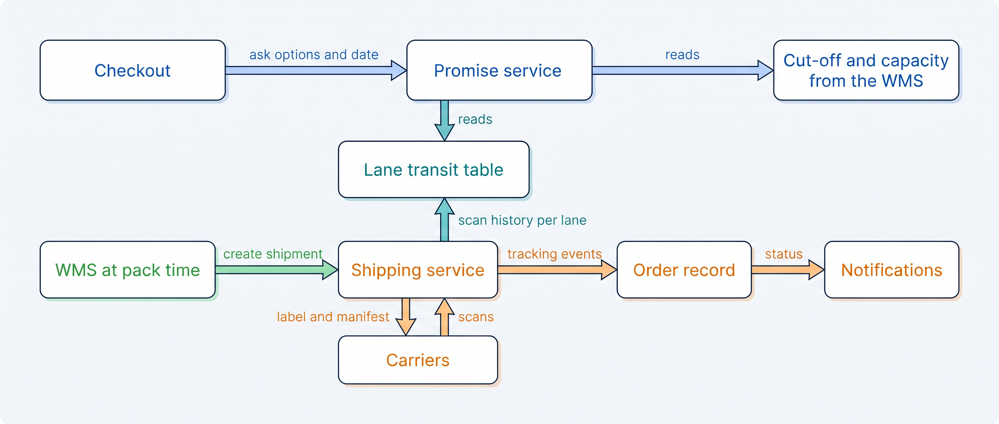
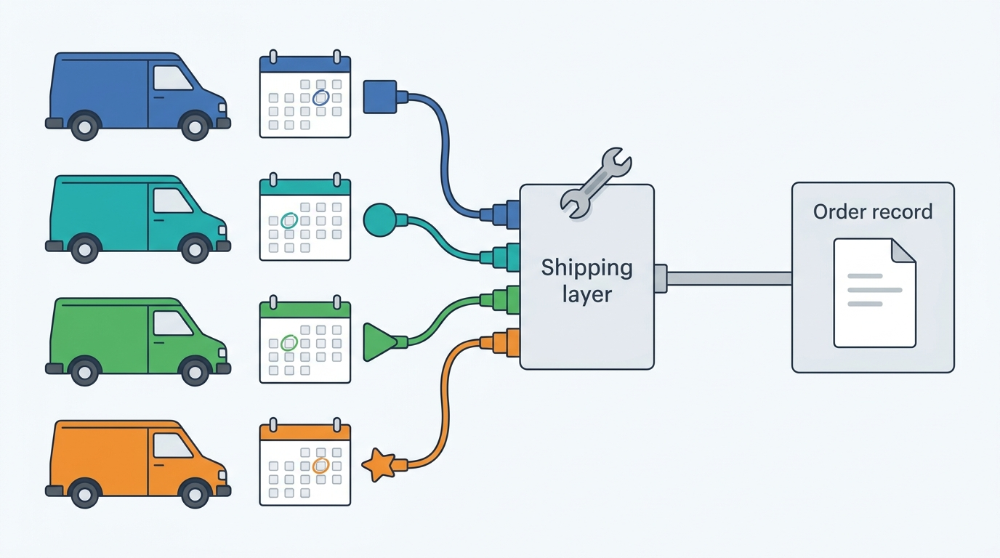
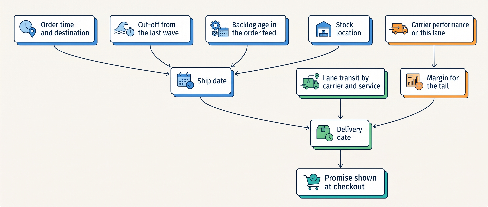
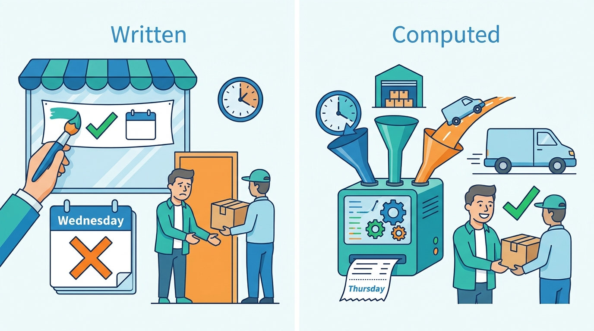

> **IN THIS CHAPTER, YOU WILL:** Learn how a parcel gets a carrier, a label and a tracking history, and what data a delivery promise needs before you may show it at checkout.

> **KEY POINTS:**
>
> * **Carriers are many, and each speaks its own language.** Every carrier has its own API generation, label format, manifest rule (the daily list of parcels handed over) and status codes, and each migrates on its own calendar; a normalizing layer (one service that speaks every carrier's interface), bought or built, is what keeps carrier change out of the order record.
> * **A tracking event is a fact about a parcel; the order's status is derived from it.** Map every carrier's scans onto one small vocabulary, let the order status page and notifications read from that vocabulary, and measure carrier performance per lane (origin, destination area and service) from the same events.
> * **A delivery promise is a computation, not a sentence.** It needs the stock location, the warehouse's cut-off and capacity, the carrier's transit time for the lane and a margin for the tail; a promise written into the page is kept by luck and broken without anyone noticing.

> **[FAILURE PATTERNS THIS CHAPTER ADDRESSES](where-commerce-platforms-go-wrong.html):**
>
> * **The Pulled Rug** — carriers retire API versions, rename products and change manifest rules on published dates; a label integration that nobody watches breaks on the morning the old version is switched off.
> * **The Message in a Bottle** — a tracking number that does not reach the order record, or a scan that arrives twice, leaves the customer without a "shipped" message or with two.
> * **The First Snowfall** — a static promise is right on an ordinary Tuesday and wrong on the one evening a year when the queue to the warehouse is four hours long.

 
A shopper sees 'delivered tomorrow' after the warehouse's last dispatch has left. Even a carrier that delivers every parcel on time cannot keep that promise. The date shown at checkout must account for the work before collection as well as the journey afterward: warehouse capacity, collection cutoffs, carrier services and sometimes customs. A fixed sentence in a storefront cannot adjust when those conditions change.

Kestrel & Pine, the fictional outdoor brand, uses PostNL in the Netherlands, bpost in Belgium, DHL in Germany and DPD as backup. Each has different labels, interfaces, collection rules and tracking terms. Putting those differences behind a shared shipping interface lets checkout request a delivery option and support read a consistent status without each maintaining its own carrier rules. Kestrel & Pine already books its parcels through a multi-carrier shipping service in the warehouse system's flow; for any merchant, the choice is who builds and operates that interface.

**Where we are in the order's journey.** [[warehouse-and-fulfillment]] packed Eva's jacket and socks at Duiven and confirmed the shipment at 08:40 on 14 April 2027; it also showed that the storefront's promise ignores the warehouse's cut-off, capacity and backlog. Now the carrier takes over: PostNL collects the parcel that evening and delivers it on 15 April. This chapter follows the label and the tracking messages, then asks whether checkout could have promised that date accurately.

This chapter's answer has two parts. From the second carrier onward, a merchant connects through one normalizing layer, bought or built: a service that speaks every carrier's interface so the merchant's own systems speak only one. The layer books each parcel once under the merchant's own reference, closes each day's manifest (the list of parcels handed to the carrier) so the carrier knows the parcel exists, and maps every carrier's scans onto one small set of events from which the order's shipping status is derived. The delivery promise, in turn, is computed from the warehouse's cut-off and backlog, where the stock is, the carrier's measured transit time for the lane (one origin, destination area and service) and a margin for late parcels, and it is checked against the dates parcels were actually delivered.

The chapter starts from a request to show delivery dates on two more storefronts and defines the shipping vocabulary. It then follows the three moments at which shipping touches an order: the label and the manifest at packing, the tracking events after collection, and the promise at checkout, with delivery options, cross-border shipping and cost. It compares four ways to talk to carriers and four ways to make the promise, and how they change with scale. It ends with public evidence, Eva's parcel followed from label to doorstep, and the ways shipping goes wrong. The evidence is Kestrel & Pine's carriers and storefront text, carrier and vendor documentation, and published research on delivery promises.

## Setting the Scene: A Sentence in the Theme

In April 2027, Ecommerce Manager Milan Petrov asks Head of Engineering Noor Visser to add delivery dates to the German and Belgian storefronts. The Dutch one already says "ordered before 22:00, delivered tomorrow".

Operations head Daniel Okafor points out the problem. Carriers collect at different times and transit times vary by destination. Even the Dutch promise ignores Duiven's last picking wave at 21:00. Those timings are illustrative, as described in [[warehouse-and-fulfillment]].

**Nothing computes the promise.** It is text written when an outside logistics provider in Tiel handled fulfillment. The web agency that maintains the storefront theme can change the words in an hour; nobody can say how often they are true.

Eva ordered at 21:14 on 13 April, was promised Wednesday and received her parcel Thursday. During Black Friday 2026, the same promise stayed visible while orders waited four hours to reach the warehouse.

Both failures matter beyond the Dutch storefront. Waypoint, the company's improvement program, already requires availability and delivery dates through APIs in decision W8. A service agent, marketplace or future shopping agent needs the same computed answer as the storefront. Milan's request exposes that shared need.

## The Vocabulary of Getting It There

Shipping has a small vocabulary a newcomer needs once.

| Term | In plain words |
| --- | --- |
| **Carrier** | The company that moves the parcel: PostNL, bpost, DHL, DPD. Each sells several **services** (standard, next-day, evening, pickup point, signature). |
| **Carrier API** | The carrier's interface for creating a shipment, getting a label, closing the day and reading tracking. |
| **Label** | The sheet on the parcel with the carrier's barcode and routing data; the barcode is the parcel's identity in the carrier's network. |
| **Manifest** | Closing the day: handing the carrier the list of parcels it is collecting. DHL's Parcel DE Shipping API states that "shipments are transferred to DHL backend systems only when manifested", with an automatic close-out at 17:45 by default (API reference updated 3 November 2026). |
| **Tracking event** | One scan with a time and place: accepted, at depot, out for delivery, delivered, attempted, exception. |
| **Pickup point, locker** | A delivery address that is not the customer's home: a shop counter, a parcel locker (DHL calls its lockers Packstations and addresses them by a `lockerID`). |
| **Delivery option** | What the customer chooses at checkout: home, pickup point, locker, a time window, a date. |
| **Cut-off** | The latest order time that still ships today, set by the warehouse's last wave and the carrier's collection ([[warehouse-and-fulfillment]]). |
| **Lead time, transit time** | Days from order to shipment (handling) and from collection to delivery (transit), per lane: an origin, a destination area and a service. |
| **Delivery promise, estimated delivery date (EDD)** | The date or window shown before purchase; the EDD is the same thing computed rather than written. |
| **Rate shopping** | Choosing the cheapest or fastest carrier service for each parcel, given its size, weight, destination and the promise made. |
| **Multi-carrier platform** | A service that sits between the merchant and many carriers: one API for labels and tracking, one event vocabulary, often one contract. |

## How the Pieces Fit Together

Shipping touches three moments of the order: the label at packing, the tracking after collection, and the promise at checkout, which is shown first but reads what the other two produce. The figure shows the systems around them.

**Figure 1:** *Three moments, one shipping layer: the promise reads the warehouse's cut-off and the lane table (transit time per lane) before checkout, the WMS creates the shipment through the shipping service at pack time, and the carriers' scans come back through the same service as normalized events that drive status, notifications and, over time, the lane table itself.*

The requirements differ by moment. The latencies below are assumptions for a merchant of Kestrel & Pine's shape, not vendor figures.

| Flow | How fresh | How consistent | How fast | How available |
| --- | --- | --- | --- | --- |
| Delivery options and date at checkout | Reflects today's cut-off and the current backlog *(assumption: minutes)* | Same answer for the same address and basket within a session | Under a few hundred milliseconds; checkout waits for it *(assumption)* | Must degrade to a safe default ("2–3 working days") rather than block checkout |
| Pickup point search | Carrier's list, cached hours | Points that exist and are open | Sub-second | Degrade to home delivery |
| Label creation at pack | Immediate | Exactly one label per parcel; a retry must not create a second shipment | Seconds per parcel; the packing station waits | If a carrier's API is down, fall back to the backup carrier or queue the parcel |
| Manifest | Before the carrier's close-out | Every labeled parcel on exactly one manifest | Minutes | Missing the close-out means the carrier does not know the parcels exist |
| Tracking events in | Within minutes of the scan | Events idempotent by carrier, barcode and event id; order preserved | Minutes | Late is fine; lost must be caught by polling or reconciliation |
| Tracking number to the order | At label print | One per parcel, linked to the fulfillment order | Within a minute, so every later message can carry it | Queued and replayed |

### Labels and manifests: the carrier's side of the contract

Creating a shipment is a transaction with the carrier: it returns a barcode and a label, and from that moment the carrier expects the parcel. Three details decide whether the integration is reliable.

- **Idempotency** (a retried call must have the same effect as the first). A timeout after the carrier created the shipment, followed by a retry, yields two barcodes for one parcel; one of them will be manifested and never collected, and the customer may receive two tracking numbers. The shipment call must carry the merchant's shipment reference and the integration must look up before it creates.
- **Manifesting.** A label is not a booking. DHL's rule in the vocabulary table is explicit; PostNL's current "Warehouse V4" API family includes a separate Confirming step (developer portal, n.d., accessed November 2026). A packing flow that prints labels but misses the close-out produces parcels that leave the building with no record in the carrier's network.
- **Version drift.** PostNL's developer portal says that "in 2025, we started rolling out the renewed APIs in phases", with Shipment V4, Return V4, Checkout V4 and Warehouse V4 next to the "legacy" Send & Track and Checkout APIs. DHL's Parcel DE Shipping API is at version 2.2.0 (8 October 2026), replaced the Warenpost product with "DHL Kleinpaket (from 1.1.2025)", and scheduled a TLS certificate change for 2–4 November 2026. bpost's Shipping Manager API "moved from v3 to v5" on 17 April 2023. Four carriers, four calendars; a merchant that integrates directly owns four migrations.

**Figure 2:** *Four carriers retire API versions on four calendars; a normalizing shipping layer absorbs each migration so the order record never notices.*

### Tracking events: one vocabulary for many carriers

A merchant needs a consistent meaning for 'in transit' or 'delivered' across carriers, so customers and support can interpret every shipment the same way. Map each carrier's codes into a shared vocabulary while retaining the original event for investigation. DHL's Shipment Tracking Unified API says codes vary by service and unrecognized values should be treated as undefined (launched 1 October 2018, changelog through September 2026). DPD Belgium, by contrast, describes its tracking as notifications when parcels reach and leave the depot (n.d., accessed November 2026). These are different inputs to the same customer-facing status. Nor can the merchant simply ask: DHL's tracking API gives initial access of 250 calls per day, one every 5 seconds, which rules out polling as the primary tracking source at any real volume. Events have to arrive as webhooks (calls the carrier's system makes to the merchant's URL when something happens), with polling kept as a fallback.

EasyPost's tracker object (n.d., accessed November 2026) is a reasonable public model: ten statuses, `unknown`, `pre_transit`, `in_transit`, `out_for_delivery`, `delivered`, `available_for_pickup`, `return_to_sender`, `failure`, `cancelled` and `error`, with a scan history of status, message, time and location, and webhooks on each update. Shopify's order status page (n.d., accessed November 2026) shows that the customer needs even fewer: "Confirmed, On its way, Out for delivery, Delivered, and Attempted delivery", and only for supported carriers, because "if you fulfill an order without a tracking number, then no shipping updates are received". The table below is a merchant's own list adapted from EasyPost's: it keeps the parcel states, drops `unknown`, `cancelled` and `error`, treats an attempted delivery as a `failure`, and adds `exception` for parcels that are lost, damaged or held at customs.

| Normalized event | What it means | Who consumes it |
| --- | --- | --- |
| `pre_transit` | Label created; the carrier has not scanned the parcel | Nobody yet; a parcel stuck here for a day is a missed manifest |
| `in_transit` | Scanned into the carrier's network, moving between depots | Status page: "On its way"; notification: shipped |
| `out_for_delivery` | On the van | Status page and notification |
| `delivered` | Handed over or left as instructed | Status page; the 14-day return clock of [[returns-and-exchanges]] starts |
| `available_for_pickup` | At the pickup point or locker | Notification with the location and the holding period |
| `failure`, attempted | Not delivered: absent, refused, address problem | Service queue; second attempt or re-route |
| `return_to_sender` | Coming back without a return request | Warehouse receiving; refund or re-ship decision |
| `exception` | Lost, damaged, customs hold | Service and claims |

Two rules follow. **The order's shipping status is derived from these events**, never set by hand, and the status page, the notifications and the service agent read the same derived status ([[customer-service-and-notifications]]). The "shipped" message therefore belongs on `in_transit`, the carrier's first scan, not on the label the warehouse reports: a label is not a booking until the parcel is manifested, and only the scan shows that the carrier has it. Kestrel & Pine adopts this rule after Eva's order. And **every event is stored with its lane**, because the scan history is the only data that will ever tell you how long PostNL really takes from Duiven to Nijmegen on a Wednesday in April.

### The delivery promise: from sentence to computation

That scan history is half of what a computed promise needs. A static promise is a business rule with no data behind it. A computed one is an estimate with inputs, and the rest of this section explains those inputs.

**Figure 3:** *A computed promise: the ship date comes from the order time, the warehouse's cut-off, the backlog in the order feed and where the stock is; the delivery date adds the carrier's transit for the lane and a margin set by how that lane has actually performed.*

In words, for Eva on Tuesday 13 April at 21:14: the stock is at Duiven; the last wave was 21:00, so the ship date is Wednesday; PostNL's standard service from Duiven to Nijmegen takes one day on that lane; the margin is small because the lane has been reliable; the promise is **Thursday 15 April**. That is the day the parcel arrived. The static sentence said Wednesday. A computed promise would have been honest, and it would have known at 20:00 on Black Friday that the ship date had already slipped by at least a day.

The public evidence shows that even the best-resourced operators treat the promise as a model with a measured effect. Amazon's SPEEDY paper (ACM SIGSPATIAL, 2025) learns from "multiple heterogeneous views of order-to-delivery data" to recommend "dynamic, faster same-day delivery time slots", predicting narrower slots for "60%+ eligible orders" in its test locale, and reports a 21-day online A/B test with +17 basis points (0.17 percentage points) in units for the treatment group: a real, small, measured gain from a sharper promise.

A 2025 arXiv paper by Ye, Hijazi and Van Hentenryck forecasts order fulfillment time as a distribution rather than a point, with "spatiotemporal features tied to fulfillment location and carrier performance", because "traditional rule-based approaches often fail to capture the inherent uncertainties in delivery operations"; on an industrial dataset it reports "up to 14% higher accuracy and up to 75% better identification of late deliveries" than the rule-based system.

The point for a newcomer is not the models. It is that **the promise has a tail**, and a point estimate hides it; the margin in the figure is where the tail lives. However wide the tail, consumer law sets the outer bound: Directive 2011/83/EU (2011), Article 18, requires delivery "without undue delay, but not later than 30 days from the conclusion of the contract" unless otherwise agreed.

Showing a date, tail and all, is worth measuring. Vendor case studies claim that showing an estimated date lifts conversion by around 10–20% (Maude via Wonderment, Natch via Hive, 2024–2026); they are vendor-reported A/B tests without peer review, so read them as "the effect is positive and worth measuring", not as a number to plan on.

### Delivery options, cross-border and the cost lever

Three things change the label and the promise just described: the delivery option, a border, and cost. **Options at checkout.** Pickup points and lockers are a second delivery network with its own lookup, so checkout must find eligible locations as well as quote a price and date: PostNL's Checkout V4 bundles Locations and TimeFrame APIs so a shop can "add delivery options to your checkout"; multi-carrier platforms aggregate them (Sendcloud lists "390K+" service points and nShift "1.2 million pick-up and drop-off points", both n.d., accessed November 2026, both marketing counts). The option chosen must be stored on the order, because it changes the label (the warehouse addresses the parcel to the selected location), the promise, the notifications and, under Article 13(2) of Directive 2011/83/EU, the refund: a merchant need not reimburse the extra cost of a delivery "other than the least expensive type of standard delivery".

**Cross-border.** Kestrel & Pine ships only within the EU, so no customs applies. The moment a merchant ships outside the customs union, three things appear: an import declaration (since 1 July 2021, "required for all goods entering the EU, regardless of their value", with a reduced data set for consignments up to €150, per the European Commission's customs pages, n.d., accessed November 2026), the **IOSS** (Import One-Stop Shop: the scheme that lets a seller charge destination-country VAT at checkout on imported consignments up to €150 and remit it monthly, so the parcel is not stopped for VAT at the border; a 2026 Council document proposes deleting the €150 threshold, so check its status), and customs data per SKU (stock-keeping unit: one sellable variant): a commodity code and a country of origin, which are catalog attributes ([[product-information]]). DHL's Parcel DE API added paperless customs documents to production on 3 November 2026. Cross-border makes the label call depend on catalog data quality; [[tax-invoicing-and-ledger]] owns the VAT.

**Cost.** Shipping is a business lever as much as a logistics fact. Kestrel & Pine's D2C average order is €92 and shipping is free above €75, so most parcels carry a cost the margin absorbs; assume €4.50 to €6.00 per domestic parcel for a merchant of this size (assumption; carrier contracts are confidential). Rate shopping across carriers and services, right-sized boxes from the WMS's cartonization (choosing the smallest box that fits), and steering customers to pickup points (cheaper for most carriers) are the three levers the architecture can offer; the shop platform's checkout must be able to price options differently and the shipping service must be able to choose per parcel.

## The Choices

### Who talks to the carriers

The requirements table of the three moments can be met by four arrangements of who talks to the carriers. **Direct integration per carrier.** The merchant's WMS or shipping module calls each carrier's API. It gives the best access to carrier-specific features and negotiated rates; it costs one integration per carrier per country, each with its own migration calendar, label format and status codes. It fits a merchant with volume commitments to two or three carriers and an engineer who owns the integrations; it limits a merchant with a small team the first time two carriers migrate in the same quarter.

**A multi-carrier platform.** This service provides one interface for labels and tracking across several carriers, sometimes with negotiated shipping contracts. It absorbs carrier-specific changes, but may omit services in a merchant's own contract and adds a dependency between the packing station and collection. Sendcloud, nShift and ShipStation are examples. Sendcloud claimed over 30,000 European businesses and 170 carriers on 6 November 2026, while its developer site said 160; nShift claimed over 1,000 carrier services and 450 platforms (n.d.). These marketing counts describe different units. Check the actual services you need, rather than comparing the totals.

**Through the WMS or the 3PL.** Most WMS products and every 3PL bundle carrier integration; Picqer, a cloud WMS, sends "carrier labels and tracking codes" back to the store in one step. The merchant integrates nothing and sees only tracking numbers. It fits Starting and Growing merchants completely; it limits a merchant who wants to offer delivery options at checkout that the WMS cannot price, or who wants the scan history for its own promise.

**Through the shop platform.** Hosted shop platforms sell labels and tracking in their admin for the markets they cover. Simplest of all for a single-country merchant; limited the moment a warehouse system owns the packing station.

| Choice | Fits when | Limits when | Who absorbs carrier change |
| --- | --- | --- | --- |
| Direct per carrier | Volume contracts, carrier-specific services, an owner for each integration | Small team, many countries, two migrations in one quarter | The merchant |
| Multi-carrier platform | Several carriers and countries; no negotiated rates yet; delivery options at checkout wanted | Contract services the platform does not expose; one more vendor in the critical path | The platform vendor |
| WMS or 3PL bundle | One warehouse owns packing; the merchant wants no shipping code | Checkout options and the promise need data the WMS does not expose | The WMS or 3PL vendor |
| Shop platform's labels | One country, one warehouse, no WMS | A WMS or 3PL enters | The platform vendor |

The table shows who absorbs a carrier's change in each option, and that column decides. The combination Kestrel & Pine runs (a multi-carrier shipping service inside the WMS flow, with carrier contracts of its own for PostNL and DHL) is common at the Omnichannel stage: direct contracts for price, a shipping service for labels and tracking normalization. The author's rule is that **the normalizing layer is not optional from the second carrier onward**; what is optional is whether you buy it or build it.

### How the promise is made

**A static rule.** "Ships in 1–2 days." "Ordered before 22:00, delivered tomorrow." Costs nothing, needs no data, and is right as often as the warehouse and the carrier happen to agree with it. Fits a Starting merchant with one carrier and one cut-off; limits anyone with two storefronts or one peak.

**A transit table.** A table of lead days per carrier, service and destination area, plus the warehouse's cut-off, maintained by operations. Honest on an ordinary day, blind to backlog and to the carrier's bad week. Fits a Growing merchant.

**A promise service.** A component that reads the warehouse's cut-off and backlog, the stock location, the lane table and a margin from recent carrier performance, and answers "options and date for this basket and this address" to the checkout, to marketplaces and, later, to agents. This is what Waypoint W8 means by "delivery promise through APIs". Fits the Omnichannel stage; its cost is that it must be fed, and that a promise service nobody measures is a static rule with more moving parts.

**A predictive model.** Distributional forecasts of fulfillment time from scan history, as in the 2025 papers above. Right for a Group-stage operator with the data volume to train and the analysts to watch it; for everyone else it is what this book calls the Giant's Boots, a larger company's machinery copied without its problems. The table shows that each step adds inputs and removes a blind spot.

| Approach | Inputs | Honest when | Blind to |
| --- | --- | --- | --- |
| Static rule | None | Warehouse and carrier happen to agree | Everything |
| Transit table | Cut-off, lead days per lane | Ordinary days | Backlog, carrier bad weeks, stock location |
| Promise service | Cut-off, backlog, stock location, lane table, performance margin | Most days including peak, if fed and measured | Events it has no data for yet |
| Predictive model | Scan history at scale | At volume, with monitoring | Its own drift, without a back-test |

## Across Scale Stages: When It Fits and When It Limits

The choices above fall into the four scale stages, and the table shows where each fits. The judgement: shipping is the one area where a Growing merchant should buy the normalizing layer early and without regret, because carrier change is external, frequent and uninteresting to the merchant's customers. The promise is the opposite: it should stay simple (a transit table agreed with the warehouse) until the merchant has the cut-off, backlog and lane data to feed a real service, and then it should be built or bought as a component with an API, because by then three other systems need the same answer.

| Stage | Typical setup | What becomes necessary | Warning signs of outgrowing it |
| --- | --- | --- | --- |
| **1 — Starting** | The platform's labels or a multi-carrier plugin; one carrier; a static promise; a tracking link in the e-mail | A tracking number on every order the moment the label prints; one person who knows the carrier's close-out time | Addresses typed into the carrier's portal; "where is my order" e-mails answered by looking up the carrier site by hand |
| **2 — Growing** | A multi-carrier platform; a second carrier or country; pickup points at checkout; a transit table; the platform's notifications driven by tracking | The delivery option stored on the order; one event vocabulary; the promise text agreed with the warehouse's cut-off; a watch on carrier API changelogs | A different promise on each storefront; labels failing the morning a carrier version is retired; a lost parcel nobody notices until the customer does |
| **3 — Omnichannel** | A shipping service in the WMS flow with direct contracts for volume; a normalizing layer for tracking; a promise service reading cut-off, backlog and lane performance; the promise exposed by API to marketplaces; an exceptions queue | Scan history stored per lane; the promise measured (promised vs delivered, per lane, per week); a backup carrier that can be switched on; cross-border data in the catalog if shipping leaves the EU | A static promise during peak; marketplace promise and storefront promise disagreeing; tracking numbers missing on 3PL or marketplace-fulfilled orders; carrier migrations found by an outage |
| **4 — Group** | The promise as a shared service with per-brand policies; group-level carrier contracts; carrier invoice audit against scan data; lane performance across brands | One promise API for every brand and channel; an owner for carrier relationships separate from the warehouse | Each brand with its own carrier stack and promise logic; nobody can say the group's on-time rate |

## In Practice

### Public evidence

The carriers' own developer pages, cited above, show the drift on four calendars at once. Two details add to it: DHL's rename to Kleinpaket came "with automatic correction of old requests", and bpost's bpack integration manual is at version 3.3.35 (26 May 2026). Each of these is a Pulled Rug for a merchant that integrated directly and did not subscribe to the changelog.

On what carriers deliver, the public measures are thin. PostNL's Annual Report 2024 (published 2025) reports "delivery quality parcels in NL" of 97% in both 2023 and 2024 and a parcel volume of 371 million items in 2024; that is PostNL's own key performance indicator, and no independent parcel on-time measure for the Netherlands, Belgium or Germany was found. The only official figures, from the Dutch regulator ACM (Authority for Consumers and Markets), concern letters, not parcels (86% within 24 hours in 2024 against a 95% legal requirement, per DutchNews, 13 June 2025; a fine of nearly €7 million for 2023, reported 12 May 2026). The lesson for an architect is practical: **the only on-time rate you will ever trust is the one you compute from your own scan history**, which is why the events must be stored per lane from the first day.

### Kestrel & Pine: Eva's PostNL parcel, and the promise that should have said Thursday

The shipping service handles Kestrel & Pine's parcels (336,000 in 2026); Eva's is one of them. At 08:40 on 14 April 2027, the WMS confirms Eva's shipment. The shipping service creates a PostNL parcel: 1.1 kg, standard delivery to Nijmegen. The fulfillment order reference acts as an **idempotency key**, identifying the request so retries cannot book another shipment.

The label prints and the tracking number returns through the integration platform (the iPaaS) to the order within a minute, so the order record holds it from then on. At 18:30, the shipping service includes her parcel in the day's manifest of 1,100 PostNL parcels; collection is at 22:30.

Tracking scans follow: depot acceptance at 23:40, out for delivery at 07:50 Thursday and delivered at 11:20. These timings and batch size are illustrative. Eva's "shipped" e-mail had gone out at 08:40, when the WMS reported the shipment, fifteen hours before PostNL's first scan. Had the parcel been left off the manifest or kept waiting at the dock, that e-mail would have been untrue; under the first-scan rule Kestrel & Pine adopts later, it waits for the 23:40 scan. Back on the parcel's route, the shipping service translates each of those scans into a common status, records the route and forwards it to the shop platform for customer updates.

What did not work was the promise on Tuesday evening (Wednesday shown, Thursday delivered). Its cost is not the parcel but one "where is my order" (WISMO) ticket and one disappointed customer. Multiplied by every weekday order between 21:00 and 22:00, it is a share of the year's complaints that could be counted but that nobody has counted.

Noor's answer starts small. Under Waypoint W8, the promise becomes an API by 2028; the first version Noor specifies in May 2027 is the transit table plus the WMS's cut-off and backlog, measured weekly as promised-versus-delivered per lane (illustrative plan). [[journey-consumer-order]] follows Eva's order end to end; [[journey-peak-day]] shows the same promise on Black Friday evening.

**Figure 4:** *Eva's promise written versus computed: the theme's sentence said Wednesday, while a promise computed from the 21:00 wave, the stock at Duiven and the one-day lane would have said Thursday 15 April, the day the parcel arrived.*

## When It Goes Wrong

Each failure below is one part of this chapter breaking: first the carrier side in the order a parcel meets it, then the promise, then the parcel itself, and last the parcels the merchant does not ship. **The retired API version.** A carrier switches off an API version on a published date; the shipping flow fails at the first label of the morning. Detection: subscribe to every carrier's changelog, and test the label call in the carrier's sandbox against the new version before the date. Recovery: switch to the backup carrier for the day (Kestrel & Pine keeps DPD for exactly this), queue the parcels, fix the integration. The multi-carrier platform's job is to make this its problem instead of yours.

**Two labels for one parcel.** A timeout and a retry create two shipments. Detection: two barcodes against one fulfillment order; a `pre_transit` event that never progresses. Recovery: cancel the second shipment with the carrier before the manifest; make the shipment call idempotent by reference.

**The tracking number that never reached the order.** The label printed; the confirmation lost its tracking number on the way; the customer sees "unfulfilled" and the status page shows nothing, which is Shopify's "no tracking number, no updates" rule in action. Detection: shipments in the shipping service with no tracking number on the order. Recovery: replay from the shipping service.

**The missed manifest.** Parcels collected without a close-out; the carrier scans them as unknown or not at all. Detection: parcels in `pre_transit` for more than a few hours after collection. Recovery: manifest late if the carrier allows; otherwise the parcels travel on the barcode alone and the tracking is late or absent. Prevention: the close-out is a scheduled job with an alert, not a button.

**The lost or duplicated scan.** A webhook delivery fails or arrives twice. Detection: events keyed by carrier, barcode and event id; a daily poll of parcels with no event in 24 hours. Recovery: idempotent event handling; a status derived from the full history, not from the last message received.

**The promise at peak.** A static promise stays on the page while the order feed backs up (the Queue That Waited of [[warehouse-and-fulfillment]], an instance of the First Snowfall). Detection: the age of the oldest unprocessed order, and the promised-versus-delivered measure per day. Recovery: a promise that reads the backlog, or at minimum a peak switch that changes the text; a goodwill voucher policy decided before the day.

**Undeliverable, lost, damaged.** The parcel comes back (`return_to_sender`), disappears (`exception` with no further scans) or arrives broken. Detection: the normalized events and the absence of a `delivered` within the lane's expected time plus margin. Recovery: a service workflow with the carrier's claims process, and a decision rule (re-ship from stock, refund) owned by service, with the stock side handled by [[returns-and-exchanges]]. Under Article 20 of the Consumer Rights Directive (2011/83/EU), the risk of loss or damage passes to the consumer only when they have "acquired the physical possession of the goods": until the scan says delivered, a lost parcel is the merchant's loss.

**The marketplace parcel.** Orders fulfilled by the marketplace's program (about 40% of Kestrel & Pine's German marketplace units) produce tracking the merchant never sees unless the connector imports it. Detection: marketplace orders with no tracking in the order record. Recovery: import tracking from the marketplace as events; [[marketplaces-and-channel-integration]] owns the connector.

## What to Take Away

Go back to the shopper who saw "delivered tomorrow" after the warehouse's last dispatch had left. The two parts of this chapter meet in that sentence. The normalizing layer's events are the only record of how long each lane really takes. A computed promise needs exactly that record, together with the warehouse's cut-off and backlog. Without the layer there is no lane data to compute from; with a static sentence the data is never used. The date at checkout becomes true only when the shipping layer feeds the promise and someone compares the promised dates with the delivered ones. That needs no model: Kestrel & Pine's first version is a transit table, the warehouse's cut-off and backlog, and a weekly count per lane.

**Established.**

- Carriers version and retire their APIs, rename services and set manifest rules on their own calendars (PostNL V4 from 2025; DHL Parcel DE v2 and Kleinpaket from 2025; bpost v5 from 2023), and their status codes differ and change (DHL: treat unknown values as undefined).
- A tracking number must reach the order record for any status or notification to exist (Shopify, n.d.); a small normalized event vocabulary such as EasyPost's ten statuses covers every carrier and the customer needs five of them.
- Consumer law bounds the promise: delivery within 30 days absent agreement (Directive 2011/83/EU, Art. 18), risk with the merchant until physical possession (Art. 20), and refund of only the cheapest standard delivery (Art. 13(2)).
- The promise has a tail; published research (Amazon 2025; Ye, Hijazi and Van Hentenryck 2025) treats it as a distribution with a measured conversion effect, not a rule.

**Depends on context.**

- Buy a multi-carrier platform from the second carrier or country onward unless you have volume contracts, carrier-specific services and an engineer who owns each integration; at Omnichannel scale, direct contracts for price and a normalizing layer for labels and tracking commonly coexist.
- Keep the promise a transit table agreed with the warehouse until you have cut-off, backlog and lane data to feed a service; build or buy the service when marketplaces, service agents or shopping agents need the same answer by API.
- Cross-border customs data (commodity codes, origin, IOSS) matters only if you ship outside the customs union, and then it is a catalog-quality problem before it is a shipping problem.
- Pickup points and lockers are worth offering where the carrier networks are dense (the Benelux and Germany) and are a cost lever as well as a convenience.

**The author's synthesis.**

- A promise you cannot compute is a promise you cannot measure, and a promise you cannot measure is broken more often than you think. The first step is not a model; it is making the storefront's sentence agree with the warehouse's last wave, and counting how often the parcel arrives on the day shown.
- Store every scan with its lane from the first day. It is the cheapest data a merchant will ever collect and the only source of an on-time rate it can trust.

## Questions to Ask

1. What exactly is the delivery promise computed from today, and who would know if it stopped being true?
2. Does the storefront's cut-off agree with the warehouse's last wave and the carriers' collection times, on every storefront?
3. Which system talks to the carriers, and who is notified when a carrier announces an API version retirement?
4. If the label call times out and is retried, can one parcel get two barcodes?
5. When and how is the manifest closed, and what alerts if it is missed?
6. Which event vocabulary does the order status use, and is the status derived from events or set by hand?
7. How long after the label prints does the tracking number reach the order, and which event sends the "shipped" message: the label or the carrier's first scan?
8. Is the scan history stored per lane, and can you say last month's on-time rate for Duiven to Antwerp by bpost?
9. What does the customer see at checkout when the promise service is down?
10. Which carrier is the backup, and when was it last used?

The parcel is on Eva's doormat in Nijmegen and the status page says delivered. For most orders this is the end. But not every order travels from Duiven to a door. Kestrel & Pine has six stores, a click-and-collect pilot and store stock that reaches the ERP only nightly. The next question is what changes when the order is collected at a counter, shipped from a store shelf, returned at the till or placed for stock that is not in the building. [[stores-and-omnichannel]] takes the order into the store.

## Sources and Evidence

*Company, product and investor sources*

- [PostNL developer portal](https://developer.postnl.nl/) and [API overview](https://developer.postnl.nl/api-overview/), PostNL, n.d., accessed 2026-11 — the V4 API families (Shipment, Return, Checkout with Locations and TimeFrame, Warehouse with Confirming), the phased rollout from 2025 and the legacy APIs.
- [PostNL Annual Report 2024](https://annualreport.postnl.nl/app/uploads/2026/01/PostNL-Annual-Report-2024.pdf), PostNL N.V., 2025 — delivery quality parcels NL 97% (2023 and 2024); 371 million parcels in 2024.
- [Parcel DE Shipping API v2](https://developer.dhl.com/api-reference/parcel-de-shipping-post-parcel-germany-v2), DHL Group, updated 2026-11-03 — manifesting rule and 17:45 close-out, `lockerID` for Packstations, DHL Kleinpaket from 1 January 2025, paperless customs documents in production from 3 November 2026.
- [Shipment Tracking – Unified API](https://developer.dhl.com/api-reference/shipment-tracking), DHL Group, changelog through 2026-09 — status codes vary by service; unrecognized values undefined; initial rate limit of 250 calls per day.
- [DHL developer portal](https://developer.dhl.com/), DHL Group, n.d., accessed 2026-11 — the TLS certificate change of 2–4 November 2026.
- [Sending tracking notifications (Predict)](https://it-integration.dpd.be/dpd-shipper/tracking/sending-tracking-notifications/), DPD Belgium, n.d., accessed 2026-11 — depot arrival and departure notifications.
- [bpack integration manual and Shipping Manager API downloads](https://bpost.freshdesk.com/support/solutions/articles/4000037653), bpost, changelog through 2026-05-26 — the v3 to v5 move of 17 April 2023; manual version 3.3.35.
- [Sendcloud](https://www.sendcloud.com/), Sendcloud, 2026-11-06, and [Sendcloud developer site](https://sendcloud.dev/), n.d., accessed 2026-11 — customer, carrier and service-point counts (marketing figures; inconsistent carrier counts noted).
- [nShift](https://nshift.com/), nShift, n.d., accessed 2026-11 — carrier services, pick-up and drop-off point counts (marketing figures).
- [Trackers](https://docs.easypost.com/docs/trackers), EasyPost documentation, n.d., accessed 2026-11 — the ten tracker statuses, scan history and webhooks.
- [Understanding order status pages](https://help.shopify.com/en/manual/fulfillment/setup/order-status-page/understanding-order-status-pages), Shopify Help Center, n.d., accessed 2026-11 — the five customer-facing states and the "no tracking number, no updates" rule.
- [Picqer](https://picqer.com/en), Picqer, n.d., accessed 2026-11 — carrier labels and tracking codes returned to the store in one step.
- [How Maude leveraged delivery promise to increase conversion rate by 12%](https://wonderment.com/blog/how-maude-leveraged-delivery-promise-to-increase-conversion-rate-by-12), Wonderment, 2024–2026, and [Natch case study](https://www.hive.app/es/case-study/natch), Hive, 2024–2026 — vendor-reported conversion effects of showing a delivery date; no peer review.

*Standards, regulation and official documentation*

- [Directive 2011/83/EU on consumer rights](http://publications.europa.eu/resource/celex/32011L0083), Publications Office of the EU, 2011 — Articles 13(2), 18 and 20: cheapest standard delivery refund, 30-day delivery, passing of risk.
- [Customs formalities for low value consignments](https://taxation-customs.ec.europa.eu/customs/customs-procedures-import-and-export/customs-operations/customs-formalities-low-value-consignments_en), European Commission DG TAXUD, n.d., accessed 2026-11 — import declarations for all goods since 1 July 2021; the reduced data set up to €150.
- [The One Stop Shop](https://vat-one-stop-shop.ec.europa.eu/one-stop-shop_en), European Commission, n.d., accessed 2026-11 — the Import One-Stop Shop and the €150 ceiling.
- [Council document ST-15179-2026](https://data.consilium.europa.eu/doc/document/ST-15179-2026-INIT/en/pdf), Council of the EU, 2026 — the proposal to delete the €150 threshold (status not verified).

*Research and practitioner sources*

- [SPEEDY: Framework for sharpening promise time estimates in sub-same-day delivery](https://www.amazon.science/publications/speedy-framework-for-sharpening-promise-time-estimates-in-sub-same-day-delivery), Sarkar and Mandayam Comar, Amazon Science, ACM SIGSPATIAL, 2025 — learned promise windows and the A/B test result.
- [Conformal Predictive Distributions for Order Fulfillment Time Forecasting](https://arxiv.org/abs/2505.17340), Ye, Hijazi and Van Hentenryck, arXiv, 2025 — fulfillment time as a distribution; accuracy and late-delivery identification gains over rules.
- [PostNL fails to meet next-day delivery targets for sixth year](https://www.dutchnews.nl/2025/06/postnl-fails-to-meet-next-day-delivery-targets-for-sixth-year), DutchNews, 2025, and [PostNL calls €7m fine for late deliveries disproportionate](https://www.dutchnews.nl/2026/05/postnl-calls-e7m-fine-for-late-deliveries-disproportionate/), DutchNews, 2026 — the regulator's letter-delivery figures and fine, cited as the contrast to the parcel KPI.

Kestrel & Pine is fictional; architectural recommendations, labeled inferences and labeled assumptions are the author's judgement.
