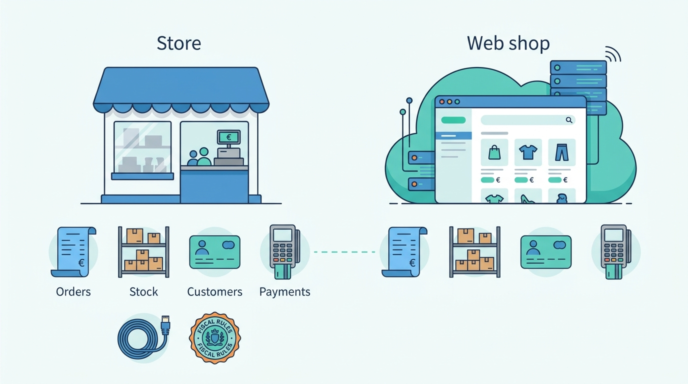
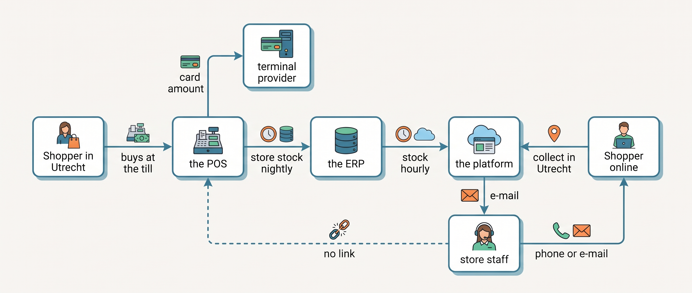
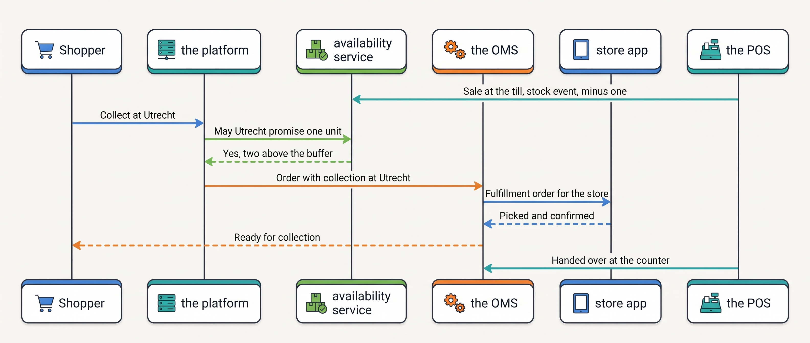
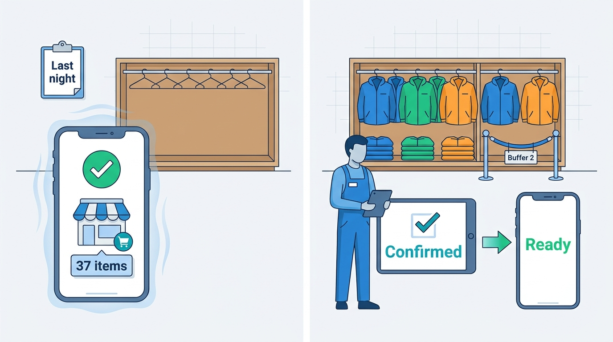

> **IN THIS CHAPTER, YOU WILL:** Learn what a store adds to the architecture, how click-and-collect, ship-from-store, return-in-store and endless aisle work, and when to change the point of sale.

> **KEY POINTS:**
>
> * **A store is a second system of record, not a sales channel.** It creates orders, holds stock, knows customers and takes money, often while offline and under fiscal rules of its own. The architecture has to model it as a stock location, an order source and an identity source, each with a named owner.
> * **Store stock may be promised only with a buffer, a confirmation or a count behind it.** The classic field study found about two-thirds of store inventory records wrong, and a nightly copy makes a wrong number older. The Store Stock Mirage is what promising at face value from a nightly copy produces.
> * **"Unified commerce" is a goal state, not a product.** One record per order, per stock unit and per customer across channels can be reached with one platform or with an order management system and an identity layer over several. Which path fits depends on the scale stage, which is why Kestrel & Pine fixed the joins first and deferred its point-of-sale decision to 2028.

> **[FAILURE PATTERNS THIS CHAPTER ADDRESSES](where-commerce-platforms-go-wrong.html):**
>
> * **The Phantom Stock** — store stock copied nightly into the back office is promised online as if it were counted this minute.
> * **Schrödinger's Order** — a click-and-collect order exists in the web platform, in an e-mail to the store and as a till receipt, and none of the three knows about the others.
> * **The Familiar Stranger** — the store's loyalty list, the web shop's accounts and the newsletter each count the same shopper as a different person.

 
A shopper brings a web order to a nearby store for an exchange. The store's **point of sale (POS)**, its till software and hardware, must find the purchase, work out the amount paid and record the returned item. If the online platform holds those facts separately, staff may have to reconstruct the transaction by hand. A service that sounds simple to the customer requires the systems to cooperate.

Separate store and online records can work while each channel sells only its own stock; a nightly report may be enough for finance. Store pickup, shipping from a store or exchanging a web order at the till creates a new dependency. **One channel now acts on another channel's stock or order.** Those facts must arrive before staff or software make the next commitment, or the merchant can sell the same unit twice or refund the wrong amount.

The chapter explains those cross-channel services, the limits of store stock records and the choice between a platform's own POS and a separate product. [[inventory-and-availability]] covers sellable quantities, [[order-management]] coordinates orders, and [[identity-and-master-data]] links customer records.

**Where we are in the order's journey.** Eva's jacket from Kestrel & Pine, the fictional outdoor brand, travels from the Duiven warehouse to her Nijmegen home. The company's Nijmegen store could offer alternatives: pickup, dispatch from its shelf or a counter exchange from M to L. This chapter explains what those alternatives would require.

## Setting the Scene at Kestrel & Pine: The Utrecht Pilot and a Deferred Decision

Kestrel & Pine's six stores hold about **1,800 variants each**. Their **118,000 transactions** produced **€6.0 million** in 2026, about **€51 per receipt**. They use a cloud POS chosen in 2019 and a separate card-terminal provider.

Stock reaches the **enterprise resource planning system (ERP)**, which runs finance and purchasing, once a night. **No integration connects the POS to the online platform.** The stores are in Arnhem, Utrecht, Amsterdam, Nijmegen, Eindhoven and Antwerp.

The Utrecht **click-and-collect** pilot lets a customer order online and collect at the counter. In 2026 it relied on people: the platform checked last night's ERP stock copy and emailed the store. Staff checked the shelf and contacted the customer.

In December, **37 promised items had already sold** before the nightly update. This **Store Stock Mirage** is a stale-stock failure: the platform could accept an order without knowing what the till had sold that day.

In February 2027, Noor Visser and operations head Daniel Okafor considered replacing the POS with the platform's own till. Their **Waypoint** improvement program instead repairs the information flow first:

- **W1:** make the POS authoritative for store stock and send changes as they happen. An availability service calculates what each channel may sell.
- **W2:** bring channel orders into a purchased **order management system (OMS)**, adding stores later.
- **W4:** keep the hosted platform and evaluate its POS in 2028.

This sequence fixes what the store tells the other systems before committing to new tills.

## What a Store Adds to the Architecture

In plain words, a store adds four things the online architecture must now take into account, and two constraints it has never had to live with.

| What the store adds | What it means for the architecture | Chapter that owns the concept |
| --- | --- | --- |
| **A second order source** | Every receipt is an order created outside the platform, with its own number, its own line items and its own tax treatment | [[order-management]] |
| **A stock location per store** | Six stores are six more places stock can be promised from, each counted by hand and sold from by people | [[inventory-and-availability]] |
| **A second customer list** | The POS knows a customer by loyalty card, phone number or e-mail captured at the till, if at all; most store sales are anonymous | [[identity-and-master-data]] |
| **A second payment path** | Terminal payments settle through the terminal provider, with their own references and payout files | [[commerce-payments]] |
| **Offline operation** (constraint) | The store must keep selling when the connection drops; for those hours it is its own system of record, reconciled later | this chapter |
| **Fiscal rules** (constraint) | Some countries prescribe how a sale is recorded and what a receipt must contain, down to a signed transaction counter | this chapter, [[commerce-regulation]] |

The two constraints make a POS a different kind of product from a web platform. A web checkout can refuse to work when a dependency is down; a till cannot. A web order can be a row in a database; in Germany a store sale must be signed by a certified security device and carry a sequential number that makes gaps detectable. That is why "just use the platform's POS" is sometimes right and sometimes not available at all.

**Figure 1:** *A store is a second commerce system, not a channel: like the web shop it creates orders, holds stock, knows customers and takes money, and it must also keep selling offline and follow fiscal rules.*

### The offline rule

When a till loses its connection, it may record sales locally and upload them later. The merchant needs to know which sales it may accept, which payment results remain uncertain and how long records can wait before reconnecting.

Vendors document what their POS does without a connection. Shopify's help pages (n.d., accessed November 2026) say its POS needs the internet to sync with the admin, e-mail receipts and capture card payments; cash sales work offline, and card payments taken offline are "captured after your device reconnects to the internet", with a merchant-set daily limit per device, a declined payment that surfaces only after reconnection, and advice to reconnect "ideally within 24 hours". Square's help page (n.d., accessed November 2026) goes further: offline payments "expire after 72 hours if you don't reconnect", and "You're responsible for any expired, declined, or disputed payments accepted while taking offline payments."

**For the hours a store is offline, it is an independent system of record for sales and stock.** Its transactions need locally generated identifiers that never collide; its stock changes arrive late and in a batch; the merchant, not the payment provider, carries the risk of a declined card. Any online promise made against that store's stock during those hours is a guess.

### The fiscal rule

**Fiscalization** is a legal requirement that every sale be recorded in a way the tax authority can verify. Its form differs by country, and the differences decide which POS products can be used where.

| Country | Mandate for retail stores | Mechanism | Dates and source |
| --- | --- | --- | --- |
| **Germany** | Yes, every electronic cash-register-like system | A certified **technical security device** (TSE: security module, storage medium, uniform interface) signs each transaction; a sequential transaction number so that "gaps in transaction records are recognizable"; a receipt obligation; registration with the tax office within one month | § 146a Fiscal Code; KassenSichV of 26 September 2017 (last amended 14 January 2026); registration via ELSTER (the tax administration's online portal) since 1 January 2025 |
| **Belgium** | Not for shops; the "white cash register" (GKS) applies only to restaurant and catering services above €25,000 turnover | For hospitality: a certified register, a certified fiscal data module ("black box") and a VAT signing card; GKS 2.0 mandatory for new hospitality businesses from 1 July 2026 | FPS Finance GKS site, 2026; records kept seven years |
| **Italy** | Yes | Electronic storage and telematic transmission of daily receipts to the tax agency | From 1 July 2019 (turnover above €400,000) and 1 January 2020 (all others), Agenzia delle Entrate release of 29 June 2019 |
| **Netherlands** | No certified register | Register data are part of the administration, kept seven years; a voluntary private quality mark | Belastingdienst brochure, n.d., accessed November 2026 |

The table is my compilation of the sources listed at the end. For Kestrel & Pine the point is specific: its five Dutch stores faced no certified-register mandate when the POS was chosen, and Antwerp's receipts follow Belgian VAT and seven-year record-keeping rules, not the hospitality-only black box. A first **German store** would need a POS with a certified TSE, registered with the tax office, and that requirement alone can rule a product out. A store opening in a new country is a POS decision as much as a logistics one.

## How the Pieces Fit Together

The January 2027 landscape at Kestrel & Pine is the shape many Growing-stage merchants have when they open stores: a POS chosen for the stores, an ERP as the meeting point, and the web platform on the other side of a nightly copy.

**Figure 2:** *Kestrel & Pine's stores in January 2027: a sale at the till reaches the platform the next day by way of the ERP, while a click-and-collect order reaches the store as an e-mail and never reaches the POS at all.*

The target shape is different in two places: store stock flows as events into one availability calculation, and store orders of every kind pass through one order hub. The components and their responsibilities:

| Component | Responsibility | Owns (system of record for) | At Kestrel & Pine |
| --- | --- | --- | --- |
| **The POS** | Ring up sales, take terminal payments, issue receipts, handle returns at the counter, count stock | Store transactions; store stock (W1) | The cloud POS from 2019 |
| **The terminal provider** | Card acceptance in the store | The card transaction and its reference | Separate from the online PSP (the payment service provider for online payments) |
| **The availability service** | Compute what each channel may promise per location from stock events, with buffers | The available-to-promise number (what a channel may still sell: physical stock minus what is promised, minus buffers) | A module of the OMS, from Q4 2027 |
| **The OMS** | Hold every channel's orders in one state model; route each order line to a location (**sourcing**); hand work to the warehouse or a store | The operational order record | Bought, Q4 2027; store receipts imported "later" |
| **Store staff tooling** | Show staff what to pick, confirm, mark ready and hand over; look up stock elsewhere; start a return | Nothing; a client of the OMS and the POS | E-mail and phone today |
| **The customer record** | Recognize the same person across till, web and newsletter | Customer identity | Four unlinked lists; [[identity-and-master-data]] |

### The four omnichannel services

The vocabulary first, because vendors use several names for each.

| Service | Order placed | Stock used | Handed over | What it needs from the architecture |
| --- | --- | --- | --- | --- |
| **Click-and-collect** (BOPIS, buy online pick up in store) | Online | Store stock, or warehouse stock sent to the store | At the counter | Store stock visible to availability; an order line routed to a store; staff tooling to confirm, hold and hand over; a notification when ready |
| **Ship-from-store** | Online | Store stock | Carrier collects at the store | Everything above plus labels, packaging and a carrier pickup at the store; routing rules that weigh store cost and capacity |
| **Return-in-store** | Online | None | Return accepted at the till | The till can find an online order, accept the item, trigger one refund through one path, and restock to the store or send it back |
| **Endless aisle** | In store | Warehouse or another store's stock | Carrier to the customer | The till can see availability elsewhere, create an order in the order hub, and take payment for goods that are not in the building |

Each row is a promise made against stock somewhere else, and **all four are the same three problems in a different order**: knowing what stock is where (availability), deciding which location serves the order (sourcing), and giving the store the tools to do its part (staff tooling). The requirements differ by service:

| Flow | How fresh must store stock be | How consistent | How fast | What happens when the link is down |
| --- | --- | --- | --- | --- |
| Store sale reduces online availability | Minutes, as an event; nightly is the Mirage | Eventually consistent is fine; the buffer absorbs the lag | Not latency-critical | The store keeps selling; availability holds the last known number minus a larger buffer |
| Click-and-collect promise | Minutes, plus a per-store buffer | The order must be visible to the store within minutes and confirmed by a person before "ready" is sent | The confirmation, not the promise, is the commitment | Offer collection "within two hours" rather than "now", or route to the warehouse |
| Ship-from-store routing | Minutes | The chosen store must accept the fulfillment order before the carrier label exists | Routing in seconds at order time | Fall back to the warehouse |
| Return-in-store | Order lookup in seconds | Exactly one refund, from one system | Seconds at the counter | Accept the item, record the return, refund when the link returns, never twice |
| Endless aisle | Seconds, from the shared availability number | The order is created in the hub, not re-keyed later | Seconds at the counter | Do not promise; take the customer's details and call back |

The target flow for click-and-collect looks like this, with the OMS and the availability service in place:

**Figure 3:** *Click-and-collect done with the joins in place: the till reports every sale as a stock event, the availability service promises only above a buffer, the order hub routes the work to the store, and a person's confirmation, not the stock number, is what turns the promise into "ready".*

Notice where the commitment sits. The storefront's "available for collection" is a **promise with a buffer**; the store's "picked and confirmed" is the **commitment**; the customer hears "ready" only after the second. That ordering is the whole design, and the Utrecht pilot lacked it.

### What store stock is actually worth as a promise

The buffer and the confirmation are not caution for its own sake. Store inventory records are wrong far more often than warehouse records, and the research is old but unambiguous. DeHoratius and Raman, in *Management Science* in 2008, examined "nearly 370,000 inventory records from 37 stores of one retailer" and found **65% to be inaccurate**; auditing reduced inaccuracy, store complexity increased it.

The data are from one US retailer in the 2000s, before RFID (radio-frequency identification: a tag on each item that a reader counts without line of sight), so take the mechanism rather than the number.

Auburn University's RFID Lab reported in 2018 (Project Zipper, eight brands, five retailers) that order audits using barcode data found inaccuracies "in 69% of cases" against "less than 0.01%" with RFID. Both sources are more than three years old; nothing newer with an open methodology turned up in this book's research.

The ways to make a store-stock promise honest, in rising order of cost:

1. **A per-store safety threshold**: never promise the last *N* units of a variant at a store. Cheap, loses some sales on slow movers, and is the first thing to do.
2. **A confirmation step**: the store confirms the pick before the customer is told to come. Costs a few minutes of staff time per order; removes almost all broken promises.
3. **Exception-driven cycle counting**: when a store cannot find an item the system said it had, that variant is counted that day, and the count corrects the record. Turns every miss into a data fix.
4. **RFID**: tags on every item and readers at the door and the counter. Expensive; the evidence above is why fashion retailers at Group stage do it anyway.

Kestrel & Pine's interim fix for Utrecht, until the availability service arrives, is the first two: a threshold of two units per variant per store and a staff confirmation before the "ready" message. It costs nothing to build and would have prevented most of the 37.

**Figure 4:** *The Store Stock Mirage and its interim fix: in December 2026 a nightly copy promised 37 items already sold; a buffer of two units and a staff confirmation before "ready" would have prevented most of them.*

## The Choices

A merchant with stores has four realistic ways to connect them to the rest of the landscape. Each is a real product category, and each is right somewhere.

**1. The platform's own POS.** The web platform's vendor sells a till on the same back end: one catalog, one stock record per location, one order list, one customer list. Shopify's POS pages (n.d., accessed November 2026) describe "buy online, pickup in store, or buy in store, ship to customer", staff roles and "Returns and exchanges at any location"; POS Pro is €79 per location per month on its euro page as of November 2026.

The Dutch vendor Vendit makes the same promise from the POS side: a till "from the same database as your webshop", so that "if you sell the last item at the till, the article is immediately at zero in your webshop" (n.d., accessed November 2026, translated). The joins disappear.

The limits: the platform's POS must be available and fiscally certified in every country you have stores in, it inherits the platform's offline rules, and it couples the stores to the platform contract, so changing the platform later means changing the tills too.

**2. A specialist POS, integrated by events through the order hub.** The stores keep a POS built for stores (fiscal certification, offline operation, loyalty, counts), and three integrations connect it: stock events to the availability service, store receipts imported into the OMS as orders, and fulfillment orders from the OMS to a store app. This is where Waypoint takes Kestrel & Pine: the best POS for the stores and the best platform for the web, at the cost of three contracts and the reconciliation jobs behind them.

**3. A specialist POS, integrated by nightly batch through the ERP.** The January 2027 state. It works until someone promises store stock outside the store; then it produces the Mirage.

**4. The ERP's POS.** Some mid-market ERPs include a till module, so store stock, store sales and the books are one record and the web platform is the odd one out. Attractive for a wholesaler with a few outlet stores; less so for a brand whose stores are a growing channel, because the ERP's till rarely has the customer and omnichannel features of a specialist POS ([[erp-and-back-office-integration]]).

| | Platform's POS | Specialist POS by events through the OMS | Specialist POS by nightly batch | ERP's POS |
| --- | --- | --- | --- | --- |
| Store stock visible online | Immediately, one record | Within minutes, as events | Next day | Same record as the ERP; the web gets a copy |
| Store orders in the order record | Native | Imported, with their fiscal identifiers | Only as ERP postings | Native to the ERP, not to the OMS |
| Fiscal coverage | Where the platform vendor supports it | Chosen per country | Chosen per country | Where the ERP supports it |
| Offline operation | The platform's rules and limits | The POS's rules | The POS's rules | The ERP's rules |
| Integrations to own | Few | Three contracts plus reconciliation | One batch job | Web-to-ERP only |
| Exit cost | The tills change with the platform | Each part replaceable | Low | The tills change with the ERP |
| Fits best | Starting and Growing; one country; web-first brands | Omnichannel; several countries; stores that matter | Stores with no omnichannel promises | Wholesalers with outlet stores |

My rule: **choose by the number of countries and the weight of the stores, not by the vendor's demo.** A web-first brand with two stores in one country should take the platform's POS and enjoy the one record. A merchant whose stores earn a serious share of revenue, in more than one fiscal regime, should keep a store-grade POS and spend the money on the events and the order hub. Kestrel & Pine sits between: six stores in two countries, **12.5% of revenue**, one fiscal regime that is lenient and one that is lenient for shops. That is why W4 defers rather than decides: the 2028 evaluation will have an availability service and an OMS in place, and the question will have shrunk to "which till", not "how do stores join the architecture".

### "Unified commerce", and who is speaking

**Unified commerce** is a vendor term for online and store operations sharing core systems or records, so a customer or order can be recognized across channels. Ask which records are shared and which still rely on integrations. Shopify's 2026 description means sales channels, inventory and customer data on one backend; it contrasts this with its own definition of omnichannel. Adyen uses the term for online and in-person payments on one platform with cross-channel shopper recognition (documentation, n.d., accessed November 2026). These definitions come from vendors selling different kinds of platform; no independent analyst definition was obtained for this book.

I use the term for the **goal state**: one record per order, per stock unit and per customer, visible to every channel in near real time. It can be reached with one platform (choice 1) or with an OMS and an identity layer over several systems (choice 2). When a vendor says "unified commerce", ask which they mean, and whether their definition would survive your store in Germany.

## Across Scale Stages: When It Fits and When It Limits

| Stage | What is typical | What becomes necessary | Warning signs of outgrowing the approach |
| --- | --- | --- | --- |
| **1 — Starting** | No store, or a pop-up on the platform's POS; stock is the back room; store sales are a line in the monthly accounts | Nothing beyond the platform's own POS; one location record | Store count and platform count disagree every month-end; staff keep a notebook of "web orders to pick up" |
| **2 — Growing** | One to three stores, often on a specialist POS chosen by the store manager; POS to accounting or ERP nightly; no omnichannel promises | A decision on which system owns store stock; a per-store threshold before any click-and-collect pilot; one customer key (loyalty id or e-mail) captured at the till | Click-and-collect run by e-mail and phone; the first Mirage; store managers who cannot say whether online refunds come off their sales |
| **3 — Omnichannel** | Several stores in more than one country, a visible share of revenue; stock events from the POS; an OMS that routes to stores; staff tooling; return-in-store | The availability service with store buffers; store receipts imported into the order hub with fiscal identifiers; one refund path; reconciliation of POS, OMS and ERP; a fiscal checklist per country | Store-stock promises without a confirmation step; ship-from-store launched before routing knows store capacity; a POS API deprecation nobody owns |
| **4 — Group** | Dozens to hundreds of stores across fiscal regimes; several POS products after acquisitions; RFID in fashion; stores as fulfillment nodes with their own cut-offs and carrier pickups | One fulfillment-order contract every POS and WMS honors; a registry of which store does what; accuracy targets; per-brand decisions on shared versus separate POS | A single POS forced on brands with different fiscal needs (One Size Fits None); store fulfillment that undercuts store sales because the economics were never modeled |

The judgement: the store joins the architecture at the Growing stage, with the first omnichannel promise, and the cheapest moment to decide who owns store stock is before that promise, not after the first broken one. The POS itself rarely needs to change until the merchant opens stores in a country whose fiscal rules its POS cannot meet, or until the stores' weight justifies a single record. Kestrel & Pine has reached the first point with its joins and not the second with its till.

## In Practice

**Ship-from-store on someone else's marketplace: Zalando Connected Retail, 2021 to 2027.** Zalando's Connected Retail program let physical shops list their store stock on Zalando and ship the parcels from the store; trade press reported more than 3,400 active stores in nine markets in early 2021. In April 2026 TextilWirtschaft reported a Zalando spokesperson confirming that the program ends by the end of June 2027, to bundle all partners in one central model. Two lessons transfer: ship-from-store works at scale when the store's stock feed and the return path are built properly, and programs retire. A merchant that exposed store stock through its own store-stock feed rather than a program-specific tool faces a connector change, not a redesign ([[marketplaces-and-channel-integration]]).

**Store orders in one order model.** A common order model can carry both store and web sales into finance, but it must retain the identifiers specific to each channel, such as receipt number and staff member.

Microsoft's documentation for its Business Central connector to Shopify (published 14 October 2026) notes that orders created through Shopify POS carry a staff identifier that the connector maps to a salesperson. Small detail, large point: on a platform with its own POS, a store sale and a web order travel to the ERP by the same road. A merchant with a separate POS builds that road itself, and the import must carry the store's own identifiers (receipt number, fiscal transaction number, staff id) rather than re-create the sale as a web order.

**Routing to stores.** Routing chooses the location that should prepare an order. That choice must account for available stock and the delivery or pickup promise before it becomes an instruction to do the work.

Adobe Commerce's inventory documentation (updated August 2026) ships two source-selection rules, a fixed priority and a distance rule that picks "the closest source". Shopify binds work to a location through a **fulfillment order** whose assigned location may change only while it is open, scheduled or on hold (n.d., accessed November 2026). Kibo's documentation (n.d., accessed November 2026) describes routing that returns a suggestion, logs why locations were rejected, "does not create shipments or deduct inventory", and lets a pickup order trigger a transfer shipment to the store. That is the ladder: simple rules in the platform, then an explainable routing decision separate from the deduction of stock, which is the OMS's job once stores, cost and capacity enter the rule ([[order-management]]).

**Store payments and PCI scope.** With **point-to-point encryption** (P2PE; the PCI Security Standards Council lists validated solutions by exact version), the card number is encrypted inside the terminal and decrypted only at the payment provider, so a **semi-integrated** terminal that receives an amount and returns a result keeps the POS out of the scope of PCI DSS (the Payment Card Industry Data Security Standard) ([[commerce-security]]). Keep the terminal provider's transaction reference on the receipt; it later matches the payout file ([[commerce-payments]]).

**Adoption, a decade ago.** The only open, dated adoption figures found are old and UK-weighted: a 2016 UPS survey of over 700 European retailers put stores used as online fulfillment centers at 27%; a 2018 Savills survey of UK stores found 47% offering click-and-collect, about one in ten in ship-from-store, and nearly one in three store managers in one category who "did not know whether online refunds were deducted from store sales". Treat the percentages as history; keep the last finding. "Whose sale is it" must be answered before the first store ships a web order.

### Kestrel & Pine, worked: the Utrecht pilot, before and after

The numbers below are Kestrel & Pine illustrations; where they are not among Kestrel & Pine's recorded figures they are labeled as assumptions.

| | December 2026 (the Mirage) | Interim fix, from April 2027 | Target, from Q4 2027 |
| --- | --- | --- | --- |
| Store stock seen by the platform | ERP copy, up to a day old | Same copy, minus a threshold of 2 units per variant *(assumption)* | POS stock events into the availability service, minutes old, per-store buffer |
| Promise shown online | "Available for collection today" | "Collection today, we confirm within two hours" | "Ready in two hours" after confirmation, computed per store |
| How the store learns of the order | E-mail from the platform | E-mail, with a reply template that confirms or declines | Fulfillment order in the store app from the OMS |
| Commitment to the customer | At order placement | At the store's confirmation | At the store's confirmation |
| Broken promises | **37 items** in the month | Illustrative target under 5 *(assumption)* | Measured per store as "promised but not found" |
| Store receipt for the handover | A POS sale at €0 keyed by hand *(local detail)* | Same | Handover recorded against the OMS order; the POS imports it with its receipt number |

Two details deserve a sentence. The €0 till sale is how many pilots record a collection, and it is why the order exists three times: in the platform (paid), in an e-mail (picked) and in the POS (a zero sale); that is *Schrödinger's Order* with a store in it. And the interim promise is deliberately weaker than the original: a two-hour window kept every time beats "today" broken once in thirty.

## When It Goes Wrong

Stores fail in ways online systems do not, because people and buildings are involved. The ones that matter most, with how to notice them and how to recover:

- **The till and the web sell the same last unit.** A store sale and an online reservation race for the final unit before the store's event reaches availability. *Detection*: "promised but not found" per store, counted daily. *Recovery*: the buffer makes it rare and the confirmation step catches it before the customer travels; when it still happens, the OMS reroutes to the warehouse or cancels with a notification, and the variant is counted.
- **Offline session replay creates duplicates.** A store reconnects after three hours and uploads its sales; the upload is retried after a timeout, and the same receipts arrive twice. *Detection*: daily sales count against the receipt-number range. *Recovery*: every import is **idempotent** on the POS transaction number (receiving the same receipt twice has the same effect as once), which is also what Germany's fiscal transaction counter is for ([[events-consistency-and-reconciliation]]).
- **The nightly job fails silently.** The POS-to-ERP copy stops on a Friday; by Monday the ERP's store stock is three days old and the platform has promised against it all weekend. *Detection*: a monitor that alarms when the copy is older than its schedule, not only when it errors ([[integration-styles]]). *Recovery*: rerun and reconcile the weekend's orders by hand; the cure is events with a freshness check.
- **Return-in-store refunds twice.** A web order is returned at the Nijmegen counter; the till refunds to the card through the terminal provider, and the returns portal, seeing the item "received", refunds through the platform's API as well: the store's version of *The Double Refund* (212 returns, €19,400, January 2027). *Recovery*: one refund path per order, decided once; a return recorded at the till closes the portal request before anything is paid ([[returns-and-exchanges]]).
- **The store charges a different price.** During the Price Drift of October 2026 the German storefront sold the Ridgewalker at €179 while the stores charged €199; the stores were right by accident, because the POS has its own hand-loaded price list. *Recovery*: one pricing source publishing to the POS as to the storefronts ([[pricing-architecture]]).
- **The loyalty list and the web account never meet.** Eva Janssen is a POS loyalty customer and an online account with no shared identifier (the *Familiar Stranger* pattern). Return-in-store still works, because the till finds the order, not the person; store purchases simply never reach her online history. *Recovery*: a declared matching rule with a confidence level ([[identity-and-master-data]]).
- **A fiscal rule arrives with a store.** A German lease is signed before anyone checks whether the POS has a certified TSE (*The Long Fuse*). *Recovery*: store openings go on the regulatory calendar ([[commerce-regulation]]); a POS per country is acceptable, a store without a compliant till is not.

## What to Take Away

**Established.**

- A store's POS is a system of record for store transactions and, for the hours it is offline, for store stock; vendors document offline capture, limits and merchant-borne risk (Shopify and Square help pages, accessed November 2026).
- Store inventory records are far less accurate than people assume: 65% inaccurate in the 2008 DeHoratius and Raman study; 69% of audited orders with barcode-data errors against under 0.01% with RFID in the 2018 Auburn study. The numbers are old; the mechanism is not.
- Fiscalization differs by country and constrains POS choice: Germany requires a certified security device and sequential transaction numbers (§ 146a AO, KassenSichV 2017); Italy requires telematic transmission (2019–2020); Belgium's certified register applies to hospitality only; the Netherlands requires seven-year records and no certified device.
- Platforms and order management systems separate routing from the deduction of stock and bind work to a location through a fulfillment order that can move only before work starts (Shopify, Kibo and Adobe Commerce documentation, 2026).

**Depends on context.**

- The platform's own POS is the right choice for web-first brands with a few stores in one lenient fiscal regime; a specialist POS integrated by events is the right choice once stores carry weight or span fiscal regimes. The line moves with the platform vendor's country coverage.
- Click-and-collect against store stock needs at least a threshold and a confirmation step; ship-from-store needs routing rules that know store capacity and cost; both can wait until an availability service exists, and both can run earlier with weaker promises.
- Whether store sales are imported into the OMS from day one or "later" (Kestrel & Pine's W2) depends on whether anyone needs a store receipt in the order hub: returns-in-store and customer history do; finance does not, because the ERP already has the nightly postings.

**The author's synthesis.**

- Fix what the store tells the other systems, and how fast, before changing the till: a store-stock event feed, a buffer and a confirmation step remove most broken promises, and they are the same work whichever POS you end up with.
- Promise only what a person has confirmed. The storefront's availability number is a forecast; the staff member's "picked" is the commitment; the customer should hear from the second, not the first.

## Questions to Ask

1. Which system is the system of record for store stock, and how old is the copy that the storefront promises from?
2. What does the POS do when the connection drops, for how long, and who carries the risk of a declined card taken offline?
3. Which countries will we have stores in within three years, and does the POS meet each country's fiscal rules today?
4. When a click-and-collect order is placed, what exactly is the customer promised, and at what moment does a person confirm it?
5. How does a store receipt reach the order record: imported with its own identifiers, re-keyed, or not at all?
6. When a web order is returned at the till, how many systems can issue the refund?
7. Does the POS receive prices from the same source as the storefronts and the marketplaces?
8. If we replaced the platform in five years, would the tills have to change with it?

The store is where a web order can come back to the counter, and the return is where stock, money and the books have to agree again. [[returns-and-exchanges]] follows the jacket on its way back.

## Sources and Evidence

*Company, product and investor sources*

- [Shopify POS](https://www.shopify.com/pos) and [Shopify POS pricing](https://www.shopify.com/pos/pricing), Shopify, n.d., accessed 2026-11 — the platform-POS feature set (pickup in store, ship to customer, returns at any location, staff roles) and the €79 per location per month POS Pro price.
- [Using Shopify POS offline](https://help.shopify.com/en/manual/sell-in-person/shopify-pos/selling-offline) and [Offline payments](https://help.shopify.com/en/manual/sell-in-person/shopify-pos/selling-offline/offline-payments), Shopify Help Center, n.d., accessed 2026-11 — what works offline, deferred capture, device limits and the 24-hour advice.
- [Process offline payments](https://squareup.com/help/us/en/article/5095), Square Support, n.d., accessed 2026-11 — the 72-hour expiry and the merchant's responsibility for offline payments.
- [What is unified commerce?](https://www.shopify.com/blog/unified-commerce), Shopify (Roxanne Voidonicolas), 2026 — the vendor definition contrasted with omnichannel.
- [Lightspeed Retail POS](https://www.lightspeedhq.com/pos/retail/), Lightspeed, n.d., accessed 2026-11 — stock transfers between stores and customer profiles that follow shoppers between locations.
- [Kassasysteem](https://www.vendit.nl/kassasysteem/), Vendit, n.d., accessed 2026-11 — a Dutch POS that runs from the same database as the web shop (translated).
- [Point of sale documentation](https://docs.adyen.com/point-of-sale/), Adyen, n.d., accessed 2026-11 — in-person and online payments on one platform, the Terminal API and shopper recognition.
- [Synchronize orders (Shopify connector)](https://learn.microsoft.com/en-us/dynamics365/business-central/shopify/synchronize-orders), Microsoft Learn, 2026 — POS orders carrying a staff id into the ERP connector.
- [Source algorithms and reservations](https://experienceleague.adobe.com/en/docs/commerce-admin/inventory/basics/selection-reservations), Adobe Commerce, 2026 — source priority and distance priority routing.
- [FulfillmentOrder object](https://shopify.dev/docs/api/admin-graphql/latest/objects/FulfillmentOrder), Shopify GraphQL Admin API, n.d., accessed 2026-11 — the fulfillment order and when its assigned location may change.
- [Order routing](https://docs.kibocommerce.com/help/order-routing) and [Fulfillment concept guide](https://docs.kibocommerce.com/concept-guides/fulfillment), Kibo Commerce, n.d., accessed 2026-11 — routing suggestions separate from stock deduction; transfer shipments for pickup orders.
- [Zalando stellt Connected Retail ein](https://www.textilwirtschaft.de/tech/zalando-stellt-connected-retail-ein-158921), TextilWirtschaft, 2026 — the end of Connected Retail by June 2027; and [Zalando baut Connected Retail aus](https://fashionunited.de/nachrichten/einzelhandel/zalando-baut-connected-retail-aus-c-a-als-partner-expansion-nach-oesterreich/2021021539302), FashionUnited, 2021 — the 3,400 active stores figure (evidence age).

*Standards, regulation and official documentation*

- [§ 146a Abgabenordnung](https://www.gesetze-im-internet.de/ao_1977/__146a.html), German Fiscal Code, current text, accessed 2026-11 — the certified technical security device, the receipt obligation and the registration duty.
- [Kassensicherungsverordnung](https://www.gesetze-im-internet.de/kassensichv/BJNR351500017.html), ordinance of 26 September 2017, amended 2026 — transaction numbering, signature counter and receipt content.
- [Mitteilungspflicht für elektronische Kassensysteme](https://www.grantthornton.de/themen/2025/mitteilungspflicht-fuer-elektronische-kassensysteme-frist-endet-am-31.-juli-2025), Grant Thornton Germany, 2025 — the ELSTER registration procedure and the 31 July 2025 deadline.
- [Geregistreerd kassasysteem](https://www.geregistreerdkassasysteem.be/) and [GKS 2.0 mandatory from 1 July 2026](https://www.geregistreerdkassasysteem.be/nl/nieuws/het-nieuw-geregistreerd-kassasysteem-gks-20-wordt-verplicht-vanaf-1-juli-2026), FPS Finance (Belgium), 2026 — the hospitality-only scope, the €25,000 threshold and the GKS 2.0 dates (translated).
- [Comunicato stampa: corrispettivi telematici](https://agenziaentrate.gov.it/portale/documents/20143/1534262/057_Com.%2Bst.%2BCorrispettivi%2Btelematici%2B29.06.19/a4d1a59f-fb83-b2c6-333f-c572cbd2c774), Agenzia delle Entrate, 2019 — the 2019–2020 start of telematic receipts in Italy (translated; evidence age for the start dates only).
- [Het kassasysteem in uw bedrijf](https://download.belastingdienst.nl/belastingdienst/docs/uw_bedrijf_en_het_kassa_on2001z5fd.pdf), Belastingdienst, n.d., accessed 2026-11 — seven-year retention and the voluntary quality mark (translated); [Keurmerk Betrouwbare Afrekensystemen](https://www.keurmerkafrekensystemen.nl/), n.d., accessed 2026-11.
- [Point-to-Point Encryption solutions](https://www.pcisecuritystandards.org/assessors_and_solutions/point_to_point_encryption_solutions), PCI Security Standards Council, n.d., accessed 2026-11 — the validated P2PE solution listing.

*Research and practitioner sources*

- [Inventory Record Inaccuracy: An Empirical Analysis](https://econpapers.repec.org/RePEc:inm:ormnsc:v:54:y:2008:i:4:p:627-641), Nicole DeHoratius and Ananth Raman, *Management Science* 54(4), 2008 — 65% of 370,000 store inventory records inaccurate (evidence age).
- [RFID can lead to 100% order accuracy, Auburn study finds](https://www.retaildive.com/news/RFID-100-accurate-ROI-Auburn/539468), Retail Dive on the Auburn University RFID Lab's Project Zipper, 2018 — 69% of audited orders with barcode-data errors against under 0.01% with RFID (evidence age).
- [UK retailers responding slowly to needs of online shoppers, says UPS](https://postandparcel.info/74732/news/e-commerce/uk-retailers-responding-slowly-to-needs-of-online-shoppers-says-ups), Post & Parcel on the UPS "Pulse of the Omni-channel Retailer" survey, 2016 — 27% of European retailers using stores as online fulfillment centers (evidence age).
- [Click & collect sales and in-store online ordering](https://www.savills.co.uk/research_articles/179587/226023-0), Savills Research, 2018 — click-and-collect and ship-from-store adoption in UK stores and the store managers who did not know how online refunds were booked (evidence age).

Kestrel & Pine is fictional; architectural recommendations, labeled inferences and labeled assumptions are the author's judgement.
