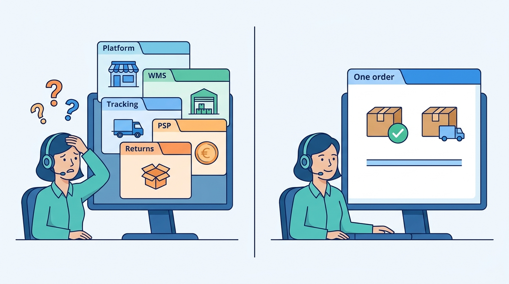
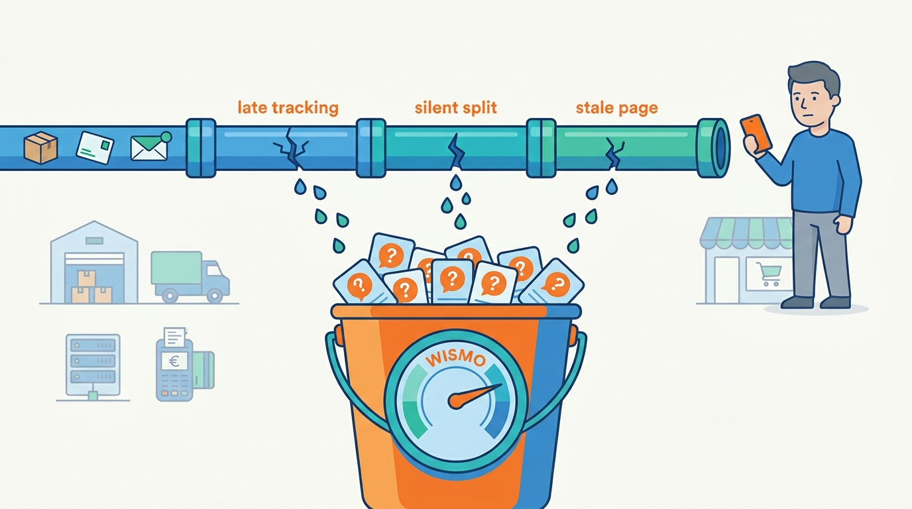
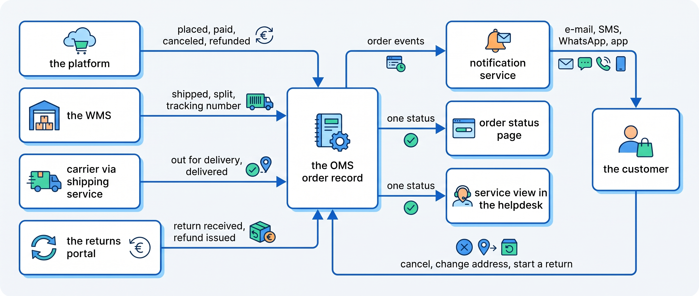
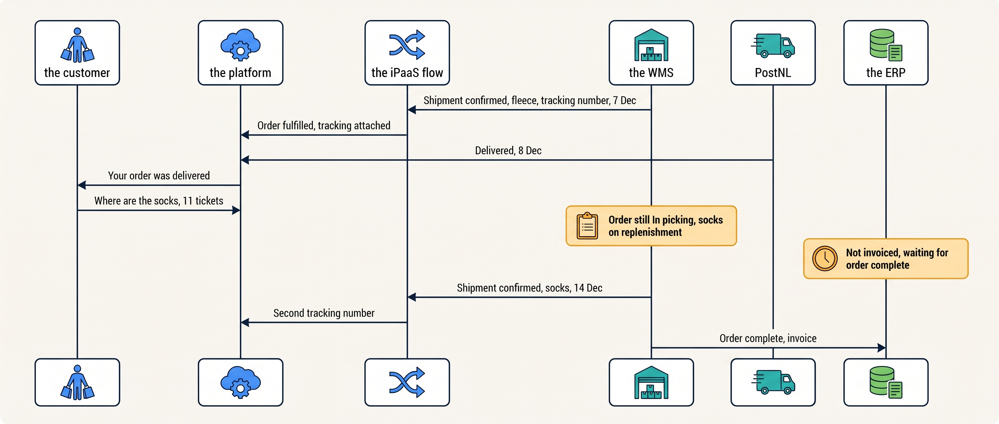
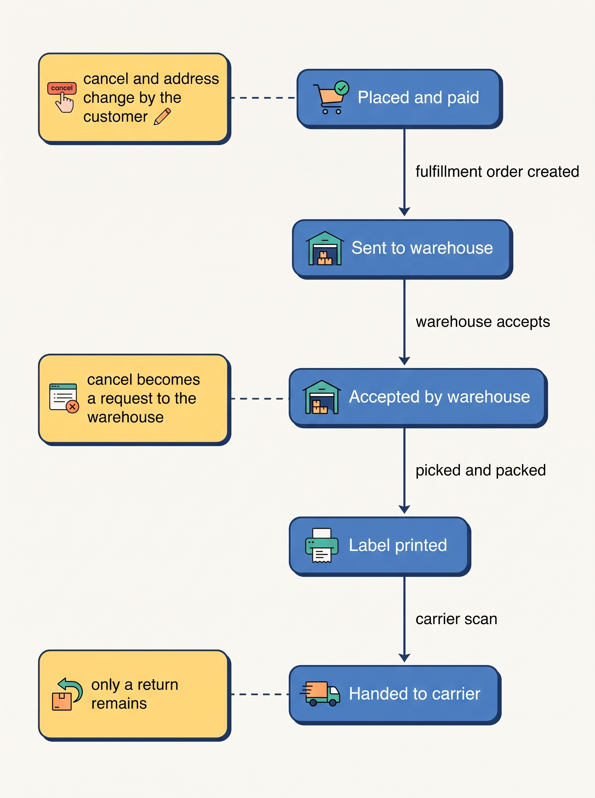

> **IN THIS CHAPTER, YOU WILL:** Learn how order events become notifications, a status page and an agent's view, why the three must share one status, and how to read service load as a signal.

> **KEY POINTS:**
>
> * **Notifications, the status page and the agent's screen are three views of one status, and they must be built from the same events.** The platform emits "confirmed", "canceled" and "refunded"; the warehouse emits "shipped" with a tracking number; the carrier emits "out for delivery" and "delivered". When each view reads a different system, the customer and the agent see different orders.
> * **An order has several status machines, not one.** Money, goods and returns each move on their own; a single "status" string collapses them and loses what the customer is asking about. Kestrel & Pine's Three-Status Order was a two-parcel order whose first parcel turned the whole order "Delivered".
> * **"Where is my order" is a measurement, not a cost of doing business.** The one vendor dataset that states its basis puts it at about a fifth of tickets; measured per shipped order, it rises when tracking events go missing, promises slip or shipments split without explanation. Self-service that is gated on the fulfillment state removes the contacts that need no judgement.

> **[FAILURE PATTERNS THIS CHAPTER ADDRESSES](where-commerce-platforms-go-wrong.html):**
>
> * **Schrödinger's Order** — the customer, the status page and the agent each read a different system and get a different answer.
> * **The Message in a Bottle** — a shipping notification sent once, from a label printed rather than a parcel handed over, is trusted by the customer and wrong.
> * **The Familiar Stranger** — the agent searches by e-mail and finds the online account, not the store purchases, the newsletter consent or the open return.

 
After the order is placed, the customer's relationship with the merchant is a sequence of messages: your order is confirmed; it has shipped; it is out for delivery; it was delivered; your return was received; your refund is on its way. Between those messages sits a page the customer can open at any time, and behind both sits a person the customer can write to when the messages stop making sense. **Notifications, the order status page and the service agent are the merchant's voice after the sale**, and the architecture decides whether that voice is one or three.

The business problem is simple to state. Every message is triggered by an event, and the events come from different systems: the platform knows the order was placed and paid, the warehouse knows it was packed, the carrier knows it was delivered, the returns portal knows it came back. If the status page reads the platform, the notifications read the warehouse and the agent reads all of them in separate tabs, the customer sees "Delivered", receives "Shipped" and is told "In picking" by the person meant to help. **Every contradiction is a ticket, and a ticket costs more than the margin on a €92 order**, Kestrel & Pine's average.

This chapter owns the **transactional notification**, the **order status page** and the **service view**. It builds on the order record and its state machines from [[order-management]], tracking events from [[shipping-and-delivery]] and the return record from [[returns-and-exchanges]]. Who the customer is, across the online account, the store's loyalty list and the newsletter, is [[identity-and-master-data]]'s subject; this chapter only shows what the agent cannot see without it.

**Where we are in the order's journey.** This chapter covers the messages Eva Janssen receives about her jacket (the recurring order from [[meet-kestrel-and-pine]]) from the confirmation at 21:14 on 13 April 2027 to the exchange shipped on 22 April, the page she opens in between, and what an agent sees if she writes in. It is the last chapter of Part IV, and the one that looks at the whole journey from the customer's side.

## Setting the Scene at Kestrel & Pine: Eleven Tickets, Six Days, One Order

Kestrel & Pine, the fictional outdoor brand this book follows, had an order in December 2026 that this book calls **the Three-Status Order**: order **#1052877** showed *Delivered* in the platform, *In picking* in the WMS (the warehouse management system that runs picking, packing and shipping at Duiven) and *Not invoiced* in the ERP (the enterprise resource planning system that keeps the books and issues invoices) for **six days**, and one customer opened **11 support tickets** about it. [[order-management]] explains why the three systems could hold three states. This chapter follows the tickets, because they show what the customer and the agent each could and could not see.

The order was a two-line order: a Trailhead fleece (€119) and a pair of merino hiking socks (€18), €137 in total. The details below are the chapter's reconstruction, and later chapters reuse them. The fleece was picked and shipped on Monday 7 December; the socks were short in the pick location and waited on replenishment from bulk stock. The agency-built flow in the iPaaS (the integration platform that carries orders between systems) had no notion of a partial shipment: on the first shipment confirmation from the WMS it marked the whole platform order fulfilled and attached the fleece's tracking number. PostNL delivered the fleece on Tuesday 8 December, the platform's status page turned the order to **Delivered**, and the "delivered" e-mail went out. The WMS, which tracks the order as a whole until every line ships, still showed **In picking**. The ERP invoices on an "order complete" message from the WMS that never came, so it showed **Not invoiced**. Nobody told the customer there were two parcels.

| Day | Channel | What the customer asked | What the agent could see | What the agent did |
| --- | --- | --- | --- | --- |
| Tue 8 Dec, evening | E-mail | "Delivered, but the socks are not in the box." | Platform: Delivered, one tracking number | Asked for a photo of the packing slip |
| Wed 9 Dec | E-mail | Photo sent; "where are my socks?" | Same | Checked PostNL tracking: delivered; replied that it was delivered |
| Wed 9 Dec | Chat | "I know it was delivered, the socks were not in it." | Same | Opened a "missing item" case; said someone would check with the warehouse |
| Thu 10 Dec | E-mail | "Any news?" | Same; the warehouse question sat in an inbox | Replied "still checking" |
| Thu 10 Dec | Phone | Asked for a refund of the socks | Platform: paid €137; refund possible | Offered the refund; the customer said she wanted the socks |
| Fri 11 Dec | E-mail | "Status still says Delivered. Is this a scam?" | A WMS reply by e-mail: order "In picking", socks on replenishment | Explained that the socks would ship; could not say when |
| Fri 11 Dec | Chat | "Why does the page say Delivered if it is being picked?" | Both answers, in two tabs | Apologized; could not change the status page |
| Sat 12 Dec | E-mail | Asked whether she had been charged for both | Platform: paid €137; ERP not visible to support | Asked finance by e-mail on Monday |
| Sun 13 Dec | E-mail | Asked again | Nothing new | No reply until Monday |
| Mon 14 Dec | Phone | "Just tell me one thing that is true." | Socks shipped that morning; new tracking number | Gave the second tracking number by phone |
| Mon 14 Dec | E-mail | Asked for the tracking number in writing | Same | Sent it, with a €10 voucher *(local detail)* |

Eleven contacts, three channels, three people answering, and one piece of information that would have ended it on day one: **"your order ships in two parcels; the second is on its way on the 14th."** Nobody had it, because no system held it. The agent worked from what the support team calls **the five tabs**: the platform's order screen, the WMS, the shipping service's tracking page, the PSP console (the payment service provider's portal, where refunds can be issued by hand) and the returns portal. The ERP was a sixth, visible only to finance. Waypoint's answer (**W2**, one order record in a bought order management system, or OMS, by Q4 2027, and **W8**, order status by API) is the subject of the rest of this chapter; the tickets are its justification.

**Figure 1:** *The five tabs: each system told the agent a different truth about one order, so the message that would have ended the eleven tickets, two parcels, existed on no screen; a service view over one order record shows it.*

## What the Customer Needs to Know, and Which System Knows It

A **transactional notification** is a message triggered by an event on the customer's own order, as opposed to marketing: confirmed, shipped, delivered, refunded. The list of notifications a merchant sends is, read the other way, a list of events some system must emit. Shopify's help page on customer notifications (n.d., accessed November 2026) is a usable inventory: order confirmation (which cannot be deactivated), shipping confirmation at fulfillment, shipping update "when tracking information is updated", out for delivery and delivered, each triggered "when a carrier or fulfillment app reports" the event, order refund and order canceled.

| Customer-facing message | Event behind it | Which system emits it | Typical lag the customer tolerates |
| --- | --- | --- | --- |
| Order confirmed | Order placed and payment authorized | The platform, after the PSP answers | Seconds |
| Payment problem | Authorization failed or pending (bank transfer, buy-now-pay-later) | The platform, from the PSP's webhook (a message the PSP pushes when a payment changes state) | Minutes |
| Shipped, with tracking | Parcel handed to the carrier, label scanned | The WMS or the 3PL (third-party logistics provider), via the shipping service | Minutes to an hour |
| Ships in two parcels | A fulfillment order split, or one line delayed | The OMS; nothing emits it in a landscape without one | Before the first parcel arrives |
| Out for delivery; delivered; attempted | Carrier scan events | The carrier, normalized by the shipping service | Minutes |
| Ready for collection | Store confirmation of a click-and-collect pick | The OMS from the store app ([[stores-and-omnichannel]]) | Minutes |
| Return received; refund issued | Return inspected; refund executed | The WMS and the platform or PSP, via the returns portal ([[returns-and-exchanges]]) | Hours to a day |

The middle row is the one a newcomer should stare at. "Ships in two parcels" is the message that would have ended the eleven tickets, and it has no emitter at Kestrel & Pine in 2026, because no system holds the order's lines and their fulfillment state together. It is also the kind of message that an order management system produces as a side effect of doing its job ([[order-management]]).

### The order status page

The **order status page** is the self-service page where the customer sees where the order is. It is the cheapest answer to "where is my order" the merchant will ever give, and it is a **read model**: a view assembled from the order record and the tracking stream for the purpose of being read, not the place where either is written. Shopify's documentation of its page (n.d., accessed November 2026) shows the design choices in miniature: five customer-facing states, "Confirmed, On its way, Out for delivery, Delivered, and Attempted delivery", updated only for supported carriers; "If you fulfill an order without a tracking number, then no shipping updates are received"; and an access rule under which a visitor who is not logged in sees items, total and status but not the address, the payment method or the tracking number, with link access lasting three weeks in the same browser.

Three rules follow. The page must be fed by the **same** status the notifications and the agent use. It must receive tracking numbers the moment the parcel is handed over, or it goes silent. And it is a privacy boundary: a link in an e-mail is a credential, and the page should show a stranger holding it as little as possible ([[privacy-and-customer-data]]).

### "Where is my order" as a measurement

**WISMO** ("where is my order") is the service contact that asks for delivery status. Gorgias, a helpdesk vendor, reported from its own customer base in 2023 that WISMO requests "account for 18% of incoming requests on average" (an article updated in November 2023, now approaching three years old, drawn mostly from small Shopify merchants). Other vendor figures range from 10% to 50% and rise at peak; a 2026 critical reading on the Branvas blog points out that these are shares of *tickets*, not of *shipped orders*, and are not comparable across vendors. No independent study was found for this book.

The safe statement: WISMO is consistently reported as the largest single contact category in online retail service, roughly a fifth of tickets in the one dataset that states its basis. The useful statement is architectural: **WISMO per shipped order is a direct measure of the notification and tracking layer.** It rises when tracking numbers arrive late, the promise slips, shipments split without a message, or the status page reads a system that is behind. Measured that way, it is a dashboard for the integrations, not a staffing problem.

**Figure 2:** *WISMO per shipped order reads the health of the notification and tracking layer: every late tracking number, silent split or stale status page leaks out as a where-is-my-order ticket.*

## How the Pieces Fit Together

The target shape has one order record (the OMS, from Q4 2027 at Kestrel & Pine) emitting events; a notification service that turns events into messages per channel and country; a status page and a service tool that read the same record; and self-service actions that write back through the order record's own rules.

**Figure 3:** *One order record, fed by the platform, the warehouse, the carrier and the returns portal, drives the notifications, the status page and the agent's view alike; self-service actions go back through the same record and its rules, so the customer and the agent can never read two different orders.*

| Component | Responsibility | What it must never do | At Kestrel & Pine, 2027 |
| --- | --- | --- | --- |
| **Order record** (OMS) | Hold every channel's order with separate state machines for money, goods and returns; emit an event on every change | Collapse the state machines into one string | Bought; order hub by Q4 2027 (W2) |
| **Notification service** | Subscribe to order events; choose channel and language per customer and country; render templates; send through providers; record what was sent | Send from a label printed rather than a parcel handed over; send twice for one event | The platform's built-in e-mails today; a subscriber to the OMS later |
| **Order status page** | A read model of the order record plus the tracking stream, with a privacy boundary | Read a different system than the agent's tool | The platform's page today, fed by the iPaaS; W8 adds status by API |
| **Service view** | Show the agent one order across systems; offer actions (refund, cancel, change address, reship) gated on the order's state | Issue a refund through a second path | Five tabs and a helpdesk that reads the platform; a helpdesk over the OMS later |
| **Self-service** | Let the customer cancel before picking, change the address before the label, and start a return, each gated on the fulfillment state | Allow an edit the warehouse has already acted on | A returns portal; no cancel or address change |
| **Customer record** | Tell the agent who this is: online account, store customer, wholesale contact, consent | Guess a match | Four unlinked lists; [[identity-and-master-data]] |

### Requirements for the flows

| Flow | How fresh | How consistent | How fast | How available |
| --- | --- | --- | --- | --- |
| Order confirmation | Seconds after payment | Must match the order the customer sees in their account | Under a minute | Queued if the mail provider is down; never lost |
| Shipped notification | Minutes after the carrier scan | Tracking number must already resolve at the carrier | Within the hour | Degrades to "shipped, tracking to follow" |
| Status page | Minutes behind the record | Identical to the agent's view | Under two seconds to load | Serve the last known status with its timestamp when the record is unreachable |
| Service view | Seconds | Identical to the status page; actions gated on state | Under two seconds per lookup | Read-only fallback when the OMS is down; refunds queued, not re-keyed |
| Self-service cancel | Immediate check against the fulfillment state | Exactly once; reversed stock commitment | Seconds | Refuse rather than guess when the state is unknown |

The consistency column is the point. Freshness can be minutes; two views of one order can never differ, because the difference is what the customer writes in about.

### The state machines behind "status"

The Three-Status Order was not a bug in one system; it was three systems each telling the truth about a different thing. Platforms model this openly. Shopify's help page on order status (n.d., accessed November 2026) keeps three status families on one order: an order status (open, archived, canceled), a payment status (eight values from authorized to refunded) and a fulfillment status (six values including partially fulfilled), with seven more statuses on the fulfillment order below it. commercetools' orders API (n.d., accessed November 2026) keeps an order state, a shipment state (with *Partial* for "items in the Order are shipped in more than one shipment" and *Backorder*) and a payment state, plus return item states. In both, "fulfilled" does not mean "delivered" unless carrier events are fed back.

The lesson for the service layer: the agent's screen and the status page should show the **goods** state per line (the socks are on backorder), the **money** state for the order (paid €137, nothing refunded) and the **return** state when there is one. A single word is a subject line for the customer's inbox, not what the agent or the page should read.

**Figure 4:** *The Three-Status Order: a shipment confirmation for the first parcel turned the whole order "fulfilled", the carrier's delivery scan turned it "Delivered", and the socks stayed "In picking" and the invoice "Not invoiced" until the second parcel shipped six days later; the one message the customer needed, "two parcels", had no system to come from.*

## The Choices

A merchant has four realistic ways to build the service layer, and they line up with the scale stages.

**1. The platform's built-in notifications and a helpdesk that reads the platform.** The platform sends its standard e-mails; a helpdesk such as Zendesk or Gorgias shows the platform's order next to the ticket. Zendesk's documentation of its Shopify integration (n.d., accessed November 2026) describes the shape: orders matched by the requester's e-mail or phone; date, value, payment status, fulfillment status and tracking numbers in the sidebar; agents can refund in any fulfillment state and cancel only unfulfilled orders. This is the right choice while the platform is the only system that fulfills. It stops being enough the day a warehouse system or an OMS holds a state the platform does not.

**2. A tracking-and-notifications vendor over the carrier stream.** Multi-carrier and post-purchase vendors (Sendcloud, nShift, Narvar and others) sell branded tracking pages and shipping notifications driven by carrier events; Narvar claims its pages "convert 10% higher and reduce support costs" (vendor claim, n.d., accessed November 2026). They solve the carrier half well and the order half not at all: they know where the parcel is, not whether there is a second one or whether the refund went out.

**3. A notification service and a service view over the order management system.** Once an OMS is the order record, the notification service subscribes to its events, the status page reads it, and the helpdesk's order sidebar is backed by it. OMS vendors sell this view: Fluent Commerce says agents "see the same order data the platform used to make its decisions"; Kibo lets representatives edit, credit and refund "without leaving the order screen" (both n.d., accessed November 2026). This is where Waypoint takes Kestrel & Pine.

**4. A built notification and service layer.** A merchant with engineers and unusual needs (many countries, brands and channels) builds the event subscriber, the template engine and the service screens itself. Right at Group stage; the Giant's Boots for anyone smaller ([[commerce-architecture-styles]]).

| | Platform notifications and helpdesk | Tracking vendor | Notification service and service view over the OMS | Built layer |
| --- | --- | --- | --- | --- |
| Knows the carrier events | Only for supported carriers with tracking numbers | Yes, normalized | Yes, via the shipping service | Yes |
| Knows splits, backorders and returns | No | No | Yes | Yes |
| Agent actions gated on state | Refund any state; cancel unfulfilled | None | Yes, by the OMS's rules | As built |
| Channels and languages | The platform's templates | The vendor's | Configurable per country | Anything |
| Integrations to own | None | One (carrier stream) | OMS events, templates, helpdesk connector | Everything |
| Risk of two refund paths | Helpdesk and returns portal both refund through the platform | None | Low if the OMS owns the refund command | As built |
| Fits best | Starting, Growing | Growing, as a complement | Omnichannel | Group |

My rule: **the service view must read the system that owns the goods state.** While the platform owns it, choice 1 is right and cheap. The moment an OMS or a WMS owns it, every view that still reads the platform is a Schrödinger's Order waiting to happen, and the helpdesk must be re-pointed at the OMS even if nothing else changes. The notification channels are a second-order question; the source of truth is the first.

### Self-service, gated on state

The contacts that need no judgement (cancel before picking, change the address before the label, start a return) should not reach a person. Each is an edit to a placed order, and each must check the fulfillment state first. Shopify's order editing documentation (n.d., accessed November 2026) states the constraint plainly: "You can edit only unfulfilled line items", and its fulfillment order has a request status (unsubmitted, submitted, accepted) after which "the merchant can no longer cancel it directly and must submit a cancellation request". In plain words: once the warehouse has accepted the work, a cancellation is a request to the warehouse, not a change to a record. A self-service cancel button that does not know this will cancel orders that are already in a box.

**Figure 5:** *Which self-service actions are safe depends on the goods state: before the warehouse accepts, the customer may cancel or change the address; afterwards a cancel is a request; once the carrier has the parcel, only a return remains.*

### Service for marketplace orders

On a marketplace, the customer conversation belongs to the marketplace, and the merchant answers under its rules and clocks. bol's partner standards (n.d., accessed November 2026) include a per-seller "dynamic standard" for customer questions as a share of orders, a response-time standard and a strike process in which weeks below standard accumulate toward closure; Amazon's order performance policy (European policy document, May 2026) sets the Order Defect Rate, the share of orders with negative feedback, a guarantee claim or a chargeback, at "under 1%" over 60 days. So the helpdesk must ingest marketplace messages with their deadlines, and the service view must find an order by the marketplace's id as well as its own. Personal data is the other difference: Amazon's SP-API (Selling Partner API) returns a buyer's name and address only through a restricted data token, so the service view holds only what fulfillment needed ([[marketplaces-and-channel-integration]], [[privacy-and-customer-data]]).

## Across Scale Stages: When It Fits and When It Limits

| Stage | What is typical | What becomes necessary | Warning signs of outgrowing the approach |
| --- | --- | --- | --- |
| **1 — Starting** | The platform's standard e-mails; a shared mailbox; the founder answers WISMO by looking at the carrier's site | Tracking numbers on every shipment; the platform's status page turned on; one reply template per common question | The same question asked ten times a week; orders shipped without a tracking number |
| **2 — Growing** | A helpdesk reading the platform's order; a 3PL or WMS that confirms shipments by integration; the platform's notifications plus a carrier's own messages | The shipment confirmation from the 3PL must carry the tracking number within the hour; a WISMO-per-shipped-order measure; a single refund path between the helpdesk and the returns tool | Agents keep a second tab open for the 3PL; "shipped" e-mails that precede the handover; refunds issued from two consoles |
| **3 — Omnichannel** | Orders from web, marketplaces, stores and wholesale; an OMS as order record; a notification service with channels per country; a service view over the OMS; self-service gated on state; marketplace messages in the helpdesk with their deadlines | One status source for the page, the messages and the agent; split-shipment and backorder messages; a customer record that joins the online account to the store customer; service metrics per channel | Five tabs; the Three-Status Order; WISMO rising at peak while order volume is flat; marketplace strikes for late replies |
| **4 — Group** | Several brands and countries; a shared notification platform with per-brand templates; AI-assisted agents and chat; a customer data layer feeding service | Per-brand service levels on a shared order record; consent and data residency per country in the notification layer; audit of what was sent to whom | A shared template that breaks one brand's tone or one country's law; an assistant answering from a stale copy of the order |

The judgement: the layer changes shape exactly once, when the goods state leaves the platform. Everything before that point can stay on the platform's built-in tools; everything after it must read the order hub. Kestrel & Pine is at that point now, and the eleven tickets are what the delay cost.

## In Practice

**Events, not polling, is also the rule for the messages customers receive.** DPD's Predict notifications in Belgium (n.d., accessed November 2026) are sent by the carrier itself when the parcel "arrives at the depot, and when it leaves the depot for the receiver". EasyPost's tracker object (n.d., accessed November 2026) reduces every carrier's codes to ten statuses, from pre-transit to delivered, with webhooks on update. A notification service needs five of the ten for the customer and all ten for the agent, pushed, not polled ([[integration-styles]]).

**Channels change their economics on published dates.** Meta's WhatsApp Business Platform pricing page (accessed November 2026) classifies templates as marketing, utility ("template messages for transactional or informational objectives") and authentication, states that per-message pricing arrived on 1 July 2025, when utility messages sent inside the 24-hour customer service window became free, and that from 1 October 2026 those utility messages are charged as regular messages again, with a free tier of 1,000 a month that applies to service messages only. A notification service that chooses the channel per message, with cost as an input, survives such changes; one that hard-codes "WhatsApp for shipped" does not.

**Order status by API is a prerequisite, not a feature.** Waypoint's W8 lists order status by API among what an AI shopping agent would need before acting for a customer ([[ai-and-agentic-commerce]]). The same endpoint feeds the status page, the helpdesk and the carrier vendor's tracking page: one read model, every consumer.

**The service tool's refund button is another refund path.** Zendesk's Shopify integration lets an agent refund from the ticket in any fulfillment state; Kestrel & Pine's returns portal refunds through the platform's API; its PSP console allows a refund by hand. In January 2027 the last two produced the Double Refund (**212 returns**, **€19,400** refunded twice, most recovered); the helpdesk's button is a third. The rule: the order record owns one refund command and every tool invokes it, with the order and return ids as the **idempotency key** (a key that makes a repeated request have the same effect as one) ([[commerce-payments]], [[events-consistency-and-reconciliation]]).

### Kestrel & Pine, worked: Eva's jacket from the customer's side

The dates are Kestrel & Pine's records; the message times and channels are illustrative details. The "2026 landscape" column is what Eva would have received had she ordered in December 2026; the "target" column is the Q4 2027 design.

| When | What happened | 2026 landscape: what Eva receives | Target: what Eva receives |
| --- | --- | --- | --- |
| Tue 13 Apr 2027, 21:14 | Order #1072455 placed, €235 by iDEAL | Confirmation e-mail from the platform within a minute | Same, with "delivery expected Thursday" computed, not static ([[shipping-and-delivery]]) |
| Wed 14 Apr, 08:40; collected 22:30 | Picked, packed, PostNL label; collected that evening | "Shipped" e-mail when the iPaaS flow marks the order fulfilled, sometimes before the parcel leaves | "Shipped" when the carrier scan arrives, with a tracking link that already works |
| Thu 15 Apr, morning | Out for delivery | A PostNL message, if Eva opted in with PostNL | A message from Kestrel & Pine, same event, her chosen channel |
| Thu 15 Apr, 11:20 | Delivered | Status page: Delivered | Status page: Delivered, per parcel |
| Mon 19 Apr | Exchange for size L requested in the returns portal | Portal e-mail with the label; the platform's page knows nothing of it | "Return registered, send within 14 days"; the order's return state visible on the page |
| Thu 22 Apr | Return received, graded resellable; size L ships | Two e-mails from two systems, in two designs | "Received; your size L ships today", one message, one design |
| If Eva writes in | "Has my return arrived?" | The agent opens the returns portal tab and the WMS tab | The agent's view shows the return received at 10:15 and the exchange's tracking number |

Nothing in the target column needs a new channel. It needs one record emitting the events and one read model serving the page, the messages and the agent. The messages that matter most are the ones that pre-empt the ticket: "two parcels", "received", "ships today".

### Measuring service as an architecture signal

A small set of measures turns the service desk into the platform's most honest monitor. Targets are illustrative.

| Measure | Definition | Why it is an architecture signal | Kestrel & Pine, 2026 *(assumption)* | Illustrative target |
| --- | --- | --- | --- | --- |
| Contacts per 100 orders | All tickets, calls and chats divided by shipped orders | The total cost of every gap | 9 | Under 5 |
| WISMO per 100 shipped orders | Delivery-status contacts only | The notification and tracking layer | 3.5, rising past 6 in Black Friday week | Under 1.5, flat at peak |
| Contacts per split shipment | Tickets on orders shipped in more than one parcel | Whether the split message exists | Not measured | Under 0.2 |
| Status disagreements found | Orders whose page and agent view differ, sampled weekly | Whether the views read one source | Not measured | Zero |
| Tickets per order (max) | The worst order of the month | The long tail that becomes a social-media story | 11 | Under 4 |
| First reply with a true answer | Share of WISMO tickets answered with the correct goods state on first reply | Whether the agent can see the order | Unknown | Over 95% |

Hanna Berg's data team can produce most of these from the helpdesk and the order record once there is one; the first and the last are the ones to put on Noor's monthly page ([[commerce-data-and-analytics]]).

## When It Goes Wrong

- **The notification is sent twice.** Events are delivered at least once; a retried "delivered" event sends a second e-mail, and the customer wonders whether there were two parcels. *Detection*: sent-message log keyed by order and event. *Recovery*: the notification service is idempotent on the event id; it records what it sent before it sends.
- **The notification precedes the event.** "Shipped" goes out when the label prints, and the parcel waits a day for the carrier (Kestrel & Pine's Black Friday queue backed up for four hours); "delivered" goes out when the carrier's scan says so, and the parcel is with a neighbor. *Detection*: WISMO tickets that quote the notification. *Recovery*: trigger "shipped" on the handover scan, and say "delivered to a neighbor" when the carrier says so; the carrier's vocabulary has that state, and the message should too.
- **No tracking number, no updates.** A fulfillment confirmed without a tracking number leaves the status page frozen at "confirmed". *Detection*: shipments without tracking, counted daily. *Recovery*: the WMS integration contract requires the number; the notification service sends "shipped, tracking to follow" and then the number.
- **The split that nobody announced.** The Three-Status Order. *Detection*: contacts per split shipment. *Recovery*: an order record that holds goods state per line, a "ships in two parcels" message, and an agent view that shows both parcels.
- **The carrier is down.** No scans for a day; every parcel looks stuck. *Detection*: a monitor on the carrier stream's freshness. *Recovery*: a banner on the status page ("carrier updates delayed") and a hold on "attempted delivery" messages until the stream resumes ([[peak-load-and-reliability]]).
- **The agent and the page disagree.** The helpdesk reads the platform; the page reads the OMS. *Detection*: the weekly status-disagreement sample. *Recovery*: re-point the helpdesk; never run two sources.
- **The template is wrong for the country.** A Belgian customer in French receives a Dutch "shipped" with a Dutch legal footer. *Recovery*: templates selected by storefront, language and country, with the legal text owned by whoever owns the regulatory calendar ([[commerce-regulation]]).
- **The agent cannot find the person.** Eva writes from the e-mail on her store loyalty account, which differs from her online account's; the agent finds no order (the *Familiar Stranger* pattern). *Recovery*: search by order number first, by any known identifier second, with a matching rule of declared confidence ([[identity-and-master-data]]).

## What to Take Away

**Established.**

- Platforms model an order with several status machines (Shopify's order, payment and fulfillment statuses plus the fulfillment order's own; commercetools' order, shipment and payment states), and "fulfilled" means "delivered" only when carrier events are fed back (vendor documentation, accessed November 2026).
- Transactional notifications are triggered by events from three different emitters: the platform (placed, canceled, refunded), the warehouse or 3PL (shipped with tracking) and the carrier (out for delivery, delivered, attempted); a status page without a tracking number receives no updates (Shopify documentation, accessed November 2026).
- Order edits and cancellations are safe only before the warehouse accepts the work; afterwards they become requests (Shopify order editing and fulfillment order documentation, accessed November 2026).
- "Where is my order" is consistently reported as the largest single contact category in online retail service; the only figure with a stated basis is 18% of tickets (Gorgias, 2023), and vendor figures are shares of tickets, not of orders.

**Depends on context.**

- While the platform owns the goods state, its built-in notifications and a helpdesk that reads the platform are the right design; once a WMS or an OMS owns it, every view must read the order hub. The trigger is the ownership of the goods state, not the order volume.
- Whether to add a tracking-and-notifications vendor depends on how many carriers and countries the merchant ships to; it complements the order record and never replaces it.
- The channel mix (e-mail, SMS, app, WhatsApp) depends on country and on pricing that changes on published dates; choose per message with cost as an input.

**The author's synthesis.**

- Build the status page, the notifications and the agent's screen as three read models over one order record, and treat any difference between them as a defect, because every difference is a ticket with the merchant's name on it.
- Measure WISMO per shipped order and put it next to the integration monitors, not next to the staffing plan: it is the customer's reading of the platform's joins, and the one that arrives first.

## Questions to Ask

1. Which system does the order status page read, and which system does the service agent's tool read? Are they the same?
2. Which event triggers the "shipped" message: the label, or the carrier's scan?
3. If an order ships in two parcels, what does the customer receive, and when?
4. How many systems can issue a refund on one order, and which of them is the one that should?
5. What can a customer do without contacting anyone (cancel, change address, start a return), and what state check guards each action?
6. How many WISMO contacts per hundred shipped orders did we have last month, and how did the number move in peak week?
7. How many tabs does an agent open to answer "where is my order"?
8. How do marketplace messages reach the agent, with which deadline, and under which order id?
9. What happens when the customer writes from an e-mail the platform has never seen?

Part IV ends here, with the order delivered, returned if it must be, and explained to the customer. The next part leaves the merchant's own channels: [[part-5]] begins with selling on someone else's platform, in [[marketplaces-and-channel-integration]], where the customer conversation, the deadlines and the order id all belong to the marketplace.

## Sources and Evidence

*Company, product and investor sources*

- [Customer notifications](https://help.shopify.com/en/manual/fulfillment/setup/notifications/customer-notifications), Shopify Help Center, n.d., accessed 2026-11 — the notification list and the events and emitters behind each message.
- [Understanding order status pages](https://help.shopify.com/en/manual/fulfillment/setup/order-status-page/understanding-order-status-pages), Shopify Help Center, n.d., accessed 2026-11 — the five customer-facing states, the tracking-number rule and the access rules without login.
- [Order status](https://help.shopify.com/en/manual/fulfillment/managing-orders/order-status), Shopify Help Center, n.d., accessed 2026-11 — the three status families on one order.
- [Edit orders](https://shopify.dev/docs/apps/build/orders-fulfillment/order-management-apps/edit-orders) and [FulfillmentOrder object](https://shopify.dev/docs/api/admin-graphql/latest/objects/FulfillmentOrder), Shopify developer documentation, n.d., accessed 2026-11 — edits only on unfulfilled items; cancellations as requests after acceptance.
- [Orders (OrderState, ShipmentState, PaymentState)](https://docs.commercetools.com/api/projects/orders), commercetools, n.d., accessed 2026-11 — separate order, shipment and payment states, including Partial and Backorder.
- [Using the Shopify integration in Support and Chat](https://support.zendesk.com/hc/en-us/articles/4408837984026-Using-the-Shopify-integration-in-Support-and-Chat), Zendesk, n.d., accessed 2026-11 — the helpdesk's order sidebar, refund in any state, cancel only unfulfilled.
- [What's the secret to reducing WISMO requests?](https://www.gorgias.com/blog/automate-wismo-requests), Gorgias, 2023 — the 18% share of incoming requests (evidence age approaching three years; one vendor's customer base) and the remedies listed.
- [Gorgias](https://www.gorgias.com/), Gorgias, n.d., accessed 2026-11 — the one-inbox helpdesk with in-ticket order actions (vendor claims).
- [Fluent Commerce order management](https://fluentcommerce.com/order-management-system/) and [Kibo order management](https://kibocommerce.com/platform/order-management/), n.d., accessed 2026-11 — the service view sold from the OMS side (vendor claims).
- [Narvar](https://corp.narvar.com/), n.d., accessed 2026-11 — branded tracking pages and the vendor's claims on conversion and support cost.
- [Trackers](https://docs.easypost.com/docs/trackers), EasyPost, n.d., accessed 2026-11 — the ten tracker statuses and webhooks on update.
- [Sending tracking notifications (Predict)](https://it-integration.dpd.be/dpd-shipper/tracking/sending-tracking-notifications/), DPD Belgium, n.d., accessed 2026-11 — carrier-originated notifications at depot arrival and departure.
- [WhatsApp Business Platform pricing](https://developers.facebook.com/docs/whatsapp/pricing), Meta, accessed 2026-11 — template categories, per-message pricing from 1 July 2025 and the 1 October 2026 change for utility messages in the service window.
- [Service standards](https://partnerplatform.bol.com/en/idp/service-standards), [Customer questions](https://partnerplatform.bol.com/en/idp/customer-questions) and [Strike process](https://partnerplatform.bol.com/en/idp/strike-process), bol partner platform, n.d., accessed 2026-11 — the customer-questions standard, response time and strikes.
- [Order Performance program policy (DE)](https://m.media-amazon.com/images/G/03/B2B/MFN/Changes_to_Order_Performance_Program_Policy_-_DE.pdf), Amazon, 2026 — the Order Defect Rate definition and the under-1% threshold.
- [Tokens API use case guide](https://developer-docs.amazon/sp-api/docs/tokens-api-use-case-guide), Amazon SP-API, n.d., accessed 2026-11 — personal data available only through a restricted data token.

*Standards, regulation and official documentation*

- [Directive 2011/83/EU on consumer rights](http://publications.europa.eu/resource/celex/32011L0083), Publications Office of the EU, 2011 — the 14-day withdrawal and refund clocks that the return messages refer to.

*Research and practitioner sources*

- [WISMO benchmarks](https://branvas.com/blogs/news/wismo-benchmarks-where-is-my-order), Branvas, 2026 — a critical reading of vendor WISMO figures as shares of tickets rather than of orders.

Kestrel & Pine is fictional; architectural recommendations, labeled inferences and labeled assumptions are the author's judgement.
