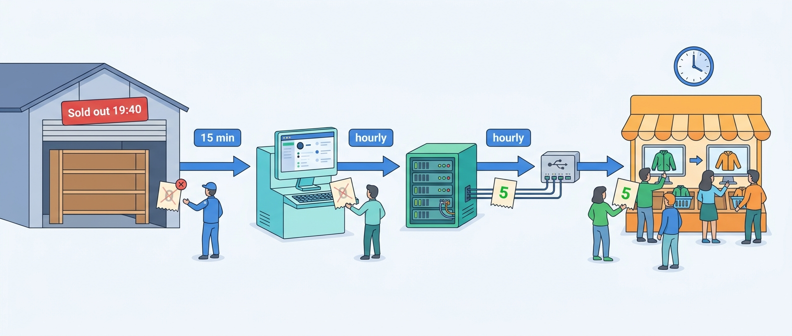
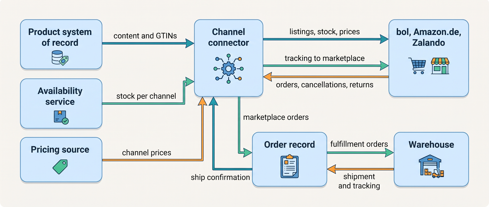
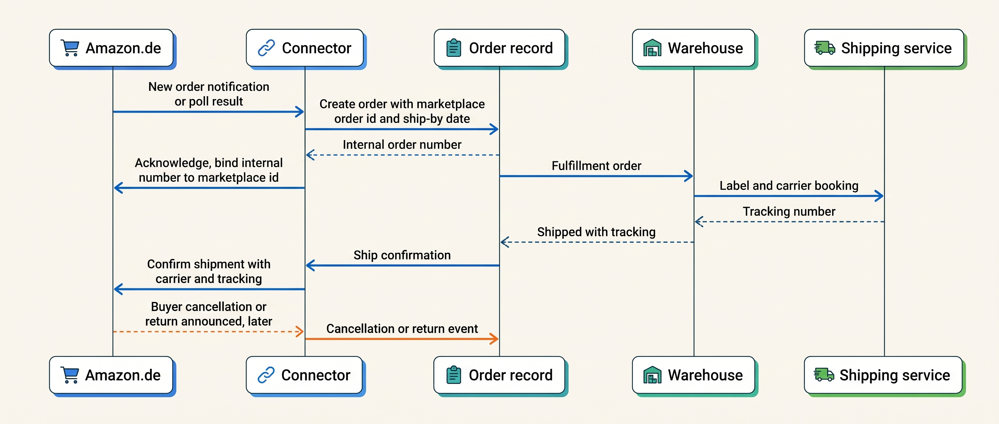
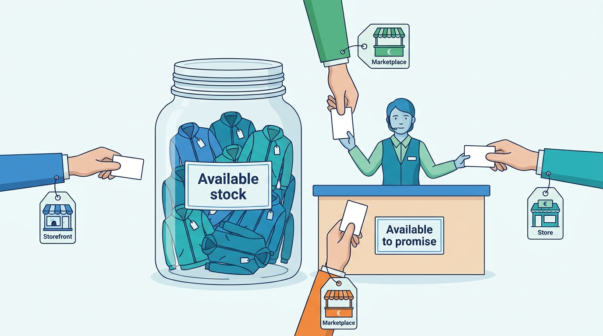

> **IN THIS CHAPTER, YOU WILL:** Learn how a merchant lists, sells and ships on a marketplace, what a channel connector does and must not do, and how to allocate stock and import orders so that marketplace promises are kept.

> **KEY POINTS:**
>
> * **A marketplace is a channel with a scorecard.** It measures your cancellations, late shipments and tracking against public thresholds (Amazon: cancellation rate under 2.5%, late shipment rate under 4%; bol: at most 2% cancellations a week), so every hour of stock or shipment latency inside your integration is a commercial risk, not a technical detail.
> * **The connector translates; it must not own.** Listings should come from the product system of record, the stock number from one availability calculation, prices from the pricing source, and every marketplace order should land in the merchant's one order record. A connector that keeps its own copies becomes a fourth system of record, which is what Kestrel & Pine has today.
> * **The number you send is a promise.** Decide how much stock each channel may sell (a buffer at first, later a computed available-to-promise figure: what can still be sold after existing orders and reservations), model marketplace-held stock as a location you do not control, and own the deprecation calendar of every marketplace API, because versions retire on published dates whether or not anyone is watching.

> **[FAILURE PATTERNS THIS CHAPTER ADDRESSES](where-commerce-platforms-go-wrong.html):**
>
> * **The Phantom Stock** — the stock figure sent to a marketplace is a copy of a copy, hours old, and the last unit sells twice.
> * **The Pulled Rug** — marketplaces and connectors retire API versions on published dates; an unowned script finds out two days later.
> * **Schrödinger's Order** — a marketplace order that lives only in the connector cannot be found by support, finance or the warehouse report.

 
Listing a jacket on Amazon, bol or Zalando can put it in front of shoppers who never visit the merchant's own site. The merchant pays a commission, a share of the sale, and must follow the marketplace's rules for prices, fulfillment and customer service. That additional reach brings obligations its own storefront does not control.

The marketplace also grades performance: cancellations, late dispatch and valid tracking can affect visibility or the right to sell. Those measures depend on the data your integrations send. An old stock figure can become a canceled order; a late shipment message can damage the seller's score even when the parcel left on time.

This chapter follows product **listings**, marketplace orders and status updates through a **channel connector**, the service translating between merchant and marketplace systems. Its permissions matter because a connector that changes prices or stock independently can make a different promise from the web shop. Give it authoritative values to distribute and define which incoming marketplace changes it may accept.

**Where we are in the order's journey.** At Kestrel & Pine, the fictional outdoor brand, Eva buys from the merchant's own storefront. Two illustrative Amazon.de orders on the same day, 13 April 2027, show different routes. One ships from Kestrel & Pine's Duiven warehouse; the other from stock already held by the marketplace. Both must reach the merchant's records. [[journey-of-an-order]] provides the wider journey.

## Setting the Scene at Kestrel & Pine: Two Days of Stale Stock

Kestrel & Pine sells through bol, Amazon.de and Zalando using a rented marketplace connector costing €900 a month. In 2026, those channels brought **43,000 orders and €3.0 million**, averaging **€70 per order** against €92 on its own storefronts. Marketplace fulfillment programs ship about **40% of its German marketplace units**.

Ecommerce and Marketplaces Manager Milan Petrov owns the connector. In March 2027, he walks Head of Engineering Noor Visser through two incidents.

The **Black Friday Oversell** began when Duiven ran out of Ridgewalker jackets at 19:40 on 27 November 2026. Stock traveled from the warehouse management system (WMS) to the enterprise resource planning system (ERP) every 15 minutes, then hourly to the platform and hourly to the connector. Marketplaces kept selling for up to two hours.

In this illustration, about **160** of the 1,120 canceled or delayed orders were marketplace orders, and Kestrel & Pine canceled **140**. Those cancellations counted against seller standards. Bol issued a formal warning, or **strike**, for the week. Marketplace penalties form part of the incident's €96,000 cost.

The second is the **Deprecated Endpoint**. In February 2027 the connector retired an older version of its API on a date it had published months earlier. The agency script that pushed the platform's stock figures into the connector still used that version. Nobody had read the notice. For **two days** the connector kept sending bol the last figures it had, and bol sold from them.

**Figure 1:** *The Black Friday Oversell: the stock figure reached the marketplaces as a copy of a copy, so the Ridgewalker jacket sold out at Duiven at 19:40 and the marketplaces kept selling it for up to two hours.*

Noor's questions are the chapter's questions. Which stock number should each marketplace be told, and who computes it? Where does a marketplace order live, so that support, the warehouse and finance see the same record? And who owns the API calendar of a vendor Kestrel & Pine pays €900 a month and depends on for €3.0 million?

## What a Marketplace Is, and the Two Ways to Sell on One

Selling on a marketplace means publishing an **offer** against a product the marketplace knows: your price, your stock and your delivery promise for an item identified by its **GTIN** (Global Trade Item Number, the number behind the barcode; [[product-information]] owns it). Several sellers can offer the same product, and the marketplace shows one of them in the **buy box**, the single "add to basket" button on the product page; performance and price decide who wins it.

Every large marketplace offers the same two logistics models under its own names.

| Model | Who holds the stock | Who ships | Who handles returns | Amazon name | bol name | Zalando name |
| --- | --- | --- | --- | --- | --- | --- |
| **Seller-fulfilled** | The merchant | The merchant, with its own carriers or the marketplace's labels | The merchant, under marketplace rules | FBM (Fulfilled by Merchant), "Merchant Fulfilled Network" | Own shipping, or "Shipping via bol" | "Own Logistics" |
| **Marketplace-fulfilled** | The marketplace's warehouse, stocked in advance | The marketplace | The marketplace | FBA (Fulfillment by Amazon) | "Logistics via bol" (LvB) | ZFS (Zalando Fulfillment Solutions); ZEOS (Zalando E-commerce Operating System) for multi-channel |

The names are from the vendors' own pages (bol partner platform and Zalando partner university, n.d., accessed November 2026; Amazon's order performance policy, 2026). bol describes Logistics via bol as "We handle storage, shipping, and returns", counts stock daily and charges for it, with a 40% surcharge on stock costs in November and December, as of November 2026.

The architectural difference is larger than the operational one. In the seller-fulfilled model, a marketplace order must enter your order record and your warehouse flow with the marketplace's deadline attached, and your ship confirmation must travel back in time to count. In the marketplace-fulfilled model, your stock sits in **a location you do not control**: you learn its quantity from the marketplace's reports, its sales from the marketplace's notifications, and its returns after the marketplace has processed them. [[inventory-and-availability]] treats such stock as an external location with its own feed, and Kestrel & Pine's Waypoint decision W1 says the same.

**The marketplace is also a competitor.** The German competition authority's 2013 press release on Amazon's price-parity clauses states it plainly: Amazon, "as the largest online retailer, competes directly with" the sellers on its marketplace (Bundeskartellamt, 26 November 2013). Everything you send a marketplace is also market intelligence, and the design question is which attributes and which stock granularity leave the building.

### What it costs

Fees differ by marketplace, category, price band and fulfillment model, and change on published dates. As of November 2026, Amazon's US schedule charges $39.99 a month for a professional account plus a referral fee of mostly 8–15% of the price (clothing 5% up to $15, 10% to $20, 17% above); bol charges no subscription but a fixed amount per item plus a percentage of the price including VAT, by category; Zalando publishes no figures. The lesson is not the numbers but their shape: **fees are dated reference data**, not constants. Margin per channel belongs in the analytics layer ([[commerce-data-and-analytics]]) with the fee schedule versioned by effective date, and the channel price floor (below) is computed from it.

## What the Marketplace Measures You On

Marketplaces publish the metrics they grade sellers on. Amazon's European order performance policy (PDF dated May 2026) and its seller blog (October 2024) give these thresholds:

| Metric | What it counts | Threshold | Window | Applies to |
| --- | --- | --- | --- | --- |
| **Order Defect Rate** | Orders with negative feedback, an A-to-z Guarantee claim or a chargeback | Under 1% | 60 days | All orders |
| **Cancellation rate** (pre-fulfillment) | Orders the seller canceled; customer cancellations excluded | Under 2.5% | 7 days | Seller-fulfilled |
| **Late shipment rate** | Shipping confirmations completed after the expected ship date | Under 4% | 10 or 30 days | Seller-fulfilled |
| **Valid tracking rate** | Shipments with a valid tracking number | Above 95% | 30 days | Seller-fulfilled |
| **On-time delivery rate** | Tracked units delivered by the promised date | 90% or higher expected on Amazon.de; consistently under 80% after a warning may lead to restrictions | Rolling 14 days | Seller-fulfilled |

bol's partner pages (n.d., accessed November 2026) set an "Items on time" minimum of 90%, a cancellation standard of at most 2% a week (from three or more items canceled), and a **strike process**: a strike is a warning for a week below standard on items on time, cancellations or response time; strikes count over 22 weeks; at five the shop is temporarily closed pending an improvement plan; at seven the account is closed for at least a year. bol also cancels an unconfirmed order automatically on the third day after the promised delivery date, and counts that against the seller.

Read the table as an integration specification. **An oversell becomes a seller cancellation**, and a merchant with a few hundred marketplace orders a week needs only a handful to cross 2.5%. **A warehouse confirmation that reaches the marketplace a day late is a late shipment**, however promptly the parcel left. Each row maps to a flow in the next section and to a freshness requirement on it.

## How the Pieces Fit Together

A **channel integration platform** (connector, integrator, "marketplace middleware") sits between the merchant's systems and many marketplaces and translates four kinds of data both ways. Vendors describe the same four functions: ChannelEngine calls itself "One platform for listings, orders, inventory, and pricing across 1,300+ channels" (n.d., accessed November 2026); Shopify's own Marketplace Connect app does the same for Amazon, Walmart, Target Plus and eBay from inside the platform (Shopify Help Center, accessed November 2026).

**Figure 2:** *The connector translates five flows between the merchant's systems of record and the marketplaces; it owns none of the data it carries.*

The five flows and what each needs:

| Flow | Direction | How fresh | How consistent | What goes wrong when it is late |
| --- | --- | --- | --- | --- |
| **Listings** (content, images, attributes, GTINs) | Merchant to marketplace | Hours to a day; seasonal | Must match the product system of record; incomplete content is rejected | A listing goes offline or shows last season's text |
| **Stock** (quantity per offer) | Merchant to marketplace | Minutes; as events happen | One availability figure per channel, computed once | Oversell, seller cancellation, a strike |
| **Prices** | Merchant to marketplace | Minutes to hours | Derived from the pricing source, bounded by a floor | Price drift between channels, a parity warning |
| **Orders** (import, acknowledge, cancel) | Marketplace to merchant | Minutes; before the ship deadline | One order record, keyed on the marketplace order id, idempotent | Auto-cancellation, a duplicate shipment |
| **Status back-flow** (ship confirmation, tracking, returns) | Merchant to marketplace | Within the day of shipment | Carrier and tracking from the shipping service, once | Late shipment rate, invalid tracking rate |

The two fast rows, stock and orders, are why Waypoint's W5 moves them by **events** (a message sent the moment something changes) rather than by periodic copies; [[integration-styles]] picks a style per flow from requirements like these.

### Order import, acknowledgement and back-flow

The marketplace order lifecycle has the same shape everywhere, and the connector's job is to keep two order records in step. The steps below are my synthesis of Amazon's, bol's and ChannelEngine's documented interfaces; marketplace state names differ.

**Figure 3:** *A seller-fulfilled marketplace order: the order is created once in the merchant's record, acknowledged back with the binding between the two order numbers, and its shipment confirmed with tracking before the marketplace's deadline.*

Three points on this diagram carry the chapter.

**Acknowledgement is a binding.** ChannelEngine's documentation calls it "the critical step that links the ChannelEngine order to your internal system"; bol auto-cancels unacknowledged orders on day three after the promised delivery date. The acknowledgement ties the marketplace order id to your order number, and that pair is the key for everything after: cancellations, returns, disputes, payouts.

**Delivery can be duplicated.** Amazon's notifications push to a queue you own; you can also poll; a connector retries. All three can deliver the same order twice, so the receiving side must be **idempotent**: creating the same marketplace order a second time has no effect, because the order record enforces uniqueness on the marketplace order id ([[events-consistency-and-reconciliation]]).

**Ship confirmation is a deadline, not a courtesy.** The late shipment rate is computed from the confirmation's timestamp, so the path WMS → order record → connector → marketplace must complete on the day of shipment. When Kestrel & Pine's WMS connector queue backed up for four hours on Black Friday 2026, every delayed confirmation was also a late shipment on a scorecard.

### What the marketplace APIs actually impose

The marketplaces' own documentation shows that an integration cannot be designed as a tight loop of calls.

**Amazon's Selling Partner API** (SP-API), the only programmatic route since the older MWS (Marketplace Web Service) was retired on 1 April 2024, uses a token-bucket **rate limit** per operation: each call draws a token, tokens refill at a published rate, and a throttled request returns HTTP 429 and must be retried later. The Orders API's `getOrders` has a rate of 0.0167 requests a second, one call a minute, with a burst of 20 (SP-API documentation, accessed November 2026). Amazon's guidance is explicit: "Don't hardcode timers" and "Respond to events rather than polling on a loop, for example, update prices on price notifications".

Listings, prices and stock go up as **feeds**, asynchronous bulk uploads whose result you fetch later. Acceptance of the upload does not confirm that the listing changed. The connector must check the outcome so a rejected update does not leave the marketplace selling at an old price or from an old stock count.

Customer names and addresses are **restricted data** that need a separate token. Keep only the personal data fulfillment needs in the order record: every extra copy adds another place to secure and another record to find when handling a customer request ([[privacy-and-customer-data]]).

**bol's Retailer API** (as of November 2026) warns that "most calls are asynchronous; confirm the result afterwards", publishes its rate limits, and advises sending "only changes that need synchronizing" and "events as they happen instead of large batches". Its lifecycle policy: when a new major version is released, the previous one is deprecated and "scheduled for removal in 12 months". On 3 November 2026 bol's partner news announced that Offers API v10 stops on 1 February 2027.

That last sentence is the Deprecated Endpoint in public form. **A deprecation schedule is a contract clause with a date**, and someone at the merchant must own the calendar even when the connector vendor does most of the work; [[api-contracts-and-versioning]] owns the general discipline.

## Channel Allocation: The Number You Send Is a Promise

The stock figure a connector sends to a marketplace is not a report. It is **the quantity that marketplace is now entitled to sell**, and the marketplace will sell it without asking again. Amazon even publishes a notification (`LISTINGS_ITEM_MFN_QUANTITY_CHANGE`) so a seller can see what Amazon currently believes its quantity to be.

**Channel allocation** is the decision of how much of your available stock each channel may promise. Connectors support several policies, and the choice follows the merchant's stage:

| Policy | How it works | Fits | Breaks when |
| --- | --- | --- | --- |
| **Shared pool** | Every channel is told the full available quantity | One channel, or very deep stock | Two channels sell the last units in the same window; the Oversell |
| **Fixed quantity per channel** | Each marketplace gets a set allocation, replenished by hand | A few hero products, a small team | Stock sits unsold in one channel while another runs out |
| **Buffer** | Each channel is told available minus a safety margin; zero below it | Hourly or slower sync; the interim fix | Long tails: the last units never sell anywhere |
| **Percentage split** | Each channel gets a share of available stock | Channels with predictable demand ratios | Demand shifts (a promotion on one marketplace) and the split is stale |
| **Computed available-to-promise per channel** | One availability service computes what each channel may still sell, from stock events, reservations and channel rules, and publishes changes as they happen | Omnichannel and Group; several warehouses and external locations | Only if the events it depends on are late or missing |

**Figure 4:** *The number you send is a promise: several channels draw on one stock, so one availability calculation decides how much each channel may still sell, instead of each channel reaching into the jar.*

The last row is what [[inventory-and-availability]] builds and what Waypoint's W1 buys as a module of the OMS (order management system, the hub that holds every channel's orders). The principle behind it is simple: **compute available-to-promise once, from the system of record for physical stock, and publish it to every channel from that one computation.** A connector that holds its own stock copy and applies its own rules is a fourth system of record, which is what Kestrel & Pine has in January 2027: the connector keeps a copy of product data for listings and a copy of stock that is up to two hours old.

Marketplace-fulfilled stock adds a second rule. Units in a marketplace's warehouse are **an external location** with its own feed (Amazon's `FBA_INVENTORY_AVAILABILITY_CHANGES` notification exists for exactly this), never a copy of your warehouse figure; the availability service tracks the location, and the marketplace promises from it.

### Kestrel & Pine after the Oversell

Milan Petrov's first fix, set in December 2026, was a buffer. The connector now publishes the platform's figure **minus ten units per variant** to each marketplace, and zero below ten *(illustrative)*. With a two-hour sync lag, ten units is enough for most variants; for the Ridgewalker on a Black Friday evening it would have held for minutes. The buffer has a cost: across roughly 17,000 active variants, the last few units of each are never offered on marketplaces at all.

The target, under W1, is this: the WMS is the system of record for stock at Duiven; the marketplace's fulfillment stock in Germany is a tracked external location; the availability service computes available-to-promise per channel from stock events and publishes changes to the connector as they happen; the connector forwards them to each marketplace within minutes, as bol's rate-limit guidance asks. The hourly chain is retired by Q4 2027, and the buffer shrinks to what the event latency justifies.

A channel rule can then say, for example, "hold the last 20 units of each variant for the storefront, where the margin is highest" *(assumption)*: the connector sends the marketplaces zero while the storefront keeps selling. None of that is possible when the connector only knows "the platform said 410 an hour ago".

### Prices across channels

The same discipline applies to prices. **Price parity** clauses, which required a seller's marketplace price to be no higher than its price elsewhere, were dropped by Amazon in the EU in 2013 after the German competition authority's proceedings (Bundeskartellamt, 26 November 2013; an old source, but the origin of today's rules). Marketplaces still compare prices to decide visibility: Amazon's `PRICING_HEALTH` notification tells a seller that an offer is "ineligible for the Featured Offer (Buy Box) because its price is uncompetitive", and bol's pages say good performance "improves your chance of appearing in the buy box".

**Repricing** is an automated rule that moves a listing's price within bounds in reaction to competitors; ChannelEngine sells it as "dynamic pricing, margin guardrails, and cost-based insights to adjust prices per channel" (n.d., accessed November 2026). The architectural rule: repricing acts on a **channel price** derived from the merchant's pricing source, never on the base price list, and it is bounded by a **floor** computed from cost and fees.

For the Ridgewalker at €199 including 21% VAT, with an assumed 15% commission (the most common referral rate on Amazon's US pricing page; European rates differ) and €6 of shipping, about €128 remains against a landed cost of €58 *(assumptions)*, so the floor sits well above cost.

A connector rule allowed below the floor can undercut the brand's own storefront, which is one way the Price Drift of October 2026 (€179 in Germany for nine days, and a parity warning from a marketplace) happens. [[pricing-architecture]] owns the channel price as a derived price with a source, an effective date and a floor.

## The Choices

A merchant has four realistic ways to connect to marketplaces, and the order-record decision cuts across all four.

**1. The marketplace's own seller tools.** Upload listings by spreadsheet, read orders in the seller portal, key them in, confirm shipments by hand. Right at a few orders a day on one marketplace; wrong when a second marketplace arrives or the late-shipment clock starts biting.

**2. The platform's native channel app.** Hosted platforms ship or list channel apps (Shopify's Marketplace Connect and its social and Google channels, for example). Orders arrive in the platform's own order list and stock is the platform's stock. Cheap, quick and adequate at the Growing stage for the marketplaces the app covers; the reviews are the warning (Marketplace Connect's listing shows a 4.1 rating with 15% one-star reviews citing sync and pricing errors, accessed November 2026). The limit is structural: the app treats the platform as the system of record for stock and orders, true at stage 2 and false at stage 3.

**3. A channel integration platform.** A specialist SaaS (software as a service: rented, hosted software) product (ChannelEngine, EffectConnect, Rithum, Linnworks and others) with ready-made marketplace connections, listing mapping, allocation rules, repricing and order import into your platform, OMS or ERP. This is Kestrel & Pine's choice and the common one for Omnichannel merchants in Europe: tracking dozens of marketplaces' content rules and APIs is the vendor's business. The risk is the fourth-copy problem: the connector *can* hold your stock, prices and products, and will if you let it.

**4. Direct integration.** Build against the marketplaces' APIs yourself. Right for Group-stage merchants with the volume to justify engineers on marketplace APIs, or where no connector expresses a rule the business needs. Below that, you inherit every deprecation, feed quirk and rate limit, per marketplace.

Across all four runs the question **where the marketplace order lives**: either the connector (or app) creates the order in your order record and mirrors status back, or the order lives in the connector and your systems read it there. The first gives one order record with one state model; the second is cheaper at the Growing stage and produces the Three-Status Order the moment stores and EDI arrive. Kestrel & Pine's W2 chooses the first.

| | Marketplace tools by hand | Platform channel app | Channel integration platform | Direct integration |
| --- | --- | --- | --- | --- |
| **Marketplaces covered** | Any, one at a time | The few the app supports | Dozens to hundreds | Those you build |
| **Who tracks API changes** | Nobody | The platform vendor | The connector vendor; you own the connector's own versions | You |
| **Stock allocation** | By hand | Platform stock, sometimes per-channel availability | Rules per channel; risk of a private stock copy | From your availability service |
| **Order record** | Keyed in | The platform's order list | Configurable: create in the OMS or hold in the connector | Your OMS |
| **Cost** | Staff time | Low subscription or per-order fee | Subscription (Kestrel & Pine: €900 a month) | Engineers |
| **Fits** | Starting | Growing, D2C-first (direct-to-consumer) | Omnichannel | Group, or a rule no vendor expresses |

My recommendation for a merchant at the Omnichannel stage is the third option with two conditions written into the contract and the design: the connector creates orders in the order record and does not keep them; and the stock number it publishes comes from the merchant's availability calculation, not from a rule inside the connector. Both conditions assume the merchant has, or is getting, an order record and an availability service. Without them, the connector will own those facts by default, because something has to.

## Across Scale Stages: When It Fits and When It Limits

| Stage | What is typical | What becomes necessary | Warning signs of outgrowing it |
| --- | --- | --- | --- |
| **1 — Starting** | One marketplace, or none; seller portal and spreadsheets; orders keyed into the shop; one fulfillment model | A decision whether the marketplace is a test or a channel; GTINs on every variant before listing | More than an hour a day copying orders; the first late-shipment warning |
| **2 — Growing** | Two or three marketplaces through the platform's channel app or a connector; the platform's stock is the figure sent everywhere; orders mirrored into the platform | A buffer per channel; one owner for the seller account and its scorecard; the deprecation calendar on someone's list | A second order source (a store or wholesale) makes the platform's order list incomplete; a strike or a restricted category |
| **3 — Omnichannel** | A channel integration platform over several marketplaces and countries; both fulfillment models; marketplace-held stock | Available-to-promise per channel from an availability service; marketplace orders created in the OMS; channel prices with floors; ship confirmation by event from the WMS; reconciliation of connector stock against the system of record | Oversells at peak; the connector holds the only copy of marketplace orders; nobody can say what a marketplace believes the stock is |
| **4 — Group** | Many marketplaces per brand and country; direct integrations where volume justifies; a marketplace as logistics provider for the brand's own shop; perhaps operating a marketplace | A channel syndication service over the PIM (product information management system) with reduced, channel-specific views; fee schedules and performance data in the data platform; seller-identity obligations if operating a marketplace | Each brand runs its own connector with its own rules; margin per channel unknown; a marketplace program change forces a re-architecture |

The judgement: the mechanism scales with the number of *order sources*, not with order volume. One marketplace feeding the platform's order list works at stage 2 at any volume the platform handles. The moment a store, a wholesale portal or a second marketplace also creates orders, the platform's order list is no longer the order record, and the marketplace integration must be re-pointed at whatever is. Kestrel & Pine crossed that line in 2023 and noticed in December 2026.

## In Practice

**Marketplaces retire interfaces on their own calendar.** Amazon's older MWS interface was no longer available from 1 April 2024, after a migration schedule that had already moved once (SP-API changelog, 2023–2024); bol's Offers API v10 stops on 1 February 2027. Programs retire too: Zalando announced in April 2026 that Connected Retail, under which "stationary retailers sold branch stock directly through the platform and shipped orders from their stores", ends by the end of June 2027 (TextilWirtschaft, 24 April 2026). A merchant whose store-stock exposure was built on Connected Retail's tool rebuilds it; one whose store stock is a location in its own availability service changes a connector ([[stores-and-omnichannel]]).

**The marketplace is becoming infrastructure.** Zalando's ZEOS, announced on 17 October 2023 as "one stock pool, one carrier integration and one user interface", was by December 2025 available in 24 markets and serving 18 sales channels, including brands' own web shops (Zalando corporate releases, 2023 and 2025). For a merchant that means a third kind of stock location, marketplace-held but multi-channel, and a dependency on the marketplace's APIs for its *own* storefront's orders.

**Social channels switch between feed and order source.** Meta moved Facebook and Instagram Shops from in-app checkout to website checkout in 2025 (trade press, June 2025), so for most merchants it is again a **shopping feed** destination: a structured product file with title, price, availability, GTIN and image.

TikTok Shop went the other way, opening in-app checkout in Germany, France and Italy on 31 March 2025 (widely reported) and in the Netherlands, Belgium, Austria and Poland from 15 June 2026 (TikTok newsroom, 28 May 2026).

A social channel may send shoppers to the merchant's checkout or take orders itself. Supply its catalog from the product system of record and route any orders through the marketplace import, so those purchases join the same stock and fulfillment controls. **Retail media**, sponsored marketplace listings, adds a per-channel cost and a reporting stream; it does not create a separate order flow.

**Operating a marketplace is a different book.** Mirakl sells the operator side (seller onboarding, per-seller offers, order splitting, payouts) to over 450 companies (Mirakl and Wikipedia, accessed November 2026). The Digital Services Act adds the legal core: since 17 February 2024, Article 30 requires platforms that let consumers buy from traders to obtain and verify the trader's identity, payment account and register details before they can sell, and to suspend traders who do not supply them (Regulation (EU) 2022/2065); that is why every marketplace onboarding asks a merchant for identity documents and bank details. The operator's architecture is the subject of LISTED; start with [[marketplace-regulation]] and [[liquidity-and-network-effects]].

### Kestrel & Pine: the marketplace variant, 13 April 2027

Two Amazon.de customers order a Ridgewalker jacket on the day of Eva's order. Here is each order's path in April 2027, before W1 and W2 land, and what changes after.

| Step | Seller-fulfilled order (shipped from Duiven) | Marketplace-fulfilled order (shipped by Amazon) |
| --- | --- | --- |
| Where the order appears | The connector pulls it from Amazon and creates a connector order; the iPaaS (integration platform as a service, which runs Kestrel & Pine's data flows) passes it to the WMS; it reaches the ERP only in the daily finance batch | The connector sees it in Amazon's reports; no warehouse work; it reaches the ERP only in the finance batch |
| Stock effect | Duiven stock falls when the WMS picks; the ERP learns within 15 minutes, the platform within an hour, the connector within two | The German external-location quantity falls by one; Kestrel & Pine learns it from the marketplace's inventory feed |
| Shipment | Picked and packed 14 April, DHL label from the shipping service; tracking flows WMS → iPaaS → connector → Amazon the same day | Amazon ships and sends tracking to the customer; Kestrel & Pine is told after the fact |
| Scorecard | Cancellation, late shipment, valid tracking and on-time delivery all apply | Only the order defect rate applies |
| Return | Announced by Amazon, acknowledged by the connector, received at Duiven | Handled by Amazon from the external location |
| After W1 and W2 | Created in the OMS by the connector with the Amazon order id and ship-by date; available-to-promise reduced by event; ship confirmation by event from the WMS | Created in the OMS as a marketplace-fulfilled order for finance and analytics; the external location adjusted by event; no fulfillment order |

The second column is the one most merchants get wrong: because the marketplace does all the work, the order never enters the order record, and revenue, returns and the external location's stock are reconstructed from the marketplace's statements at month-end. Hanna Berg's three definitions of "order" (W7) are partly this.

## When It Goes Wrong

| Failure | How it shows | Detection | Recovery |
| --- | --- | --- | --- |
| **Duplicate order delivery** (notification and poll both deliver it; the connector retries) | Two internal orders, two parcels, one payment | Uniqueness on the marketplace order id at creation; a daily count of marketplace orders by id against internal orders | Cancel the duplicate before pick; if shipped, treat as a return; make the import idempotent |
| **Stale stock** (sync failure, a retired API version, a feed rejected) | The marketplace keeps selling a sold-out variant; the cancellation rate rises | An **age monitor** per channel: alert when the last accepted stock update is older than the agreed interval; read every feed result (Amazon keeps them 28 days); compare what the marketplace believes with available-to-promise | Push a full stock snapshot; fix source data in the product system of record, not in the connector; cancel oversold orders early |
| **Late ship confirmation** (warehouse queue, iPaaS outage) | The late shipment rate climbs though parcels left on time | Compare carrier scan time with confirmation time daily | Send confirmations by event from the WMS; backfill from the shipping service's records |
| **External-location drift** (marketplace-fulfilled stock) | Your figure and the marketplace's differ; replenishment is planned on the wrong number | Weekly reconciliation of the external location against the marketplace's inventory report | Adopt the marketplace's figure as the location's truth and investigate the difference |
| **Return announced by the marketplace, unknown to the returns portal** | The unit arrives at Duiven with no record; the marketplace refunds while a second refund is prepared internally | Every marketplace return acknowledged into the order record with the marketplace return id | One refund path per channel; [[returns-and-exchanges]] |
| **A retired API version** | Everything stops, quietly, on a published date | The deprecation calendar in the integration inventory with an owner per entry; the age monitor above | Upgrade; meanwhile a manual stock snapshot through the seller portal |

The **age monitor** is the cheapest control in the chapter: for each channel, the time since the marketplace last accepted a stock update. It would have caught the Deprecated Endpoint within the hour instead of after two days. **Early cancellation** runs against instinct: once an oversell is certain, canceling at once costs a cancellation-rate point, while waiting for the stock to "turn up" costs a late shipment and often a defect as well.

## What to Take Away

**Established.**

- Marketplaces grade sellers on published performance metrics with consequences; Amazon's thresholds (cancellation rate under 2.5% over 7 days, late shipment rate under 4%, valid tracking above 95%, order defect rate under 1%) and bol's standards and strike process (at most 2% cancellations a week; five strikes close the shop) are documented as of 2026.
- Marketplace APIs are rate-limited and asynchronous, and versions retire on published dates: Amazon's `getOrders` allows one call a minute and Amazon recommends notifications over polling; bol removes deprecated major versions after 12 months. An integration must be event-driven, idempotent and owned.
- The two fulfillment models are architecturally different: seller-fulfilled orders enter the merchant's order and warehouse flow with a deadline; marketplace-fulfilled stock is a location the merchant does not control and learns about from the marketplace's feeds.

**Depends on context.**

- A platform's native channel app is enough while the platform is the only source of orders and holds the only stock figure (Starting and Growing stages). Once a store, wholesale or a second system creates orders, marketplace orders must be created in whatever the order record is.
- A stock buffer per channel is the right interim allocation when sync is hourly; computed available-to-promise per channel is right when stock moves by events and several channels and locations compete. The buffer's cost (units never offered) grows with the catalog's long tail.
- Direct marketplace integrations are right only with the volume to keep engineers on the marketplaces' APIs, or a rule no connector expresses; below that, rent the connector and own the contract.

**The author's synthesis.**

- The connector's job is translation, and the one design rule I insist on is that it owns nothing: not the product content, not the stock figure, not the order. Every incident in this chapter is a connector that was allowed to own a copy because nothing else did.
- Treat the marketplace scorecard as an integration SLA (service-level agreement) you did not negotiate: derive a freshness requirement per flow from the metrics, and monitor the age of the last accepted update per channel before anything else.

## Questions to Ask

1. Which system computes the stock figure each marketplace is told, and does the connector apply any rule of its own on top of it?
2. Where is a marketplace order created, and can support, the warehouse and finance find it by the marketplace order id?
3. Who owns the seller account's scorecard, and who sees the cancellation and late shipment rates weekly?
4. How long does a ship confirmation take to reach the marketplace, and what happens when the iPaaS is down?
5. For marketplace-fulfilled stock, which system holds the external location's quantity, and how often is it reconciled against the marketplace's report?
6. Who holds the deprecation calendar for the connector's own API and for each marketplace's API, and when is the next retirement date?
7. Is the price sent to each marketplace derived from the pricing source with a floor, and can a repricing rule go below it?
8. If a marketplace closed our account tomorrow, what revenue and which stock would be stranded?

Marketplaces are one kind of order that arrives from outside the shop. The next chapter turns to the other kind Kestrel & Pine lives on: the 1,100 wholesale accounts whose buyers are companies, with contract prices, payment terms and credit limits that no consumer checkout knows how to express. Continue with [[b2b-commerce]].

## Sources and Evidence

*Company, product and investor sources*

- [Usage plans and rate limits](https://developer-docs.amazon/sp-api/docs/usage-plans-and-rate-limits), Amazon SP-API documentation, n.d., accessed 2026-11 — token-bucket rate limiting, HTTP 429, "Respond to events rather than polling".
- [Orders API rate limits](https://developer-docs.amazon/sp-api/docs/orders-api-rate-limits) and [Orders API](https://developer-docs.amazon/sp-api/docs/orders-api), Amazon, n.d., accessed 2026-11 — `getOrders` at 0.0167 requests a second; v0 deprecated, v2026-01-01 current.
- [Notifications API](https://developer-docs.amazon/sp-api/docs/notifications-api) and [Notification type values](https://developer-docs.amazon/sp-api/docs/notification-type-values), Amazon, n.d., accessed 2026-11 — order change, pricing health, listing quantity and FBA inventory notifications.
- [Feeds API](https://developer-docs.amazon/sp-api/docs/feeds-api) and [Tokens API use case guide](https://developer-docs.amazon/sp-api/docs/tokens-api-use-case-guide), Amazon, n.d., accessed 2026-11 — asynchronous feeds, 28-day result retention, Restricted Data Tokens for personal data.
- [Changes to Order Performance Program Policy (DE)](https://m.media-amazon.com/images/G/03/B2B/MFN/Changes_to_Order_Performance_Program_Policy_-_DE.pdf), Amazon, 2026 — performance metric definitions, thresholds and windows.
- [Amazon seller policies to know](https://sell.amazon.com/blog/selling-policies), Amazon, 2024 — ODR under 1%, late shipment under 4%, cancellation under 2.5%.
- [Pricing (US)](https://sell.amazon.com/pricing), Amazon, n.d., accessed 2026-11 — subscription and referral fees by category and price band.
- [bol partner platform news](https://partnerplatform.bol.com/en/), bol, 2026-11-03 — Offers API v10 stops on 1 February 2027.
- [API lifecycle](https://api.bol.com/retailer/public/Retailer-API/api-lifecycle.html) and [Rate limiting](https://api.bol.com/retailer/public/Retailer-API/ratelimits.html), bol Retailer API, n.d., accessed 2026-11 — 12-month deprecation, asynchronous calls, "events as they happen".
- [Commission](https://partnerplatform.bol.com/en/idp/commission), [Items on time](https://partnerplatform.bol.com/en/idp/items-on-time), [Cancellations](https://partnerplatform.bol.com/en/idp/cancellations), [Strike process](https://partnerplatform.bol.com/en/idp/strike-process) and [Conditions and rates LvB](https://partnerplatform.bol.com/en/idp/conditions-and-rates-lvb), bol, n.d., accessed 2026-11 — fee model, service standards, strikes, fulfillment surcharges.
- [Zalando logistics solutions: an overview](https://partner.zalando.com/university/article/zalando-logistics-solutions-overview), Zalando Partner University, n.d., accessed 2026-11 — ZFS, Own Logistics and ZEOS terms.
- [Productizing Zalando's capabilities: introducing ZEOS](https://corporate.zalando.com/en/node/10491), Zalando SE, 2023, and [The evolution of our B2B growth engine](https://corporate.zalando.com/en/node/10922), Zalando SE, 2025 — ZEOS launch; 24 markets, 18 channels, over 60 merchants.
- [Zalando stellt Connected Retail ein](https://www.textilwirtschaft.de/tech/zalando-stellt-connected-retail-ein-158921), TextilWirtschaft, 2026 — Connected Retail ends by June 2027.
- [ChannelEngine](https://www.channelengine.com/), [EffectConnect](https://www.effectconnect.com/), [Rithum](https://www.rithum.com/) and [Linnworks](https://www.linnworks.com/), vendor pages, n.d., accessed 2026-11 — the four connector functions and channel counts; [Merchant API: orders](https://support.channelengine.com/hc/en-us/articles/34188693762589-Merchant-API-orders), ChannelEngine support, n.d. — acknowledgement "links the ChannelEngine order to your internal system".
- [Marketplace Connect](https://help.shopify.com/en/manual/online-sales-channels/marketplace-connect) and [app listing](https://apps.shopify.com/marketplace-connect), Shopify, n.d., accessed 2026-11 — supported marketplaces, pricing, review profile.
- [Kaufland Global Marketplace conditions](https://www.kauflandglobalmarketplace.com/en/conditions/) and [OTTO Market](https://www.otto.market/), vendor pages, n.d., accessed 2026-11 — subscription and commission figures.
- [TikTok Shop expands across Europe](https://newsroom.tiktok.com/tiktok-shop-expands-across-europe?lang=en-150), TikTok, 2026 — launch in the Netherlands, Belgium, Austria and Poland from 15 June 2026.
- [Meta phases out Facebook and Instagram Shops checkout](https://ppc.land/meta-phases-out-facebook-and-instagram-shops-checkout-by-august-2025/), PPC Land, 2025 — move to website checkout (trade press).
- [Mirakl](https://www.mirakl.com/), vendor page, n.d., accessed 2026-11, and [Mirakl](https://en.wikipedia.org/wiki/Mirakl), Wikipedia, accessed 2026-11 — marketplace operator platform.

*Standards, regulation and official documentation*

- [Regulation (EU) 2022/2065 (Digital Services Act)](http://publications.europa.eu/resource/celex/32022R2065), Publications Office of the EU, 2022 — Article 30 trader traceability; application from 17 February 2024.
- [Amazon abandons price parity clauses for good](https://bundeskartellamt.de/SharedDocs/Meldung/EN/Pressemitteilungen/2013/26_11_2013_Amazon-Verfahrenseinstellung.html), Bundeskartellamt, 2013 — end of EU price-parity clauses; Amazon as competitor to its sellers (evidence age).

*Research and practitioner sources*

- [Important: Amazon MWS removal dates](https://developer-docs.amazon.com/sp-api/changelog/important-amazon-marketplace-web-service-mws-removal-dates), Amazon SP-API changelog, 2023–2024 — MWS no longer available from 1 April 2024 (page has since moved).

Kestrel & Pine is fictional; architectural recommendations, labeled inferences and labeled assumptions are the author's judgement.
