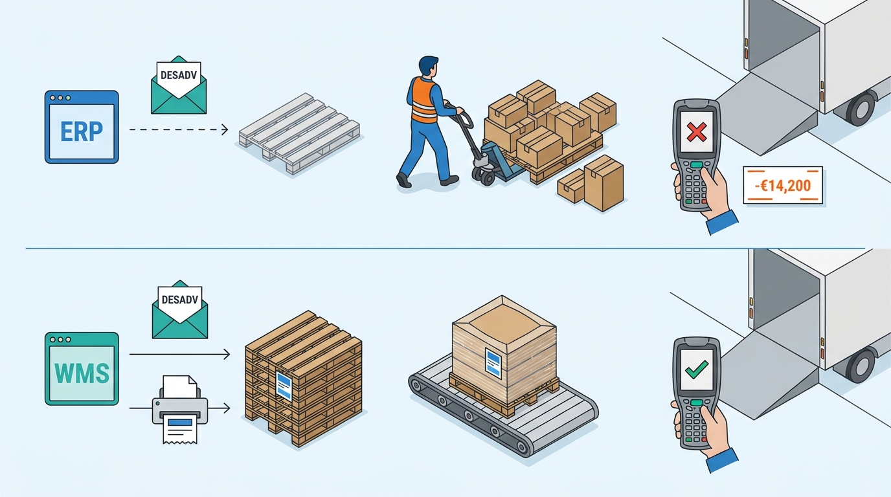
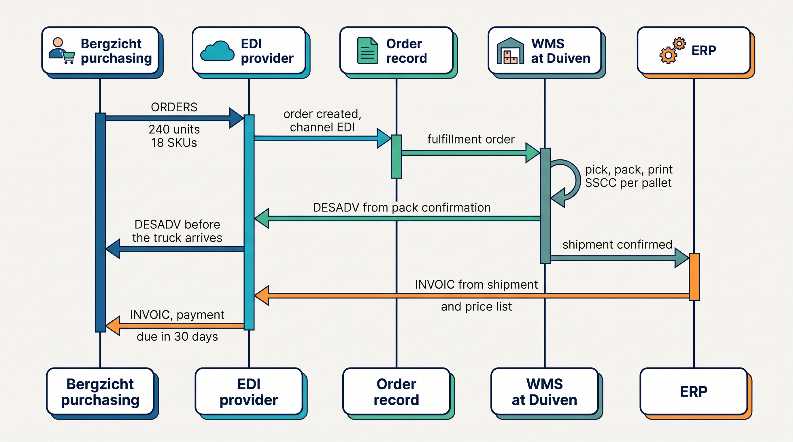
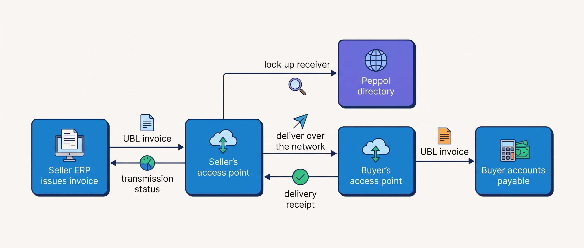
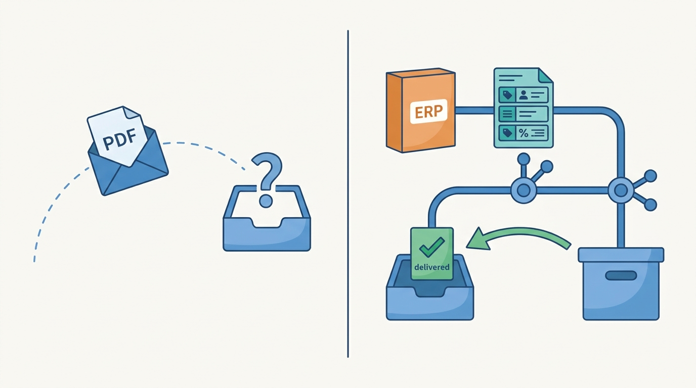

> **IN THIS CHAPTER, YOU WILL:** Learn how companies trade by exchanging standard documents, why each document must come from a different system, and which e-invoicing deadlines already apply.

> **KEY POINTS:**
>
> * **EDI is a channel into the order record, not a separate order system.** An EDI order should create the same order object as a web order, flagged by channel, so allocation, invoicing and the books see one shape.
> * **Each document has its own system of truth.** The order comes from the buyer, the despatch advice must come from what the warehouse packed and labeled, and the invoice must come from what was shipped and priced. Generating any of them from the wrong system is how chargebacks happen.
> * **E-invoicing is a legal calendar, not a feature.** Belgium has required structured e-invoices over Peppol for domestic business-to-business invoices since 1 January 2026, Germany's issuing obligation starts in 2027, and the Netherlands plans 2030. The invoice becomes a transmitted document with a delivery status the ERP must hold.

> **[FAILURE PATTERNS THIS CHAPTER ADDRESSES](where-commerce-platforms-go-wrong.html):**
>
> * **The Pulled Rug** — a trading partner changes its message guideline, a label rule or a legal format, and the merchant learns from a rejected delivery.
> * **The Lynchpin** — the EDI mappings live in one consultant's head or one provider's portal, and nobody inside the company can read them.
> * **The Long Fuse** — an e-invoicing mandate with an official date is discovered when the first customer's system refuses a PDF.

 
Most of this book follows orders that start on a web page. This chapter is about orders that never do. When a retail chain buys from a brand, nobody logs in to a storefront. The chain's purchasing system writes a purchase order, sends it to the brand's system in a format both agreed years ago, and expects two documents back: a notice saying exactly what is on each pallet before the truck arrives, and an invoice its accounts-payable software can read without a person retyping it. **The buyer, not the seller, chooses this channel**, and writes it into its purchasing conditions with penalties.

Electronic data interchange, **EDI**, is the name for this exchange of standard business documents between two companies' systems: no e-mail, no PDF, no retyping. It is older than the web, slow to change, and a brand that wants to sell to chains has to speak it.

A second kind of document has joined it. Since 1 January 2026, a business in Belgium that invoices another Belgian business must send a **structured electronic invoice** over a public network called Peppol; a PDF by e-mail no longer counts. Germany, France, Italy and Poland have their own rules and dates, and the Netherlands has announced 2030. **The invoice is becoming a transmitted legal document with a delivery receipt**, and the system that issues invoices has to know whether each one arrived.

**Where we are in the order's journey.** Eva's jacket, the recurring consumer order in this book, never touches EDI. Its wholesale sibling does: Bergzicht's spring reorder of 6 April 2027, which [[journey-wholesale-order]] follows end to end. The two orders meet in the warehouse, where the same Duiven stock and the same WMS (warehouse management system: the software that runs receiving, picking, packing and shipping) serve both, and in the ledger, where both become postings.

## Setting the Scene at Kestrel & Pine: A Deduction Instead of a Payment

Kestrel & Pine, the fictional outdoor brand this book follows (see [[meet-kestrel-and-pine]]), has one customer that orders by EDI: **Bergzicht Outdoor**, a fictional Dutch outdoor retail chain with 38 shops and a distribution center in Zwolle, worth €2.1 million a year. Bergzicht has sent its orders electronically since 2025 through **the EDI provider**, a value-added network (VAN) that relays documents between trading partners. Three message types travel: Bergzicht's order (ORDERS), Kestrel & Pine's despatch advice (DESADV) and its invoice (INVOIC).

In October 2026, Lea Moreau, Head of Wholesale, received a remittance from Bergzicht that was **€14,200 short**. The attached statement listed nine third-quarter deliveries whose pallet labels had not matched the despatch advice announcing them. Bergzicht's supplier conditions let it charge a fixed compliance fee per non-compliant delivery plus the cost of counting the pallets by hand. The book calls this **the ASN Chargeback**, after ASN (advance shipping notice), the general name for a despatch advice.

The mechanism took Lea and Ruben Alves, the integration engineer, two weeks to reconstruct, because the only person who knew the EDI mappings was an external consultant engaged in 2025. **The ERP** (enterprise resource planning system: the back-office system that keeps the books, purchasing and invoicing) generated the despatch advice the moment a wholesale order was released to the warehouse, before anyone had packed anything, with pallet numbers from an ERP number range and contents as the order lines suggested. At Duiven, the WMS printed its own pallet labels at pack time. When pickers merged two half-pallets or split a heavy one, the labels on the truck and the message in Bergzicht's system described different pallets, and Bergzicht's scanners rejected them.

**Figure 1:** *The ASN Chargeback: the ERP announced pallets before anyone had packed them, the WMS labeled the pallets it actually built, and the mismatches on nine deliveries cost €14,200.*

Noor Visser's question in the Waypoint proposal is the one this chapter answers: **which system knows the truth each document claims to carry?** The ERP knew the order. Only the WMS knew the pallets. Waypoint decision **W6** fixed it: pallet labels generated by the WMS at pack time, the despatch advice sent from the WMS pack confirmation, and one EDI partner card per trading partner so that no mapping lives in one person's head again.

## What EDI Is and Why It Has Not Gone Away

In plain words, EDI is a set of agreed message formats plus a way of delivering them. A **message** is a document such as an order; a **standard** says which fields it has and in which order; a **transport** is how the file travels; a **mapping** is the translation between the standard's fields and the fields in your own system.

Two standards dominate. **UN/EDIFACT** is the United Nations standard, maintained by UN/CEFACT, whose syntax became ISO 9735 in 1987; European retail uses the **GS1 EANCOM** subset, which GS1's manual (2002 edition, last updated 2021) describes as the UN/EDIFACT messages and fields relevant to retail. **ANSI X12** is the North American standard. A European brand selling to a Dutch chain and a US chain needs both; the message pairs are functional equivalents, not field-for-field translations.

GS1's 2021 implementation survey, the most recent public one, reported ORDERS, INVOIC and DESADV as the three most implemented EANCOM messages and AS2 as the most used transport. The survey is five years old; the standards it describes have barely changed since, which is the point.

Why does a format from the 1980s still carry wholesale orders in 2027? Four reasons, stated as industry practice. **The buyer chooses**: Jumbo, the Dutch supermarket chain, writes in its purchasing conditions of 9 April 2026 that suppliers "undertake to conduct all communication concerning the flow of goods (being order, packing slip (DESADV) and invoice) via EDI", forfeit €70 per message otherwise, and may have deliveries without DESADV and SSCC (the pallet's serial number, defined below) refused. **The documents carry meaning**: an order is a purchase commitment, a despatch advice a receiving plan, an invoice a payment claim, and their stability is a feature. **Network effects**: once a chain has mapped hundreds of suppliers, changing format costs more than keeping it. **Regulators accommodate it**: Germany lets an EDI procedure that does not yet meet the e-invoice requirements run to the end of 2027 rather than banning it.

## The Documents: Order, Despatch Advice, Invoice

| Document | EDIFACT | X12 | Sender | What it says | Internal system of truth |
| --- | --- | --- | --- | --- | --- |
| Order | ORDERS | 850 | Buyer | Items, quantities, delivery date and address | The buyer's purchasing system; it creates an order record on the seller's side |
| Order response | ORDRSP | 855 | Seller | What will be delivered, line by line, including shortages | The seller's order record after allocation |
| Despatch advice (**ASN**) | DESADV | 856 | Seller | What is physically coming, pallet by pallet | The WMS pack confirmation |
| Invoice | INVOIC | 810 | Seller | What is owed for what was shipped, at agreed prices, with VAT (value-added tax) | The ERP, from shipment and price, never from the order |
| Syntax acknowledgment | CONTRL | 997 | Receiver | "I could parse your file", not "I accept it" | The EDI translator |

The **ASN** (advance shipping notice) deserves its own sentence. It is a message sent at despatch telling the receiver what is coming, pallet by pallet, so receipt can be scanned instead of counted. Jumbo's guidelines for its mechanized distribution center (October 2025) state the consequence: every delivery "must be preceded by a DESADV message", completed to pallet level, "a delivery without an accompanying DESADV message cannot be processed and is therefore refused", and "the SSCC label forms the link with the DESADV despatch message". The ASN is the receiving plan; the pallet label is the key into it.

A CONTRL or 997 says only that the file was syntactically readable, not that the order was accepted, the delivery received or the invoice will be paid; those answers come in ORDRSP, a receiving advice and, eventually, payment. **Treating a syntax acknowledgment as acceptance is a common and expensive mistake.**

**Figure 2:** *Bergzicht's spring reorder as a document cycle: the order creates a normal order record, the despatch advice comes from the WMS once the pallets are labeled, and the invoice comes from the ERP once the shipment is confirmed. Three documents, three systems of truth.*

## Identifiers: What, Where and This Pallet

EDI works because both sides use the same numbers for things, places and shipments. GS1's General Specifications (Release 26.0, ratified January 2026) define all three:

- A **GTIN** (Global Trade Item Number) identifies *what*: a sellable product, the number in the barcode on a jacket's hang tag; [[product-information]] owns the term.
- A **GLN** (Global Location Number) identifies *who and where*: a legal entity or a physical place, such as Bergzicht's Zwolle distribution center. Messages address parties by GLN; Jumbo requires that the supplier GLN in the DESADV equal the GLN the order was sent to.
- An **SSCC** (Serial Shipping Container Code) identifies *this pallet*: an 18-digit serial number on a logistics unit's label. GS1 states that the SSCC "is the only GS1 key that SHALL be used as the identifier of a logistic unit" and "is used with EDI communications to enable identification and traceability". bol has required SSCC labels on every logistics unit since 31 December 2021 and requires EDI suppliers to include the SSCC in the DESADV.

The ASN ties the three together: each SSCC lists the GTINs and quantities it holds, addressed from one GLN to another. Hence the rule Kestrel & Pine paid for: **the SSCC must be generated by the system that physically builds the pallet.** An ERP that invents pallet numbers before packing produces an ASN that is wrong whenever the warehouse deviates from the plan.

## Transport: Point-to-Point or Network

| Transport | What it is | You connect to | Typical use |
| --- | --- | --- | --- |
| **AS2** | A protocol (RFC 4130, 2005) for signed, encrypted documents over HTTP with a signed receipt proving delivery | Each partner: one certificate and endpoint per partner | Large retailers; the most used channel in GS1's survey |
| **SFTP** | Secure file transfer to a server, polled on a schedule | Each partner | Smaller partners, batch flows |
| **VAN** (value-added network) | A provider-operated mailbox network that relays to any partner on it and often translates formats | The provider, once | The common choice for a mid-size brand; Kestrel & Pine's EDI provider is one |
| **Peppol** | An open network run by OpenPeppol, a Brussels non-profit, in which parties connect through any accredited **access point** and reach any participant; it mandates document standards and has a public directory | Your access point, once | E-invoices where governments mandate them; Belgian business invoices since 2026 |

AS2 and SFTP are point-to-point: every partner is a relationship to manage. A VAN and Peppol are networks: connect once, reach many. Peppol alone has a public directory and mandates what the documents look like. OpenPeppol calls it the **four-corner model**: the sender hands the document to its access point, which delivers it to the receiver's access point, which delivers it to the receiver, with no bilateral agreement.

**Figure 3:** *Peppol's four-corner model: each party connects once to an access point of its choice; the sender's access point finds the receiver in a public directory and delivers; the transmission status flows back to the system that issued the invoice, which must store it.*

## Mapping, Onboarding and the Chargeback Economy

The standards are public; the cost is per partner. Every chain publishes its own **message implementation guideline**: which optional fields it requires, which codes it accepts, how deep the DESADV must go. **Mapping** is the translation between a partner's guideline and your own order, shipment and invoice records, done and maintained per partner. That is the business model of the EDI providers: SPS Commerce's annual report for 2025, filed in February 2026, describes a network that lets companies "connect once and immediately transact with thousands of trading partners without negotiating standards, building integrations, or maintaining" them, and reported $751.5 million of revenue, 96% of it recurring. Jumbo tells small suppliers that its WebEDI portal is "the simplest, and cheapest in the short term", while an integrated connection "requires translating EDI messages to and from your internal system, with effort from IT, a solution provider, and system users".

Chargebacks are how the buyer enforces the guideline. They come in two families. **Delivery performance**: Walmart's on-time-in-full program charged a 3% fee on orders not delivered in full or on time when it launched in 2017 (the thresholds have risen since; no official Walmart page states them), and Jumbo's 2026 conditions add €250 per order when less than 90% of an order line arrives as agreed. **Data and label compliance**: a missing ASN, an unscannable label, an ASN quantity that does not match receipt; Jumbo's €70 per message is this family. The first family is a logistics problem. **The second is an architecture problem**: the ASN is only as right as the system that generated it.

## How EDI Documents Reach the Order Record and the Ledger

Here is the rule this chapter exists to state. **An EDI order is a channel into the order record, not a separate order system.** An ORDERS message should create the same order object a web order creates, flagged by channel, so that stock allocation, invoicing and the books see one shape. The common failure is the opposite: EDI orders sit in the ERP or the provider's portal, web orders in the platform, marketplace orders in the connector, and nobody has one list. That was Kestrel & Pine's January 2027 state, and [[order-management]] explains why Waypoint's OMS (order management system: the one place every channel's order is created, with one state model) takes EDI orders from the ERP in Q4 2027.

Each document then has a different internal source:

| Document | Produced from | Never from | Why |
| --- | --- | --- | --- |
| Order record | The ORDERS message after mapping and validation: item codes resolved, prices checked against the contract price list, delivery date feasible | A retyped e-mail | The buyer's commitment enters the system of record once, unchanged |
| Order response | The order record after allocation (stock set aside for this order; [[inventory-and-availability]]) | The ORDERS echoed back | A response that promises everything promises nothing |
| Despatch advice | The WMS pack confirmation: which SSCC holds which GTINs in which quantity | The order or an ERP number range | The receiver scans what is physically on the truck |
| Invoice | The ERP, from the confirmed shipment and the contract price, with VAT, in the legal numbering sequence | The order (quantities may have changed) or the WMS (prices and VAT live elsewhere) | The invoice is a payment claim for what was delivered; [[tax-invoicing-and-ledger]] owns its legal shape |

The flows have different requirements, which is the argument against forcing them through one system:

| Flow | How fresh | How consistent | How fast | How available |
| --- | --- | --- | --- | --- |
| ORDERS in → order record | Minutes; chains commonly expect a response within hours *(assumption)* | Exactly once: a duplicate ORDERS must not create two orders | Batch acceptable | A provider outage must queue, not lose |
| DESADV out | Must leave before the truck arrives | Must match the labels exactly | Minutes after pack confirmation | A late ASN is a refused delivery |
| Invoice out | Same day as shipment, or per month-end rules | One invoice per shipment; immutable once numbered | Daily batch acceptable | Rejection must be a tracked state |
| Transmission status back | Within hours | Per document | Not critical | Needed as dispute evidence |

## Punchout: When the Buyer's System Owns the Order

Some corporate buyers send no ORDERS at all; they shop in your web shop from inside their own procurement system. This is **punchout**. The cXML User's Guide, the protocol behind SAP Ariba's punchout, describes it plainly: procurement applications "display a button instead of product or pricing details", the buyer's browser then shows "pages from the supplier's local website", and when the user is done, a button "returns the order information to the procurement application". SAP's OCI (Open Catalog Interface) is the equivalent for SAP procurement; a 2026 integrator's description notes that OCI posts cart lines back to a hook URL and lacks native purchase-order and invoice automation.

Punchout **inverts the usual flow**. The buyer's procurement system owns the requisition and the purchase order; the supplier's shop is only a catalog session. The real order arrives later as a cXML order request or an EDI ORDERS, so **the shop must never treat a punchout cart as an order**. [[b2b-commerce]] covers punchout as a feature; here it matters as another channel into the same order record.

## E-Invoicing: The Invoice Becomes a Transmitted Legal Document

The European Commission defines an **electronic invoice** as one "issued, transmitted and received in a structured data format which allows for its automatic and electronic processing"; a PDF attached to an e-mail is not one. Three layers to keep apart:

1. **The semantic model.** **EN 16931** is the European standard listing what a core invoice contains: seller and buyer with VAT identifiers, a document type (380 for an invoice, 381 for a credit note), lines each with a VAT category, a VAT breakdown per category and rate, payment information.
2. **The syntax.** **UBL** (Universal Business Language, an XML format) is the one most e-invoices use; national formats such as Germany's XRechnung are profiles of the same model.
3. **The network and profile.** **Peppol BIS Billing 3.0** is a usage specification of EN 16931 for the Peppol network. Its current release, 3.0.21, was published on 20 May 2026 and became mandatory on 17 August 2026: even the invoice format has a version calendar.

An EDI INVOIC and a Peppol invoice carry the same claim and differ in almost everything else:

| | EDI INVOIC (EANCOM or X12 810) | Peppol / EN 16931 invoice |
| --- | --- | --- |
| Who defines the content | A bilateral guideline per retailer, on top of the standard | The European standard, with a published usage specification and validator |
| Purpose | Supply-chain settlement: match to order and receipt | A tax-compliant legal invoice any receiver's accounts-payable system can read |
| Addressing | GLNs agreed per partner | A Peppol participant identifier in the public directory |
| Transport | AS2, VAN or SFTP, per partner | Any accredited access point |
| Validation | Syntax acknowledgment and partner-side rejection | Validation rules at the access point; state clearance in Italy and Poland |
| Legal weight in 2026 | Tolerated in Germany through 2027; in Belgium only if it meets the structured-invoice requirement | The format the mandates require |

Three things change for the architecture. First, **the system that numbers and issues invoices, usually the ERP, must also hold the transmission status, rejections and archive**. Second, in **clearance** countries (Italy's SdI, Poland's KSeF) the state platform sits in the invoice path and the invoice is valid only once accepted, so rejection becomes a first-class state. Third, **commerce platforms do not issue tax invoices in these regimes**; they produce orders and confirmations, and the storefront's "invoice" PDF is a courtesy copy. [[tax-invoicing-and-ledger]] explains the invoice as a legal document; [[erp-and-back-office-integration]] explains why its home is the ERP.

**Figure 4:** *An e-invoice is not a PDF in an e-mail but a structured, transmitted document with a delivery state, and the system that issues invoices must hold that state.*

## The Mandate Calendar

The dates below are the official ones as of November 2026, from national tax administrations and the Commission. They are the most volatile facts in this chapter: check the source before relying on any of them, and read [[commerce-regulation]] for how to keep a regulatory calendar.

| Jurisdiction | What is mandatory | Since or from | Format and channel | Touches Kestrel & Pine? |
| --- | --- | --- | --- | --- |
| **Belgium** | Structured e-invoices for domestic business-to-business invoices between VAT-registered businesses | **1 January 2026**; tolerance on penalties in the first three months of 2026 only for businesses that can show timely steps; "under no circumstances" a general postponement | Peppol network, Peppol BIS at minimum, credit notes included; fines of €1,500, €3,000 and €5,000 for lacking the technical means | Indirectly: the bookkeeping of its 210 Belgian wholesale accounts expects Peppol invoices; whether the obligation reaches a Dutch supplier is not settled (see below) |
| **Germany** | Receive e-invoices (all domestic businesses); issue after transition periods | Receive since **1 January 2025** ("an e-mail inbox is already sufficient"); issue from **1 January 2027**, or **1 January 2028** if prior-year turnover was at most €800,000; EDI procedures tolerated to end 2027 | EN 16931 formats such as XRechnung and ZUGFeRD from 2.0.1; no network mandated | Indirectly: covers transactions between businesses established in Germany |
| **France** | Receive (all); issue plus transaction reporting (large and mid-size) | **1 September 2026**; small and medium-sized enterprises (SMEs) and micro-enterprises issue from **1 September 2027** | Accredited platforms | No sales in France |
| **Italy** | Business-to-business and business-to-consumer e-invoicing via the state platform | Since **1 January 2019**; size exemptions removed **1 January 2024** | FatturaPA XML via the Sistema di Interscambio; EU derogation to 31 December 2027 | No |
| **Poland** | Structured invoices via the national system KSeF | **1 February 2026** (2024 sales above PLN 200 million), **1 April 2026** (others), **1 January 2027** (smallest) | KSeF 2.0 central platform | No |
| **Netherlands** | None for business-to-business today; e-invoices to central government required | Cabinet plan of 11 September 2026: invoicing from **1 July 2030**, reporting from **1 July 2031**; bill before summer 2027 | EN 16931; network not yet decided | Yes, from 2030: 640 Dutch accounts |
| **EU (ViDA, "VAT in the Digital Age")** | Digital reporting based on e-invoicing for cross-border business-to-business supplies | Adopted 11 March 2025; in force 14 April 2025; reporting from **1 July 2030**; national systems aligned by 1 January 2035 | EN 16931 | Yes, from 2030: every Belgian and German wholesale invoice |

Two readings for a newcomer. The mandates are **domestic** in scope: Belgium's FAQ states that VAT-registered persons not established in Belgium and without a permanent establishment there are not subject to the obligation (the FAQ adds that the law is still being amended on this point), and Germany's covers transactions between domestic companies. A Dutch brand invoicing a Belgian shop is not automatically obliged, but the Belgian customer's bookkeeping expects a Peppol invoice, and many customers ask for one; whether a foreign supplier with a Belgian store counts as established is a question for a tax adviser. The second reading: **the cross-border case arrives in 2030 with ViDA**, so a brand selling into several EU countries will soon send every business invoice as structured data. Building the capability once, for the first country that requires it, is cheaper than building it per deadline.

## The Choices

**A provider's web portal.** You log in to the provider's site, read the chain's order, key the shipment and the invoice. No integration. Jumbo recommends it for small suppliers. It is also retyping, which EDI was meant to remove, and it does not scale past a few orders a day.

**A provider integrated with your systems.** The provider's translator maps the chain's guideline to your order record, WMS and ERP, over the provider's network, often through an iPaaS (integration platform as a service: a hosted tool for building and running the flows between systems). The provider owns the mappings and the partner connections; you own the contract for what each document means inside your company. This is the common choice at Kestrel & Pine's size.

**In-house EDI.** Your own translator software and AS2 endpoints, your own mappings under version control. Full control, full cost: certificates, onboarding, guideline changes and a person who understands EDIFACT. It makes sense when EDI is the business, as for a distributor with hundreds of partners.

**An e-document gateway.** One internal component, bought or assembled, that produces and receives every structured document (EDI, Peppol, punchout, clearance formats) from the same internal order, shipment and invoice records, with per-partner and per-country rules as configuration. The integrated provider grows into this as partners and countries multiply.

| | Provider portal | Provider, integrated | In-house | E-document gateway |
| --- | --- | --- | --- | --- |
| Time to first partner | Days | Weeks to months | Months | Months |
| Running cost | Lowest subscription; staff time per order | Subscription plus mapping per partner | Staff and software | Highest fixed cost |
| Who owns the mappings | Provider | Provider; you hold a copy and a partner card | You | You, under version control |
| Chargeback exposure | High: retyping; ASN rarely from the WMS | Low if the ASN comes from the WMS | Low if staffed | Lowest |
| Right when | A handful of orders a week, one partner | One to a dozen partners; a WMS exists | EDI is core to the business | Several countries, many partners, e-invoicing in more than one regime |

My recommendation for a brand at the Omnichannel stage is the integrated provider, with two conditions that are not optional: the ASN is generated from the WMS pack confirmation, and the company holds a **partner card** per trading partner in its own repository, listing the partner's GLNs, transport, message versions, guideline version, mapping version, contacts, compliance rules and open disputes. The provider may hold the mapping; the company must hold the knowledge. That is W6's third clause.

## Across Scale Stages: When It Fits and When It Limits

| Stage | What is typical | What becomes necessary | Warning signs of outgrowing it |
| --- | --- | --- | --- |
| **1 — Starting** | No EDI; business customers order by e-mail; invoices as PDF from an accounting package | A provider portal if the first chain demands EDI; a Peppol-capable accounting package if any customer sits in a mandate country | The first purchasing conditions with an EDI clause arrive |
| **2 — Growing** | First chain forces EDI; a provider connector into the ERP; invoices numbered in the ERP and, where required, sent through a Peppol access point | A decision on which system produces the ASN (if a 3PL, a third-party logistics provider, packs, its system must) | Orders retyped from the portal into the ERP; the first chargeback; a second chain with a different guideline |
| **3 — Omnichannel** | Integrated EDI through the provider into the OMS via the iPaaS; SSCC labels from the WMS; Peppol invoices from the ERP to customers in mandate countries | A partner card per partner; a compliance scorecard (ASN match rate, on-time-in-full); disputes backed by pack and label evidence; a regulatory calendar | Mappings one person understands; EDI orders in the ERP while web orders live in the platform; a deduction nobody can explain |
| **4 — Group** | An e-document gateway shared across brands and countries; mappings under version control; clearance integrations where required | One invoicing service behind which country entities handle different clearance systems; mandate monitoring as a standing task | Each brand with its own provider contract; the same chain onboarded three times |

Kestrel & Pine sits at stage 3 with a stage 2 setup: one chain, one provider, mappings built by one consultant, the ASN from the wrong system. The deduction was the warning sign.

## In Practice

**Belgium as the first mandate the reader will meet.** The Belgian government's e-invoicing site announced on 18 September 2024 that from 1 January 2026 "all Belgian enterprises liable to VAT will have to use structured electronic invoices" for transactions with each other, that "sending a PDF invoice by e-mail or via a platform will no longer be enough", and that invoices travel "via a decentralised network called Peppol". On 18 December 2025 it confirmed a three-month tolerance on penalties for businesses that could show timely steps and refused any general postponement.

**Kestrel & Pine's spring reorder, done right.** On Tuesday 6 April 2027 Bergzicht's ORDERS arrives through the EDI provider: 240 units across 18 SKUs (sellable variants: one jacket in one size and color), Ridgewalker jackets and Trailhead fleeces, €19,860 excluding VAT. Under the W6 flow it creates an order in the ERP (the OMS is not live until Q4 2027), flagged as channel EDI, with Bergzicht's item codes resolved to Kestrel & Pine's SKUs by GTIN and prices checked against Bergzicht's seasonal contract price list, which the ERP holds. Allocation sets the 240 units aside at Duiven and an ORDRSP confirms all lines. The WMS picks and packs to three pallets, prints an SSCC label per pallet at pack time and records which GTINs each pallet holds. The DESADV is generated from that pack confirmation and reaches Zwolle before the truck. Delivery is 9 April; Bergzicht scans three labels against three pallets in the message. The WMS confirms the shipment to the ERP, which issues INVOIC the same day for the quantities shipped at contract prices, payment due 9 May. The moment the Q3 2026 flow would have failed is the pack step, where labels and message came from different systems.

**The Belgian variant.** Ardennes Trail Co., a fictional outdoor shop in Namur and one of the 210 Belgian accounts, orders 40 Ridgewalker jackets at €95, **€3,800** excluding VAT, through the platform's business-customer (B2B) portal on Wednesday 21 April 2027. The jackets leave Duiven by bpost, and at dispatch on 23 April the ERP issues the invoice in the same numbering sequence: an intra-EU supply at 0% VAT with the reverse-charge mention, payment due 23 May, rendered as a UBL (Universal Business Language, the XML invoice format Peppol carries) document under Peppol BIS Billing 3.0 and sent through the EDI provider, which is also Kestrel & Pine's Peppol access point; the ERP stores the transmission status. Kestrel & Pine has sent Peppol invoices to all Belgian business customers since January 2026 by choice, not because the mandate is known to bind a Dutch supplier (see above): its larger Belgian customers' bookkeeping expects Peppol, and one rule was cheaper than exceptions.

## When It Goes Wrong

**A duplicate ORDERS.** The provider re-sends a file after a timeout that was actually a success. Without idempotent handling (receiving a message twice has the same effect as once; [[events-consistency-and-reconciliation]] owns the term), two orders for 240 units are allocated. Detection: the buyer's order number plus GLN is the natural key; a second ORDERS with the same key is a duplicate or a change, never a new order. Recovery: cancel before allocation; if shipped, a return and a credit note.

**A changed guideline.** The chain moves to a new DESADV level or SSCC rule and notifies the address on file, which is the consultant's. The first the merchant hears is a refused truck: the Pulled Rug. Detection: the partner card names an internal owner who receives partner notices; the scorecard shows the match rate dropping. Recovery: version the mapping, test against the chain's test environment, keep the old version until the switch date.

**The ASN from the wrong system.** The Kestrel & Pine case. Detection: compare every DESADV against the WMS pack confirmation before sending and alert on any difference; a match rate below 100% is a defect, not a statistic. Recovery: re-send a corrected DESADV before arrival where the chain allows it; otherwise dispute the deduction with the pack record and the label print log as evidence, which is why both must be kept.

**A rejected e-invoice.** The receiver's access point rejects a UBL file because a VAT category code is missing on one line, or because Peppol's validation rules changed with a release. The invoice is numbered in the ERP but was never received. Detection: the transmission status is a field on the invoice, and an "issued but not delivered" report runs daily. Recovery: correct and re-send, or a credit note and a new invoice; which one depends on the country and belongs in the ERP's configuration, not in someone's memory.

**A provider outage, or the consultant leaves.** The VAN is down for a morning: nothing is lost if every document is persisted before sending and carries a reference the provider can deduplicate, and a heartbeat per partner turns silence from a chain that orders daily into an alert. The consultant leaves: the mappings are in the provider's portal and the test cases in an inbox, which is why the partner card and a mapping export belong in the company's own repository.

## What to Take Away

**Established.**

- EDI is a buyer-driven channel with its own standards (UN/EDIFACT and GS1 EANCOM in Europe, ANSI X12 in North America), identifiers (GTIN, GLN and SSCC, defined in GS1's General Specifications) and transports (AS2 per RFC 4130, VANs, SFTP, Peppol); the order, despatch advice and invoice are its most implemented documents, per GS1's survey.
- The ASN is a receiving plan keyed by the SSCC label, and large receivers refuse deliveries without it, as Jumbo's 2025 guidelines and 2026 purchasing conditions and bol's supplier rules document.
- Structured e-invoicing is law with dates: Belgium since 1 January 2026 over Peppol, Germany's issuing obligation from 2027, Italy since 2019 and Poland since 2026 through state clearance, the Netherlands planned for 2030, and ViDA's cross-border reporting from 1 July 2030.

**Depends on context.**

- A provider's portal fits a handful of orders a week with one partner; an integrated provider fits from the first chain with a WMS onward; in-house EDI fits only where EDI is the business; a shared e-document gateway is a Group-stage answer.
- Whether a foreign supplier is obliged under a domestic mandate depends on establishment rules; the decision to send structured invoices anyway depends on what customers can receive and on the cost of exceptions.
- EDI orders belong in the OMS where one exists; at the Growing stage, before an OMS, the ERP is an acceptable home, provided the ASN still comes from the system that packs.

**The author's synthesis.**

- Each document has exactly one honest source, and the architecture should make it impossible to generate it anywhere else: the order from the buyer's message, the ASN from the pack confirmation, the invoice from the ERP's confirmed shipment. Every compliance chargeback in the public rule sets above is a document that came from the wrong place.
- The e-invoice turns the invoice into a message with a delivery state, so the ERP needs the discipline the order channel needs: persistence before sending, idempotent re-sends, a status per document and a daily report of what was issued but not received.

## Questions to Ask

1. Which of our customers require EDI, under which purchasing conditions, and what do those conditions charge for a missing or wrong ASN?
2. Which internal system generates the DESADV, and is it the system that physically packs and labels the pallets?
3. Does an EDI order create the same order record as a web order, or does it live in the ERP or the provider's portal?
4. For each trading partner, where is the partner card: GLNs, transport, guideline version, mapping version, internal owner, open disputes?
5. What is our ASN match rate per partner, who sees it weekly, and who receives the chain's notices of guideline changes?
6. In which countries do we invoice business customers, which mandate applies to each, and from what date?
7. Which system numbers and issues invoices, and does it store the Peppol transmission status, rejections and archive?
8. Who inside the company can read our EDI mappings without calling a consultant?

The documents in this chapter end in one place: the ledger. The next chapter asks what the system that keeps the ledger, the ERP, should own in a commerce business, and whether it should be the hub everything else connects through. Continue with [[erp-and-back-office-integration]].

## Sources and Evidence

*Company, product and investor sources*

- [SPS Commerce Form 10-K for 2025](https://www.sec.gov/Archives/edgar/data/1092699/000109269926000012/spsc-20251231.htm), SPS Commerce via SEC EDGAR, 2026: revenue, recurring share and the "connect once" description.
- [EDI Jumbo Supermarkten information](https://www.jumbo.com/supplier/edi), Jumbo, 2026 profile (accessed 2026-11): WebEDI vs integrated routes, document sets, the GLN rule.
- [Algemene inkoopvoorwaarden Jumbo Supermarkten](https://jumbo.com/dam/service/leverancier/jumbo-algemene-voorwaarden-2026-04-09.pdf), Jumbo, 2026: EDI obligation, €70 per message, €250 per order, refusal rights (translated from Dutch).
- [Richtlijnen gemechaniseerd DC, versie 2025-10](https://www.jumbo.com/dam/leveranciers/JUMBO5735-HAND%20OUT-RICHTLIJNEN-GEMECHANISEERD-DC-NL-S2.1.doc.pdf), Jumbo, 2025: DESADV before every delivery, refusal without it, the SSCC label as the link (translated from Dutch).
- [SSCC for EDI suppliers](https://leveranciers.bol.com/en/need-help/delivery/sscc-edi-suppliers/), bol, n.d. (accessed 2026-11): SSCC labels mandatory since 31 December 2021 and required in the DESADV.
- [Walmart U.S. gives suppliers new order fulfillment guidelines](https://talkbusiness.net/2017/02/the-supply-side-walmart-u-s-gives-suppliers-new-order-fulfillment-guidelines/), Talk Business & Politics, 2017: the 3% on-time-in-full fee at launch (older than three years; thresholds have changed).
- [How to dispute Walmart OTIF chargebacks](https://www.spscommerce.com/community/articles/how-to-dispute-walmart-otif-chargebacks), SPS Commerce, 2024: current targets as a provider reports them; no official Walmart page found.
- [cXML User's Guide 1.2.037](https://xml.cxml.org/current/cXMLUsersGuide.pdf), cXML.org (SAP Ariba), 2018: the punchout description (older than three years; still the "current" link).
- [SAP SRM OCI PunchOut](https://tradecentric.com/blog/sap-srm-oci-punchout/), TradeCentric, 2026: OCI's mechanism and limits (integrator source).

*Standards, regulation and official documentation*

- [GS1 General Specifications, Release 26.0](https://ref.gs1.org/standards/genspecs/), GS1, 2026: definitions of GTIN, GLN and SSCC and the SSCC's role in EDI.
- [GS1 EANCOM 2002, Syntax 4, Part 1, Edition 2016 Upd. 2021](https://www.gs1.org/sites/default/files/docs/eancom/s4/part1s4.pdf), GS1, 2021: EANCOM as a subset of UN/EDIFACT (standard older than three years).
- [Implementation of GS1 EDI standards in 2020](https://www.gs1.org/sites/gs1/files/2021-10/edi-implementationsurvey2021std.pdf), GS1, 2021: most-implemented messages and transports (older than three years).
- [X12 Transaction Sets](https://x12.org/products/transaction-sets), X12, n.d. (accessed 2026-11): the 850, 855, 856, 810, 846 and 997 descriptions.
- [EDIFACT](https://en.wikipedia.org/wiki/EDIFACT), Wikipedia, 2026 (accessed 2026-11): UN/EDIFACT's origin and ISO 9735 (encyclopedia source; unece.org refused fetches).
- [RFC 4130: Applicability Statement 2 (AS2)](https://www.rfc-editor.org/rfc/rfc4130), IETF, 2005: what AS2 is (older than three years; still in production use).
- [About Peppol](https://peppol.org/about/), OpenPeppol, n.d. (accessed 2026-11): the four-corner model and governance.
- [Peppol BIS Billing 3.0 specification](https://docs.peppol.eu/poacc/billing/3.0/bis/) and [release notes](https://docs.peppol.eu/poacc/billing/3.0/release-notes/), OpenPeppol, 2026: the usage specification of EN 16931, document type codes, release 3.0.21 dates.
- [What is eInvoicing](https://ec.europa.eu/digital-building-blocks/sites/display/DIGITAL/What+is+eInvoicing), European Commission, n.d. (accessed 2026-11): the definition of an electronic invoice.
- [Structured electronic invoices between companies are compulsory in 2026](https://einvoice.belgium.be/en/article/structured-electronic-invoices-between-companies-are-compulsory-2026), FPS Finance, Belgium, 2024; [Period of tolerance during the first three months of 2026](https://einvoice.belgium.be/en/news/period-tolerance-during-first-three-months-2026), 2025; [FAQ: general questions B2B](https://einvoice.belgium.be/en/FAQ/general-questions-b2b) and [FAQ: specific questions about e-invoicing](https://einvoice.belgium.be/en/FAQ/specific-questions-about-e-invoicing), n.d. (accessed 2026-11): the Belgian mandate, scope, format, fines and tolerance.
- [FAQ E-Rechnung](https://www.bundesfinanzministerium.de/Content/DE/FAQ/e-rechnung.html), Bundesministerium der Finanzen, Germany, n.d. (accessed 2026-11): receiving since 2025, issuing transition periods, EDI tolerated to end 2027, accepted formats (translated from German).
- [À partir de quand suis-je concerné par la réforme de la facturation électronique ?](https://www.impots.gouv.fr/professionnel/questions/partir-de-quand-suis-je-concerne-par-la-reforme-de-la-facturation), DGFiP, France, 2026: the French dates (translated from French).
- [eInvoicing in Italy](https://ec.europa.eu/digital-building-blocks/sites/display/DIGITAL/eInvoicing+in+Italy), European Commission, 2026: SdI since 2019, exemption removal 2024, derogation to 2027.
- [KSeF priority page](https://www.gov.pl/web/priorytety/p35), Ministry of Finance, Poland, 2026: the KSeF dates (translated from Polish).
- [Kabinet kiest voor invoering e-facturatie en rapportage voor bedrijven](https://www.rijksoverheid.nl/actueel/nieuws/2026/09/11/kabinet-kiest-voor-invoering-e-facturatie-en-rapportage-voor-bedrijven), Rijksoverheid, Netherlands, 2026: the 2030 and 2031 plan (translated from Dutch).
- [E-invoicing](https://business.gov.nl/regulation/e-invoicing/), business.gov.nl, n.d. (accessed 2026-11): the existing Dutch obligation toward central government.
- [VAT in the Digital Age (ViDA)](https://taxation-customs.ec.europa.eu/taxation/vat/vat-digital-age-vida_en), European Commission, DG TAXUD, n.d. (accessed 2026-11): adoption, entry into force, the 2030 and 2035 dates.

*Research and practitioner sources*

- The scale-stage table, the "one honest source per document" rule and the partner-card recommendation are the author's synthesis of the sources above and of common practice; the Kestrel & Pine latencies and Bergzicht's compliance clause are illustrative.

Kestrel & Pine is fictional; architectural recommendations, labeled inferences and labeled assumptions are the author's judgement.
