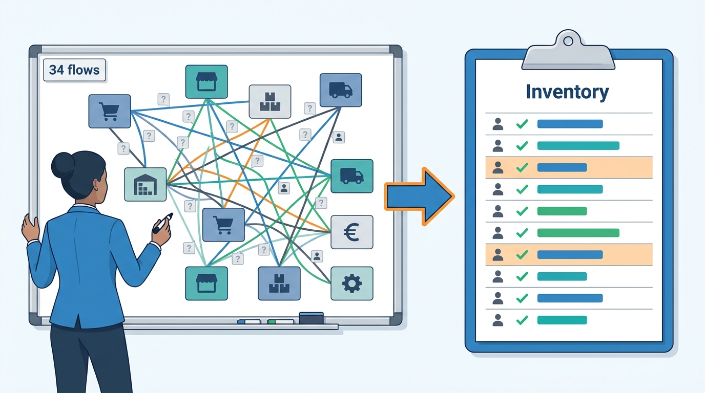
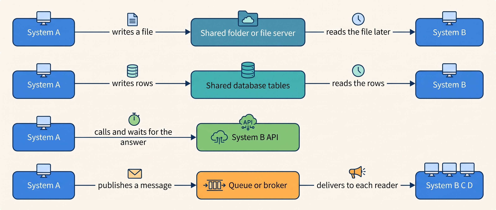
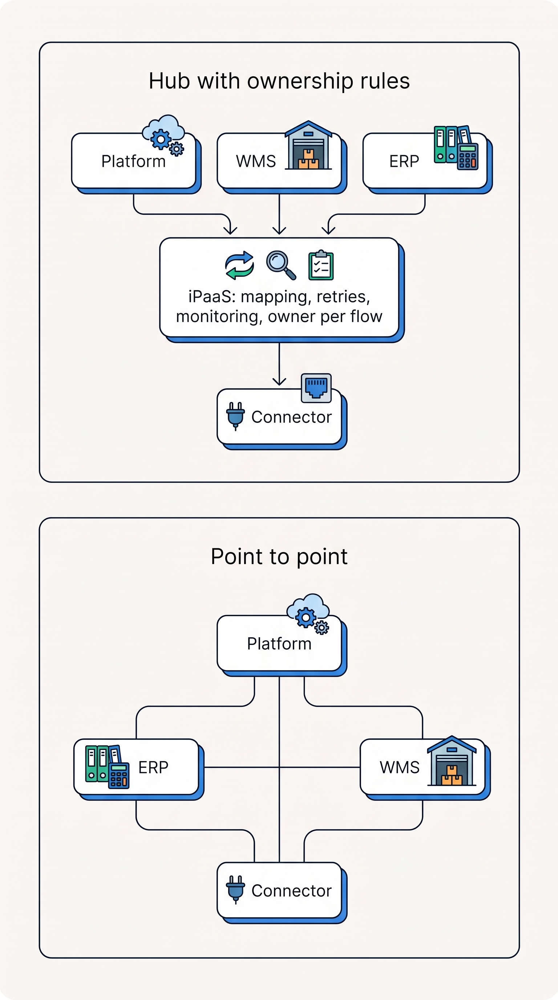
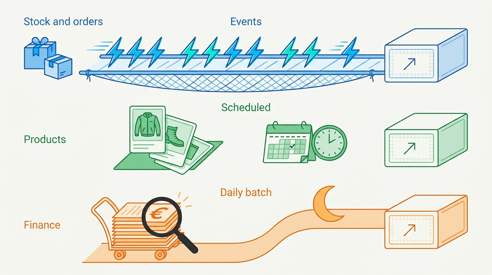

> **IN THIS CHAPTER, YOU WILL:** Learn the four ways commerce systems exchange data, the mechanisms that trigger each exchange, how to choose a style per flow, and why an inventory of integrations is the first management tool.

> **KEY POINTS:**
>
> * **There are four styles and five triggers, and the right one is chosen per flow, not per company.** A file, a shared database, a direct call or a message moves the data; a call, a webhook, a poll, a schedule or a database log decides when. Stock and orders want events plus a safety net, products want scheduled publication, finance wants a daily batch.
> * **Point-to-point connectors multiply with every system; a hub only helps when it comes with ownership rules.** A hosted integration platform centralizes mapping, retries and monitoring, but a hub whose flows have no owner, contract or reconciliation recreates the same tangle in one place.
> * **The integration inventory turns integration debt into a list.** One row per flow, with source, target, style, owner, contract version, failure handling and reconciliation. Kestrel & Pine's inventory found 34 flows, 13 of them without an owner in January 2027, and none with a check on stock or orders.

> **[FAILURE PATTERNS THIS CHAPTER ADDRESSES](where-commerce-platforms-go-wrong.html):**
>
> * **The Spaghetti Junction** — every pair of systems has grown its own connector, with its own owner or none, because each was built for the need of the moment.
> * **The Message in a Bottle** — a scheduled sync or a webhook is sent once and trusted, so a silent failure stays silent until a customer finds it.
> * **The Lynchpin** — a flow that only an agency script, one consultant or one vendor connector understands is a single point of failure the business does not know it has.
> * **The Pulled Rug** — a vendor retires an API version on a published date; an unowned script finds out after it breaks.

 
A storefront accepts an order, but the warehouse can only pick it after its own system receives the instruction. If that message is lost, the customer can be charged while the parcel never enters the picking queue. If it arrives twice, the warehouse may prepare two parcels. The reliability of the handoff directly affects what the customer receives.

An **integration** exchanges data or triggers work between systems. Its design determines how fresh the stock badge is, what happens during an outage and who investigates a missing order. Kestrel & Pine, the fictional outdoor brand used here, oversold for up to two hours on Black Friday because three scheduled updates added their delays together.

Different flows need different timing and recovery. A stock update during a sale can be urgent, while finance may accept records in a later batch. Choosing an exchange method for those needs avoids paying for speed where it adds little or tolerating delay where it loses sales.

The part introduction asked first how systems talk, and why so many of Kestrel & Pine's integrations had nobody to call. This chapter's answer has two halves. First, each flow's way of exchanging data, and what starts the exchange, is chosen from that flow's needs, not as one strategy for the company. Second, every flow needs a named owner in an integration inventory.

**Where we are in the order's journey.** Eva's jacket order crosses from the platform to the warehouse after checkout on 13 April 2027. The payment provider separately reports success. After picking, stock changes travel back toward the storefronts and marketplaces. This chapter follows those messages and the responsibilities at each crossing, in "In Practice", once the ways of exchanging data have names.

The chapter starts from Noor Visser's inventory of the 34 integrations and says what an integration is and what its design decides. It then sets out the four styles, the five triggers and three ways to wire a landscape, with what a hosted integration platform costs. It weighs the styles against each other, chooses a style per flow and looks at how the choice changes across scale stages. It then turns the inventory into a working tool with a definition of integration debt, follows Eva's order and the stock path before and after Waypoint, and ends with what goes wrong. The evidence is Kestrel & Pine's inventory and incidents and the vendors' own documentation. [[events-consistency-and-reconciliation]] explains recovery from duplicates and gaps; [[api-contracts-and-versioning]] covers changes to the agreements.

## Setting the Scene at Kestrel & Pine: Thirty-Four Lines Nobody Had Drawn

Kestrel & Pine had thirteen systems and **34 integrations** in January 2027. New Head of Engineering Noor Visser asked lead integration engineer Ruben Alves for an inventory. Only fourteen flows were listed: those running in the **integration platform as a service (iPaaS)**, a hosted tool for configuring data flows. Scripts and other connectors were missing.

Noor spent February building one row per flow: source, destination, data, method, frequency, owner, recovery and checks. Three flows emerged only because data arrived that none of the listed integrations could explain. The finished inventory had 34 rows. Its first four rows count them by method, the styles explained in the sections below; the next row counts the same 34 again by who built them:

| What the inventory found (February 2027, illustrative) | Count |
| --- | --- |
| Flows that move data by **files or batch exports** (EDI documents, that is electronic data interchange, the standard exchange of business documents between companies' systems; Peppol e-invoices on the European e-invoicing network; the nightly stock export from the POS, the store till system; data-warehouse extracts; spreadsheet imports) | 9 |
| Flows that **read another system's database directly** (the BI tool, for business intelligence reporting, on the ERP's reporting copy) | 1 |
| Flows that are **direct API calls** (one system calling an operation another exposes through its application programming interface: checkout to the PSP, the returns portal to the platform's refund API, the WMS to the shipping service, the connector to three marketplaces, the stock pulls) | 11 |
| Flows that are **events, webhooks or queues** (the platform's order webhooks into the iPaaS, PSP payment webhooks, WMS shipment events, the connector's order imports) | 13 |
| Running on the iPaaS / as agency scripts / as vendor-built connectors or plugins | 14 / 9 / 11 |
| Flows with **no named owner** (as of January 2027; 5 still unowned in April 2027, after Noor's ownership map named owners for the rest) | 13 |
| Flows with a **reconciliation job** (something that compares both ends): PSP payouts, EDI invoices with Bergzicht, store cash | 3 |
| Flows that **write stock into the platform** | 4 (the hourly ERP sync and three apps); with hand edits in the ERP and the platform admin, six writers of Duiven stock in all |

Two numbers made the business case for the integration standards of Waypoint, the company's 2027 improvement program (decision W5, set out under "Choosing Per Flow"). In January 2027, thirteen flows had nobody who would be called when they stopped, and nothing compared stock or orders between any two systems. The Black Friday Oversell happened in a stock chain of three scheduled hops, each with an owner, and no check across its two ends; the Price Drift and the Deprecated Endpoint happened in flows with no owner and no check. Noor's summary to Mara Lindqvist, the CEO: "We have 34 integrations and 34 different answers to the question 'how do we know it worked?'"

**Figure 1:** *Before the inventory, 34 integrations ran between thirteen systems, and 13 of them had nobody who would be called when they stopped; the inventory turned the tangle into a list.*

## What an Integration Is, and Why the Joins Cost Money

Two systems need to exchange data when a fact one of them owns is needed by the other. The WMS knows how many Ridgewalker jackets in size M are on the shelf; the storefront needs that number to show "in stock". The platform knows Eva ordered one; the warehouse needs the order to pick it. The fact has a **system of record** (the one system whose value counts as the truth when copies disagree; [[boundaries-and-systems-of-record]] owns the idea), and every other system holds a **copy**.

An integration moves the fact from the owner to the copies, or sends a request the other way ("refund €199 on order #1072455"). Four properties of that movement matter to the business:

- **Freshness.** How old is the copy? A stock copy an hour old sells units that are gone; a product description an hour old is fine.
- **Reliability.** When the move fails, is the fact sent again, lost, or sent twice?
- **Coupling.** How much does each side need to know about the other? A flow that depends on the exact field names of the WMS's interface breaks when the WMS vendor changes them.
- **Ownership.** Who understands this flow, is told when it fails, and decides what to change?

The style is the main lever on the first three; the inventory is the only lever on the fourth.

## The Four Styles: File, Shared Database, Direct Call, Message

An **integration style** is the mechanism by which systems exchange data or request work. It determines whether they share storage, wait for one another or continue independently. The four styles below use the vocabulary of Gregor Hohpe and Bobby Woolf's *Enterprise Integration Patterns* (2003); the categories remain useful despite changes in their implementation technology.

1. **File transfer.** One system writes a file; the other reads it later. The file's agreed format is the contract between the two. Commerce examples: the nightly product feed to a marketplace, the EDI order Bergzicht's system sends through the EDI provider, the POS export of store stock to the ERP.
2. **Shared database.** Two systems read and write the same tables. Common inside a suite where the web shop and the ERP are one product; risky across vendors, because any schema change breaks the other side and there is no record of who changed what.
3. **Direct call** (Hohpe and Woolf say *remote procedure invocation*). System A calls an operation System B exposes over the network, usually through an **API** (application programming interface: the set of operations a system lets other software perform), and waits for the answer. Commerce examples: the checkout asks the PSP to authorize €235; the returns portal asks the platform to refund €199.
4. **Messaging.** System A puts a message on a shared channel (a **queue** or **broker**: software that holds messages until the receivers take them) and continues without waiting; B, C and D read it when they are ready. Commerce example: "order #1072455 placed" is published once and consumed by the WMS, the ERP connector and the e-mail service.

**Figure 2:** *The four integration styles. Only the direct call makes A wait for B; the other three let the two systems work at different times, which is what makes them resilient and what makes their copies stale.*

Two words recur. A **synchronous** exchange makes the caller wait for the answer (the direct call): the checkout cannot continue until the PSP says yes or no. An **asynchronous** exchange lets the sender continue (files, messages): the storefront does not wait for the warehouse to confirm it received the order. Synchronous is simple to reason about and fragile under load: if B is slow, A is slow; if B is down, A fails. Asynchronous is resilient and introduces a delay during which the two sides disagree. [[events-consistency-and-reconciliation]] is about living with that delay.

Hohpe and Woolf's warning is the one to remember: "Tightly coupled applications make numerous assumptions about how the other applications work." A direct call to the WMS assumes the WMS is up, fast and unchanged; a message assumes only that the broker will hold it.

## Five Ways to Trigger an Exchange

The style says how the data moves. A second choice says **when**: who notices that something changed and starts the exchange. Five mechanisms start an exchange, and most merchants run all of them. The table has a sixth row, the queue or event stream (a log of messages that several consumers read, each at its own pace): it does not notice a change, it is the channel in which messages wait. A direct call appears both as a style and here, because the caller is also what starts it. The table is the author's synthesis of the vendor documentation cited in the next paragraphs and in the next chapter.

| Mechanism | Who starts it | Typical delay | What the receiver must handle | Typical commerce use |
| --- | --- | --- | --- | --- |
| **Direct API call** | The caller, when it needs the answer | Milliseconds | Timeouts, partial success, retry storms under load | Price, tax or stock check at checkout; payment authorization; a refund request |
| **Webhook** | The source, when something happens: one HTTP request to a URL you registered | Seconds | Missed, duplicated and out-of-order deliveries; must answer fast | Order placed, payment captured, shipment created |
| **Polling** | The receiver, on a timer: "what changed since my last visit?" | Minutes | Rate limits, large pages, clock differences | Catching up after an outage; the safety net under webhooks |
| **Scheduled batch or file** | Either side, on a clock | Hours to a day | Late files, partial files, stale by design | Product feeds, EDI documents, nightly stock and finance exports |
| **Queue or event stream** | The source publishes; each consumer pulls at its own pace | Seconds | Duplicates (delivery is "at least once"); ordering only per key (for example, per order) | Stock and order events with several consumers |
| **Change data capture (CDC)** | The database's own change log, read by a connector | Seconds | A row change is not a business event; someone must translate it | Turning an old ERP or order management system (OMS) into an event source without rewriting it |

Two of these mechanisms need plain words. A **webhook** is a notification, not a guarantee: the source makes one HTTP request to your address when something happens, and if your server was down, slow or busy, the request is retried for a while and then dropped. Shopify's developer documentation (Shopify is a hosted shop platform; n.d., accessed November 2026) says its HTTPS webhooks are retried eight times over four hours, that a subscription created through the API is deleted after eight consecutive failures, and that delivery "isn't always guaranteed." Stripe's (Stripe is a payment provider; n.d., accessed November 2026) retries for up to three days. Both tell integrators the same thing: run a periodic **reconciliation job** that asks the source for everything changed since the last run. The webhook is a speed-up on top of polling, never a replacement for it.

The same documentation says more than the retry figures. Shopify's webhook documentation (n.d., accessed November 2026) does not guarantee ordering within a topic, warns that an app "can miss or mishandle events," and tells apps to "use reconciliation jobs to periodically fetch data from Shopify" with `updated_at` filters (asking only for records changed since a given time). Stripe's webhook documentation (n.d., accessed November 2026) says the same about ordering and duplicates and asks the receiver to answer with a success code "before any complex logic" and to process events from a queue, because spikes "might overwhelm your endpoint hosts."

The second mechanism that needs plain words is **change data capture**. It reads a database's transaction log, the record every database keeps of each change, and turns it into a stream of "row inserted, updated, deleted" events. Debezium, the most used open-source tool for this (documentation for version 3.7, accessed November 2026), describes itself as a set of source connectors that use each database's own change-capture features. CDC is the honest way to get events out of a system never built to publish them. Its limit is meaning: "row updated in the item ledger table" is not "stock changed for SKU X at location Y" (a SKU being one sellable variant, one size in one color), and someone has to write that translation and keep it current.

Webhooks, queues and change data capture all deliver events, and an event message can take two forms. **Event notification** announces that a fact changed, such as 'order #1072455 changed'; receivers fetch the details when they need them. **Event-carried state transfer** includes the data in the message, allowing receivers to maintain local copies without that extra lookup. The second reduces calls to the source but leaves each receiver responsible for a copy that can become stale. A stock event in this book uses that form: 'SKU 2113-M-moss at Duiven: 14 on hand, 3 reserved, as of 21:14:07' ([[inventory-and-availability]]). These two terms follow Martin Fowler's 2017 article.

## Point to Point, Hub, or the Vendor's Connector

With thirteen systems there is a second question: how the whole landscape is wired. There are three answers, and most Omnichannel merchants run all three at once.

**Point to point.** Each pair of systems that needs to talk gets its own connector, built by whoever needed it: the agency, the ERP partner, an engineer who has since left. The first three are cheap and fast. By the tenth, every change to one system means finding and testing every connector that touches it, and the mapping between two data models (which WMS field means which platform field) lives in code one person understands. This is The Spaghetti Junction, and it is what buying one good system per need, one need at a time, produces.

**A hub.** An integration platform sits in the middle; every system talks to the hub, which holds the mapping, the schedule, the retries and the monitoring in one place. The hosted form is the iPaaS. Gartner's definition, as relayed by an encyclopedia entry (2015 retrieval; the Gartner page itself could not be fetched), is "a suite of cloud services enabling customers to develop, execute and govern integration flows between disparate applications," with prebuilt connectors so that "no software development" is needed for common pairs. The catch is that a hub does not create ownership. Kestrel & Pine's fourteen iPaaS flows were the best-documented of the 34 and still had three with no owner in January 2027.

The arithmetic: *n* systems that all need to talk need up to *n*(*n*−1)/2 point-to-point links, 78 for thirteen systems; through a hub they need 13. The real saving is one place to find a flow's mapping, schedule, failure handling and log.

**Figure 3:** *Four systems need six point-to-point links; a hub needs four. The saving grows with every system added, but only if each flow through the hub still has an owner, a contract and a check.*

**The vendor's connector.** Between point to point and a hub sits a third answer: a connector built and maintained by the vendor of one of the systems. Microsoft's documentation for the Shopify Connector of Dynamics 365 Business Central, an ERP product (published October 2026), shows what such a connector decides for you. It tells the merchant to "decide which system is the system of record for product data" before configuring, states that for inventory "Business Central acts as the system of record" and pushes stock one way at a recommended interval of 15 to 30 minutes, and for orders runs a batch import that a real-time notification from Shopify merely *triggers*. That last detail is the webhook-plus-polling pattern built into a product. A vendor connector encodes an ownership model; if it matches yours, it is the cheapest reliable option, and if not, no configuration will fix it.

Back to the hub: its costs are hard to compare. Fetched in November 2026, among iPaaS vendors: MuleSoft packages "start at $2,000 per month, billed annually" on usage-based credits, with a $50,000 minimum for its pre-commit model; Boomi's pay-as-you-go starts at $99 a month plus usage; Workato and Celigo publish no prices; Make bills in credits with a free plan of 1,000 a month; n8n charges per workflow execution, from €20 a month for 2,500 to €667 for 40,000, billed annually. Because the metering unit (credits, executions, connections, concurrency) differs per vendor, the only honest comparison is per flow at your volume: Kestrel & Pine's roughly 950 orders a day (D2C, marketplace and wholesale, the 2026 average), each triggering five or six flow executions, costs very differently under per-execution and per-connection pricing.

The low end is priced for a Growing-stage merchant's first three integrations; a $50,000 pre-commitment signals a Group-stage buyer.

> **INFERENCE, NOT DOCUMENTED:** Every iPaaS pricing page in November 2026 sells "AI agents" beside integration. What a merchant buys underneath is the same four functions as in 2020: connectors, mapping, scheduling and monitoring. I would evaluate on those and treat the AI framing as a feature that may not survive the next pricing page.

## The Trade-Offs

| | Direct API call | Webhook plus polling | Queue or event stream | Scheduled file or batch | Shared database |
| --- | --- | --- | --- | --- | --- |
| **Freshness** | Immediate | Seconds, gaps healed by the poll | Seconds | Hours to a day | Immediate |
| **When the other side is down** | The caller fails or waits; under load, a retry storm | Deliveries are retried for hours, then dropped | Messages wait in the queue | The file is late | Both sides fail |
| **Coupling** | High: on the callee's availability and interface | Medium: on the payload format and the callback address | Low: on the message format | Low: on the file format | Highest: on the schema, with no record of who changed what |
| **Duplicates and order** | None if the call is idempotent | Expected; the receiver deduplicates | Expected; delivery at least once, order per key | A rerun file is the risk | None |
| **Who owns the mapping** | The caller | The receiver | Each consumer, or the hub | Whoever writes the file spec | Nobody, which is the problem |
| **Fits** | Decisions that need an answer now: payment, tax, a stock check at checkout | Receiving changes from a SaaS vendor: the platform, the PSP, the returns portal | Facts with several consumers that must not be lost: stock, orders | Facts that change by season or by day: products, finance, EDI | A suite from one vendor; nothing across vendors |
| **Limits** | Every dependency's outage becomes yours | A deleted subscription stops the flow silently | Needs the discipline of the next chapter | Stale by design; a late file is a quiet failure | Breaks on the first upgrade |

The table sets webhook plus polling beside the styles because that pairing is how most receivers get changes from a hosted vendor. Set side by side, the options give three judgements that the choice per flow rests on. **Use a direct call only where the answer is needed before the next step can happen**: whether the card is authorized, what the tax is, whether this unit may be promised; everything else should be asynchronous, so one system's outage does not become every system's outage. **Treat a webhook as a notification and polling as the truth**; the vendors say so in their own documentation. **A scheduled batch is not old-fashioned**; it is right for finance and product publication, provided a missed run raises an alert.

## Choosing Per Flow

The mistake I see most often is choosing a strategy for the company ("we are event-driven now"). Flows differ in what they need, and the style follows from the needs. "Consistency" below means how closely the copies must agree with the system of record; "freshness" is how old a copy may be; "latency" is how long one exchange takes once it starts.

| Flow | System of record (typical) | Freshness | Consistency | Latency of the exchange | Availability |
| --- | --- | --- | --- | --- | --- |
| **Stock** | WMS, POS, 3PL (a third-party warehouse); an availability service for what may be sold | Seconds to minutes; the oversell window is the sync interval | High per SKU and location; a wrong copy sells a unit that is gone | Seconds | Must survive a consumer being down: queue it |
| **Orders** | Platform or OMS | Seconds for the warehouse, minutes for finance | Never lost, never doubled; one order number family | Seconds | Must survive the WMS being down: queue it |
| **Prices** | The platform, the ERP or a pricing service | Minutes; promotions with start times want the minute | A stale price is a broken promise with legal weight | Minutes | Fail loudly, never silently |
| **Products and content** | PIM, the product information management system (or the ERP item master before one exists) | Hours; a season is published, not streamed | Completeness over speed | Hours | Can wait a day |
| **Customers** | Platform, CRM (customer relationship management system) or an identity service | Hours | Matching is the hard part, not transport ([[identity-and-master-data]]) | Hours | Can wait |
| **Finance** (invoices, payments, payouts) | ERP and the PSP | Daily; finance works in periods | Exact to the cent; reconciled, not trusted | Hours | Complete, not fast |

Those values are typical, my recommendation rather than a standard. From those needs, the rule I use:

| Flow | At the Growing stage | At Omnichannel and beyond | Why |
| --- | --- | --- | --- |
| Stock | The inventory owner pushes to the channels every 15–30 minutes (the interval Business Central's connector recommends, October 2026) | Stock events per SKU and location into an availability service, plus a daily reconciliation and a safety buffer | The oversell window equals the sync interval; at 38 orders a minute in the peak hour, fifteen minutes is 570 orders |
| Orders | A webhook starts the import; a polling sweep catches what it missed | Order events to the OMS, WMS and ERP connector; every consumer idempotent ([[events-consistency-and-reconciliation]]) | Orders must never be lost or doubled; a webhook alone cannot promise that |
| Prices | Scheduled sync, hourly or faster, with an alert when it fails | Events for promotion start and end; scheduled sync as the net | The Price Drift was a scheduled sync that failed without an alert |
| Products | Scheduled publication from the system of record | Event on change for the storefront, plus a nightly full publication | A nightly full copy heals any missed change |
| Customers | Copied with each order; periodic merge | An identity service or customer data platform | The problem is deciding whether two records are one person |
| Finance | Nightly batch to the ERP, reconciled against the PSP's payout report | Same; reconciliation becomes a data-platform job across brands | A daily batch that is checked beats an event stream nobody balances |

This is what Waypoint's decision **W5** says for Kestrel & Pine: stock, orders and prices move by events; products by scheduled publication; finance by daily batch; and every flow has an owner, a contract, idempotent handling and a reconciliation job. The next chapter explains how idempotent handling and a reconciliation job are built; the reason the rule is per flow is the needs table.

**Figure 4:** *The style follows the flow: stock and orders move as events with a reconciliation net beneath them, products by scheduled publication, finance by a daily batch that is checked.*

## Across Scale Stages: When It Fits and When It Limits

The four stages are the book's (see [[commerce-scaling-stages]]).

| Stage | What is typical | What becomes necessary | Warning signs of outgrowing it |
| --- | --- | --- | --- |
| **1 — Starting** | The platform's apps and one or two vendor connectors (shop to accounting, shop to the 3PL); the merchant owns no integration code | An inventory anyway, even with four rows, and a weekly look at each app's failure log | A second channel whose orders are keyed in by hand; a stock number maintained in two places |
| **2 — Growing** | The first point-to-point scripts and the first iPaaS; an agency builds most flows; stock and orders move by scheduled sync every 15–60 minutes | Choose the style per flow; a reconciliation job for stock and for orders; a named owner per flow, even when the agency built it | An oversell in the first busy week; a flow only the agency can explain; a sync interval that is "fine" until the first promotion |
| **3 — Omnichannel** | A dozen or more systems, 20–40 flows in three or four styles, several builders; the joins are the incident source | The integration layer becomes a product with an owner, standards (idempotency, contract versions, monitoring, reconciliation) and a queue or event stream for stock and orders; an OMS as the order hub | Nobody can draw the landscape from memory; the same fact is written by more than one flow; a vendor's API retirement is discovered by a customer |
| **4 — Group** | Several brands or countries, each with its own landscape, or a shared platform with a central team | A governance decision: shared hub with service levels, or per-brand autonomy with shared standards; a schema registry for events; integration as a platform team's product | Every brand queues behind one central hub; a brand builds its own connectors because the hub is too slow; hub flows with no owner, The Spaghetti Junction inside one tool |

The judgement: the styles do not change with scale; the **discipline around them** does. A Starting-stage merchant and a Group follow the same rule per flow. What a Group needs on top is ownership at team level, contracts enforced by tooling, and a hub run as a product, not bought as a box. Kestrel & Pine is at the point where that discipline becomes necessary, which is what W5 is.

## The Integration Inventory and Integration Debt

The first piece of that discipline is a list of the flows and of what is unknown about each. No vendor-neutral source defines "integration debt," so this book defines it operationally: **the set of integrations whose owner, contract version, failure alert and reconciliation job are unknown.** Each unowned flow is cheap today and charges interest as the next silent failure, the next vendor retirement, the next person who leaves with the only understanding of a script.

The interest is real, and the vendors document it. Shopify deletes an API-created webhook subscription after eight consecutive failed deliveries, so an unmonitored integration silently stops receiving events. Shopify declared its REST Admin API legacy as of 1 October 2024 and removes deprecated fields on a published schedule; Stripe and Shopify both retire API versions on dates they choose ([[api-contracts-and-versioning]]). An unmaintained integration breaks on the vendor's schedule, not yours.

The inventory makes the debt a list. One row per flow:

| Column | What goes in it | Why it matters |
| --- | --- | --- |
| Source → target, and what moves | "WMS → ERP: stock on hand per SKU" | The flow's identity |
| Style and trigger | Scheduled pull, every 15 min | Decides freshness and failure mode |
| System of record | The WMS | Which side wins when they disagree |
| Owner | A named person, not a team or a vendor | Who is called at 20:30 on Black Friday |
| Contract version | The API version or file format, and the vendor's retirement date | The Pulled Rug (a vendor retiring an interface) has a date; put it in the row |
| Volume and expected rate | About 950 orders a day; 38 a minute at peak | Sizes the queue and the rate-limit budget |
| Failure handling | Retries, dead-letter queue (where messages that keep failing are parked), alert | Whether a failure is loud or silent |
| Reconciliation | What is compared, how often, who gets the exceptions | Whether anyone knows it worked |
| Last incident | Date and one line | The row's history |

Noor's rule, which I would adopt anywhere: **no flow goes live without a row, and no row without an owner.** By April 2027 her ownership map ([[organizing-commerce-engineering]]) had named owners for 8 of the 13; 5 were still unowned. The inventory is reviewed quarterly, and a flow whose owner has left is an incident, not a note. Apps inside the platform are inventoried separately ([[extensibility-and-app-ecosystems]]); the integration inventory counts flows between two systems, and an app that moves data to another system appears in both lists on purpose.

## In Practice

**Eva's order before the change.** Eva's order shows what the inventory's columns change. At 21:14:03 on 13 April 2027, the platform creates #1072455 and sends a webhook to the iPaaS. The integration translates it and calls the WMS. The retry policy is an assumption for this example: three retries at one-minute intervals, then it stops if the warehouse does not answer.

The PSP sends payment success separately. An hourly connector copies the order to the ERP for finance. After picking, stock passes from the WMS through the ERP and the platform to the marketplace connector, and takes up to two hours to reach the marketplaces. Nobody has recorded who responds if a message is missed.

**Under Waypoint, each flow gets an owner and a reason for its timing.** In the 2028 target, the platform's order notification reaches an **OMS** through the iPaaS. The OMS becomes the shared order home and supplies warehouse, finance and notification flows.

Warehouse stock events feed the availability service, which recalculates sellable quantities for each channel. The ERP leaves the stock path. A nightly comparison finds missing orders; stock comparisons run weekly and daily in November. The technology choices are familiar. The responsibilities and checks are now explicit.

| Kestrel & Pine flow (inventory excerpt, illustrative) | Style and trigger | Owner (Feb 2027 / under W5) | Reconciliation (Feb 2027 / under W5) |
| --- | --- | --- | --- |
| Platform → iPaaS → WMS: orders | Webhook, then direct call | Ruben / Ruben | None / nightly order count and list |
| WMS → ERP → platform → connector: stock | Scheduled pulls, up to two hours end to end | Ruben, the ERP partner, Milan / retired; WMS stock events through the iPaaS to the availability service, which publishes to the platform and the connector | None / weekly per SKU and location, daily in November |
| PSP → platform: payment status | Webhook | Nobody named / Milan | Monthly payout matching by finance / daily |
| Returns portal → platform: refunds | Direct API call | Nobody named / Sanne's team | None / daily refund matching against the PSP |
| Bergzicht → EDI provider → ERP: order, despatch advice and invoice messages (ORDERS, DESADV, INVOIC) | Files in EDIFACT, the UN EDI message standard | The EDI consultant / Lea, with the DESADV sent from the WMS (W6) | Invoice matching by Bergzicht / outbound document log checked weekly |
| POS → ERP: store stock | Nightly file | The store team / Daniel; an event feed once the POS link exists | None / daily |
| ERP → data warehouse: orders and invoices | Nightly extract | Hanna / Hanna | Three order counts / one definition (W7) |

## When It Goes Wrong

**The silent stop (The Message in a Bottle).** A scheduled sync fails and nothing says so. The Price Drift (October 2026) was a price-list sync to the German storefront that stopped; the storefront kept €179 for nine days while the stores and the marketplace charged €199: 410 orders, about €8,200 of margin and a price-parity warning from a marketplace. The fix is not a different style; it is an alert when a scheduled run does not happen, or produces no changes when changes were expected.

**The dropped notification (The Message in a Bottle again).** A webhook is retried for hours, then dropped, or the subscription is deleted after repeated failures. The receiver believes nothing happened. Detection is the polling sweep; recovery is the reconciliation job that lists orders present in the source and absent in the target.

**The backed-up queue.** On Friday 27 November 2026, the same evening as the oversell but a separate failure, the WMS connector queue backed up for four hours. No order was lost, but orders reached the warehouse late. A queue's depth and its oldest message's age are health metrics; unwatched, a resilience feature becomes a delay nobody can explain ([[peak-load-and-reliability]]).

**The retired contract.** In February 2027 the marketplace connector retired an API version on a published date; the agency script that read it had not been updated, and stock to bol was stale for two days: the Deprecated Endpoint, an instance of The Pulled Rug. Because only the agency understood the script, it was also The Lynchpin. A contract-version column with the retirement date puts it on someone's calendar ([[api-contracts-and-versioning]]).

**The second writer.** The App That Wrote Stock (March 2026) adjusted platform inventory while the hourly ERP sync, carrying the WMS's figure, also wrote it: two weeks of phantom reservations on 600 variants. Two flows writing one fact is a failure of the table that names one owning system per kind of data ([[boundaries-and-systems-of-record]]), visible in the inventory's "system of record" column.

**The vendor outage.** When the PSP paused Kestrel & Pine's account for 40 minutes during the Card-Testing Night, every direct call from the checkout failed; that is what a synchronous dependency means, and the only responses are a short call list, quick timeouts and a decision made in advance about what the checkout does when no answer comes ([[commerce-payments]]).

## What to Take Away

The chapter opened with an order whose message to the warehouse is lost or arrives twice. The chapter's two halves, a style chosen per flow and an owner for every flow, answer that case together. The order travels as a webhook or event, because the storefront must not wait for the warehouse; a polling sweep beneath it finds what the webhook missed, and the receiver ignores a repeat. A named owner in the inventory is told when the flow goes quiet. The same reasoning gives stock its events and its reconciliation, products their schedule and finance its checked batch. The incidents happened where one half was missing: the Black Friday stock chain had owners and no check across its ends, and the Price Drift and the Deprecated Endpoint had no owner at all.

**Established.**

- The four integration styles (file transfer, shared database, direct call, messaging) and the criteria for choosing between them have been stable since Hohpe and Woolf named them in 2003; the technology changes, the trade-offs do not.
- Webhooks are a notification, not a guarantee. Shopify and Stripe both state in their current documentation that deliveries can be missed, duplicated and reordered, and both tell integrators to run periodic reconciliation.
- A vendor's connector encodes an ownership model (Business Central's Shopify connector, documented October 2026, has the ERP own inventory and the shop own orders); it fits when that model matches yours.

**Depends on context.**

- At the Starting and Growing stages a scheduled stock sync every 15–30 minutes is normal and acceptable; it stops being acceptable when the sync interval times the peak order rate exceeds the stock buffer you can afford to oversell. At 38 orders a minute, fifteen minutes is 570 orders.
- An iPaaS pays for itself when the number of flows and builders makes point-to-point unmanageable, usually at the Omnichannel stage; below that, two vendor connectors and a short inventory are cheaper. Compare vendors per flow at your volume, because each meters a different unit.
- Whether the hub is the iPaaS, the OMS or the ERP depends on which system owns the order ([[erp-and-back-office-integration]] argues this out); the style per flow does not change with that choice.

**The author's synthesis.**

- Choose the style per flow from its needs, never for the company: stock and orders by events with a reconciliation net, products by scheduled publication, finance by daily batch, direct calls only where the next step needs the answer.
- The integration inventory with a named owner per row is worth more than any integration tool, because every incident in this chapter happened in a flow whose row was missing, had no owner or had no check.

## Questions to Ask

1. How many integrations do we have, and can anyone produce the list with an owner on every row?
2. For each flow that moves stock: how old can the copy be, who writes it, and what checks that the two ends agree?
3. Which flows are synchronous calls, and what does the caller do when the other side does not answer within two seconds?
4. For each webhook we receive, what polls the source to catch what it missed; for each scheduled sync, what alerts when it does not run?
5. Which vendor connector are we relying on, and which ownership model does it encode for products, stock and orders?
6. What does our iPaaS meter, and what would our peak-day volume cost under it?
7. Which flows does only the agency, one consultant or one engineer understand, and which API versions retire when?

Choosing the style is half the work. The other half is living with what every asynchronous style introduces: a window in which two systems disagree, messages that arrive twice or out of order, and failures that leave one side updated and the other not. [[events-consistency-and-reconciliation]] shows how to make that window safe, with idempotency, the outbox, retries, compensation and reconciliation as a first-class component, and Kestrel & Pine's first stock reconciliation as the worked example.

## Sources and Evidence

*Company, product and investor sources*

- [Webhooks](https://shopify.dev/docs/apps/build/webhooks), Shopify developer documentation, n.d., accessed 2026-11 — ordering not guaranteed, deliveries can be missed, reconciliation jobs with `updated_at` filters recommended.
- [HTTPS webhook delivery](https://shopify.dev/docs/apps/build/webhooks/subscribe/https), Shopify, n.d., accessed 2026-11 — eight retries over four hours, subscription deletion after eight consecutive failures, duplicate-detection headers.
- [REST Admin API (legacy notice)](https://shopify.dev/docs/api/admin-rest) and [API versioning](https://shopify.dev/docs/api/usage/versioning), Shopify, n.d., accessed 2026-11 — REST Admin API legacy as of 1 October 2024; deprecated fields removed on a schedule.
- [Receive Stripe events in your webhook endpoint](https://docs.stripe.com/webhooks), Stripe, n.d., accessed 2026-11 — retries up to three days, no ordering guarantee, duplicates, answer fast and process from a queue.
- [Synchronize items with Shopify](https://learn.microsoft.com/en-us/dynamics365/business-central/shopify/synchronize-items) (2026-10-16), [Synchronize inventory with Shopify](https://learn.microsoft.com/en-us/dynamics365/business-central/shopify/synchronize-inventory) (2026-10-14) and [Synchronize and fulfill sales orders](https://learn.microsoft.com/en-us/dynamics365/business-central/shopify/synchronize-orders) (2026-10-14), Microsoft Learn — a vendor connector's ownership model, the 15–30 minute inventory interval, notification-triggered order import.
- [Debezium features](https://debezium.io/documentation/reference/stable/features.html), Debezium project, n.d. (version 3.7), accessed 2026-11 — change data capture as a product category.
- [MuleSoft Anypoint pricing](https://www.mulesoft.com/anypoint-pricing), [Boomi pricing](https://boomi.com/pricing/), [Workato pricing](https://www.workato.com/pricing), [Celigo pricing](https://www.celigo.com/pricing/), [Make pricing](https://www.make.com/en/pricing), [n8n pricing](https://n8n.io/pricing/), all n.d., accessed 2026-11 — iPaaS metering units and the public price points quoted.

*Standards, regulation and official documentation*

- [Cloud-based integration (iPaaS)](https://en.wikipedia.org/wiki/Cloud-based_integration), Wikipedia, relaying Gartner's definition retrieved 2015, accessed 2026-11 — the iPaaS definition; the Gartner page itself was not reachable.

*Research and practitioner sources*

- [Integration Styles](https://www.enterpriseintegrationpatterns.com/patterns/messaging/IntegrationStylesIntro.html), Gregor Hohpe and Bobby Woolf, *Enterprise Integration Patterns*, 2003 (site updated 2023) — the four styles and the criteria for choosing; the source is more than twenty years old and the styles are unchanged.
- [What do you mean by "Event-Driven"?](https://martinfowler.com/articles/201701-event-driven.html), Martin Fowler, 2017 — event notification, event-carried state transfer, event sourcing and CQRS.

Kestrel & Pine is fictional; architectural recommendations, labeled inferences and labeled assumptions are the author's judgement.
