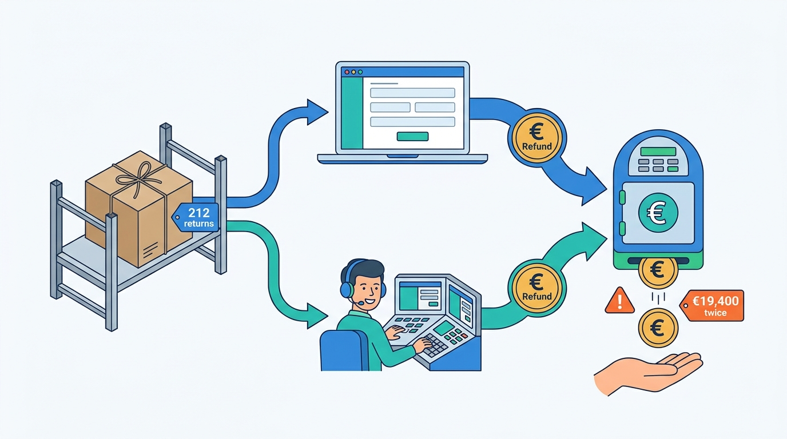
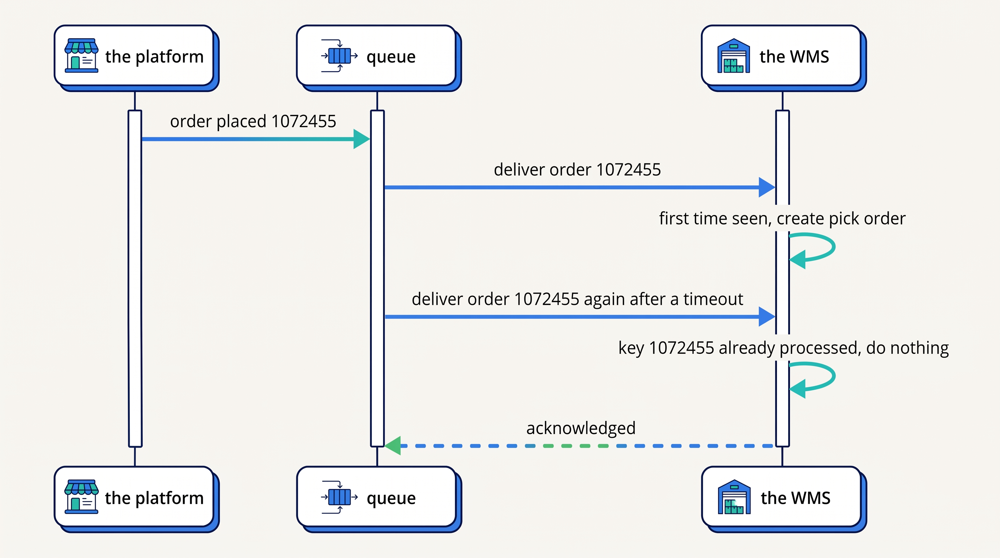
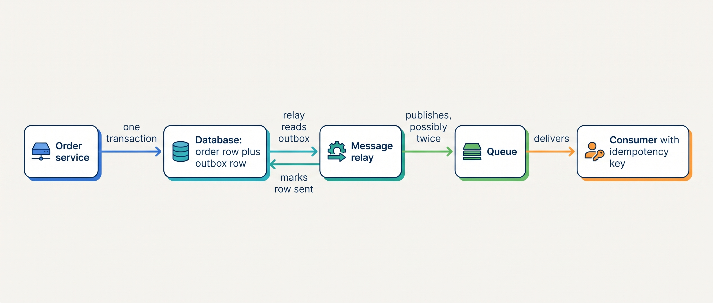
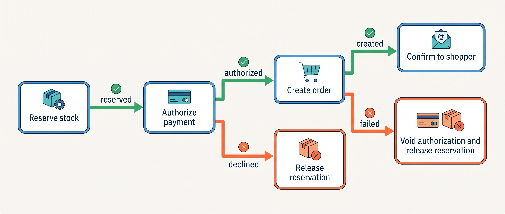
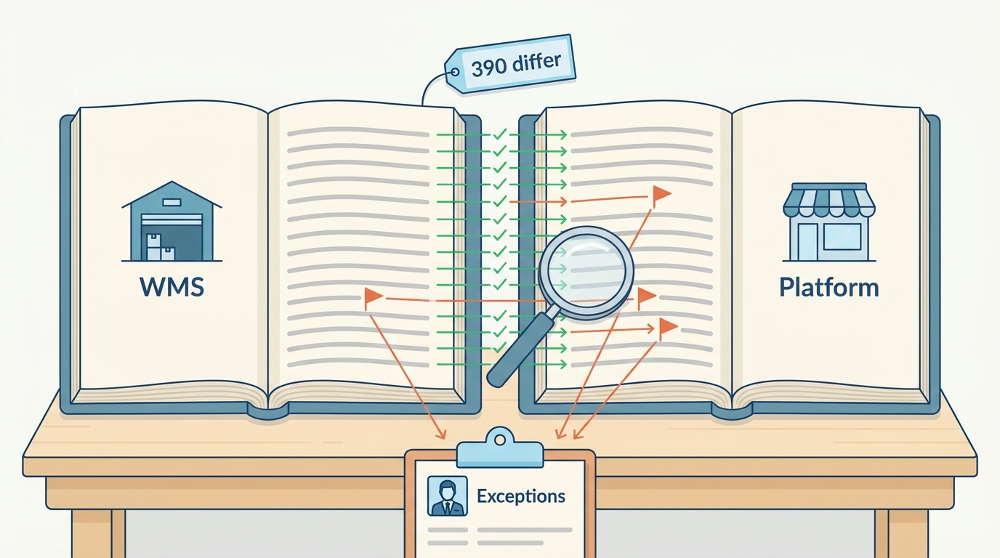
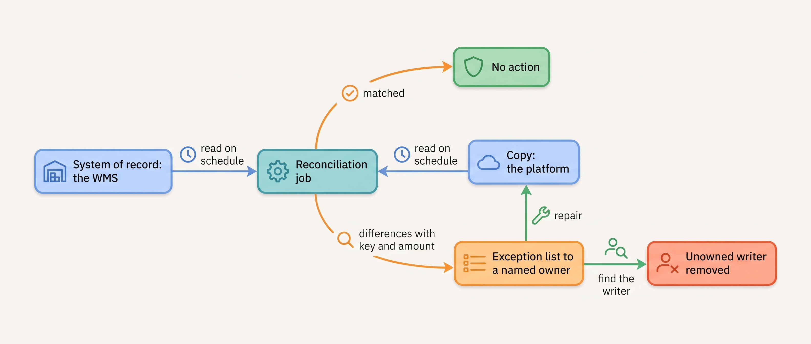

> **IN THIS CHAPTER, YOU WILL:** Learn why copies of a fact always disagree for a while, and the five mechanisms that make the disagreement safe: idempotency, the outbox, retries, compensation and reconciliation.

> **KEY POINTS:**
>
> * **Every delivery you will meet is "at least once"; "exactly once" is something the receiver builds.** Webhooks, queues and integration-platform retries all deliver duplicates and reorder messages. An idempotency key, a business identifier such as the order number, makes a repeat harmless, and the receiver must be able to say what its key is.
> * **The outbox makes "the order was saved" and "the event was sent" one act; compensation undoes a step that cannot be rolled back.** A cancellation after shipment is not an undo but a return and a refund: a business process with its own owner.
> * **Reconciliation is a component, not a cleanup.** A job that compares two systems' records on a schedule, with a key, a tolerance and a named recipient for the exceptions, is the only way to know that the other mechanisms worked. Kestrel & Pine's first one found 2.3% of active variants with the wrong stock figure.

> **[FAILURE PATTERNS THIS CHAPTER ADDRESSES](where-commerce-platforms-go-wrong.html):**
>
> * **The Message in a Bottle** — a message sent once and trusted produces exactly the duplicates and gaps that idempotency and reconciliation exist to catch.
> * **The Boomerang** — the Double Refund is what happens when a money action has two writers and no shared key.
> * **The Phantom Stock** — a stock copy that drifts from the warehouse's truth, with nothing comparing the two, sells units that are gone.

 
The previous chapter, [[integration-styles]], ended on a promise: once you choose an asynchronous style, two systems will disagree for a while, and that is the price of not having one system's outage become every system's. This chapter is about paying that price safely.

The first instinct is to make the disagreement go away with one database and one transaction. Inside one system that works. Across a hosted platform (software as a service, SaaS: rented by the month and run by the vendor), a warehouse system from another vendor, an ERP (enterprise resource planning system: the books and the item master) from a third and a payment provider in another country, it cannot. **The systems are built to disagree. The design question is how they recover.**

The mechanisms are few, old and documented by the vendors a merchant already uses. A receiver that can tell a repeat from a new message. A sender that cannot lose an event between saving the fact and publishing it. A retry that does not become a stampede. A way to undo a step that cannot be rolled back. And a job that compares the two ends and tells someone when they differ. This chapter owns four of their names: idempotency, the outbox, compensation and reconciliation.

**Where we are in the order's journey.** When Eva's jacket (the recurring order; see [[meet-kestrel-and-pine]]) is placed at 21:14 on 13 April 2027, the platform tells the warehouse, the ERP and the e-mail service, and each hears it a little later than the others. When her exchange is received on 22 April, the returns portal tells the platform, which tells the PSP (payment service provider: the company that takes the shopper's payment and settles the money) to refund, and the WMS (warehouse management system) puts the size M jacket back on the shelf. Every one of those messages can arrive twice or not at all. This chapter is about what happens then.

## Setting the Scene at Kestrel & Pine: The First Reconciliation

Kestrel & Pine, the fictional outdoor brand this book follows, had never compared its warehouse's stock figures with its storefront's. The WMS, which runs receiving, picking and shipping at Duiven, sent stock to the ERP every fifteen minutes, the ERP sent it to the platform hourly, and everyone assumed the numbers matched.

In **May 2027**, as part of Waypoint's integration standards (decision W5: every integration gets an owner, a contract, idempotent handling and a reconciliation job), Ruben Alves ran the first weekly **reconciliation**: a job that reads the WMS's on-hand quantity and the platform's available quantity for every active variant and lists the ones that differ. Of about 17,000 active variants, **2.3%**, about **390**, had a different figure in the two systems *(illustrative)*. The breakdown, over the following week:

| Cause of the difference (May 2027, illustrative) | Variants (about) | What it was |
| --- | --- | --- |
| Three platform apps that wrote inventory | 240 | The pre-order app from the App That Wrote Stock incident of March 2026 and two others each adjusted platform stock on their own, on top of the ERP sync |
| In-flight units | 90 | Returns the WMS had received and restocked that the hourly chain had not yet carried to the platform when the job ran |
| Manual edits | 40 | Corrections typed into the platform's admin by the e-commerce team after customer complaints, never passed back to the WMS |
| Unexplained | 20 | No writer found; overwritten from the WMS and watched |

Noor's note to Milan Petrov and Daniel Okafor the next morning made three points. The number was not the news; the news was that nobody had known it. Most of the drift had a writer that should not have been writing, which is a question of ownership (W1: the WMS is the system of record for physical stock), not of integration technology. And the job is a net, not the fix: the availability service that W1 brings in Q4 2027 closes the gap by consuming stock events, and the job then proves it. The job stayed weekly, with a daily run through November, the peak month; the three apps lost their permission to write stock, so that after W1 none of the apps can, and the pre-order app gets a pre-order allocation in the availability service instead. I would have run the job daily all year, 390 wrong variants for a week being 390 chances to repeat Black Friday in miniature; Noor judged the event feed, not the job, to be where the effort belonged.

The second scene is older. In **January 2027**, over three weeks, **212 returns** were refunded twice: once by the returns portal through the platform's API (application programming interface: the operations a system lets other software perform), which instructed the PSP, and once by support agents in the PSP's own console, who refunded by hand when customers whose parcels had reached Duiven asked where their money was. **€19,400** went out twice, most of it recovered. Two writers, no shared key, no job comparing refunds issued with refunds due. The rest of this chapter is the toolkit that stops both scenes from recurring.

**Figure 1:** *Two writers and no shared key: 212 returns were refunded twice, once by the returns portal and once by hand in the payment provider's console, and €19,400 went out twice.*

## Eventual Consistency in Plain Words

A **copy** of a fact is consistent with its **system of record** (the system whose value counts when they disagree; see [[boundaries-and-systems-of-record]]) when both show the same value. Across separate systems joined by messages, they cannot always show the same value, because the message takes time. **Eventual consistency** is the promise that is possible: if updates stop, all copies will eventually show the last value. Werner Vogels, then Amazon's CTO, defined it that way in a December 2008 article (old, but the definition has not changed), together with the smaller promises a designer can add on top, such as "a reader always sees its own writes."

Gregor Hohpe's 2004 essay "Starbucks Does Not Use Two-Phase Commit" made the point most practitioners still quote: the cashier takes the order and the money while baristas make drinks asynchronously; drinks finish out of order, so the name on the cup matches drink to customer; and when something goes wrong the shop does not freeze the queue; it writes off the drink, remakes it or refunds the money. Starbucks, he wrote, "is primarily interested in maximizing throughput of orders." So is a commerce platform at 38 orders a minute. The three recoveries he named, **write-off, retry and compensating action**, are still the whole menu.

**Figure 2:** *The same order event delivered twice. The queue is doing its job (it would rather repeat than lose); the WMS is safe only because it remembers the order number it has already processed.*

The window of disagreement is normal; a window that never closes, or that nobody can see, is not.

## At Least Once: Why Duplicates Are the Default

Every delivery mechanism a merchant meets prefers repeating a message to losing it. Apache Kafka's design documentation (version 4.4, accessed November 2026) states that Kafka "guarantees at-least-once delivery by default"; exactly-once is available inside Kafka's own processing and with transactions, but destinations outside Kafka "need cooperation from those systems." Shopify's webhook documentation (n.d., accessed November 2026) says it "minimizes duplicate deliveries, but your app might receive the same webhook more than once." Stripe's (n.d., accessed November 2026) says endpoints "might occasionally receive the same event more than once." Mollie, a Dutch PSP, calls a webhook up to ten times over 26 hours until it gets a success response (documentation accessed November 2026).

**At-least-once delivery** means exactly what it says: the message will arrive one or more times. The alternative, at-most-once, means it may not arrive at all, which for an order or a refund is worse. "Exactly once" is not a property you receive from a queue or a vendor; it is a property the receiver builds by recognizing repeats. The CloudEvents specification (a standard of the Cloud Native Computing Foundation, CNCF, for the envelope around an event; graduated January 2024) builds this in: every event carries a `source` and an `id`, a re-sent duplicate keeps the same `id`, and consumers may treat events with the same `source` and `id` as duplicates.

Ordering is the second thing not to expect. Shopify "doesn't guarantee ordering within a topic," so a product update can arrive before the product's creation; Stripe "doesn't guarantee the delivery of events in the order that they're generated" and warns against using the event's timestamp to decide order, because distinct events can share one. Kafka orders messages only within a partition, one slice of a stream. A design that assumes "shipped" arrives after "allocated" will one day process them the other way round.

## Idempotency: Making a Repeat Harmless

An operation is **idempotent** when doing it twice has the same effect as doing it once. Reading a stock level is; "create an order", "refund €199" and "subtract one from stock" are not, unless you make them so. The way to make them so is an **idempotency key**: a unique token for the business action, sent with the request and remembered by the receiver, so that a second request with the same key is recognized and answered without doing the work again.

The PSPs document it best, because money is where duplicates hurt most. Stripe's API (documentation accessed November 2026) accepts an `Idempotency-Key` header on every request that creates or changes something; it "saves the status code and body of the first request made with a given idempotency key" and returns the saved response to retries, errors if the retry's parameters differ from the original's, suggests random unique identifiers (UUIDs) as keys, and may prune keys after 24 hours. Shopify's GraphQL Admin API (accessed November 2026) takes an `idempotencyKey` on mutations that are not naturally idempotent, so that "repeated requests with the same parameters are executed only once, no matter how many times the request is retried." On the receiving side, Shopify gives each webhook delivery an `X-Shopify-Webhook-Id` and Stripe each event an `id`, and both tell you to store the ids you have processed and skip repeats.

The rule I use for choosing the key is that **it must name the business action, not the attempt.** A timestamp or a random number per attempt defeats the purpose, because the retry gets a new one. The table gives the keys for the actions every merchant performs:

| Action | Idempotency key | Why that key |
| --- | --- | --- |
| Create the order in the WMS, the OMS (order management system, the order hub) or the ERP | The order number (#1072455) | One order, one record, however many times the event arrives |
| Refund a return | The return id, or (order, line, quantity, reason) | The same return refunded twice is the Double Refund |
| Capture a payment | The order number plus "capture" | A capture retried after a timeout must not capture twice |
| Apply a stock event | (SKU, location, event id); a SKU is one sellable variant, one size in one color | The same movement applied twice doubles the change |
| Send a shipping confirmation e-mail | (order, shipment id) | The customer should get one |
| Create a customer | E-mail or external id, with care ([[identity-and-master-data]]) | Matching is harder than deduplication |

The Double Refund fails this test twice over. The returns portal and the support console were two writers with no shared key; the PSP would have declined the second refund had the second request carried the return id the first one used. Waypoint's fix was two rules: **one writer per money action** (refunds go through the returns portal and the platform; support no longer refunds in the PSP console) and the return id as the key on every refund request. A receiver that cannot say what its key is cannot be made safe; that is the first question to ask of any integration that creates, moves or pays.

Out-of-order events need a second defense, because a stale update is not a duplicate. Three responses, in rising cost: make the handler tolerant (a "shipped" event that arrives before "allocated" is stored and re-evaluated when the missing state arrives); carry a version or `updated_at` per entity and drop updates older than what is stored; or route all events for one entity through one consumer, as Walmart's inventory design described on Confluent's blog in May 2020 does, one partition per item and store so that "only one consumer processes it." Stripe's own advice is the simplest of all: when an event arrives early, fetch the current object from the API rather than trusting the payload.

## The Outbox: Never Losing the Event Between the Database and the Queue

There is a quiet way to lose an event. A service saves the order to its database, then publishes "order placed" to the queue. If the process dies between the two steps, or the queue is briefly unreachable, the order exists and nobody is told. Doing it the other way round (publish first, then save) risks telling everyone about an order that was never saved. This is the **dual-write problem**, and no amount of retry fixes it, because the sender does not know which half failed.

The **transactional outbox**, as cataloged by Chris Richardson (microservices.io, accessed November 2026), solves it by making the two writes one. The service writes the business change *and* a row in an **outbox table** ("event to send: order placed, #1072455") in the same database transaction, so either both exist or neither. A separate relay reads the outbox and publishes to the queue, either by polling the table or by tailing the database's transaction log (the change data capture of [[integration-styles]]). The relay "might publish a message more than once," Richardson notes, which is why "a message consumer must be idempotent": the outbox and idempotency are two halves of one design.

**Figure 3:** *The outbox: the order and the promise to announce it are saved together, so a crash between saving and publishing loses nothing; the relay may repeat, and the consumer's key makes the repeat harmless.*

A merchant on a SaaS platform cannot build or inspect the platform's outbox. What plays the same role from the outside is the pair the previous chapter described: the platform's webhook plus a polling sweep of everything changed since the last run. The sweep is the merchant's substitute for a relay it cannot inspect.

## Retries, Backoff and the Dead-Letter Queue

When a call or a delivery fails, the obvious response is to try again. Done naively, retries make an outage worse: a thousand integrations all retrying at the same second hit the recovering system together. **Exponential backoff** waits longer after each failure (one second, two, four, eight). Marc Brooker of AWS showed by simulation in March 2015 that backoff alone is not enough, because clients still cluster: "The solution isn't to remove backoff. It's to add jitter," meaning randomness in the wait, which in his simulation with 100 contending clients cut total calls by more than half. Stripe's rate-limit guidance (accessed November 2026) says the same for its `429` responses: back off exponentially and "add randomness to the backoff schedule to avoid a thundering herd effect." Shopify's recommended backoff after a throttle is one second.

Retries must end somewhere. A **dead-letter queue** (DLQ) is where a message goes after it has failed more than a set number of times, so that it is neither lost nor retried forever. The documentation of Amazon SQS (Simple Queue Service; accessed November 2026) describes the `maxReceiveCount` after which a message moves, advises setting it "high enough to allow for sufficient retries," and recommends giving the dead-letter queue a longer retention than the source, because a moved message keeps its original timestamp. Messages can be moved back ("redrive") once the cause is fixed.

A dead-letter queue with nobody watching it is a silent order-loss mechanism. The operational rule: **every DLQ has an alarm, an owner and a written replay procedure**, and the number of messages sitting in dead-letter queues is a health metric beside orders per minute ([[peak-load-and-reliability]]). On Black Friday 2026 no order was lost, but an order that had exhausted the integration platform's (the iPaaS's) three retries would have gone nowhere a person would look: the inventory of [[integration-styles]] found that no flow had a DLQ at all.

## Sagas and Compensation: Undoing What Cannot Be Rolled Back

Placing an order touches several systems: reserve the stock, authorize the payment, create the order, confirm to the shopper. Inside one database you would wrap those in a **transaction**, a unit of work that either completes entirely or leaves no trace. Across the availability service, the PSP and the OMS there is no such thing. If the payment is declined after the stock was reserved, the reservation must be released by a second, deliberate action.

The name for this is a **saga**. Hector Garcia-Molina and Kenneth Salem introduced it in a 1987 paper (old, but it is still the definition in use): a long-lived transaction written as a sequence of smaller transactions, where the system guarantees "that either all the transactions in a saga are successfully completed or compensating transactions are run to amend a partial execution." A **compensating action** is the business undo: release the reservation, void the authorization, cancel the pick. Richardson's catalog adds the two ways to coordinate one: **choreography**, where each step publishes an event that triggers the next (no central brain, hard to see the whole flow), and **orchestration**, where one component tells each participant what to do and tracks where the saga is.

**Figure 4:** *The place-order saga: each step that fails triggers the compensations for the steps before it; nothing is rolled back, everything is undone on purpose.*

The commerce sagas worth naming are three. **Place order**: reserve, authorize, create, confirm, with the compensations in the figure. **Cancel after shipment**: there is no undo for a parcel already with PostNL; the compensation is a return and a refund on receipt, which is a business process with a parcel, a warehouse grade and a credit note, not a database operation ([[returns-and-exchanges]]). **Split shipment**: each location's allocation is its own step with its own release. The drawback Richardson names, "lack of isolation," is real: between steps, another order can see stock that is reserved-but-not-yet-paid, which is exactly why an availability service counts reservations, not just physical units ([[inventory-and-availability]]).

In practice the saga orchestrator for a merchant's order is the **OMS**, the one place that holds every order and steers it through payment, fulfillment, delivery and return ([[order-management]]). That is a large part of what Waypoint's decision W2 buys: a component whose job is to know which step of which order has happened, and what to do when the next one fails.

## Reconciliation as a First-Class Component

Everything above reduces the chance of disagreement. None of it proves there is none. **Reconciliation** is the job that compares two systems' records on a schedule and reports or repairs the differences. In finance it is centuries old; in commerce integration it is usually an afterthought.

**Figure 5:** *Reconciliation is two ledgers matched line by line: in the first stock run, about 390 of some 17,000 variants differed between the WMS and the platform, and each difference went on an exception list to a named owner.*

The vendors give it precise shape. Stripe's payout reconciliation report (accessed November 2026) helps "match the payouts you receive in your bank account with the batches of payments and other transactions that they relate to," itemizing "every payment, refund, dispute, fee, and other balance transaction included in the payout" with an id per line and an `order_id` for matching, and it warns that "a payout might arrive before its reconciliation data is ready." Shopify tells apps to run periodic sweeps with `updated_at` filters so they stay consistent with Shopify's data. Microsoft's Business Central Shopify connector (documentation of October 2026) reconciles stock continuously: it compares "Shopify Stock" with "Last Calculated Stock" per variant and location and sends an update only when they differ, keeping "Last Synced On" and "Last Calculated On" timestamps for troubleshooting. That compare-and-send loop is a reconciliation job built into a product.

Every reconciliation job can be written on one card, and I would require the card before the job goes live:

| Card field | Stock (Kestrel & Pine, from May 2027) | Refunds (from February 2027) | Orders (from Q4 2027) | PSP payouts |
| --- | --- | --- | --- | --- |
| **What two sets are compared** | WMS on-hand minus reservations vs platform available, per active variant | Refunds issued by the PSP vs refunds recorded by the platform, per day | Platform orders of the day vs OMS orders of the day | PSP payout lines vs ERP receivables |
| **Matching key** | SKU and location | Order number and amount | Order number | Balance transaction id or order id |
| **Tolerance** | Zero per variant | Zero | Zero | Zero to the cent |
| **Cadence** | Weekly, Sunday 03:00; daily in November; the availability service closes the gap by events in between | Daily | Nightly | Per payout, and monthly close |
| **Who gets the exceptions** | Ruben's team and Milan | Sanne's team | Ruben's team | Finance |
| **The fix** | Overwrite the platform from the WMS (W1), find and remove the writer | Reverse the duplicate, block the writer | Replay the missing event | Book the difference, open a dispute |

Two design points matter. **The system of record decides the direction of the fix.** Because W1 names the WMS for physical stock, the platform's figure is overwritten and the platform-side writer is hunted, never the reverse. And **a zero tolerance is a choice, not a default**: for stock it is zero because one wrong variant at peak is one Phantom Stock incident; for a copy of product descriptions it could be a count threshold. No public source gives a typical disagreement rate between a WMS and a shop; the 2.3% is Kestrel & Pine's illustration and has no benchmark behind it.

**Figure 6:** *A reconciliation job is a loop with a recipient: the copy is corrected from the system of record, and the exception list leads to the writer that should not have been writing.*

[[traceability-and-reconciliation]] in the sibling book RECONCILED covers the finance version for ledgers; [[commerce-payments]] covers the PSP's reports.

## What Each Flow Needs

The mechanisms are chosen per flow, like the styles. The table states, for the flows this chapter touches, how long disagreement is tolerable and which mechanism closes the gap.

| Flow | Tolerable window of disagreement | Freshness needed | Consistency on arrival | Availability | Mechanisms that earn their place |
| --- | --- | --- | --- | --- | --- |
| **Stock events** (WMS to availability, availability to channels) | Seconds; minutes at most | Seconds | Per SKU and location, latest version wins | Queue; channels keep selling from the last value | Idempotency on (SKU, location, event id); version per entity; reconciliation with zero tolerance, daily in peak months |
| **Order placed** (platform to OMS, WMS, ERP) | Minutes for the warehouse; an hour for finance | Seconds | Never lost, never doubled | Queue; the warehouse works from what it has | Order number as key; outbox or webhook plus sweep; nightly order reconciliation; DLQ with owner |
| **Refunds** (returns portal, platform, PSP) | Hours | Minutes | Exactly once, to the cent | Can queue; a late refund is a complaint, a double one is a loss | One writer; return id as key; daily refund reconciliation |
| **Shipment confirmed** (WMS to platform, OMS, notifications) | Minutes | Minutes | One confirmation per shipment | Can queue | (order, shipment) as key; tolerant handler for early arrival |
| **Prices and promotions** | Minutes; a promotion start to the minute | Minutes | Latest version wins | Fail loudly | Version per price list; alert on a missed run ([[pricing-architecture]]) |
| **Payment status** (PSP to platform) | Minutes; method expiry windows for the long tail | Seconds to minutes | Terminal state must be reached | Webhook retried by the PSP for a day or three | Event id as key; fetch the status from the PSP when it matters; daily sweep of orders not in a terminal state |

*(The author's recommendation; the Kestrel & Pine cadences are illustrative.)*

## The Choices and Their Trade-Offs

There are four ways to keep two systems in agreement, and a merchant will use more than one.

| | Distributed transaction (two-phase commit) | Events with idempotent consumers and reconciliation | Scheduled compare-and-send | Manual correction |
| --- | --- | --- | --- | --- |
| **How it works** | Both systems commit together or not at all | Each change is published; receivers deduplicate; a job checks the ends | On a timer, read both sides, send what differs | A person fixes what a customer reported |
| **Window of disagreement** | None | Seconds, closed by the job | The timer interval | Days |
| **Coupling and availability** | Both must be up; one locks the other | Each works alone; the queue holds the rest | Each works alone | None |
| **Cost to build** | High; needs both vendors' cooperation, which SaaS vendors do not give | Medium: keys, outbox or sweep, DLQ, card per job | Low | None, then everything |
| **Fits** | One database, one vendor | Stock, orders, refunds, shipments across vendors | Products, prices, finance, and as the safety net under events | Never as the design; always as the last resort |
| **Limits** | Hohpe's warning: it "can also hurt the free flow of messages"; unavailable across SaaS | Needs the discipline of this chapter | Stale by design; the Price Drift was a compare-and-send that stopped | The Double Refund was manual correction without a key |

And between the two ways to run a saga:

| | Choreography | Orchestration |
| --- | --- | --- |
| **Who decides the next step** | Each participant, by reacting to events | One orchestrator, usually the OMS |
| **Visibility** | The whole flow is in nobody's code | One place shows where every order is |
| **Coupling** | Lowest | The orchestrator knows every participant |
| **Fits** | Two or three steps, few participants | The order lifecycle at Omnichannel scale, where support must answer "where is my order" |

My judgement: for a merchant, orchestration by the OMS wins once there are more than three systems in the order's path, because the question support asks ("where is this order and what happens next?") has to be answerable from one screen. Choreography is right for the edges: notifications, analytics, anything that listens and never has to be undone.

## Across Scale Stages: When It Fits and When It Limits

The four stages are the book's (see [[commerce-scaling-stages]]).

| Stage | What is typical | What becomes necessary | Warning signs of outgrowing it |
| --- | --- | --- | --- |
| **1 — Starting** | The platform and its apps handle retries and duplicates; the merchant never sees a queue | Check the apps' failure logs weekly; reconcile PSP payouts to the books monthly | A refund issued twice "by accident"; an order the 3PL (the third-party warehouse) never received, found by the customer |
| **2 — Growing** | The first custom integration (ERP connector, returns portal, marketplace sync) built by an agency or a partner, usually without keys or a DLQ | Idempotent writes on every create, refund and stock change; retry with backoff; a daily reconciliation for orders and for stock | An oversell in the first busy week; a connector that "sometimes" doubles orders; nobody can say what a flow's key is |
| **3 — Omnichannel** | A dozen systems, 20–40 flows; a double-refund or a stock-drift incident has already happened | Written standards: a key per entity, an event envelope with id, source and type, a DLQ with an owner per flow, a reconciliation card per flow, four signals per flow; an OMS orchestrating the order saga | Reconciliation findings that nobody owns; a DLQ nobody has opened; sagas that live in three people's heads |
| **4 — Group** | A shared event bus and schema registry across brands; a platform team owns the standards | Reconciliation as a data-platform job across brands ([[commerce-data-and-analytics]]); replay tooling; service levels for the bus | One brand's bad event schema stalling another's consumers; exceptions routed to a central team that does not know the business |

The judgement: idempotency and reconciliation do not change with scale; a Starting-stage merchant needs them from its PSP and its 3PL, a Group needs them from its own bus. What changes is who builds them. Below the Omnichannel stage they are bought inside products (the PSP's idempotency keys, the connector's compare-and-send); from the Omnichannel stage the merchant has enough flows of its own that the discipline must be written down and owned, which is what W5 is.

## In Practice

**Dated public evidence.** Stripe's idempotent-requests documentation (accessed November 2026) is the clearest public model of a key-based design: one key per request, the first response saved and replayed, a mismatch in parameters rejected. Mollie's webhook design (accessed November 2026) shows a different defense against lies and duplicates: the webhook carries only an `id`, never the status, so "fake calls to your webhook will never result in orders being processed without being actually paid," and the receiver must fetch the current status. Microsoft's Business Central connector (October 2026) ships a compare-and-send reconciliation for stock. Stripe's payout reconciliation report (accessed November 2026) is the finance-side template for the reconciliation card. Walmart's 2020 inventory design, described on Confluent's blog (six years old; it may describe a replaced system), shows one consumer per item and location at a scale no merchant in this book needs; the idea is the same at any size. Google's Site Reliability Engineering book (2017) names the four golden signals, latency, traffic, errors and saturation, that the monitoring section below applies to flows.

**Kestrel & Pine's refund path after the fix.** From February 2027 a refund for Eva's exchange, had she chosen a refund instead of size L, would travel like this. The returns portal receives the jacket's inspection result on 22 April and calls the platform's refund API with the return id as the idempotency key *(illustrative design)*; the platform asks the PSP to reverse €199 by iDEAL (the Dutch bank-transfer payment method), with the same key; the PSP's "refund succeeded" webhook, carrying the event id, is stored and skipped if it arrives twice; the ERP books a credit note from the nightly batch. Support agents can see the refund in the platform and can no longer issue one in the PSP console. Every morning a job lists the PSP's refunds of the previous day and the platform's, keyed on order number and amount, and sends any unmatched line to Sanne de Wit's team. The 212 duplicates of January would have appeared on the first morning.

**Monitoring the flow.** The SRE book's four signals become, per integration: end-to-end lag (order placed to order in the WMS), events per minute against the expected rate, failed deliveries and DLQ depth, and rate-limit headroom. The reconciliation job's variance is the black-box check, "what's broken"; the connector's own log is the white-box check, "why." The alert most teams forget is traffic at zero while the shop is busy: a deleted webhook subscription produces no errors at all.

## When It Goes Wrong

**Duplicates.** The Double Refund: two writers, no key. Detection is the daily refund reconciliation; recovery is a reversal and a block on the second writer. The same shape appears as a double pick when a WMS keys on its own sequence number instead of the order number.

**Gaps.** A webhook retried for hours and then dropped; a subscription deleted after repeated failures; an event stuck in a DLQ nobody opens. Detection is the polling sweep and the DLQ alarm; recovery is replay. Stripe allows manual resend of events for 15 days from its dashboard, 30 by its command-line tool (documentation accessed November 2026); replay is safe only because of idempotency.

**Stale copies.** The 390 variants of May 2027, and the Price Drift of October 2026. Detection is the reconciliation job and the alert on a missed run; recovery is overwriting from the system of record and finding the writer. A stale copy with no job is found by a customer.

**Retry storms.** A recovering ERP hit by every connector at once. Backoff with jitter on every caller, and a circuit breaker (stop calling after repeated failures, try again later) on the ones that matter at peak ([[peak-load-and-reliability]]).

**Partial failures.** The order exists in the WMS and not in the ERP, or the reservation exists and the payment was declined. The saga's compensations handle the second; the nightly order reconciliation finds the first. A partial failure nobody designed for becomes the Three-Status Order ([[order-management]]).

**Vendor outages.** When the PSP paused Kestrel & Pine's account for 40 minutes in August 2026, webhooks stopped too. Webhooks resume with retries, but only within the vendor's window (26 hours at Mollie, three days at Stripe); a daily sweep of orders whose payment has not reached a terminal state, querying the PSP directly, is the net under the net.

## What to Take Away

**Established.**

- Delivery across systems is at least once and unordered: Kafka's design documentation, Shopify's and Stripe's webhook documentation and Mollie's retry schedule all say so in their own words. Exactly once is built by the receiver.
- An idempotency key must identify the business action; Stripe's and Shopify's API documentation describe the mechanism, and CloudEvents standardizes `source` plus `id` as the duplicate key for events.
- The transactional outbox (Richardson) and sagas with compensating transactions (Garcia-Molina and Salem, 1987) are the standard answers to losing events and to undoing partial work; backoff with jitter (Brooker, 2015) is the standard retry.

**Depends on context.**

- Below the Omnichannel stage the merchant buys these mechanisms inside products (the PSP's keys, a connector's compare-and-send) and needs only to check payouts monthly and failure logs weekly; from the Omnichannel stage, with its own flows, it must write the standards down and own them.
- Orchestration by an OMS is right when more than three systems sit in the order's path and support must answer "where is it" from one screen; choreography is right for listeners that never have to be undone.
- Reconciliation cadence follows the cost of a wrong copy: daily for refunds, nightly for orders, per payout for money, weekly for content; for stock, weekly is tolerable only while an event feed closes the gap in between, and daily in the peak months.

**The author's synthesis.**

- Treat the reconciliation card as part of the integration, not as its audit: no flow that creates, moves or pays goes live without one, because the other mechanisms reduce disagreement and only reconciliation proves it.
- Most drift has a writer that should not have been writing; when a reconciliation finds differences, the first question is "who else writes this?", not "which queue dropped it."

## Questions to Ask

1. For each integration that creates, refunds, captures or adjusts stock: what is its idempotency key, and where are processed keys stored?
2. What happens when the same order event arrives twice, and when "shipped" arrives before "allocated"?
3. Which flows have a dead-letter queue, who is alerted when it is not empty, and how is a message replayed?
4. For each money action: how many systems can perform it, and is it one?
5. Which reconciliation jobs run, on what key, with what tolerance, and who receives the exceptions?
6. When a reconciliation finds a difference, which side is corrected, and is that written down as the system of record?
7. If the platform's webhooks stopped for a day, what would notice?
8. Which component orchestrates the order saga, and what compensations exist for a declined payment after a reservation and for a cancellation after shipment?

The mechanisms in this chapter protect a flow against the messages it receives. They do not protect it against the other side changing the shape of those messages: a field renamed, an API version retired, a webhook format revised on a date the vendor chose. [[api-contracts-and-versioning]] is about those promises between systems, with Kestrel & Pine's Deprecated Endpoint as the worked example.

## Sources and Evidence

*Company, product and investor sources*

- [Idempotent requests](https://docs.stripe.com/api/idempotent_requests), Stripe API reference, n.d., accessed 2026-11 — key-based idempotency: saved first response, parameter comparison, 24-hour pruning.
- [Receive Stripe events in your webhook endpoint](https://docs.stripe.com/webhooks), Stripe, n.d., accessed 2026-11 — retries up to three days, no ordering guarantee, duplicates, event ids, manual resend windows.
- [Rate limits](https://docs.stripe.com/rate-limits), Stripe, n.d., accessed 2026-11 — exponential backoff with randomness on `429`.
- [Payout reconciliation report](https://docs.stripe.com/reports/payout-reconciliation), Stripe, n.d., accessed 2026-11 — the finance-side reconciliation model: itemized payout lines, matching ids, timing caveat.
- [Idempotent requests](https://shopify.dev/docs/api/usage/idempotent-requests), Shopify developer documentation, n.d., accessed 2026-11 — `idempotencyKey` on GraphQL Admin API mutations.
- [Webhooks](https://shopify.dev/docs/apps/build/webhooks) and [HTTPS webhook delivery](https://shopify.dev/docs/apps/build/webhooks/subscribe/https), Shopify, n.d., accessed 2026-11 — ordering not guaranteed, duplicates possible, `X-Shopify-Webhook-Id`, reconciliation jobs; [Rate limits](https://shopify.dev/docs/api/usage/rate-limits) — one-second backoff.
- [Webhooks](https://docs.mollie.com/docs/webhooks), Mollie, n.d., accessed 2026-11 — ten retries over 26 hours; the id-only payload that makes forged calls harmless.
- [Synchronize inventory with Shopify](https://learn.microsoft.com/en-us/dynamics365/business-central/shopify/synchronize-inventory), Microsoft Learn, 2026-10-14 — compare-and-send stock reconciliation with "Last Synced On" and "Last Calculated On".
- [Walmart's Real-Time Inventory System using Kafka](https://www.confluent.io/blog/walmart-real-time-inventory-management-using-kafka/), Suman Pattnaik, Confluent blog, 2020-05-04 — partition per item-store pair so one consumer processes each; the author's views, not Walmart's endorsement; six years old.

*Standards, regulation and official documentation*

- [CloudEvents specification](https://github.com/cloudevents/spec/blob/main/cloudevents/spec.md), CNCF, version 1.0, accessed 2026-11, and the [CNCF project page](https://www.cncf.io/projects/cloudevents/) — `source` plus `id` as the duplicate key; graduated 2024-01-25.
- [Kafka design](https://kafka.apache.org/44/design/design/), Apache Software Foundation, Kafka 4.4 documentation, accessed 2026-11 — at-least-once by default; exactly-once within Kafka; ordering per partition.
- [Using dead-letter queues in Amazon SQS](https://docs.aws.amazon.com/AWSSimpleQueueService/latest/SQSDeveloperGuide/sqs-dead-letter-queues.html), AWS, n.d., accessed 2026-11 — `maxReceiveCount`, retention advice, redrive.

*Research and practitioner sources*

- [Eventually Consistent](https://www.allthingsdistributed.com/2008/12/eventually_consistent.html), Werner Vogels, 2008 — the definition of eventual consistency and its variants; eighteen years old, definitions unchanged.
- [Starbucks Does Not Use Two-Phase Commit](https://www.enterpriseintegrationpatterns.com/ramblings/18_starbucks.html), Gregor Hohpe, 2004 — asynchronous processing, correlation, write-off, retry and compensation; twenty-two years old, still the clearest analogy.
- [Transactional outbox](https://microservices.io/patterns/data/transactional-outbox.html) and [Saga](https://microservices.io/patterns/data/saga.html), Chris Richardson, microservices.io, n.d., accessed 2026-11 — the outbox and relay; choreography vs orchestration; compensating transactions; lack of isolation.
- [Sagas](https://www.cs.cornell.edu/andru/cs711/2002fa/reading/sagas.pdf), Hector Garcia-Molina and Kenneth Salem, Proc. ACM SIGMOD 1987 — the original definition; thirty-nine years old.
- [Exponential Backoff And Jitter](https://aws.amazon.com/blogs/architecture/exponential-backoff-and-jitter/), Marc Brooker, AWS Architecture Blog, 2015 — the simulation showing jitter halves contending calls.
- [Monitoring Distributed Systems](https://sre.google/sre-book/monitoring-distributed-systems/), Google, *Site Reliability Engineering*, 2017 — the four golden signals; symptoms vs causes; black-box vs white-box.

Kestrel & Pine is fictional; architectural recommendations, labeled inferences and labeled assumptions are the author's judgement.
