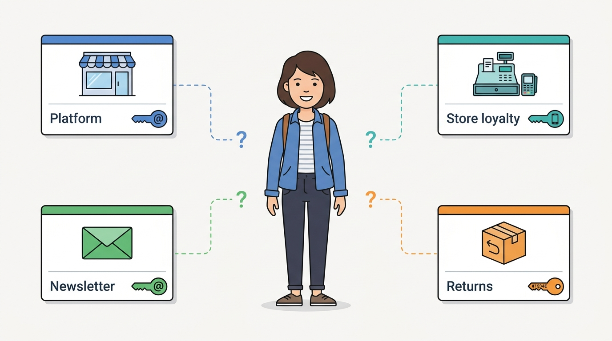
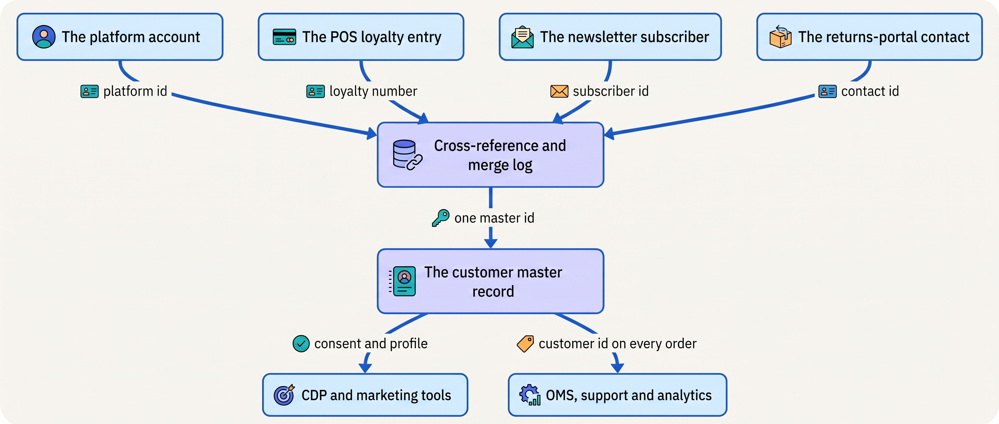
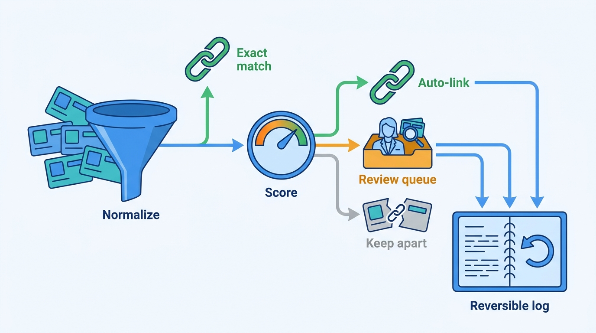
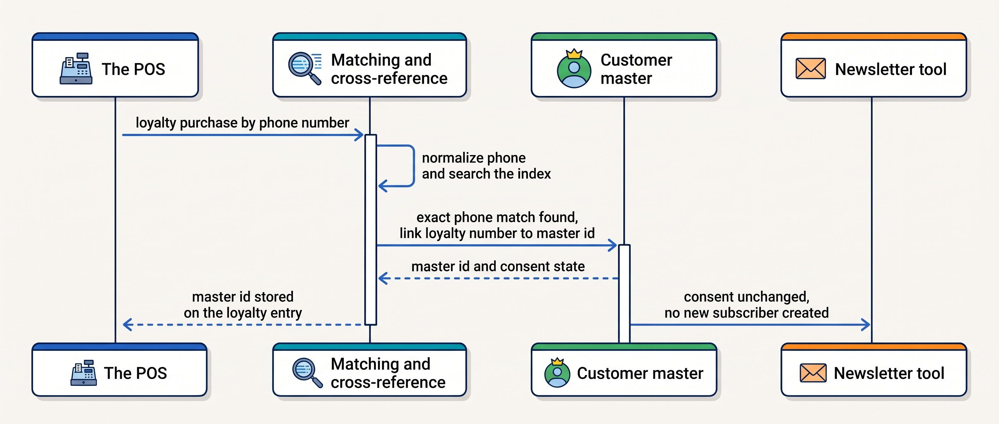
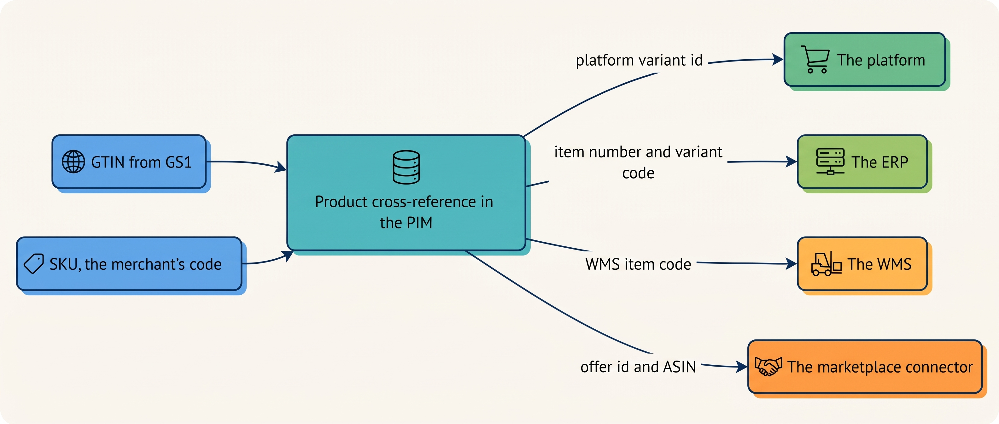

> **IN THIS CHAPTER, YOU WILL:** Learn why one person or product becomes four records, how matching and merging decide that they are one, and who should own the result.

> **KEY POINTS:**
>
> * **Every system keys the same person or product its own way, so duplicates are the normal case.** An online account is keyed by e-mail, a store customer by phone or loyalty card, a wholesale contact by company plus person, a product by an internal stock code in the warehouse and a global product identifier on the marketplace. Nothing links them unless you build the link.
> * **Identity is a decision before it is software.** For each master entity, name the system of record, keep a cross-reference of every other system's identifier for it, write the matching rules and the survivorship rules down, and make every merge reversible. A merge that joins two different people is a privacy incident, not a data-quality blemish.
> * **The marketing copy is not the master.** A customer data platform builds a fuzzy, useful profile for audiences; the record that drives orders, refunds, invoices and deletion requests must be exact and owned. Keep the two apart and let the exact one feed the fuzzy one.

> **[FAILURE PATTERNS THIS CHAPTER ADDRESSES](where-commerce-platforms-go-wrong.html):**
>
> * **The Familiar Stranger** — each system counts customers its own way, so nobody can say whether the store customer and the online customer are the same person.
> * **The Spaghetti Junction** — every connector maps product and customer identifiers in its own way, so the cross-reference between systems lives inside the connectors, with no owner.

 
The previous chapter's contracts fix how two systems speak to each other; they cannot tell whether the records on both sides describe the same customer. A customer buys online, joins a store loyalty scheme and later contacts the returns portal. Each system may create its own record for that person. At Kestrel & Pine, the fictional outdoor brand, accounts on the shop platform, store loyalty entries, newsletter subscribers and returns contacts all overlap. Without reliable matching, support can miss part of a customer's history and reports can count one buyer several times.

Products have the same problem. One Ridgewalker women's M in moss appears as a variant on the shop platform, an item in the ERP, an item in the warehouse system and several marketplace offers. Each has a local identifier. If only the connectors know how those identifiers match, replacing a connector can lose the relationship.

This chapter explains **master data**, the slowly changing shared records that transactions refer to (customers, products, suppliers, locations), and **matching**, the decision that two records describe the same entity. A **golden record** is the maintained, authoritative view assembled from those records. [[boundaries-and-systems-of-record]] covers ownership, [[privacy-and-customer-data]] covers personal-data rules and [[product-information]] explains the product model; which record is the order is settled in [[order-management]].

**Where we are in the order's journey.** Eva buys a jacket online on 13 April 2027. She has previously bought socks through the Nijmegen store's loyalty account. Her exchange request creates a returns contact on 19 April. The identity problem is whether those systems can establish that their records describe the same customer.

The answer this chapter gives is that two records are the same only where the merchant has decided so, entity by entity. It names one master for each entity, the system whose record counts as true: the shop platform for consumers, the ERP for business customers, and the PIM or the ERP's item master for products. It keeps an owned cross-reference of every system's identifier for each master record, with a merge log that lets any merge be undone. It links records automatically only on an exact e-mail address, phone number or product code, written one standard way, and sends partial matches to a named person for review. A customer data platform, the marketing tool that builds one profile per person, is a copy for marketing, not the master.

The chapter starts with Kestrel & Pine's four customer lists and Eva's four records. It then says what undecided identity costs and which identifiers customers and products carry, and lays out the responsibilities that make up identity. Next come matching, merging and consent, then the ways to own customer and product identity, compared by their trade-offs and by scale stage. It follows Kestrel & Pine's 2027 decision and ends with what goes wrong. The evidence is the scenario, vendors' documentation and the research on record linkage.

## Setting the Scene at Kestrel & Pine: Four Evas

In March 2027, Ecommerce Manager Milan Petrov proposes an autumn online loyalty program. Head of Engineering Noor Visser asks how it would recognize a store customer online. Nobody can reliably count eligible customers or connect the accounts.

Ruben Alves, the lead integration engineer, pulled the counts. The figures are illustrative.

| List | System | Records (illustrative) | Key the system uses |
| --- | --- | --- | --- |
| Customer records | The shop platform (storefronts, cart, checkout) | about 410,000, including guest checkouts | Customer id; e-mail address |
| Loyalty list | The POS (point of sale: the till software in the six stores) | about 38,000 | Phone number; loyalty number |
| Subscribers | The newsletter tool (one of the 41 apps installed on the shop platform) | about 165,000 | E-mail address |
| Contacts | The returns portal | about 61,000 | E-mail address plus order number |

The four lists add up to about 674,000 records. Nobody believes Kestrel & Pine has 674,000 customers; nobody can say how many it has.

Eva Janssen shows why. She is one person in Nijmegen. In Kestrel & Pine's systems she is four:

| Where | What the record says | What it does not know |
| --- | --- | --- |
| The shop platform | An account from 2024 under her personal e-mail; three orders, the latest #1072455 of 13 April 2027; an address in Nijmegen | That she shops in the Nijmegen store |
| The POS loyalty list | "E. Janssen", joined at the Nijmegen store in 2023; four purchases, the latest socks in February 2027 | Her e-mail; her online orders |
| The newsletter tool | A subscriber since 2022 under an older e-mail address | That she is a customer at all |
| The returns portal | A contact created on 19 April 2027 from order #1072455, with her personal e-mail | Nothing else about her |

No field is shared by all four records. **The Familiar Stranger** is the book's name for this problem: a merchant repeatedly encounters a person its systems cannot reliably connect. Milan and Noor defer online loyalty until the link between her records can be maintained ([[commerce-promotions]]).

**Figure 1:** *One shopper, four records, four keys: no field is shared by all four, so the four lists add up to about 674,000 records and nobody can say how many customers there are.*

## Why One Customer and One Product Matter

Eva's four records are one case of a wider cost. Why does a merchant lose money or trust when identity is undecided?

- **Marketing.** Eva gets the new-subscriber offer at her older e-mail while her account is three orders old; a store customer who opted out is e-mailed because the opt-out lives only in the POS. Consent belongs to a person, and a person the systems cannot see cannot be respected ([[privacy-and-customer-data]]).
- **Service.** The agent answering Eva's exchange question cannot see her store purchases. [[customer-service-and-notifications]] describes the five tabs an agent works from; identity is why there is no sixth that joins them.
- **Loyalty and promotions.** "First order", "members only" and "once per customer" need to know who the customer is ([[commerce-promotions]]); a program built on one list rewards that list and ignores the rest.
- **Returns and refunds.** A refund goes back to the order's payment method, which is safe; a store credit or an exchange raised against the wrong record goes to the wrong person.
- **Analytics.** "Customers", "new customers" and "repeat rate" are undefined while the person is ([[commerce-data-and-analytics]]).
- **Privacy.** A person who asks to be forgotten must be found in every system within one month; without an index of where Eva is, the request cannot be fulfilled ([[privacy-and-customer-data]]).

Products have their own version of each loss: a marketplace listing without the GTIN (the global barcode number, explained below) of its warehouse item becomes a second product, and an ERP item whose variant code maps to no platform variant is a sale the ERP cannot cost.

Naming the fix needs a few words. An **identifier** is a value a system uses to tell one record from another: a customer id, an e-mail address, an order number, a barcode number. **Customer identity** is the set of identifiers that different systems use for the same person, plus the rules that link them. A **system of record** is the one system whose version of a fact is the truth (the idea comes from [[boundaries-and-systems-of-record]]); for master data it is usually called the **master**.

### The identifiers a commerce estate uses

Linking records means linking identifiers, and customers carry six kinds. Each is assigned by a different party and differs in how stable and how unique it is, so the e-mail address, which every system understands, is the usual match key but never a perfect one:

| Identifier | Who assigns it | Stable? | Unique to one person? | Who else understands it |
| --- | --- | --- | --- | --- |
| Customer id | The platform, the POS, the ERP, each its own | Yes, inside that system | Yes, inside that system | Nobody else, unless carried in a cross-reference |
| E-mail address | The person | Changes with jobs and providers | Often shared by a household; one person has several | Every system, which is why it is the usual match key |
| Phone number | The person | Changes rarely | Usually one person, sometimes a family | Stores and carriers |
| Loyalty number | The POS or a loyalty program | Yes | Yes, but one person may hold two cards | Only the program |
| Postal address | The person | Changes with moves | Shared by a household | Carriers; useful for matching, never alone |
| Company id plus contact | The ERP or the B2B portal | Yes | A company has many contacts; a contact moves between companies | EDI (electronic data interchange) partners by GLN (the Global Location Number that GS1, the barcode standards body, assigns to companies and sites; see [[edi-and-e-invoicing]]) |

For products, the lesson of [[product-information]] is that a SKU (the merchant's own code for a sellable variant) and a GTIN (the Global Trade Item Number under the barcode, licensed from GS1 so that every company means the same item by it) are assigned once and never change. Here is what each identifier is good for, and what it is not:

| Identifier | Who assigns | Scope | Good for | Not |
| --- | --- | --- | --- | --- |
| GTIN (EAN-13, the 13-digit barcode number, in Europe) | The brand owner, through GS1 | Global, one per sellable item | Marketplace listings, retail scanning, matching across companies | An internal key: resellers of the same item share it, and packaging variants differ |
| SKU | The merchant | Internal, one per variant | Warehouse, stock, merchandising, the join key between the merchant's own systems | Stable across systems unless governed: connectors overload it, putting other codes in the SKU field |
| Internal id | Each system | That system only | Joins inside that system | Meaningful anywhere else |
| Marketplace id | The marketplace (an ASIN, Amazon's own product number; an offer id on bol) | That marketplace | That channel's listings and orders | Yours; the marketplace can change what it refers to |

The table is the author's synthesis of the GS1 US definition of the GTIN (n.d., accessed November 2026) and of Microsoft's documentation for its Business Central connector for Shopify (October 2026), which matches items on SKU or barcode and, when it finds an existing variant, links rather than creates. That one rule in Microsoft's documentation is a product-identity policy: **match on the governed identifiers, link, never duplicate.**

## How the Pieces Fit Together

Nothing links those identifiers by itself. Linking them is not one system but a set of responsibilities spread across the systems a merchant already has; the last column shows Kestrel & Pine at the time of the scene above, when none of them had been assigned.

| Responsibility | What it does | Where it usually lives | Kestrel & Pine, March 2027 |
| --- | --- | --- | --- |
| **The customer master** | The one record per consumer the business treats as true: name, contact details, addresses, consent | The platform for consumer merchants; the ERP or a CRM (customer relationship management system) for business customers | Undecided; four lists |
| **The product master** | Holds the one record per product and variant, with its SKU and GTIN | The PIM (product information management system) where there is one; the ERP's item master where there is not | Three copies plus the connector's; the PIM arrives in Q3 2027 (W3, the PIM as system of record for product content) |
| **The cross-reference and merge log** | For each master record, every other system's identifier for it, and every link or merge made, reversibly | A table owned by the master's owner; often in the integration platform or the data warehouse | Inside each connector's mapping |
| **Matching** | Decides whether two records are the same entity when they share no identifier | A batch job, a platform feature, a customer data platform (CDP) or a master data management (MDM) tool | Nothing |
| **Survivorship** | When two records merge, which value wins per field | Rules written down; enforced by the merge tool | Nothing |
| **Consent** | The person's marketing choices, with when, where and what they agreed to | On the customer master, synchronized outward | In the newsletter tool and the POS, separately |
| **The customer data platform (CDP)** | A unified profile per person built from every touchpoint, for audiences and personalization | A separate product, fed by the master and the event streams | None |

The design rule I use: **the master owns the record, the cross-reference owns the links, and every other system keeps its own record but carries the master's id once matched.** The POS still needs its loyalty list and the returns portal its contacts; what changes is that each record points at one master, and the master knows where its copies are.

**Figure 2:** *Four systems keep their own records of Eva; a cross-reference links each to one master record, which feeds marketing copies and the operational systems.*

## Matching and Merging

The design rule leaves one question open: how the cross-reference decides that two records belong together. **Matching** is deciding that two records that do not already point to each other refer to the same real-world thing. The field is called record linkage, and it is older than commerce computing: Dunn described it in 1946, Newcombe and colleagues showed in 1959 that agreeing on a rare value (an unusual surname) is stronger evidence than agreeing on a common one, and in 1969 Fellegi and Sunter gave the scoring model most tools still use, explained below. The 1969 paper is paywalled, so it is cited here through a secondary source.

Before any comparison, **normalization**: lower-case the e-mail and strip spaces; write phone numbers in the international format; write postal codes in the national format. Most "duplicates" in a commerce estate are the same key spelled two ways. And for any estate larger than a few thousand records, **blocking**: compare only pairs that already agree on something (the same postal code, the same surname), because comparing every record with every other grows with the square of the count; two lists of a million records would make a million million pairs.

Then come two families of rule. **Deterministic matching** uses exact rules and needs no score or thresholds: the same normalized e-mail or phone means the same person. It is cheap, explainable and safe, and it misses every person who used two e-mail addresses. **Probabilistic matching** scores partial agreement (name, address, postal code) and tolerates typos. It finds more matches and makes more mistakes, which is why it needs thresholds and a review queue.

The probabilistic family scores in the way Fellegi and Sunter described. In plain words: for each candidate pair, add up evidence field by field (the same e-mail is strong, the same first name weak), and compare the total with two thresholds. Above the upper one, a match; below the lower one, not; between them, a person decides.

The rules I use for a merchant's customer matching:

1. Normalize first; match on exact e-mail or exact phone automatically.
2. Score name plus address plus postal code; auto-link above a high threshold, queue the middle band for a person, and never link on name plus city alone.
3. Never merge during a customer-facing flow; link in the background.
4. Keep every merge reversible, in a log that records which records became one, when, by which rule and who approved it.
5. Treat a wrong merge as a privacy incident and rehearse the unmerge: it shows one person the other's orders and addresses, a personal-data breach ([[privacy-and-customer-data]]).

**Figure 3:** *Customer matching in the order the chapter recommends: normalize, link exact e-mail or phone matches automatically, score the rest, send the middle band to a person, and keep every merge reversible.*

**Survivorship** is the rule that decides which value wins when two merging records disagree: two names, two addresses, two consent states. The usual rule types are source priority (the platform's address beats the newsletter tool's), recency (the latest address wins) and completeness (the record with a phone number wins), as the MDM vendor Profisee describes them (August 2025). The rule is per field, not per record: the newest address, the strictest consent, the earliest created-date.

Shopify documents its own survivorship, which makes it the clearest dated example. Its `customerMerge` mutation (API version 2026-10) says the two ids "don't guarantee which customer is kept": the caller may name the customer whose e-mail survives; otherwise the one with an e-mail wins, then an enabled account, then the marketing-consent state; first and last name can be overridden per field; the merge runs as a job whose resulting id must be treated "as authoritative", and a preview shows the outcome first. Most platforms have a comparable rule and do not publish it. **That is why the responsibilities table above must name the customer master: if the shop platform merges customer records by its rules and the ERP merges its copies by others, the two systems' versions of one customer drift apart on their own.**

### Consent travels with the identity

Merging customer records must preserve what the person agreed to. An address supplied for delivery does not become permission to send marketing when two accounts are joined. The General Data Protection Regulation (GDPR), the EU's personal-data law, defines consent as a freely given, specific, informed and unambiguous indication of the person's wishes (Article 4(11)) and requires the controller to be able to demonstrate that consent was given (Article 7(1)). "Demonstrate" is a data requirement: the record must hold when, where and to what the person agreed, which is why Shopify's consent mutation records "when and where the customer gave or withdrew consent". A merge must carry that evidence forward, with its source, rather than recompute consent from whichever record survived. The legal side belongs to [[privacy-and-customer-data]].

### How a new record finds its master

The sequence in the figure below shows how a new record should find its master under the design rule and the matching rules above. The example is a loyalty member's store purchase, like Eva's socks in the Nijmegen store in February 2027, as it would run under them; no such rule existed then.

**Figure 4:** *A store purchase is matched on a normalized phone number; the loyalty entry is linked to the master, and consent is read from the master rather than recreated.*

Three things carry the design: the POS keeps its own entry and gains a master id; the match is on an exact key written one standard way (normalized), so no human is needed; and consent is read from the master, which is why the newsletter tool does not quietly gain a subscriber from a store sign-up.

### Requirements per flow

The store purchase is one identity flow; the others differ in how fast and how sure they must be.

| Flow | How fresh | How consistent | How fast | How available |
| --- | --- | --- | --- | --- |
| Online checkout, logged in | Immediate | The account id is the key; no matching needed | Part of checkout | Must not block checkout |
| Guest checkout | Immediate | Creates a record keyed by e-mail; matched to an account later, never during checkout | Part of checkout | Must not block checkout |
| Store loyalty sign-up or purchase | Hours | Exact match on phone or e-mail; otherwise a new master record | Batch is fine | Can wait; the store never waits on it |
| Newsletter sign-up | Hours | Exact match on e-mail; consent recorded on the master with time, place and wording | Batch is fine | Can wait |
| Returns-portal contact | Minutes | Exact match on the e-mail address the contact shares with the order | Part of the return start | Can degrade to "unlinked" |
| New product variant | Weeks before launch | One SKU and one GTIN per variant, created once in the master, published outward | Batch | Office hours |

The pattern: **the flows that face a customer are exact or deferred, never fuzzy.** Nothing in the checkout path waits for a matching job; probabilistic matching runs in the background and sends its uncertain cases to a person, so the rules above never slow a customer down.

### Matching products

Products are simpler than customers, and the matching is stricter. The GTIN is the match key across companies, the SKU inside one. A product record with no GTIN is matched by hand or not at all. GS1's rule, relayed by secondary sources, is that every distinct trade item and packaging configuration gets its own GTIN and a GTIN is never reused for a different item; [[product-information]] carries the detail. The product cross-reference (GTIN, SKU, each system's internal id, each marketplace's id) is the product master's companion table. It belongs to the PIM where there is one, and to the ERP's item master where there is not.

**Figure 5:** *One product, two governed identifiers and four internal ones; the cross-reference in the PIM is where every other system's key for the Ridgewalker women's M moss is recorded.*

## The Choices

With matching, survivorship and consent explained, the question is who owns them. A merchant has four realistic ways to own customer identity, a fifth for the Group stage, and two for products.

**The platform's customer record is the master, with periodic deduplication.** Every other system's record is linked to a platform customer id; matching is the platform's own merge feature plus a scheduled job for the other lists. This fits a consumer merchant whose platform already holds most customers, which is most merchants below the Group stage.

**The ERP or a CRM is the master.** The finance or sales system holds the customer; the platform's accounts are copies. This fits wholesale-heavy businesses, where the customer is a company with terms and a credit limit that the ERP already owns ([[b2b-commerce]]). For consumers it usually fails: the ERP's customer record was designed for invoicing, not for consent, addresses and preferences.

**A cross-reference and matching service beside the existing systems.** Nothing moves; a small service, or tables in the integration platform or the data warehouse, holds the master id, the links and the merge log, and runs matching. It is the lightest way to make several masters behave as one, and Kestrel & Pine later combines it with the shop platform as the master for consumers. Its weakness: it is "just tables" until a wrong merge happens.

**A customer data platform as the master.** The CDP Institute (2026 wording) defines a CDP as software that "creates and maintains a persistent, unified customer record that is accessible to other systems" and that "assumes primary responsibility for defining and maintaining customer identity". Twilio Segment's identity resolution (documentation of June 2026) merges each person's history across web, mobile, server and third-party sources into one profile through an identity graph of cookie ids, device ids, e-mails and external ids, with merge protection against non-unique anonymous ids.

These are strong marketing tools. My judgement, labeled as mine: do not make the CDP the master that service agents, the OMS and the ERP read. Its profile is built for audiences and may be fuzzier than a record that drives invoices, refunds and deletion requests. Let the exact master feed the CDP, and let the CDP's matches come back as suggestions, not merges.

The fifth option is for the Group stage: a **master data management (MDM)** platform. Informatica describes MDM as creating "a single master record for each person, place, or thing in a business", the record "also known as a 'golden record' or 'best version of the truth'", with software that matches and merges across systems and keeps an audit trail (n.d., accessed November 2026). That assembled record is the golden record named at the start of the chapter, built by merging sources under survivorship rules. Below the Group stage I keep MDM small: a decision per entity (owner, survivorship rule per field, merge process), not a product. Buying the platform is a move driven by several brands, acquisitions or countries, each with a master to reconcile.

For products: **the ERP item master or the PIM.** Until product content needs enrichment, translation and syndication, the ERP's item master with a SKU and a GTIN per variant is enough, and the cross-reference to channel ids lives beside it. From that point the PIM is the product master and the ERP keeps costs and purchasing, which is Waypoint's W3 ([[product-information]]).

## Trade-offs

The table below compares five options: the four ways to own customer identity, and MDM. Each fits one situation and has its own warning sign. The product side has the same shape in miniature: one master at a time, and never two masters for the same identifier.

| Option | Fits when | Strengths | Costs and limits | Warning sign |
| --- | --- | --- | --- | --- |
| Platform as customer master | Consumer merchant; most customers come through the storefront | Already exists; merge and consent features; one id on every online order | Store and wholesale records are second-class; survivorship rules are the vendor's | The POS list is never matched because "the platform is the master" |
| ERP or CRM as master | Wholesale-heavy; company customers with terms | Terms, credit and invoices already there | Consumer fields fit badly; marketing tools cannot read it | Consumer records keyed by invoice address |
| Cross-reference and matching service | Several systems holding customers; no replatforming | Nothing moves; reversible; cheap to start | Needs a named owner and a review queue; easy to leave untended | A wrong merge nobody can undo |
| CDP as master | Marketing needs audiences across many touchpoints | Identity graph across anonymous and known; activation to advertising and e-mail | Probabilistic; not built for refunds, invoices or deletion; cost scales with events | Service agents working from the CDP's view |
| MDM platform | Group stage: several brands, countries or acquisitions | Survivorship per field across masters; audit trail; stewardship workflow | License plus a data-governance function; a year to implement | Bought before the second brand exists |

## Across Scale Stages: When It Fits and When It Limits

The same choice also changes with the merchant's size. The four stages are the book's (see [[commerce-scaling-stages]]).

| Stage | What is typical | What becomes necessary | Warning signs of outgrowing it |
| --- | --- | --- | --- |
| **1 — Starting** | One platform; its customer record is the only one; SKUs typed by hand, GTINs bought in a block | One e-mail per customer; a periodic duplicate merge in the platform; one SKU and one GTIN per variant, never reused | Guest checkouts outnumber accounts and nobody merges them; a SKU corrected in place after the first sale |
| **2 — Growing** | The first store, wholesale account and marketplace each bring a new key: loyalty number, company plus contact, marketplace id | Decide the customer master (platform, ERP or CRM) and the product master (ERP or PIM); a product cross-reference before the first marketplace; consent on the master | A loyalty list nobody can join to online accounts; a marketplace listing created as a second product for want of a GTIN |
| **3 — Omnichannel** | A dozen systems holding customers; four product copies; a mapping inside each connector; marketing asking for a CDP | Matching with thresholds, a review queue and a merge log; consent with evidence on the master, synchronized outward; a PIM as product master; a CDP, if needed, fed from the master | A wrong merge found by a customer; "how many customers" answered with four numbers; a deletion request that cannot find every copy ([[privacy-and-customer-data]]) |
| **4 — Group** | Several brands or countries, each with its own masters; acquisitions bring more | An MDM function or platform across brands; survivorship per field; a merge log privacy can audit; one consent model with national differences as configuration | One brand's customers e-mailed under another's consent; two GTINs for one item in two catalogs |

The judgement: the identifiers do not change with scale, and the cheapest decisions are the earliest: one SKU and one GTIN per variant from the first day, one e-mail per account, a named customer master before the first store. What changes is how many systems hold a copy, and so how much linking there is to own. Kestrel & Pine is a stage-3 merchant that skipped the stage-2 decision, which is why it has four lists and no answer.

## In Practice

Before following Kestrel & Pine out of that position, it helps to see what the public record offers. The public evidence for this chapter is documentation, not case studies: vendors describe their identity features, and no merchant publishes its duplicate rate.

- **Shopify (2026)** documents what a platform-as-master design gives a merchant: `customerMerge` with published survivorship rules and a preview, and a consent mutation that records when and where consent was given. Both operate only on the platform's own records. Orders from Shopify's own POS land in the same customer and order model (Microsoft's connector documentation of October 2026 maps their staff id to a salesperson): the suite answer to the Familiar Stranger is one vendor for till and storefront. Kestrel & Pine's POS is from another vendor; the shop platform's own POS is evaluated in 2028 (W4, stay on the shop platform and add what it lacks beside it).
- **Microsoft's Business Central connector (October 2026)** matches items on SKU or barcode and links rather than creates; its SKU field may hold the ERP item number, the item number plus a variant code, or the vendor's item number, depending on a setting. A merchant with two such connectors and two settings has two cross-references.
- **The CDP category (2013–2026)**: named by David Raab in 2013, defined by the CDP Institute (founded 2016), implemented with identity graphs by products such as Twilio Segment (June 2026).
- **The MDM vocabulary**: Informatica's and Profisee's pages (2025–2026) define the golden record and survivorship; DAMA's Data Management Body of Knowledge (revised 2024) is the formal reference.

### Kestrel & Pine's identity decision (2027, illustrative)

In **June 2027**, at the weekly architecture hour, Noor Visser, Milan Petrov and Ruben Alves adopted a customer-identity rule, recorded as an addition to Waypoint rather than a new W-decision. The figures are illustrative.

- **The shop platform's customer record is the master for consumers.** The POS loyalty list, the newsletter tool and the returns portal keep their own records and carry the platform customer id once matched.
- **The ERP is the master for business customers and contacts**, as it already was for terms and credit ([[b2b-commerce]]).
- **The cross-reference and merge log live in the data warehouse**, owned by Hanna Berg's data pair, because the warehouse already receives every list nightly and her team already owns the metric definitions under W7 (one definition of order, revenue and return).
- **Matching runs weekly.** Exact matches on normalized e-mail or phone link automatically; name plus address plus postal code goes to a review queue worked by the application support specialists; the platform's own merge is used only after review, with its preview.
- **Consent is read from the master.** The newsletter tool's subscription state and the POS's opt-in flag are copied to the platform's consent record with source and date; the strictest state wins where they disagree.

The first run, in **July 2027**, linked about **21,000** of the 38,000 loyalty entries to a platform customer by exact phone or e-mail, sent about **4,100** to the review queue and left the rest unlinked. Of the 165,000 newsletter subscribers, about **96,000** matched a platform customer.

Eva Janssen's four records became one master with three links: her returns contact automatically, on the e-mail address it shares with her account, and the other two under the weekly rules, one of them through the review queue.

The product side waited for the PIM: its July 2027 load from the four copies of product data found 1,900 variants with conflicting attributes ([[replatforming-and-migration]]), and the cross-reference of GTIN, SKU, platform, ERP, WMS and marketplace ids, the Ridgewalker women's M moss among its rows, was built in the PIM at the same time (W3).

What the decision bought: one answer to "how many customers" (the master count, with unlinked store entries reported separately), a loyalty program that could start in 2028 on one list, a service screen that could show Eva's store purchases next to her online orders once the OMS arrived (W2, the OMS as the one order record), and an index of where every person's data lives, which [[privacy-and-customer-data]] needs.

## When It Goes Wrong

Those gains hold only while the rules do; the table below shows six ways they fail. The wrong merge is what makes matching dangerous; the safeguard is not a better algorithm but a reversible log and a person in the middle band. The overloaded SKU is the product-side Spaghetti Junction: the estate's identifier policy expressed as a drop-down in one connector's settings.

| Failure | How it shows | Detection | Recovery |
| --- | --- | --- | --- |
| **The wrong merge** | A customer logs in and sees another person's orders or address | A complaint; a review of recent merges near the threshold | Unmerge from the log; notify the affected people; assess it as a personal-data breach ([[privacy-and-customer-data]]); raise the threshold |
| **Duplicates from guest checkout** | One person, six platform records, six "first order" discounts ([[commerce-promotions]]) | Duplicate rate on normalized e-mail, reported monthly | Scheduled exact-match merge; a "sign in to use your discount" rule |
| **Consent lost in a merge** | A person who opted out is e-mailed because the surviving record said "subscribed" | A consent reconciliation between the master and each marketing tool | Strictest state wins; re-sync outward; keep the evidence of the original opt-out |
| **The overloaded SKU** | A connector writes the ERP's item-plus-variant code into the platform's SKU field; the WMS expects the plain SKU; pick lists fail | A cross-reference reconciliation: one SKU and one GTIN per variant in every system | Fix the connector setting; rebuild the cross-reference from the master |
| **The missing GTIN** | A marketplace creates a second listing for the same item; stock and reviews split between them | A listing-to-GTIN reconciliation per marketplace | Merge the listings where the marketplace allows; never list without a GTIN |
| **The connector that owned the mapping** | A connector is replaced ([[api-contracts-and-versioning]]) and the cross-reference goes with it | Discovered at migration | Keep the cross-reference in the master's companion table, never only in a connector; export it before any connector change |

## What to Take Away

The opening asked how a shopper who buys online, in a store and through the returns portal, or a Ridgewalker variant held by four systems, can be known as one customer or one product. No system finds this out by itself. The merchant names a master for each entity, keeps every other system's identifier in an owned cross-reference, links automatically only on exact keys and sends the rest to a person, with every merge reversible. That is how Eva's four records became one master with three links without any data moving, and why the customer data platform stays a copy fed from the master rather than the record that service, orders and finance read.

**Established.**

- Record linkage is a mature field: exact rules for shared keys, probabilistic scoring with two thresholds and a review band (Fellegi and Sunter, 1969), normalization and blocking to make it feasible.
- Platforms and connectors implement survivorship and cross-reference policies their own way and sometimes publish them: Shopify's `customerMerge` rules (API 2026-10) and Business Central's item matching on SKU or barcode (October 2026).
- The GTIN is the only product identifier every external party understands; the SKU is the only one the merchant controls; both are assigned once and never reused (GS1; [[product-information]]).
- Consent must be demonstrable (GDPR Article 7(1)), so it is a record with time, place and wording that travels with the identity through every merge.

**Depends on context.**

- The platform is the right customer master for a consumer merchant below the Group stage and the ERP for business customers; a merchant with both has two masters and one cross-reference, which is fine as long as both are named.
- A CDP earns its place when marketing needs audiences across anonymous and known touchpoints; it does not earn the role of master for service, orders and deletion, whatever the vendor's definition says.
- Probabilistic matching is worth its review queue from the Omnichannel stage; below it, exact matching on normalized e-mail and phone catches most duplicates at no risk.
- An MDM platform is a Group-stage purchase, triggered by a second brand or an acquisition, not by the first duplicate list.

**The author's synthesis.**

- Identity is the box the capability map leaves blank the longest, because every system works without it; make the decision before the first store, and if you did not, make it the way Kestrel & Pine did: nothing moves, the links are owned, every merge can be undone.
- Keep the exact record and the fuzzy profile apart and let the exact one feed the fuzzy one; the day they are the same table, a marketing match becomes an invoice error.

## Questions to Ask

Eight questions apply the chapter to your own company:

1. For each master entity (consumer, business customer, product, supplier, location): which system is its master, and is that written down?
2. Where is the cross-reference between the master's id and every other system's id kept, and is it anywhere other than inside a connector?
3. What are the matching rules, what is matched automatically, and who works the review queue?
4. Is every merge logged and reversible, and when was an unmerge last rehearsed?
5. Which value wins, per field, when two records merge, and does consent carry its evidence?
6. What is the duplicate rate on normalized e-mail, and who reports it?
7. Does every sellable variant have one SKU and one GTIN in every system, and which job checks?
8. Could you list, today, every system that holds a given person's data?

The last question is where this chapter hands over. Once a merchant can say who its customers are and where their records live, it can count them. [[commerce-data-and-analytics]] takes the master and the cross-reference built here and asks why three reports still show three different order counts, and how to build analytics the business trusts. The question of what the merchant may do with the records, and how it forgets them, waits for [[privacy-and-customer-data]].

## Sources and Evidence

*Company, product and investor sources*

- [customerMerge mutation](https://shopify.dev/docs/api/admin-graphql/latest/mutations/customerMerge), Shopify developer documentation, API version 2026-10, accessed 2026-11 — the published survivorship rules, asynchronous job and preview.
- [customerEmailMarketingConsentUpdate mutation](https://shopify.dev/docs/api/admin-graphql/latest/mutations/customerEmailMarketingConsentUpdate), Shopify developer documentation, n.d., accessed 2026-11 — consent state, opt-in level, and "when and where" consent was given or withdrawn.
- [Customer accounts](https://shopify.dev/docs/apps/build/customer-accounts), Shopify developer documentation, n.d., accessed 2026-11 — accounts, pre-authenticated order status pages, deprecation of legacy accounts.
- [Synchronize items with Shopify](https://learn.microsoft.com/en-us/dynamics365/business-central/shopify/synchronize-items), Microsoft Learn, 2026-10-16 — SKU and barcode matching, the SKU field's three possible contents, link rather than create.
- [Synchronize and fulfill sales orders](https://learn.microsoft.com/en-us/dynamics365/business-central/shopify/synchronize-orders), Microsoft Learn, 2026-10-14 — POS and draft orders carrying a staff id into one order model.
- [What is a CDP?](https://www.cdpinstitute.org/learning-center/what-is-a-cdp/), CDP Institute, 2026 wording, accessed 2026-11 — the definition and the "primary responsibility" for customer identity.
- [Identity Resolution](https://www.twilio.com/docs/segment/unify/identity-resolution), Twilio Segment documentation, last modified 2026-06-04 — identity graph, external ids, merge protection.
- [What is master data management?](https://www.informatica.com/resources/articles/what-is-master-data-management.html), Informatica, n.d., accessed 2026-11 — the golden record and MDM domains.
- [What Is a Golden Record in MDM?](https://profisee.com/blog/what-is-a-golden-record/), Benjamin Bourgeois, Profisee, 2025-08-26 — survivorship rule types: source priority, recency, completeness.

*Standards, regulation and official documentation*

- [What is a GTIN?](https://www.gs1us.org/upcs-barcodes-prefixes/what-is-a-gtin), GS1 US, n.d., accessed 2026-11 — GTIN-8, -12, -13 and -14 and their uses.
- [Regulation (EU) 2016/679 (GDPR)](http://publications.europa.eu/resource/celex/32016R0679), Official Journal text, 2016 — Article 4(11) on consent and Article 7(1) on demonstrating it.
- [DAMA Body of Knowledge](https://www.dama.org/cpages/body-of-knowledge), DAMA International, n.d., accessed 2026-11 — the practitioner framework for master data governance, revised 2024.

*Research and practitioner sources*

- [Record linkage](https://en.wikipedia.org/wiki/Record_linkage), Wikipedia, accessed 2026-11 — the history (Dunn 1946, Newcombe 1959, Fellegi and Sunter 1969), thresholds, blocking; a secondary source, used because the 1969 paper is paywalled.
- [[entity-resolution]] in the sibling book LISTED — the full treatment of matching, blocking and merge reversibility for marketplaces, for readers who need depth.

Kestrel & Pine is fictional; architectural recommendations, labeled inferences and labeled assumptions are the author's judgement.
