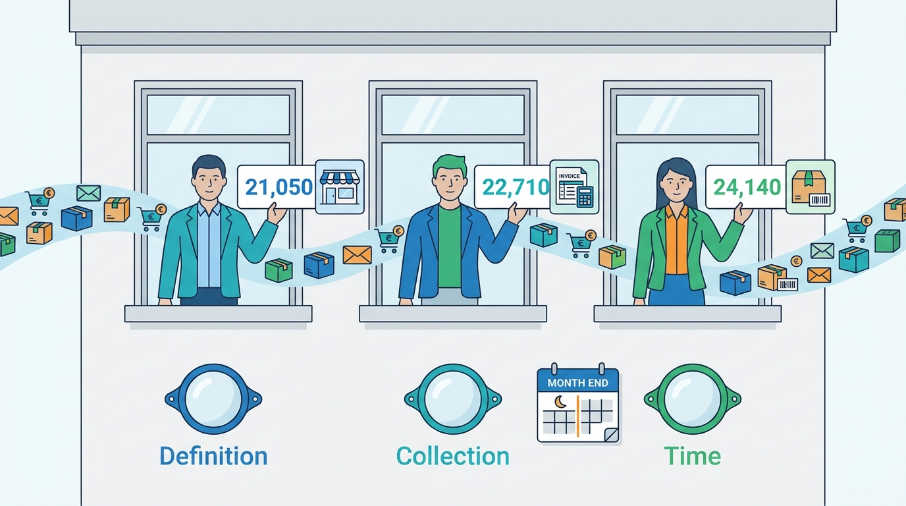
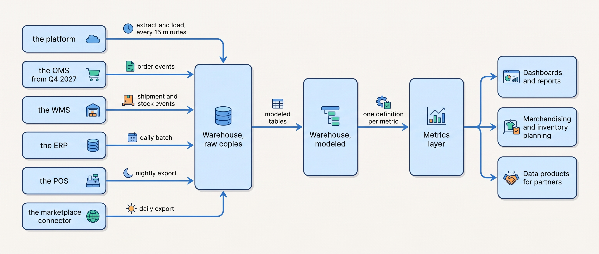
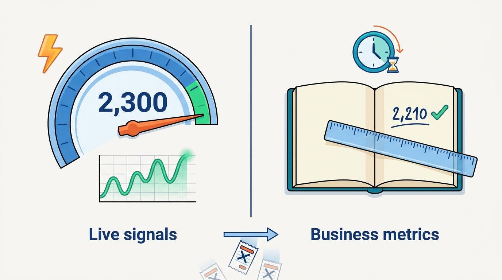
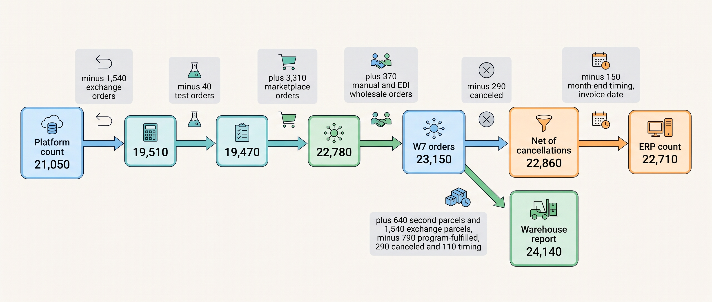

> **IN THIS CHAPTER, YOU WILL:** Learn why honest systems count orders differently, how a data platform collects every system's data, and how one owned definition per metric makes a number trustworthy.

> **KEY POINTS:**
>
> * **Three order counts have three honest causes: definition, collection and time.** Each system counts what it exists to handle (orders placed, orders invoiced, parcels shipped), each loses or gains records in the copying, and each uses its own clock. None is wrong; none is the company's number until someone defines it.
> * **Keep operational and analytical data apart, and copy everything into one place.** Operational stores answer "where is this order" for one order; analytical stores answer "how many orders by channel" over all of them. A warehouse or lakehouse fed by extract-and-load jobs and event streams is where the counts can be compared.
> * **Define each metric once, with an owner, and publish the bridge.** A metrics layer holds "order", "net sales" and "return" as code so every dashboard computes them the same way. Waypoint decision W7 gives Kestrel & Pine's definitions to the Data Lead and puts the reconciliation between the platform's count and the warehouse's count next to the reported number.

> **[FAILURE PATTERNS THIS CHAPTER ADDRESSES](where-commerce-platforms-go-wrong.html):**
>
> * **Schrödinger's Order** — when the operational systems disagree about an order, every report built on them disagrees too, and the dashboard becomes a fourth opinion.
> * **The Message in a Bottle** — an order edit or refund that one connector missed is a permanent difference between the warehouse and the platform until a reconciliation finds it.
> * **The Familiar Stranger** — "customers" cannot be counted while four systems each count their own, so the customer metrics inherit the identity problem of the previous chapter.

 
Every chapter so far has been about keeping a promise to one customer: this jacket, this price, this delivery, this refund. This chapter is about a different kind of promise, the one the company makes to itself when it says "we took 21,000 orders last month". **A business runs on a few numbers: orders, revenue, margin, returns, stock. If those numbers are not the same in every room, the rooms make different decisions.** Merchandising buys for a season from the sell-through numbers; finance closes the month from the invoiced numbers; operations plans the warehouse from the shipped numbers; the board judges all three from a dashboard.

The numbers come from the same systems the rest of the book describes, and those systems were built to run the business, not to count it. The platform knows orders placed; the ERP knows orders invoiced; the warehouse knows parcels shipped. Each is right about its own job. **The failure is not that they differ; it is that nobody has said which difference is the definition and which is an error.** This chapter is about building the place where the counts can be compared, and the discipline that turns three honest numbers into one trusted one.

For Kestrel & Pine, the fictional outdoor brand this book follows, that discipline is Waypoint decision W7: one definition of an order, of revenue and of a return, owned by the Data Lead. It is the cheapest of the eight Waypoint decisions and, in my experience of merchants at this stage, the one that most changes how the leadership meeting goes.

**Where we are in the order's journey.** Eva's jacket is one order in the platform (#1072455, €235, 13 April 2027), a set of invoice lines in the ERP, one parcel shipped from Duiven on 14 April, and, after her exchange, a second parcel on 22 April and a credit note against the first. Whether that is one order, two shipments or one order and one return depends on who is counting. This chapter sits at the end of the journey, where every step is counted, and looks back along it.

## Setting the Scene: Three Answers to One Question

On the first Monday of March 2027, Mara Lindqvist, the CEO, asked her leadership meeting a question she expected to be simple: how many orders did we take in February? Milan Petrov had the platform's number: **21,050**. Sanne de Wit had the ERP's number: **22,710**. Daniel Okafor had the warehouse report the BI (business intelligence) tool builds from the WMS's (warehouse management system's) data: **24,140**. All figures in this scene are illustrative and fictional. Nobody had made a mistake, and the next forty minutes of the meeting went to finding out why.

Hanna Berg, the Data Lead, had the explanation by Wednesday, and it is worth reading slowly because every merchant has a version of it.

| What each count includes | Platform: 21,050 | ERP: 22,710 | Warehouse report: 24,140 |
| --- | --- | --- | --- |
| What is counted | Orders created in the platform in February | Sales orders invoiced in February | Parcels and shipments leaving Duiven in February |
| Date used | Order creation, Amsterdam time | Invoice date | Ship date |
| D2C (direct-to-consumer: the brand's own storefronts) orders | 18,900 created, including 290 later canceled and 40 test or draft orders | 18,420 invoiced (canceled and test orders excluded; 150 fewer from month-end timing) | 19,100 parcels, including 640 second parcels of orders split across two boxes |
| Marketplace orders | Not here; they live in the marketplace connector | 3,310, from the connector's weekly summary | 2,520 shipped from Duiven; the 790 fulfilled by the marketplace's program never pass through the warehouse |
| Wholesale orders | 610 placed through the B2B portal | 980: the 610 portal orders plus 370 keyed in by the wholesale team or received by EDI | 980 shipments |
| Exchange orders from the returns portal | 1,540, created through the platform's API | None; an exchange is a credit note and a replacement line | 1,540 exchange parcels |
| Store transactions | Not here | A nightly sales total, not orders | Not here |

Three kinds of difference hide in the table. The first is **definition**: is a canceled order an order? Is an exchange a new order? Is a parcel an order? Is a store receipt? The second is **collection**: marketplace orders reach the ERP as a weekly summary and the platform not at all, so each system sees a different population. The third is **time**: an order placed on Sunday 28 February at 23:40 is a February order to the platform, a March invoice to the ERP and a March parcel to the warehouse.

**Figure 1:** *The platform's 21,050, the ERP's 22,710 and the warehouse report's 24,140 are honest counts that differ by definition, collection and time; none is the company's number until someone owns the definition.*

Mara's reaction was the right one. She did not ask which number was correct. She asked who owned the definition, and the answer, in March 2027, was nobody.

## Operational Data and Analytical Data

The first idea a newcomer needs is that the same facts are used in two different ways, and that the two ways want different stores.

**Operational data** is the live state of the business: this order's status, this SKU's stock at Duiven, this customer's address. Operational systems (the platform, the OMS, the WMS, the ERP, the POS) read and write it one record at a time, thousands of times a minute, and must answer fast. **Analytical data** is the history of the business laid out for questions across all records: orders by channel by week, return rate by product by size, stock cover by category. Analytical questions read millions of rows at once and can tolerate hours of lag.

The two must be kept apart for a practical reason. A report that scans every order of the year, run against the platform's own database on a Friday evening in November, competes with the checkout for the same machine. The rule is simple: **never run an analytical question against an operational store, and never trust an analytical store for an operational answer.** "The dashboard says it shipped" is not a shipment ([[peak-load-and-reliability]] has the Black Friday version).

The analytical store has had two names. A **data warehouse** is a database built for large analytical queries, into which copies of every system's data are loaded and modeled into tables analysts can use. Snowflake describes its architecture as separating storage from compute so that one team's queries do not slow another's; Google's BigQuery calls itself "a fully managed serverless data warehouse" with the same separation (both from current documentation, accessed November 2026). A **lakehouse** keeps the raw copies in open file formats in cloud storage and runs warehouse-style queries over them; the term comes from a 2021 paper by Databricks' founders (Armbrust, Ghodsi, Xin and Zaharia, CIDR 2021) that argued the two-tier design of a data lake feeding a separate warehouse suffered from staleness, duplication and cost. For a merchant of Kestrel & Pine's size the difference is a vendor choice, not an architecture choice; what matters is that one analytical store exists and that every system lands in it.

**Figure 2:** *Every operational system is copied into one analytical store, modeled once, and served through a metrics layer, so that every dashboard, plan and partner feed computes "order" the same way.*

## Getting the Data Out

Three mechanisms carry data from the operational systems into the analytical store, and a merchant usually uses all three.

**Extract-and-load** (ELT: extract, load, then transform inside the warehouse) copies a system's tables on a schedule through a connector. Hosted tools sell this by volume: Fivetran prices by "monthly active rows", the rows inserted, updated or deleted in a month, with a free tier of 500,000 and 15-minute syncs on its Standard plan (pricing page, accessed November 2026; prices change). The connectors do what the previous chapters taught: Airbyte's Shopify source (version 4.3.5, changelog entry of 3 November 2026) reads orders, refunds, products, variants, customers, transactions, fulfillments and inventory levels, syncs incrementally using each record's update time as a cursor, offers a "lookback window" to catch late updates, captures deleted products in a separate stream, and backs off on rate-limit errors. Read that list as a reconciliation sweep ([[events-consistency-and-reconciliation]]) applied to analytics: an order edited after the connector's last run is picked up by the lookback window or not at all, and a missed edit becomes a permanent difference between the warehouse and the platform.

**Event streams** carry each change as it happens. A system publishes an event (order placed, stock changed), a durable log keeps it, and the warehouse reads the log at its own pace alongside the OMS and the WMS. The best-known public account is from a Walmart engineer on Confluent's blog (May 2020; six years old), describing more than ten event sources normalized into one inventory event feed, with each item and store pair always handled by one consumer so that no two updates to the same stock figure race. [[integration-styles]] owns the style; for analytics the point is that an event stream gives the warehouse the same facts the operational systems act on, at the same moment, with no second extraction.

**Platform exports** exist to spare the API. Shopify's bulk operations run a query asynchronously and deliver a file; Stripe recommends its Data Pipeline "for a complete export of API data" rather than read-heavy integrations (both from documentation accessed November 2026). A merchant that pulls a year of orders through the same API its checkout uses, one page at a time, is spending the rate budget [[api-contracts-and-versioning]] described on a report.

The requirements differ by what the data is for; the targets below are illustrative.

| Data flow | How fresh | How complete | Who may disagree with it | Typical mechanism |
| --- | --- | --- | --- | --- |
| Orders and shipments into the warehouse | Minutes to an hour | Every order, including edits and cancellations after the fact | The platform's own count, within a published tolerance | Events from the OMS; ELT with a lookback window |
| Stock snapshots for planning | Hourly, or a daily snapshot | Every SKU and location, including the marketplace program's stock | The WMS, which is the system of record | Stock events; a nightly snapshot |
| Finance figures | Daily | To the cent; reconciled with the ERP and the payouts of the PSP (payment service provider) | Nothing; the ERP wins | Daily batch from the ERP; PSP settlement reports |
| Operational dashboards (orders per minute, checkout errors, queue depth) | Seconds | Approximate is fine | Nobody; they are rates for action, not records | Direct from the operational systems' monitoring |
| Board and management reports | Monthly, revised | Defined and reconciled | The ERP for revenue | The metrics layer |

The last two rows are the ones that get confused. An orders-per-minute dashboard and a monthly order count are different objects: one is a rate used to act now, the other a record that will be revised and reconciled. Showing both on one screen with one label is how a dashboard becomes the fourth opinion.

## One Definition: Metrics and the Metrics Layer

A **metric definition** is the written rule for computing a business number: what is counted, which records are included or excluded, which date decides the period, which currency and tax treatment apply, and what happens when the underlying record changes later. The public definitions of large companies show how many decisions hide in a word like "order".

| Source | What it defines | What it says, in short |
| --- | --- | --- |
| Shopify's ShopifyQL sales schema, API version 2026-10 | `orders`, `gross_sales`, `net_sales`, `total_sales` | An order is counted once "even when the order contains multiple items"; gross sales exclude "taxes, shipping, duties, and fees"; net sales are gross sales minus discounts minus "sales reversals" (refunds, returns, cancellations, edits); "a single order can produce multiple rows if refunds or adjustments follow" |
| Shopify's FY2025 annual report (February 2026) | GMV (gross merchandise volume) | "the total dollar value of orders facilitated through our platform ... net of refunds" |
| Zalando's 2025 annual report (March 2026) | GMV, average basket | GMV after cancellations and returns, including VAT (value-added tax); the average basket of €62.8 is GMV per order on that basis |
| Google Analytics 4 e-commerce reference (accessed November 2026) | the `purchase` event | Requires a `transaction_id` to "avoid getting duplicate events for a purchase"; `value` is the sum of price times quantity, excluding shipping and tax; a `refund` is a separate event |

Four sources, four units: an order net of reversals as later rows, an order value net of refunds, an order value after cancellations and returns including tax, and a browser event with its own value rule. Each is internally consistent; none is interchangeable with another. This is why analytics vendors who reconcile a platform's sales against web analytics publish lists of the usual gaps (orders created by apps or subscriptions that never fire a browser event, point-of-sale and draft orders, ad blockers and refused consent, refunds netted by one side and not the other, currency and tax inclusion, attribution windows); those lists are widely reported in vendor help pages rather than in a neutral source, and the direction of each gap depends on the merchant.

The architectural answer to definitional drift is the **metrics layer**: one place where each metric is defined as code, from which every dashboard, report and tool computes it. Benn Stancil's 2021 essay named the gap: "there's no central repository for defining a metric", so metric logic lives in individual dashboards, is re-derived by each analyst, and drifts. The products that followed implement the idea in different ways: dbt's Semantic Layer lets a team define metrics on top of its models so that "If a metric definition changes in dbt, it's refreshed everywhere it's invoked" (documentation updated September 2026); LookML, Looker's modeling language, describes "dimensions, aggregates, calculations, and data relationships" once; Cube's semantic layer adds access control, caching and APIs so that applications and AI tools query governed metrics (all accessed November 2026; product scope changes often). The tool matters less than two properties: **the definition lives outside any one dashboard, and it has an owner.**

What a definition should contain, in plain words, is a table like the one Hanna wrote for W7 (the In Practice section below). The hard rows are always the same: what to do with cancellations, returns, exchanges, test orders and split shipments; which date; which currency and tax basis; and how a late change (an order edited in March) is reported against February.

## What the Data Is For

The same warehouse serves four audiences with different tolerances, and a design should name them.

**Reporting** is the monthly and weekly record: orders, net sales, margin, return rate, by channel, country and category. It must be defined, reconciled and revised with a stated policy.

**Experimentation** is the comparison of two versions of something (a checkout step, a delivery promise, a price) on randomly split traffic. It needs event-level data with a stable customer or session key, and it needs the same metric definitions as reporting, or the winning variant will be judged by a number nobody else recognizes. [[commerce-search-and-discovery]] and [[storefront-architecture]] use it; this chapter only insists on the shared definitions.

**Data science** builds forecasts and models: demand per SKU and week, return probability per product, customer value. It reads the modeled tables and writes back predictions; it is the main reason a merchant keeps raw history rather than only aggregates.

**Merchandising and inventory planning** is the most commercially important use at Kestrel & Pine's stage. Two numbers drive a season. **Sell-through** is the share of the units bought for a season that have been sold at a point in time (units sold divided by units received); it tells Teun Baas whether the moss Ridgewalker is a hit or a markdown waiting to happen. **Weeks of cover** is the stock on hand divided by the average weekly sales rate; it tells Daniel Okafor and the buyers when to reorder and when to stop. Both depend on one definition of a sale and one view of stock across Duiven, the six stores and the marketplace program's location, which is why [[inventory-and-availability]] and W1 are prerequisites for trustworthy planning, not just for selling. [[product-information]] supplies the attributes (category, season, size) the numbers are grouped by.

**Data products for partners** appear at the Omnichannel stage: sell-through of a third-party brand's products to that brand, listing performance to a marketplace team, a stock feed to a wholesale customer such as Bergzicht. A **data product** is a dataset with an owner, a definition, a contract and a consumer, and the warehouses now make delivery cheap: Snowflake's Secure Data Sharing lets a consumer query a provider's data in place with "no actual data ... copied or transferred between accounts", and Databricks documents an open sharing protocol that works "regardless of the computing platforms" the other organization uses (both accessed November 2026; Databricks' product naming for this was changing at the time of writing). Cheap delivery moves the cost to definitions and consent: a sell-through feed to a brand is also a disclosure of the merchant's sales, and a customer-level feed is personal data ([[privacy-and-customer-data]]).

**Ownership** follows from the audiences. Zhamak Dehghani's 2019 data mesh article argued that domains should "host and serve their own datasets" and treat them as products, with a shared self-serve platform and global standards so that cross-domain data fits together. The commerce reading is modest: the order domain (the OMS team after W2) owns the order dataset and its definitions; the inventory domain owns stock snapshots; finance owns revenue recognition; the data team owns the platform, the keys, the time zones and the currency rules that make the domains' data joinable. A central data team that owns every definition becomes a bottleneck; domain teams with no shared standards produce four incompatible "orders" again, inside the warehouse this time.

## Real-Time Dashboards and When They Mislead

A real-time dashboard shows a number that will be revised. Google Analytics' export documentation says its intraday data is best-effort and may have gaps and that some attribution lags "by up to 24 hours"; Stripe's reconciliation documentation says a payout "might arrive before its reconciliation data is ready"; Shopify's sales schema records a refund as a later row against an earlier order. None of these is a defect. They are what it means to count while the facts are still changing.

The rule I use separates two kinds of number by what they are for. **Operational signals** (orders per minute, checkout error rate, queue depth, the integration lag from order placed to order in the WMS) are rates used to act in the next ten minutes; show them live, approximately, from the operational systems' monitoring ([[peak-load-and-reliability]]). **Business metrics** (revenue, conversion, return rate, margin) are records; show them on a lag, with a definition, a revision policy and the reconciliation beside them. A screen that mixes the two with one label invites the question "why does the live dashboard say 2,300 orders and the report say 2,210", to which the answer is always "because 90 of them were canceled, refunded, edited or duplicated after the dashboard counted them".

**Figure 3:** *Operational signals are live rates for acting in the next ten minutes; business metrics are records shown on a lag with a definition and a revision policy, which is why a live 2,300 orders becomes a reported 2,210.*

## The Choices and Their Trade-offs

Four realistic designs exist for a merchant's analytics, and the right one is mostly a function of stage.

**The platform's reports plus web analytics.** The commerce platform's own sales reports and a web analytics tool such as GA4. No warehouse, no engineering. Two definitions of "order" from day one, and no way to count marketplaces, wholesale or stores alongside.

**A BI tool on operational copies.** A business intelligence tool pointed at exports or read replicas of the ERP, the WMS and the platform. Cheap and quick; much of Kestrel & Pine's reporting in early 2027 still worked this way, beside a warehouse with no owned definitions. Every report embeds its own definition, and a report that is wrong is wrong invisibly.

**A warehouse with extract-and-load, a modeling tool and a metrics layer.** Every system copied into one store on a schedule, modeled into shared tables, with metrics defined once and reconciled against the source systems. The standard Omnichannel design; it needs one or two data engineers and a named owner per domain.

**An event stream feeding a lakehouse and the operational systems.** Order and stock events carried once, to the OMS, the WMS, the ERP connector and the warehouse alike, with the lakehouse keeping full history for data science and partner products. The Group-stage design, and Walmart's 2020 account is its large-scale version.

| Design | Cost and skills | Definitions | Freshness | Right when |
| --- | --- | --- | --- | --- |
| Platform reports plus web analytics | None beyond subscriptions | Two, both the vendors' | Live, unreconciled | One channel; Starting stage |
| BI on operational copies | A BI tool; an analyst | One per report; drift is the norm | Hours; risks loading operational systems | A stopgap; never for a multi-channel merchant |
| Warehouse, ELT, metrics layer | ELT fees by volume; one or two data engineers; domain owners | One per metric, owned, reconciled | 15 minutes to a day by flow | Two or more channels; Omnichannel stage; Kestrel & Pine from 2027 |
| Event stream and lakehouse | Streaming platform; a data platform team | As above, plus schemas on events | Seconds for events; history for models | Several brands or units; data science and partner products at scale |

My recommendation for a merchant at Kestrel & Pine's stage is the third design, with one addition the vendors do not sell: a **reconciliation published with the number**. Each monthly report shows the platform's count, the OMS's count and the warehouse's count and the bridge between them. A number with its bridge is believed; a number alone is argued with.

## Across Scale Stages: When It Fits and When It Limits

| Stage | What is typical | What becomes necessary | Warning signs of outgrowing it |
| --- | --- | --- | --- |
| **1 — Starting** | The platform's reports and web analytics; the founder knows the numbers by heart | Knowing that the two tools define "order" differently and which one the accountant uses | Marketing's conversion rate and the platform's order count stop agreeing and nobody can say why |
| **2 — Growing** | A BI tool on exports; spreadsheets for the season; a first ERP report | A warehouse fed by an ELT connector, three or four agreed metric definitions, and a monthly check of warehouse orders against platform orders | Three order counts in the leadership meeting; a buying decision made on a report nobody can reproduce |
| **3 — Omnichannel** (Kestrel & Pine) | Many systems, several channels, a warehouse that exists but has no owned definitions | An event stream or OMS feed into the warehouse, a metrics layer, domain ownership of definitions, data products for key partners, operational dashboards separated from business metrics | Reports revised after the board saw them; partners asking for feeds built by hand; the warehouse used as a system of record for stock |
| **4 — Group** | Several brands or units, each with its own warehouse or definitions | A shared data platform with federated ownership, warehouse-native sharing with partners, a governance function that also serves privacy | Two brands reporting "net sales" on different bases to one board; group-level forecasts that cannot be reconciled to any unit's books |

The subject changes shape with scale more than most. At Starting there is nothing to build and one thing to know. At Growing, the warehouse is worth building before the second channel, not after, because the second channel is what creates the second count. At Omnichannel the problem is ownership, not technology: Kestrel & Pine had a warehouse for three years before it had a definition. At Group the problem becomes federation across units that each solved it their own way.

## In Practice: Waypoint W7 at Kestrel & Pine

Under W7, Hanna Berg published Kestrel & Pine's metric definitions in June 2027 and the warehouse's monthly report adopted them from the July close. The definitions and the bridge below are fictional and illustrative.

| Metric | Definition | Decisions it settles |
| --- | --- | --- |
| **Order** | A confirmed customer purchase with one order number, in any sales channel: D2C storefronts, the B2B portal, manual and EDI wholesale, and marketplaces including orders fulfilled by the marketplace's program. Counted at the moment of confirmation in Amsterdam time. Test and draft orders are excluded. Canceled orders are counted as orders and reported with a cancellation status; "orders net of cancellations" is a second, named metric. An exchange order created by the returns portal is a return outcome, not an order. An order split into two parcels is one order. | Exchanges, cancellations, test orders, split shipments, the marketplace program, the period |
| **Store transaction** | A POS receipt. Reported beside orders, never added to them, until the POS joins the OMS (evaluated in 2028 under W4). | Whether a €51 receipt is an order |
| **Net sales** | Merchandise value excluding VAT, after discounts, minus the value of returns and cancellations in the month they are refunded; shipping charges and payment fees excluded. Recognized when control passes to the customer under IFRS 15 (the international accounting standard for revenue): at delivery for D2C and marketplace orders, and at delivery to the customer's distribution center for wholesale; "shipped" is the operational milestone, not the accounting one. This is the ERP's basis, so the warehouse's net sales reconcile to the ERP to the cent each month. | Tax, shipping, returns timing, recognition |
| **Return** | A returned item received and accepted at Duiven. Item return rate is returned items over shipped items (24% in 2026); order return rate is orders with at least one return over orders (19%). Exchanges are returns with an exchange outcome (28% of returns). | What a return is, and which rate is meant |
| **Customer** | Deferred to the identity work of [[identity-and-master-data]]; until then, customer counts are reported per channel and labeled as such. | Whether Eva is one customer |

With the definitions, the February numbers became one number and a bridge. Hanna's report for February 2027, recomputed in July, reads: **orders 23,150** (18,860 D2C after excluding the 40 test orders and keeping the 290 canceled, 3,310 marketplace, 980 wholesale), **22,860 net of cancellations**, and 9,200 store transactions reported beside them.

**Figure 4:** *The bridge from the platform's February count to the W7 definition, and from there to the ERP's and the warehouse's counts: each count is right about what it counts, and the bridge is what makes the company's number believable.*

The bridge, not the number, is what changed the meeting. From the July close, the monthly report shows the W7 order count, the platform's own count, the ERP's invoiced count and the warehouse's shipment count on one page, with the bridge between them; a difference that the bridge does not explain is an exception for Hanna's team, which is how a missed order edit or a connector gap is found. The first such exception, in August 2027, was 23 marketplace orders the connector's weekly summary had dropped during a vendor outage *(illustrative)*.

Two things made W7 cheap. The definitions took Hanna three weeks of conversations, not three months of engineering; the warehouse and the BI tool already existed. And the OMS, from Q4 2027, makes the order count's collection problem smaller, because every channel's order is created in one place with one number family (W2); W7 is still needed, because one record does not settle whether an exchange is an order.

## When It Goes Wrong

| Failure | How you notice | What to do |
| --- | --- | --- |
| **A late edit or cancellation is missed** by the extract (the Message in a Bottle, in the warehouse) | The bridge shows an unexplained difference; a refund in the PSP has no match | A lookback window on incremental loads; a monthly full compare of order ids and amounts against the source |
| **Two clocks** (store time versus UTC; order date versus invoice or settlement date) | Month-end orders move between months; the ERP and the warehouse disagree by a day's volume | One period rule per metric, written in the definition; store the source timestamp and the time zone |
| **Refunds netted on one side only** | Net sales in the warehouse exceed the ERP's by the month's refunds | Define the refund month in the metric; reconcile net sales to the ERP every close |
| **A report built straight on an operational database** | The platform or ERP slows during reporting; worst on peak days | Route every analytical query to the warehouse; revoke reporting access to operational stores |
| **Browser analytics as the order count** | Marketing's count is lower by the ad-blocked and consent-refused share, and misses app-created orders | Treat web analytics as a behavior source, never as the order record; reconcile it against the platform monthly |
| **A metric redefined in one dashboard** | Two dashboards with the same title show different figures | Definitions only in the metrics layer; dashboards consume, never compute |
| **The warehouse used as a system of record** | Someone adjusts stock or an order "because the dashboard said" | The warehouse is a copy; corrections go to the owning system and flow back |
| **A partner feed without a contract** | A brand or wholesale customer disputes its sell-through figure | A data product with an owner, a definition, a schedule and a version, like any API ([[api-contracts-and-versioning]]) |

## What to Take Away

**Established.**

* Operational and analytical workloads belong in different stores: the warehouse and lakehouse vendors' own architecture descriptions (Snowflake, BigQuery; the 2021 lakehouse paper) rest on separating the two, and a report run against a checkout database is a known peak-day failure.
* Public metric definitions differ and are explicit about it: Shopify's sales schema (2026-10), Shopify's and Zalando's annual-report GMV definitions and GA4's purchase event each count an order on a different basis, which is why a merchant's own definition must be written down.
* Incremental extraction from a SaaS platform is a reconciliation sweep: connectors use update timestamps and lookback windows, and a missed late edit is a permanent discrepancy until a compare finds it (Airbyte's Shopify source documentation, 2026).

**Depends on context.**

* Whether to feed the warehouse by scheduled extract-and-load or by an event stream depends on whether the operational systems already emit events: once an OMS and an availability service publish order and stock events (W1, W2), the warehouse should read the same stream; before that, ELT with a lookback window is enough.
* Whether definitions are owned centrally or by domains depends on team size: under about five data people, one owner (the Data Lead) with domain reviewers; beyond that, domain ownership with central standards for keys, time and currency.
* A metrics layer product is worth its cost when more than one tool consumes the metrics; a merchant with one BI tool can keep the definitions as versioned models in the modeling layer and add the product later.

**The author's synthesis.**

* The number that gets believed is the number published with its bridge: show the platform's, the ERP's and the warehouse's counts beside the defined one every month, and treat an unexplained difference as an incident, not a footnote.
* Define before you build. Kestrel & Pine's warehouse was three years old when W7 was decided; the definitions took three weeks and did more for trust than the warehouse had.

## Questions to Ask

1. If I ask three people how many orders we took last month, do I get one number, and if not, who owns the definition?
2. Where is each metric defined: in a metrics layer with an owner, or inside the dashboards that show it?
3. What happens to February's numbers when an order is canceled, refunded or edited in March, and does the report say so?
4. Which systems are not in the warehouse at all (marketplaces, stores, the returns portal), and whose count is missing because of it?
5. Does any report run against an operational database, and what happens to it at 20:00 on Black Friday?
6. How does the warehouse learn about orders edited after the extract ran, and when was the last full compare against the platform?
7. Which numbers on the live dashboard are rates for action, and which are records that will be revised, and are they labeled?
8. Which partners receive data from us, under what definition, on what schedule, and who signed off on what it discloses?

Part VI has been about making separate systems behave like one: how they talk, how they recover, what they promise, who they mean, and what they count. The next part turns from the joins to the platforms themselves, and asks how commerce platforms are built, why their vendors made the choices they made, and what a merchant should copy and what it should not. Continue with [[part-7]].

## Sources and Evidence

*Company, product and investor sources*

- [Key Concepts and Architecture](https://docs.snowflake.com/en/user-guide/intro-key-concepts), Snowflake documentation, n.d., accessed 2026-11: separation of storage, compute and services.
- [What is BigQuery?](https://docs.cloud.google.com/bigquery/docs/introduction), Google Cloud documentation, n.d., accessed 2026-11: serverless warehouse with separated compute and storage.
- [Fivetran pricing](https://www.fivetran.com/pricing), Fivetran, n.d., accessed 2026-11: monthly active rows, free tier, sync frequency by plan.
- [Shopify source connector](https://docs.airbyte.com/integrations/sources/shopify), Airbyte documentation, changelog to 2026-11-03: streams, incremental sync by update time, lookback window, deleted-product stream, rate-limit backoff.
- [Bulk operations: queries](https://shopify.dev/docs/api/usage/bulk-operations/queries), Shopify developer documentation, n.d., accessed 2026-11: asynchronous bulk export.
- [Rate limits](https://docs.stripe.com/rate-limits) and [Payout reconciliation report](https://docs.stripe.com/reports/payout-reconciliation), Stripe documentation, n.d., accessed 2026-11: Data Pipeline recommended for exports; reconciliation data may lag the payout.
- [ShopifyQL sales schema, API version 2026-10](https://shopify.dev/docs/api/shopifyql/2026-10/schemas/sales_revenue/sales), Shopify developer documentation, 2026: definitions of orders, gross sales, discounts, sales reversals, net sales and total sales.
- [Shopify Inc. Form 10-K for fiscal 2025](https://www.sec.gov/Archives/edgar/data/1594805/000159480526000007/shop-20251231.htm), SEC EDGAR, filed 2026-02-11: the GMV definition.
- [Zalando SE Annual Report 2025](https://corporate.zalando.com/sites/default/files/media-download/zalando-se_annual-report-2025_eng_261003_s.pdf), Zalando, 2026: GMV after cancellations and returns including VAT; average basket.
- [Walmart's real-time inventory management using Kafka](https://www.confluent.io/blog/walmart-real-time-inventory-management-using-kafka/), Suman Pattnaik on Confluent's blog, 2020 (evidence age: six years; the author's views, not Walmart's endorsement): normalized inventory events, one consumer per item and store.
- [dbt Semantic Layer](https://docs.getdbt.com/docs/use-dbt-semantic-layer/dbt-sl), dbt Labs documentation, updated 2026-09-29: metrics defined once and refreshed everywhere.
- [What is LookML?](https://docs.cloud.google.com/looker/docs/what-is-lookml), Google Cloud documentation, n.d., accessed 2026-11: a modeling language for dimensions and aggregates.
- [Cube introduction](https://docs.cube.dev/docs/introduction), Cube documentation, n.d., accessed 2026-11: modeling, access control, caching and APIs.
- [Introduction to Secure Data Sharing](https://docs.snowflake.com/en/user-guide/data-sharing-intro), Snowflake documentation, n.d., accessed 2026-11: sharing without copying.
- [Share data securely across organizations](https://docs.databricks.com/aws/en/delta-sharing/), Databricks documentation, updated 2026-10-27: an open sharing protocol across platforms (product naming in flux).

*Standards, regulation and official documentation*

- [GA4 recommended events reference](https://developers.google.com/analytics/devguides/collection/ga4/reference/events) and [Measure ecommerce](https://developers.google.com/analytics/devguides/collection/ga4/ecommerce), Google Analytics developer documentation, n.d., accessed 2026-11: the purchase event, transaction id, value and refund.
- [BigQuery Export schema and limits](https://support.google.com/analytics/answer/9358801), Google Analytics Help, n.d., accessed 2026-11: raw export differs from reports; intraday export is best-effort.

*Research and practitioner sources*

- [Lakehouse: A New Generation of Open Platforms that Unify Data Warehousing and Advanced Analytics](https://www.cidrdb.org/cidr2021/papers/cidr2021_paper17.pdf), Armbrust, Ghodsi, Xin and Zaharia, CIDR 2021: the two-tier problem and the lakehouse proposal.
- [The missing piece of the modern data stack](https://benn.substack.com/p/metrics-layer), Benn Stancil, 2021: the case for a metrics layer.
- [How to Move Beyond a Monolithic Data Lake to a Distributed Data Mesh](https://martinfowler.com/articles/data-monolith-to-mesh.html), Zhamak Dehghani, 2019: domain ownership of data as a product.
- [Why is GA4 under- or over-reporting?](https://docs.getelevar.com/docs/why-is-google-analyticsga4-under-or-over-reporting), Elevar help center, n.d., accessed 2026-11 (vendor help page; widely reported causes of the platform-versus-analytics gap).

Kestrel & Pine is fictional; architectural recommendations, labeled inferences and labeled assumptions are the author's judgement.
