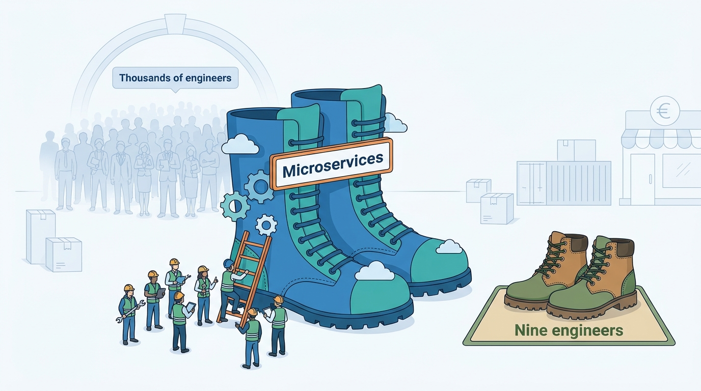
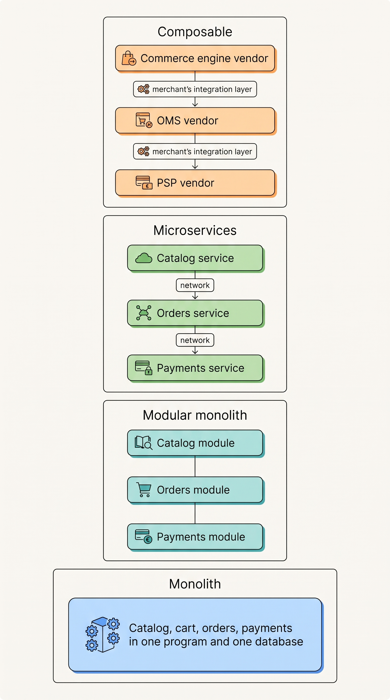
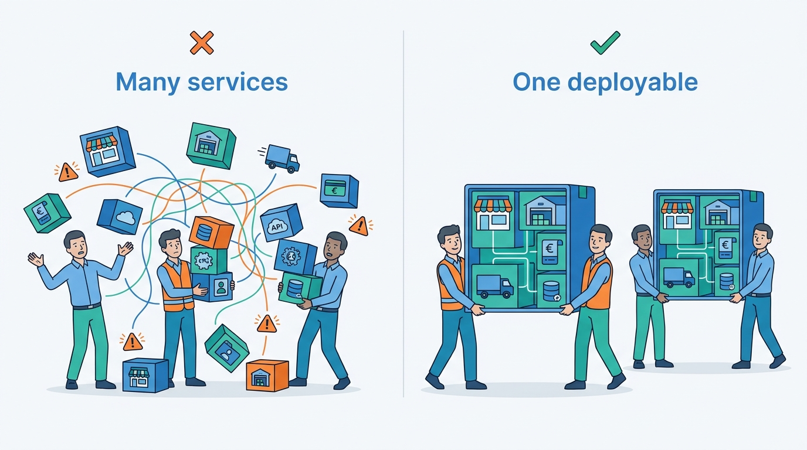
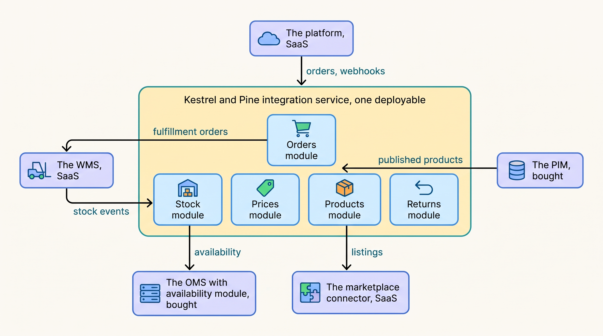

> **IN THIS CHAPTER, YOU WILL:** Learn the four ways a commerce system can be structured inside, what Amazon, Zalando and Shopify documented, and how to size modularity to your team.

> **KEY POINTS:**
>
> * **A style is a choice about deployment units and boundaries, not about quality.** Monolith, modular monolith, microservices and composable differ in how many separately deployed pieces exist, who owns which data, and how the boundaries between them are enforced. The same commerce logic can live in any of them; what changes is where the cost lands.
> * **The famous examples document reasons and costs, not a recipe.** Amazon split at a scaling wall in 2001; Zalando split for team autonomy in 2015 and spent a decade re-standardizing; Shopify refused to split and spent seven years learning that boundaries drawn on an org chart do not match how code runs. Every account is dated and describes a company with thousands of engineers.
> * **For a merchant, the style is mostly the vendor's; what is yours is the integration layer.** Size modularity to the number of teams that must release without blocking each other, decide who owns each fact before splitting anything, and treat a microservices or all-custom composable rebuild by nine engineers as The Giant's Boots.

> **[FAILURE PATTERNS THIS CHAPTER ADDRESSES](where-commerce-platforms-go-wrong.html):**
>
> * **The Giant's Boots** — a microservices or all-custom composable rebuild copied from a company with thousands of engineers, without its reasons.
> * **The Spaghetti Junction** — composable moves the distribution costs the big companies paid into the merchant's own integration layer, where every join needs an owner.
> * **The Burned Bridge** — a rebuild that replaces the platform on one date, when every documented migration took years and was done piece by piece.

 
A commerce team wants to release checkout changes without waiting for a catalog release. Separating the programs may help, but each new connection must carry data and handle failures. The benefit depends on whether independent releases are worth that extra work for this team. A large company's successful redesign cannot answer that question on the merchant's behalf.

Read a company's account for its date, scale, problem and limits. Then identify what you control. On a hosted platform, the vendor decides most internal architecture; your team owns surrounding connectors, custom apps and data pipelines. A separation can be useful when those programs need different release schedules or operating capacity. Without that need, it adds coordination without removing a practical obstacle.

An **architecture style** describes how a system's running programs divide work and data. A **deployment unit** is a program built, tested and released as one piece. Splitting it creates another program to operate and another boundary across which data and failures must be handled.

**Where we are in the order's journey.** Eva's jacket order at Kestrel & Pine, the fictional outdoor brand, crosses the vendor's platform code and the merchant's integrations. Every network crossing can add delay or fail independently. This chapter examines which separations earn that cost.

## "Are We Behind?" at Kestrel & Pine

Kestrel & Pine reviewed two February 2027 proposals: a consultancy's **composable rebuild**, assembling separate commerce services for about **€3.2 million over eighteen months**, and the agency's separate storefront on the existing platform. [[commerce-platform-landscape]] and [[storefront-architecture]] describe them.

The review also considered an enterprise suite and **stay and surround**: keep the platform and add missing capabilities. It chose the latter as decision W4 of **Waypoint**, the improvement program launched in March with **€1.1 million for 2027–2028** ([[build-buy-or-assemble]]).

In April 2027, a board member forwarded CEO Mara Lindqvist an article about a fashion retailer with roughly three thousand technology staff that had abandoned its monolith. Mara asked Head of Engineering Noor Visser whether Kestrel & Pine had chosen correctly. The question was reasonable; the team-size difference mattered.

Noor had fourteen people in technology, nine of them engineers. On Black Friday 2026 the platform itself had held at 2,300 orders in the peak hour; what failed was the chain of connectors between the platform, the ERP (enterprise resource planning system: finance, purchasing, invoicing), the WMS (warehouse management system) and the marketplace connector, which let the Ridgewalker jacket sell for two hours after the warehouse ran out. The rebuild option would have rebuilt the part that worked while leaving the joins that failed to "phase two". Noor's memo to the board is the rest of this chapter.

**Figure 1:** *The famous accounts describe companies with thousands of engineers; a microservices rebuild copied from them by nine engineers is The Giant's Boots, paying the costs without the reasons.*

## Four Styles in Plain Words

Three ideas separate the styles: the **deployment unit**, defined above; **data ownership**, which program may read and write a given table or record directly; and the **boundary**, the rule that one part of the system may only reach another through a defined interface, and how that rule is enforced (by a tool, by a review, or not at all).

| Style | What is deployed | Who owns the data | How boundaries are enforced | Documented example |
| --- | --- | --- | --- | --- |
| **Monolith** | One program holding every domain: catalog, cart, orders, payments, admin | One shared database; any code can read any table | Usually not enforced; conventions and reviews | Zalando's Java shop "Jimmy" 2010–2015; Shopify's Rails core before 2017 |
| **Modular monolith** | Still one program, divided into named modules with a public interface each | One database, but each module is meant to own its tables | A static check in the build that blocks new cross-module references | Shopify 2019–2024 (Packwerk); Medusa's module layout (n.d., accessed 2026-11) |
| **Microservices** | Many small programs, each built, released and scaled on its own | Each service owns its own database; nobody else reads it | The network: a service can only be reached through its API | Amazon from about 2001 (described 2006); Netflix 2008–2016; Zalando from 2015 |
| **Composable (MACH)** | Separately *bought* API-first SaaS services plus a storefront and an integration layer the merchant owns | Each vendor owns its data; the merchant owns the copies between them | Vendor APIs and contracts | commercetools and the MACH Alliance vendors (2020–2026) |

**Figure 2:** *The four styles differ in how many separately deployed pieces exist and who owns the joins between them; in a modular monolith the joins are function calls inside one program, in microservices they are network calls between a company's own services, and in composable they are integrations between vendors that the merchant must own.*

Two clarifications a newcomer needs. First, **"monolith" is not an insult.** It is one program with one database, which is also the shape in which every transaction is cheapest and every fact is consistent. Second, **composable is a different kind of thing from the other three.** They describe how one organization structures code it writes. Composable describes how a merchant *buys*: several API-first products (an engine, a search service, a PIM, an OMS, a payment provider) assembled behind a storefront the merchant builds or buys. The merchant does not write the services; it writes the joins, and the distribution costs the big companies document for microservices transfer to that integration layer almost unchanged.

Two terms from earlier chapters recur. A **system of record** ([[boundaries-and-systems-of-record]]) is the one system allowed to be right about a fact: the WMS for physical stock, the OMS (order management system) for the order. **Eventual consistency** ([[events-consistency-and-reconciliation]]) means a copy of a fact in another system may be out of date for a while, and will catch up. Every style with more than one deployment unit lives with it, and with **idempotent** handling: processing the same message twice must have the same effect as processing it once.

## What the Famous Examples Actually Show

The accounts below are listed with their dates because the architecture they describe has certainly changed since. Treat each as evidence that a pattern existed and worked at that date in that company, not as a description of today's systems.

### Amazon: a scaling wall, then hundreds of services (2001–2007)

The primary account is a 2006 conversation between Jim Gray and Werner Vogels, Amazon's chief technology officer, in *ACM Queue*. As digested by High Scalability in 2007, Amazon's front end was a "two-tier monolith" and "in 2001 it became clear that the front-end application couldn't scale anymore"; Amazon moved to "a fully-distributed, decentralized, services platform" that grew into hundreds of services, with a single page request touching between 100 and 150 of them. The same source carries the two cultural rules the industry still quotes: "you build it, you run it" (the team that writes a service also operates it, confirmed in AWS's own 2006 relay of the interview) and the "two-pizza team", a team small enough to be fed by two pizzas. The 2007 Dynamo paper gives the scale: the shopping cart service served "well over 3 million checkouts in a single day".

What this shows: a company that split because one program could no longer serve its traffic, and organized the split around small teams owning services end to end. What it does not show: a timeline a smaller company could copy, or anything about Amazon's retail architecture today. The evidence is two decades old.

### Zalando: a split for autonomy, then a decade of discipline (2015–2025)

Zalando's record is unusually complete and unusually honest. Henning Jacobs's 2020 retrospective of a decade in Zalando's technology gives the sequence: a PHP shop on the Magento stack, rewritten in Java in 2010 because the stack hit scaling limits; in-house order and payment services in 2012; and in March 2015, under the banner "Radical Agility", a move to Amazon Web Services (AWS), Amazon's cloud, with containerized microservices owned by autonomous teams, each with its own AWS account. Zalando's 2015 post on the shop rebuild gives the motive: the monolith, "Jimmy", meant that "all of the Shop teams shared the same code base" and teams "couldn't move quickly because of Jimmy's slow startup time and our overly complicated deployment processes". The trigger was not traffic. It was too many teams in one program.

By 2020 Zalando had, per Jacobs, more than 260 engineering teams, more than 1,300 developers and more than 4,000 applications. The same post lists the costs: team autonomy over technology produced "similar CRUD REST services written in six languages" (simple create-read-update-delete web services), which "hurts productivity at scale"; a standard stack would have been "a major win"; and in 2020 Zalando "still dealt with monoliths from 2010", with some functionality implemented twice. The 2015 engineering principles repository is now marked deprecated, noting that they "no longer reflect the current reality (2020) in all aspects".

The discipline that followed is documented step by step. In July 2020 Zalando narrowed its technology radar, dropping Clojure, Haskell and Rust for new applications because "a broad freedom of choice leads to increased difficulties in supporting software long-term". In 2023 one developer portal replaced "more than 100 disconnected interfaces". In March 2025 it reported that its event-driven pipeline for price and stock updates "became a bottleneck": more than 90% of each payload was unchanged, during Cyber Week stock and price events "could be delayed by up to 30 minutes", and teams that consumed the stream adapted product data for their own needs, producing what the post calls "competing sources of truth"; it was replaced by a synchronous read API. Zalando's 2025 annual report (published March 2026) puts about 3,000 employees in its technology departments.

What this shows: microservices gave Zalando team autonomy at hundreds of teams, and the bill came as technology sprawl, tooling sprawl and, in one critical path, a boundary that had to be redrawn. What it does not show: that microservices "failed". Each later fix narrowed a choice; none reversed the architecture.

### Shopify: the monolith that refused to split, and what it learned (2019–2024)

Shopify is the counter-example, and its own account runs from 2019 to 2024. In February 2019 it described its Rails codebase as one of the largest in existence, worked on for over a decade by more than a thousand developers, and said that around 2016 "the downsides of the monolith were outweighing the benefits". It rejected microservices explicitly: they would add test and deployment pipelines and infrastructure per service, network calls that add latency and reduce reliability, and coordinated deploys for large refactors; the team "wanted more modularity without more deployment units". Instead it regrouped code into business components (orders, shipping, inventory, billing), each meant to have a public interface and "exclusive ownership of its associated data", and built a tool, Wedge, to score each component's isolation. The payoff it claimed: the isolation work let it replace a legacy tax engine.

By September 2020 the core had "over 2.8 million lines of Ruby code", 37 components and an Architecture Guild of about 400 members, and Shopify said it split out services "only for good reasons", naming storefront rendering and credit-card vaulting. The same post is candid: "every component depended on over half of all the other components", with "lots of circular dependencies". Packwerk, open-sourced that month, is a static check that records existing boundary violations in a list so that new ones are blocked without fixing everything at once. Shopify's FY2025 annual report (filed February 2026) confirms the broad shape today: a multi-tenant platform, Ruby on Rails, "single branch" software on which all merchants run the latest version, and about 7,600 employees.

The February 2024 Packwerk retrospective is the latest first-party account and the most useful. Privacy checks "were removed from Packwerk with the release of version 3.0" because they pushed teams into API design instead of dependency management. Several common ways of loading code are "untracked and invisible to the tool", so "a package can show zero violations and still fail at runtime". Isolating one base package with zero violations and zero dependencies "took many months of hard work".

The rate at which the tool found problems "vastly outpaced" teams' capacity to fix them; "we have discussed removing Packwerk from our monolith", and it stayed because it "has provided value in holding the line against new dependencies at the base layer".

Most important: "domains and the boundaries between them do not reflect the way Shopify's code actually functions in practice", so components became organizational groupings rather than enforced units. Two quoted lessons: "Packwerk is a sharp knife, and it must be wielded with care" and "running code, more than any metric, will always be the best indicator of real progress".

The one documented case of Shopify carving a hot path out of the monolith is the Storefront Renderer, rewritten from 2019 because storefront code "has much stricter performance requirements" than, say, payment processing; by August 2020 it reported server response times four to six times faster. It was carved for latency, behind a verifier that compared old and new responses on live traffic, not for team autonomy.

What this shows: a company with a thousand developers kept one deployment unit, got real value from ownership and from one cheap gate at the base layer, and found that enforced domain boundaries did not match runtime coupling. The honest reading is not "Shopify modularized its monolith" but "Shopify spent seven years learning which modularity was worth paying for".

### The consolidations: Segment (2018) and Prime Video (2023)

Two accounts are often quoted as "microservices failed" and support something narrower. Segment wrote in 2018 that it had grown to over 140 services, each with its own queue, that three full-time engineers spent most of their time keeping them running, and that shared-library versions diverged; it consolidated them into one service and wrote "the solution for us was a monolith", while listing the trade-offs (weaker fault isolation; a shared upgrade can break several destinations).

In 2023 Prime Video's video-quality team replaced a serverless, orchestrated pipeline (small functions run on demand by the cloud provider, chained by a workflow service) that "supported only around 5% of the expected load" with a single process, cutting operational cost by 90%; the original post has been taken down, and InfoQ's contemporaneous summary is the surviving source.

Both are consolidations of *one subsystem* that had been cut too fine. The transferable claim is "right-size the unit of deployment to the data flow across it", not "reverse the architecture".

### Composable and MACH: a style whose definition moved (2020–2026)

The MACH Alliance was announced in June 2020 by commercetools, Contentstack, EPAM and Valtech, with the acronym spelled out as "Microservices, API-first, Cloud-Native, and Headless". It passed 100 members in December 2023. In August 2025 it listed five guiding principles without restating the acronym, and as of November 2026 its principles page states three (Open, Composable, Connected) and no longer defines microservices or headless at all.

Its own February 2026 survey of 600 enterprise technology decision-makers reports that 37% cite integration complexity as a primary concern, a finding against interest from a vendor alliance whose respondents are its adopters.

In the same period commercetools, the alliance's flagship vendor, cut about 10% of staff in February 2025 after missing growth targets (widely reported), and in January 2026 launched a product it describes as layering agentic capabilities "on top of your existing commerce solution". The composable champions now sell composable incrementally.

What a composable vendor sells as a unit is visible in its documentation. A commercetools Project is "the top-level container" for a merchant's data, isolated from other Projects, with published limits (25 API Extensions per Project as of November 2026). Its API Extensions, synchronous call-outs to the merchant's own code before a cart or order is saved, carry a plain warning: "if it fails or takes a second longer to return a result, the whole API call fails or takes a second longer." That sentence is the distribution cost of microservices, delivered to the merchant's doorstep. And none of the accounts above describes a company with fourteen people in technology.

## What Each Style Costs

Martin Fowler's 2015 "Microservice Trade-Offs" names the benefits as strong module boundaries, independent deployment and technology diversity, and the costs as **distribution** (remote calls are slower and can fail), **eventual consistency** ("because of their laudable insistence on decentralized data management") and **operational complexity** ("there's just no way to handle dozens of services without the automation and collaboration that continuous delivery fosters"). His "MonolithFirst" of the same year adds the point that decides most cases: "even experienced architects working in familiar domains have great difficulty getting boundaries right at the beginning", so "the premium of microservices is a drag you should do without" early on.

In commerce those costs land on specific promises. The table takes three steps of Eva's order and shows what changes when the pieces sit inside one deployment unit versus across several.

| Promise in Eva's order | Inside one deployment unit | Across deployment units (microservices or composable) | Who pays |
| --- | --- | --- | --- |
| **The price at checkout** matches the product page | One function call; one transaction; always the same number | A network call to a pricing service, or a copy that can be stale (the Price Drift of October 2026 was a stale copy between systems) | The merchant, in margin and in a reconciliation job |
| **The last unit** is sold once | One row, one lock, one decrement | A reservation message; two channels can both read "one left" before either decrement lands (the Black Friday Oversell) | The customer, in cancellations; the merchant, in goodwill |
| **The order reaches the warehouse** | Not applicable; the WMS is always a separate system | A message that can be delayed, duplicated or lost; needs idempotent handling, retries and reconciliation | The operations team, in late orders |

The third row is the honest one: some boundaries exist whatever style you choose, because the WMS, the PSP (payment service provider) and the carriers are other companies' systems. The question a style answers is how many *additional* boundaries of that kind you create inside your own code.

The people cost is the one the pitch decks omit. Netflix's own account of its move to cloud microservices runs from August 2008 to January 2016: seven years. Uber reported in 2020 that with about 2,200 critical microservices a root-cause investigation could run through about 50 services owned by 12 teams, a simple feature needed 10 touchpoints, services had a half-life of about 1.5 years, and ownership had blurred into "networked monoliths" that must be deployed together; its remedy grouped services into about 70 domains behind gateways, the modular-monolith discipline rebuilt on top of microservices. Segment's three engineers keeping 140 services alive is the same cost at a company a hundredth of Uber's size.

| | Monolith | Modular monolith | Microservices | Composable |
| --- | --- | --- | --- | --- |
| Teams it serves well | One, up to roughly ten engineers | A few teams on one release train; Shopify ran it with a thousand developers | Many teams releasing on their own schedules | A merchant with an integration team that can own every join |
| Consistency of price, stock, order | Transactional | Transactional | Eventual; needs idempotent handling, reliable publishing and reconciliation | Eventual, between vendors; reconciliation is the merchant's |
| Release independence | None | None by default; ownership per module | Full | Per vendor, on the vendor's schedule |
| Operating cost | One pipeline, one runtime | Plus one boundary check | A pipeline, monitoring and on-call per service; a platform team | An integration platform, contracts and reconciliation per vendor pair |
| Typical failure | Nothing changes without touching everything | Boundaries drift; the tool reports more than teams can fix | The distributed monolith; sprawl of languages and tools | The Spaghetti Junction; a vendor's limit becomes the merchant's outage |
| Right when | One team, one product, early | Several teams, one product, a decade of change ahead | Hundreds of engineers; the organization is the bottleneck | Capabilities differ in pace and the merchant can staff the joins |

## Modularity Sized to the Team

Melvin Conway wrote in 1968 that organizations "are constrained to produce designs which are copies of the communication structures of these organizations". Every account above is Conway's observation at work: Amazon's two-pizza teams produced services; Zalando's 260 teams produced 4,000 applications; Shopify's one release train produced one deployment unit with internal ownership. Team Topologies, the 2019 book by Matthew Skelton and Manuel Pais, rests on the premise that "teams can only handle so much complexity before breaking down".

The rule I use follows from that. **Create one deployment unit per team that must release without waiting for another team.** Not per domain, flow or capability: per team with its own release need. A four-person integration team gets one deployable with modules inside it; a storefront team gets the theme and its apps. When those two teams block each other's releases, that is the evidence for a second unit, and not before.

**Figure 3:** *One deployment unit per team that must release without waiting for another: a small team gets one deployable with modules inside, and a second unit only when two teams block each other's releases.*

Three disciplines make a single unit work for years, all in the public record.

**Decide who owns each fact before you split anything.** Fowler's warning about boundaries and Shopify's finding that domains and their boundaries "do not reflect the way Shopify's code actually functions in practice" are the same warning. In commerce the boundaries that matter are the systems of record: who owns stock, the order, the product. Kestrel & Pine's Waypoint decisions W1 to W3 are exactly that, made before a line of custom code was moved.

**Enforce boundaries cheaply and gate new violations rather than chase zero.** Packwerk's design, a list of existing violations and a block on new ones, is the transferable idea, and Shopify's retrospective says where it earned its keep: holding one base layer clean. A merchant's version is a dependency check in the build of its integration code that says, for example, the stock module may not import from the orders module.

**Split a hot path only on measured evidence, behind a verifier.** Shopify's Storefront Renderer is the model: a measured latency need, a rewrite, a comparison of old and new responses on live traffic, a fallback. If you cannot name the measurement, you do not have the evidence for the split.

The vendor's view and the merchant's view differ, and the pitch deck blurs them.

| Question | A platform vendor | A merchant on a hosted platform |
| --- | --- | --- |
| Who must be modular? | Thousands of engineers shipping one product to millions of tenants | A dozen engineers shipping connectors, apps and pipelines around a bought core |
| What is the unit of change? | A component or service inside the platform | A connector, an app, a theme, a data pipeline |
| Where does distribution cost land? | In the vendor's engineering budget | In the merchant's integration layer, as integration debt ([[integration-styles]]) |
| What does "microservices" buy? | Release independence for many teams | Nothing directly; the merchant does not deploy the platform |
| What does "composable" buy? | A product category to sell | Replacing one capability (search, OMS, PIM) without replacing the core, at the price of owning the joins |

A vendor's internal style is also not something a merchant can verify. A WMS vendor's page saying it is "built on microservices" (Manhattan's does, as of November 2026) says nothing about uptime, release cadence or the API contract, which are the things to ask about ([[api-contracts-and-versioning]]).

**Figure 4:** *Kestrel & Pine's own code in 2027 is one deployment unit with a module per flow, surrounded by bought systems; the boundaries that matter are the systems of record on the outside, not service boundaries on the inside.*

## Across Scale Stages: When It Fits and When It Limits

| Stage | What is typical | What becomes necessary | Warning signs of outgrowing it |
| --- | --- | --- | --- |
| **1 — Starting** (under about €2M) | A hosted platform and a handful of apps; no custom code beyond the theme; the style is the vendor's | An inventory of apps with their owners; nothing more | A custom integration with no owner; an agency proposes "headless" before the first store or wholesale account |
| **2 — Growing** (about €2M–€20M) | A first ERP or accounting connector, a 3PL feed, a marketplace tool; custom code as agency scripts | One repository and one deployable for the merchant's own integration code; boundaries drawn around systems of record | Scripts in three languages on three hosts that nobody can list; a connector fails and its author has left |
| **3 — Omnichannel** (about €20M–€200M) | A dozen systems; an OMS and PIM beside the platform; an integration team of two to five; a modular monolith for own code | Modules per flow with a dependency check; OMS and PIM bought rather than built; a second deployable only when two teams block each other | A rebuild proposal sized for a company a hundred times larger; a "service" per flow with one engineer each; releases that need three teams to coordinate |
| **4 — Group** (over about €200M, or several brands) | Platform teams; shared storefront, integration and data services across brands; some services the group writes itself | Standard stacks, API guidelines and a paved road, a supported default toolset (Zalando's 2020 and 2023 lessons); a deployable per stream-aligned team (a team owning one flow of business change end to end); a boundary gate in every shared codebase | Six languages for similar services; a service half-life under two years; a feature that needs ten teams; functionality built twice |

The judgement: through stage 3 the right number of deployment units for a merchant's own code is one, perhaps two, and the energy goes into boundaries around systems of record. Microservices become a real question only at stage 4, when the organization rather than the traffic is the bottleneck, and even then the documented path is incremental and takes years. Composable read as "replace one capability at a time around a kept core" fits stage 3; read as "an API-only core and a custom storefront" it is a stage 4 choice that needs a platform team.

## In Practice: Noor's Memo

Noor's memo to the board (May 2027) ran to two pages. The numbers below are Kestrel & Pine illustrations.

She started with the headcount. Nine engineers, shaped from April 2027 as a "Buy" team of three storefront and apps engineers, a "Fulfil and Return" team of two back-end engineers, an integration pair under Ruben Alves and a data pair ([[organizing-commerce-engineering]]). Three of those groups write code, and none has yet waited on another to release. By the rule above, Kestrel & Pine's own code needs one storefront codebase and one integration service, shared by the integration pair and the Fulfil and Return team until the day they block each other. The rebuild option had described about a dozen services for nine engineers.

She then matched the rebuild against the incidents. The Black Friday Oversell, the Three-Status Order, the Price Drift and the Store Stock Mirage were all failures of ownership and of the joins, not of the platform's internal structure; an API-only engine would have recreated every one of those joins in new code. Waypoint decides ownership (W1 to W3), buys the missing hubs and makes the copies trustworthy (W5); none of it depends on the platform's internals.

| | The composable rebuild option *(illustrative)* | Stay and surround as approved |
| --- | --- | --- |
| Cost over 2027–2029 | About €3.2M, 18 months | About €1.33M including subscriptions; the €1.1M Waypoint budget |
| What is rebuilt | Storefront, commerce engine, order service, every integration to them | Nothing; the platform stays (W4) |
| What is bought | An API-only engine; the rest custom | OMS with availability module, PIM (product information management system); standards on the existing iPaaS (integration platform as a service) |
| Deployment units the team must run | About a dozen services plus a storefront | One integration service; vendors run the rest |
| Incidents addressed in 2027 | None until "phase two" | Oversell (W1), Three-Status Order (W2), Price Drift and Double Refund (W5 contracts and reconciliation) |
| Reversibility | One-date cutover of storefront and checkout: The Burned Bridge | Each hub added beside the platform; decision revisited in 2029 |

The one piece of the rebuild option Noor kept was the vocabulary. She wrote the integration rule into the engineering handbook: one repository, one deployable, a module per flow (stock, orders, prices, products, returns), a dependency check in the build that blocks new cross-module imports, and a measured latency problem as the only accepted reason to split anything. The agency scripts that move in-house during 2027, and every new connector outside the iPaaS, land in that one service. The answer to "are we behind?" was no: Kestrel & Pine stood where every documented company stood before it split, and those companies split for reasons Kestrel & Pine did not have.

## When It Goes Wrong

**The distributed monolith.** Services that must be deployed, tested and rolled back together, with the network added for nothing; Uber named it "networked monoliths" in 2020. Detection: a release that needs three teams in one meeting; a change to one service that always needs a change to another. Recovery: merge the pair, or redraw the boundary around the data that actually flows, as Uber's domains did.

**The half-finished migration.** Zalando in 2020 "still dealt with monoliths from 2010" and had some functionality implemented twice. Detection: two systems that both claim to own an order or a price; a legacy program nobody dares to switch off. Recovery: the strangler approach ([[replatforming-and-migration]]), replacing the old system one capability at a time with a retirement date for each; never the one-date cutover of The Burned Bridge.

**The boundary in the wrong place.** Zalando's price-and-stock pipeline (described in 2025) reprocessed payloads that were more than 90% unchanged and fell up to 30 minutes behind during Cyber Week, and consumers' adapted copies became competing sources of truth; Prime Video's pipeline paid for every step between stages that belonged in one process. Detection: consumers behind at peak; copies that disagree; a bill that scales with hops, not with orders. Recovery: a synchronous read API beside the events for "what is the price now", and a merged boundary where the data flow is tight.

**The over-decomposed integration layer.** Segment's 140 services for 140 destinations is the shape a merchant's 34 integrations take when each is its own deployable with its own queue. Detection: engineers who spend their weeks keeping connectors alive; library versions that differ per connector. Recovery: one integration service with a module per flow and recorded traffic replayed as tests, as Segment did.

**Composable without a platform team.** The MACH Alliance's own 2026 survey puts integration complexity first among its adopters' concerns. Detection: every vendor pair joined by a different script with a different owner; a vendor's call-out timeout failing your checkout. Recovery: an integration inventory ([[integration-styles]]) and a contract per join (W5).

## What to Take Away

**Established.**

- The costs of splitting a system into separately deployed pieces are distribution, eventual consistency and operational complexity, and boundaries are hard to get right at the start (Fowler, 2015); every documented commerce case confirms both.
- The documented splits were driven by a traffic wall (Amazon, 2001) or by too many teams in one codebase (Zalando, 2015), and each took years; the documented refusal to split (Shopify, 2019–2024) served a thousand developers on one deployment unit.
- System structure follows team structure (Conway, 1968); teams can only carry so much complexity (Skelton and Pais, 2019).
- Composable is a buying style, not an internal architecture; its own alliance dropped "microservices" from its principles (2026) and its own survey ranks integration complexity as the top concern (2026).

**Depends on context.**

- One deployment unit for a merchant's own code is right through the Omnichannel stage; a second when two teams measurably block each other's releases; a service per team at Group stage, with a platform team and a standard stack to carry it.
- Composable per capability (replace search, add an OMS, add a PIM) fits a merchant that can staff the joins; an API-only core with a custom storefront fits a group with platform teams and a differentiated front end, and not before.
- Splitting a hot path out of a single unit is right when a measured latency or load requirement demands it, behind a verifier and fallback; it is wrong as a reorganization tool.

**The author's synthesis.**

- The number of deployment units in a merchant's own code should equal the number of teams that must release independently, and for most merchants below group scale that is one; the modularity that matters is the ownership of facts across bought systems, not service boundaries inside custom code.
- Every famous architecture account should be read with three questions: what size was the company, what was the trigger, and what did they pay; a proposal that cannot answer those three for your company is The Giant's Boots.

## Questions to Ask

1. How many teams do we have that must release without waiting for another team? That is our ceiling for deployment units.
2. Which facts (stock, order, price, product, customer) have a named system of record, and which do not? Boundaries come from that list, not from a diagram.
3. For any proposed split: what is the measured problem, in latency, load or blocked releases, that the split solves?
4. For any proposed rebuild: which of our incidents of the last year would it have prevented, and by when?
5. What is the reference company's size in engineers, what triggered its split, and what did it report paying?
6. Where will the distribution costs (retries, duplicates, stale copies, reconciliation) land, and who owns them?
7. If we adopt composable for one capability, who owns the join to the core, and what are the vendor's call-out timeout and failure rule?
8. What is the rollback if the new piece is wrong: a feature switch, a parallel run, or The Burned Bridge?

On a hosted platform the internal structure is the vendor's problem; what a merchant shares with the vendor, every day and especially on its peak day, is the platform itself. The next chapter asks how one platform serves thousands of merchants at once, and why rate limits, noisy neighbors and pods are a merchant's concern: [[multi-tenancy-and-isolation]].

## Sources and Evidence

**Company, product and investor sources**

- [Deconstructing the Monolith: Designing Software that Maximizes Developer Productivity](https://shopify.engineering/deconstructing-monolith-designing-software-maximizes-developer-productivity), Shopify Engineering, 2019 — the componentization decision, the reasons for rejecting microservices, Wedge and the tax-engine payoff.
- [Under Deconstruction: The State of Shopify's Monolith](https://shopify.engineering/shopify-monolith), Shopify Engineering, 2020 — 2.8 million lines, 37 components, circular dependencies, services split "only for good reasons".
- [Enforcing Modularity in Rails Apps with Packwerk](https://shopify.engineering/enforcing-modularity-rails-apps-packwerk), Shopify Engineering, 2020 — the violation list that blocks new boundary breaks.
- [A Packwerk Retrospective](https://shopify.engineering/a-packwerk-retrospective), Shopify Engineering, 2024 — what worked and what did not after four years; the quoted lessons.
- [How Shopify Reduced Storefront Response Times with a Rewrite](https://shopify.engineering/how-shopify-reduced-storefront-response-times-rewrite), Shopify Engineering, 2020 — the one hot path carved out for latency, with verifier and fallback.
- [Cloud, Load, and Modular Code: What 2022 Looks Like for Shopify](https://shopify.engineering/cloud-load-modular-code-shopify-2022), Shopify Engineering, 2022 — the CTO's "majestic, modular monolith".
- [Shopify Inc. Form 10-K for fiscal 2025](https://www.sec.gov/Archives/edgar/data/1594805/000159480526000007/shop-20251231.htm), U.S. SEC, 2026 — multi-tenant, Rails, "single branch", employee count.
- [One Decade in Zalando Tech](https://srcco.de/posts/one-decade-in-zalando-tech.html), Henning Jacobs, 2020 — the 2010–2020 sequence, team and application counts, "six languages", the costs.
- [From Jimmy to Microservices: Rebuilding Zalando's Fashion Store](https://engineering.zalando.com/posts/2015/10/from-jimmy-to-microservices-rebuilding-zalandos-fashion-store.html), Zalando Engineering, 2015 — the monolith's name and the motive for the split.
- [Zalando Engineering Principles (deprecated repository)](https://github.com/zalando/engineering-principles), Zalando, n.d., accessed 2026-11 — the 2015 principles and the 2020 deprecation note.
- [Technology Choices at Zalando: Tech Radar Update](https://engineering.zalando.com/posts/2020/07/technology-choices-at-zalando-tech-radar-update.html), Zalando Engineering, 2020 — the narrowed radar and the quoted reason.
- [Sunrise: Zalando's Developer Platform Based on Backstage](https://engineering.zalando.com/posts/2023/08/sunrise-zalandos-developer-platform-based-on-backstage.html), Zalando Engineering, 2023 — one portal replacing more than 100 interfaces.
- [From Event-Driven to API: Rethinking Price and Stock Updates](https://engineering.zalando.com/posts/2025/03/event-driven-to-api.html), Zalando Engineering, 2025 — the pipeline bottleneck, the 30-minute Cyber Week delay, the read API.
- [Zalando SE Annual Report 2025](https://corporate.zalando.com/sites/default/files/media-download/zalando-se_annual-report-2025_eng_261003_s.pdf), Zalando, 2026 — about 3,000 technology employees.
- [Amazon Architecture (digest of "A Conversation with Werner Vogels", ACM Queue 2006)](http://highscalability.com/amazon-architecture), High Scalability, 2007 — the 2001 scaling wall, hundreds of services, 100–150 services per page; the primary interview text was not fetchable.
- [ACM Queue Interview with Werner Vogels](https://aws.amazon.com/blogs/aws/acm_queue_inter), AWS News Blog, 2006 — "you build it, you run it".
- [Two-Pizza Teams](https://docs.aws.amazon.com/whitepapers/latest/introduction-devops-aws/two-pizza-teams.html), AWS whitepaper, n.d., accessed 2026-11 — the team-size rule and its ownership rationale.
- [Dynamo: Amazon's Highly Available Key-value Store](https://www.allthingsdistributed.com/files/amazon-dynamo-sosp2007.pdf), DeCandia et al., 2007 — the shopping cart's daily checkout volume.
- [Completing the Netflix Cloud Migration](https://about.netflix.com/en/news/completing-the-netflix-cloud-migration), Netflix, 2016 — the 2008–2016 timeline and "hundreds of microservices".
- [Introducing Domain-Oriented Microservice Architecture](https://www.uber.com/blog/microservice-architecture/), Uber Engineering, 2020 — 2,200 services, "networked monoliths", the domain and gateway remedy.
- [Goodbye Microservices: From 100s of Problem Children to 1 Superstar](https://www.twilio.com/en-us/blog/developers/best-practices/goodbye-microservices/), Segment (Twilio), 2018 — 140 services consolidated, with the stated trade-offs.
- [Prime Video Switched from Serverless to EC2 and ECS to Save Costs](https://www.infoq.com/news/2023/05/prime-ec2-ecs-saves-costs/), InfoQ, 2023 — the surviving summary of the removed Prime Video post.
- [EPAM Joins Newly Formed MACH Alliance as Founding Member](https://s202.q4cdn.com/436759741/files/doc_news/2020/06/24/12951.pdf), EPAM Systems, 2020 — the founding and the acronym's original expansion.
- [MACH Alliance Surpasses 100 Members](https://machalliance.org/newsroom/mach-alliance-surpasses-100-members-as-it-closes-out-milestone-2023), MACH Alliance, 2023 — the 2023 restatement.
- [MACH Alliance Advances End-User Leadership Model](https://www.silicon.co.uk/press-release/mach-alliance-advances-end-user-leadership-model-to-guide-enterprise-ai-architecture-evolution), MACH Alliance via Silicon UK, 2025 — five principles without the acronym.
- [MACH Principles](https://machalliance.org/mach-principles/), MACH Alliance, n.d., accessed 2026-11 — the three current principles.
- [MACH Alliance Research: 6x More Organizations Achieve AI ROI with a Composable Foundation](https://machalliance.org/insights-hub/mach-alliance-research-6x-more-organizations-achieve-ai-roi-with-a-composable-foundation), MACH Alliance, 2026 — the 37% integration-complexity figure.
- [commercetools General Concepts](https://docs.commercetools.com/api/general-concepts) and [API Limits](https://docs.commercetools.com/api/limits), commercetools, n.d., accessed 2026-11 — the Project as the unit and its limits.
- [commercetools API Extensions](https://docs.commercetools.com/api/projects/api-extensions), commercetools, n.d., accessed 2026-11 — the synchronous call-out and its failure rule.
- [Medusa Architecture Overview](https://docs.medusajs.com/learn/introduction/architecture), Medusa, n.d., accessed 2026-11 — a layered single application with modules.
- [Manhattan Active Warehouse Management](https://www.manh.com/products/warehouse-management), Manhattan Associates, n.d., accessed 2026-11 — a vendor describing its product as built on microservices.

**Standards, regulation and official documentation**

- None; this chapter cites no standard or regulation.

**Research and practitioner sources**

- [How Do Committees Invent?](https://www.melconway.com/Home/Committees_Paper.html), Melvin Conway, *Datamation*, 1968 — the quoted thesis.
- [Microservices](https://martinfowler.com/articles/microservices.html), James Lewis and Martin Fowler, 2014 — the definition, decentralized data, complexity moving into the connections.
- [MonolithFirst](https://martinfowler.com/bliki/MonolithFirst.html), Martin Fowler, 2015 — boundaries are hard to get right at the start.
- [Microservice Trade-Offs](https://martinfowler.com/articles/microservice-trade-offs.html), Martin Fowler, 2015 — the three costs quoted in this chapter.
- [Team Topologies: Key Concepts](https://teamtopologies.com/key-concepts), Matthew Skelton and Manuel Pais, n.d., accessed 2026-11 — the team types and the complexity premise.

Kestrel & Pine is fictional; architectural recommendations, labeled inferences and labeled assumptions are the author's judgement.
