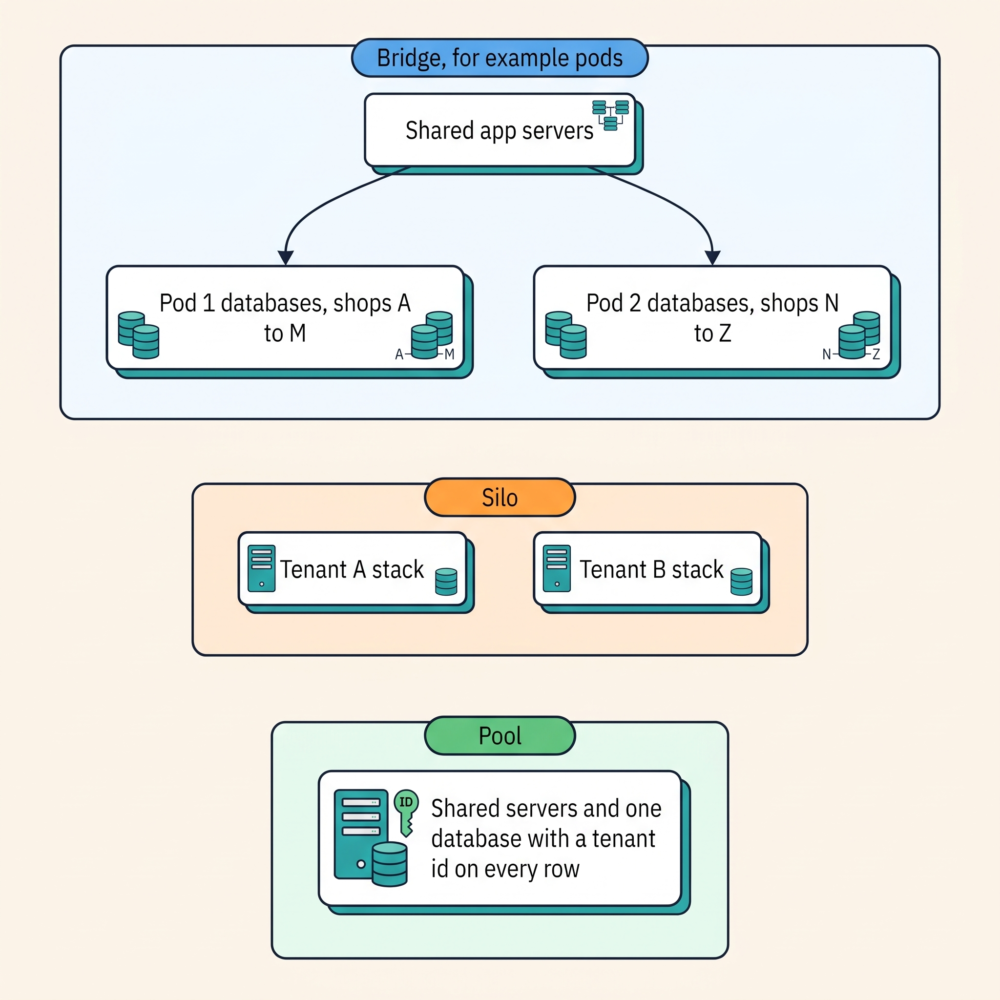
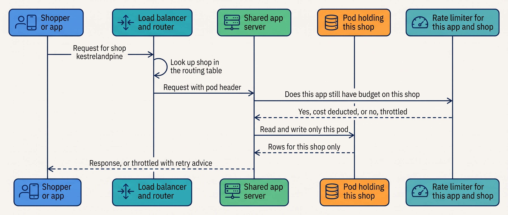
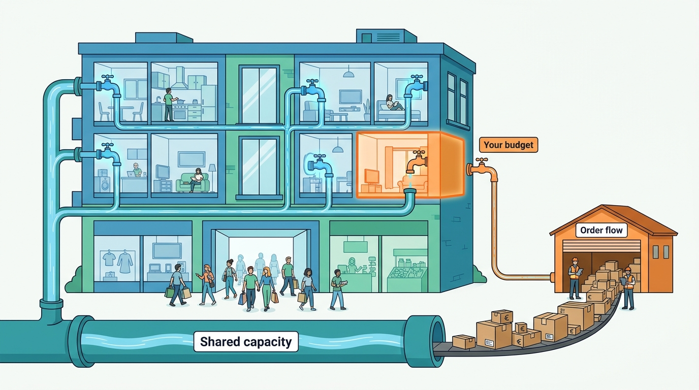
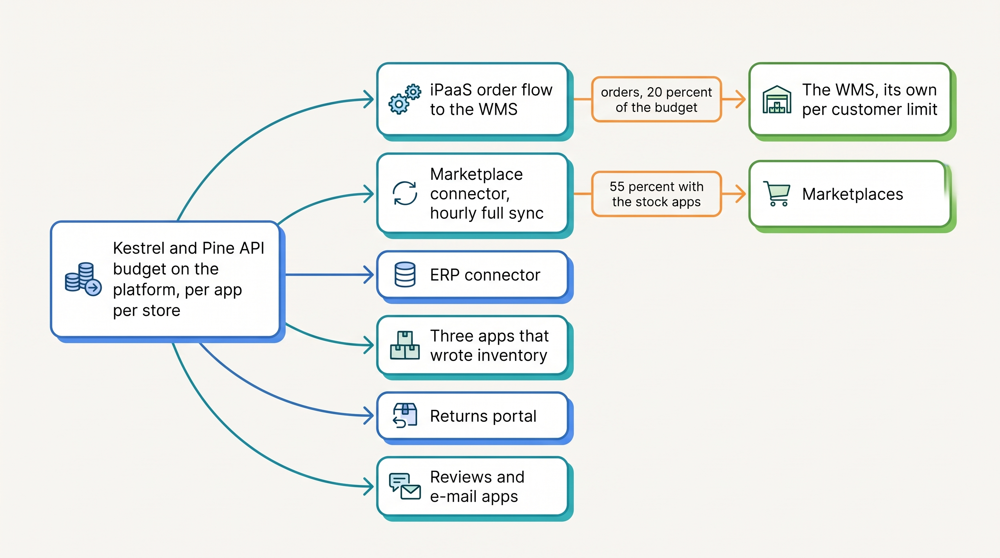
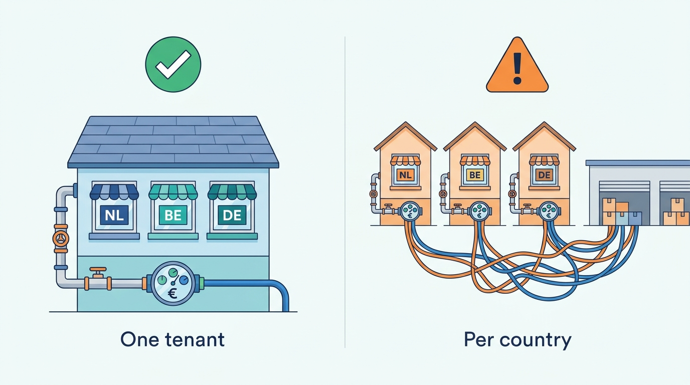

> **IN THIS CHAPTER, YOU WILL:** Understand how a SaaS (software-as-a-service) platform serves thousands of merchants on shared systems, and what that sharing means for your rate limits, neighbors and peak day.

> **KEY POINTS:**
>
> * **Tenancy is the vendor's design; its consequences are yours.** A hosted platform pools merchants on shared servers and databases, keeps them apart with a tenant identifier, a routing layer and, at the largest scale, isolated groups of databases; the unit of isolation is invisible to you and the vendor may move you between units.
> * **The rate limit is the tenancy mechanism you meet.** A platform protects shared capacity by giving each app a budget of calls per store, tiered by plan. Every connector and app you install spends from that budget, so your noisiest neighbor on a peak day is often your own stock-sync app, and the vendor may lower the budget "to protect platform stability".
> * **Every SaaS you rent is a tenancy arrangement, and the peak day is shared.** The warehouse, returns and product information systems and the marketplace connector pool you with strangers whose Black Friday is the same Friday; one tenant or several for three countries is a real decision with costs both ways.

> **[FAILURE PATTERNS THIS CHAPTER ADDRESSES](where-commerce-platforms-go-wrong.html):**
>
> * **The First Snowfall** — the API budget, the checkout throttle and the vendor's shared capacity are met for the first time on the busiest day of the year.
> * **The Spaghetti Junction** — every connector and app draws on the same per-store budget, and nobody has added up what they spend.
> * **One Size Fits None** — three countries or several brands are forced into one tenant, or split across several, before anyone has measured what the sharing costs.

 
During a sale, a merchant's order export may be delayed because the platform refuses further requests until its usage allowance resets. The shop can still accept purchases while warehouse instructions wait. Hosted platforms impose limits to protect shared capacity, so renting a platform does not remove the merchant's need to plan how its integrations use that capacity.

Sharing one running system among several customers is **multi-tenancy**; each customer is a tenant. It spreads infrastructure costs, but requires **isolation** to stop one customer's load, data or failures affecting others. Shopify's FY2025 annual report, filed in February 2026, describes millions of merchants on one codebase. Vendors may split databases into **shards**, group tenants into isolated **pods**, and impose **rate limits**, budgets for API use. Those choices determine which work can proceed when capacity is tight.

The chapter uses dated vendor accounts to explain the mechanisms, then focuses on the merchant's decisions: call budgets, priorities at peak and whether several countries should share one tenant. Ask the same questions of warehouse and returns vendors; they share infrastructure too.

**Where we are in the order's journey.** Eva orders a jacket at Kestrel & Pine, the fictional outdoor brand. Once the platform records it, integrations must fetch and send the order within both platform and warehouse API limits. An ordinary April evening leaves spare capacity. Black Friday can exhaust it.

## Two Rate Limits on One Friday Evening

Kestrel & Pine's platform handled **38 orders per minute** at the 2026 peak. Its export flow created warehouse orders one at a time, using several calls per order. The **warehouse management system (WMS)** vendor throttled those calls, and the backlog reached four hours by 21:00. [[peak-load-and-reliability]] follows the wider incident.

In June 2027, Lead Integration Engineer Ruben Alves examined logs from both ends before planning the next peak. The quantities below are illustrative.

On the **WMS side**, the vendor's API allows each customer about 30 calls a minute. The order flow made four calls per order, one order at a time, so it could carry about seven orders a minute on any day, and 38 were arriving. The WMS is a multi-tenant SaaS like the platform; the limit is how its vendor keeps one customer's peak from slowing the warehouses of its other customers, several of which were also having their Black Friday.

On the **platform side**, the illustrative account shows nine integration consumers: order export, finance, marketplaces, returns, three stock-writing apps, reviews and email. Rate-limit scope matters: a budget may apply to an app, a store or another vendor-defined unit, so consumers do not necessarily share one quota.

The reconstruction attributes about 55% of recorded usage to the stock apps and full-catalog marketplace sync, and about 20% to orders. Order export was throttled about 1,900 times, adding one-second waits. **Nobody had set priorities or checked the relevant limits before the peak.**

Neither finding was a bug; both vendors did what their documentation said. **The rate limit is the shared platform's way of being fair; the merchant's job is to decide how its own share is spent.** The rest of the chapter explains the machinery behind the error code.

## Why Platforms Share: Tenancy in Plain Words

A **tenant** is one customer of a shared software platform, with its own data and configuration: at a commerce platform, one shop. **Multi-tenancy** is the design in which one running system serves many tenants. Vendors choose it for two reasons a merchant benefits from every day. The first is cost: one fleet of servers, one database estate and one operations team serve everyone, which is how a hosted platform can be rented by the month. The second is a single version: Shopify's FY2025 annual report calls its platform "single branch" software, meaning "all of our merchants use the latest version"; there is no upgrade project because there is nothing to upgrade.

The Amazon Web Services (AWS) SaaS Lens, a published reference for SaaS vendors (n.d., accessed November 2026), names three ways to arrange tenants. In the **silo** model "tenants are provided dedicated resources", such as a separate database or a separate stack per tenant, while identity, onboarding and operations stay shared. In the **pool** model "tenants share resources": "the more classic notion of multi-tenancy", one set of servers and tables holding everyone's rows with a tenant identifier on each. The **bridge** model mixes them: "some microservices in your architecture might be implemented with silo and others might use pool", chosen by regulatory profile, noisy-neighbor risk, agility and cost.

The term **noisy neighbor** is also the SaaS Lens's: "a user of a system could place load on the system's resources that could have an adverse effect on other users". In a pool, one tenant's flash sale is every tenant's load unless the vendor meters it. In a silo, the noisy tenant only hurts itself, at a cost per tenant that few commerce subscriptions can carry.

**Figure 1:** *Three ways to arrange tenants: a pool shares everything and relies on identifiers and limits, a silo dedicates a stack per tenant at a cost per tenant, and a bridge pools the compute while grouping tenants into isolated sets of databases.*

A merchant can see the spectrum in what vendors sell. Adobe's information center for Adobe Commerce (updated October 2026) lists three deployment options: on-premises, where the merchant or its host runs everything (a silo the merchant operates); "on cloud infrastructure", where Adobe runs the platform and the merchant maintains its own code (a silo Adobe operates); and "as a Cloud Service", a fully managed SaaS (a pool). Shopware draws the same line from the extension side: plugins that run inside the core process "have direct access to the database" and therefore "are not supported by Shopware cloud", while apps run outside and talk through APIs. In a pool, nobody's code may touch the shared database, which is why hosted platforms extend by API and not by plugin ([[extensibility-and-app-ecosystems]]).

## How a Shared Platform Keeps Tenants Apart

The public evidence comes from three vendors who have described their mechanisms, each at a date.

**Shopify: a tenant identifier, a router and pods (2018–2021).** By 2015, per Shopify's 2018 engineering post, its database "could no longer be scaled by buying a bigger server", so it **sharded**: split the one database into many, each holding a set of shops. Sharding alone reduced resilience, because one failed shard could take an action down for everyone.

In 2016 Shopify reorganized into **pods**: "a pod consists of a set of shops that live on a fully isolated set of datastores". Application servers, job workers and load balancers stay shared, but "all shared resources can only ever communicate to a single pod at a time"; every web request or background job is assigned to one pod, and a routing component ("Sorting Hat") matches each request to its pod and adds a header the application uses to pick the right datastore.

Each pod has an active and a recovery data center, and a "Pod Mover" could move a pod between them in about a minute without dropping requests. That post is eight years old and describes a pre-cloud topology.

The 2021 post on shard balancing fills in the tenant mechanics. Each shop's data lives in one pod with its own MySQL database shard plus Redis and Memcached caches; the shop is the sharding unit, with a `shop_id` on every shop-owned table; a routing table mapping domains to pods "lives in a separate database that isn't sharded".

Shops land on shards arbitrarily and grow at different rates, so the least- and most-loaded shards differed by "almost four times" before rebalancing.

Moving a shop uses Ghostferry (open-source): rows are copied and changes tailed while the shop stays live, a short application-level write lock covers the cutover, the routing table is updated and stale data pruned; "the only opportunity for downtime is during the cutover". The post's worked example is two flash-sale merchants on the same pod whose bursts coincided, one of which was moved; placement uses measured utilization, not shop counts.

> **INFERENCE, NOT DOCUMENTED:** In SaaS Lens terms a Shopify pod is a bridge: siloed datastores under pooled compute. Shopify has not described the pod topology after its move to Google Cloud; the 2019 backup post and the 2021 balancing post both describe shards on Google Cloud, so pods and the cloud coexisted at least to 2021. Nothing public after 2021 gives pod or shard counts.

**Salesforce: one database, one identifier, governor limits (n.d., accessed November 2026).** Salesforce's architecture documentation describes the purest pool in commercial use: a "multitenant and metadata-driven" platform in which tenants' definitions and data sit in shared tables, each organization identified by an OrgID; "when the kernel accesses the database, it uses this unique identifier to ensure that each org's activities are private". Because everything is shared, the platform protects itself with **governor limits**, published caps on what one tenant's code may consume. In a pool, limits are the isolation mechanism.

**commercetools: projects and regions (n.d., accessed November 2026).** commercetools documents a Project as "the top-level container" for a merchant's data and configuration, isolated from other Projects, with published per-Project limits (for example 25 API Extensions and 50 Subscriptions). It hosts in five Regions (two in North America, two in Europe, one in Australia) that "are completely isolated from each other, and no data is transferred between them". **Data residency**, the question of which country's servers hold your data, is therefore decided at sign-up by choosing a region, and changing it later is a migration ([[privacy-and-customer-data]]).

| Mechanism | What it keeps apart | What the merchant sees | Evidence |
| --- | --- | --- | --- |
| Tenant identifier on every row | One tenant's data from another's in a shared table | Nothing, unless it fails; the design rule to copy in any shared system you build | Shopify 2021; Salesforce n.d. |
| Router in front of the application | Requests, so that each one touches only its tenant's datastore | Nothing | Shopify 2018 |
| Pod or shard | One group's database load and failures from another's | A move: a short write lock at cutover; a neighbor's flash sale, if you share a pod | Shopify 2018, 2021 |
| Governor and resource limits | Shared compute from any one tenant's code | Published caps on scripts, queries and extensions | Salesforce n.d.; commercetools n.d. |
| Region | One jurisdiction's data from another's | The residency choice at sign-up; a migration to change it | commercetools n.d. |
| Rate limit | Shared API capacity from any one app on any one store | The budget, the HTTP 429 ("too many requests") or throttled response and the retry | All platforms (next section) |

**Figure 2:** *A request on a pooled platform is routed to the one group of databases that holds the shop, and an API request is first checked against the budget of the app that made it for that shop; the merchant never sees the pod, and always sees the budget.*

## Rate Limits: The Tenancy Tool You Meet

A **rate limit** is the maximum number of API calls, or units of query cost, that a platform lets one caller make in a time window. On a hosted commerce platform the caller is usually an **app** (any program that talks to your store through its API, whether installed from an app store or built for you) and the window is per second or per minute. Three vendors' published models, all volatile and all as of November 2026, show three philosophies.

| Platform | Model | Published figures (November 2026, subject to change) |
| --- | --- | --- |
| Shopify GraphQL Admin API | A "leaky bucket" of query cost per app and store, refilling at a plan-dependent rate; a write costs ten times a simple read; no single query may exceed 1,000 points | 100 points per second on the standard plan, 200 on Advanced, 1,000 on Plus, 2,000 for enterprise; bulk operations exempt from the per-query cost |
| Amazon Selling Partner API | A token bucket per operation with a rate and a burst, looked up from the caller's credentials; "standard" plans are static, "dynamic" plans are "automatically adjusted to each selling partner based on the current and historical business needs" | Example on the page: one request per second with a burst of two |
| BigCommerce | A request quota per time window, by plan, reported in response headers | 60,000 requests an hour on the Scale plan; 20,000 on Growth and Core |
| commercetools | No published request rate; instead caps on data and query shape per Project | 500 elements per query, 500 update actions per request, a GraphQL complexity ceiling, 25 API Extensions |

Shopify charges by the shape of the query; Amazon charges by operation and adapts to the seller's history; BigCommerce counts requests; commercetools caps capacity. For a merchant the consequence is the same across all four: **the budget belongs to a tenant, and everything you install spends from it.** Three rules from Shopify's documentation apply, in spirit, to every hosted platform:

- The budget is per app per store, "both the bucket size and the restore rate vary by API and by plan", and the recommended wait after a throttle is one second. A merchant that buys a higher plan buys a larger bucket; a merchant that installs another app adds another spender.
- "Shopify may temporarily reduce API rate limits to protect platform stability." The budget is not a contract; on the platform's own worst day it can shrink.
- Buyer traffic is treated differently from app traffic: "requests from real buyers aren't subject to a fixed request-per-minute limit", bots are limited, and checkout creation is "throttled per minute", returning a throttled response that the caller should queue and retry. The platform protects the shopper and the checkout first, and the merchant's integrations second.

Webhooks, the notifications a platform sends when something changes, are the other half of the budget story, because they are how a merchant avoids spending it on polling. They are also a tenancy mechanism in reverse: the platform spends its capacity to call you. Shopify's documentation promises eight retries over four hours if your endpoint fails, and warns that after eight consecutive failures a subscription created through the Admin API "is automatically deleted"; an integration that was down for an evening can wake up unsubscribed ([[api-contracts-and-versioning]]).

| Flow in Eva's order | Who owns the capacity | What is metered | What the merchant controls | On a peak day |
| --- | --- | --- | --- | --- |
| Browsing and search on the storefront | The platform; served largely from caches and the content delivery network | Not rate-limited for real buyers; bots are | Theme weight, app scripts | The platform's peak, not yours; it is smoothed across tenants |
| Checkout and payment | The platform and the PSP (payment service provider) | Checkout creation throttled per minute; the PSP has its own limits | Nothing but plan tier and warning the PSP of a flash sale | Shoppers queue briefly; payment is separated from order creation under load (Shopify, 2018) |
| Order to the warehouse through a connector | Your share of the platform's API budget and of the WMS vendor's | Calls per app per store on one end; calls per customer on the other | Which apps share the budget, batching, webhooks instead of polling | The first link to fall over, and the one you can govern |
| Stock sync to channels | The same two budgets plus the marketplace's | Writes cost more than reads | Events instead of full-catalog polls; bulk operations | The loudest spender of the budget unless redesigned |

The table shows where tenancy bites. The platform's own peak is shared across every tenant and smoothed, which is why the storefront held; the merchant's integrations draw on budgets that are per tenant and fixed, which is why the order flow did not ([[peak-load-and-reliability]]).

**Figure 3:** *The platform's own peak is shared across every tenant and smoothed, which is why the storefront held; the merchant's integrations draw on a fixed budget per tenant, which is why the order flow did not.*

**Figure 4:** *On Black Friday 2026 nine consumers spent one store's API budget with no order of priority; the order flow, the only one with a customer waiting on it, got a fifth of the budget on one end and met the WMS vendor's own limit on the other (illustrative shares).*

## One Tenant or Many

A merchant with several countries or brands faces a tenancy decision of its own: one tenant for everything, or one per country, brand or business unit. Kestrel & Pine runs three storefronts (Netherlands, Belgium in Dutch and French, Germany) in **one tenant**. The choice has costs both ways.

Hosted platforms have built features to keep multi-country merchants in one tenant. Shopify's Markets (n.d., accessed November 2026) lets one shop tailor "currency, language, pricing, and theme content" by customer location, with per-market settings for domains, product availability and taxes; its Managed Markets variant makes a partner the merchant of record (the legal seller on the invoice) but, as of November 2026, is offered to merchants in the United States, Canada and the United Kingdom, not the EU.

| Option | What is shared | What multiplies | Fits when | Breaks when |
| --- | --- | --- | --- | --- |
| **One tenant, several markets** (Kestrel & Pine) | Catalog, customers, apps, integrations, the API budget, the blast radius | Nothing | One brand, one assortment, one operations team; the platform supports markets | One country's flash sale starves another's order export; one country needs a legal entity, catalog or checkout the platform cannot vary per market |
| **One tenant per country** | Nothing but the vendor contract | Catalogs, apps, integrations, reconciliation, reporting | Separate legal entities, assortments or fulfillment per country; regulatory separation | Product data drifts between tenants (The Price Nobody Can Explain across countries); the integration count triples |
| **One tenant per brand** (Group stage) | Possibly a shared OMS, PIM and integration layer beneath | Storefronts and apps per brand | Brands with different assortments, audiences and teams | A group forces shared apps and release dates on brands that do not share customers (One Size Fits None); or keeps brands apart that share a warehouse and a customer |

My rule: **stay in one tenant as long as the platform can vary what differs by market and the shared budget can carry every market's peak with the integrations you have.** The first condition is a product question (markets, catalogs per market, per-market taxes); the second is the budget analysis above, repeated per market. Split tenants when a legal entity, a separate assortment or a separate operations team makes the sharing a fiction, and when you do, put the PIM and the OMS beneath all tenants so product and order truth is not multiplied ([[product-information]], [[order-management]]). Group-stage merchants with several brands become a tenant of tenants and should ask the vendor what they ask of themselves: which unit can be isolated, moved and restored alone ([[commerce-scaling-stages]]).

**Figure 5:** *Kestrel & Pine keeps its three storefronts in one tenant, sharing one catalog, one set of integrations and one API budget; one tenant per country would multiply catalogs, apps and integrations.*

## Tenancy in the SaaS You Also Rent

The platform is the most visible tenancy arrangement but not the only one. Kestrel & Pine's WMS, returns portal, marketplace connector, iPaaS, shipping service and, from 2027, OMS (order management system) and PIM (product information management system) are each a multi-tenant SaaS in which Kestrel & Pine is one tenant among the vendor's other customers. Three consequences follow.

**The peak day is shared.** A WMS vendor's other customers are retailers whose Black Friday is the same Friday. The vendor's capacity planning is your risk, and its per-customer rate limit is its tool for being fair when every customer peaks at once. The WMS limit that throttled Kestrel & Pine's order flow was doing for that vendor's other tenants what the platform's budget does for its own.

**The pricing unit tells you what the vendor meters.** Operational SaaS commonly prices by volume: Picqer, a Dutch WMS, publishes plans from €379 a month including 3,000 orders and €0.28 per extra order (n.d., accessed November 2026). A per-order price means the vendor's capacity model is per order, and a peak day costs money as well as calls ([[commerce-platform-landscape]]).

**Residency is per component.** Each SaaS was provisioned in a region at sign-up. A European merchant should record which region holds the data at the platform, the PIM, the OMS, the returns portal and the search service; the answer differs per vendor and moving is a migration ([[privacy-and-customer-data]]).

The questions for every vendor are the same four: what is your unit of isolation, and can you move or restore my tenant alone; what are my limits, per what, and do they change under load; which region holds my data; and what happened on your busiest day last year.

## The Merchant's Choices and Their Trade-Offs

A merchant cannot change how its vendor pools tenants, but it has four realistic responses to sharing.

**Accept the pool and govern the budget.** Keep the tenant and the plan; inventory every spender of the API budget; decide an order of priority; replace polling with webhooks and events; use bulk operations for catalog work; remove what nobody uses. It is cheap, and it is where Kestrel & Pine starts.

**Buy a larger share.** Move up a plan tier for a bigger bucket, or negotiate an enterprise agreement with higher or, as some vendors advertise for their largest customers, no fixed limits. It is a subscription line, not an engineering project, and it does nothing for the WMS vendor's limit or the marketplace's.

**Rent or run a silo.** A platform-as-a-service or on-premises edition (Adobe Commerce's two non-SaaS options are the public example) gives dedicated capacity and your own database at the price of running upgrades, capacity and security yourself ([[commerce-architecture-styles]]).

**Split tenants.** One tenant per country or brand, as in the table above.

| | Govern the budget | Buy a larger share | Rent or run a silo | Split tenants |
| --- | --- | --- | --- | --- |
| Cost | Engineering days; an inventory and some redesign | A plan tier or enterprise contract | An operations capability and a larger team | Integrations, catalogs and reconciliation per tenant |
| Protects against | Your own apps starving your order flow | Running out of budget at your own peak | Other tenants' peaks; vendor-side limit changes | One market's peak starving another's |
| Does not protect against | Other tenants' load; the vendor lowering limits | The WMS or marketplace limits; the vendor lowering limits | Your own capacity mistakes; it is now your problem | Shared vendors beneath the tenants |
| Right when | Always first; every stage | The budget is measured and still short | Group stage with platform teams, or a regulatory reason | Legal entities, assortments or teams genuinely differ |

The recommendation is the order of the table: govern first, buy second, and treat silos and splits as decisions with their own chapters' costs. It assumes the merchant can measure its budget consumption; a merchant that cannot see the logs should get them first.

## Across Scale Stages: When It Fits and When It Limits

| Stage | What is typical | What becomes necessary | Warning signs of outgrowing it |
| --- | --- | --- | --- |
| **1 — Starting** (under about €2M) | A pooled tenant on a standard plan; a handful of apps; the vendor's region chosen by default | A list of installed apps with their permissions; knowing which region holds the data | A 429 or throttled response in a connector log that nobody reads; an app that polls the whole catalog every hour |
| **2 — Growing** (about €2M–€20M) | A first ERP connector, a 3PL (third-party logistics provider) feed, a marketplace tool, all spending the same budget; the first peak that throttles | An inventory of budget spenders; webhooks and events for stock and orders; one owner per connector; a question to each vendor about its limits | The order export falls behind on a promotion; two apps write stock; the agency cannot say how many calls a flow makes |
| **3 — Omnichannel** (about €20M–€200M) | One tenant for several countries; a dozen multi-tenant SaaS products; the budget is the peak-day bottleneck | A budget allocation with the order flow first; batching within the WMS limit; bulk operations for catalog; a decision on one tenant or several per market; residency recorded per component | A market's peak starving another's; a vendor's limit change breaking a flow; a country that needs what the platform cannot vary per market |
| **4 — Group** (over about €200M, or several brands) | Several tenants or brands; enterprise agreements; some dedicated capacity; shared OMS and PIM beneath | Vendor-side isolation in the contract (pods, dedicated instances, restore of one tenant); the group's own shared services built with a tenant identifier on every row; peak capacity reserved per brand | One brand's sale starving another's on a shared connector; a group service that cannot restore one brand alone; a vendor that cannot say what its isolation unit is |

The judgement: tenancy does not change what a merchant must do so much as how much of it. At every stage the first move is the same, know who spends your budget and put the order flow first; what grows is the number of budgets, the number of markets sharing them and, at Group stage, the merchant's own duty to isolate its brands the way its vendors isolate their tenants.

## In Practice: Kestrel & Pine's API Budget for 2027

The peak plan in [[peak-load-and-reliability]] forecasts 60 orders a minute for Black Friday 2027 and tests every link at 80. Its tenancy decisions, from Ruben's June 2027 analysis (all figures illustrative):

| Spender of the platform's API budget | Black Friday 2026 | Black Friday 2027 plan |
| --- | --- | --- |
| Order flow to the warehouse | One order at a time through the iPaaS, about 20% of the budget, throttled about 1,900 times in two hours | Orders created in the OMS (W2), which sends fulfillment orders to the WMS in batches within the WMS limit; webhooks from the platform instead of polling; first call on the budget |
| Marketplace connector stock sync | Hourly full-catalog write of about 17,000 active variants, the largest single spender | Stock by events from the availability service (W1), changed variants only; if the service misses its 15 October go/no-go, the fallback is the old chain with the ten-unit marketplace buffer |
| Three apps writing inventory | Each polled and wrote stock on its own schedule | None may write stock after W1; the pre-order app uses an allocation in the availability service; six unused apps removed in the audit |
| ERP connector | Hourly | Daily batch for finance (W5); nothing in the peak hours |
| Returns portal, reviews, e-mail | Small, unmanaged | Small, listed, each with an owner and a scope |
| WMS vendor's own limit | About 30 calls a minute per customer; four calls per order, one at a time, about seven orders a minute | Fulfillment orders in batches within the limit; tested at 120 orders a minute with marked orders the WMS skips |

Two decisions carry over. The three storefronts stay in **one tenant**: the platform varies price, language and tax per market, the catalog is one assortment, and the budget analysis showed that governing the spenders, not splitting the markets, was what the order flow needed. And the plan records the **region** of every SaaS component Kestrel & Pine rents, the platform's EU region among them, so that the privacy work in [[privacy-and-customer-data]] starts from a list rather than a search.

## When It Goes Wrong

**A neighbor's flash sale on your pod.** The documented case is Shopify's 2021 example of two flash-sale merchants on one pod with synchronized bursts; the vendor's remedy was to move one. Detection: slow responses on a day that is not your peak, with your own logs quiet. Recovery: there is none on your side; report it, and ask the vendor what its isolation unit is and whether it rebalances.

**A noisy neighbor inside your tenant.** Your own stock app consumes the budget your order flow needs. Detection: throttled responses in the order flow's logs while another app's call count climbs; the gauge that was missing in 2026, queue depth with rate-limit headroom. Recovery: pause the app (a switch on the degradation ladder), then redesign it to events and bulk operations.

**The vendor lowers the limit.** "Shopify may temporarily reduce API rate limits to protect platform stability" is a published possibility, and other vendors have the same right in their terms. Detection: throttles at call rates that worked yesterday. Recovery: a flow that reads the budget headers and slows itself, rather than one that assumes a fixed rate.

**The webhook that unsubscribed itself.** Your endpoint failed eight times in a row during an outage and the platform deleted the subscription. Detection: silence; a reconciliation job that finds orders in the platform and none in your system. Recovery: re-subscribe, replay from the platform's API, and keep the reconciliation job ([[events-consistency-and-reconciliation]]).

**The shop move.** A vendor moves your shop between shards; the documented mechanism takes a short write lock at cutover and fails the move if the lock cannot be acquired in time. Detection: a brief burst of write failures with no change on your side. Recovery: idempotent retries; it should pass in seconds, and the vendor's status page should say so.

**The shared peak at a specialist vendor.** Your WMS, returns portal or connector slows because every tenant peaks at once. Detection: throttles and latency at the vendor's end, correlated with the calendar rather than with your load. Recovery: batch within the limit, queue behind the order, and put the vendor's busiest-day record into next year's contract talk.

## What to Take Away

**Established.**

- Multi-tenant SaaS arranges tenants as pool, silo or bridge, and the noisy-neighbor problem is inherent to pooling (AWS SaaS Lens, n.d.); the documented commerce mechanisms are a tenant identifier on every row, a router, isolated database groups, resource limits and regions (Shopify 2018 and 2021, Salesforce n.d., commercetools n.d.).
- Rate limits on commerce platforms are granted per app and per store, tiered by plan, and can be reduced by the vendor under load (Shopify documentation, 2026); buyer traffic and checkout are protected ahead of integrations.
- Webhook delivery is not guaranteed, is unordered, and a subscription can be deleted after repeated failures; consumers must be idempotent and reconcile (Shopify documentation, 2026).

**Depends on context.**

- One tenant for several countries is right while the platform can vary what differs by market and one budget can carry every market's peak; it stops being right when a legal entity, assortment or operations team genuinely differs.
- Buying a larger budget is right when consumption is measured and still short; it is wrong as a substitute for removing the spenders, because it does nothing for the WMS's or the marketplace's limits.
- A silo (platform-as-a-service or self-hosted) is right at Group stage with a platform team or under a regulatory requirement; below that it trades a vendor's shared operations for your own.

**The author's synthesis.**

- Tenancy is the vendor's architecture, but the budget is the merchant's: treat the API budget per store as a capacity you plan, with the order flow first and a named owner for every spender, because on a pooled platform that budget is the only isolation you control.
- Every SaaS you rent should be asked the same four questions (unit of isolation, limits and their changes, region, busiest day), and the answers belong in the vendor card next to the price, because a vendor's tenancy is a promise about your peak day.

## Questions to Ask

1. Which apps and connectors spend our platform's API budget, how much each, and in what order of priority on a peak day?
2. What is our plan's budget per app per store, and may the vendor lower it under load? Do our flows read the budget headers and slow down, or assume a fixed rate?
3. For each multi-tenant SaaS we rent (WMS, OMS, PIM, returns, connector, iPaaS): what is its limit per customer, and how did it behave on its busiest day last year?
4. What is each vendor's unit of isolation? Can it move, restore or rebalance our tenant alone, and how would we know it happened?
5. Which region holds our data at each vendor, and what would it take to change it?
6. Are our markets or brands one tenant or several, and which condition (legal entity, assortment, operations team, budget) would change that answer?
7. Which flows poll where they could subscribe, and which write the whole catalog where they could write only the changes?
8. If a webhook subscription were silently deleted tonight, which reconciliation job would notice by morning, and is there a tenant identifier on every row of every shared service we have built ourselves?

The budget a merchant spends on a shared platform is spent mostly by apps, and apps are the next chapter's subject: how platforms let merchants and partners extend them without breaking them, what an app may touch, and how a merchant with forty-one apps, six unused and three writing stock, should govern them: [[extensibility-and-app-ecosystems]].

## Sources and Evidence

**Company, product and investor sources**

- [A Pods Architecture to Allow Shopify to Scale](https://shopify.engineering/a-pods-architecture-to-allow-shopify-to-scale), Shopify Engineering, 2018 — sharding in 2015, pods in 2016, the router and the Pod Mover; eight years old, pre-cloud.
- [MySQL Database Shard Balancing at Terabyte Scale](https://shopify.engineering/mysql-database-shard-balancing-terabyte-scale), Shopify Engineering, 2021 — the shop as sharding unit, the routing table, Ghostferry moves, the four-times imbalance and the two flash-sale merchants.
- [Shopify Inc. Form 10-K for fiscal 2025](https://www.sec.gov/Archives/edgar/data/1594805/000159480526000007/shop-20251231.htm), U.S. SEC, 2026 — "multi-tenant", "single branch", the definition of a merchant as a paying shop.
- [GraphQL Admin API rate limits](https://shopify.dev/docs/apps/build/apis/graphql-admin/rate-limits), [API limits](https://shopify.dev/docs/api/usage/limits) and [REST Admin API rate limits](https://shopify.dev/docs/api/admin-rest/usage/rate-limits), Shopify, n.d., accessed 2026-11 — the cost model, plan tiers, per-app-per-store scope, the one-second backoff and the stability clause.
- [Storefront API](https://shopify.dev/docs/api/storefront), Shopify, n.d., accessed 2026-11 — buyer traffic without a fixed limit, bot limits, the per-minute checkout throttle.
- [Faster checkout for customers during flash sales](https://changelog.shopify.com/posts/faster-checkout-for-customers-during-flash-sales), Shopify changelog, 2018 — payment processing separated from order creation under load; eight years old.
- [Webhooks](https://shopify.dev/docs/apps/build/webhooks) and [HTTPS webhook delivery](https://shopify.dev/docs/apps/build/webhooks/subscribe/https), Shopify, n.d., accessed 2026-11 — no delivery guarantee, eight retries over four hours, subscription deletion after eight failures.
- [Shopify Markets](https://help.shopify.com/en/manual/markets) and [Managed Markets](https://help.shopify.com/en/manual/international/managed-markets), Shopify Help Center, n.d., accessed 2026-11 — one shop with several markets; the merchant-of-record variant and its geography.
- [Platform Multitenant Architecture](https://architect.salesforce.com/fundamentals/platform-multitenant-architecture), Salesforce Architects, n.d., accessed 2026-11 — the metadata-driven pool, the OrgID and governor limits.
- [commercetools General Concepts](https://docs.commercetools.com/api/general-concepts) and [API Limits](https://docs.commercetools.com/api/limits), commercetools, n.d., accessed 2026-11 — Projects, Regions and per-Project limits.
- [Usage Plans and Rate Limits](https://developer-docs.amazon.com/sp-api/docs/usage-plans-and-rate-limits), Amazon Selling Partner API, n.d., accessed 2026-11 — token buckets per operation, standard and dynamic plans.
- [API rate limits](https://docs.bigcommerce.com/docs/start/best-practices/api-rate-limits), BigCommerce, n.d., accessed 2026-11 — request quotas by plan and the response headers.
- [Adobe Commerce platforms and services](https://experienceleague.adobe.com/en/docs/commerce/information-center/explore-platforms-and-services/platform-and-services), Adobe Experience League, 2026 (updated 2026-10-21) — on-premises, cloud infrastructure and Cloud Service as three answers to who runs the servers.
- [Extensions concept](https://developer.shopware.com/docs/concepts/extensions/), Shopware, n.d., accessed 2026-11 — plugins with database access unsupported on the cloud edition; apps over APIs.
- [Picqer pricing](https://picqer.com/en/pricing), Picqer, n.d., accessed 2026-11 — per-order pricing as an example of a volume-metered operational SaaS.

**Standards, regulation and official documentation**

- [Silo, pool, and bridge models](https://docs.aws.amazon.com/wellarchitected/latest/saas-lens/silo-pool-and-bridge-models.html) and [Noisy neighbor](https://docs.aws.amazon.com/wellarchitected/latest/saas-lens/noisy-neighbor.html), AWS Well-Architected SaaS Lens, n.d., accessed 2026-11 — the tenancy models and the noisy-neighbor definition.

**Research and practitioner sources**

- [Ghostferry](https://github.com/Shopify/ghostferry), Shopify (GitHub), n.d., accessed 2026-11 — the open-source tool behind shop moves, with its own caveat that the model is not a proof of the implementation.

Kestrel & Pine is fictional; architectural recommendations, labeled inferences and labeled assumptions are the author's judgement.
