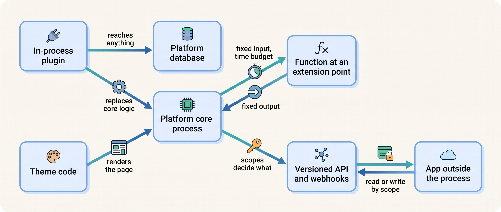
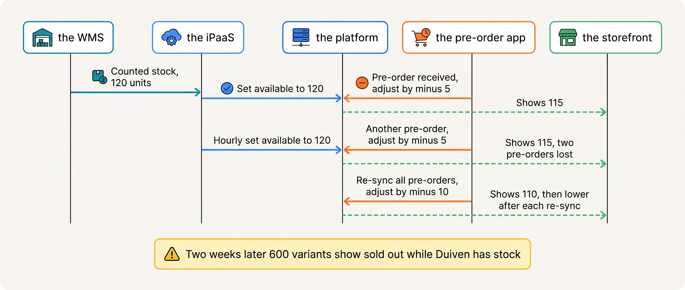
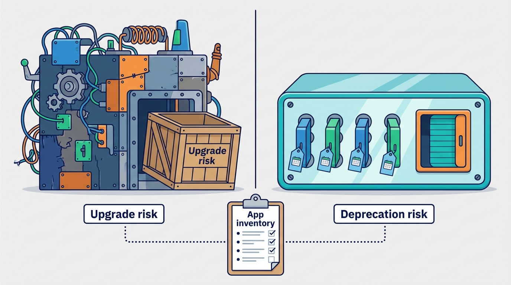
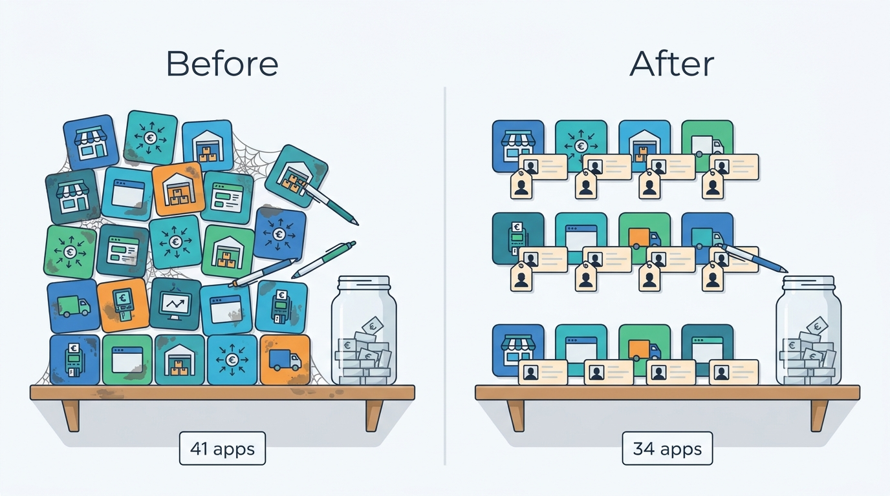

> **IN THIS CHAPTER, YOU WILL:** Learn how platforms let other people's code change them, what each mechanism may touch, why installed apps sprawl, and how to govern the apps a merchant runs.

> **KEY POINTS:**
>
> * **Extension mechanisms differ by where the code runs and what it may touch.** A plugin inside the platform's process can reach anything, including the database; an app outside it may do only what its granted permissions allow; a function at a named extension point gets a fixed input, a fixed output and a time budget. The deeper the code sits, the more every vendor release costs.
> * **The app store is the vendor's business model and the merchant's governance problem.** Scopes, app review and dated API versions protect the platform and the shopper; none of them tells the merchant which of its installed apps writes stock, prices or orders. That inventory is the merchant's own work, and the App That Wrote Stock is what happens when nobody does it.
> * **Govern by owner, scope and writer, and keep custom behavior out of the core.** One named owner per app, its scopes on a card, one writer per business fact, a quarterly uninstall review, and custom logic in the platform's bounded extension points rather than in a modified core. A platform you cannot upgrade is a platform you have already left.

> **[FAILURE PATTERNS THIS CHAPTER ADDRESSES](where-commerce-platforms-go-wrong.html):**
>
> * **The Secret Agent** — an app that writes stock, prices or orders without a named owner, its own identity or anyone's approval is this pattern in its most common form.
> * **The Forked Platform** — in-process customization of a platform's core is the mechanism that makes a platform un-upgradable, and the vendors describe the cost in their own documentation.
> * **The Spaghetti Junction** — forty-one apps, each with its own path into the platform's data, behave like forty-one hand-built connectors, many of them without an owner.

 
No commerce platform does everything a merchant needs. A hosted platform serves millions of shops from one codebase; a suite serves thousands of enterprises with one product; neither can build the size guide, the pre-order flow, the loyalty program and the Belgian fiscal receipt that one merchant wants this quarter. So every platform lets other people's code change it, and sells that ability as a **marketplace of apps, plugins or extensions**. **For the vendor, extensibility is how one product fits a million businesses. For the merchant, it is how one product quietly becomes forty.**

The arrangement works until the extensions touch the same facts. An app that shows "only 3 left" reads stock. An app that takes pre-orders may write it. An app that syncs the warehouse writes it too. Each was installed for a good reason by someone who did not know about the others, and the platform runs all three. The failures look like inventory, pricing or order failures; the cause is a governance gap that this chapter owns.

Kestrel & Pine, the fictional outdoor brand this book follows, supplies the worked example: 41 installed apps, 6 unused, 3 writing stock, and the rule Noor Visser set in April 2027.

**Where we are in the order's journey.** Apps sit beside the path of Eva's jacket rather than on it. The size guide she opened on the product page, the "only a few left" badge, the review widget and the notification app that mailed her tracking link are all extensions; each reads order or stock data, and the ones that write it decide whether the stock Eva saw was real. This chapter is about the code beside the journey, and about keeping it from rewriting the journey's facts.

## Setting the Scene at Kestrel & Pine: Forty-One Apps and One Spreadsheet

In the second week of April 2027, Noor Visser (Head of Engineering since January) sat down with Milan Petrov, who manages the storefronts, the apps and the marketplace connector, to list every app installed in the platform. The admin showed 41. Nobody had a list of why. Milan knew about twenty of them well; 22 had been installed by the agency over the years, many for theme features; the rest came from campaigns, pilots and former colleagues. The subscriptions added up to about €2,900 a month (a Kestrel & Pine illustration), spread over the platform invoice, the agency's invoice and three company cards. The list they produced is the table every merchant should be able to show in an afternoon (figures illustrative).

| Category | Apps | Unused | Write platform data | Example |
| --- | --- | --- | --- | --- |
| Storefront features (size guide, reviews, badges, pop-ups, bundles) | 14 | 3 | 0 | A "low stock" badge that reads inventory 40 times a minute |
| Marketing and analytics (pixels, e-mail, referral, A/B testing) | 11 | 2 | 1 (customer tags) | An e-mail app writing customer tags for segmentation |
| Operations (pre-orders, returns, shipping rates, invoices, stock sync) | 9 | 0 | 5 (stock, orders, fulfillment) | The pre-order app and an inventory-sync app the agency installed |
| Finance and compliance (tax, cookie consent, fiscal receipts) | 4 | 0 | 1 (order metadata) | The Belgian cookie-consent banner |
| Agency utilities and pilots | 3 | 1 | 0 | A search pilot nobody switched off |
| **Total** | **41** | **6** | **7** | **3 of the 7 write inventory** |

The three that write inventory are the ones every later chapter refers to, and none of them is the main stock feed. That feed carries the WMS's (warehouse management system's) counts into the platform every hour through the integration platform (the **iPaaS**, integration platform as a service: a hosted tool for building the flows that move data between systems; [[integration-styles]]). One app is an inventory-sync app the agency installed to copy stock adjustments between the platform's locations on its own schedule. One is the pre-order app behind **the App That Wrote Stock** of March 2026: it adjusted inventory to reserve units for pre-orders while the WMS feed overwrote the same numbers an hour later, and for two weeks about 600 variants carried phantom reservations that the storefront reported as sold out. The third once pushed stock to a channel the company no longer uses and still holds write access.

Noor's question to Milan was not "which app did it". It was: **who in this company is allowed to let a program write stock, and how would we know it had?** Nobody was, and nobody would. That is the question this chapter answers.

## Five Ways to Extend a Platform

A commerce platform is a promise-keeping machine that many businesses share. Shopify's annual report for the year ended 31 December 2025 (filed 11 February 2026) describes its platform as "'single branch' software, which means that all of our merchants use the latest version", serving "millions" of merchants with "more than 21,000 apps" in its App Store at year end. One codebase cannot carry a million businesses' particular needs, so the long tail of behavior lives in apps; at a different scale, that is why SAP Commerce describes itself as "a flexible, modular architecture based on extensions". Three things decide how dangerous an extension is: **where it runs** (inside the platform's process or outside it), **what it may touch** (everything the platform can reach, or only the data its permissions cover) and **how tightly it is coupled to the platform's version** (whether a release can break it silently, or whether it talks to a versioned interface with a stated support window).

In plain words, an **extension point** is a named place in the platform's flow where the platform agrees to run, or call, someone else's code. Platforms offer five kinds.

| Mechanism | Runs where | Can touch | Coupling to the platform's version | Dated examples |
| --- | --- | --- | --- | --- |
| **In-process plugin, module, extension, cartridge** | Inside the platform's program, in its language | Anything the code can reach, including the database | Tight: re-tested on every release | Adobe Commerce plugins; SAP Commerce extensions; WordPress hooks under WooCommerce; Shopware plugins; Salesforce B2C Commerce cartridges |
| **Theme code** | Inside the storefront renderer (templates and scripts) | Presentation, and through scripts the whole page | Medium: theme updates can conflict with edits | Liquid themes (Shopify); Stencil themes (BigCommerce); SFRA, the Storefront Reference Architecture (Salesforce B2C Commerce) |
| **App over APIs and webhooks** | Outside, hosted by the app's vendor | Only what its granted scopes permit | Loose: versioned APIs with a support window | Shopify, BigCommerce, Shopware and Saleor apps; Adobe App Builder |
| **Serverless function at an extension point** | Inside the platform's request path, in a sandbox | A fixed input and a fixed output | Loose, and time-boxed | Shopify Functions |
| **Synchronous call-out** | The platform calls the merchant's endpoint before saving | Validate or amend one resource | Loose; latency becomes the merchant's problem | commercetools API Extensions |

### In-process: the plugin can do anything, which is the problem

An **in-process plugin** runs inside the platform program itself, in the same language, and can therefore do anything the platform can. Adobe Commerce's developer documentation describes its plugins (also called interceptors) as code that changes a public method's behavior by running *before*, *after* or *around* it without modifying the class; an "around" plugin that never calls the original method skips it entirely, several plugins on one method are ordered by a `sortOrder` setting or else by module load order, and around plugins "should be avoided unless they're required, because they add to stack traces and can hurt performance" (n.d., accessed November 2026). Read that as a newcomer: a plugin can replace the platform's own logic for computing a price or saving an order, and two plugins can disagree about who goes first.

WooCommerce's extension guide adds the warning that matters most: "backwards compatibility between WooCommerce releases is not guaranteed" (n.d., accessed November 2026). Salesforce B2C Commerce layers **cartridges** (packages of templates and code) over a base storefront and tells developers "you never edit `app_storefront_base` directly", which "keeps the backward compatibility guarantee intact" (Trailhead, n.d., accessed November 2026): extend by layering over the core, never by editing it. Shopware draws the line most explicitly, because it sells both kinds: plugins "are executed within the Shopware Core process", "have direct access to the database", and therefore "are not supported by Shopware cloud"; apps "are not executed within the process of the Shopware Core" and interact through webhooks and the admin API (n.d., accessed November 2026). A vendor that runs the platform for you cannot let your code run inside it.

### Theme code: the storefront's own extension point

**Theme code** is the set of templates and scripts the platform renders into pages; [[storefront-architecture]] owns it. It is a second place where apps land: before Shopify's Online Store 2.0 (announced 29 June 2021), apps typically injected code into theme files and uninstalling could leave "ghost code" behind, which theme app extensions were introduced to end. Agency-edited theme files are the storefront's version of the Forked Platform: the more templates edited by hand, the more a theme update becomes a merge.

### Apps over APIs: outside the process, limited by scopes

An **app** in the hosted-platform sense is a separate program, run elsewhere, that talks to the platform through its APIs and receives **webhooks** (push notifications the platform sends to the app's address when something changes; [[api-contracts-and-versioning]]). It may only do what its granted **scopes** allow: a scope is one named permission the app asks for at install, such as "read orders" or "write inventory", shown to the merchant on the consent screen. Shopify's documentation gives `read_inventory` and `write_inventory`, `read_orders` and `write_orders` as examples and notes that order scopes "cover orders created within the last 60 days" unless a broader scope is approved (n.d., accessed November 2026). Saleor describes its apps the same way, as external services over webhooks and the API.

Apps are loosely coupled because the API is versioned. Shopify "releases a new API version every three months", supports each stable version "for a minimum of 12 months" and, if an app targets a retired version, "falls forward and responds using the oldest accessible stable version" (n.d., accessed November 2026). The price of looseness is that every app carries an upgrade obligation of its own.

### Functions and call-outs: a fixed input, a fixed output, a time budget

The newest mechanism runs the merchant's small program at a named moment in the platform's own flow, with a fixed input, a fixed output and a limit on how long it may take. Shopify Functions plug into targets such as discounts, delivery and payment customization, cart and checkout validation and order routing. The function is compiled to WebAssembly (a portable binary format that runs in a sandbox), receives JSON the platform produces, returns a list of operations, cannot be called by URL and has no network access; the documented limits for API version 2026-10 are 11 million instructions per run for carts of up to 200 lines, 10 MiB of memory and a 256 KiB module. The earlier mechanism, Scripts (Ruby code running inside checkout for Plus merchants), was retired on 30 June 2026 (help center, accessed November 2026).

commercetools' **API Extensions** are the synchronous call-out variant: after a create or update on a cart, order, payment or customer is processed but before it is saved, the platform calls the merchant's endpoint, which may reject the change or return update actions. The documentation is candid: "if it fails or takes a second longer to return a result, the whole API call fails or takes a second longer." The default budget is 2 seconds to connect and 2 seconds to respond, configurable to 10 with a support request; the recommended target is about 50 milliseconds; a project may have 25 extensions; a failure fails the API call and is not retried (n.d., accessed November 2026).

The common design is the lesson. **An extension point is a named moment with a fixed input, a fixed output, a time budget and a failure rule.** The time budget is the vendor protecting checkout from the merchant's code, which is the architectural fact behind the claim in [[cart-and-checkout]] that checkout is the most protected part of a platform.

**Figure 1:** *Where an extension runs decides what it can touch: a plugin inside the process reaches the database and can replace core logic; a function gets a fixed input and a time budget; an app outside the process reads and writes only what its scopes allow.*

### What each interaction needs from the platform

The requirements differ by interaction; time budgets are the vendors' documented ones where given and assumptions otherwise.

| Interaction | Mechanism | Time budget | On failure | Who owns the outcome |
| --- | --- | --- | --- | --- |
| Checkout validation or discount | Function or call-out | Milliseconds (Shopify: an instruction count; commercetools: 2 s default) | The platform fails the call or skips the function by its documented rule | The merchant; the shopper waits |
| Stock write from the warehouse | App over API | Seconds, asynchronous *(assumption)* | Retried; stale stock until it succeeds | The integration owner |
| Order created notification to an app | Webhook | Shopify: 1 s to connect, 5 s total; 8 retries over 4 hours | After 8 consecutive failures the subscription is deleted | The app's owner, and the merchant |
| Core method replaced (price, tax, save order) | In-process plugin | Whatever the plugin takes | The platform does what the plugin does, right or wrong | The merchant, entirely |

Every row but the last has a platform rule for failure. The in-process row has none, because the platform no longer knows what it is doing.

## The App Store: Business Model and Governance

An **app store** is where a platform vendor lists third-party apps, reviews them, bills for them and takes a share. It is a business and a governance mechanism, and the two are not the same.

**As a business.** Shopify's revenue-share page states that developers keep all of the first $1,000,000 of lifetime gross app revenue (counting revenue earned on or after 1 January 2025) and pay 15% above it (n.d., accessed November 2026). The app store aligns the vendor's and the developers' interests around installs, which is why it is full, and why nothing in it is designed to reduce the number of apps a merchant runs.

**As governance.** The review requirements are the platform's and the shopper's protection, and read like a list of the harms the vendor has seen:

- **Least scope.** Shopify asks that an app request only the scopes it needs. BigCommerce states that "Apps configured with all scopes aren't approved", that a checkout-content scope triggers a security assessment, and that apps handling card data need a PCI review (against the card industry's Payment Card Industry security standard) (both n.d., accessed November 2026).
- **Performance and currency.** A Shopify public app "shouldn't lower a store's Lighthouse performance score by more than 10 points" (Lighthouse is Google's page-speed audit tool), and apps using APIs deprecated within 90 days cannot be submitted.
- **Clean uninstall.** BigCommerce requires that uninstalling "return the control panel and storefront to their pre-install state" and remove storefront scripts.
- **Privacy.** Every Shopify App Store app must implement three compliance webhooks (customer data request, customer redaction, shop redaction) and complete the request "within 30 days". The deletion request that touches nine of Kestrel & Pine's systems in [[privacy-and-customer-data]] reaches its apps this way.
- **Billing through the platform**, so the merchant sees charges on one invoice.

Now read what the list does not contain. **Nothing in app review tells the merchant that two of its installed apps both write inventory.** Each app passed review on its own; each asked for `write_inventory` for a reason; the merchant approved each consent screen months apart. The platform cannot know that, in your business, the warehouse feed is the system of record for stock and the pre-order app is not, because that is a decision about your business ([[boundaries-and-systems-of-record]]). The App That Wrote Stock is a governance gap on the merchant's side, and no vendor can close it.

## What an App May Touch: The Writer Problem

The most important question about any extension is not what it does but **what it writes**. A reader can be slow, wrong or expensive. A writer can change a fact that other systems trust. In March 2026 Kestrel & Pine's platform had two writers of one fact: the WMS feed **set** stock levels every hour to what the warehouse counted, and the pre-order app **adjusted** stock by the quantity pre-ordered. Each operation was correct alone. Together they fought, and the number the storefront showed drifted away from both.

**Figure 2:** *Two writers of one fact: the warehouse feed sets stock to the counted quantity, the pre-order app adjusts it by reservations, and the number the storefront shows drifts away from both.*

Shopify's inventory documentation (n.d., accessed November 2026) shows the distinction cleanly: its API offers `inventoryAdjustQuantities` (a change per state) and `inventorySetQuantities` (an absolute quantity), and models stock per location in states such as *available*, *committed* (set aside for placed orders) and *on hand*. Kestrel & Pine's platform is not named and the mechanism is general: **set and adjust do not mix on the same number**, and a reservation belongs in its own state, not subtracted from the physical count. [[inventory-and-availability]] owns the states and the availability service that Waypoint's decision W1 introduces; this chapter owns the rule that got Kestrel & Pine there: **one writer per fact.** For each fact the platform holds there is one system of record and at most one path by which it is written into the platform; every app that holds the write scope on that fact is either that path or a mistake.

| Fact in the platform | System of record (Kestrel & Pine, after Waypoint) | The one writer into the platform | Apps that may only read |
| --- | --- | --- | --- |
| Physical stock and availability | The WMS for physical stock; the availability service for what each channel may promise (W1) | The WMS feed through the iPaaS, until the availability service replaces it (Q4 2027) | Badges, feeds, the pre-order app |
| Prices | The platform's market price lists for consumer prices; the ERP's (enterprise resource planning system's) for wholesale ([[pricing-architecture]]) | Price events with effective dates from the price lists | Repricing and marketplace apps |
| Product content | The PIM, product information management system (W3) | The PIM's publication job | Search-engine optimization (SEO) and feed apps |
| Orders | The OMS, order management system (W2); the platform keeps checkout and order history | The checkout, and the OMS for status | Notification, invoice and analytics apps |

Writing is not forbidden (the returns portal creates exchange orders through the platform's API, with an owner and a reason); every writer is named.

## The Forked Platform: When the Core Has Been Changed

**The Forked Platform** is a platform whose core or theme has been customized so deeply that it can no longer be upgraded, so every vendor release is a project and, eventually, no release is taken. The vendors who offer in-process mechanisms describe it best.

Adobe Commerce's upgrade guidance says: "The amount of custom work and the number of installed third-party modules strongly affects the complexity of an upgrade", "The quality of the custom work and modules can determine whether an upgrade goes smoothly", skipping releases makes the next upgrade harder, and if upgrades cost more than expected, audit the project (n.d., accessed November 2026). Adobe ships an Upgrade Compatibility Tool that checks a customized instance's modules and core code against a target version and reports "critical issues, errors, and warnings" (updated 8 October 2026). Its reasoning for its newer out-of-process model is the same lesson from the vendor's side: in-process code "must stay compatible with each Commerce version and its runtime", while App Builder apps can be "developed, deployed, and operated on their own schedule"; the trade-off is that in-process extensibility offers "deep, synchronous control of the Commerce runtime" that out-of-process does not (n.d., accessed November 2026).

The clock that turns a postponed upgrade into a forced migration is the support policy. Adobe's lifecycle page (accessed November 2026) gives each release line roughly three years of standard support from general availability. Version 2.4.4 reached general availability on 12 April 2022 and left standard support on 12 April 2025; 2.4.7 (general availability 9 April 2024) is supported to 31 May 2027. From 1 June 2027 Adobe says it will no longer maintain cloud environments running unsupported versions, including "suspending traffic to the affected infrastructure", so the storefront "will go offline". A merchant still on 2.4.4 has a dated deadline and a bill that grows with every module.

Hosted platforms cannot be forked, but they withdraw extension points, which is the same risk from the other direction. Shopify's checkout template (`checkout.liquid`) stopped working for in-checkout pages on 13 August 2024, by a notice of 13 February 2023; non-upgraded checkouts were "automatically upgraded to an un-customized, out-of-the-box Shopify Checkout"; Scripts followed on 30 June 2026 ([[cart-and-checkout]] tells the story). **An extension point is a promise with a date**, and the merchant's inventory must record which date each app depends on.

So open source and suites put the upgrade risk in the merchant's hands (the merchant may change the core, and must manage module count, module quality and an upgrade calendar under the vendor's support clock), while hosted SaaS puts the deprecation risk there instead (the merchant cannot change the core, and must manage app scopes, API versions per app and the vendor's deprecation calendar). Neither is safe, and both are managed by the same inventory.

**Figure 3:** *Open-source and suite platforms put the upgrade risk in the merchant's hands and hosted platforms put the deprecation risk there instead; an extension point is a promise with a date, and one app inventory manages both.*

## The Choices: Where Custom Behavior Should Live

When a merchant needs the platform to behave differently, there is a ladder of places to put the change. I climb it from the top and stop at the first rung that works: **configuration** (most "customizations" are settings the platform already has; Pete Hodgson's 2017 toggle taxonomy helps decide whether a switch is a release, ops or permissioning toggle, and so whether it belongs in configuration at all); **a platform-native extension point** (a function, a call-out or a workflow tool such as Shopify Flow, which "monitors your store for events" and runs actions); **a public app** for commodity capabilities; **a custom app over the API** for integrations and special behavior, with an owner and an API-version pin; **an in-process plugin** only where the platform allows it and the behavior needs synchronous control of the core; and **editing the core**, never.

| Choice | Upgrade coupling | What it may touch | Latency risk to checkout | Who maintains it | When it is right |
| --- | --- | --- | --- | --- | --- |
| Configuration | None | What the vendor exposes | None | The merchant's admin | Always try first |
| Native extension point (function, call-out, workflow) | Loose, versioned | Fixed input and output | Bounded by the vendor | The merchant or agency | Checkout, discount and routing rules |
| Public app | Loose | Its scopes | Theme scripts can slow pages | The app vendor | Commodity capabilities |
| Custom app | Loose | Its scopes | None, if asynchronous | The merchant (named owner) | Integrations; special behavior |
| In-process plugin | Tight | Anything | Whatever it takes | The merchant, on every release | Rarely; synchronous core control |
| Core edit | Total | Anything | Whatever it takes | Nobody can | Never |

The recommendation assumes a merchant with a small team that does not sell software; a Group-stage merchant with a platform team on a suite can afford a disciplined, budgeted in-process layer, and Kestrel & Pine, with three storefront-and-apps engineers and an agency, cannot.

## Across Scale Stages: When It Fits and When It Limits

The mechanisms do not change with scale; the governance does, and the stage decides which failure arrives first.

| Stage | What is typical | What becomes necessary | Warning signs of outgrowing the approach |
| --- | --- | --- | --- |
| **1 — Starting** (Kestrel & Pine 2016–2018) | A hosted platform and ten to twenty public apps installed by the founder or the agency; no custom code beyond the theme | A list of installed apps with their scopes, kept from day one; one person who approves installs | Two apps for the same job; an app billed to a card nobody checks; theme edits by hand |
| **2 — Growing** (2019–2022) | The first custom app or connector (ERP, 3PL or third-party logistics provider, marketplace); thirty apps; agency-built theme features; on open-source platforms, the first in-process modules | A named owner per app and connector; the API version each targets, written down; one writer each for stock and prices; out-of-process mechanisms preferred even where in-process ones are allowed | Stock or price disagreements traced to an app; an upgrade postponed because "the modules might break"; the agency as the only one who knows what an app does |
| **3 — Omnichannel** (2023–now) | Forty or more apps across storefront, marketing, operations and compliance; apps that write stock, orders and customers; several countries in one tenant | A governance card per app; a quarterly uninstall review; scopes revoked when a system of record moves (W1, W2, W3); on in-process platforms, an upgrade calendar set by the vendor's support clock and a module budget | A phantom-stock or price incident caused by two writers; app subscriptions nobody can account for; a deprecation discovered after its date; a platform release more than a year behind |
| **4 — Group** | Several brands, each with its own app list; platform teams; possibly in-process customization on a suite | A shared extension catalog across brands; one upgrade calendar for every vendor; app security review inside vendor management ([[commerce-security]]); the same contract discipline for the group's own APIs | Each brand solving the same need with a different app; a module written for one brand blocking the group's upgrade; **One Size Fits None** when brands are forced to share apps that fit none of them |

The judgement: extensibility is cheap to adopt and expensive to govern, and the bill arrives at the Omnichannel stage as two writers of one fact. A merchant that keeps the list from the Starting stage pays almost nothing for it; one that starts at forty apps pays a week of archaeology, as Kestrel & Pine did.

## In Practice

### Dated public examples

- **A hosted platform withdrawing in-process code (2021–2026).** Shopify announced WebAssembly-based Functions in beta on 29 June 2021, deprecated its checkout template by a notice of 13 February 2023 effective 13 August 2024, and retired Scripts on 30 June 2026. Over five years the platform replaced free-form code inside checkout with sandboxed, time-budgeted extension points; read that as the direction every hosted platform takes as it grows.
- **A suite vendor moving extensibility out of process (2025–2026).** Adobe's Commerce as a Cloud Service, whose release notes begin in November 2025, extends through App Builder, API Mesh, events and webhooks rather than in-process modules, with updates delivered continuously and 30 days to evaluate them in a sandbox (Adobe, 20 October 2026). The vendor that documented the upgrade problem most candidly built its SaaS edition without the mechanism that causes it.

### Kestrel & Pine: the app governance rule

Noor and Milan turned the April 2027 spreadsheet into a rule, approved by Mara Lindqvist alongside Waypoint and recorded on one page per app (the **app governance card**, reproduced in the [[toolkit]]). The rule has five lines.

1. **Every app has a named owner** in the business (Milan for storefront and marketing apps, Daniel Okafor's team for fulfillment apps, Sanne de Wit's team for tax and invoicing apps, Ruben Alves for connectors); the agency installs nothing without an owner's approval.
2. **Every app's scopes are recorded** on its card, with the API version it targets and the date that version leaves support.
3. **One writer per fact.** The WMS feed through the iPaaS is the only writer of stock into the platform until the availability service takes over in Q4 2027 (W1); consumer prices change only through the platform's market price lists and wholesale prices only through the ERP's ([[pricing-architecture]]); the OMS will be the only writer of order status (W2). Every other write scope on those facts is revoked.
4. **A quarterly uninstall review.** Any app without an owner, without use in the quarter, or duplicating another is removed.
5. **Custom behavior goes to the lowest rung that works**: configuration, then the platform's functions and workflows, then a public app, then a custom app with an owner.

The results: the six unused apps were uninstalled in April 2027; inventory write access was withdrawn from all three stock-writing apps by June 2027, after the first weekly reconciliation in May had measured the damage (2.3% of active variants with a different quantity in the WMS and the platform, most from those apps); the pre-order app kept read access and records pre-orders without adjusting stock until the availability service handles pre-order quantities. Thirty-four apps remained in July 2027, at about €2,400 a month (illustrative). The saving is not the point. The point is that Noor can now answer, on one page, the question nobody could answer in March 2026: who is allowed to let a program write stock.

**Figure 4:** *The April 2027 spreadsheet found 41 apps with nobody's name on them; an owner per app, scopes on a card, one writer per fact and a quarterly uninstall review left 34 by July.*

| App governance card | Kestrel & Pine example: the pre-order app |
| --- | --- |
| App, vendor, owner | Pre-order app, public, installed 2025; owner Milan Petrov |
| Purpose | Take pre-orders for next season's Ridgewalker colors |
| Scopes granted | read_products, read_inventory, write_orders (pre-order tags) |
| Scopes revoked and why | write_inventory, June 2027: the WMS feed is the only writer of stock (W1) |
| API version and support end | 2027-01; supported at least to January 2028 *(illustrative; mirrors the 12-month rule of hosted platforms)* |
| Review date | October 2027 |
| Exit plan | Pre-orders handled by the availability service and the OMS from Q4 2027; app removed after the spring 2028 season |

## When It Goes Wrong

Extensions fail the way integrations fail, with one difference: the merchant often does not know the extension exists.

| Failure | What it looks like | Detection | Recovery |
| --- | --- | --- | --- |
| **Two writers of one fact** (the App That Wrote Stock) | Stock, price or status drifts between the platform and its system of record | The reconciliation job ([[events-consistency-and-reconciliation]]) lists variants whose quantity differs; the platform's audit log, where it exists, names the last writer | Revoke the extra write scope; re-set the fact from the system of record; keep the reconciliation weekly |
| **An app lost its webhook** | An app stops receiving orders after an outage on its own side; Shopify, for example, deletes a subscription "After 8 consecutive failures" over 4 hours | Orders missing in the app; the platform's webhook delivery log | Re-subscribe; backfill from the API; webhooks need a reconciliation job, not trust |
| **The withdrawn extension point** (the Pulled Rug) | Checkout customizations stop on the vendor's announced date; an app on a retired API version "falls forward" to a newer one with different fields | The deprecation calendar on the cards; the vendor's changelog | Move the logic to the replacement mechanism before the date; after it, the platform's default behavior runs, usually safe and always surprising |
| **The un-upgradable core** (the Forked Platform) | Each release is a project; releases are skipped; the support end approaches | The upgrade compatibility report; the module count; the version gap | Audit modules; move what can move out of process; plan the upgrade as a migration ([[replatforming-and-migration]]) |
| **An app as the attacker's path, or an app nobody maintains** | An app with broad scopes, or its vendor, is compromised ([[commerce-security]]); or a capability customers use runs through an app whose vendor has gone quiet (the Lynchpin) | Scope review; vendor assessments; the review date and API-version lag on the card | Revoke and rotate credentials; the exit plan on the card |

Every row is found faster, and fixed faster, by a merchant that can list its apps, their owners, their scopes and the facts they write.

## What to Take Away

**Established.**

- Where an extension runs decides what it can touch and what it costs at upgrade time: in-process plugins can reach anything (Adobe, Shopware and WordPress documentation); apps over APIs only what their scopes allow (Shopify, BigCommerce, Saleor); functions and call-outs get a fixed input, a fixed output and a time budget (Shopify Functions, commercetools API Extensions).
- Upgrade cost scales with the number and quality of in-process customizations, and the vendor's support clock turns a postponed upgrade into a forced migration (Adobe Commerce's upgrade guidance and lifecycle policy).
- Hosted platforms withdraw extension points on published dates; Shopify's checkout template and Scripts timeline (2023–2026) is the reference case.
- App review protects the platform and the shopper (least scope, performance, clean uninstall, privacy webhooks); it does not tell a merchant which installed apps write the same fact.

**Depends on context.**

- Whether in-process extension is acceptable depends on who runs the platform and the size of the team: a merchant on a hosted platform has no choice; one on a suite with a platform team can run a disciplined, budgeted in-process layer; one with a small team and an agency should treat every in-process module as debt.
- How formal app governance must be depends on stage: a list with owners and scopes at Starting; a card per app, a quarterly review and a one-writer rule at Omnichannel; a shared extension catalog and an upgrade calendar at Group.
- Whether to build a custom app or buy a public one depends on whether the need is special: commodity capabilities belong to the store; integrations and business rules belong to a custom app or a function with a named owner.

**The author's synthesis.**

- I treat every installed app as an integration and give it what Waypoint's W5 gives every integration: an owner, a contract (its scopes and API version), idempotent handling where it writes, and a reconciliation job for the facts it touches. Forty apps are forty integrations.
- I would rather lose a feature than keep a second writer. When a business need seems to require a second app writing stock or prices, the need is real and the mechanism is wrong: the answer is a reservation state, a price list or an availability service, not another writer.

## Questions to Ask

1. How many apps, plugins or extensions are installed, and can someone produce the list with an owner per app in an afternoon?
2. For each fact the platform holds (stock, price, product content, order status, customer), which single path writes it, and which apps hold a write scope on it anyway?
3. Which mechanism does each custom behavior use: configuration, a function or call-out, a public app, a custom app, an in-process module, or an edit to the core?
4. On an open-source or suite platform: how many in-process modules are installed, which version is running, and when does standard support for it end?
5. On a hosted platform: which API version does each app and connector target, and which deprecations fall in the next twelve months?
6. What time budget does the platform give our checkout customizations, and what happens to the shopper when they time out?
7. Who approves a new app, and if its vendor stopped maintaining it tomorrow, what is the exit plan on its card?

The apps that extend a platform mostly land on one surface: the storefront, where theme code, app blocks and scripts meet the shopper's browser. The next chapter follows that surface from the platform to the phone, compares themes with headless storefronts, and works through the headless proposal Noor declined in February 2027. Continue with [[storefront-architecture]].

## Sources and Evidence

*Company, product and investor sources*

- [Shopify Inc., Annual Report on Form 10-K for the fiscal year ended December 31, 2025](https://www.sec.gov/Archives/edgar/data/1594805/000159480526000007/shop-20251231.htm), U.S. Securities and Exchange Commission, filed 11 February 2026 — "single branch" software, "millions" of merchants and "more than 21,000 apps" at year end.
- [Shopify Unite 2021 announcements](https://www.shopify.com/in/partners/blog/shopify-unite-announcements-2021), Shopify Partners blog, 29 June 2021 — theme app extensions and app blocks, uninstalls removing ghost code, Functions in beta.
- [The checkout.liquid theme file is being deprecated](https://changelog.shopify.com/posts/the-checkout-liquid-theme-file-is-being-deprecated), Shopify changelog, 13 February 2023 — the 13 August 2024 date and the automatic upgrade to an uncustomized checkout.
- [Script Editor](https://help.shopify.com/en/manual/checkout-settings/script-editor), Shopify Help Center, n.d., accessed 2026-11 — Scripts retired on 30 June 2026.
- [Shopify Functions](https://shopify.dev/docs/apps/build/functions) and [Function APIs](https://shopify.dev/docs/api/functions), shopify.dev, n.d. (API version 2026-10), accessed 2026-11 — targets, WebAssembly, no network, instruction and memory limits.
- [Access scopes](https://shopify.dev/docs/api/usage/access-scopes), shopify.dev, n.d., accessed 2026-11 — scope examples, the 60-day order window, protected customer data.
- [App requirements checklist](https://shopify.dev/docs/apps/launch/app-requirements-checklist), shopify.dev, n.d., accessed 2026-11 — least scope, the 10-point Lighthouse rule, the 90-day deprecation rule, billing.
- [Revenue share](https://shopify.dev/docs/apps/launch/distribution/revenue-share), shopify.dev, n.d., accessed 2026-11 — the 0% to $1,000,000 lifetime threshold and 15% above.
- [Privacy law compliance](https://shopify.dev/docs/apps/build/compliance/privacy-law-compliance), shopify.dev, n.d., accessed 2026-11 — the three mandatory compliance webhooks and the 30-day completion rule.
- [HTTPS webhook delivery](https://shopify.dev/docs/apps/build/webhooks/subscribe/https), shopify.dev, n.d., accessed 2026-11 — timeouts, eight retries over four hours, subscription deletion after eight consecutive failures.
- [API versioning](https://shopify.dev/docs/api/usage/versioning), shopify.dev, n.d., accessed 2026-11 — quarterly versions, the 12-month minimum support and the fall-forward rule.
- [Inventory management apps](https://shopify.dev/docs/apps/build/orders-fulfillment/inventory-management-apps), shopify.dev, n.d., accessed 2026-11 — inventory states and the adjust-versus-set mutations.
- [Shopify Flow](https://help.shopify.com/en/manual/shopify-flow), Shopify Help Center, n.d., accessed 2026-11 — the workflow tool and its plan gating.
- [Web performance](https://help.shopify.com/en/manual/online-store/web-performance), Shopify Help Center, n.d., accessed 2026-11 — theme code and apps named as what can slow a site.
- [App marketplace requirements](https://docs.bigcommerce.com/docs/integrations/apps/guide/requirements), BigCommerce developer documentation, n.d., accessed 2026-11 — "Apps configured with all scopes aren't approved", checkout and PCI reviews, clean uninstall.
- [Extensions: plugins and apps](https://developer.shopware.com/docs/concepts/extensions/), Shopware developer documentation, n.d., accessed 2026-11 — plugins in process with database access and unsupported in the cloud; apps out of process.
- [Plugins (interceptors)](https://developer.adobe.com/commerce/php/development/components/plugins), Adobe Commerce PHP developer guide, n.d., accessed 2026-11 — before, after and around plugins, ordering and the performance warning.
- [Out-of-process extensibility](https://developer.adobe.com/commerce/extensibility/), Adobe Commerce developer documentation, n.d., accessed 2026-11 — the in-process versus App Builder trade-off in Adobe's words.
- [Upgrade best practices](https://experienceleague.adobe.com/en/docs/commerce-operations/upgrade-guide/prepare/best-practices), Adobe Experience League, n.d., accessed 2026-11 — custom work and modules as the drivers of upgrade complexity.
- [Upgrade Compatibility Tool overview](https://experienceleague.adobe.com/en/docs/commerce-operations/upgrade-guide/upgrade-compatibility-tool/overview), Adobe Experience League, updated 8 October 2026 — what the tool checks and reports.
- [Adobe Commerce lifecycle policy](https://experienceleague.adobe.com/en/docs/commerce-operations/release/planning/lifecycle-policy), Adobe Experience League, n.d., accessed 2026-11 — about three years of standard support, release dates, the 1 June 2027 cloud enforcement.
- [Adobe Commerce as a Cloud Service overview](https://experienceleague.adobe.com/en/docs/commerce/cloud-service/overview), Adobe Experience League, 20 October 2026 — continuous updates with a 30-day sandbox window; extensibility through App Builder, API Mesh, events and webhooks.
- [Extension concept](https://help.sap.com/doc/b490bb4e85bc42a7aa09d513d0bcb18e/2205/en-US/8bbf0b9d866910149688b8d696c8d47e.html), SAP Help Portal (SAP Commerce 2205), n.d., accessed 2026-11 — "a flexible, modular architecture based on extensions".
- [Customize with cartridges](https://trailhead.salesforce.com/content/learn/modules/b2c-cartridges/b2c-cartridges-customize), Salesforce Trailhead, n.d., accessed 2026-11 — the cartridge path and the rule never to edit the base storefront.
- [API Extensions](https://docs.commercetools.com/api/projects/api-extensions), commercetools documentation, n.d., accessed 2026-11 — synchronous call-outs, time budgets, limits and failure behavior.
- [Apps overview](https://docs.saleor.io/developer/extending/apps/overview), Saleor documentation, n.d., accessed 2026-11 — apps as external services over webhooks and the API.
- [Getting started building extensions](https://developer.woocommerce.com/docs/extensions/getting-started-extensions/), WooCommerce developer documentation, n.d., accessed 2026-11 — "backwards compatibility between WooCommerce releases is not guaranteed"; the 3.6M+ active stores reach figure.

*Standards, regulation and official documentation*

- [Hooks](https://developer.wordpress.org/plugins/hooks/), WordPress Plugin Handbook, n.d., accessed 2026-11 — actions and filters as the in-process mechanism under WooCommerce. No cross-vendor standard governs commerce extensibility; the privacy obligations that reach apps are covered in [[privacy-and-customer-data]].

*Research and practitioner sources*

- [Feature Toggles (aka Feature Flags)](https://martinfowler.com/articles/feature-toggles.html), Pete Hodgson, martinfowler.com, 9 October 2017 — the toggle taxonomy used to decide whether a change belongs in configuration.

Kestrel & Pine is fictional; architectural recommendations, labeled inferences and labeled assumptions are the author's judgement.
