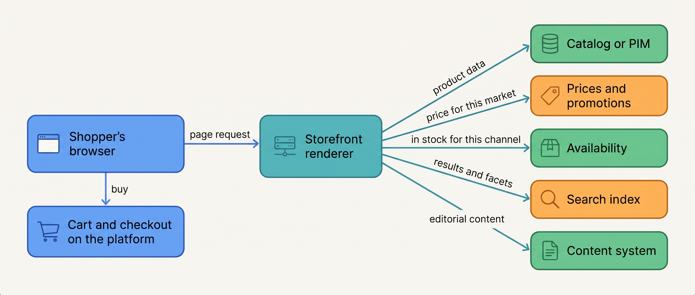
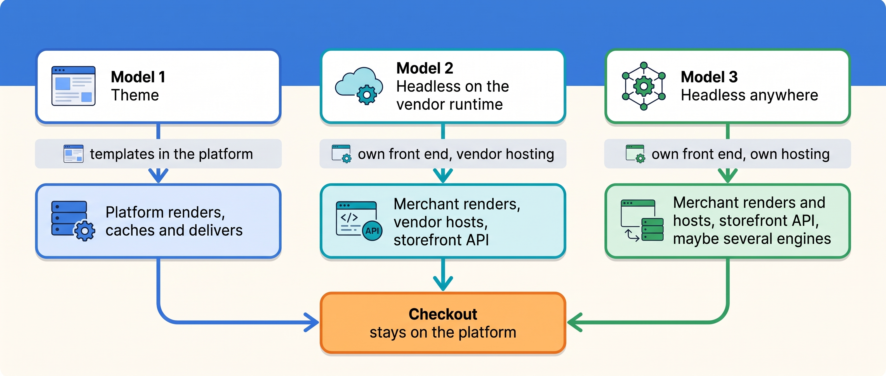
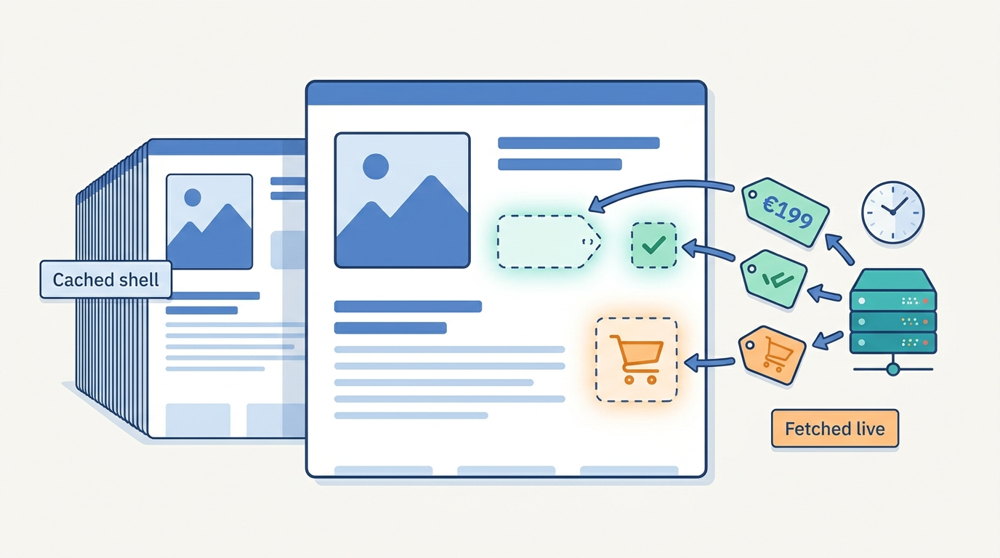
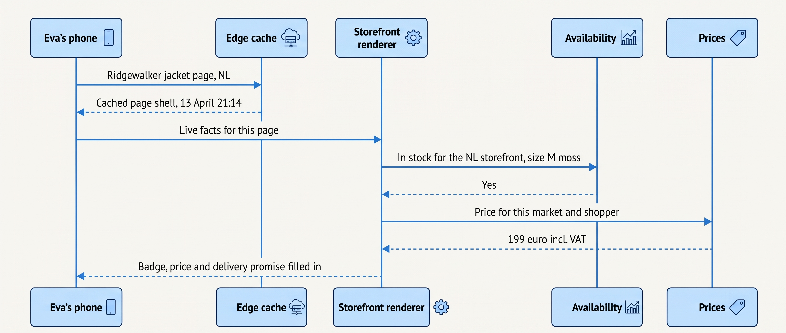
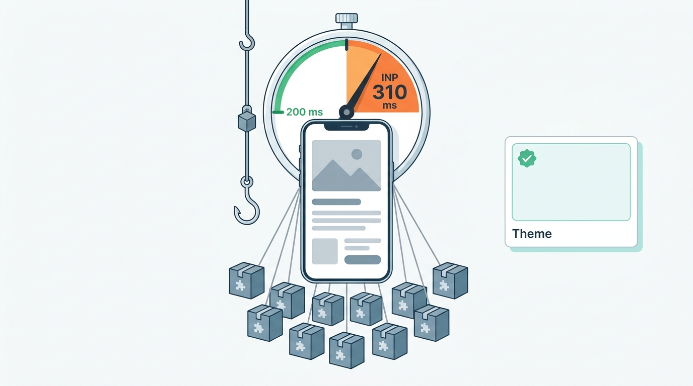

> **IN THIS CHAPTER, YOU WILL:** Follow a product page from the platform to the shopper's phone, compare themes with headless storefronts, and learn when owning the storefront is worth it.

> **KEY POINTS:**
>
> * **A storefront is a rendering of facts other systems own.** It shows the catalog, prices, promotions, availability, search results and the cart, and hands the shopper to checkout; it owns none of them. Three rendering models exist (a theme rendered by the platform, a headless storefront on the vendor's runtime, a headless storefront anywhere else), and under all three the checkout stays on the platform.
> * **Cache the shell, fetch the promise.** Product and category pages can be cached per market and language, which is what survives a peak day; the price for a logged-in account, live stock, the cart and the checkout cannot, and are fetched after the cached page renders. The platform's full-page cache and a headless framework's regeneration are the same idea at two layers.
> * **Go headless for a need the theme cannot meet, never for speed alone.** The performance evidence is directional, dated and self-selected; a themed storefront with disciplined app scripts can pass Google's thresholds. Headless is justified by a shared front end across brands, a content-led site or an account-priced B2B portal, and it costs a second deployable that a small team must run.

> **[FAILURE PATTERNS THIS CHAPTER ADDRESSES](where-commerce-platforms-go-wrong.html):**
>
> * **The Giant's Boots** — headless storefront architectures are copied from brands with front-end teams of fifty, by merchants with three.
> * **The Forked Platform** — a theme edited by hand for years is the storefront's version of a core that cannot take the vendor's updates.
> * **The First Snowfall** — the storefront meets forty times its normal traffic once a year, and whether its pages are cacheable decides whether it stands.

 
Everything else in this book happens behind a screen. The shopper sees one thing: a page, on a phone, that shows a jacket, a price, "in stock", a delivery promise and a button. The **storefront** is the software that produces that page, and the architectural question is not what it looks like but **where it is rendered, from which data, and who owns the machinery**. A storefront rendered by the platform from a theme is one answer; a separate application that fetches everything through APIs (a **headless** storefront, so called because the "head" the shopper sees has been cut off from the commerce engine behind it) is another.

The question matters because the storefront is where the rest of the architecture becomes visible. It reads the catalog, prices, promotions, search, availability and the cart, and if any of those is slow, stale or wrong, the page is. It also carries the merchant's brand, which is why agencies and designers want to own it, and it is where most installed apps land their scripts, which is why it gets slow. **The storefront is the one component every stakeholder wants to change and nobody wants to operate.**

Kestrel & Pine, the fictional outdoor brand this book follows, supplies the worked example: three localized storefronts rendered from one agency-customized theme, 41 apps' worth of scripts, a peak hour of 41 times normal traffic, and the headless rebuild Noor Visser was asked to approve in February 2027 and declined.

**Where we are in the order's journey.** This chapter is the first step of Eva's jacket: the product page she opened on her phone at 21:14 on 13 April 2027, with its price, its "in stock" badge and its "ordered before 22:00, delivered tomorrow" promise. Every later step ([[cart-and-checkout]], [[commerce-payments]], [[order-management]]) begins with what that page showed her and whether it was true.

## Setting the Scene at Kestrel & Pine: The Headless Proposal

In February 2027, the agency that has built and maintained Kestrel & Pine's theme since 2017 presented a proposal to Noor Visser, in her second month in the job: rebuild the three storefronts as a headless application on a modern front-end framework, hosted on the platform vendor's own edge runtime (servers spread close to shoppers that run the merchant's front-end code), with a headless content system behind it. The pitch had three arguments: the storefront would be faster, the brand team would get a content model the theme could not give them, and the company would be "ready for the future". The figure, a Kestrel & Pine illustration, was about €240,000 and nine months, plus a second runtime to operate.

Noor did what the next sections of this chapter do. She measured the storefront, listed what each rendering model would change, and asked which of the agency's three arguments described a need the theme could not meet. The product pages' field measurements (the ones Google collects from real visitors, at the 75th percentile on mobile, February 2027, all illustrative) were: largest contentful paint 2.1 seconds, interaction to next paint 310 milliseconds, cumulative layout shift 0.08. Two of the three were already in Google's "good" range. The third, responsiveness, was not, and the agency's own audit traced it to scripts from eleven apps, not to the theme or the platform.

She declined the rebuild. The reasons form the rest of this chapter.

## What a Storefront Does, and What It Does Not Own

A storefront produces pages: home, category (also called collection) pages, product pages, search results, content pages, the cart, the account pages and, at the end, the checkout. To produce them it needs facts from almost every other part of the platform. **It owns none of those facts.** It owns the templates, the layout, the brand, and the scripts that run in the browser.

| What the page shows | Who owns the fact | Chapter |
| --- | --- | --- |
| Product name, description, images, attributes | The catalog, or the PIM (product information management system) once there is one | [[product-information]] |
| Price, and the tax-inclusive display for EU shoppers | The pricing engine or price list | [[pricing-architecture]] |
| Discounts and badges | The promotion engine | [[commerce-promotions]] |
| Search results, facets, sort order | The search index | [[commerce-search-and-discovery]] |
| "In stock", "only 3 left", pre-order | The availability service, or the platform's stock until there is one | [[inventory-and-availability]] |
| The delivery promise | The shipping service, or a static rule | [[shipping-and-delivery]] |
| The cart and the checkout | The platform's checkout | [[cart-and-checkout]] |
| Editorial content (stories, guides, campaign pages) | A content management system (CMS), the tool editors use to write and publish pages without engineers | this chapter |
| Who the shopper is, and which prices they see | Identity and the customer record | [[identity-and-master-data]] |

**Figure 1:** *The storefront renders facts it does not own: product data, prices, availability, search results and content come from other systems, and the buy button hands the shopper to a checkout the platform runs.*

That table is the reason the storefront question is an architecture question. A headless storefront does not move any of those facts; it moves the **rendering** and the **glue** between them into the merchant's hands. Whether that is a gain depends on whether the merchant wanted either.

## Three Rendering Models

Two words first. **Server-side rendering** means a server builds the complete page as HTML and sends it; the browser shows it at once. **Client-side rendering** means the server sends a mostly empty page plus JavaScript, and the browser fetches data and builds the page itself. Early headless storefronts were client-rendered single-page applications, which is where their reputation for slow first loads comes from; today's headless frameworks render on the server by default, so the distinction between the models is no longer about rendering technique but about **who runs the renderer and where the templates live**.

### Model 1: the theme, rendered by the platform

A **theme** is a set of templates (and, on hosted platforms, the settings and scripts around them) that the platform's own renderer turns into pages. Shopify's Liquid themes, BigCommerce's Stencil ("BigCommerce's Handlebars-based theme engine") and the templates of Salesforce's Storefront Reference Architecture (SFRA) are the dated examples. The platform owns rendering, caching, delivery, security and scale; the merchant owns the templates.

Shopify described its renderer in August 2020 (evidence now six years old): the Storefront Renderer is "a server-side application that loads a Shopify merchant's storefront Liquid theme" and returns HTML, rewritten from scratch from January 2019 because storefront code "has much stricter performance requirements" than, say, payment processing. It reads from dedicated database replicas and caches at three layers: a query cache in a key-value store, an in-memory cache of the most frequent queries, and a full-page cache. Reported results: server response times "4x to 6x faster than the legacy implementation". In January 2022 the CTO added that the separate renderer could "deploy in regions worldwide without deploying the full Rails monolith".

The theme model's ceiling is the template language and the platform's page types. Its floor is high: a merchant inherits caching, edge delivery and a renderer tuned by a vendor whose business depends on it. Shopify's Online Store 2.0 (announced 29 June 2021) moved theme content into JSON templates with sections on every page, added theme app extensions (so apps add blocks instead of editing templates) and set a performance bar for themes.

### Model 2: headless on the vendor's runtime

The platform vendor supplies a storefront **API** and a hosting runtime, and the merchant builds a separate front-end application on it. Shopify's Hydrogen is "Shopify's headless toolkit", not a framework: it adds Shopify-specific clients for "the Storefront API and Customer Account API only" to a framework the merchant chooses (React Router 7 is the starter), deployed to Oxygen, Shopify's hosting (documentation version 2026-10, accessed November 2026); Shopify's February 2023 Editions post made Oxygen available on its main plans "at no extra cost". Salesforce's PWA Kit is "a storefront technology for headless commerce using Salesforce Commerce APIs and React", deployed to a Managed Runtime. Adobe's Commerce as a Cloud Service uses a headless storefront on Edge Delivery Services as its only storefront (Adobe, 20 October 2026).

What stays on the platform in this model is instructive. Hydrogen's documentation says it covers the Storefront and Customer Account APIs and "doesn't include checkout UI, because checkout stays on Shopify"; the headless storefront builds the cart and hands off to the platform's checkout. The vendor keeps the part it is paid for and the part it must keep secure.

### Model 3: headless anywhere

The merchant builds the storefront on a general-purpose framework and hosts it where it likes, against the platform's storefront API, possibly against several platforms. Vercel's Next.js Commerce template, "A high-performance, server-rendered Next.js App Router ecommerce application" with Shopify as reference and forks for BigCommerce, Medusa, Saleor and Shopware, was archived and moved to a successor repository (accessed November 2026), a reminder that this layer churns. Alokai (formerly Vue Storefront) sells a **unified data layer** that normalizes "product data from each platform into this common format" through a middleware, for BigCommerce, commercetools, Magento, SAP and Salesforce (documentation, accessed November 2026): the merchant's front end talks to one shape of product, whichever engine is behind it, which is the Group-stage reason to go headless.

**Figure 2:** *Three rendering models differ in who renders, who hosts and how many engines the front end can face; under all three the checkout stays on the platform.*

## Cache the Shell, Fetch the Promise

A storefront's performance on an ordinary day and its survival on a peak day both come from one split. Some of a page can be computed once and served many times; some must be computed for this shopper, now.

**Cacheable:** the product page's content, images, attributes and layout, per market and language; category pages; editorial pages; search facets to a degree. These change when the catalog or the campaign changes, not when a shopper arrives.

**Not cacheable:** the price for a logged-in wholesale account; live stock and the "only 3 left" badge; the cart; the checkout; anything personalized. These are **promises**, in this book's vocabulary, and a cached promise is a lie waiting for its moment, which is exactly what the Price Drift of October 2026 and the Black Friday Oversell were from the page's side.

**Figure 3:** *Cache the shell, fetch the promise: the page content is computed once and served many times, while the price, the stock badge and the cart are fetched for this shopper, now.*

The pattern every model implements is **cache the shell, fetch the promise**: serve the cached page immediately, then fetch the live facts into it. Shopify's full-page cache is this at the platform layer. At the headless layer the same idea appears as **incremental static regeneration**: Vercel's documentation (updated 28 August 2026) describes serving the cached page while regenerating it in the background on a timer or on demand, names e-commerce catalogs "that need current pricing and availability without rebuilding the entire site" as the first use case, collapses concurrent requests for an uncached page "into one function invocation per region, protecting your backend during traffic spikes", and serves stale content with a retry if regeneration fails. Request collapsing is the peak-day feature: when 41 times the normal traffic hits one hero product at once, the backend sees one request, not thousands.

**Figure 4:** *Eva's product page arrives from the edge cache first; the storefront then fetches the facts that must be true now, availability and price, and fills them in.*

### Requirements per page type

| Page | How fresh | How consistent | How fast | On a peak day |
| --- | --- | --- | --- | --- |
| Product and category content | Minutes after a catalog publish | Same content in every channel (the PIM's job after W3) | Cached at the edge; server response in tens of milliseconds *(assumption)* | Must be fully cacheable; request collapsing on misses |
| Price shown | Within the price change's effective time; [[pricing-architecture]] | One price per market and channel | Fetched live or cached for seconds, by market | Cache per market, never per shopper, for anonymous visitors |
| Stock badge and delivery promise | Seconds to a minute after a stock event *(assumption)* | Same answer the checkout will give | Fetched after the shell | Degrade to "in stock / out of stock" or hide the count ([[peak-load-and-reliability]]) |
| Search results | Minutes after a catalog publish | Index matches the catalog | Under 300 ms *(assumption)* | Fewer facets, simpler sorts |
| Logged-in B2B (business-to-business, wholesale) pages | Live | Contract price per account | Never cached across accounts | Rate-limited by account |
| Cart and checkout | Live | One cart per session; the checkout's rules win | Platform-owned | Never on the switch-off list |

## Performance: What the Evidence Says, With Dates

**Core Web Vitals** are Google's three field metrics for page experience, measured from real visitors and assessed at the 75th percentile of page loads, mobile and desktop separately (web.dev, updated 31 October 2024): **largest contentful paint** (LCP, when the main content has loaded; "good" is 2.5 seconds or less), **interaction to next paint** (INP, how quickly the page responds to a tap or click; good is 200 milliseconds or less) and **cumulative layout shift** (CLS, how much the page jumps while loading; good is 0.1 or less). INP replaced the older first-input-delay metric on 12 March 2024. Google's Search documentation says it "highly recommend[s]" good Core Web Vitals "for success with Search" and that they "align with what our core ranking systems seek to reward", without stating a weight (accessed November 2026).

The evidence that speed moves money is consistent in direction and weak in precision:

- **Deloitte Ireland for Google (24 March 2020; six years old):** across mobile sites in retail, travel, luxury and lead generation, a 0.1-second improvement in site speed went with +8.4% retail conversions and +9.2% retail average order value. Caveats the study carries: commissioned by Google, the number of sites not disclosed, and a correlation, not an experiment.
- **web.dev's case collection (undated, accessed November 2026):** Vodafone Italy improved LCP 31% and saw sales up 8%; Lazada tripled LCP speed and saw mobile conversion up 16.9%; Cdiscount improved all three metrics and reported +6% revenue in a Black Friday sale. Every case is a self-selected success story, and none separates speed from the redesign that came with it.
- **A vendor's admission (Shopify, accessed November 2026):** the theme-performance page says performance "directly influences conversion rates, repeat business, and search engine rankings" without citing a figure; the Theme Store requires a minimum average Lighthouse performance score of 60; public apps "shouldn't reduce Lighthouse performance scores by more than 10 points"; and the admin's performance report warns that theme code and apps "can slow down your site".

The honest reading: **faster is better, nobody can tell you by how much, and the usual culprit is not the rendering model but the scripts.** A rule that caps each app at ten points is a vendor admitting that apps are where storefront speed goes. Kestrel & Pine's INP of 310 milliseconds was eleven apps' scripts; the rendering model was innocent.

**Figure 5:** *Kestrel & Pine's interaction to next paint of 310 milliseconds was eleven apps' scripts, not the rendering model; good is 200 milliseconds or less.*

### Accessibility is a requirement, not a performance option

**WCAG 2.2**, the Web Content Accessibility Guidelines of the World Wide Web Consortium (W3C), is a Recommendation dated 12 December 2024, with three conformance levels (A, AA, AAA) and four principles (perceivable, operable, understandable, robust). The **European Accessibility Act** (Directive (EU) 2019/882) applies to services "provided to consumers after 28 June 2025" and lists "e-commerce services" explicitly, defined as a service provided at a distance "with a view to concluding a consumer contract"; microenterprises (under 10 people and up to €2 million turnover) are exempt. Kestrel & Pine, with 310 employees and three consumer storefronts, has been in scope since June 2025; its B2B portal, serving businesses, is not a consumer service. National enforcement differs; [[commerce-regulation]] owns the calendar. For the storefront the consequence is that accessibility criteria belong in the theme and in every app block, and that the agency's and the apps' output must be tested against them, whichever rendering model is chosen.

### Mobile apps and progressive web apps

A **progressive web app** (PWA) is a website "built and enhanced with modern APIs" that can be installed like an app, work offline and send push notifications (web.dev, accessed November 2026). For a merchant it is mostly the headless question in disguise: the same server-rendered storefront can be made installable. A **native app** adds a second storefront that must show the same prices, stock and promises as the first, and is justified by loyalty, push and in-store features, not by speed.

## The Choices and Their Trade-Offs

The realistic options for a merchant on a hosted platform are four.

1. **The theme, disciplined.** Keep the platform's renderer; use sections and app blocks instead of edited templates; police app scripts with a performance budget; let the platform's cache and edge do the peak-day work.
2. **The theme plus a content system.** Keep the theme for commerce pages and feed editorial content from a CMS through the platform's content features or a small integration; the brand team gets its content model without a new renderer.
3. **Headless on the vendor's runtime.** Own the front end; let the vendor host it, serve the storefront API and run checkout. The team now owns rendering, caching rules and the glue to search, prices and availability.
4. **Headless anywhere, possibly over several engines.** Own everything in front of the APIs; add a unified data layer if several engines or brands sit behind one front end.

| Option | Who runs rendering and caching | Flexibility | Peak-day posture | Team it needs | When it is right |
| --- | --- | --- | --- | --- | --- |
| Theme, disciplined | The vendor | The template language and page types | The vendor's cache and edge; apps are the risk | One or two front-end engineers plus an agency | Starting through Omnichannel, unless a need below applies |
| Theme plus CMS | The vendor, plus a content feed | Content model of the CMS; commerce pages as the theme allows | As above | The same, plus editors | A content-led brand on a themed platform |
| Headless on the vendor runtime | The merchant renders, the vendor hosts | Full control of the front end; checkout stays the vendor's | The merchant's caching rules; request collapsing if used | Three or more front-end engineers who can own a production application | A design system shared across brands or countries; a B2B portal with account pricing that the theme cannot express |
| Headless anywhere | The merchant | Full, including several engines behind one front end | Entirely the merchant's | A front-end platform team | Group stage: several brands or engines behind one storefront |

The recommendation is tied to assumptions. Options 1 and 2 assume the platform's page types and checkout fit the business, which for a direct-to-consumer (D2C) brand with a B2B portal on the same platform they usually do. Options 3 and 4 assume a team that can run a production application on its own: on-call, caching bugs, framework upgrades every year, and the storefront API's versioning calendar ([[api-contracts-and-versioning]]). The agency can build it; the question is who runs it in year two.

Three needs justify headless, in my experience: a **shared front end across brands or countries** that the theme model cannot express because each tenant has its own theme; a **content-led site** where the editorial model, not the catalog, drives the page structure; and a **B2B portal** with account pricing, assortments and approval flows that the consumer theme cannot represent ([[b2b-commerce]]). Speed is not on the list, because a disciplined theme reaches the thresholds and an undisciplined headless storefront misses them.

## Across Scale Stages: When It Fits and When It Limits

| Stage | What is typical | What becomes necessary | Warning signs of outgrowing the approach |
| --- | --- | --- | --- |
| **1 — Starting** (Kestrel & Pine 2016–2018) | A purchased theme with light customization; a handful of apps; the platform's defaults for caching and delivery | Field measurements at the 75th percentile, read monthly; a rule that every app's script is justified | A theme edited by hand "just this once"; LCP drifting past 2.5 seconds after each app install |
| **2 — Growing** (2019–2022) | An agency-customized theme; two or three storefronts for countries; thirty apps; the first content pages fought over by brand and engineering | A performance budget per page type; sections and app blocks instead of edited templates; a content model decision (theme sections or a CMS) | Theme updates skipped because the merge is painful; brand asking for page types the theme lacks; a headless proposal arriving before any need is measured |
| **3 — Omnichannel** (2023–now) | Several localized storefronts in one tenant; a B2B portal; forty apps; a peak hour many times normal; accessibility obligations in force since June 2025 | Cacheability per page type as a design rule; the stock badge and the delivery promise fed by the availability service (W1) and the shipping service rather than static text; an app-script audit each quarter; accessibility testing on theme and app blocks; a headless decision made against the three needs, not the pitch | Peak-day slowness traced to uncacheable pages; the B2B portal needing account logic the theme cannot express; a second brand or a native app that must share the design system |
| **4 — Group** | Several brands or engines; a front-end platform team; design systems; possibly a unified data layer over several commerce engines | One front-end platform (framework, design system, normalization layer) across brands; headless as the shared surface, with each brand's engine behind it; a performance and accessibility standard enforced across brands | Each brand running its own storefront stack; a group-wide campaign needing five implementations; the One Size Fits None pattern when a brand with a different model is forced onto the shared front end |

The judgement: at Starting and Growing stages the theme is the right answer and the work is discipline; at the Omnichannel stage headless becomes a real question only when one of the three needs appears; at the Group stage headless becomes the usual answer, because the thing being shared is the front end itself.

## In Practice

### Dated public examples

- **A platform carving out its renderer for latency (Shopify, 2020–2022).** The Storefront Renderer rewrite is the one documented case of Shopify separating a hot path from its monolith, and it was done for storefront latency, not for team autonomy. The rollout pattern transfers to any merchant replacing a storefront: a verifier compared "status code, headers, and body" of old and new responses on sampled production traffic, with fallbacks to the legacy path. Replace a storefront behind a comparison, not on a date.
- **Checkout stays home under every model (Shopify Hydrogen, docs 2026-10; Adobe Cloud Service, October 2026).** Hydrogen "doesn't include checkout UI"; Adobe's SaaS edition ships a headless storefront but keeps the commerce engine and checkout. A merchant's headless storefront is a new front door, not a new shop.
- **Regeneration as the peak-day mechanism (Vercel, updated 28 August 2026).** Request collapsing to "one function invocation per region" and serving stale content on failed regeneration are the documented behaviors that make a headless storefront survivable; a merchant choosing model 3 should ask its hosting for the equivalent and test it before November.
- **Accessibility as a dated obligation (EU, 28 June 2025; W3C, 12 December 2024).** The European Accessibility Act's application date and WCAG 2.2 are the storefront's two external deadlines, and they apply to the theme and to every app's block alike.

### Kestrel & Pine: why Noor said no, and what she said yes to

Noor's answer to the agency in late February 2027 had four parts, recorded as a short decision note that later folded into Waypoint's W4 (stay and surround; no replatforming, with the platform's own point-of-sale (POS) system evaluated in 2028 and the whole decision revisited in 2029).

1. **The speed argument did not survive measurement.** LCP 2.1 seconds and CLS 0.08 were already "good"; INP of 310 milliseconds was the problem, and it was app scripts. The agency's retainer (€14,000 a month) was redirected for one quarter to a theme performance pass and an app-script audit, run alongside the app governance review of April 2027 ([[extensibility-and-app-ecosystems]]). By June 2027 INP on product pages measured 180 milliseconds (illustrative), inside the threshold, after six unused apps and four redundant scripts were removed.
2. **The content argument was real, and headless was the wrong remedy.** Teun Baas's brand team wanted seasonal guides and stories that the theme's page types handled badly. The remedy was option 2: theme sections for commerce pages, and a content model that waits for the PIM (W3, Q3 2027) so product stories draw on one product record rather than a fifth copy.
3. **"Ready for the future" named no need.** None of the three needs applied: one brand, three countries sharing one design, a B2B portal that the platform's B2B features serve for 62% of wholesale orders, and no native app. A headless rebuild would have been the Giant's Boots: an architecture borrowed from brands with front-end teams of fifty, run by three engineers who also own the apps.
4. **The peak-day argument pointed the other way.** The 2026 peak hour (2,300 orders, 41 times an average hour) was survived by the platform's cache; what failed was the stock sync chain behind the badge. The fix for the badge is the availability service (W1), not a new renderer. Until W1 lands in Q4 2027, the 2027 peak plan hides the stock count on product pages and shows "in stock / low stock" from a per-channel buffer ([[peak-load-and-reliability]], [[journey-peak-day]]).

What she said yes to cost about €38,000 of agency time over the quarter (illustrative) instead of €240,000 and nine months, and left the storefront on the one rendering model her team can run. The decision is revisited at the 2029 review together with the POS question, because the one need that could change the answer, a second brand or a store-mode app sharing the design system, is a Group-stage question Kestrel & Pine has not yet reached.

## When It Goes Wrong

| Failure | What it looks like | Detection | Recovery |
| --- | --- | --- | --- |
| **A cached promise** | A price change or a sell-out shows on the page minutes or hours after the fact; a shopper buys at the old price or orders the last unit twice | Compare what the page showed with what checkout computed; the Price Drift and the Oversell are both this | Cache content, never promises; purge on publish; fetch price and stock after the shell |
| **The uncacheable peak** | Pages that depend on a per-shopper fact are rendered fresh for every visitor; the renderer or the APIs behind it saturate at 41 times normal | Cache hit rate per page type in the load test ([[peak-load-and-reliability]]) | Make product and category pages cacheable per market; collapse requests on misses; degrade the badge |
| **Script sprawl** | INP and LCP drift with every app install; checkout steps slow or break when a script errors | Field metrics at the 75th percentile, monthly; the platform's app performance rule | A performance budget; the quarterly app-script audit; app blocks instead of injected scripts |
| **The forked theme** | Theme updates skipped for years; security and feature updates unavailable; every change a merge | The gap between the installed and the current theme version; the count of hand-edited templates | Rebuild the customizations as sections and app blocks on a current theme; treat the theme like code, with versions |
| **The headless storefront that drifted** | A front end pinned to an old storefront API version breaks on the vendor's retirement date; a framework upgrade stalls for a year | The API version on the integration card ([[api-contracts-and-versioning]]); the framework's support calendar | Treat the storefront as the integration it is: an owner, a version pin, an upgrade calendar |
| **Bots at the front door** | Crawlers and AI agents read the catalog at a rate that costs money or starves real shoppers; Commerce.com's (formerly BigCommerce) second-quarter 2026 filing reported lower gross margin, and an earnings-call summary attributed part of it to hosting costs from AI crawlers and agents (6 August 2026) | Traffic by source; the storefront API's bot limits (Shopify limits bots "most strictly when unsigned") | Bot rules and signed agent access; a catalog feed for agents instead of page scraping ([[ai-and-agentic-commerce]]) |
| **An inaccessible storefront** | A complaint or an enforcement notice under the Accessibility Act; checkout unusable with a screen reader | Automated and manual WCAG 2.2 testing of theme and app blocks | Fix in the theme and in every app block; add accessibility to the app review on the governance card |

## What to Take Away

**Established.**

- Core Web Vitals are defined and thresholded by Google (LCP 2.5 s, INP 200 ms, CLS 0.1, at the 75th percentile; INP since 12 March 2024) and are recommended for Search success; the business evidence (Deloitte 2020; web.dev cases) is consistent in direction and imprecise in size.
- Under every rendering model the vendor keeps checkout: Hydrogen ships no checkout UI; Adobe's Cloud Service keeps the engine behind its headless storefront.
- Cacheable content and live promises must be split; the platform's full-page cache (Shopify, 2020) and incremental regeneration with request collapsing (Vercel, 2026) are the two documented mechanisms.
- The European Accessibility Act applies to consumer e-commerce services since 28 June 2025, with WCAG 2.2 (December 2024) as the technical reference; app scripts are the usual cause of storefront slowness (Shopify's ten-point rule).

**Depends on context.**

- Whether to go headless depends on one of three needs being present (a shared front end across brands or countries, a content-led site, a B2B portal the theme cannot express) and on a team that can run a production application; absent both, the theme is right at every stage up to Group.
- Where editorial content lives depends on how much of the site the brand team drives: theme sections suffice for a catalog-led brand; a CMS feeding the theme suits a content-led one; a headless front end is the answer only when content drives the page structure of the whole site.
- How aggressively to cache depends on the business model: an anonymous D2C storefront can cache nearly everything per market; a B2B portal with account prices can cache almost nothing across accounts.

**The author's synthesis.**

- I treat the storefront as an integration consumer with a brand on top: it owns no fact, so the architectural work is deciding which facts are fetched live, which are cached, and who runs the renderer. Decide that before the framework.
- I decline headless proposals that lead with speed. The speed is in the scripts and the cache, which the theme already has; the real reasons for headless are organizational (brands, content, B2B), and a merchant that does not have one should keep the renderer the vendor runs and spend the money on the availability service that makes the badge true.

## Questions to Ask

1. What do the field Core Web Vitals say at the 75th percentile on mobile for the product and category pages, and when were they last read?
2. Which rendering model is in use, who runs the renderer, and who is on call when it fails on a Friday evening in November?
3. Which facts on the product page are cached, for how long, and which are fetched live; is the stock badge one of the live ones?
4. How many hand-edited theme templates exist, and when was the theme last updated from the vendor's version?
5. How many apps add scripts to the storefront, and what is the performance budget each must meet?
6. If a headless storefront is proposed, which of the three needs (shared front end, content-led site, B2B portal) does it serve, and who will run it in year two?
7. Which storefront API version does the front end target, and when does that version leave support?
8. Has the storefront, including every app block and the checkout, been tested against WCAG 2.2, and who owns the result?
9. What does the page show for stock and delivery when the availability service or the shipping service is down?

The storefront is where the peak arrives first: forty-one times the usual traffic hits the pages this chapter described, and whether they are cacheable decides whether the shop stands. The next chapter takes that day apart, from load testing and backpressure to the order in which features are switched off, and returns to Kestrel & Pine's Black Friday hour by hour. Continue with [[peak-load-and-reliability]].

## Sources and Evidence

*Company, product and investor sources*

- [How Shopify Reduced Storefront Response Times with a Rewrite](https://shopify.engineering/how-shopify-reduced-storefront-response-times-rewrite), Shopify Engineering (Maxime Vaillancourt), 20 August 2020 — the Storefront Renderer, its three cache layers, the 4x–6x result and the verifier-and-fallback rollout; six years old.
- [Cloud, Load, and Modular Code: What 2022 Looks Like for Shopify](https://shopify.engineering/cloud-load-modular-code-shopify-2022), Shopify Engineering, 20 January 2022 — the renderer deployed in regions without the monolith.
- [Shopify Unite 2021 announcements](https://www.shopify.com/in/partners/blog/shopify-unite-announcements-2021), Shopify Partners blog, 29 June 2021 — Online Store 2.0, JSON templates and sections, theme app extensions, Hydrogen and Oxygen previewed.
- [Shopify Editions](https://www.shopify.com/partners/blog/editions), Shopify Partners blog, 9 February 2023 — Oxygen hosting on the Basic, Shopify, Advanced and Plus plans at no extra cost.
- [Hydrogen](https://shopify.dev/docs/storefronts/headless/hydrogen), shopify.dev, documentation version 2026-10, accessed 2026-11 — Hydrogen as a toolkit, the APIs it covers, no checkout UI, the React Router 7 starter and Oxygen.
- [Storefront API](https://shopify.dev/docs/api/storefront), shopify.dev, n.d., accessed 2026-11 — access modes, no fixed limit for real buyers, bots limited most strictly when unsigned, versioned paths.
- [Theme performance best practices](https://shopify.dev/docs/storefronts/themes/best-practices/performance), shopify.dev, n.d., accessed 2026-11 — Core Web Vitals as a ranking signal, the Lighthouse 60 minimum, app scripts.
- [App requirements checklist](https://shopify.dev/docs/apps/launch/app-requirements-checklist), shopify.dev, n.d., accessed 2026-11 — the ten-point Lighthouse rule for public apps.
- [Web performance](https://help.shopify.com/en/manual/online-store/web-performance), Shopify Help Center, n.d., accessed 2026-11 — theme code and apps as what can slow a site.
- [Stencil](https://docs.bigcommerce.com/docs/storefront/stencil/start), BigCommerce developer documentation, n.d., accessed 2026-11 — the Handlebars-based theme engine.
- [PWA Kit](https://github.com/SalesforceCommerceCloud/pwa-kit), Salesforce Commerce Cloud, GitHub, n.d., accessed 2026-11 — the React storefront on a Managed Runtime.
- [Adobe Commerce as a Cloud Service overview](https://experienceleague.adobe.com/en/docs/commerce/cloud-service/overview), Adobe Experience League, 20 October 2026 — the headless Commerce Storefront on Edge Delivery Services as the only storefront.
- [Adobe Commerce Storefront](https://experienceleague.adobe.com/developer/commerce/storefront/), Adobe Experience League, n.d., accessed 2026-11 — drop-in components and document-based authoring.
- [Next.js Commerce](https://github.com/vercel/commerce), Vercel, GitHub, n.d., accessed 2026-11 — the server-rendered template, its platform forks, and its archiving.
- [Incremental Static Regeneration](https://vercel.com/docs/incremental-static-regeneration), Vercel documentation, updated 28 August 2026 — stale-while-revalidate, the e-commerce use case, request collapsing and failure behavior.
- [Unified Data Layer](https://docs.alokai.com/unified-data-layer), Alokai documentation, n.d., accessed 2026-11 — normalizing product data across platforms.
- [Commerce.com, Form 8-K exhibit 99.1, second quarter 2026 results](https://www.sec.gov/Archives/edgar/data/0001626450/000119312526336701/bigc-ex99_1.htm), U.S. Securities and Exchange Commission, 6 August 2026 — revenue and gross-margin figures; the attribution of hosting costs to AI crawlers comes from an earnings-call summary ([Nasdaq](https://www.nasdaq.com/articles/cmrc-q2-earnings-call-flags-softer-b2c-demand-outlook-cut), 2026), not from the exhibit.

*Standards, regulation and official documentation*

- [Web Vitals](https://web.dev/articles/vitals), web.dev (Google), updated 31 October 2024 — the three metrics, their thresholds and the 75th-percentile rule.
- [Interaction to Next Paint becomes a Core Web Vital on March 12](https://web.dev/blog/inp-cwv-march-12), web.dev, 2024 — INP replacing first input delay.
- [Understanding Core Web Vitals and Google search results](https://developers.google.com/search/docs/appearance/core-web-vitals), Google Search Central, n.d., accessed 2026-11 — "highly recommend" and alignment with ranking systems, without a weight.
- [What are Progressive Web Apps?](https://web.dev/articles/what-are-pwas), web.dev, n.d., accessed 2026-11 — the PWA definition.
- [Web Content Accessibility Guidelines (WCAG) 2.2](https://www.w3.org/TR/WCAG22/), W3C Recommendation, 12 December 2024 — levels, principles and the current edition.
- [Directive (EU) 2019/882, the European Accessibility Act](http://publications.europa.eu/resource/celex/32019L0882), Publications Office of the European Union, 7 June 2019 — e-commerce services in scope, application from 28 June 2025, the microenterprise exemption.

*Research and practitioner sources*

- [Milliseconds Make Millions](https://www.deloitte.com/ie/en/services/consulting/research/milliseconds-make-millions.html), Deloitte Ireland for Google, 24 March 2020 — the 0.1-second study and its caveats; six years old.
- [The business impact of Core Web Vitals](https://web.dev/case-studies/vitals-business-impact), web.dev, n.d., accessed 2026-11 — the self-reported case studies quoted as illustrations.

Kestrel & Pine is fictional; architectural recommendations, labeled inferences and labeled assumptions are the author's judgement.
