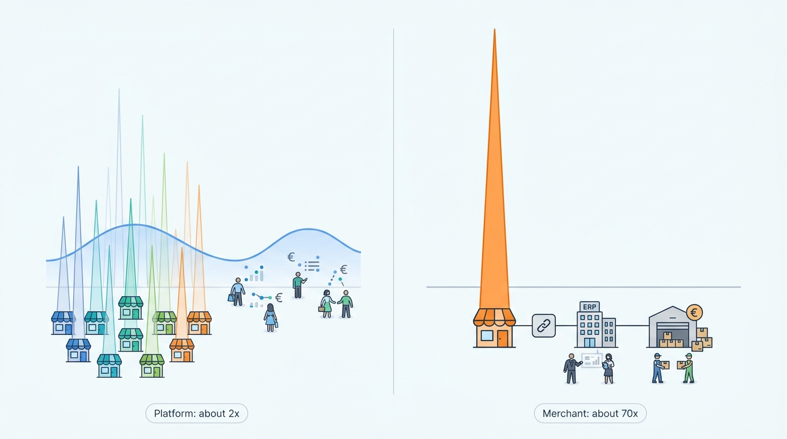
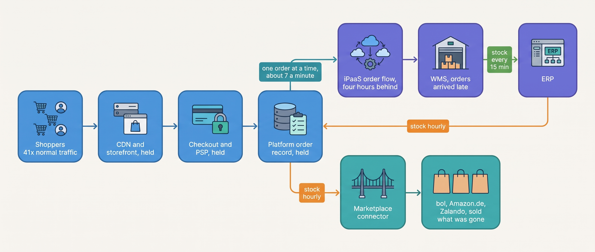
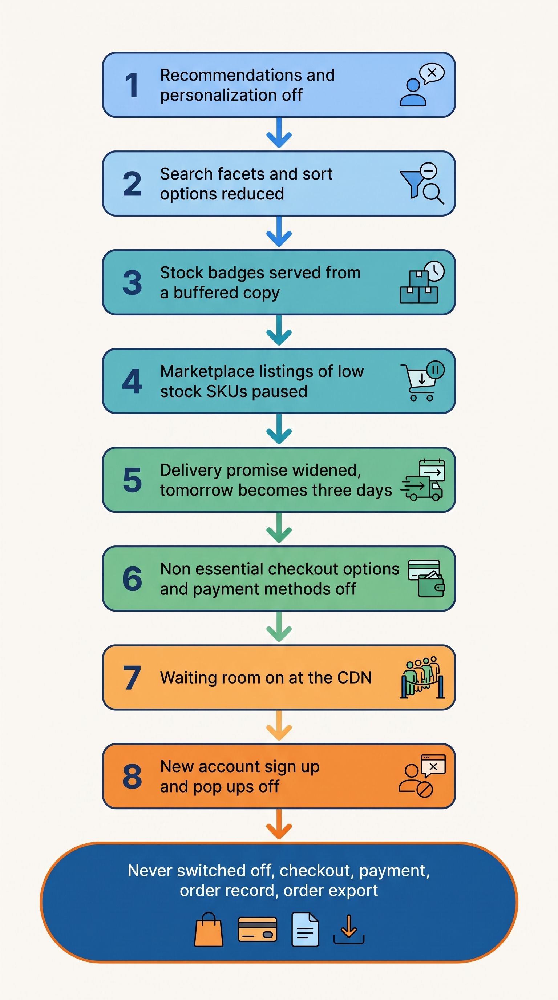
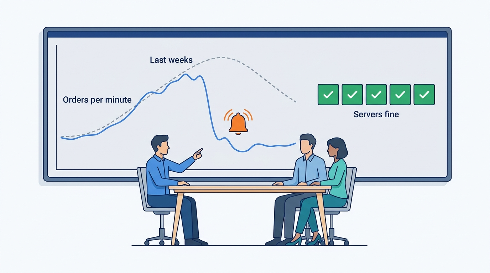

> **IN THIS CHAPTER, YOU WILL:** Learn how a peak day breaks a commerce chain, how to size, test, protect and observe that chain in orders per minute, and how to recover afterwards.

> **KEY POINTS:**
>
> * **The platform's peak is not your peak.** A hosted platform smooths thousands of merchants' spikes into a gentle curve; your own connectors, warehouse and finance systems see your spike alone. The storefront usually holds; the chain behind it is where the day is lost.
> * **Measure the whole chain in one unit, orders per minute, and protect it with queues and switches.** Every link gets a capacity figure, a load test and a place in a written switch-off order. Checkout, payment and the order record are never on that list; everything behind them may wait.
> * **Recovery is reconciliation.** A peak leaves orders accepted but not exported, stock sold twice and messages dropped in retries. The plan names, before the day, who compares which two systems the morning after and how the differences get fixed.

> **[FAILURE PATTERNS THIS CHAPTER ADDRESSES](where-commerce-platforms-go-wrong.html):**
>
> * **The First Snowfall** — the peak is the first time the integrations, not just the storefront, meet real load, and nobody has measured what they can carry.
> * **The Phantom Stock** — every sync interval that is harmless on a quiet day becomes, at forty times the pace, a window in which every channel sells the same last unit.
> * **The Message in a Bottle** — retries, throttles and timeouts at peak produce the duplicates and gaps that quiet days never show.

 
The previous chapter's storefront survives a peak hour because most of its pages can be cached. The chain behind it cannot be cached, and it meets the spike alone. Kestrel & Pine, the fictional outdoor brand, takes about **800 online orders on an ordinary day**, roughly 33 an hour. On Black Friday, it reaches **2,300 in one hour**. An integration that clears its queue between ordinary purchases can accumulate a backlog when that many orders arrive together. The store may look healthy while promised deliveries become impossible to meet. Order export, stock updates and picking each have their own capacity, even when the hosted storefront handles the traffic, and a slow step can produce an unavailable jacket sold, a late confirmation or a missed dispatch.

**Where we are in the order's journey.** Eva's April 2027 jacket order, the order this book follows, reached the warehouse within minutes on an ordinary evening, through the same chain that had failed in November 2026. Here we ask what happens when thousands of orders take that path in an hour. The steps stay the same; queues and delays become decisive.

In short: the shop platform shares its capacity across many merchants, so its storefront and checkout usually hold, while the merchant's own chain meets its spike alone and fails first. The rest of the chapter shows how to prepare that chain, with every link measured in **orders per minute**.

The chapter starts from Kestrel & Pine's Black Friday 2026 post-mortem, the written review of what went wrong. It then explains why the platform's peak is not the merchant's and where along the chain a peak day breaks. It follows the day in order: preparing the chain, running the peak, observing it and recovering afterwards, using dated figures and practices published by large operators such as Shopify, Zalando and Amazon. Last come the choices of how far to go, how they change with scale, and Kestrel & Pine's 2027 plan.

## Setting the Scene at Kestrel & Pine: Reading the Post-Mortem

In March 2027, Head of Engineering Noor Visser reads the post-mortem for **27 November 2026**. CEO Mara Lindqvist wants to know whether the next Black Friday will repeat it. The book calls this failure pattern **The First Snowfall**: discovering capacity limits on the day they matter most.

During **23–29 November 2026**, the storefronts took **31,000 orders**, 10.6% of the year's total. Friday's **20:00–21:00** hour brought **2,300 orders**, about **38 per minute**, with storefront traffic **41 times** an average hour and orders about seventy times (2,300 against 33). The platform handled checkout. The chain behind it accumulated these failures:

- The **stock sync chain** ran as it always ran. The WMS (warehouse management system, the software that runs the Duiven warehouse) reported stock to the ERP (enterprise resource planning system: the books, purchasing and the item master); the ERP copied it to the platform; the platform copied it to the marketplace connector, each copy on its own schedule. A sale at Duiven took **up to two hours** to reduce the stock shown anywhere else. The Ridgewalker jacket, the hero of the week's 20% outerwear promotion, sold out in the warehouse at **19:40**; the storefronts and marketplaces kept selling it for up to two hours. **1,340 units** were oversold and **1,120 orders** canceled or delayed, at a cost of about **€96,000** including goodwill vouchers and marketplace penalties.
- The **order flow to the warehouse**, a flow on the iPaaS (integration platform as a service, the hosted tool that runs the data flows between systems), created orders in the WMS one at a time, four API calls each, and was throttled by the WMS vendor's **rate limit** (the maximum number of calls a vendor lets one customer make in a time window). By 21:00 the backlog was **four hours** long; orders placed at 20:00 reached the warehouse after midnight, and the "ordered before 22:00, delivered tomorrow" promise on the Dutch storefront was broken for roughly 8,000 orders placed between 17:00 and midnight (a Kestrel & Pine figure from [[warehouse-and-fulfillment]]). The promise was a sentence on a page, not a computed figure.

The systems ran at their configured rates, but **nobody had compared those rates in orders per minute**. The team could not identify the slowest link or reduce work before it overwhelmed the next one. [[journey-peak-day]] gives the hour-by-hour account and 2027 plan; this chapter explains the design decisions.

## What a Peak Is, and Why the Merchant's Is Worse Than the Platform's

Comparing rates means knowing the load they must meet. A **peak** is a period, planned or not, in which traffic and orders are many times their normal level. Peaks have different shapes, and the shape decides what breaks.

| Peak profile | Shape | What it stresses most |
| --- | --- | --- |
| **Seasonal peak** (Black Friday, Singles' Day, pre-Christmas) | Days of elevated load with hour-long spikes; a known date | Everything in sequence: storefront, checkout, order export, warehouse, carriers, returns three weeks later |
| **Launch or drop** | Minutes of extreme load on one product at a known moment | Stock accuracy and fairness: one SKU (a sellable variant), thousands of buyers, a few hundred units |
| **Flash sale** | A short promotion concentrating demand on a few products | Checkout throughput, promotion rules, stock on the discounted items |
| **Unplanned moment** (a TV mention, a viral post) | No warning | Whatever has no headroom; usually the first integration |

The figures that circulate about peaks come from the largest operators, and they teach one lesson above all: **each reports in its own unit**. Alibaba's cloud arm reported **583,000 orders per second** 26 seconds after midnight on 11 November 2020, without defining "order" ([Alibaba Cloud, 2020](https://www.alibabacloud.com/press-room/magic-behind-the-worlds-largest-online-shopping-festival)). Zalando reported **7,200 orders per minute** at its 2019 Cyber Week peak ([Zalando Engineering, 2020](https://engineering.zalando.com/posts/2020/10/how-zalando-prepares-for-cyber-week.html); six years old, so historical). Shopify reported **$5.1 million of sales per minute** at 12:01 p.m. EST on Black Friday 2025 against a weekend total of **$14.6 billion**, with **489 million requests per minute at the edge** (the CDN servers near the shopper, explained below) and **117 million on its app servers**, all unaudited ([Shopify, December 2025](https://www.shopify.com/investors/press-releases/shopify-merchants-achieve-record-breaking-146-billion-black)). Adobe put US Cyber Monday 2024 at **$13.3 billion**, with **$15.8 million per minute** in the peak hours ([Adobe, December 2024](https://news.adobe.com/news/2024/12/120324-adi-cyber-monday-recap)). A merchant needs one unit that its whole chain can be measured in, and this chapter uses orders per minute throughout.

Two things in Shopify's figures matter more than their size. First, the ratio of edge to app-server requests, about **four to one**, means roughly three quarters of peak traffic was absorbed by the content delivery network (**CDN**, the layer of servers near the shopper that serves cached pages and images) before it reached application code. Second, the peak minute ($5.1 million) against the weekend average (about $2.7 million a minute over roughly 5,400 minutes) is a **peak-to-average ratio of about two**. The two ratios use different units and baselines, so the comparison is approximate; the gap between about two and about seventy is the point. Kestrel & Pine's ratio in orders was about **seventy** (2,300 in the peak hour against 33 in an average one). Its storefront traffic rose 41 times; the orders, which are the load the chain behind the storefront carries, rose about seventy times. That is the central fact of this chapter:

> **The platform's peak is not the merchant's peak.** A hosted platform serving a million merchants smooths their spikes into a curve. Each merchant's own connectors, ERP, WMS and warehouse staff see that merchant's spike, alone and in full.

**Figure 1:** *The platform's peak is not the merchant's peak: a hosted platform smooths a million merchants' spikes to a peak about twice its average, while Kestrel & Pine's own chain saw about seventy times an average hour.*

Multi-tenancy, one system shared by many merchants ([[multi-tenancy-and-isolation]]), gives the platform its smoothing; the merchant's chain gets none, and it is what this chapter sizes.

## The Chain Under Load: Where a Peak Day Breaks

A commerce chain is a sequence of handoffs, and a peak day runs down it from the front. The figure shows Kestrel & Pine's chain in November 2026 with the capacity each link turned out to have; the per-link figures are illustrative reconstructions consistent with Kestrel & Pine's recorded totals.

**Figure 2:** *Kestrel & Pine's chain on 27 November 2026: the vendor-hosted links at the front held at 38 orders a minute, the hand-built order flow behind them carried about seven, and the stock copied back around the loop was up to two hours old by the time the marketplaces saw it.*

**The storefront.** Catalog pages, images and scripts are mostly cacheable, and a hosted platform's CDN serves them without touching the application. This is why "the platform held" is the normal outcome at the Omnichannel stage and why the storefront is the wrong thing to worry about first. A **cache** is a stored copy served instead of recomputing or refetching. The peak tests the cache rule of [[storefront-architecture]]: cache the content; fetch price, stock and cart live. On a peak day the question is what not to cache: a cached product page is a gift; a cached stock figure is a Phantom Stock waiting to happen. My rule for the stock badge: below a low-stock threshold it may show "low stock" from a copy a few minutes old, but it never shows "in stock" from a copy older than the sales rate allows.

**Checkout and payment.** Checkout is the most protected part of any platform, because it is where the money is. The **PSP** (payment service provider, the company that takes the shopper's payment) has its own rate limits: Stripe's documentation asks merchants planning flash sales that may exceed them to tell support in advance ([Stripe, n.d., accessed November 2026](https://docs.stripe.com/rate-limits)). Shopify described in a 2018 changelog that under high sales volume "processing payments at checkout happens separately from creating orders", so the shopper finishes checkout at once and the order record and confirmation e-mail catch up afterwards ([Shopify changelog, November 2018](https://changelog.shopify.com/posts/faster-checkout-for-customers-during-flash-sales); eight years old, and today's "checkout throttle" is not publicly described). The idea transfers whatever platform you use: **take the money and the commitment fast; let the record-keeping queue.** [[cart-and-checkout]] and [[commerce-payments]] own the details.

**The order export.** Here the vendor-hosted part ends and the merchant's part begins. The order has to reach the WMS, usually through a connector or an iPaaS flow the merchant or its agency built. This link is almost always the first to fall over, for three reasons that compound: it processes orders one at a time with several API calls each; it runs under rate limits at both ends, the platform's (shared with every installed app, which are busiest when the store is) and the WMS vendor's; and it was tested, if at all, at the rate of an ordinary afternoon. Ruben Alves's API-budget analysis in [[multi-tenancy-and-isolation]] put numbers on it: the WMS vendor allows about 30 calls a minute per customer, and the flow made four calls per order, one order at a time, so it carried about seven orders a minute. A flow carrying seven orders a minute against 38 arriving builds a queue of 31 a minute, invisible unless someone built a gauge for it.

**The WMS and the people.** The warehouse system is usually a hosted product with capacity to spare; the constraint is pickers and carrier collections. [[warehouse-and-fulfillment]] owns this, and [[shipping-and-delivery]] owns the delivery promise, which in 2026 no system could withdraw when the warehouse fell behind.

**The stock loop.** Stock has to come back around the loop to every channel before the next sale. On a quiet day a two-hour loop sells nothing twice, because nothing sells out in two hours. On a peak day the loop is the oversell. [[inventory-and-availability]] owns **available-to-promise** (ATP: physical stock minus what is already promised) and the fix; here the point is that *every* sync interval is a peak-day risk in proportion to the sales rate.

**The ERP, the data warehouse (the analytics database) and the notifications** come last and can wait longest. An invoice posted at 03:00 instead of 21:00 costs nothing; a confirmation e-mail an hour late costs a support ticket. They are where queues should grow.

The requirements table sets out what each flow needs at peak: checkout, payment authorization and the order record never degrade, and everything behind them may wait; the latencies are the author's illustrative targets for an Omnichannel merchant.

| Flow | Freshness needed at peak | Consistency | Latency target *(assumption)* | If it cannot keep up |
| --- | --- | --- | --- | --- |
| Product page and search | Minutes (cached) | Eventual | Under 1 s | Serve cached; drop personalization |
| Stock shown on the product page | Minutes, with a buffer | Eventual, but bounded | Under 2 min from the WMS event | Hide the stock count; show "in stock / low stock" from a per-channel buffer |
| Checkout, payment authorization, order record | Immediate | Strong (one order, one payment) | Under 3 s | **Never degrade**; queue everything after it |
| Order to the WMS | Minutes | At-least-once, idempotent | Under 10 min from order to warehouse | Let the queue grow; widen the delivery promise |
| Stock from the WMS to every channel | Minutes | Eventual with a per-channel buffer | Under 2 min | Pause marketplace listings of low-stock SKUs |
| Notifications, ERP import, invoicing | Minutes to hours | At-least-once; daily batch for finance | Under 15 min for e-mails; overnight for the ERP | Delay; never duplicate |

## Preparing: Capacity, Forecasts and Load Tests

**Capacity planning** is deciding, before the day, how many orders a minute each link must carry and proving it can. The input is a forecast; the proof is a **load test**, deliberately sending realistic artificial traffic to find where the chain breaks before customers do.

The two best-documented programs are a platform's and a retailer's. Shopify's 2025 readiness post describes preparation that "started in March with capacity planning", five full-scale tests from April to October on production infrastructure at around **150% of the previous year's load**, scripted browse, cart and checkout flows with flash-sale bursts layered on top, and **Game Days** that injected faults into "critical journeys" (checkout, payment processing, order creation, fulfillment, search) and recorded the findings in a Resiliency Matrix of vulnerabilities, runbooks (written instructions for handling an incident) and recovery objectives. Early tests saw "checkout queues backed up", and adding authenticated checkout "exposed rate-limit paths that anonymous browsing never touches" ([Shopify Engineering, November 2025](https://shopify.engineering/bfcm-readiness-2025)). Its 2023 post explains why tests "bypass the CDN for a portion of the traffic": so that the origin (the platform's own servers behind the CDN), not the cache, is measured ([Shopify Engineering, January 2023](https://shopify.engineering/scale-performance-testing)).

Zalando load-tested its production website end to end in 2019 because team-level tests could not show whether the whole system held together: recorded shopper journeys were replayed to about **130,000 requests per second**, above the real Cyber Week peak, and broke on replay because sessions expired, items sold out and rate limiting blocked requests, which is itself a finding ([Zalando Engineering, April 2019](https://engineering.zalando.com/posts/2019/04/end-to-end-load-testing-zalandos-production-website.html); seven years old). Its 2020 retrospective adds the practice a merchant can copy most directly: **order-flow simulators that place test orders which fulfillment skips**, exercising inventory and payments without shipping anything (Zalando Engineering, 2020).

For a merchant on a hosted platform, the translation is short:

1. **Forecast in orders per minute**, from last year's peak hour and this year's promotion plan. One and a half times last year's peak is a defensible figure for a growing merchant; the forecast's owner is whoever owns the promotion calendar, because the promotion makes the peak.
2. **Test the journeys, not the servers.** Place marked orders at the forecast rate and watch them reach the WMS, the stock come back, the e-mails go out and the ERP import run. Mark the orders so the warehouse skips them and finance excludes them.
3. **Test the authenticated and integrated paths.** Logged-in wholesale accounts, the marketplace connector's order pull and every app that writes stock take API budget that anonymous browsing does not. This step tests the ranked list of budget spenders from [[multi-tenancy-and-isolation]] and the app audit from [[extensibility-and-app-ecosystems]].
4. **Rehearse failure on the money paths.** Switch off the WMS connector for thirty minutes in a test and see whether anyone notices and whether the held orders can be sent again (replayed) once it is back; have the PSP decline every tenth test payment; zero the stock feed. Each exercise finds a gap or proves a runbook.
5. **Fix the slowest link and repeat** until every link carries the forecast with headroom.

Beyond testing, a **freeze** (no new apps, theme edits, connector or configuration changes after a set date) is the cheapest reliability measure available, because the most common cause of a peak-day incident is a change made the week before.

## Running the Peak: Queues, Waiting Rooms and Switches

Preparation removes most surprises; it does not remove all of them. Three tools help with the surprises that are left: queues that let the chain's work wait, a waiting room that slows the storefront's own traffic, and switches that remove work.

### Queues and backpressure

A **queue** is a buffer in which work waits until the next system can take it. **Backpressure** is the discipline of letting a slow downstream system slow the producers, or letting work pile up in a queue, instead of failing the customer-facing step. The AWS Builders' Library states the principle: a system given more work than its resources support becomes slow and should "start rejecting excess requests so that it can focus on the requests it decides to let in"; what matters is **goodput**, "the subset of the throughput that is handled without errors" and fast enough to be useful ([AWS, December 2019](https://builder.aws.com/content/3Eun1EEyX6p2e3VYNyRLSJzLuMV/using-load-shedding-to-avoid-overload)).

In a commerce chain the principle has a specific shape. **Accept and persist the order fast; queue everything downstream**: the confirmation e-mail, the ERP export, the WMS release, the marketplace stock push. Zalando's 2015 practice of pausing non-essential asynchronous processing to protect order acceptance is this rule in production (Zalando Engineering, 2020). Kestrel & Pine's order flow *had* a queue in 2026, on the iPaaS; what it lacked was a gauge, an alarm, an owner and a plan for when the gauge rose. A queue nobody watches is a delay nobody announces.

Queues also create the duplicates and gaps of **The Message in a Bottle**. Delivery between systems is at-least-once: every message arrives, some more than once. A flow that times out and retries delivers the same order twice unless the receiver is **idempotent** (handling a repeated message has the same effect as handling it once), with the order number as the key. A message that fails every retry lands in a **dead-letter queue** (a holding queue for messages that could not be processed, so a person can look at them), which needs an alarm and an owner or it is a silent order-loss mechanism. [[events-consistency-and-reconciliation]] owns these mechanics.

### Waiting rooms

Queues protect the chain; the front door has its own tool. A **waiting room** is a virtual queue in front of the storefront that admits shoppers at a set rate when traffic exceeds a threshold. Cloudflare launched its Waiting Room in January 2021 after vaccine registration sites failed under demand; it is configured with a maximum number of active users, a rate of new users per minute and a session duration ([Cloudflare, January 2021](https://blog.cloudflare.com/cloudflare-waiting-room/); configuration reference accessed November 2026). Queue-it, a specialist vendor, redirects visitors only when traffic exceeds a set capacity and lets operators adjust the outflow during the event ([Queue-it, n.d., accessed November 2026](https://queue-it.com/how-does-queue-it-work/)). A waiting room converts an unknown spike into a known outflow rate. That is useful only if the merchant knows its end-to-end capacity in orders per minute, and it protects the storefront, not the chain: **it does nothing for an order export that carries seven orders a minute.** For a hosted-platform merchant it is a launch-day tool more than a Black Friday one, and its admission rate should be set from the slowest tested link, usually behind the platform.

### Graceful degradation and the switch-off order

Queues let work wait and a waiting room slows the front; when that is not enough, work has to be removed. **Graceful degradation** is switching off non-essential features in a planned order so the essential ones keep working. The mechanism is a **feature switch** (also called a feature flag or toggle: a setting that turns a behavior on or off at runtime without a deployment). Pete Hodgson's taxonomy calls the relevant kind **ops toggles** and notes that long-lived kill switches let operators "gracefully degrade non-vital system functionality" under high load ([Hodgson, martinfowler.com, October 2017](https://martinfowler.com/articles/feature-toggles.html)).

The documented case of degradation under fire is Amazon's Prime Day 2018, as reported by CNBC from internal documents: within fifteen minutes of the noon launch the site switched to a simplified fallback front page, at 12:15 international traffic was cut off to relieve a failing internal system, and at 12:37 the default page was restored for a quarter of traffic ([CNBC, July 2018](https://www.cnbc.com/2018/07/19/amazon-internal-documents-what-caused-prime-day-crash-company-scramble.html); a press account, eight years old). The fallback page and the traffic cut were switches that existed before the day. The team had somewhere to go.

A merchant's switch-off order is shorter. The figure gives the ladder I recommend for an Omnichannel merchant on a hosted platform, from the first rung to switch off to the last: recommendations and personalization, then search facets and sort options, stock badges served from a buffered copy, marketplace listings of low-stock SKUs paused, the delivery promise widened from tomorrow to three days, non-essential checkout options and single payment methods (one failing method at a time, never payment as a whole); then the waiting room is turned on at the CDN for the storefront's own load, and new-account sign-up and pop-ups are switched off. Checkout, payment, the order record and the order export are never switched off: the order export may fall behind and queue, but it keeps running; [[journey-peak-day]] gives Kestrel & Pine's 2027 version with owners and triggers.

**Figure 3:** *A degradation ladder for a hosted-platform merchant: each rung removes load or risk while keeping the promise that matters, and the bottom rung names what is never switched off.*

Three rules make a ladder work: every switch has been flipped in a test before November, because a switch that has never been used is a hope; every switch has one named owner who may flip it without a meeting; and the order is decided in a calm month by the people who own the revenue, not in the peak hour by whoever is on call.

## Observing the Day: Orders per Minute as the Health Signal

While the mechanisms run, someone has to see whether orders still flow. Server metrics tell you that the servers are fine; in 2026 every server in Kestrel & Pine's chain was fine while the business lost €96,000. **The health signal for a commerce platform is orders per minute**, plotted against the same weekday and hour of recent weeks, with a sustained drop as the alarm. The operators of the largest peaks report their health in business units (orders per second at Alibaba, orders per minute at Zalando, checkouts and sales per minute at Shopify), and a merchant should do the same.

**Figure 4:** *The health signal is orders per minute against the same weekday and hour of recent weeks: in 2026 every server in the chain was fine while the business lost €96,000.*

I would organize the peak dashboard around **traffic, latency, errors and saturation**, Google's four monitoring signals, applied to each business flow ([Google, 2017](https://sre.google/sre-book/monitoring-distributed-systems/)). For order export, show incoming orders per minute, the oldest unprocessed order, failed deliveries and remaining API capacity. For stock, show event rate and lag. For payment, show authorization time and decline rate against normal.

On that dashboard, the alarms that matter most are **queue age and spare capacity, which expose trouble before customers do.** Payment declines reveal failures a healthy server cannot explain, and a flow whose events stop arriving while the shop remains busy needs its own alert, because a silent flow can look deceptively healthy.

Targets belong in business units too. Google's SRE book defines a **service level objective** (SLO) as a target value for a measured aspect of service ([Google, 2017](https://sre.google/sre-book/service-level-objectives/)); a merchant's peak SLOs are checkout success rate, order-confirmation latency, time from order to WMS release and stock lag to marketplaces. The vendors' service agreements cover their own uptime; **the merchant's integration SLOs are nobody else's.**

The signals and targets need people who act on them. Shopify and Zalando, the two documented programs, both staff a room through the peak: Zalando's Situation Room with incident commanders (2020), Shopify's round-the-clock incident coverage (2025). A merchant's version fits six people in one room, but needs the same elements: an **incident commander** who decides, one person per link, the vendors' emergency contacts, a **runbook** (a written list of symptoms, checks and actions, including which switch to flip and who may flip it) and a communication plan. The runbook is written in September and rehearsed in November; a runbook written during the incident is a diary.

## When It Goes Wrong: Recovery and Reconciliation

Preparation, the mechanisms and a watched dashboard reduce incidents; they do not eliminate them. What distinguishes a prepared merchant is that it knows, before the day, what each failure leaves behind and how to clean it up.

| Failure at peak | What it leaves behind | Detection | Recovery |
| --- | --- | --- | --- |
| Order export falls behind | Orders in the platform not yet in the WMS; a broken delivery promise | Queue depth; order-to-WMS lag alarm | Let the queue drain; widen the promise; notify customers once |
| Connector retries after timeouts | The same order twice in the WMS; two parcels | Duplicate check on the order number; the morning reconciliation | An idempotent receiver prevents it; otherwise cancel the duplicate before picking |
| Messages exhaust their retries | Orders in the dead-letter queue, invisible to the warehouse | Dead-letter alarm | Replay after the cause is fixed; confirm each order arrived once |
| Stock copy stale | Units sold in several channels | Orders for a SKU above available stock | Pause listings; allocate what exists to the earliest orders; cancel or delay the rest with a voucher |
| PSP degraded or one method failing | Declines rising; carts abandoned | Decline rate vs. normal | Switch the method off; confirm every captured payment has an order |

Recovery after a peak is **reconciliation**: comparing two systems' records and fixing the differences. The platform's own documentation makes the case: Shopify tells apps that "webhook delivery isn't always guaranteed" and to run reconciliation jobs that periodically fetch changed data ([Shopify developer docs, accessed November 2026](https://shopify.dev/docs/apps/build/webhooks)). The morning-after report compares orders across systems by order number, stock per SKU between the WMS and the availability service, and payments captured against orders; the owner of each difference is named in the plan, not found on the day. [[events-consistency-and-reconciliation]] owns the reconciliation card.

The last step is the **post-mortem**, written within two weeks, blameless (looking for causes, not culprits), with the timeline in orders per minute and every action assigned. Kestrel & Pine's became the Waypoint proposal, the 2027 architecture plan whose decisions W1 to W8 this book follows; a post-mortem that becomes nothing is the surest predictor of the same incident next year.

## The Choices and Their Trade-offs

How much of all this a merchant takes on is a choice. Peak preparation has four levels, each adding responsibility:

- **Trust the platform:** reasonable for a small merchant whose hosted platform and logistics provider handle the full path, until custom integrations appear.
- **Protect the front door:** add caching, traffic controls such as a waiting room, or a higher service tier for concentrated launches.
- **Protect the chain:** measure every link in orders per minute, test integrations, monitor queues and define which work to pause. Kestrel & Pine adopts this for 2027.
- **Operate the platform yourself:** take responsibility for the broader capacity and fault-testing program described by companies such as Shopify and Zalando.

Choose the level that protects the order path you actually operate. If the warehouse connector is the bottleneck, a faster storefront will only feed its queue more quickly. Additional controls need a team that can maintain them; otherwise the apparent protection can disappear as systems change. The table compares the four levels by what each protects, what it costs and when it fails.

| | Trust the platform | Protect the front door | Protect the chain | Operate the platform yourself |
| --- | --- | --- | --- | --- |
| **What it protects** | Nothing beyond the vendor's own uptime | The storefront and checkout | Every link from order to warehouse and back | Everything, including the platform itself |
| **Cost** | None | Low: CDN, waiting room, a tier upgrade | Months of integration work, test tooling, one owner's time | A platform team and a year of calendar |
| **Fails when** | The first connector exists | The order export is the bottleneck | Nobody owns it after the first year | Copied by a merchant a hundred times smaller (The Giant's Boots, the book's name for copying a much larger company's practice) |

My recommendation for a merchant with its own warehouse and more than one channel is the third level, with one addition: **the peak plan has a named owner all year**, not a project team that disbands in December. It does not hold for a merchant whose peak is under five times its normal hour (ordinary reliability work is enough) or whose integrations are all vendor-built and vendor-tested, which is rare.

## Across Scale Stages: When It Fits and When It Limits

The four levels roughly follow the four scale stages: trust the platform at Starting, protect the front door when Growing with launch-driven peaks, protect the chain at Omnichannel, and operate the platform yourself at Group or as a platform vendor. The table shows what each stage needs.

| Stage | What is typical | What becomes necessary | Warning signs of outgrowing it |
| --- | --- | --- | --- |
| **1 — Starting** (one channel, hosted platform, a 3PL) | The platform's peak is not yours; the 3PL's cut-off and the PSP's limits are the real risks | Know the 3PL's peak capacity and cut-off; confirm the PSP's limits; a promotion calendar | The first hand-built connector; a launch that sells more than the 3PL can ship in a day |
| **2 — Growing** (two or three channels, an ERP link, a marketplace) | The first integrations are the first bottlenecks; peaks found by surprise; the agency on the phone | Test the order export at ten times normal; a queue between the platform and the ERP; a written switch-off list; marked test orders | A sync interval that oversells; a queue nobody can see; a peak that the agency, not the merchant, runs |
| **3 — Omnichannel** (stores, wholesale, marketplaces, own warehouse) | Kestrel & Pine in 2026: the storefront holds and the chain behind it fails in sequence; marketplaces and store stock are hit too | A peak plan with a named owner; capacity per link in orders per minute; integration load tests; gauged queues with dead-letter alarms; the degradation ladder with owners; a situation room; a reconciliation owner | Vendors' service level agreements (SLAs) quoted as the merchant's SLOs; the same post-mortem two years running; an OMS (order management system) or availability service bought but not load-tested before November |
| **4 — Group** (several brands or countries, platform teams) | Shared peak tooling across brands; some brands on different platforms; a group calendar | Shared load tests, dashboards and runbooks; vendor SLAs read against group SLOs; failover decisions; a platform team that owns the year-round plan | One brand's flash sale starving another's order export on a shared connector; peak readiness that depends on one engineer |

The judgement: the practices grow with the stage, but what changes most is who owns them. At Starting and Growing a peak plan is a checklist the founder or the agency runs; at Omnichannel it is a program with a name, a budget line and an owner who does nothing else in October and November; at Group it is a platform team's product. Kestrel & Pine ran its 2026 peak with a Growing-stage plan (the agency watching the storefront) for an Omnichannel-stage chain.

## In Practice: Kestrel & Pine's 2027 Peak Plan

Noor's answer to Mara's question was a plan built from the dated practices above, approved with Waypoint in March 2027 and worked out in full in [[journey-peak-day]]. Its spine, with the figures the plan commits to (all fictional):

- **One unit and one forecast.** Every link is measured in orders per minute. The forecast for Black Friday 2027 is **60 orders a minute** in the peak hour, about one and a half times 2026, and every link is tested at **80**.
- **The order path rebuilt.** By the peak, marketplace orders (since 15 September 2027) and direct-to-consumer (D2C) orders (since 13 October) are created in the new OMS (Waypoint W2), which sends fulfillment orders to the WMS in batches within its rate limit, with the order number as the idempotency key, a gauge on the age of the oldest unsent order, an alarm at ten minutes and a dead-letter queue with an owner. This link is tested at 120 orders a minute, above the 80 for the rest of the chain, with marked orders that the WMS skips.
- **The stock loop replaced**: the availability service, a module of the OMS (W1), computes available-to-promise per channel from WMS stock events within a minute, with a buffer per channel. Go/no-go for the peak: **15 October 2027**; if it is not ready, the old chain runs with the interim buffer that has held back ten units of each variant from the marketplaces since December 2026.
- **A degradation ladder** of eight switches, each with an owner and a trigger, rehearsed in October.
- **A freeze** on apps, theme, connector and OMS changes from **15 November to 5 December 2027**, after the app audit of [[extensibility-and-app-ecosystems]] removed the six unused apps and left the WMS feed as the only writer of stock, with no app writing it.
- **A situation room** on Friday 26 November from 16:00 to midnight with Noor as incident commander, and a **reconciliation report** at 08:00 on Saturday comparing orders in the platform, the OMS and the WMS, stock in the WMS and the availability service, and payments captured against orders.
- **Deliberately after the peak**: wholesale orders by EDI (electronic data interchange, the structured order messages a retail chain sends) and by hand move to the OMS on 8 December. Nothing that has not run through a load test goes live in November.

The plan costs about four months of one integration engineer's time, a load-testing tool and Noor's October and November. Against €96,000 in one evening, Mara approved it in twenty minutes.

## What to Take Away

Kestrel & Pine's store, which takes about 33 orders in an ordinary hour, looked healthy at 2,300 in one hour because the shop platform shares its capacity across many merchants and serves most pages from its CDN; the order flow, the stock loop and the warehouse took the 2,300 orders alone. The answer to Mara's question is therefore not a faster storefront. It is every link measured and tested in orders per minute, the work behind checkout queued with gauges on the queues, a switch-off order that never touches checkout, payment or the order record, and a named owner for the morning-after reconciliation.

**Established.**

- A hosted platform's multi-tenancy smooths its peak to roughly twice its average (Shopify's 2025 figures), while a single merchant's chain sees that merchant's full spike; the storefront is the link most likely to hold and the integrations the links most likely to fail (Shopify 2025, Zalando 2020).
- Preparation at the documented operators follows one shape: forecast, scale tests at forecast load that bypass caches and include checkout and authenticated paths, fault injection on the money paths, a freeze, a staffed room and a runbook (Shopify 2023 and 2025, Zalando 2019 and 2020).
- Under overload, persisting the customer-facing commitment fast and queuing everything behind it preserves goodput (AWS 2019); planned degradation through ops toggles keeps the essential path alive (Hodgson 2017); and because delivery between systems is at-least-once, a peak's retries produce duplicates and gaps unless receivers are idempotent and a reconciliation runs afterwards (Shopify and Stripe documentation, 2026).

**Depends on context.**

- A waiting room pays off for launches and flash sales where the storefront is the bottleneck and the admission rate can be set from a known end-to-end capacity; for a hosted-platform merchant whose bottleneck is the order export it adds little.
- One and a half times last year's peak is a reasonable forecast for a growing merchant with a stable promotion plan; a merchant adding a marketplace, a country or a television campaign should forecast from the plan, not the history.
- The full readiness calendar belongs to platform owners and Group-stage merchants; an Omnichannel merchant that copies it wears the Giant's Boots, and one that skips its integration half meets the First Snowfall.

**The author's synthesis.**

- Measure the whole chain in orders per minute, because it is the only unit that every link, every vendor and every executive can read, and the only one in which the slowest link is visible before the day.
- The peak plan is a year-round product with one owner, not a November project; the switch-off ladder is written by the people who own the revenue, in a calm month, and the engineers' job is to make sure every rung exists and has been flipped once before it matters.

## Questions to Ask

1. What was our peak hour last year, in orders per minute, and what is the forecast for this year? Who owns that forecast?
2. For each link from checkout to warehouse and back, what is its tested capacity in orders per minute, and when was it last tested at that rate?
3. Which apps and connectors share the platform's API budget, and what are the WMS's and the PSP's rate limits?
4. Where are the queues in our chain, who can see their depth, and what happens to a message that fails every retry?
5. What is our switch-off order, who owns each switch, and when was each last flipped?
6. Can we withdraw the delivery promise on the page when the warehouse falls behind, and who decides?
7. Does the dashboard show orders per minute against last week, order-to-warehouse lag and payment decline rate, and who is the incident commander on the day?
8. The morning after, which two systems do we compare, by which key, and who fixes the differences? When is this year's freeze?

## Closing Part VII

This chapter closes Part VII. The part opened with a hosted platform that kept accepting orders while the merchant's warehouse connector fell behind. Its five chapters each started from a Kestrel & Pine case: a composable rebuild proposed for about €3.2 million ([[commerce-architecture-styles]]); an order flow throttled at both ends, by the platform's API budget and by the WMS vendor's ([[multi-tenancy-and-isolation]]); 41 apps, three of them writing stock ([[extensibility-and-app-ecosystems]]); product pages that took 310 ms to respond to a tap ([[storefront-architecture]]); and, in this chapter, an order flow carrying seven orders a minute against 38. They look like five questions about the platform: its architecture style, its tenancy, its extensibility, its renderer and its capacity. They have one answer. In each case the platform's inside did what its vendor designed, and the promise broke in what Kestrel & Pine owned around it: integration code with no rule, a budget nobody had ranked, apps with no owner, scripts with no budget, and a chain nobody had measured in orders per minute.

Kestrel & Pine therefore stayed on the shop platform (W4, stay and surround) and spent on its own layer. Its own code went into one integration service with a module per flow. The order flow came first in the API budget, with orders sent to the WMS in batches within its limit. Every app got an owner and an app governance card; 34 apps remained by July 2027, and none writes stock. A theme performance pass brought the delay to a tap down to 180 ms by June 2027. The 2027 peak plan tests every link at 80 orders a minute, with eight switches that have owners and a reconciliation report at 08:00 on Saturday 27 November.

A reader can audit their own platform the same way. For the platform you rent, list what you own around it: your deployables (the programs you build and release separately) and the teams that release them, the spenders of each API budget in order of priority, each app's owner, scopes and the facts it writes, the scripts on your product pages against a performance budget, and the tested capacity of every link in orders per minute. Start with the link that carried least on your last peak.

Part VII has shown the platform's structure and the limits it sets: the vendor's inside, the budgets it meters, the extension points it retires and the checkout the merchant cannot replace, and the layer the merchant owns around them. That same layer must also keep promises the merchant does not choose. Attackers try stolen cards on its checkout and look for its integration keys; privacy law gives every customer rights over the data its systems hold; regulation sets duties with dates. The next part begins there: [[part-8]], starting with [[commerce-security]].

## Sources and Evidence

*Company, product and investor sources*

- [Shopify merchants achieve record-breaking $14.6 billion in Black Friday Cyber Monday sales](https://www.shopify.com/investors/press-releases/shopify-merchants-achieve-record-breaking-146-billion-black), Shopify investor press release, 2025 — BFCM 2025 sales, peak sales per minute, edge, app-server and API requests per minute, and the unaudited caveat.
- [Black Friday Cyber Monday 2025 data](https://www.shopify.com/news/bfcm-data-2025), Shopify News, 2025 — the same figures with the GMV definition and the methodology caveat.
- [Black Friday Cyber Monday 2024 data](https://www.shopify.com/news/bfcm-data-2024), Shopify News, 2024 — BFCM 2024 load figures for comparison.
- [How we prepare Shopify for BFCM](https://shopify.engineering/bfcm-readiness-2025), Shopify Engineering, 2025 — capacity planning from March, five scale tests, Game Days, the Resiliency Matrix, checkout queues backing up in early tests, rate-limit paths found by authenticated checkout.
- [Scale and performance testing at Shopify](https://shopify.engineering/scale-performance-testing), Shopify Engineering, 2023 — full-scale testing with CDN bypass and cache-busting, and the abort switch.
- [Faster checkout for customers during flash sales](https://changelog.shopify.com/posts/faster-checkout-for-customers-during-flash-sales), Shopify Changelog, 2018 — payment processing separated from order creation under high volume (eight years old).
- [Storefront API reference](https://shopify.dev/docs/api/storefront), Shopify developer documentation, n.d., accessed 2026-11 — the present-day checkout throttle.
- [Webhooks](https://shopify.dev/docs/apps/build/webhooks), Shopify developer documentation, n.d., accessed 2026-11 — delivery not guaranteed; reconciliation jobs recommended.
- [Rate limits](https://docs.stripe.com/rate-limits), Stripe documentation, n.d., accessed 2026-11 — per-account limits, backoff with jitter, and the advice to announce flash sales.
- [End-to-end load testing Zalando's production website](https://engineering.zalando.com/posts/2019/04/end-to-end-load-testing-zalandos-production-website.html), Zalando Engineering, 2019 — recorded journeys replayed at 130,000 requests per second; situation rooms; what broke on replay (seven years old).
- [How Zalando prepares for Cyber Week](https://engineering.zalando.com/posts/2020/10/how-zalando-prepares-for-cyber-week.html), Zalando Engineering, 2020 — 7,200 orders per minute in 2019, production-readiness reviews, test orders that fulfillment skips, pausing non-essential processing, the Situation Room (six years old).
- [The magic behind the world's largest online shopping festival](https://www.alibabacloud.com/press-room/magic-behind-the-worlds-largest-online-shopping-festival), Alibaba Cloud, 2020 — 583,000 orders per second at the 2020 peak, "orders" undefined.
- [Adobe: Cyber Monday 2024 recap](https://news.adobe.com/news/2024/12/120324-adi-cyber-monday-recap), Adobe, 2024 — $13.3 billion and $15.8 million per minute in the peak hours.
- [Amazon internal documents: what caused the Prime Day crash](https://www.cnbc.com/2018/07/19/amazon-internal-documents-what-caused-prime-day-crash-company-scramble.html), CNBC, 2018 — the fallback front page and the international traffic cut (a press account, eight years old).
- [Cloudflare Waiting Room](https://blog.cloudflare.com/cloudflare-waiting-room/), Cloudflare, 2021, and [Waiting Room configuration settings](https://developers.cloudflare.com/waiting-room/reference/configuration-settings/), Cloudflare Docs, n.d., accessed 2026-11 — what a waiting room is and how it is configured.
- [How does Queue-it work](https://queue-it.com/how-does-queue-it-work/), Queue-it, n.d., accessed 2026-11 — threshold-triggered virtual queues with adjustable outflow.

*Standards, regulation and official documentation*

- [Using load shedding to avoid overload](https://builder.aws.com/content/3Eun1EEyX6p2e3VYNyRLSJzLuMV/using-load-shedding-to-avoid-overload), AWS Builders' Library, 2019 — overload, goodput and prioritizing requests.
- [Service Level Objectives](https://sre.google/sre-book/service-level-objectives/) and [Monitoring Distributed Systems](https://sre.google/sre-book/monitoring-distributed-systems/), Google SRE book, 2017 — SLI, SLO, error budget and the four golden signals.
- [Amazon SQS dead-letter queues](https://docs.aws.amazon.com/AWSSimpleQueueService/latest/SQSDeveloperGuide/sqs-dead-letter-queues.html), AWS documentation, n.d., accessed 2026-11 — what a dead-letter queue is and how messages are redriven.
- [Exponential backoff and jitter](https://aws.amazon.com/blogs/architecture/exponential-backoff-and-jitter/), AWS Architecture Blog, 2015 — why retries need randomness.

*Research and practitioner sources*

- [Feature Toggles (aka Feature Flags)](https://martinfowler.com/articles/feature-toggles.html), Pete Hodgson, martinfowler.com, 2017 — the toggle taxonomy and ops toggles as kill switches for graceful degradation.
- [Starbucks Does Not Use Two-Phase Commit](https://www.enterpriseintegrationpatterns.com/ramblings/18_starbucks.html), Gregor Hohpe, 2004 — accept the order fast and let the work queue; write-off, retry and compensation as the error strategies.

Kestrel & Pine is fictional; architectural recommendations, labeled inferences and labeled assumptions are the author's judgement.
