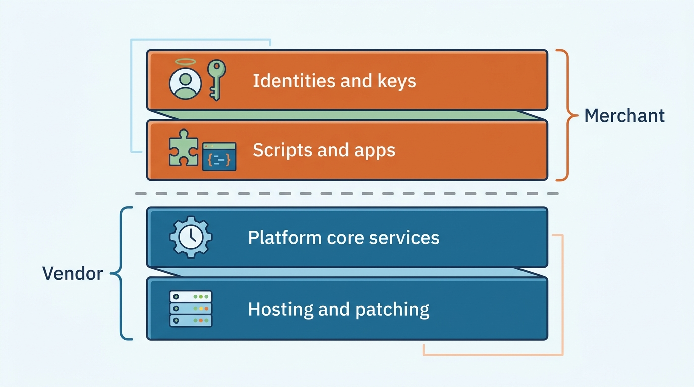
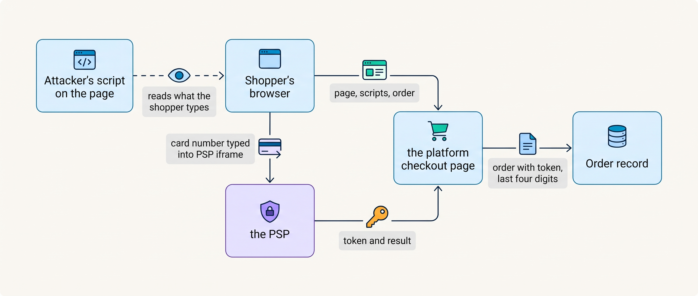
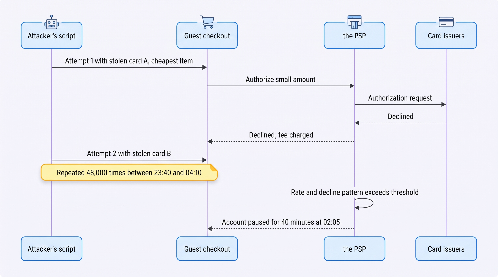
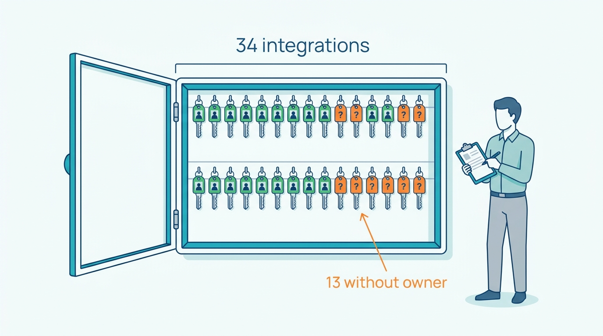

> **IN THIS CHAPTER, YOU WILL:** Learn what attackers take from a shop, where the card-data standard draws its line, which controls stop card testing, takeover and skimming, and what stays your job on a hosted platform.

> **KEY POINTS:**
>
> * **Attackers do not break in; they use the shop as built.** Card testing, credential stuffing, coupon abuse and inventory hoarding are the payment form, the login, the promotion engine and the cart used at machine speed. The control is to make every endpoint that can trigger a payment or a login authenticated, rate-limited and challengeable, and to watch the decline rate as closely as the order rate.
> * **Keep the card number out of your systems, and own everything around the box that takes it.** With a hosted checkout or hosted fields the card number never touches your code and the lightest self-assessment under PCI DSS, the card industry's security standard, applies. Since 31 March 2025 the standard's script requirements (6.4.3 and 11.6.1) make the scripts on the payment page yours to know: even on the lightest questionnaire you must state that your page cannot be skimmed, because skimmers run in the shopper's browser on a page you serve.
> * **The platform secures the platform; you secure the identities.** Every vendor's shared-responsibility statement draws the same line: the vendor patches and certifies the service; the merchant owns admin accounts, API keys, apps, scripts and integrations. An integration without its own identity and a least-privilege key is the Secret Agent waiting for a leak.

> **[FAILURE PATTERNS THIS CHAPTER ADDRESSES](where-commerce-platforms-go-wrong.html):**
>
> * **The Secret Agent** — a script, app or integration that can change orders, prices, stock or money without its own identity cannot be traced when its key leaks, and a leaked key is the attacker's favorite entry.
> * **The Lynchpin** — one shared admin password, one payment account and one person who knows where the keys are is a security architecture that fails in a single step.
> * **The Spaghetti Junction** — thirty-four integrations (hosted integration flows, agency scripts and vendor connectors) each hold a credential, and when 13 of them have no named owner, as at Kestrel & Pine in January 2027, those are doors with no record of who holds the key.

 
A checkout must accept payment attempts from strangers. An attacker can use that same behavior to test stolen card details, while automated logins can try stolen passwords and bot carts can reserve stock. The shop may process these requests exactly as designed. Security must distinguish a legitimate purchase from misuse of the same functions, as well as prevent unauthorized access.

The damage appears as fees for declined payments, a paused payment account, stolen customer access or stock held in bot carts. Malicious checkout scripts can also steal card details. The British Airways case, a 2018 breach followed by a £20 million penalty in 2020 and described later in this chapter, shows the consequences of that browser-side exposure.

Much of that damage stays the merchant's to prevent even when it rents its platform. Its security work begins with the responsibilities it still holds: access, integrations, custom scripts and abuse controls. This chapter covers payment-page exposure, card testing and account takeover. [[privacy-and-customer-data]] covers personal data, [[commerce-regulation]] the wider rules and [[fraud-prevention]] fraud models.

**Where we are in the order's journey.** Eva buys a jacket at Kestrel & Pine, the fictional outdoor brand, in April 2027 using iDEAL, a Dutch bank-transfer method. Eight months earlier, in August 2026, the same checkout received 48,000 abusive attempts in one night. This chapter examines how to distinguish legitimate purchases from automated misuse.

The chapter opens on that night and on the question Noor Visser, Kestrel & Pine's Head of Engineering, drew from it: which doors are open to a script, and who holds the key to each. It then ranks what attackers want from a shop, draws the line between what the platform vendor secures and what the merchant must, and places the checkout on the card-data standard's table, then describes the skimmers that the standard's script rules were written for. Next it takes the attacks that use the shop's own doors one at a time: card testing, account takeover and bots, and admin accounts and keys. It sets out what each control on the request path must meet, compares four security postures and how they fit each scale stage, and ends with Kestrel & Pine's 2027 security baseline and what to do when an attack succeeds.

## Setting the Scene at Kestrel & Pine: The Card-Testing Night

Kestrel & Pine's **Card-Testing Night** runs from **18 to 19 August 2026**. Its figures belong to the fictional scenario; the mechanism below is an illustrative reconstruction.

Between about 23:40 and 04:10, a script makes **48,000 guest-checkout attempts**, using stolen card numbers and the cheapest catalog item. Its purpose is to discover which cards still work. This is **card testing**, or carding.

The Open Worldwide Application Security Project (**OWASP**) lists this automated abuse as OAT-001 in its Automated Threats project (undated guidance, accessed November 2026). A payment form that works as designed becomes a free testing service for attackers.

Three things happened that the shop was not built to notice.

- The **PSP** (payment service provider: the company that takes the shopper's payment and settles the money to the merchant) charged a fee for every authorization request, declined or not: **€2,900** on the September statement for sales that never happened.
- At **02:05** the PSP's own monitoring saw an authorization rate and a decline rate it had never seen from this account and **paused the account for 40 minutes**. For 40 minutes nobody could pay by card on any storefront, and the e-mail that said so went to a shared mailbox nobody read until 07:30.
- About **260** of the 48,000 cards were live (illustrative). The shop platform created real orders for them, which Milan Petrov, who owns the storefronts, canceled and refunded by hand; **21** came back as disputes, and the share of genuine card payments declined by issuers rose from about 4% to about 7% for two weeks, because issuers had seen a burst of fraud from this merchant (illustrative; Stripe's card-testing documentation describes the mechanism, n.d., accessed November 2026).

Most attempts used cards issued outside Europe (illustrative), where **strong customer authentication** (SCA, the European rule that a shopper must prove their identity at payment, which for cards runs through 3-D Secure, the check in which the issuer asks the shopper to confirm; [[commerce-payments]]) does not bind the issuer, so the usual challenge never fired. The agency switched on the shop platform's bot protection and the PSP's velocity rules (limits on attempts per card, address and hour) that week; no runbook was written. Those were fixes for one attack, not an answer to what the night had shown. In March 2027 Noor Visser, Head of Engineering since January, reads the incident report for the Waypoint program and asks a different question: **not "how do we stop card testing", but "which of our doors are open to a script, and who holds the key to each".**

## What Attackers Want From a Shop

Noor's question asks about every door, not only the checkout, and on most shops many of the visitors at those doors are programs: vendor reports put automated traffic at about half of all web requests (Imperva, 2025, measuring its own customers). The table lists the threats in roughly the attacker's order of preference (how often each is tried, not how much damage it does), with the OWASP Automated Threat identifier where one exists (OWASP, n.d., accessed November 2026).

| Threat | What it is, in plain words | Who loses | Where the control lives |
| --- | --- | --- | --- |
| **Card testing** (OAT-001; OAT-010 when the expiry or security code is guessed) | Many small payments or card-save attempts to find which stolen cards work | The merchant: fees, disputes, a paused account, a worse decline rate for months | Checkout, PSP rules, rate limits, challenges |
| **Credential stuffing** (OAT-008) and **account takeover** | Password pairs leaked from one site tried on yours at machine speed; any route that ends with an attacker logged in as a customer or employee | The customer: saved addresses and cards; the merchant: refunds and trust | Login, multi-factor authentication (MFA), bot management (an edge service that tells people from bots) |
| **Web skimming** (Magecart, the name given to the groups behind many such attacks) | Malicious script on the checkout page that copies what the shopper types into the card fields | Every shopper who paid; then the merchant, through penalties and reputation | The scripts on the payment page: inventory, policy, tamper detection |
| **Coupon abuse** (OAT-002) | Guessing or sharing codes; stacking; one-time codes used many times | Margin | The promotion engine ([[commerce-promotions]]) |
| **Refund and returns abuse** | Refunds to a different card, empty-box returns, serial "not received" claims | Margin and stock | The returns and order systems ([[returns-and-exchanges]]) |
| **Inventory hoarding and scalping** (OAT-021, OAT-005) | Bots fill carts to hold stock during a launch, or buy it all to resell | Real customers, then the brand | Cart reservation rules ([[inventory-and-availability]]), bot management |
| **Admin compromise** | An attacker with a staff login or a leaked API key: payout account changed, scripts added, customers exported | Everything | Identity: MFA, least privilege, key management |
| **Supply-chain risk** | An app, plugin, theme or hosted script that is compromised and runs with your privileges | Everything the app could touch | App governance ([[extensibility-and-app-ecosystems]]), script policy, patch cadence |

The rows differ most in where their control lives. The last two bypass every other control: a compromised script on the payment page does not need to beat the PSP, and an attacker with the admin password does not need to guess. Three rows, coupon abuse, refund abuse and inventory hoarding, are not intrusions but **policy abuse** of the shop's own rules, whose controls live in the promotion, returns, order and cart systems; a bot-management product helps only where the abuse is automated. **On most shops a large part of the requests are not people**, but a control at the edge cannot tell which requests break a business rule.

The policy-abuse rows need controls in the money flows, because no edge control sees them. Refund only to the original payment method; inspect before refunding above a threshold; bind one-time codes to a customer; give the returns portal a refund-only key. The Double Refund of January 2027 ([[returns-and-exchanges]]), when support agents and the returns portal both refunded the same returns, taught the same lesson from the inside: each kind of money movement needs one system that makes it.

## Shared Responsibility: What the Platform Does and What You Must Do

Some of those controls come with a hosted platform, and many do not. Buying a hosted platform divides security work between vendor and merchant. The vendor can secure its infrastructure while an unsafe app, exposed key or poorly managed staff account still creates a route into the shop.

The line between what the vendor does and what the merchant does is published. Adobe's shared-responsibility model for Adobe Commerce on cloud infrastructure (n.d., accessed November 2026) is the most explicit: Adobe maintains the core code, the operating system, global firewall rules and PCI certification for the infrastructure; the merchant secures "custom code and integrations with third-party applications", applies patches, manages user access and handles its own incidents.

Shopify states that it is "certified Level 1 PCI DSS compliant" (PCI DSS is the card-data security standard of the next section; Level 1 is its tier for the largest card volumes) and that the certification "extends by default to all stores powered by Shopify", while adding that "there are also steps you will need to take on your own" (Shopify, n.d., accessed November 2026).

Stripe says the same about payments: "PCI compliance is a shared responsibility and applies to both Stripe and your business" (Stripe, n.d., accessed November 2026).

Read together: the vendor covers the service's code, hosting, patching and certification and the built-in tools with their defaults; the merchant covers the code, scripts and apps it adds, who holds an admin account and whether MFA is enforced, which API keys exist, and incident response for the shop. **The hosted platform removes the patching burden. It never removes the identity, script and endpoint burden**, which is the rest of this chapter.

**Figure 1:** *The hosted platform removes the patching burden; the identities, keys, scripts and apps the merchant adds stay the merchant's to secure.*

## Card Data: Where PCI DSS Draws Its Line

The certification the vendors cite is to **PCI DSS** (Payment Card Industry Data Security Standard), the card brands' security standard for anyone who stores, processes or transmits card data, a contractual obligation through the merchant's acquiring bank (the acquirer: the bank that accepts card payments on the merchant's behalf) rather than a law. Its **scope** is the set of systems that touch card data, and the design goal of a modern checkout is to make that set as small as possible: ideally, none of the merchant's own.

The dates matter because the standard changed recently: PCI DSS v4.0 was published in March 2022; v3.2.1 was retired on 31 March 2024; a limited revision, **v4.0.1**, was published on 11 June 2024, and v4.0 was retired on 31 December 2024. The requirements that v4.0 introduced as "best practice" became mandatory on **31 March 2025**, and v4.0.1 did not move that date (PCI Security Standards Council blog, 11 June 2024).

### How much of the standard applies to you

The answer depends on how the card number, the **PAN** (primary account number), reaches the PSP. Smaller merchants attest compliance through a **self-assessment questionnaire** (SAQ), and which SAQ applies follows the integration pattern. The table is the author's synthesis of Stripe's and Adyen's guides (n.d., accessed November 2026); the acquirer, not a vendor's documentation, sets the SAQ.

| Integration pattern | Who sees the card number | Typical SAQ | What the merchant still owns |
| --- | --- | --- | --- |
| **PSP-hosted checkout page** (the shopper is redirected to the PSP's page) | The PSP only | **SAQ A**, the lightest | Site integrity (the script statement in the next section), admin access, order data |
| **Hosted fields** (card input boxes served by the PSP inside an iframe on the merchant's page) | The PSP only | SAQ A, if the eligibility criteria are met | Everything on the page around the iframe: scripts, headers, policy |
| **Merchant-hosted form posting through the PSP's JavaScript** | The merchant's page collects, the PSP swaps the number for a token (a reference that stands for the card) | SAQ A-EP, considerably heavier | Page security, scripts, tamper detection |
| **Direct API with raw card data** | The merchant's servers | SAQ D or a full assessment; "the most challenging SAQ there is" (Stripe) | The full cardholder-data environment (every system that stores, processes or transmits card data): more than 300 controls |

Hosted platforms with their own checkout put every merchant in the first two rows. **This is the largest security decision a merchant makes, and most make it by default.** A custom checkout that collects card numbers itself, as some headless projects do for design reasons ([[storefront-architecture]]), moves the merchant down the table and multiplies the controls it must prove.

**Figure 2:** *With hosted fields the card number travels from the shopper's browser straight to the PSP and the merchant's systems hold only a token; the remaining exposure is any script on the page that can watch the shopper type, which is why the page's scripts are the merchant's responsibility.*

With hosted fields, the card brand, last four digits and expiry returned by the PSP are out of scope and may be stored (Stripe security guide, n.d.); everything else is replaced by the **token**, which the PSP issues and which can charge or refund that card again without the merchant ever holding the number.

Two requirements apply to every hosted merchant, whatever its checkout. **Requirement 12.8** makes the merchant responsible for its service providers and for holding each one's attestation of compliance (the provider's signed statement that it meets the standard) ("Adyen is solely responsible for the security of cardholder data only as soon as Adyen receives the data", Adyen docs, n.d., which leaves everything before that point to the merchant). **Requirement 8.4.2**, also mandatory since 31 March 2025, requires multi-factor authentication for all access into the cardholder-data environment: for a hosted merchant, the PSP console and the platform admin.

## Skimmers: The Attack in the Shopper's Browser

Hosted fields keep the card number away from the merchant's systems, but not away from the page around the fields. A web skimmer is malicious code that copies payment or personal information as the shopper enters it. Code running on an otherwise legitimate checkout page can steal data before the merchant's payment provider receives it.

The British Airways breach of 2018 remains the clearest public record of web skimming, though it is eight years old and predates PCI DSS v4. The attacker entered BA's network on 22 June 2018 with a stolen third-party login that had no multi-factor authentication, found a saved privileged credential, and between 14 and 25 August 2018 added 22 lines of JavaScript to the payment pages that sent card details to an attacker-controlled site; roughly 429,612 people's data was potentially accessible, and the UK Information Commissioner's Office issued a £20 million penalty on 16 October 2020 (Wikipedia, citing the ICO penalty notice, 2020).

Two lessons survive. **The skimmer did not break the PSP; it ran in the shopper's browser, on a page the merchant served, loaded by a script the merchant or a vendor put there.** And the entry was identity: a third-party login without MFA.

The supply-chain version is newer. On 25 June 2024 Sansec reported that `cdn.polyfill.io`, a script embedded by more than 100,000 sites, had been sold in February 2024 and was injecting code, the same route a skimmer would use, that redirected mobile users to a betting site, skipping admin users to evade detection (Sansec, 2024). Nobody who embedded that script had changed anything. On a self-hosted platform the same exposure can come from an unpatched flaw instead of a script: Adobe fixed CosmicSting (CVE-2024-34102) on 11 June 2024, and Sansec counted thousands of unpatched stores breached that October and November (Sansec, 2024). Stripe's guide puts the principle in one sentence: "Including JavaScript from other sites makes your security dependent on theirs."

### The two script requirements and the SAQ A statement

PCI DSS answers these attacks with two requirements on the page around the card fields. **Requirement 6.4.3**: every script on a payment page is authorized, integrity-checked and inventoried with a written business justification. **Requirement 11.6.1**: a mechanism detects and alerts on unauthorized changes to the payment page's content and security-relevant HTTP headers. Both were best practice from March 2022 and are required since **31 March 2025** (PCI SSC, 26 March 2025).

The PCI Security Standards Council then **removed 6.4.3 and 11.6.1 from SAQ A** and added an eligibility criterion instead: an SAQ A merchant must confirm that its site "is not susceptible to attacks from scripts that could affect the merchant's e-commerce systems", which it can do by applying the techniques itself, through a third party, or by obtaining its PCI-compliant payment processor's confirmation that the hosted solution includes those techniques when implemented as instructed.

As the Council wrote, "these requirements were only removed from SAQ A, and they are still in the standard" (PCI SSC, 26 March 2025). In plain words: **a merchant on a hosted checkout is no longer asked to prove a script inventory, but it is asked to state that its page cannot be skimmed, and it had better know why that statement is true.**

Adyen's guidance describes the work: deploy a **Content Security Policy** (CSP, an HTTP header that tells the browser which script sources a page may load), first in report-only mode, then enforcing; keep the inventory with business reasons; use **Subresource Integrity** (SRI, a hash on a script tag so the browser refuses a changed file) on the PSP's scripts; and treat CSP violation reports as "valid alerts and 'indicators of compromise'" (Adyen docs, n.d., accessed November 2026), with **tamper detection** against the known page. On a hosted platform the checkout page is the vendor's; the merchant's exposure is the scripts it adds through the theme, apps and tag managers, and the inventory is still the merchant's.

## Card Testing: The Attack and the Controls

A skimmer steals card numbers as shoppers type them. The attack of the August night needed none: it brought its own stolen cards and needed only a checkout that would try them. Card testing uses a merchant's payment or card-saving interface to discover which stolen card details still work. The merchant bears processing costs and disruption even when the attempts do not become genuine orders.

Stripe's documentation is the clearest public description of the attack (Stripe, "Protect yourself from card testing", n.d., accessed November 2026). Attackers prefer **saving a card** to paying with it, because card-setup authorizations "don't typically show up on cardholder statements". The symptoms are a spike in failed payments, a spike in HTTP 402 responses (the status code a payment API returns for a declined charge) and low-value payments "often with nonsensical customer names and emails". The consequences outlast the night: in Stripe's words, "a high decline rate might damage the reputation of your business with card issuers and card networks".

**Figure 3:** *Card testing on the Card-Testing Night: every attempt is a normal checkout to the platform and a normal authorization to the PSP; only the count, the pace and the decline rate reveal it, and the first system to react was the PSP, by pausing the account.*

Stripe states that "simple firewall rules or filters based on a single heuristic such as IP addresses are usually not sufficient", because attackers rotate addresses. The **leaked secret key** (the merchant's API key with the PSP) is the worst version: "card testers can create payments and set up cards using your secret key", with no checkout involved at all.

### The control ladder

The controls form a ladder; the right rung depends on how much of the checkout the merchant built.

1. **Use the hosted checkout or hosted fields and accept the PSP's defaults**; do not bypass them with a custom flow.
2. **Switch on what you already pay for**: the platform's bot protection on checkout, the PSP's velocity rules (attempts per card, address and hour), a CAPTCHA validated on the server.
3. **Require a session before a payment.** Stripe recommends login or session validation before payment, limits on cards per account and rate limits such as new customers per address per day. A guest still has a session that loaded a product page and a cart; a request that reaches the payment step with no history is the script.
4. **Alert on the decline rate, not only the order rate.** [[peak-load-and-reliability]] makes orders per minute the health signal; the security twin is **declines against normal**. Kestrel & Pine's night was visible at 23:55 as a 99% decline rate against a usual 4%.
5. **Have a kill switch**: a setting, not a deploy, that disables guest card payments while iDEAL, Bancontact (a Belgian payment method) and PayPal keep running ([[cart-and-checkout]]).
6. **Never retry the cards the attacker saved.** Stripe warns that retrying saved cards "repeats the original attack"; a dunning job (an automatic retry of failed payments) that retries every failed card is a card-testing machine with your name on it.

**A challenge that fires on 2% of genuine shoppers costs more than most card-testing nights**, which is why challenges are triggered by risk signals (no session history, velocity, reputation) rather than shown to everyone.

## Account Takeover, Bots and Scraping

The login and the cart are abused at machine speed in the same way as the payment form. **Credential stuffing** is "the automated injection of stolen username and password pairs" to gain access to accounts, and OWASP names multi-factor authentication as a primary countermeasure (OWASP, n.d., accessed November 2026). In commerce: a shopper reuses a password that leaked elsewhere; a script tries it; the attacker changes the delivery address and orders with the saved card; the merchant sees refunds weeks later.

Customer MFA is rarely enforced because it costs conversion, so three other controls carry the weight: **rate limits and bot management on the login**, an edge service that classifies requests as human, good bot or bad bot from device, behavior and reputation signals; **a challenge for new devices and risky logins**, with passkeys (a phishing-resistant login using the device's own unlock) as the platforms' direction; and **notification of change**, an e-mail when an address or payment method changes, which catches the takeover after the fact and costs nothing.

The cart and the catalog are the other doors bots use, and neither is guarded at the login. **Inventory hoarding** turns the cart into an attack surface: if a cart holds stock for 30 minutes, a bot can hold a launch's units for 30 minutes at no cost. The control is the reservation model, not the edge: a short hold, extended only by progress through checkout, and a limit per account during launches ([[inventory-and-availability]]). **Scraping** is tolerated selectively: comparison and search engines scrape, so the typical policy allows product pages, challenges cart and checkout, and rate-limits the storefront API.

## Admin Accounts, Keys and the Apps

Customer logins are one target; staff logins are the bigger one, and the British Airways skimmer entered through one. The commerce admin is the most valuable login on the estate: it can change the payout bank account, add a script to the checkout, install an app, export every customer and issue refunds. **An attacker with it needs no other technique**, which is why identity is the center of a merchant's security program.

Shopify's documentation shows how platforms think about it (Help Center, n.d., accessed November 2026): staff "can set up two-step authentication for their own individual accounts", the store owner "can't activate two-step authentication for any other staff member" on standard plans, organizations on the Plus plan can require it for all users, and without it on the Payments account "your payouts might be placed on hold". The platform makes MFA available; **enforcing it is the merchant's decision**, on many plans a policy to police rather than a switch to flip. For staff, unlike customers, MFA is never optional.

Keys are the other half. Stripe's key guidance (n.d., accessed November 2026) applies to every system: never put secret keys in source code, because "bad actors continuously scan public repositories" for them; use a secrets vault; create **restricted keys** with the least privilege the job needs (a refund-only key for the returns portal); rotate; audit; treat any exposure as compromise. A webhook's signing secret is a key too: a **webhook** (a message the PSP or platform sends to your endpoint when something happens) is an unauthenticated request until its signature is verified with that secret; an unsigned "payment succeeded" accepted by an order system is a free order.

Kestrel & Pine's January 2027 inventory found **34 integrations, 13 without owners**, and **41 apps**, including three with stock-writing permission. Five integrations remained unowned in April ([[integration-styles]], [[organizing-commerce-engineering]]). Each credential needs someone who can explain its use, limit its permissions and replace it when staff or suppliers change.

My rule is **one integration identity, narrow permissions and a named owner who can rotate its key**. Separate identities let the team trace an action and revoke one integration without disabling all the others. Narrow permissions limit what a stolen or misused credential can change. Record the identity, permissions and owner in the inventory; an app that asks for more than its job needs, such as an e-mail marketing app asking to write inventory, is refused at installation ([[extensibility-and-app-ecosystems]]).

**Figure 4:** *Kestrel & Pine's inventory found 34 integrations, 13 without a named owner: every one holds a credential, and a key without an owner cannot be rotated, scoped or traced.*

## Requirements per Control Point

The controls of the last three sections, the challenge at the payment step, the login limits and the webhook check, sit on the request path and have budgets like any other call (figures are assumptions). Each row of the table gives four things. The latency budget is how fast the control must answer. The false-positive tolerance is how many genuine users it may wrongly stop. The consistency column is the state it keeps between requests: none, counters, or the event ids it has already handled. The last column is what happens when the control itself is down: it lets requests through (fails open) where another check still stands, and refuses them (fails closed) where it is the only check.

| Control point | Latency budget | False-positive tolerance | Consistency | When the control itself fails |
| --- | --- | --- | --- | --- |
| Challenge on guest checkout | Under 300 ms at the payment step *(assumption)* | Low: each false challenge costs a conversion | Stateless | Fail open for methods with their own authentication (iDEAL, cards verified by 3-D Secure, the issuer's own confirmation step), fail closed for plain card |
| Login rate limit and MFA | Under 100 ms *(assumption)* | Low for customers; zero for staff | Per-account and per-address counters | Fail closed for staff, degrade to a challenge for customers |
| Webhook signature check | Microseconds | Zero: an unsigned webhook is never processed | Idempotent handling by event id ([[events-consistency-and-reconciliation]]) | Queue and alert, never process |

## The Choices: Four Security Postures

These controls, with the inventories of the earlier sections, can be taken on in four steps, or postures. The four are **platform defaults**, **defaults plus the tools you already pay for**, **edge policy and identity management** (a CDN, the content delivery network in front of the storefront, with bot management, per-endpoint policies, a CSP, a vault, keys with owners, attestations on file, app review in procurement) and **a security function** (central identity, maintained inventories, monitoring with on-call). The last suits a group or a software vendor. For a merchant with fourteen engineers, like Kestrel & Pine, it is the Giant's Boots: an architecture copied from a company many times its size.

| Posture | Cost (illustrative) | Closes | Leaves open | Right when |
| --- | --- | --- | --- | --- |
| Platform defaults | Nothing | Card-data scope (SAQ A); the service itself | Card testing on guest checkout, takeover, keys, scripts, apps | One channel, no integrations, few staff |
| Defaults plus paid tools | Days of configuration; attention | Card testing, most takeover, the admin | Integrations' keys, scripts, apps, store card terminals (card readers in shops) | Two or three channels, first integrations |
| Edge policy and identity | A CDN tier, a vault, a quarter of an engineer *(assumption)* | Keys, scripts, apps, per-endpoint abuse | Monitoring depth, cross-brand consistency | Stores, wholesale, marketplaces, many integrations |
| Security function | Headcount; tooling | Nearly everything in the table | Cost, and controls nobody can explain | Group or vendor scale |

The recommendation is dull and I hold it firmly: **move up one posture at the moment the landscape gains the thing that posture protects.** The first integration with a key is the moment for the vault and the inventory; the first custom checkout is the moment for the CSP and script inventory; the first store terminal, whose card data the terminal provider handles, is the moment for the attestation file. Earlier buys controls nobody operates; later buys an incident.

## Across Scale Stages: When It Fits and When It Limits

Which posture fits depends mostly on the scale stage, and the table gives the typical posture for each stage, what becomes necessary in it and the signs that a merchant has outgrown it.

| Stage | Typical posture | What becomes necessary | Warning signs of outgrowing it |
| --- | --- | --- | --- |
| **1 — Starting** (under about €2M) | Hosted checkout, SAQ A, the PSP's defaults, the founder's admin with MFA | Removing unused apps; no shared admin account; MFA on the PSP console | A custom checkout "for the brand"; a developer's key in a repository; the first decline spike |
| **2 — Growing** (about €2M–€20M) | Defaults plus paid tools; an agency with admin access; first vendor connectors | Challenges on guest checkout and login; velocity rules; MFA enforced for staff and agency; a decline-rate alert; a kill switch; a key per integration | Keys shared between agency scripts; nobody can list the apps; a PSP pause noticed at 07:30 (Kestrel & Pine, 2026) |
| **3 — Omnichannel** (about €20M–€200M) | Edge policy and identity management; store terminals; dozens of integrations | Per-endpoint bot policy; CSP with reporting; a vault and rotation; attestations for every provider; app review in procurement; runbooks for a card-testing wave, a skimmer and a compromised key | Integrations without owners (13 of 34 at Kestrel & Pine in January 2027); a leaked key that reaches every channel; logs the merchant needs but a vendor's contract does not provide |
| **4 — Group** | A security function; central identity; one PCI program or a token vault across brands | Vendor allow-lists; a shared CSP policy; supplier contracts that say how fast an incident must be reported; monitoring with on-call | Each brand with its own PSP keys and no central revocation |

The shape of the control barely changes with scale: identities, keys, scripts and endpoints are the same problem at every size. What changes is **the number of them, and whether anyone has a list.** A Starting-stage merchant holds the list in its head; an Omnichannel merchant with 34 integrations and 41 apps cannot, and that is the moment the Lynchpin applies.

## In Practice: Kestrel & Pine's 2027 Security Baseline

In April 2027 Noor Visser and Milan Petrov write a one-page security baseline: the second posture, plus the parts of the third the integration inventory demands. All figures are illustrative.

| Item | What was true in August 2026 | What is true from Q2 2027 |
| --- | --- | --- |
| Card-data scope | Hosted checkout, SAQ A; store terminals through the terminal provider; nobody held the providers' attestations | SAQ A confirmed with the acquirer; the script statement answered with the shop platform's confirmation; attestations for every payment provider on file, reviewed yearly |
| Guest checkout | No challenge, no velocity rule, no alert | The shop platform's bot protection on checkout; PSP velocity rules per card, address and hour; a server-validated challenge when a payment request has no session history |
| Decline-rate alert and kill switch | Neither | Alert at three times the 30-day median to the on-call phone; a shop-platform setting that disables guest card payments, tested quarterly |
| Staff and vendor identity | 31 admin accounts on the shop platform, 4 shared, MFA optional; the agency on one shared login | MFA enforced on the shop platform, the PSP console, the ERP (finance and invoicing), the WMS (warehouse management system) and the iPaaS (the integration platform); no shared accounts; agency engineers named; leavers removed within a day |
| Integration identities | 34 integrations, 13 without owner in January 2027 (5 still in April), keys in scripts and the iPaaS, never rotated | One identity and one restricted key per integration, owner in the inventory, stored in a vault, rotated yearly or on exposure |
| Apps | 41, of which 6 unused and 3 writing stock | The 6 unused apps uninstalled in April and one more by July; stock-write access withdrawn from all three by June; 34 apps in July 2027; scopes reviewed; every new app through a procurement check of scopes and data access; a quarterly review |
| Checkout scripts | Unknown; the agency's theme loaded a tag manager | A script inventory with an owner and reason per script; CSP in report-only mode from May, enforcing from September |
| Runbooks | None | Three: a card-testing wave, a skimmer found on checkout, an admin or key compromised; each names who is called, the first three actions and the vendor contacts |

The baseline reads the Card-Testing Night backwards: the alert fires at 23:55, the challenge on session-less payment requests stops most of the 48,000, the kill switch ends the rest in a minute, and the runbook makes Milan's phone ring instead of a shared mailbox. The €2,900 was never the cost that mattered; the paused account and the two weeks of raised declines were.

## When It Goes Wrong

Even with a baseline, some attacks get through. **A card-testing wave.** Detection: the decline-rate alert, a 402 spike, orders with nonsense names, a PSP e-mail. Response, in order: kill switch for guest card payments; cancel and refund the orders that succeeded before they reach the warehouse; rotate every key if the attempts did not come through the checkout, because then they came through a leaked credential; afterwards watch the decline rate for weeks. Never retry the cards the attacker saved. If the PSP pauses the account, it is doing its job; have the contact and the evidence ready.

**A skimmer found on checkout.** Detection: a CSP violation report, a tamper alert, a shopper's bank, or a researcher's e-mail, which is how many are found. Response: remove the script through whatever loaded it (theme, app, tag manager) or switch to the PSP's redirect page so no script of yours is on the page where the card is typed; preserve the evidence; find how it got there, which is usually an identity rather than a vulnerability. Card numbers are personal data, so the incident is also a privacy breach, which the merchant must report within a deadline; [[privacy-and-customer-data]] names that deadline, 72 hours, where it sets out what a vendor owes the merchant.

**An admin account or key compromised.** Detection: a payout account changed, a script added, a bulk export in the audit log, a vendor's notice that a key was seen in public. Response: revoke, then investigate; rotate every key the account could see; check the payout account and the staff list; read the audit log from the first suspicious login. A merchant that cannot say which integration a leaked key belonged to must rotate everything.

## What to Take Away

Noor Visser asked which doors are open to a script and who holds the key to each. Every door in this chapter, the payment form, the login, the cart, the checkout's scripts, the admin and each integration's key, was open by design and worked as its vendor promised. To the checkout, Eva's iDEAL payment in April 2027 and one of the 48,000 attempts of August 2026 look the same, and one request at a time they cannot be told apart. They can be told apart in the decline rate. A merchant that watches it, and knows its keys, their owners and the scripts on its checkout, can act on what it sees: close a door with a setting instead of a deploy, rotate one key instead of all of them, and sign the SAQ A statement knowing why it is true.

**Established.**

- Keep the card number out of your systems: a hosted checkout or hosted fields puts the merchant in PCI DSS SAQ A with tokens and the last four digits as the only card data held (Stripe and Adyen guidance, n.d.; PCI DSS v4.0.1, 2024).
- The scripts on the payment page are the merchant's responsibility: requirements 6.4.3 and 11.6.1 are mandatory since 31 March 2025, and SAQ A merchants must state that their page is not susceptible to script attacks (PCI SSC, 2024 and 2025); British Airways and Polyfill are why.
- Card testing and credential stuffing are defeated by layered controls, not single filters (Stripe documentation; OWASP, n.d.).
- Shared responsibility is published and consistent: the platform secures the service; the merchant owns identities, keys, apps, scripts and integrations (Adobe, Shopify, Stripe, n.d.).

**Depends on context.**

- How far up the postures to go depends on what the landscape contains; the trigger is the first key, the first custom checkout, the first terminal.
- Whether to challenge guest checkout depends on the payment mix: where most payments carry their own authentication (iDEAL, 3-D Secure cards), a challenge on card-only, session-less requests costs little; where plain card dominates, the false-positive cost is real and the PSP's velocity rules should carry more of the load.
- On a self-hosted platform the patch cadence is a security control in its own right (CosmicSting, 2024); on SaaS the saved effort should go into identities and scripts.

**The author's synthesis.**

- For a merchant that rents its platform, security is an **inventory problem before it is a technology problem**: a list of every identity, key, app, script and endpoint, with an owner, is worth more than any product, because every incident in this chapter started with something nobody had on a list.
- The decline rate belongs next to orders per minute on the dashboard: the two signals catch the two ways a checkout is used in bad faith.

## Questions to Ask

1. Which SAQ does our acquirer say applies to us, and who holds the attestation of compliance for every provider that touches payments?
2. Can anyone list the scripts that load on our checkout page, with an owner and a reason for each, and would a CSP tell us if a new one appeared?
3. Which endpoints can trigger a payment authorization or a login, and which has no challenge, rate limit or session requirement?
4. Is multi-factor authentication enforced, not merely available, on every admin console, including the agency's and the partner's accounts?
5. Does every integration and app have its own identity and a scoped key, with an owner who can rotate it today?
6. If the PSP paused our account at two in the morning, who would know, and what would they do first?
7. What is our normal decline rate, would anyone be alerted if it tripled, and can we switch off guest card payments without a deploy?
8. Which apps can write inventory, prices, orders or refunds, and did anyone review those scopes before installation?

Security decides who may act on the shop. The next chapter asks the mirror question about the data the shop holds on people: who may use it, for what, for how long. Continue with [[privacy-and-customer-data]].

## Sources and Evidence

*Company, product and investor sources*

- [Protect yourself from card testing](https://docs.stripe.com/disputes/prevention/card-testing) — Stripe Docs, n.d., accessed 2026-11; the attack's mechanism, symptoms, consequences for the decline rate, controls, the retry warning and the leaked-key vector.
- [Integration security guide](https://docs.stripe.com/security/guide) — Stripe Docs, n.d., accessed 2026-11; shared responsibility, what card data may be stored, third-party JavaScript, webhook signatures.
- [Best practices for managing secret API keys](https://docs.stripe.com/keys-best-practices) — Stripe Docs, n.d., accessed 2026-11; restricted keys, vaults, rotation, exposure handling.
- [PCI compliance guide](https://stripe.com/guides/pci-compliance) — Stripe, n.d. (Dutch-language edition), accessed 2026-11; merchant levels and the SAQ by integration pattern.
- [PCI DSS compliance guide](https://docs.adyen.com/development-resources/pci-dss-compliance-guide/) — Adyen Docs, n.d., accessed 2026-11; where the PSP's responsibility starts, attestations and requirement 12.8.
- [Script security for ecommerce](https://docs.adyen.com/development-resources/pci-dss-compliance-guide/script-security/) — Adyen Docs, n.d., accessed 2026-11; CSP, script inventory, SRI and violation reports as the 11.6.1 alert source.
- [Security](https://www.shopify.com/security) and [PCI compliance](https://www.shopify.com/pci-compliant) — Shopify, n.d., accessed 2026-11; Level 1 certification extending to all stores, and the merchant's own steps.
- [Two-step authentication](https://help.shopify.com/en/manual/your-account/account-security/two-step-authentication) — Shopify Help Center, n.d., accessed 2026-11; who can enforce MFA, SMS retirement, payouts on hold.
- [Shared responsibility](https://experienceleague.adobe.com/en/docs/commerce-operations/security-and-compliance/shared-responsibility) — Adobe Experience League, n.d., accessed 2026-11; the merchant's and Adobe's duties on Adobe Commerce cloud infrastructure.
- [Polyfill supply chain attack hits 100K+ sites](https://sansec.io/research/polyfill-supply-chain-attack) — Sansec, 2024-06-25; the compromise, its evasion logic and the CSP advice.
- [CosmicSting](https://sansec.io/research/cosmicsting) — Sansec, 2024, accessed 2026-11; the Adobe Commerce flaw, its fix dates and the breach campaigns.
- [2025 Bad Bot Report](https://www.imperva.com/resources/resource-library/reports/2025-bad-bot-report/) — Imperva, 2025; vendor figures on automated traffic, quoted as such.

*Standards, regulation and official documentation*

- [Just Published: PCI DSS v4.0.1](https://blog.pcisecuritystandards.org/just-published-pci-dss-v4-0-1) — PCI Security Standards Council, 2024-06-11; publication of v4.0.1, retirement of v4.0 on 31 December 2024, v4.0's March 2022 publication, the unchanged 31 March 2025 effective date.
- [Guidance for PCI DSS e-commerce requirements effective after 31 March 2025](https://blog.pcisecuritystandards.org/coffee-with-the-council-podcast-guidance-for-pci-dss-e-commerce-requirements-effective-after-31-march-2025) — PCI Security Standards Council, 2025-03-26; requirements 6.4.3 and 11.6.1, their removal from SAQ A and the eligibility statement.
- [OAT-001 Carding](https://owasp.github.io/www-project-automated-threats-to-web-applications/assets/oats/EN/OAT-001_Carding) — OWASP Automated Threats to Web Applications, n.d., accessed 2026-11; the threat identifiers used in this chapter.
- [Credential stuffing](https://community.owasp.org/attacks/Credential_stuffing) — OWASP, n.d., accessed 2026-11; definition and MFA as countermeasure.

*Research and practitioner sources*

- [British Airways data breach](https://en.wikipedia.org/wiki/British_Airways_data_breach) — Wikipedia, citing the ICO penalty notice of 16 October 2020, accessed 2026-11; the entry point, the script, the numbers and the penalty. Eight years after the incident; the ICO's own pages could not be fetched.

Kestrel & Pine is fictional; architectural recommendations, labeled inferences and labeled assumptions are the author's judgement.
