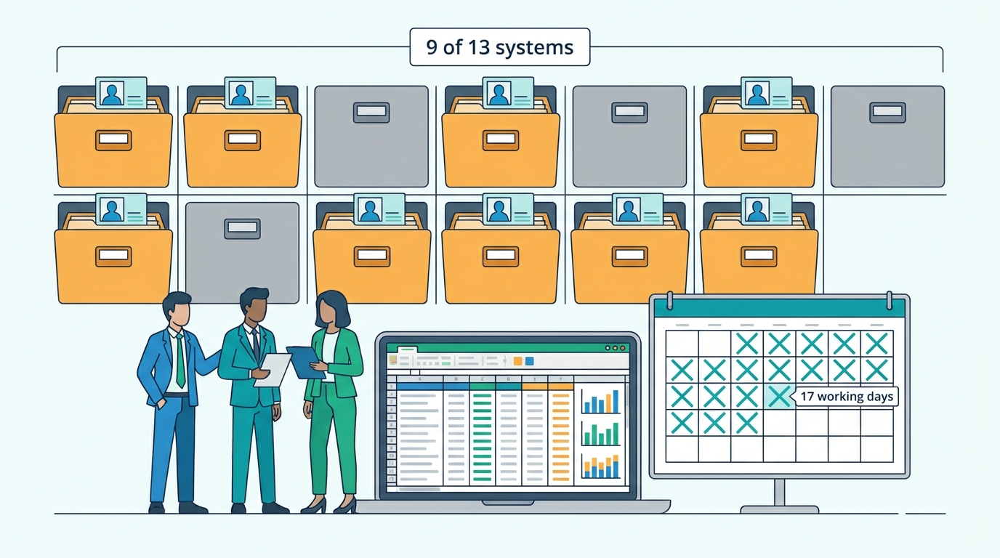
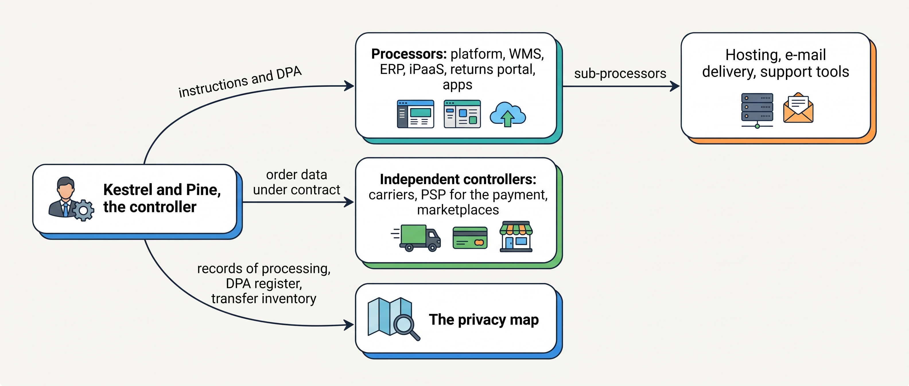
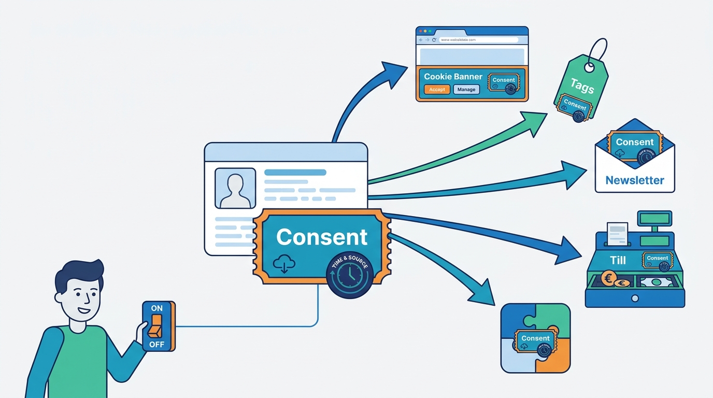
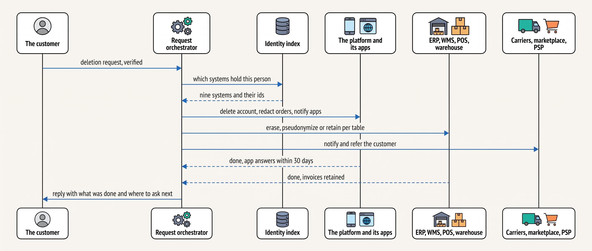
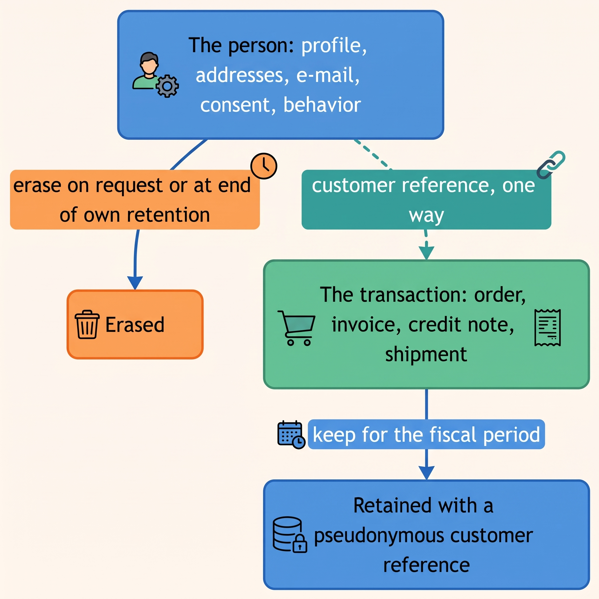

> **IN THIS CHAPTER, YOU WILL:** Learn where personal data lives in a commerce estate, which rules govern each use of it, and how to design consent, retention and deletion across many systems.

> **KEY POINTS:**
>
> * **Every integration is also a data flow with a legal role.** The merchant decides why and how customer data is used, so it is the controller; the platform, the warehouse system and most apps act on its instructions as processors; carriers, marketplaces and payment providers usually decide for themselves. The system-of-record map needs that column.
> * **The order and the marketing profile are two different things in law, even when they describe one person.** The order rests on the contract and on tax law and must be kept for years; the profile rests on consent and must go when the person says so. Design them to separate: pseudonymize the transaction, erase the person.
> * **A deletion request is a fan-out with a deadline.** One month, every system that holds the person, a different right answer in each, and a record of what was done. Without an identity index and an orchestrator it is a seventeen-day hunt through nine systems; with them it is a job.

> **[FAILURE PATTERNS THIS CHAPTER ADDRESSES](where-commerce-platforms-go-wrong.html):**
>
> * **The Familiar Stranger** — a person the systems cannot recognize as one cannot be deleted, told the truth about, or respected when they opt out.
> * **The Secret Agent** — an app, script or export that copies customer data without a named owner or a contract is a processor nobody appointed.
> * **The Long Fuse** — a data subject request has a legal clock of one month, and a cookie or transfer rule can change with a court decision; both are discovered late by merchants with no map.

 
A customer asks a merchant to remove their personal data. Their account is in the commerce platform, but addresses, purchases and contacts have also reached warehouse, carrier, payment, marketing and support systems. Removing the storefront profile does not settle what happens to those copies. The merchant needs to know where the data went, why it is held and which records can be removed or must be retained.

That is why the architecture needs a map of data copies, purposes, access and retention rules. A forgotten export can retain a record, and an unchanged integration can recreate one after removal. A request must reach the systems that hold the data and produce a result the merchant can verify. This chapter offers an architect's reading of the rules; legal details and national requirements still matter.

The chapter explains who decides the use of data (**controller**), who processes it for that party (**processor**), how consent is recorded, how long records are retained and how requests are handled. [[identity-and-master-data]] connects customer identities; [[commerce-regulation]] provides the wider calendar.

**Where we are in the order's journey.** Eva buys a jacket from Kestrel & Pine, the fictional outdoor brand, on 13 April 2027. Fulfillment, payment and invoicing distribute her details to different systems. Notifications need an email address; newsletter enrollment needs its own basis. Her 19 April exchange adds the returns portal. Each copy needs a purpose and retention rule.

## Setting the Scene at Kestrel & Pine: The Request From Ghent

On **10 May 2027**, a Belgian customer, called Lotte Claes in this fictional example, asks Kestrel & Pine to delete her data and stop emailing her.

Lotte has two storefront orders, a marketplace order, a return, a newsletter subscription and an Antwerp store loyalty entry. Head of Engineering Noor Visser must identify the records behind those relationships and decide the action for each system. Deleting the storefront account alone will not complete the request.

Ruben Alves and the application support team took seventeen working days to find out. She was in nine of the thirteen systems:

| System | What it held | What they did | What they could not do |
| --- | --- | --- | --- |
| The platform | Account, addresses, two orders, consent flag, the apps' copies | Deleted the account; the platform anonymized the orders and notified its apps | Confirm that every installed app complied |
| The marketplace connector | A copy of the bol order with name and address | Anonymized the copy | Touch bol's own record; bol is a separate controller |
| The ERP | Two consumer invoices and a credit note | Nothing: invoices are tax records | Erase; retention rules apply |
| The WMS | Three shipments with name and address | Deleted addresses from shipments older than a year | Erase recent shipments while a claim is possible |
| The shipping service | Labels and tracking for three parcels | Deleted after the claims window | Reach bpost's own delivery record |
| The PSP | Payment records for two orders | Removed shopper details from the console view | Erase the PSP's own records |
| The POS | A loyalty entry with phone number and five purchases | Deleted the entry; receipts kept as fiscal records | Unlink receipts already exported to the ERP |
| The returns portal | A contact and one return | Deleted the contact; anonymized the return | Nothing further |
| The data warehouse | Rows keyed by e-mail in four tables and a BI extract | Replaced identifiers with a hash | Reach a spreadsheet export made in 2026 |

The newsletter tool, one of the platform's apps, unsubscribed her through the platform's notification; the iPaaS (the integration platform) held her in three days of logs that expired on their own; nobody checked the backups. The reply went out on **4 June 2027**, inside the one-month limit with six days to spare. It had taken three people and a shared spreadsheet. **The request was answered. The next one would arrive before anyone had written down how.**

**Figure 1:** *One customer's deletion request found her in nine of the thirteen systems and took seventeen working days, three people and a shared spreadsheet to answer.*

## What Personal Data a Commerce Platform Holds, and Under Which Rules

The vocabulary, because the words carry the design. **Personal data** is any information relating to an identified or identifiable person: a name, an e-mail, an order with an address, a cookie id tied to a browser. The **General Data Protection Regulation (GDPR)**, Regulation (EU) 2016/679, has applied across the European Union since 25 May 2018; it gives the person rights (access, rectification, erasure, objection, portability) and the organizations that handle the data duties.

A **controller** is the organization that decides why and how personal data is used; a **processor** handles data only on the controller's instructions (Article 4(7) and 4(8)). A **data processing agreement (DPA)** is the contract Article 28 requires between them. A **lawful basis** is the legal reason a controller may use the data at all; Article 6 lists six, of which four matter here: consent, performance of a contract, a legal obligation and the controller's legitimate interests. A **data subject request (DSR)** is a person exercising a right: send me my data, correct it, delete it. **Retention** is how long data is kept, and the law pulls two ways: no longer than the purpose needs, and at least as long as tax law demands.

The fine ceiling for the core infringements is €20 million or 4% of worldwide annual turnover (Article 83(5)). For Kestrel & Pine, with €48.0 million of 2026 revenue, 4% would be €1.9 million; commoner sanctions are orders to stop processing and the public finding.

What a merchant like Kestrel & Pine holds, by purpose:

| Data | Where it lives | Purpose | Usual lawful basis | How long it is needed |
| --- | --- | --- | --- | --- |
| Name, delivery and billing address | Platform, OMS (order management system), WMS, shipping service, ERP, carriers | Deliver and invoice | Contract; legal obligation for the invoice | Order: the fiscal period; shipment: the claims window |
| E-mail and phone | Platform, notification service, returns portal, POS, newsletter tool | Order messages; service; marketing | Contract for order messages; consent or the soft opt-in for marketing | Service: while the account exists; marketing: until withdrawn |
| Order history, returns, refunds | Platform, OMS, ERP, returns portal, PSP, data warehouse | Fulfill, account, support, warranty | Contract; legal obligation; legitimate interests for fraud | Fiscal period; then pseudonymized |
| Browsing and behavior | Analytics, advertising tags, CDP (customer data platform), personalization | Measurement; marketing | Consent (the ePrivacy Directive for the device; GDPR for the profile) | Until withdrawn or aggregated |

The right-hand columns are the design. The same person appears in every row, but each row has its own basis and its own clock. **The order record and the marketing profile need separate lawful bases, separate retention clocks and separate deletion behavior, even though they refer to the same person.**

## Controller, Processor and the Commerce Supply Chain

Who is the controller for Eva's data? The merchant: Kestrel & Pine decides that orders are taken, delivered and invoiced, that a newsletter exists, that a warehouse system is used. The guidelines of the European Data Protection Board (EDPB) on the two roles (version 2.0, July 2021) draw the line: decisions on the purpose of processing "are clearly always for the controller to make"; the "essential means" (which data, for how long, who receives it, whose data) are the controller's; the "non-essential means" (the choice of hardware or software, the detailed security measures) may be left to the processor.

Applied to the commerce supply chain, the usual outcome of that test, as the author reads it and not as a rule:

| System | Role for the merchant's customer data | Why |
| --- | --- | --- |
| The hosted platform, the WMS, the OMS, the iPaaS, the returns portal, the data warehouse | Processor | Tools the merchant chose, used for the merchant's purposes under its instructions and a DPA |
| Most apps | Processor | Installed by the merchant to act on its data; each needs a DPA |
| The PSP | Processor for the merchant's order data; usually an independent controller for the payment itself | Payment providers have their own legal duties (anti-money-laundering, fraud) that they decide on |
| The carrier; the marketplace | Independent controllers | The carrier decides how it delivers and keeps its own records; the shopper is the marketplace's customer |
| Advertising platforms | Often joint or independent controllers | They use the data for their own purposes too |

Platforms encode this in their app rules. Shopify requires every App Store app to subscribe to three compliance webhooks: `customers/data_request`, `customers/redact` (sent "10 days after the deletion request") and `shop/redact` (48 hours after a store owner uninstalls the app); apps must complete the action within 30 days and may decline redaction where the law requires them to retain data (developer documentation, n.d., accessed November 2026). Its protected-customer-data program gates name, address, phone and e-mail behind approval and requires minimum data, stated purposes, respect for consent, retention periods and encryption. That is a platform acting as the merchant's processor and policing the sub-processors on its behalf.

**Figure 2:** *The merchant is the controller; most of its systems are processors it must instruct and contract; carriers, payment providers and marketplaces decide for themselves.*

The consequence: **the system-of-record map from [[boundaries-and-systems-of-record]] needs a column for each system's legal role, and the integration inventory from [[integration-styles]] is also the inventory of data flows.** The thirteen integrations with no named owner in the integration inventory as of January 2027 were thirteen data flows with nobody accountable for them; five were still unowned in April 2027, after the ownership map.

## Lawful Bases: The Order Versus the Marketing

In commerce terms, the four bases divide the work like this:

| Use | Basis | In practice |
| --- | --- | --- |
| Taking, delivering, invoicing and supporting the order; warranty; returns | **Contract** | Needed to do what the customer asked; no consent needed; cannot be withdrawn while the contract runs |
| Keeping invoices, accounting records, VAT evidence | **Legal obligation** | Kept for the statutory period even if the customer objects |
| Fraud screening; security; basic analytics; defending claims | **Legitimate interests** | Allowed where the merchant's interest is not overridden by the person's; documented; can be objected to |
| Newsletters; profiling for personalized marketing; cross-site tracking | **Consent**, or for e-mail to existing customers about similar products, the ePrivacy **soft opt-in** | Freely given, specific, informed, recorded, and as easy to withdraw as to give |

The soft opt-in deserves a sentence because every merchant asks about it. The ePrivacy Directive (Article 13(2), 2002 text consolidated in 2009) lets a business that obtained a customer's e-mail "in the context of the sale of a product or a service" use it "for direct marketing of its own similar products or services", provided the customer can object, free of charge, at collection and in every message. National transpositions differ; the lawyer confirms the local reading. The architectural point holds either way: **the order's e-mail address and the marketing permission are two facts, and the second must be recorded with its basis.**

## Consent, Cookies and Tracking

A consent choice must control what the shop and its connected tools actually do. Recording a preference in a banner is insufficient if tracking scripts ignore it or another system continues the marketing the customer declined.

Consent lives in two laws. The GDPR defines it (Article 4(11)) as a freely given, specific, informed and unambiguous indication of the person's wishes by a statement or a clear affirmative action, and requires the controller to be able to demonstrate it (Article 7(1)). The ePrivacy Directive (Article 5(3), as amended in 2009) adds a rule about the device: storing information on, or reading information from, a user's device is allowed only with consent after clear information, except for what is strictly necessary to transmit a communication or to provide a service the user explicitly asked for.

In plain words: the cart cookie and the language choice need no consent; the analytics tag, the advertising pixel and the personalization script do, before they fire. The regulators Kestrel & Pine answers to agree on the substance:

- The **EDPB's consent guidelines** (May 2020) forbid cookie walls and say scrolling or swiping "will not under any circumstances" count as consent; its technical-scope guidelines (version 2.0, October 2024) bring tracking pixels, URL tracking and IP-only tracking within the device rule.
- The **Dutch regulator** (Autoriteit Persoonsgegevens, n.d., accessed November 2026) exempts functional cookies and "limited analytical cookies" with little privacy impact, requires consent for tracking cookies, and calls cookie walls prohibited.
- The **Belgian regulator** (Gegevensbeschermingsautoriteit, November 2023) exempts only strictly necessary functional and technical cookies (naming the language choice, cookie preferences and the shopping basket), rejects pre-ticked boxes and continued browsing, and requires cookies to be grouped by purpose, with own and third-party advertising as separate purposes.

A **consent management platform (CMP)** is the banner and the record behind it: it stores each visitor's choices per purpose and tells each tag whether it may run. **Server-side tagging**, in which the merchant's own server receives the browser's events and forwards them to vendors, changes who receives the data first, not whether consent is needed: the browser is still told to emit identifiers, so the device rule still applies. Present it as a governance improvement, never as a consent bypass; that reading follows the EDPB's technical-scope guidelines and is the author's.

Two moving parts. The Commission's **Digital Omnibus** proposal of November 2025 would move the device rule into the GDPR with four no-consent purposes (transmission, requested service, audience measurement, security), require a one-click refusal and oblige controllers to honor machine-readable browser signals; one law firm's reading (Osborne Clarke, December 2025) is that the end of cookie banners "is not yet in sight". It is a proposal, not law, as of November 2026. In the United States the model is opt-out: California's law lets consumers opt out of the "sale or sharing" of their data, including through the Global Privacy Control browser signal, and the 2025 chart of the IAPP (International Association of Privacy Professionals) lists nineteen state laws of that family.

The design consequence joins this chapter to the previous one. **Consent is state that must travel**: from the CMP to the tag layer, to the newsletter tool and the CDP, to the POS where staff ask for a loyalty sign-up, and to every app that sends a message. [[identity-and-master-data]] put it on the customer master with its time, place, wording and source; here is why: the merchant must demonstrate it per person and per purpose, and withdraw it everywhere at once.

**Figure 3:** *Consent is state that must travel: recorded once with its evidence on the customer master, it must reach every tag, tool, till and app, and a withdrawal must reach them all at once.*

### Requirements per flow

| Flow | How fresh | How consistent | How fast | How available |
| --- | --- | --- | --- | --- |
| Consent capture (banner, checkout box, store sign-up) | Immediate for the device; hours to reach every outbound tool | One record per person per purpose, with evidence | Must not slow the page or the till | Degrade to "no consent" when the CMP is down, never to "consent" |
| Consent withdrawal | Immediate for the channel used; same day everywhere | Strictest state wins across tools | Minutes | Works even if the master is unreachable; reconcile later |
| Data subject request | One month, extendable by two | Every system that holds the person answers; answers recorded | Days | Batch; the orchestrator can queue |
| Retention purge | Daily or weekly | Pseudonymize transactions; erase profiles; log what ran | Hours | Batch; a failed run must be visible |

## Data Subject Requests Across Many Systems

A customer may ask to see, correct or delete personal data. The merchant must locate the relevant copies and coordinate a response, even when different vendors hold the account, orders and marketing history.

The GDPR requires the controller to act on a request "without undue delay and in any event within one month", extendable by two months for complex or numerous requests (Article 12(3)). What makes it hard is not the law but the fan-out: one person, many systems, a different right answer in each. Three parts make it a job.

**An identity index**: which systems hold this person, under which identifiers. This is the cross-reference [[identity-and-master-data]] built for another reason; a deletion request is its second customer. Without it, every request starts with a search of every system by e-mail, phone and name, which is where Lotte's seventeen days went.

**A request orchestrator**: a small workflow that verifies the requester (asking for "all my data" with someone else's e-mail is a way to steal it), fans the request out, records each answer and produces the reply. Shopify's compliance webhooks are the platform-side half of one; for the systems outside the platform, the merchant builds or buys the other half.

**A per-system action table**, decided in advance:

| Answer | When | Example at Kestrel & Pine |
| --- | --- | --- |
| **Erase** | The purpose has ended and no law requires the data | The platform account, the loyalty entry, the newsletter subscription, the returns contact, old shipment addresses |
| **Pseudonymize** | The record must stay for accounting, statistics or evidence, but the person need not be identifiable from it | Orders in the platform and the OMS, warehouse rows, data-warehouse rows: name and address replaced by a token the merchant cannot reverse |
| **Retain** | A legal obligation applies or a claim is still possible | Invoices and credit notes in the ERP; recent shipments during the carrier's claims window; fraud evidence |

Two answers lie outside the merchant's reach: **refer** (the carrier, the marketplace and the PSP are told, and the person must ask them too, because they are controllers in their own right) and **except** (backups, under a documented, bounded exception: erased data is not restored, and if a backup is restored the deletion is replayed).

**Figure 4:** *A deletion request is verified once, resolved against the identity index, fanned out with a predetermined action per system, and answered with a record of what each system did.*

The reply should say, in plain words, what was erased, what was kept and why, and whom else to ask; the record behind it is what a regulator asks for.

## Retention: The Person Versus the Transaction

Tax law makes the merchant keep what privacy law makes it release. One design move reconciles them: **split the person from the transaction.** The retention facts, with their status:

- **Netherlands.** The government's business portal states that businesses "must keep your business records for at least 7 years", naming the general ledger, stock records, purchase and sales records and debtor and creditor accounts, with at least 10 years for data on immovable property, and requires digital files to remain accessible for inspection (business.gov.nl, n.d., accessed November 2026).
- **Germany.** §147 of the Abgabenordnung requires books, records, inventories and annual accounts to be kept for ten years, accounting vouchers for eight, and other records including commercial letters for six, from the end of the calendar year of the record (gesetze-im-internet.de, current text, accessed November 2026).
- **Belgium.** Ten years for accounting records and invoices is widely cited; the official text was not verified for this chapter, and Sanne de Wit treats ten years as the Belgian rule pending confirmation.

So Lotte's invoice from November 2026 stays until at least the end of 2036 under the Belgian reading, whatever she asks; "legal obligation" is a lawful basis. The conflict arises only when the invoice *is* the customer record, as it is in many ERPs and platforms: the order carries name, address and e-mail, and the customer master is the list of people with orders. Deleting the person then means deleting the order, which tax law forbids, so nothing is deleted.

**Figure 5:** *Profiles are erasable; transactions are kept with a reference that no longer points to a person once the profile is gone.*

In practice: the order and the invoice carry a customer reference and the delivery address (part of the transaction, kept for the fiscal period); the profile (e-mail, phone, preferences, consent, browsing, loyalty) is a separate, erasable record; and the analytics tables carry a hash of the customer reference, not the e-mail. **Retention periods become a property of each record type, not of the person**, and a nightly job purges what has expired without anyone deciding per customer.

Backups need a sentence. A deletion cannot reach into last month's backup; the accepted practice is a bounded, documented exception: backups are kept for a stated period, never used to resurrect erased data, and if one is restored the deletion log is replayed against it.

## Sharing, Transfers and the Store

**Sharing with partners.** Every order sends personal data to a carrier, the PSP, sometimes a marketplace, and to apps and connectors. The rules are minimization (the warehouse does not need the e-mail, the carrier does not need the order history), a recorded role per recipient, and a DPA or terms that cover the transfer. Kestrel & Pine's marketplace connector copied everything the marketplace sent; after Lotte's request it copies what the warehouse needs.

**International transfers.** Most commerce stacks send data to the United States somewhere: analytics, e-mail delivery, support tooling, hosting. The lawful routes are an adequacy decision, standard contractual clauses (SCCs) or binding corporate rules. The EU-US Data Privacy Framework (DPF), Commission Implementing Decision (EU) 2023/1795 of 10 July 2023, is the adequacy decision for certified US companies; the modern SCCs are Decision (EU) 2021/914.

The General Court dismissed Philippe Latombe's challenge to the DPF on 3 September 2025; an appeal (Case C-703/25 P) is pending as of November 2026; law firms advise keeping SCCs as a fallback.

The architectural asset is a **transfer inventory** keyed to the integration map: per vendor, where the data goes and under which mechanism, so that a court decision becomes a filter on a list rather than a discovery project.

**The store.** The POS holds a loyalty list and receipts; a store may also run cameras, Wi-Fi analytics and tablet sign-ups. Consent asked at a till by a member of staff is easy to ask badly and leaves no evidence. Kestrel & Pine's rule from mid-2027: the POS loyalty sign-up shows the same purposes and wording as the web, records the time and the store, and carries the master's consent once matched ([[identity-and-master-data]]).

**The vendor's side.** For a commerce software vendor, the obligations are a processor's: a DPA you can sign, sub-processors listed and announced, data kept in the regions you promise, the ability to export and erase one customer of one merchant, security you can evidence, and breach notification to the merchant without undue delay (Article 33(2)) so that it can meet its own 72-hour deadline.

## The Choices

For the data subject request, four realistic designs:

Choose the coordination method for the number of systems and requests:

- **A runbook:** list the action and responsible person for each system. This can suit a small merchant with few requests.
- **Platform-led handling:** use the platform's erasure and app notifications, with a runbook for outside systems.
- **An integration flow:** verify the request, resolve identities, send the required actions, record results and reply. Kestrel & Pine adopts this in autumn 2027.
- **A privacy management product:** automate more intake, discovery and records across a larger group.

I would map the data before choosing the product. Automation still needs to know which systems and records it must reach.

| Option | Fits when | Strengths | Costs and limits | Warning sign |
| --- | --- | --- | --- | --- |
| Runbook by hand | Few systems, few requests | No build; forces the map to be written | Slow; no record unless disciplined | The runbook is a person's memory |
| Platform-centered | Most data in the platform and its apps | Erasure and app fan-out come with the platform | ERP, WMS, POS and warehouse are outside it | "The platform handles GDPR" |
| Orchestrator plus identity index | A dozen systems; weekly requests | Repeatable; a record per request; reuses the identity index | A flow to own; per-system steps; a human verification step | Requests queued behind other integration work |
| Privacy management product | Several brands, countries, entities | Intake, verification, discovery, consent and records in one place | License and configuration; connectors still map to your systems | Bought before the map exists |

For consent the ladder is shorter: the platform's built-in banner and checkout box (Starting), a CMP with per-purpose consent synchronized to the customer record (Growing), and consent as an attribute of the master with evidence, synchronized to every outbound tool (Omnichannel onward).

## Across Scale Stages: When It Fits and When It Limits

The four stages are the book's (see [[commerce-scaling-stages]]).

| Stage | What is typical | What becomes necessary | Warning signs of outgrowing it |
| --- | --- | --- | --- |
| **1 — Starting** | The platform's standard DPA, cookie banner, checkout consent box and app vetting; requests handled in the platform admin | A privacy notice that matches the stack; a DPA for the 3PL and the e-mail tool; one person who answers requests | An app with no DPA; a newsletter list built from every order without a soft opt-in notice |
| **2 — Growing** | The first store, ERP and marketplace bring data outside the platform; a CMP with per-purpose consent | A DPA register and the rule that nothing goes in without one; a runbook for requests; consent on the customer record; a retention rule per record type | A request that takes two weeks; POS consent that never reaches the newsletter tool; tags firing before the banner answers |
| **3 — Omnichannel** | A dozen systems, 20–40 flows, requests weekly; a data warehouse keyed by e-mail | A data-flow map kept with the integration inventory; an identity index and a request orchestrator; the person split from the transaction; a transfer inventory; a bounded backup exception | A request that touches nine systems by hand; an erased customer resurrected by a backup; a court decision that forces a vendor-by-vendor investigation |
| **4 — Group** | Several brands, countries and legal entities, each a controller; a privacy function | One consent model with national differences as configuration; a privacy management product; a data protection officer where required; group-wide records of processing | One brand's consent used by another; two brands answering the same person differently |

The judgement: the duties do not change with scale; a Starting-stage merchant is as much a controller as a Group. What changes is where the data is. Below the Omnichannel stage the platform holds most of it and its DPA, banner and app rules do most of the work; from the Omnichannel stage the person is in a dozen systems and the merchant must own the map, the index and the orchestrator itself. Kestrel & Pine learned the stage-3 lesson from one request from Ghent.

## In Practice

**Shopify's compliance webhooks and protected customer data (accessed November 2026)** are the clearest public example of a platform acting as the merchant's processor and policing its sub-processors: three mandatory webhooks, a 30-day completion window, and a gated program for the four identifying fields.

**Sephora, California, August 2022.** A case more than three years old, but still the reference example: the Attorney General's settlement (US$1.2 million) found that third-party trackers on Sephora's site and app amounted to a sale of personal information without notice, and that Global Privacy Control signals were not honored. The tag layer is a legal surface, and a browser signal must be read as well as a banner.

**The DPF and its appeal (2023–2026).** A merchant whose transfer inventory names each US vendor's mechanism can respond to the outcome in an afternoon.

### Kestrel & Pine's deletion design (autumn 2027, illustrative)

After Lotte's request, two changes. In **June 2027** the identity rule linked every system's record to the customer master ([[identity-and-master-data]]), and the July matching run produced the index.

In **October 2027** Ruben Alves built the request orchestrator as an iPaaS flow with a human verification step: the request is logged, the requester verified through the platform's account or a signed e-mail reply, the index queried and the action table applied.

The platform deletes the account, anonymizes the orders and notifies its apps; the OMS (live for marketplace orders from 15 September) pseudonymizes its order copies; the WMS and the shipping service purge addresses older than their claims window of **twelve months** *(assumption)*; the ERP keeps invoices and credit notes and marks the customer reference as erased; the POS deletes the loyalty entry; the returns portal deletes the contact; the data warehouse replaces e-mail and name with a hash.

The carrier, the marketplace and the PSP are notified and the customer told to ask them directly. Backups are kept for **35 days** *(assumption)* and the deletion log is replayed after any restore.

The second request through the flow, in November 2027, took **two working days** *(illustrative)*. The map that made it possible, one row per system with its legal role, data, action and retention clock, is now a column of Noor's ownership map, reviewed quarterly.

## When It Goes Wrong

| Failure | How it shows | Detection | Recovery |
| --- | --- | --- | --- |
| **The missed copy** | An erased customer receives a newsletter because nobody reached the newsletter tool | A complaint; a reconciliation of erased master ids against each tool's list | Erase; add the tool to the index and the action table; ask who else was missed |
| **The resurrected customer** | A restore from backup brings back erased records | The deletion log replayed after a restore | Replay the log; document the backup exception |
| **The impostor** | Someone requests "all my data" with another person's e-mail | A verification step that fails | Never answer an unverified request with data; verify through the account or a signed reply |
| **The over-deletion** | An invoice or a fraud record is erased with the profile | The ERP's retention check; a tax audit | Restore from the retained copy; fix the action table: transactions retained, the person erased |
| **Consent without evidence** | Marketing cannot show when or how a person consented | A consent audit sampling records | Treat unevidenced consent as absent; re-ask where the soft opt-in does not apply |
| **The invalidated transfer** | A court or a decision removes a transfer mechanism | A transfer inventory naming the mechanism per vendor | Switch to SCCs or an EU region, vendor by vendor from the list |

The missed copy is the one that recurs, and its cause is a system added after the map was made; that is why the privacy map lives with the integration inventory and is reviewed when a row is added.

## What to Take Away

**Established.**

- The merchant is the controller of its customers' data; its platform, warehouse system, integration platform and most apps are processors that need a contract; carriers, payment providers for the payment itself, and marketplaces usually decide for themselves (GDPR Articles 4 and 28; EDPB Guidelines 07/2020).
- Orders rest on the contract and on tax law; marketing rests on consent or the soft opt-in; consent must be demonstrable, and cookie walls, scrolling and pre-ticked boxes do not produce it (GDPR Articles 6 and 7; EDPB Guidelines 05/2020; the Dutch and Belgian regulators).
- Requests must be answered within one month, extendable by two (Article 12(3)); business records must be kept at least seven years in the Netherlands and ten, eight or six years in Germany depending on the record (business.gov.nl; §147 AO).
- Platforms have operationalized the fan-out: Shopify's three compliance webhooks and 30-day window are a documented, dated example.

**Depends on context.**

- Below the Omnichannel stage the platform's DPA, banner, consent box and app rules do most of the work; from the Omnichannel stage the merchant must own a data-flow map, an identity index and an orchestrator, because the platform's reach ends at its apps.
- The soft opt-in depends on national transposition and on the "similar products" test; take the lawyer's reading per country.
- The retention period per record type is a legal and finance decision per country; the architecture needs only that it be a property of the record type, not of the person.

**The author's synthesis.**

- Privacy in a commerce estate is an integration problem wearing a legal coat: the map, inventory and identity index that fix the Phantom Stock and the Familiar Stranger make a deletion request a job rather than a hunt.
- Split the person from the transaction in the data model before the first request, because every system that stores the name on the order otherwise forces a choice between the tax law and the person.

## Questions to Ask

1. Which systems hold personal data, and does the system-of-record map say, per system, whether it is a processor or a controller?
2. Is there a signed DPA for every processor, including every app, and who keeps the register?
3. Where is consent recorded, with what evidence, and how long does a withdrawal take to reach every outbound tool?
4. Do tags fire before the banner is answered, and what happens when the CMP is down?
5. How would you find every record of one person today, and how long did the last request take?
6. Can an order outlive its customer in your data model, or does deleting the person delete the invoice?
7. Which vendors receive data outside the EU, under which mechanism, and is that a list or a memory?
8. What happens to an erased person when a backup is restored?

A deletion request is one legal clock among many. [[commerce-regulation]] lays out the others, from the right of withdrawal and the Omnibus price rules to e-invoicing, accessibility, product safety and the platform rules for marketplaces, and shows how Kestrel & Pine turned them into a regulatory calendar for 2027 so that no deadline is discovered only months before it applies.

## Sources and Evidence

*Company, product and investor sources*

- [Privacy law compliance](https://shopify.dev/docs/apps/build/compliance/privacy-law-compliance), Shopify developer documentation, n.d., accessed 2026-11 — the three compliance webhooks, the 10-day and 48-hour delays, the 30-day completion window.
- [Protected customer data](https://shopify.dev/docs/apps/launch/protected-customer-data), Shopify developer documentation, n.d., accessed 2026-11 — minimum data, purpose limitation, consent, retention, encryption and level-2 controls for apps.
- [Attorney General Bonta announces settlement with Sephora](https://oag.ca.gov/news/press-releases/attorney-general-bonta-announces-settlement-sephora-part-ongoing-enforcement), California Department of Justice, 2022-08-24 — trackers as a sale, Global Privacy Control, the US$1.2 million settlement.
- [Latombe's challenge to EU-US data transfers fails](https://www.lewissilkin.com/insights/2025/09/03/transatlantic-trouble-not-this-time-latombes-challenge-to-eu-us-data-transfers-fails), Lewis Silkin, 2025-09-03 — the General Court judgment and the advice to keep SCCs as a fallback.
- [Digital Omnibus reshapes EU cookie rules, leaves banner fatigue largely intact](https://www.osborneclarke.com/insights/digital-omnibus-reshapes-eu-cookie-rules-leaves-banner-fatigue-largely-intact), Osborne Clarke, 2025-12-10 — a reading of the November 2025 proposal.

*Standards, regulation and official documentation*

- [Regulation (EU) 2016/679 (GDPR)](https://publications.europa.eu/resource/celex/32016R0679), Official Journal text, 2016 — Articles 4, 6, 7, 12(3), 28, 33 and 83(5); application from 25 May 2018.
- [Directive 2009/136/EC](https://publications.europa.eu/resource/celex/32009L0136), Official Journal text, 2009 — the amended Article 5(3) device rule of the ePrivacy Directive.
- [Directive 2002/58/EC (ePrivacy), consolidated 2009](https://eur-lex.europa.eu/legal-content/EN/TXT/HTML/?uri=CELEX:02002L0058-20091219), EUR-Lex — Article 13(2), the soft opt-in; text more than three years old, national transpositions differ.
- [Guidelines 07/2020 on the concepts of controller and processor](https://www.edpb.europa.eu/system/files/2023-10/EDPB_guidelines_202007_controllerprocessor_final_en.pdf), European Data Protection Board, version 2.0, 2021-07-07 — purposes, essential and non-essential means.
- [Guidelines 05/2020 on consent](https://www.edpb.europa.eu/system/files/documents/files/file1/edpb_guidelines_202005_consent_en.pdf), European Data Protection Board, 2020-05-04 — cookie walls, scrolling.
- [Guidelines 2/2023 on the technical scope of Art. 5(3) of the ePrivacy Directive](https://www.edpb.europa.eu/system/files/documents/2024-10/edpb_guidelines_202302_technical_scope_art_53_eprivacydirective_v2_en_0.pdf), European Data Protection Board, version 2.0, 2024-10-07 — pixels, URL tracking, IP-only tracking.
- [Cookies](https://www.autoriteitpersoonsgegevens.nl/themas/internet-slimme-apparaten/cookies), Autoriteit Persoonsgegevens (Dutch), n.d., accessed 2026-11 — functional and limited analytical cookies, tracking cookies, cookie walls.
- [Cookies en andere traceringsmiddelen](https://www.gegevensbeschermingsautoriteit.be/burger/thema-s/internet/cookies), Gegevensbeschermingsautoriteit (Belgium, Dutch), 2023-11-17 — exempt categories, pre-ticked boxes, purpose grouping.
- [Keeping business records](https://business.gov.nl/regulation/keeping-business-records/), business.gov.nl (Netherlands Enterprise Agency), n.d., accessed 2026-11 — at least seven years; ten for immovable property; digital files accessible.
- [§147 Abgabenordnung](https://www.gesetze-im-internet.de/ao_1977/__147.html), gesetze-im-internet.de, current text, accessed 2026-11 — ten, eight and six years.
- [Commission Implementing Decision (EU) 2023/1795 (EU-US Data Privacy Framework)](https://publications.europa.eu/resource/celex/32023D1795), Official Journal text, 2023 — the adequacy decision.
- [Commission Implementing Decision (EU) 2021/914 (standard contractual clauses)](https://publications.europa.eu/resource/celex/32021D0914), Official Journal text, 2021.
- [Case C-703/25 P, Latombe v Commission](https://publications.europa.eu/resource/celex/62025CN0703), Official Journal C/2025/6610, 2025-12-22 — the pending appeal.
- [California Consumer Privacy Act](https://oag.ca.gov/privacy/ccpa), California Department of Justice, n.d., accessed 2026-11 — thresholds, rights, Global Privacy Control; [US State Privacy Legislation Tracker](https://iapp.org/resources/article/us-state-privacy-legislation-tracker/), IAPP, updated 2026-09-08, and its [2025 chart](https://prod.iapp.org/media/pdf/resource_center/State_Comp_Privacy_Law_Chart.pdf) — nineteen state laws.

*Research and practitioner sources*

- [[identity-and-master-data]] — the identity index this chapter's orchestrator depends on; [[fraud-prevention]] in the sibling book LISTED for the legitimate-interest side of risk screening.

Kestrel & Pine is fictional; architectural recommendations, labeled inferences and labeled assumptions are the author's judgement.
