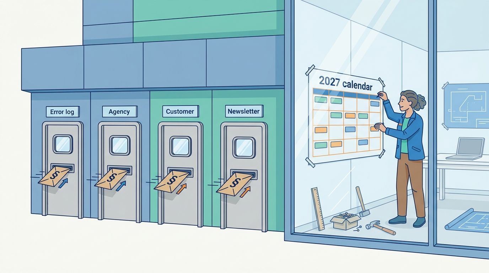
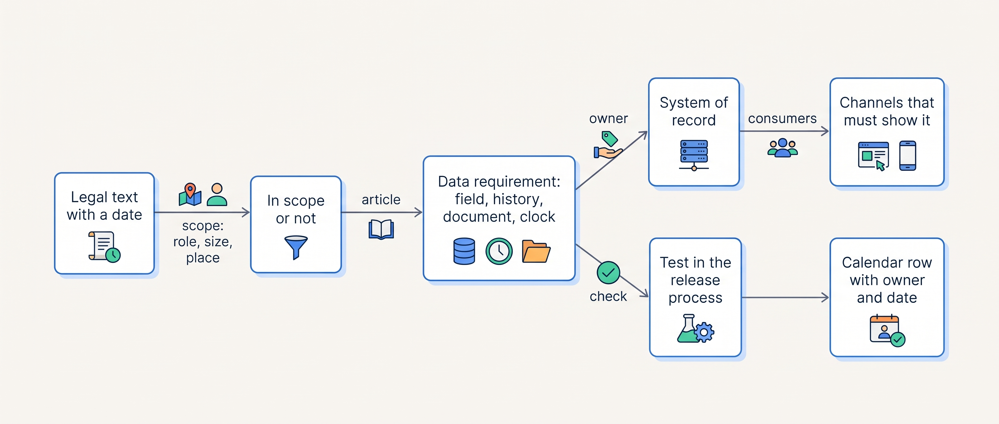
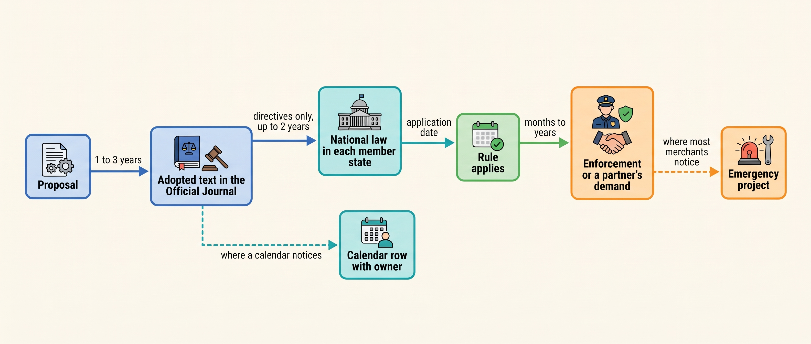
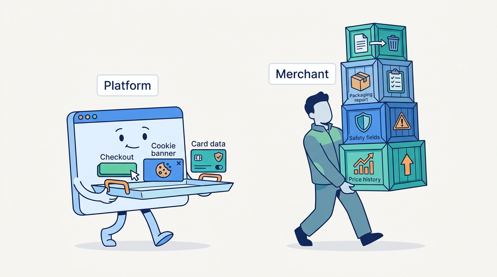

> **IN THIS CHAPTER, YOU WILL:** Learn which EU and US rules shape a commerce platform, what each requires in data terms and by which date, and how to keep a regulatory calendar that stops deadlines arriving as surprises.

> **KEY POINTS:**
>
> * **Most rules are data requirements, not page requirements.** The prior-price rule needs 30 days of price history per SKU (stock-keeping unit: one sellable variant) and country; the withdrawal right needs refund clocks started by the right events; product-safety and marketplace rules need manufacturer and seller fields on every listing; e-invoicing needs a structured invoice over a network. Each belongs in a system of record, not in a template.
> * **Dates slip, scope does not; transposition multiplies the calendar.** The AI Act's high-risk dates moved by more than a year, the Dutch e-invoicing mandate moved to 2030 before it was a bill, and one directive becomes 27 national laws with different dates. Plan to the scope, schedule to the date, and keep the calendar live.
> * **The platform absorbs some of it, never all of it.** A hosted platform brings a compliant checkout button, cookie banner and card-data scope; price history, product-safety fields, packaging reports, deletion fan-out and every vendor contract clause stay with the merchant. The practical artifact is one calendar with an owner, the systems touched and a date per row.

> **[FAILURE PATTERNS THIS CHAPTER ADDRESSES](where-commerce-platforms-go-wrong.html):**
>
> * **The Long Fuse** — every rule in this chapter was published years before it applied, and the merchant that discovers it months away pays for speed instead of planning.
> * **The Pulled Rug** — a marketplace turns a regulation into a mandatory listing field on a date of its own, and the connector starts rejecting products before anyone reads the notice.
> * **The Price Nobody Can Explain** — a discount claim is lawful only against a 30-day price history, and a shop with seven copies of a price cannot produce one.

 
Nobody joins a commerce team to read the Official Journal of the European Union. Yet a surprising share of what a commerce platform must do is written there, with a date: the button that says "order with obligation to pay", the 14 days a shopper has to change their mind, the "was" price under a discount, the manufacturer's address on a product page, the structured invoice a Belgian business customer may demand, the ban on destroying unsold jackets. **Each started as a proposal, became law years before it applied, and arrived in some merchant's backlog weeks before the date, as an emergency.** That is the pattern this book calls the Long Fuse.

The chapter's claim is that regulation is easier to handle than it looks if it is read the way an architect reads anything else: **as requirements on data, with a system of record, a test and a date.** It is not legal advice, and national rules differ in detail; it aims to make you the person who can read a legal text, say which field in which system it touches, and put it on a calendar with a name next to it. [[commerce-security]] and [[privacy-and-customer-data]] cover the other two parts of trust; this chapter covers the rest of the law and the calendar that holds all three.

**Where we are in the order's journey.** Eva's jacket, the order this book follows, met the law at four steps without anyone noticing: the price she saw had to include VAT and sit in a price history that any later reduction is measured against, the checkout button carried prescribed words, the product page carried a manufacturer's address, and her exchange request on 19 April 2027 started two 14-day clocks.

## Setting the Scene at Kestrel & Pine: Four Rules Through Four Doors

Kestrel & Pine, the fictional outdoor brand this book follows (see [[meet-kestrel-and-pine]]), is a Dutch company with 310 employees selling in three countries. In February 2027, while building the integration inventory ([[integration-styles]]), Noor Visser, Head of Engineering since January, notices that four regulations reached engineering in two years, each through a different door and none through a plan. The rules' dates are real; how they arrived is an illustration.

- **The listing rejections (December 2024).** The **General Product Safety Regulation** (GPSR, Regulation (EU) 2023/988) applied from 13 December 2024 and requires every online offer to show the manufacturer's name and address, a responsible person in the EU where the manufacturer is outside it, product identification and warnings. Amazon.de and Zalando turned those into mandatory listing fields, the connector began rejecting third-party equipment products, and Milan Petrov, who owns the marketplaces, filled the gaps from a spreadsheet over three weeks.
- **The accessibility audit (summer 2025).** The **European Accessibility Act** applied from 28 June 2025 to e-commerce services, exempting only microenterprises. The agency audited the three storefronts in May 2025 (illustrative: about 140 findings, mostly contrast, labels and keyboard navigation in the customized theme) and fixed them over the summer. The checkout page was the platform's problem; the theme was Kestrel & Pine's.
- **The refused PDF (December 2025).** Belgium made structured electronic invoices mandatory between Belgian VAT-registered businesses from 1 January 2026. Whether that binds a Dutch supplier without a Belgian establishment is not settled by the sources; what mattered was that the Belgian customer's bookkeeping now expected a Peppol invoice. Kestrel & Pine learned of it when a larger Belgian account announced it would no longer process PDFs ([[tax-invoicing-and-ledger]] tells it from finance's side); the EDI (electronic data interchange) provider, already an access point to Peppol, the European network for exchanging structured business documents, was connected to the ERP (the finance and invoicing system) in six weeks, and Peppol invoices have gone to all Belgian business customers since January 2026.
- **The newsletter (June 2026).** The **Ecodesign for Sustainable Products Regulation** (ESPR, Regulation (EU) 2024/1781) prohibits, from 19 July 2026, the destruction of unsold apparel and footwear by large enterprises, and its definition of "unsold" includes goods returned under the right of withdrawal. Teun Baas, who owns the seasons, had an August routine for end-of-line stock and returns not resold as new (about 39% of returned items); it now needs a documented disposition per unit and a yearly disclosure. Sanne de Wit, the Finance Director, found the rule in an auditor's newsletter in June 2026, weeks before it applied.

Four rules, four doors: an error log, an agency, a customer and a newsletter. None was a secret: the GPSR was published in May 2023, the Accessibility Act in June 2019, the ESPR in June 2024. **The company had no door of its own.** So Noor adds a regulatory calendar for 2027, with an owner per row, to Waypoint's working documents.

**Figure 1:** *Four rules, four doors: an error log, an agency, a customer and a newsletter brought the law in, and none of them was a door the company owned; the 2027 calendar is the door of its own.*

## How to Read a Law as a Requirement

A legal text is written for courts, not engineers; the translation follows four questions.

1. **Who is in scope, and are we?** By role (trader, marketplace, producer, payment provider), by size (microenterprises are exempt from the Accessibility Act; small and medium enterprises are exempt or deferred under the ESPR) and by place (established in a member state, selling into it, or both).
2. **What does it require, in data terms?** Nearly every obligation is a field, a history, a document or a clock: the lowest price in the last 30 days; a manufacturer's address per product; a structured invoice; a refund within 14 days of a dated notice.
3. **Which system of record holds that, and which channels must show it?** The field belongs where the fact is owned ([[boundaries-and-systems-of-record]]); a manufacturer field kept only in the marketplace connector is a copy with no owner.
4. **When does it apply, and how will we know we comply?** The application date, the national transposition date for a directive, and a test: a query, a report or a check in the release process.

In the table, the OMS is the order management system, the PIM the product information management system and the WMS the warehouse management system. ViDA is the EU's "VAT in the Digital Age" package; the PPWR is the Packaging and Packaging Waste Regulation; WCAG are the Web Content Accessibility Guidelines.

| Rule | Data requirement | System of record | Channels that must show it | Test |
| --- | --- | --- | --- | --- |
| Prior price (Omnibus, Art. 6a) | Lowest price per SKU per country in the 30 days before a reduction | Pricing engine or price history ([[pricing-architecture]]) | Storefronts, marketplaces, stores | Every strike-through price equals the 30-day minimum |
| Right of withdrawal (Consumer Rights Directive) | Delivery, notice and goods-received dates; refund within 14 days of the notice | OMS and returns portal ([[returns-and-exchanges]]) | Returns portal, service tool | No refund older than 14 days from notice |
| Product safety (GPSR, Art. 19) | Manufacturer and responsible-person name and address, identification, warnings in the shopper's language | PIM ([[product-information]]) | Storefronts, marketplaces | No product published without the fields |
| E-invoicing (Belgium, Germany, ViDA) | EN 16931 invoice over Peppol or an accredited platform, with transmission status | ERP and access point ([[edi-and-e-invoicing]]) | Business customers | Every in-scope invoice has a delivered status |
| Packaging and producer responsibility (PPWR, national registers) | Packaging weight by material per unit sold, per country | PIM and WMS | Reporting only | A yearly report per country reconciles with units shipped |
| Unsold-goods destruction (ESPR, Art. 24–25) | Disposition per unsold or returned unit, reasons, yearly disclosure | WMS and returns disposition | Reporting only | No "destroy" disposition for apparel without a derogation |
| Accessibility (European Accessibility Act) | Storefront, checkout, identification and payment meet WCAG 2.1 AA | Theme and embedded widgets ([[storefront-architecture]]) | Storefronts | An audit per release; vendor statements on file |
| AI transparency (AI Act, Art. 50) | Disclosure that a shopper talks to an AI; machine-readable marking of generated content | Any assistant or content tool ([[ai-and-agentic-commerce]]) | Storefronts, service | No undisclosed assistant; generated images marked |

The pattern to notice is the third column: **most rows land in a system Kestrel & Pine did not have or did not own in 2026** (the PIM, the OMS, the price history, a disposition record). Regulation is one more reason the Waypoint hubs exist.

**Figure 2:** *Reading a law as a requirement: scope first, then the field or clock it demands, the system that owns it, the channels that show it, a test, and a dated row with a name on it.*

## The Rules, by What They Touch

### Consumer law: withdrawal, the button, the prior price, reviews

The **Consumer Rights Directive** (2011/83/EU, applying to contracts from 13 June 2014) gives a consumer "a period of 14 days to withdraw from a distance or off-premises contract, without giving any reason", extended to 12 months if the trader fails to inform them; the trader must refund "not later than 14 days from the day on which he is informed of the consumer's decision to withdraw", and may withhold it until the goods are back; and an order button must be labeled "only with the words 'order with obligation to pay' or a corresponding unambiguous formulation" (Directive 2011/83/EU, 2011). Three clocks and one string. The clocks need the right events recorded: delivery (the carrier's scan), the withdrawal notice (the returns portal) and receipt of the goods (the WMS). Eva's exchange request of 19 April 2027 started the clock that day, not on 22 April when the jacket reached Duiven.

The **Omnibus Directive** (2019/2161, applied from 28 May 2022) added the **prior-price rule**: "any announcement of a price reduction shall indicate the prior price", meaning "the lowest price applied by the trader during a period of time not shorter than 30 days prior to the application of the price reduction" (Directive (EU) 2019/2161, 2019). It also made ranking parameters and review provenance material information, blacklisted claiming reviews are genuine "without taking reasonable and proportionate steps to check", and required disclosure of prices personalized by automated decision-making. [[pricing-architecture]] works the Black Friday case where an autumn campaign at €179 makes the lawful "was" price €179, not €199; [[commerce-search-and-discovery]] covers reviews. **A 30-day price history per SKU per country is a legal record**, and a merchant whose prices live in seven copies, as Kestrel & Pine's did in 2026, cannot produce it.

### Payments: strong customer authentication and what is coming

The second **Payment Services Directive**, **PSD2** (Directive (EU) 2015/2366, applying from 13 January 2018) requires strong customer authentication when a payer initiates an electronic payment; the technical standards (Delegated Regulation (EU) 2018/389, from 14 September 2019) allow exemptions for remote transactions up to €30 and for low-risk transactions below thresholds. For the checkout this means a challenge in the middle of paying by card and an exemption strategy for saved cards ([[commerce-payments]]).

Since 9 October 2025 euro-area banks also apply **verification of payee** (Regulation (EU) 2024/886): the name on a transfer must match the account, so the company name on a B2B invoice must match the bank account.

**PSD3 and the Payment Services Regulation** are pending as of November 2026: provisionally agreed on 27 November 2025, confirmed by member states' representatives on 22 April 2026, and still open in the Council's state of play of 29 October 2026 (Council of the EU, 2026). Providers that fail to implement fraud prevention "will be liable for covering customers' losses" (European Parliament, 21 November 2025). The dates will follow adoption; the scope is known.

### Invoicing: the mandates and ViDA

[[edi-and-e-invoicing]] owns the mandate calendar in full. For a Dutch brand selling to businesses in three countries, as of November 2026: **Belgium** requires structured e-invoices over Peppol between VAT-registered businesses since 1 January 2026, with fines of €1,500 to €5,000 for lacking the technical means (FPS Finance, 2024 and 2025); **Germany** requires receiving since 1 January 2025 and issuing from 1 January 2027 for German-established issuers above €800,000 prior-year turnover, from 2028 for all (Federal Ministry of Finance FAQ, n.d.); **the Netherlands** plans a domestic mandate from 1 July 2030 and reporting from 1 July 2031 (Rijksoverheid, 11 September 2026); and **ViDA** requires e-invoicing-based reporting for cross-border business-to-business supplies from 1 July 2030 (Council Directive (EU) 2025/516). The mandates are domestic in scope: a Dutch supplier is not automatically obliged in Belgium or Germany, but its customers there can demand the format, and many do.

### Platforms and marketplaces: the DSA and product safety

The **Digital Services Act** (Regulation (EU) 2022/2065, applying from 17 February 2024) requires a marketplace, before a trader may sell, to obtain the trader's identity and contact details, an identification document, "the payment account details of the trader", the trade-register number and a self-certification to offer only compliant products, and to verify them (Art. 30); it bans deceptive interfaces (Art. 25) and requires the interface to let traders provide compliance and product-safety information (Art. 31). For a merchant selling on three marketplaces this is an onboarding data set to keep current three times; for one operating a marketplace or dropship program, a seller-onboarding workflow with verification (LISTED's [[marketplace-regulation]] treats the operator's side).

The **GPSR** (Regulation (EU) 2023/988, applying from 13 December 2024) treats a product offered online as made available in the EU if the offer targets EU consumers, and requires every distance offer to show the manufacturer's name and address, the responsible person's where the manufacturer is outside the EU, identification including a picture, and warnings in a language the consumer understands (Art. 19); marketplaces must let traders provide this per product (Art. 22(9)). In data terms: **four mandatory attributes per product, owned by the PIM and syndicated everywhere**, with publication blocked when they are missing.

### Product and packaging: destruction bans, producer responsibility, the passport

The **ESPR** (Regulation (EU) 2024/1781) prohibits, "from 19 July 2026, the destruction of unsold consumer products as listed in Annex VII", which covers apparel, clothing accessories and footwear; the prohibition "shall not apply to micro and small enterprises" and applies to medium-sized enterprises from 19 July 2030 (Art. 25(1)); and economic operators that discard unsold products must disclose yearly the number and weight discarded by category, the reasons and the share sent to reuse, recycling, recovery or disposal (Art. 24). The regulation also defines the **digital product passport**, product data reachable through a data carrier on the item, with a registry of identifiers due by 19 July 2026 (Art. 13); which product groups come first depends on delegated acts not yet adopted, and the expectation that textiles come early (around 2027) is an assumption. For an apparel brand: **the disposition of every unsold or returned unit is a record with legal weight**, and the PIM becomes the passport's source.

The **Packaging and Packaging Waste Regulation** (Regulation (EU) 2025/40) applies from 12 August 2026 and makes producers responsible for packaging they first place on a member state's market (Art. 45), with harmonized labels from 12 August 2028 or later (Art. 12). National registers already collect the fees (Germany's LUCID: "if you are distributing packaged goods in Germany, you have to be registered", n.d., accessed November 2026; Dutch and Belgian schemes not verified here). The fee is computed from packaging weight by material per country of sale: the product needs its sales packaging, the shipment its carton, the order its destination.

### Accessibility

The **European Accessibility Act** (Directive (EU) 2019/882) covers e-commerce services (websites and apps through which consumers conclude contracts) from **28 June 2025**, exempts microenterprises providing services (fewer than 10 persons and at most €2 million turnover), lets products lawfully in use before that date continue until 28 June 2030, and requires "identification methods, electronic signatures, security, and payment services which are perceivable, operable, understandable and robust" (Directive (EU) 2019/882, 2019). The technical content in practice is WCAG 2.1 AA. Because the obligation covers identification and payment, **every embedded widget on the path to the order is in scope**: the hosted checkout, the PSP's iframe, the consent banner. Vendor conformance statements become a procurement item, and the theme is audited per release.

### Cyber and AI: NIS2, the Cyber Resilience Act and the AI Act

**NIS2** (Directive (EU) 2022/2555, applied nationally from 18 October 2024) covers listed entity types that are medium-sized or larger, among them "providers of online marketplaces"; significant incidents require an early warning within 24 hours, a notification within 72 hours and a final report within a month (Art. 23(4)). The Netherlands brought it into force as the **Cyberbeveiligingswet** on 15 August 2026 (Rijksoverheid, 7 July 2026). An ordinary retailer is usually out of scope; a marketplace operator or commerce SaaS vendor is in. The merchant meets NIS2 through its suppliers, as incident-notification clauses in the platform's, the WMS vendor's and the iPaaS vendor's contracts, so the 24-hour and 72-hour clocks become terms the merchant's incident process ([[commerce-security]]) must meet. The **Cyber Resilience Act** (Regulation (EU) 2024/2847) adds vendors' duties from 11 December 2027.

The **AI Act** (Regulation (EU) 2024/1689) applied generally from 2 August 2026. Its live obligations for commerce are transparency: a system "intended to interact directly with natural persons" must say it is an AI unless that is obvious, and generated content must be "marked in a machine-readable format and detectable as artificially generated" (Art. 50). The **Digital Omnibus on AI** (Regulation (EU) 2026/1744, July 2026) moved the high-risk obligations to 2 December 2027 (Annex III) and 2 August 2028 (Annex I). A search or fraud model is not high-risk; worker monitoring in warehouse software is the case to watch. Kestrel & Pine's W8 decision, agent readiness without agents, keeps it outside most of this in 2027 ([[ai-and-agentic-commerce]]).

### Data: the Data Act and transfers

The **Data Act** (Regulation (EU) 2023/2854) applies from 12 September 2025; its switching chapter covers cloud contracts concluded after that date and, from 12 September 2027, older ones (Art. 29). For a merchant it is an exit right: the OMS and PIM contracts Kestrel & Pine signs in 2027 must allow switching and data retrieval, the legal floor under [[replatforming-and-migration]]. Transfers belong to [[privacy-and-customer-data]].

## The Regulatory Calendar for 2027

Kestrel & Pine's calendar as Noor and Sanne write it in March 2027, with application dates as of November 2026 from the official sources in this chapter. *Maintain* rows are in force and need a test; *prepare* rows have a date ahead; *watch* rows are pending. Owners and statuses are illustrative; dates are documented.

| Date | Rule (official source) | What it requires of Kestrel & Pine | Owner | 2027 status |
| --- | --- | --- | --- | --- |
| 13 Jun 2014 | Consumer Rights Directive 2011/83/EU | 14-day withdrawal and refund clocks; the "order with obligation to pay" button | Daniel Okafor | *Maintain*: refund-age report monthly |
| 14 Sep 2019 | PSD2 RTS on SCA (2018/389) | Challenge or exemption on every card payment | Milan Petrov | *Maintain*: exemption rate from the PSP |
| 28 May 2022 | Omnibus Directive 2019/2161 | 30-day prior price per SKU and country; review provenance; ranking disclosure | Milan Petrov | *Maintain*: strike-through check before every campaign |
| 17 Feb 2024 | Digital Services Act, Art. 30 | Trader data and self-certification current on bol, Amazon.de, Zalando | Milan Petrov | *Maintain*: yearly review |
| 13 Dec 2024 | GPSR 2023/988, Art. 19 | Manufacturer, responsible person, identification and warnings on every offer | Teun Baas | *Maintain*: publication blocked without the fields (PIM rule from Q3) |
| 1 Jan 2025 / 1 Jan 2027 / 1 Jan 2028 | Germany e-invoicing (BMF FAQ) | Receive since 2025; German-established issuers above €800k issue from 2027, all from 2028; EDI tolerated to end 2027 | Sanne de Wit | *Prepare*: offer XRechnung (Germany's structured invoice format) over Peppol to German accounts that ask; not obliged as a Dutch issuer |
| 28 Jun 2025 | European Accessibility Act 2019/882 | Storefronts, identification and payment steps accessible; not a microenterprise | Milan Petrov | *Maintain*: audit per theme release; vendor statements on file |
| 12 Sep 2025 | Data Act 2023/2854 | Switching and data-retrieval terms in cloud contracts | Noor Visser | *Prepare*: clause check before signature |
| 1 Jan 2026 | Belgium e-invoicing (FPS Finance) | Structured invoices over Peppol to Belgian business customers, as they expect (whether the mandate binds a Dutch supplier is unsettled); fines of €1,500–5,000 for Belgian businesses lacking the means | Sanne de Wit | *Maintain*: delivered-status report; 210 accounts |
| 19 Jul 2026 | ESPR 2024/1781, Art. 24–25 | No destruction of unsold or returned apparel (large enterprise); yearly disclosure | Daniel Okafor | *Maintain*: disposition codes; first disclosure for 2026 |
| 2 Aug 2026 | AI Act 2024/1689, Art. 50 | Disclose AI assistants; mark generated content | Noor Visser | *Watch*: applies the day an assistant or image generator is used |
| 12 Aug 2026 | PPWR 2025/40; national registers (LUCID) | Producer responsibility per country; packaging data by material | Sanne de Wit | *Maintain*: yearly reports NL, BE, DE |
| 15 Aug 2026 | Dutch Cyberbeveiligingswet (NIS2) | Out of direct scope; vendor clauses with 24/72-hour clocks | Noor Visser | *Maintain*: clause inventory |
| 2 Dec 2027 | AI Act high-risk, Annex III | Worker monitoring in warehouse software would be in scope | Daniel Okafor | *Watch*: ask the WMS vendor |
| 11 Dec 2027 | Cyber Resilience Act 2024/2847 | Vendors' product security duties (reporting since 11 Sep 2026) | Noor Visser | *Watch* |
| Pending | PSD3 and PSR; Digital Omnibus (data); Digital Fairness Act; DPF appeal C-703/25 P | Fraud liability and payee checks; cookie rules; dark patterns; transfers | Noor Visser | *Watch*: quarterly review of status |
| 1 Jul 2030 / 1 Jul 2031 | ViDA 2025/516; Netherlands e-invoicing and reporting (planned) | Cross-border e-invoicing and reporting; domestic Dutch mandate for 640 accounts | Sanne de Wit | *Prepare*: the Peppol path already exists; watch the Dutch bill in 2027 |
| Not yet set | ESPR delegated act for textiles; digital product passport | Resolvable identifier and passport data per product *(assumption on timing)* | Teun Baas | *Watch*: verify the Commission's working plan each quarter |

Three readings. **Most rows are maintenance, not projects.** **The 2027 projects are few**: Data Act clauses in two contracts, the GPSR publication rule when the PIM arrives, the first ESPR disclosure. And **the owners are mostly not engineers**, because they own the facts; Noor owns the calendar and the vendor rows. The toolkit card is in [[toolkit]].

### Requirements for the compliance data flows

The rows become flows between systems, with requirements like any other ([[integration-styles]]).

| Flow | Freshness | Consistency | Latency | Availability |
| --- | --- | --- | --- | --- |
| Price history for the prior price | Every price change, with effective dates | One record per SKU, market and channel; the strike-through computed from it | Batch; the check runs before a campaign | The campaign does not launch without it |
| Withdrawal and refund clocks | Each event as it happens (delivery scan, notice, receipt) | One order record with dated events (the OMS) | Minutes | A missed event is a missed deadline; reconcile daily |

## The Long Fuse: Why Deadlines Arrive Late

Every row had the same life: a proposal, an adopted text, often a national transposition, an application date, then enforcement. Publication to application is usually two to four years.

**Figure 3:** *The Long Fuse: a rule is public years before it applies, a calendar notices it at adoption, and a merchant without one notices it when a customer, a marketplace or a regulator enforces it.*

Five lessons the evidence supports.

**Dates slip; scope does not.** The AI Act's high-risk dates moved by more than a year (Regulation (EU) 2026/1744); the PCI Council softened its script requirements weeks before they took effect ([[commerce-security]]); the Dutch e-invoicing mandate moved to 2030 before it was a bill. Plan the capability to the scope and schedule it to the date.

**Transposition multiplies the calendar.** A directive becomes 27 laws with 27 dates: e-invoicing in Belgium (2026), Germany (2025–2028) and the Netherlands (planned 2030) under one EU framework; NIS2 in the Netherlands in August 2026. A merchant selling in three countries keeps three calendars.

**Partners enforce before regulators do.** Marketplaces turn the GPSR and the DSA into listing fields with their own deadlines; business customers turn a mandate into a refused PDF; retail chains write label standards into purchasing conditions with penalties ([[edi-and-e-invoicing]]). The Pulled Rug and the Long Fuse are often one event seen from two sides.

**Courts and appeals are calendar events too.** *South Dakota v. Wayfair* created sales-tax obligations for remote sellers in a day (21 June 2018); the Eighth Circuit vacated the FTC's click-to-cancel rule in July 2025; the pending appeal against the EU–US Data Privacy Framework (C-703/25 P) could change every US transfer. A "watch" row is a real row.

**The platform absorbs some of it, never all of it.** A hosted platform ships the button text, the cookie banner, the withdrawal flow, the card-data scope of its checkout and the accessibility of the pages it renders. It does not ship the merchant's price history, product-safety fields, packaging reports, disposition records or deletion fan-out. The rows that remain are the data rows.

## The Choices: Four Ways to Run Compliance

**Figure 4:** *The platform absorbs some of it, never all of it: the button, the banner and the checkout's card scope travel with the platform, while the data rows stay with the merchant.*

**React when someone complains.** No calendar; rules arrive through customers, marketplaces, auditors and fines. The default, and nearly adequate for a Starting-stage shop on a hosted platform in one country, because the platform carries most of what applies.

**One owner, one calendar, reviewed quarterly.** A named person keeps the table, reads the official source per row and brings new instruments to a quarterly review. Cheap; it removes the surprise but does not put the fields in the systems.

**Calendar plus requirement cards tied to the system-of-record map.** Each row becomes a card (scope, data requirement, system of record, channels, test, date, owner, as in Figure 2), attached to the entity–owner table of [[boundaries-and-systems-of-record]], with the tests in the release process. Where an Omnichannel merchant should be, because that is when rules start landing in systems it owns.

**A compliance function with counsel and tooling.** Legal and compliance staff, tracking subscriptions, controls testing, local advisers. Right for a group or a vendor; at Kestrel & Pine's size the Giant's Boots.

| Approach | Cost (illustrative) | Catches | Misses | Right when |
| --- | --- | --- | --- | --- |
| React | Nothing, then emergencies | Whatever a partner or regulator enforces | Every deadline's lead time | One country, one channel, hosted platform |
| One owner, one calendar | Days a quarter | Published dates; pending files | Whether the data actually exists in the systems | Two or three channels, first mandates |
| Calendar plus requirement cards | A card per row; tests in releases | Dates and the data behind them | Deep national detail; litigation risk | Omnichannel; several countries; owned hubs |
| Compliance function | Headcount; subscriptions | Nearly everything | Cost; distance from engineering | Group, marketplace operator, vendor |

My recommendation: **the third approach, built from the second, the quarter the merchant first owns a PIM, an OMS or a price history**, because from then on the rules are its fields. The calendar is a management artifact; the cards are what engineering can test.

## Across Scale Stages: When It Fits and When It Limits

| Stage | Typical approach | What becomes necessary | Warning signs of outgrowing it |
| --- | --- | --- | --- |
| **1 — Starting** (under about €2M) | React; the hosted platform's defaults; one country | Checking the defaults against home-country consumer law; reading a marketplace's listing requirements before listing | A second country; the first business customer who wants a structured invoice; a microenterprise exemption that stops applying |
| **2 — Growing** (about €2M–€20M) | One owner, one calendar; the agency fixes what the platform does not cover | Price history as a record; GPSR fields in the catalog; a refund-age report; the first e-invoicing route; an accessibility audit of the theme | Rules arriving through marketplaces' error logs (December 2024); a customer's refused PDF (December 2025) |
| **3 — Omnichannel** (about €20M–€200M) | Calendar plus requirement cards on the system-of-record map; owners in finance, operations and merchandising | Fields owned by the PIM and OMS; tests in releases; vendor clauses with incident clocks; packaging and disposition reporting; a Data Act check on new contracts | Three national calendars in people's heads; a rule found in a newsletter (June 2026); a report rebuilt by hand each year |
| **4 — Group** | A compliance function tied to the map; per-country entities | Country clearance systems behind one invoicing service; one consent model across brands; a regulatory watch with counsel | Each brand reading the law separately; a marketplace business bringing DSA and NIS2 duties of its own |

Here **scope follows size**: a microenterprise is exempt from the Accessibility Act, a small enterprise from the ESPR ban, a Dutch company below the small-business threshold from the planned e-invoicing mandate, and a retailer that becomes a marketplace operator picks up the DSA's and NIS2's duties that day. Growth is a change of scope, and a row should say which size or role triggers it.

## In Practice

### The United States, as the contrast

A European merchant selling into the United States meets a different shape of law: few federal rules, many state ones, and lawsuits where the EU has regulations. **Sales tax**: since *South Dakota v. Wayfair* (21 June 2018) a state may tax remote sellers without physical presence (thresholds of $100,000 of sales or 200 transactions were upheld), and marketplace-facilitator laws make the marketplace collect, so US sales tax is a tax-engine problem ([[tax-invoicing-and-ledger]]). **Marketplace sellers**: the INFORM Consumers Act (effective 27 June 2023) requires marketplaces to collect and verify bank, tax and contact data from high-volume sellers and to disclose sellers above $20,000 on listings, with penalties of $53,088 per violation (Federal Trade Commission, FTC, n.d., accessed November 2026), a mirror of DSA Art. 30. **Reviews**: the FTC rule of 14 August 2024 bans fake or AI-generated reviews. **Accessibility**: no federal rule for private sites; exposure is litigation (a vendor counted 5,114 suits in 2025, 70% against e-commerce; UsableNet, 2025). **Privacy**: an opt-out model across at least 19 state laws (IAPP, 2025) against the EU's opt-in. A platform serving both regions needs a tax engine, a consent record that expresses both models, and the same onboarding data twice.

### Kestrel & Pine's 2027 worked example

Take one row through the method. **GPSR, Art. 19.** Scope: a trader offering products to EU consumers at a distance, so every product, own-brand and third-party. Data: manufacturer name and address (Kestrel & Pine B.V. for own brand; the supplier for third-party equipment), a responsible person where the manufacturer is outside the EU, a picture and an identifier (the GTIN, the global trade item number behind the barcode, that every own-brand SKU has carried since 2021), warnings in Dutch, French and German. System of record: the PIM from Q3 2027 (W3); until then the platform and the connector, which is why the 2024 fix lived in a spreadsheet. Channels: three storefronts, three marketplaces. Test: a PIM rule that blocks publication without the four fields, run on the 1,200 new variants each season. Owner: Teun Baas. Cost (illustrative): two days of PIM configuration and a clean-up of about 850 third-party variants. Three weeks of spreadsheet work in 2024 becomes a validation rule in 2027, because the system that should own the field now exists.

## When It Goes Wrong

**A deadline discovered late.** Detection: a customer, marketplace or auditor says so. Recovery: the capability first, the evidence second; Belgium's tolerance of December 2025 spared only businesses that could show timely steps ("under no circumstances" a general postponement), and a dated plan, a signed provider contract and a test log are that evidence. Then ask which other rows have no owner.

**A clock that nobody started.** A withdrawal notice received by e-mail and typed into the returns portal four days later; the clock ran from the e-mail. Detection: a refund-age report using the notice date. Recovery: every notice channel creates the event with its real date.

**A partner's deadline before the law's.** A marketplace requires a field months before a regulation applies, or a chain demands a label standard the law never mentions. Detection: partner notices read by the row's owner. Recovery: the partner's date becomes the row's date, because the partner is the enforcer that matters.

## What to Take Away

**Established.**

- The core EU rules for a shop are documented facts with dates: 14-day withdrawal and refund (2014); the 30-day prior price (28 May 2022); strong customer authentication (14 September 2019); DSA trader traceability (17 February 2024); GPSR product information (13 December 2024); accessibility (28 June 2025); the ESPR destruction ban for large enterprises (19 July 2026); e-invoicing in Belgium (1 January 2026) and Germany (2025–2028); ViDA from 1 July 2030.
- Most of these are requirements on data held in a system of record: price history, dated order events, product attributes, structured invoices, disposition and packaging records.
- Directives are transposed with national differences; regulations apply directly; scope depends on role, size and place; pending files (PSD3/PSR, the Digital Omnibus, the Digital Fairness Act, the DPF appeal) are rows with no date yet.

**Depends on context.**

- Whether a mandate applies depends on establishment and size, not on where your customers are: a Dutch issuer is not bound by the German e-invoicing mandate, the sources do not settle whether the Belgian one reaches it, and customers in both countries will ask for the format; a microenterprise is exempt from the Accessibility Act; a small or medium enterprise is exempt or deferred under the ESPR ban.
- A US presence changes the model from regulation to litigation and from opt-in to opt-out, and adds a tax engine and seller disclosures; a merchant without US sales leaves those rows out.

**The author's synthesis.**

- **Regulation is a second source of the system-of-record map**, not a separate discipline: most rules in the method table land in a PIM, an OMS or a price history, so the Waypoint hubs are compliance infrastructure too.
- The right unit of work is the calendar row with an owner who owns the fact, and the right cadence is a quarterly read of the official source per row; the rest is ordinary engineering.

## Questions to Ask

1. Do we have a regulatory calendar, who owns it, and when was each row's source last read?
2. For each row, which system of record holds the data, and which channels consume it?
3. Can we produce the lowest price of the last 30 days for any SKU in any country, and does the strike-through on the storefront compute from it?
4. Which event starts our 14-day refund clock, and is it the customer's notice or the day someone typed it in?
5. Are manufacturer, responsible-person and warning fields mandatory in our catalog, and is publication blocked without them?
6. Which of our size or role thresholds (microenterprise, small or medium enterprise, marketplace operator) are close, and which rows switch on when we cross them?
7. Which vendors pass NIS2 or Cyber Resilience Act clauses to us, and do this year's contracts carry Data Act switching terms?
8. Which marketplaces or customers enforce a rule earlier than the law does, and who reads their notices?

With security, privacy and regulation in place, Part VIII is complete, and the book turns from the parts to the whole: four journeys that follow one order, one return, one wholesale order and one peak day through every system at once. Continue with [[part-9]].

## Sources and Evidence

*Company, product and investor sources*

- [Sephora settlement](https://oag.ca.gov/news/press-releases/attorney-general-bonta-announces-settlement-sephora-part-ongoing-enforcement) — California Attorney General, 2022-08-24; the CCPA settlement and the Global Privacy Control requirement.
- [2025 Year-End Digital Accessibility Lawsuit Report](https://info.usablenet.com/2025-year-end-digital-accessibility-lawsuit-report-plain-text) — UsableNet, 2025-12; US lawsuit counts, quoted as a vendor figure.
- [US State Privacy Legislation Tracker chart](https://prod.iapp.org/media/pdf/resource_center/State_Comp_Privacy_Law_Chart.pdf) — IAPP, 2025; the count of comprehensive state privacy laws.

*Standards, regulation and official documentation*

- [Directive 2011/83/EU (Consumer Rights)](https://publications.europa.eu/resource/celex/32011L0083) — Publications Office of the EU, 2011; withdrawal, refund, the button label.
- [Directive (EU) 2019/2161 (Omnibus)](https://publications.europa.eu/resource/celex/32019L2161) — Publications Office of the EU, 2019; the prior price, reviews, ranking, personalized prices.
- [Directive (EU) 2015/2366 (PSD2)](https://publications.europa.eu/resource/celex/32015L2366) and [Delegated Regulation (EU) 2018/389 (RTS on SCA)](https://publications.europa.eu/resource/celex/32018R0389) — Publications Office of the EU, 2015 and 2018; strong customer authentication and exemptions.
- [Regulation (EU) 2024/886 (Instant Payments)](https://publications.europa.eu/resource/celex/32024R0886) — Publications Office of the EU, 2024; verification of payee by 9 October 2025.
- [Council document 15005/26, state of play for ECOFIN](https://data.consilium.europa.eu/doc/document/ST-15005-2026-INIT/en/pdf) — Council of the EU, 2026-10-29; PSD3/PSR still open. [Payment services deal](https://www.europarl.europa.eu/news/en/press-room/20251121IPR31540/payment-services-deal-more-protection-from-online-fraud-and-hidden-fees) — European Parliament, 2025-11-21; the agreement's content.
- [Structured electronic invoices between companies compulsory in 2026](https://einvoice.belgium.be/en/article/structured-electronic-invoices-between-companies-are-compulsory-2026) (2024-09-18), [FAQ on fines](https://einvoice.belgium.be/en/FAQ/specific-questions-about-e-invoicing) (n.d., accessed 2026-11) and [Tolerance during the first three months of 2026](https://einvoice.belgium.be/en/news/period-tolerance-during-first-three-months-2026) (2025-12-18) — FPS Finance Belgium.
- [FAQ E-Rechnung](https://www.bundesfinanzministerium.de/Content/DE/FAQ/e-rechnung.html) — Bundesministerium der Finanzen, n.d., accessed 2026-11; German dates and thresholds (translated).
- [Kabinet kiest voor invoering e-facturatie en rapportage](https://www.rijksoverheid.nl/actueel/nieuws/2026/09/11/kabinet-kiest-voor-invoering-e-facturatie-en-rapportage-voor-bedrijven) — Rijksoverheid, 2026-09-11; the Dutch 2030 and 2031 decision (translated).
- [Council Directive (EU) 2025/516 (ViDA)](https://publications.europa.eu/resource/celex/32025L0516) — Publications Office of the EU, 2025; application from 1 July 2030.
- [Regulation (EU) 2022/2065 (Digital Services Act)](https://publications.europa.eu/resource/celex/32022R2065) — Publications Office of the EU, 2022; Art. 25, 30 and 31.
- [Regulation (EU) 2023/988 (General Product Safety)](https://publications.europa.eu/resource/celex/32023R0988) — Publications Office of the EU, 2023; Art. 4, 19 and 22(9).
- [Regulation (EU) 2024/1781 (Ecodesign for Sustainable Products)](https://publications.europa.eu/resource/celex/32024R1781) — Publications Office of the EU, 2024; Art. 13, 24 and 25 and Annex VII (text verified 2026-11).
- [Regulation (EU) 2025/40 (Packaging and Packaging Waste)](https://publications.europa.eu/resource/celex/32025R0040) — Publications Office of the EU, 2025; application date, Art. 12 and 45. [LUCID Packaging Register](https://www.verpackungsregister.org/en/) — Zentrale Stelle Verpackungsregister, n.d., accessed 2026-11.
- [Directive (EU) 2019/882 (European Accessibility Act)](https://publications.europa.eu/resource/celex/32019L0882) — Publications Office of the EU, 2019; scope, dates, the microenterprise exemption, Annex I.
- [Directive (EU) 2022/2555 (NIS2)](https://publications.europa.eu/resource/celex/32022L2555) — Publications Office of the EU, 2022; scope and reporting clocks. [Cyberbeveiligingswet in force 15 August 2026](https://www.rijksoverheid.nl/actueel/nieuws/2026/07/07/cyberbeveiligingswet-en-wet-weerbaarheid-kritieke-entiteiten-vanaf-15-augustus-2026-van-kracht) — Rijksoverheid, 2026-07-07. [Regulation (EU) 2024/2847 (Cyber Resilience Act)](https://publications.europa.eu/resource/celex/32024R2847) — Publications Office of the EU, 2024.
- [Regulation (EU) 2024/1689 (AI Act)](https://publications.europa.eu/resource/celex/32024R1689) and [Regulation (EU) 2026/1744 (Digital Omnibus on AI)](https://publications.europa.eu/resource/celex/32026R1744) — Publications Office of the EU, 2024 and 2026; Art. 50 and the revised dates.
- [Regulation (EU) 2023/2854 (Data Act)](https://publications.europa.eu/resource/celex/32023R2854) — Publications Office of the EU, 2023; switching rights and dates.
- [Appeal C-703/25 P, Latombe v Commission](https://publications.europa.eu/resource/celex/62025CN0703) — Official Journal C/2025/6610, 2025; the pending DPF appeal.
- [Guidance for PCI DSS e-commerce requirements effective after 31 March 2025](https://blog.pcisecuritystandards.org/coffee-with-the-council-podcast-guidance-for-pci-dss-e-commerce-requirements-effective-after-31-march-2025) — PCI Security Standards Council, 2025-03-26; the SAQ A change.
- [South Dakota v. Wayfair, Inc.](https://www.law.cornell.edu/supremecourt/text/17-494) — Supreme Court of the United States via Cornell LII, 2018-06-21; economic nexus.
- [Informing Businesses about the INFORM Consumers Act](https://www.ftc.gov/business-guidance/resources/informing-businesses-about-inform-consumers-act) — FTC, n.d., accessed 2026-11; seller thresholds and penalties. [Final rule banning fake reviews](https://www.ftc.gov/news-events/news/press-releases/2024/08/federal-trade-commission-announces-final-rule-banning-fake-reviews-testimonials) — FTC, 2024-08-14.
- [ADA Title II web rule](https://www.ada.gov/resources/2024-03-08-web-rule/) — US Department of Justice, 2024, updated 2026; scope limited to governments.

*Research and practitioner sources*

- [FTC Relaunches Negative Option Rulemaking](https://www.jdsupra.com/legalnews/ftc-relaunches-negative-option-6871835/) — Kelley Drye via JD Supra, 2026-03-13; the vacated click-to-cancel rule.

Kestrel & Pine is fictional; architectural recommendations, labeled inferences and labeled assumptions are the author's judgement.
