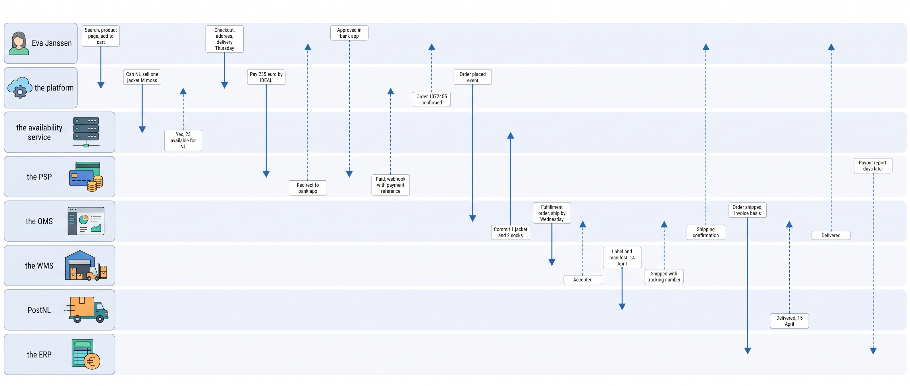
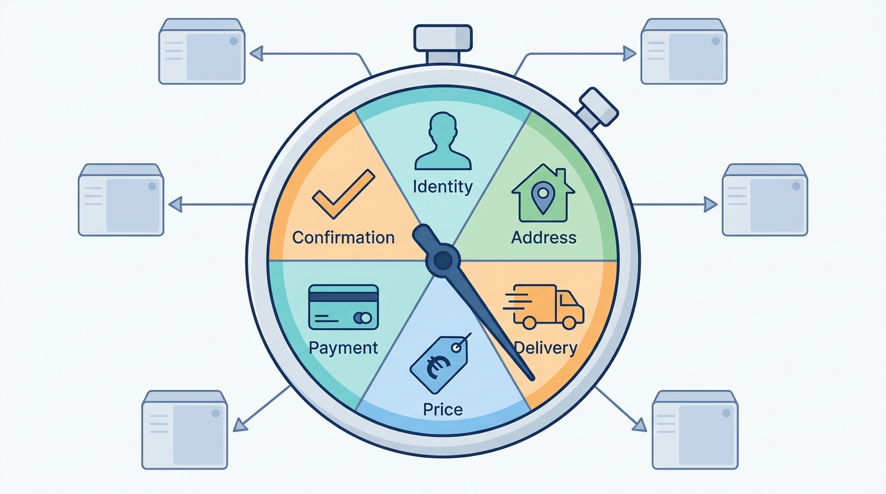
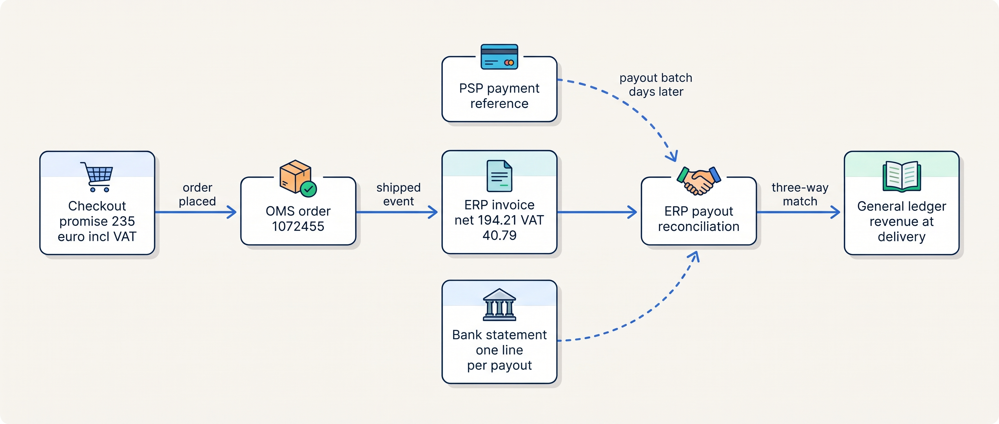
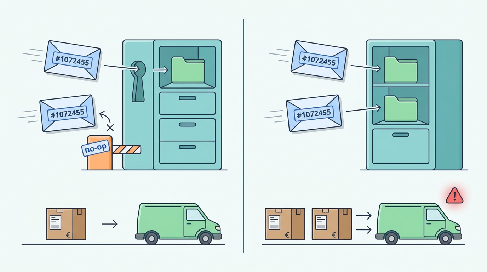

> **IN THIS CHAPTER, YOU WILL:** Follow one consumer order through every system it touches, from search to the ledger, and see which system makes each promise and what breaks when it cannot keep it.

> **KEY POINTS:**
>
> * **One order is fifteen handoffs, and each handoff is a promise.** The storefront promises a product, a price, a stock level and a delivery day; the payment provider promises money; the warehouse promises a parcel; the carrier promises a doorstep; the finance system promises a correct invoice. Nearly everything that goes wrong is a promise one system made and another could not keep.
> * **Each promise has exactly one owner in the target architecture.** Product information management owns what the jacket is, the availability service owns whether it can be sold, the platform owns the checkout and the payment handshake, order management owns the order from the moment it exists, the warehouse system owns physical stock and the parcel, the finance system owns the invoice and the books. Copies are allowed; a second writer is not.
> * **Every join delivers at least once and sometimes twice, late or not at all.** The order number is the key that makes a repeated message harmless, and a daily reconciliation is the net under every webhook. A design that assumes each message arrives exactly once is the one that produces the duplicates and the gaps customers find.

> **[FAILURE PATTERNS THIS CHAPTER ADDRESSES](where-commerce-platforms-go-wrong.html):**
>
> * **Schrödinger's Order** — an order whose status lives in three systems has no status; this journey shows where one record replaces three.
> * **The Phantom Stock** — the storefront's "in stock" is a copy of the warehouse's count, and the journey shows how long that copy may be allowed to lag.
> * **The Message in a Bottle** — the order crosses six joins, and the chapter names, at each, what happens when the message arrives twice or not at all.

 
Eva Janssen buys a jacket and socks from **Kestrel & Pine, a fictional outdoor brand**. To deliver that simple purchase, search, checkout, payment, warehouse, carrier and finance systems must pass records to one another. A wrong stock answer or a late warehouse instruction can break the delivery promise even when checkout succeeds. Following one order makes those dependencies visible.

Kestrel & Pine takes 293,000 online orders annually. At that volume, even a failure in one order per thousand affects customers almost daily. This walkthrough follows the ordinary path from search to the books, showing what each handoff must preserve and how a failure reaches the customer. The figures, dates and systems are invented for teaching; [[meet-kestrel-and-pine]] introduces the company.

**Where we are in the order's journey.** The full purchase, from search to the books. [[journey-return-and-exchange]] continues with the jacket coming back; [[journey-of-an-order]] offers a shorter overview.

## The Order, the Setting and the Rules of This Walk

**The order.** At **21:14 on 13 April 2027**, Eva Janssen in Nijmegen buys a **€199 Ridgewalker women's jacket, M, moss**, and **two €18 pairs of socks**. Order **#1072455** totals **€235 including value-added tax (VAT)**, with free shipping over €75. She pays through **iDEAL**, a Dutch bank-transfer method. Duiven picks and packs on **14 April**; PostNL delivers on **15 April**.

**The setting is a replay through the late-2027 design.** Waypoint, Kestrel & Pine's improvement program, adds an availability service to calculate sellable stock (**W1**), an **order management system (OMS)** to coordinate orders (**W2**), and a **product information management system (PIM)** for catalog content (**W3**).

None was live for Eva's actual April order. Storefront orders move to the OMS on 13 October. We keep her dates and amounts but replay the order through the later design; a section near the end explains the original route.

**The systems.** The table names each system by its job and identifies its authoritative facts. That makes it an **entity–owner table**. If copies disagree, the assigned **system of record** supplies the value to trust ([[boundaries-and-systems-of-record]]).

| Fact about the order | System of record (late 2027) | Who else holds a copy |
| --- | --- | --- |
| What the Ridgewalker is: name, attributes, images, sizes, GTIN | **the PIM** (product information management system) | the platform, the search index, the marketplace connector |
| Consumer price €199 | **the platform's** price list for the NL storefront | the search index, the OMS (as the price sold at) |
| Physical stock at Duiven | **the WMS** (warehouse management system) | the availability service, the ERP (valuation only) |
| What may still be sold to the NL storefront | **the availability service** (a module of the OMS) | the platform, the search index |
| The cart and the checkout | **the platform** | nobody |
| The payment | **the PSP** (payment service provider), with its reference stored on the order | the platform, the OMS, the ERP |
| The order: lines, state, customer reference, promises made | **the OMS** (order management system) | the platform (customer-facing history), the ERP, the data warehouse |
| The fulfillment order and the parcel | **the WMS**, with the shipping service for the label | the OMS |
| Tracking events | **PostNL**, normalized by the shipping service | the OMS, the platform's order status page |
| The invoice, VAT and the ledger entries | **the ERP** | the data warehouse |

Eight systems hold a piece of one order, and that is the normal condition, not a problem to fix. The problem is a fact with two writers, and the table has none.

## Fifteen Steps in One Table

Here is the whole journey at a glance. Each row names the step, the system that performs it, the data that moves, the promise made to Eva or to another system, the failure that belongs to this step, and the chapter that owns it. Times within a day are illustrative; the ledger fixes the dates.

| # | Step | System | Data | Promise made | What could fail here | Chapter |
| --- | --- | --- | --- | --- | --- | --- |
| 1 | Search "waterproof jacket" | the platform's search index | query, ranked products | "These products exist and match" | Stale index: a discontinued or renamed product shows | [[commerce-search-and-discovery]] |
| 2 | Product page | the platform, reading PIM content | attributes, sizes, images, price €199 | "This is the jacket, at this price" | Wrong attribute; price differs from another channel (The Price Drift) | [[product-information]], [[pricing-architecture]] |
| 3 | Availability check, size M moss | the availability service | available-to-promise for channel NL | "You can buy this one" | Stale copy, two writers, wrong buffer (The Phantom Stock) | [[inventory-and-availability]] |
| 4 | Add to cart, 21:09 | the platform | cart lines, quantities | none: a cart is a draft | Cart lost on login; abandonment | [[cart-and-checkout]] |
| 5 | Checkout: identity, address, delivery option | the platform, calling the delivery-promise service | address, shipping method, promised date | "Delivered Thursday 15 April" | Static promise contradicts the warehouse cut-off | [[cart-and-checkout]], [[shipping-and-delivery]] |
| 6 | Price review and VAT | the platform | €235 incl. 21% VAT, free shipping | "You pay exactly this" | Promotion stacking error; tax basis differs from invoice | [[commerce-promotions]], [[tax-invoicing-and-ledger]] |
| 7 | Payment by iDEAL, 21:13–21:14 | the PSP, Eva's bank | payment reference, amount, status | "The money is paid" | Eva never returns from the bank app; webhook late or duplicated | [[commerce-payments]] |
| 8 | Order created and confirmed, 21:14 | the platform, then the OMS | order #1072455, lines, customer and payment references | "The order exists and will be kept" | Created twice; created in the platform but never in the OMS | [[order-management]] |
| 9 | Stock committed | the availability service | committed +1 jacket, +2 socks | "Nobody else can buy these units" | Commit event lost; oversold on a hot SKU | [[inventory-and-availability]] |
| 10 | Fulfillment order sent and accepted | the OMS → the WMS via the iPaaS | lines, destination, service level, promised date | "Duiven will ship this" | Request duplicated or never acknowledged; WMS queue backs up | [[warehouse-and-fulfillment]], [[integration-styles]] |
| 11 | Pick and pack, Wednesday morning | the WMS | pick list, packed units, carton | "These exact units are in this box" | Short pick (shelf count wrong); wrong size scanned | [[warehouse-and-fulfillment]] |
| 12 | Label, manifest, handover to PostNL | the shipping service, PostNL | tracking number, label, manifest | "The parcel is with the carrier" | Label call fails; manifest closed before the parcel | [[shipping-and-delivery]] |
| 13 | Shipped event, confirmation and tracking | the WMS → the OMS → the platform | shipment, tracking number, carrier events | "You can see where it is" | Tracking number not passed on: no updates, a WISMO ticket | [[customer-service-and-notifications]] |
| 14 | Delivered, Thursday 15 April | PostNL → the OMS | delivered event, time | "It is at your door" | Delivered to a neighbor; lost; damaged | [[shipping-and-delivery]] |
| 15 | Invoice, revenue and payout | the ERP, the PSP | invoice, VAT €40.79, PSP payout line | "The books agree with the bank" | Order posted twice or not at all; payout unmatched | [[tax-invoicing-and-ledger]] |

Every "promise made" column entry has a different owner from the row above it. That is why the joins between rows are where [[where-commerce-platforms-go-wrong]] locates most of its sixteen patterns.

**Figure 1:** *Eva's jacket in the late-2027 architecture: the platform sells and takes the money, the OMS owns the order from the moment it exists, the WMS and PostNL move the parcel, and the ERP books the invoice and matches the payout; every arrow is a handoff with one sender and one owner.*

## Before the Buy: Search, Product Page and "In Stock"

At 21:02 Eva types "waterproof jacket" into the Dutch storefront. The storefront does not search the catalog; it searches a **search index**, a copy of the catalog rebuilt from the PIM whenever product content is published. A copy is fast and a copy goes stale, so the first promise of the journey ("these products exist and match") belongs to the publication schedule: under W5, **products move by scheduled publication**, the PIM publishes and the index consumes. [[commerce-search-and-discovery]] owns the index; [[product-information]] owns the PIM.

The product page makes the second and third promises, and they have different owners. **What the jacket is** (the name, the fabric attributes, the sizes, the moss color, the GTIN, the Global Trade Item Number behind the barcode on every own-brand SKU since 2021) comes from the PIM. **What it costs** (€199, including 21% Dutch VAT, as every consumer price in the EU is shown) comes from the platform's price list for the Dutch storefront. Before the PIM the same jacket was described in four places, and the Price Drift of October 2026, nine days of the German storefront selling it at €179 while every other channel charged €199, is what a silent copy costs ([[pricing-architecture]]).

**"In stock" is the most expensive words on the page.** When Eva selects size M in moss, the storefront asks the availability service for **available-to-promise** for the NL channel: in plain words, the units that may still be promised to a new order. The formula the industry uses, as practice rather than as any one vendor's definition, is on-hand stock minus units already committed to orders minus any buffer the merchant holds back, per location and per channel.

Every platform exposes some version of it: Shopify's inventory documentation (n.d., accessed 2026-11) separates `on_hand`, `committed` and `available` per location; commercetools documents that its `availableQuantity` is "eventually consistent" with the quantity used for reservations "with a delay of up to 10 seconds" (n.d., accessed 2026-11).

Ten seconds is small; on a hot SKU during a launch it is still enough to sell the last unit twice, which is why [[inventory-and-availability]] treats the buffer and the reservation path as design decisions.

In the target architecture the answer comes from one place. The WMS is the system of record for physical stock at Duiven (W1) and emits a **stock event**, a message sent the moment a count changes, for every receipt, pick and adjustment. The availability service consumes those events, subtracts commitments and the per-channel buffer (one unit per SKU for the storefronts), and publishes an available number per channel; the storefront reads it and never computes its own. Assume the moss jacket in size M shows 23 available for NL at 21:05 *(assumption)*. "In stock" is then a copy seconds old rather than up to two hours old, the January 2027 figure behind the Black Friday Oversell.

## Checkout: Six Promises Under a Clock

Eva adds the jacket and two pairs of socks at 21:09. A **cart** is a draft: it reserves nothing and promises nothing, and most carts never become orders; the Baymard Institute's running average of fifty published studies puts abandonment at 70.22% (updated 28 October 2026). Kestrel & Pine's platform, like most, reserves stock at order creation rather than at add-to-cart, so an abandoned cart costs nothing but a lost sale.

**Checkout** is the ninety seconds in which the platform turns the draft into promises it can keep. It is an orchestration: a sequence of calls to systems that own the facts, run under the clock of Eva's patience, and it owns none of those facts itself ([[cart-and-checkout]]). In order:

1. **Identity.** Eva signs in to her account. An order needs a customer *reference*, not an account; forcing one is the fourth-largest stated reason to abandon in Baymard's list. Her account is still one of four records of her, which is [[identity-and-master-data]]'s problem, not this chapter's.
2. **Address.** Nijmegen, the Netherlands. The address decides the tax: a Dutch consumer pays Dutch VAT at 21%; a Belgian one would pay Belgian VAT under the EU's One Stop Shop rules once the merchant's cross-border consumer sales pass €10,000 a year ([[tax-invoicing-and-ledger]]).
3. **Delivery option and promise.** The Dutch storefront's standing promise is "ordered before 22:00, delivered tomorrow". In January 2027 that was a sentence in the page template with no data behind it. In the target architecture the checkout asks a **delivery-promise service**, which W8 lists as a prerequisite, and that service knows the warehouse's real cut-off. Duiven releases its last pick wave at 21:00 and PostNL collects at 22:30 (Kestrel & Pine illustrations from [[warehouse-and-fulfillment]]): an order placed at 21:14 misses the last wave, is picked Wednesday and delivered Thursday, so the checkout shows **Thursday 15 April**, and that is the day the parcel arrives. The dates are the same under both architectures; what changes is whether the promise matched them. [[shipping-and-delivery]] owns the computed promise.
4. **Price review.** €199 plus 2 × €18 is €235; shipping is free above €75; no coupon applies. The platform freezes these amounts on the order. The price is now a promise, and the invoice in step 15 must match it.
5. **Payment.** See the next section.
6. **Confirmation.** The order exists.

**Figure 2:** *Checkout is six promises under a clock: the platform orchestrates them in about ninety seconds, but every fact it promises is owned by another system.*

None of these calls should be patched into the checkout's markup. Shopify's dated history is the public lesson: in February 2023 it announced that the `checkout.liquid` file merchants had edited would stop working for the main checkout pages on 13 August 2024, replaced by sandboxed extensions. Kestrel & Pine's agency customized the theme, not the checkout, and the decision to stay on the platform (W4) depends on keeping it that way.

### The payment: iDEAL, a detour through the bank

Eva chooses iDEAL. It matters which method she chose, because the money's state machine differs by method, and the order system must model the one it is given rather than a generic "paid: true" ([[commerce-payments]]).

iDEAL is a bank-initiated transfer: the shopper is redirected to her own bank's app, approves the amount there, and the bank pushes the money. The Dutch Payments Association reported 1.47 billion iDEAL payments worth €141 billion in 2024 (18 February 2025). Mollie's method documentation (n.d., accessed 2026-11) states the properties that shape the architecture: an "instant charge", **auto-capture only**, no chargeback risk, a session that expires after 15 minutes. Three consequences follow.

- **There is no separate capture.** For a card, the PSP first *authorizes* (reserves the money) and the merchant later *captures* (takes it), often when the parcel ships. For iDEAL the money moves at approval; "capture on shipment" does not apply, and a refund is a new transfer back, not the release of a hold.
- **The shopper leaves and may not come back.** Between 21:13 and 21:14 Eva is in her bank's app. Stripe's fulfillment guide (n.d., accessed 2026-11) states the rule for every PSP: "You can't rely on triggering fulfillment only from your checkout landing page, because it's not guaranteed customers visit that page." The platform learns the outcome from the PSP's **webhook**, an HTTP call the PSP makes to the merchant's system when the status changes, not from Eva's browser.
- **The webhook is a notification, not a fact.** Mollie's webhook carries only an identifier, "the status is not transmitted", so a forged call cannot mark an order paid; the receiver fetches the status from the API. Mollie retries an unanswered webhook ten times over 26 hours; Stripe retries for up to three days and does not guarantee order. The platform records the payment reference and the fetched status on the order, never the webhook's claim.

At 21:14 the platform creates order **#1072455** with the payment *pending* and shows Eva the confirmation; seconds later the PSP's webhook arrives, the platform fetches the status, and the order is marked paid. The order confirmation e-mail, the one notification Shopify's documentation says cannot be switched off (n.d., accessed 2026-11), goes out from the platform in the same minute.

## The Order Becomes a Record: Platform to OMS to WMS

Until 21:14 the order was the platform's. From 21:14 it belongs to the OMS, and this handoff is the one Waypoint (W2) was created to fix.

**The platform emits an "order placed" event** carrying the order number, the lines, the frozen prices, the customer reference, the delivery promise and the PSP's payment reference. The iPaaS, the integration platform through which Kestrel & Pine's flows run, delivers it to the OMS. The OMS creates the order with **one state model** for every channel: the money state (paid, by iDEAL, with its reference), the goods state (unfulfilled) and later the return state are three separate machines on one record, as Shopify's and commercetools' order models keep them (both n.d., accessed 2026-11), because "fulfilled" never means "delivered" and "paid" never means "invoiced". The platform keeps the order history Eva sees in her account; the OMS keeps the operational truth; the ERP will keep the financial one.

**The order number is the idempotency key.** The event may arrive twice: Shopify's documentation says plainly that "your app might receive the same webhook more than once" and that ordering is not guaranteed (n.d., accessed 2026-11), and every queue and iPaaS retry behaves the same way. **Idempotency** means that handling a message twice has the same effect as handling it once; the OMS keys order creation on #1072455, so the second copy finds the order and does nothing. Stripe's API applies the same principle in the other direction, saving the first response to a client-supplied idempotency key so a retry returns it instead of charging again (n.d., accessed 2026-11). W5 makes this a standard for every Kestrel & Pine integration.

**Stock is committed.** The OMS tells the availability service to move one jacket and two pairs of socks from available to committed for the Duiven location. On-hand does not change; the shelf still holds the units. Available drops from 23 to 22 for the moss jacket in M, and the next shopper's product page says so within seconds.

**The fulfillment order is the contract with the warehouse.** The OMS now creates a **fulfillment order**, an instruction to one location to ship these lines to this address by this service level, and sends it to the WMS through the iPaaS. It carries what the warehouse needs (lines, destination, carrier service, promised date) and nothing it does not (prices, payment, customer history). The handshake follows the best-documented public model: in Shopify's fulfillment-order design the merchant *requests* fulfillment, the warehouse *accepts* or *rejects*, and once accepted the merchant must *request* cancellation rather than cancel (shopify.dev, n.d., accessed 2026-11). The WMS accepts at 21:15; the order is now **in progress**, the state the Three-Status Order of December 2026 could never agree on.

**Wednesday morning at Duiven.** The order joins a **pick wave**, a group of orders released together so one walk through the warehouse serves many of them, at the first release of the day, 06:30 (illustrative). A picker scans the jacket's and the socks' GTINs into a tote; the scan is the moment the WMS confirms that the units it promised exist. Packing chooses the carton and closes the lines. Two things then leave the WMS for different places: a **stock event** (on-hand minus three units) to the availability service, which also clears the commitment, and a **shipped event** to the OMS once the label exists.

The label comes from the **shipping service**, the multi-carrier layer inside the WMS flow. It asks PostNL's API for a label and a tracking number, prints it, and at the end of the day **manifests**: closes the day's list of parcels and hands it to the carrier. Manifesting is a carrier-specific rule integrations forget; DHL's German parcel API transfers shipments "only when manifested", with an automatic close-out at 17:45 (developer.dhl.com, updated 2026-11), and PostNL's own APIs are mid-migration to a renewed generation rolled out from 2025 (n.d., accessed 2026-11). The shipping service absorbs these differences so the WMS sees one label call and one tracking vocabulary ([[api-contracts-and-versioning]]).

At 18:30 the shipping service closes Wednesday's PostNL manifest, and at 22:30 the PostNL truck collects (times illustrative). Eva's jacket has left the building.

## In Transit: Tracking, Notifications and "Where Is My Order"

From the collection scan onward the parcel's state is PostNL's to know and Kestrel & Pine's to relay. A **tracking event** is one carrier scan with a time and a place: accepted, in transit, out for delivery, delivered, attempted. Carriers each have their own codes; a multi-carrier layer maps them to one small vocabulary, such as the ten statuses EasyPost documents for its tracker object (n.d., accessed 2026-11). The shipping service feeds normalized events to the OMS, which updates the order's goods state and raises the notifications.

Eva receives three messages with three origins: the **shipping confirmation** with the tracking link when the WMS reports the label (Wednesday afternoon), **out for delivery** when PostNL's morning scan arrives (Thursday 07:50), and **delivered** at 11:20 on Thursday (times illustrative). The order status page in her account is a read model over the OMS's order and the tracking stream, the same record a service agent sees; built from different sources, the two would disagree on the day it matters.

The measure of this part of the journey is a service metric. "Where is my order" (WISMO) is consistently the largest single category of e-commerce support contacts; Gorgias's helpdesk data put it at 18% of incoming requests (updated 13 November 2023). The number is an architecture signal: a tracking number that never left the WMS, a static promise, a split shipment without an explanation. Shopify's help documentation states the failure in one sentence: "If you fulfill an order without a tracking number, then no shipping updates are received" (n.d., accessed 2026-11). [[customer-service-and-notifications]] owns the service view.

**Delivery is also a legal event.** Under the EU Consumer Rights Directive (2011/83/EU), the risk of loss passes to the consumer when she "has acquired the physical possession of the goods"; until 11:20 on Thursday the parcel is Kestrel & Pine's risk, which is why the OMS needs the delivered event and not only the shipped one.

## The Money and the Books

The parcel's journey ends at the door. The order's does not. Three documents still have to agree: the invoice, the payment and the bank.

**The invoice comes from the ERP, not the shop.** The OMS sends a "shipped" event to the ERP on Wednesday, and the ERP issues the invoice from it. The reason is numbering. A Dutch invoice must carry a unique, sequential invoice number and date, the parties, the goods, the net amount per VAT rate and the VAT amount in euros (Belastingdienst, n.d., accessed 2026-11); "sequential" means gap-free within a series, so the number is assigned by one system at the moment of posting, never pre-allocated by a checkout.

Once issued, an invoice is immutable: Odoo's documentation, representative of any ERP, states that "Once confirmed, an invoice can no longer be updated" and that a credit note "is the only legal method for canceling, refunding, or modifying a validated invoice" (18.0 documentation, accessed 2026-11). Eva's exchange next week will produce a credit note, not an edit ([[journey-return-and-exchange]]).

For #1072455 the invoice reads, net of 21% VAT: jacket €164.46, two pairs of socks €29.75, total net **€194.21**, VAT **€40.79**, gross **€235.00**, arithmetic on the ledger's prices. The amount matches the checkout because nothing changed between the two; when something does (a short pick, a canceled line) the invoice follows what shipped, not what was ordered ([[tax-invoicing-and-ledger]]).

**Revenue is recognized at delivery, not at payment.** Under IFRS 15 (issued 2014, effective from 2018), revenue is recognized when control of the goods passes to the customer, which for a parcel is delivery. Kestrel & Pine was paid on Tuesday, invoiced on Wednesday and earned the revenue on Thursday, and a 24% item return rate means a refund liability sits beside the revenue until the withdrawal period runs out. Sanne de Wit's month-end depends on these being three different fields.

**The payout arrives days later and is matched by finance, not by the order system.** The PSP pays out in batches: Adyen's default "sales day payout" groups a day's funds into one batch with a delay of two business days (n.d., accessed 2026-11); Stripe's default settlement in most EU countries moves from seven calendar days to three business days once an account is established (n.d., accessed 2026-11).

One bank deposit therefore contains hundreds of orders, minus fees, refunds and chargebacks. The join is a **payout reconciliation report**: Stripe's lists "every payment, refund, dispute, fee, and other balance transaction included in the payout" with the order id and a `trace_id` the bank also sees (n.d., accessed 2026-11).

The ERP matches Eva's €235 inside Tuesday's batch to the invoice, posts the PSP's fee (for iDEAL a fixed amount per transaction on Adyen's indicative price list, n.d., accessed 2026-11), and the three-way match of invoices, PSP report and bank statement closes. The deeper mechanics belong to the sibling book RECONCILED ([[payments-to-ledger]], [[traceability-and-reconciliation]]).

**Figure 3:** *One order, three financial records: the checkout's promise, the ERP's invoice issued on dispatch, and the PSP's payout matched against the bank statement; the ledger closes only when all three agree.*

## What Each Handoff Requires

The style of every join follows from four questions: how fresh the data must be, how consistent, how fast, and how available. The latency figures are the author's illustrative targets for a merchant of Kestrel & Pine's size, not ledger facts.

| Handoff | Freshness | Consistency | Latency | Availability | Style (W5) |
| --- | --- | --- | --- | --- | --- |
| WMS → availability service → storefront | Seconds | Eventually consistent, one writer per quantity | Under 10 s *(assumption)* | Storefront keeps the last value, with a buffer | Events |
| Checkout → PSP → platform | Redirect immediate; webhook within minutes | Status fetched, never assumed | Under 2 s per call *(assumption)* | Fails closed: no order without a fetched status | Call plus webhook |
| Platform → OMS | Seconds | One order per order number | Under 30 s *(assumption)* | OMS catches up by replay | Events, idempotent |
| OMS → WMS (fulfillment order) | Minutes | Request, accept, reject, cancel-request | Before the next pick wave | Queue absorbs an outage; the cut-off is the deadline | Events with acknowledgement |
| WMS → shipping service → carrier | At pack | One label per parcel; manifest once | Under 5 s per label *(assumption)* | Fallback carrier (DPD) if the label call fails | Synchronous call |
| OMS → ERP (invoice, posting) | Same day | One invoice per shipment, one posting per invoice | Daily batch | Reconciliation count per day | Daily batch |
| PSP → ERP (payout) | Days | Batch total equals bank line | Days | Monthly close | File or reporting API |

Two rows cannot be batch, availability and the fulfillment order, because an hour's delay on the first is the Black Friday Oversell and on the second a missed cut-off. Two rows should be batch, invoice posting and payouts, because finance tolerates a day and gains a reconciliation count from it. "Finance can be batch; availability cannot" is the rule [[erp-and-back-office-integration]] states, and this journey demonstrates it.

## The Same Order in January 2027

Run #1072455 through the landscape Noor Visser found in January, and four things change while the dates stay the same.

| Step | Late 2027 | January 2027 |
| --- | --- | --- |
| "In stock" on the product page | Seconds old, from the availability service on WMS events | Up to two hours old: WMS → ERP every 15 minutes, ERP → platform hourly (The Phantom Stock) |
| Delivery promise at checkout | Computed: Thursday 15 April | Static "delivered tomorrow": Wednesday 14 April, which the parcel missed by a day |
| The order record | One, in the OMS, with one state model | Three: the platform's order, the WMS's pick, the ERP's posting, each with its own status (Schrödinger's Order) |
| The invoice | From the ERP on the shipped event | From the ERP through the partner-built connector, only on the WMS's "order complete" message, so a split order showed "Not invoiced" for days |

The parcel still shipped on Wednesday and arrived on Thursday; Eva would have noticed only that the promised day was wrong. The Three-Status Order of December 2026, which showed *Delivered*, *In picking* and *Not invoiced* for six days and cost eleven tickets, is this January path with one split shipment: the iPaaS flow marked the whole two-line order fulfilled at the first parcel, the WMS still showed the second line in picking, and the ERP waited for an "order complete" message that could not come until the second parcel shipped. Nothing in that landscape was broken; the joins had no owner, no idempotency and no reconciliation, and W5 is the sentence that changed that.

## When It Goes Wrong Along This Path

The step table names a failure per step. Five of them deserve the mechanism, the detection and the recovery, because they recur at every merchant.

**The duplicate order.** The "order placed" event arrives at the OMS twice, or the iPaaS replays a day after an outage. Detection: by design, the OMS keys on the order number and the second copy is a no-op; a count of "orders received" against "orders created" per hour shows the duplicates without harm. Without the key, the WMS ships two parcels and the customer keeps one: the Message in a Bottle in its most expensive form.

**Figure 4:** *The order number is the key that makes a repeated message harmless: the second copy of #1072455 is a no-op, and without the key the warehouse ships two parcels.*

**The order that was paid and never confirmed.** The PSP's webhook fails for 26 hours and then stops; the shopper paid and the order still says *pending*. Detection: a daily sweep that lists checkouts whose payment reached no terminal state within the method's expiry window and queries the PSP, the job Stripe's and Mollie's documentation both ask merchants to run. Recovery: mark the order paid from the fetched status, late but once, and release it to the OMS. Webhooks are a latency optimization over a reconciliation, never a replacement ([[events-consistency-and-reconciliation]]).

**The short pick.** The picker finds no moss jacket in M where the WMS says there are 22. The classic study of inventory-record accuracy found 65% of about 370,000 records inaccurate at one US retailer's stores (DeHoratius and Raman, *Management Science*, 2008, dated but still the reference point); cycle counting keeps the number low, not zero. Detection: at the scan. Recovery: the WMS reports the line short, the OMS splits or holds it, the availability service corrects on-hand, and the customer is told before the promise date. A WMS that silently ships two of three items produces a wrong invoice and a WISMO ticket. The queue that backed up for four hours on Black Friday 2026 is the same path under load ([[journey-peak-day]]).

**The lost parcel.** No scan for 48 hours after collection. Detection: a rule on the tracking stream, not a customer e-mail. Recovery: re-ship from stock (the risk was still the merchant's) and claim against the carrier; the OMS records a second shipment on the same order, and the invoice does not change. PostNL reports a parcel "delivery quality" of 97% in 2023 and 2024 (annual report, 2025); at Kestrel & Pine's volumes the remaining 3% is about ten thousand parcels a year that need this path.

**The payout that does not match.** Tuesday's batch is short by €235. Causes, in the order finance checks them: a refund deducted from a later batch, a fee netted differently, a failed refund returned days later, or an order refunded twice, the Double Refund of January 2027 (€19,400, twice). Detection: the three-way match. Recovery: a journal correction with the PSP's line as evidence and, for the double refund, a rule that only one system may call the PSP's refund API ([[commerce-payments]]).

## What to Take Away

**Established.**

- The order's journey crosses systems that each own one fact, and the handoffs between them are where commerce failures concentrate; Shopify, commercetools, Stripe and Mollie document the same model from four sides: separate state machines for money and goods, order creation driven by fetched payment status, request-and-accept handshakes with the warehouse.
- Every delivery mechanism between those systems is at-least-once in practice: Shopify, Stripe and Mollie all document duplicate and out-of-order deliveries and ask the receiver to deduplicate and reconcile. Exactly-once is a property the receiver builds with an idempotency key, not one it receives.
- The invoice is issued by one numbering authority at dispatch, is immutable once issued, and is corrected only by credit note; revenue is recognized at delivery under IFRS 15. The order system makes promises; the ERP keeps the books.

**Depends on context.**

- Whether the OMS should exist at all. At Kestrel & Pine's stage (four channels, one warehouse, stores, marketplaces, EDI) one order record is necessary; a Starting or Growing merchant with one channel and a 3PL gets the same journey from the platform's own order and fulfillment-order model, and an OMS would be the Giant's Boots.
- Whether the delivery promise should be computed. A static rule is honest at one warehouse with one carrier and a cut-off the warehouse actually meets; compute the promise when the warehouse's collection time and the page's cut-off differ, as they did here, or when there is more than one lane.
- Whether capture should follow shipment. For cards, capturing at dispatch saves refund fees and ties money to goods; for iDEAL and other instant methods there is no capture step, and the design must not assume one.

**The author's synthesis.**

- I read any commerce architecture by walking one order through it with this chapter's step table, and I stop at every row where the promise and the system of record belong to different systems with no event, no key and no reconciliation between them. Those rows are next year's incidents.
- I would rather have eight systems with one owner per fact than three systems with two owners for stock. Count writers, not boxes.

## Questions to Ask

1. For each fact on an order (product, price, stock, promise, payment, status, invoice), which single system is the system of record, and which systems hold copies?
2. What is the idempotency key for "create order", "create fulfillment order", "refund" and "post invoice", and what happens when the same message arrives twice?
3. When the PSP's webhook never arrives, which job notices, how long after, and who owns it?
4. Where does the delivery promise shown at checkout come from, and is the warehouse's real cut-off one of its inputs?
5. Does the storefront's "in stock" come from an availability service fed by stock events, or from a periodic copy, and how old can the copy be at peak?
6. When the warehouse picks short, who tells the customer, when, and does the invoice follow what shipped?
7. Does the order status page read the same record the service agent reads?
8. Which system issues the invoice number, and can anyone edit an issued invoice?
9. How is one PSP payout matched to the orders it contains, and what were last month's unexplained differences?

Eva's jacket arrived on Thursday, and on Monday she will ask for a size L. The way back crosses many of the same systems in the opposite direction, with a refund and a credit note where the payment and the invoice were, and it is where Kestrel & Pine paid €19,400 twice. [[journey-return-and-exchange]] follows it.

## Sources and Evidence

*Company, product and investor sources*

- [Inventory management apps: inventory quantities](https://shopify.dev/docs/apps/build/orders-fulfillment/inventory-management-apps) — Shopify developer documentation, n.d., accessed 2026-11; the named inventory states (`on_hand`, `committed`, `available`).
- [Draft order and transfer shipment inventory is moving from reserved to committed](https://shopify.dev/changelog/draft-order-and-transfer-shipment-inventory-is-moving-from-reserved-to-committed) — Shopify changelog, 2026-08-05; a stock state's meaning changing under its readers.
- [Build for fulfillment services](https://shopify.dev/docs/apps/build/orders-fulfillment/fulfillment-service-apps/build-for-fulfillment-services) and [FulfillmentOrder object](https://shopify.dev/docs/api/admin-graphql/latest/objects/FulfillmentOrder) — Shopify developer documentation, n.d., accessed 2026-11; the request, accept, reject and cancellation-request handshake.
- [Order status](https://help.shopify.com/en/manual/fulfillment/managing-orders/order-status) — Shopify Help Center, n.d., accessed 2026-11; separate payment and fulfillment status families on one order.
- [Webhooks](https://shopify.dev/docs/apps/build/webhooks) and [HTTPS delivery](https://shopify.dev/docs/apps/build/webhooks/subscribe/https) — Shopify developer documentation, n.d., accessed 2026-11; duplicate and unordered deliveries, retries, reconciliation jobs.
- [Customer notifications](https://help.shopify.com/en/manual/fulfillment/setup/notifications/customer-notifications) and [Understanding order status pages](https://help.shopify.com/en/manual/fulfillment/setup/order-status-page/understanding-order-status-pages) — Shopify Help Center, n.d., accessed 2026-11; the notification list, the order confirmation that cannot be disabled, and "no tracking number, no updates".
- [The checkout.liquid theme file is being deprecated](https://changelog.shopify.com/posts/the-checkout-liquid-theme-file-is-being-deprecated) — Shopify changelog, 2023-02-13, and [checkout.liquid](https://shopify.dev/docs/storefronts/themes/architecture/layouts/checkout-liquid), n.d., accessed 2026-11; the dated removal of checkout markup customization.
- [Orders](https://docs.commercetools.com/api/projects/orders) and [Inventory](https://docs.commercetools.com/api/projects/inventory) — commercetools API documentation, n.d., accessed 2026-11; order, shipment and payment states; the 10-second availability consistency window.
- [Fulfill orders with Checkout](https://docs.stripe.com/checkout/fulfillment.md?ui=full-page), [Webhooks](https://docs.stripe.com/webhooks), [Idempotent requests](https://docs.stripe.com/api/idempotent_requests), [Payouts](https://docs.stripe.com/payouts) and [Payout reconciliation report](https://docs.stripe.com/reports/payout-reconciliation) — Stripe documentation, n.d., accessed 2026-11; fulfillment from webhooks, retries for three days, idempotency keys, settlement timing, payout matching.
- [iDEAL](https://docs.mollie.com/docs/ideal.md), [Webhooks](https://docs.mollie.com/docs/webhooks) and [Handling payment status](https://docs.mollie.com/docs/handling-payment-status.md) — Mollie documentation, n.d., accessed 2026-11; iDEAL's instant charge and auto-capture, the id-only webhook, ten retries over 26 hours.
- [Capture](https://docs.adyen.com/online-payments/capture/), [Sales day payout](https://docs.adyen.com/account/sales-day-payout.md) and [Pricing](https://www.adyen.com/pricing) — Adyen documentation and price list, n.d., accessed 2026-11; authorization versus capture, payout batching and delay, indicative iDEAL fee.
- [Annual turnover iDEAL and PIN payments 2024](https://www.betaalvereniging.nl/en/news/annual-turnover-ideal-pin-payments/) — Dutch Payments Association, 2025-02-18; iDEAL volumes.
- [Parcel DE Shipping API v2](https://developer.dhl.com/api-reference/parcel-de-shipping-post-parcel-germany-v2) — DHL developer portal, updated 2026-11; manifesting as a carrier rule.
- [PostNL developer portal and API overview](https://developer.postnl.nl/api-overview/) — PostNL, n.d., accessed 2026-11; the phased V4 migration and checkout delivery options.
- [Trackers](https://docs.easypost.com/docs/trackers) — EasyPost documentation, n.d., accessed 2026-11; a canonical tracking-status vocabulary.
- [PostNL Annual Report 2024](https://annualreport.postnl.nl/app/uploads/2026/01/PostNL-Annual-Report-2024.pdf) — PostNL, 2025; the self-reported 97% parcel delivery quality.
- [How to automate WISMO requests](https://www.gorgias.com/blog/automate-wismo-requests) — Gorgias, updated 2023-11-13; WISMO as 18% of requests in one helpdesk's data.
- [Customer invoices](https://www.odoo.com/documentation/18.0/applications/finance/accounting/customer_invoices.html) and [Credit notes](https://www.odoo.com/documentation/18.0/applications/finance/accounting/customer_invoices/credit_notes.html) — Odoo 18.0 documentation, accessed 2026-11; sequential numbering, immutability, credit notes as the only correction.

*Standards, regulation and official documentation*

- [Directive 2011/83/EU on consumer rights](http://publications.europa.eu/resource/celex/32011L0083) — Official Journal, 2011-11-22; delivery within 30 days (Art. 18) and passing of risk (Art. 20).
- [Invoice requirements](https://www.belastingdienst.nl/wps/wcm/connect/bldcontenten/belastingdienst/business/vat/vat_in_the_netherlands/vat_administration/invoice_requirements) — Belastingdienst, n.d., accessed 2026-11; mandatory invoice contents in the Netherlands.
- [VAT rates and exemptions](https://business.gov.nl/regulation/vat-rates-exemptions/) — business.gov.nl, n.d., accessed 2026-11; the 21% Dutch standard rate.
- [One Stop Shop](https://vat-one-stop-shop.ec.europa.eu/one-stop-shop_en) — European Commission, n.d., accessed 2026-11; the €10,000 cross-border threshold.
- [IFRS 15 Revenue from Contracts with Customers](https://www.ifrs.org/issued-standards/list-of-standards/ifrs-15-revenue-from-contracts-with-customers/) — IFRS Foundation, issued 2014, effective 2018; revenue when control transfers.
- [Study on the payment attitudes of consumers in the euro area (SPACE 2024)](https://www.ecb.europa.eu/stats/ecb_surveys/space/html/ecb.space2024~19d46f0f17.en.html) — European Central Bank, 2024-12; e-payment solutions at 76% of Dutch online payments.

*Research and practitioner sources*

- [Cart abandonment rate statistics](https://baymard.com/lists/cart-abandonment-rate) — Baymard Institute, updated 2026-10-28; the 70.22% average and the reasons list.
- [Are inventory records inaccurate? Evidence from retail](https://econpapers.repec.org/RePEc:inm:ormnsc:v:54:y:2008:i:4:p:627-641) — DeHoratius and Raman, *Management Science* 54(4), 2008; the 65% record-inaccuracy finding (dated).
- [Starbucks does not use two-phase commit](https://www.enterpriseintegrationpatterns.com/ramblings/18_starbucks.html) — Gregor Hohpe, 2004; write-off, retry and compensation as the three error strategies behind every handoff in this chapter (dated, still the clearest analogy).

Kestrel & Pine is fictional; architectural recommendations, labeled inferences and labeled assumptions are the author's judgement.
