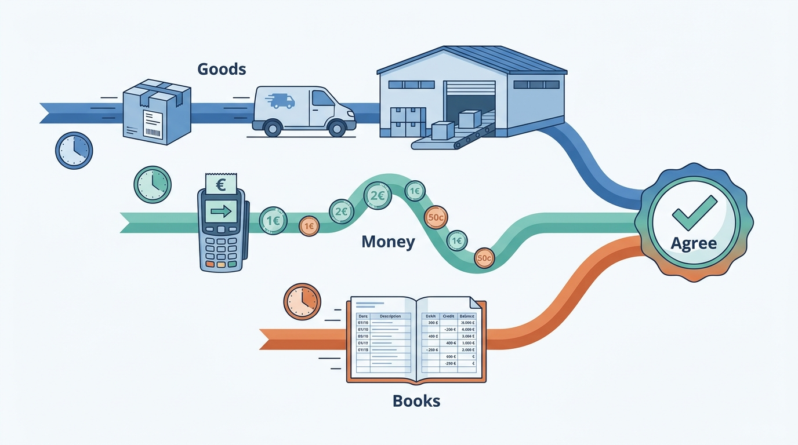
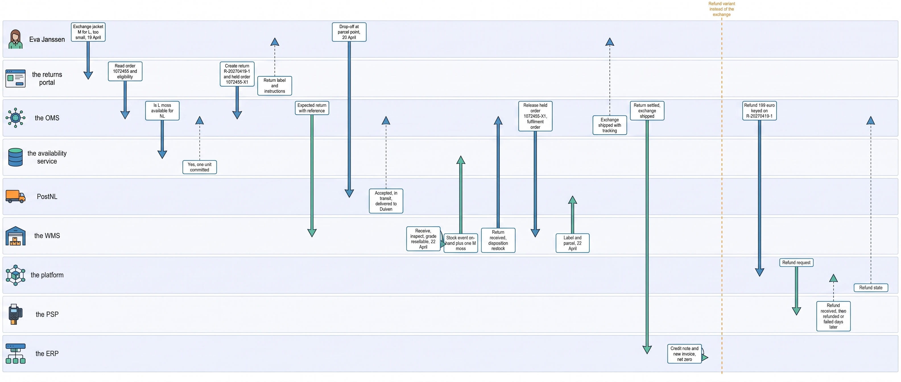
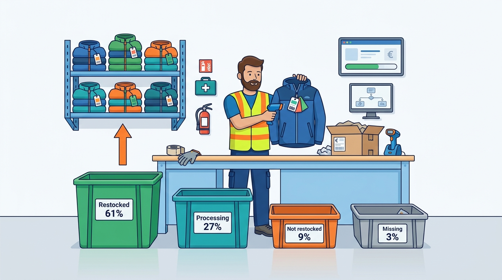
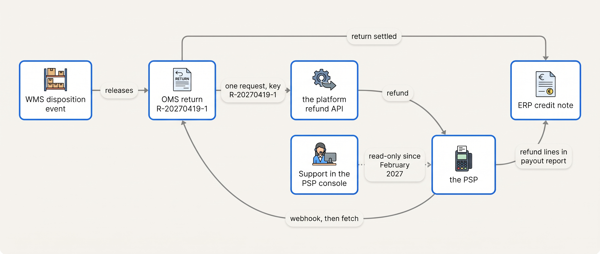

> **IN THIS CHAPTER, YOU WILL:** Follow one returned jacket from the request to the restock, the exchange or the refund, and the credit note, and see which system owns each step and where the money goes out twice.

> **KEY POINTS:**
>
> * **A return is three flows that must end in agreement, not one.** The goods come back through the carrier and the warehouse, the money through the payment provider, and the books record a credit note. Each flow has its own owner and clock, and the return is finished only when stock, money and books agree.
> * **The refund is triggered by what the warehouse found, and it has one writer and one key.** The decision to refund belongs to the disposition event from inspection, not to the request or the carrier scan; exactly one system may call the payment provider, with the return id as the key that makes a repeated call harmless. The Double Refund of January 2027 is what two writers and no key cost.
> * **An exchange is a return plus a new order, never an edit.** The exchange order carries the original frozen price, commits stock in the availability service and ships through the normal path; the books record a credit note and a new invoice that net to zero. Marketplace and store returns are the same flow with a different first step.

> **[FAILURE PATTERNS THIS CHAPTER ADDRESSES](where-commerce-platforms-go-wrong.html):**
>
> * **The Boomerang** — refunds, restocking and credit notes reconciled by hand after the return arrives, and sometimes twice; this journey shows the one order of events that makes the three agree.
> * **The Message in a Bottle** — the refund request, the disposition event and the refund confirmation each cross a join that can deliver twice or not at all, and the chapter names the key at each.
> * **Schrödinger's Order** — a return whose state lives in the portal, the warehouse and the payment console has no state; the chapter shows where one return record replaces three.

 
A customer returns a jacket and asks for a larger size. Receiving the parcel does not tell the merchant whether the original can be sold again, whether the replacement is reserved or whether a financial adjustment is due. Those decisions belong to different systems. If each treats its own step as a completed return, the customer can receive a refund twice or wait for a replacement that was never secured. This walkthrough connects the steps; [[journey-consumer-order]] covers the original purchase, with the facts needed here repeated below.

**Figure 1:** *A return is three flows, not one: the goods, the money and the books each have their own owner and clock, and the return is finished only when the three agree.*

Kestrel & Pine is the fictional outdoor brand used in this example. In 2026 it received **72,000 return parcels** after shipping 336,000. Online returns affected **24% of items** and **19% of orders**; **28%** were exchanges and **61%** of returned items could be resold as new. For comparison, the US National Retail Federation reported a **19.3% online return rate** for 2025, with **9% of returns fraudulent** (October 2025). These measures describe different populations and should retain their definitions.

**Where we are in the order's journey.** Eva received her jacket on **15 April 2027** and asks for a larger size on **19 April**. We follow authorization, transport back, inspection, replacement and accounting. [[returns-and-exchanges]] examines the choices behind each step.

## The Return, the Setting and the Rules of This Walk

**The return.** Eva Janssen in Nijmegen exchanges her **€199 Ridgewalker women's M jacket in moss for L**, because it is too small. She keeps the two €18 pairs of socks from the order. Duiven receives and inspects the jacket on **22 April**, grades it resellable and sends the replacement that day.

The alternative is a **€199 refund** through iDEAL, the Dutch bank-transfer method she used, with a credit note. It is a separate branch of the example. Times within a day, identifiers and carrier scans are illustrative.

**The setting is a replay through late 2027.** Waypoint, the company's improvement program, adds availability management (**W1**), a shared **order management system (OMS)** with return states (**W2**), and **product information management (PIM)** (**W3**).

Eva's actual April return used the earlier landscape, where portal, platform and warehouse held separate pieces. We replay it through the target design, then compare the earlier route near the end.

**The systems.** The table assigns an owner to each fact: the return request, inspection outcome, stock change and refund. The owner's value is authoritative when copies disagree, making it the **system of record** ([[boundaries-and-systems-of-record]]).

| Fact about the return | System of record (late 2027) | Who else holds a copy |
| --- | --- | --- |
| The original order, its lines, frozen prices and payment reference | **the OMS** (order management system) | the platform, the returns portal |
| Whether this line may be returned, by when, at what cost | **the OMS**, from the delivery date, the policy and the product's attributes in the PIM | the returns portal |
| The return record: lines, reason, requested outcome, state | **the OMS** | the returns portal, the WMS, the ERP |
| What arrived and what it is worth: inspection and **disposition** | **the WMS** (warehouse management system) | the OMS, the data warehouse |
| Physical stock at Duiven, including returned units | **the WMS** | the availability service |
| What may be sold again, per channel | **the availability service** (a module of the OMS) | the platform, the marketplace connector |
| The refund: amount, method, state | **the PSP** (payment service provider), with its reference on the return record | the OMS, the platform, the ERP |
| The credit note and the new invoice | **the ERP** | the data warehouse |

A fact with two writers is the problem, and in January 2027 the refund had two.

## Twelve Steps in One Table

The whole way back at a glance: the step, the system, the data that moves, the promise made, the failure that belongs to the step, and the chapter that owns it.

| # | Step | System | Data | Promise made | What could fail here | Chapter |
| --- | --- | --- | --- | --- | --- | --- |
| 1 | Return request, Monday 19 April | the returns portal, reading the OMS | order #1072455, jacket line, reason, outcome "exchange for L" | "You may return this, free, until 29 April" | Eligibility from a stale order copy | [[returns-and-exchanges]], [[commerce-regulation]] |
| 2 | Held exchange order created | the OMS, asking the availability service | order #1072455-X1 for one L moss at €0 balance, held; one unit of L committed for NL | "Size L is yours when the M is back" | Size L promised with no stock; unit committed and never released | [[inventory-and-availability]], [[order-management]] |
| 3 | Return record created | the OMS | return R-20270419-1, requested → approved, linked to #1072455 and to the held order | "This return exists and will be tracked" | Created twice from a retried request; held only in the portal | [[order-management]] |
| 4 | Label issued and return announced | the returns portal via the shipping service; the OMS → the WMS | PostNL label with the return reference; reverse fulfillment order | "This label brings it to Duiven, and Duiven expects it" | Label without a reference; announcement lost | [[shipping-and-delivery]], [[warehouse-and-fulfillment]] |
| 5 | Drop-off and transit, 20–22 April | PostNL → the shipping service → the OMS | accepted, in transit, delivered-to-warehouse scans | "It is on its way" and, legally, "evidence of having sent back" | No scan: a return cannot be told from a lost parcel | [[shipping-and-delivery]] |
| 6 | Receiving and inspection, Thursday 22 April | the WMS | return reference, GTIN, grade "resellable" | "This is the jacket, and it can be sold again" | Restocked without inspection; wrong item scanned | [[warehouse-and-fulfillment]] |
| 7 | Disposition and stock event | the WMS → the availability service | disposition restock; on-hand +1 for M moss | "One more M moss can be sold" | Stock raised for an unsellable unit; event delivered twice | [[inventory-and-availability]] |
| 8 | Disposition event to the order | the WMS → the OMS | return R-20270419-1 received, line disposition | "The merchant may now settle" | Event lost: nothing released; duplicated: settled twice | [[events-consistency-and-reconciliation]] |
| 9a | Held exchange order released and shipped | the OMS, then the WMS and PostNL | #1072455-X1 released, L moss at the frozen €199, fulfillment order | "Size L ships today" | Priced at today's price; released by a scan rather than a disposition | [[order-management]], [[pricing-architecture]] |
| 9b | Refund requested (the alternative) | the OMS → the platform's refund API → the PSP | one request keyed on R-20270419-1, €199, original method | "Your €199 is on its way" | Two writers; a retry without the key; a refund that fails days later | [[commerce-payments]] |
| 10 | Notifications | the OMS → e-mail | registered, received, exchange shipped, refund issued | "You know what is happening" | "Refund issued" before the PSP confirmed; silence at receipt | [[customer-service-and-notifications]] |
| 11 | Credit note and new invoice | the ERP | credit note −€199 against the invoice of #1072455; invoice +€199 for #1072455-X1 | "The books show what happened" | Invoice edited instead of credited; refund without credit note | [[tax-invoicing-and-ledger]] |
| 12 | Reconciliation | the ERP, the PSP's reports, a daily job | PSP refunds matched to OMS refunds and to credit notes | "Money, stock and books agree" | The match runs monthly, and 212 double refunds wait three weeks | [[events-consistency-and-reconciliation]] |

Rows 7, 9 and 11 are stock, money and books; one event, row 8, releases all three.

**Figure 2:** *The way back in the late-2027 architecture: the returns portal creates the return in the OMS, PostNL and the WMS bring the jacket to inspection, and one disposition event releases the stock, the exchange or the refund, and the credit note; the refund, when there is one, has a single writer and a single key.*

## The Request: Eligibility, Reason and the Choice

A **returns portal** is the customer-facing page where a return is requested, a reason chosen, a label issued, and an exchange or a refund selected. Kestrel & Pine has rented one since 2025 (€650 a month plus €0.95 per return). In the target architecture the portal owns the conversation with Eva and nothing else: the facts it shows come from the OMS, and the return it creates lives there. The industry calls the merchant's record of an approved return an **RMA** (return merchandise authorization); this book says "return record".

**Eligibility is computed from three facts, each with an owner.** The delivery date (15 April) is on the OMS's order, from PostNL's delivered scan in Journey 1. The policy is the merchant's: Kestrel & Pine offers free returns within 14 days of delivery in all three countries, with a prepaid label from the portal (illustrative). The product's attributes come from the PIM: EU law lets a merchant refuse withdrawal for goods made to the consumer's specification, perishable goods and sealed hygiene goods once unsealed, so "returnable" is a product attribute, not a portal setting ([[product-information]]).

Under the policy sits the law. The EU Consumer Rights Directive (Directive 2011/83/EU, 2011) gives a consumer **14 days** from taking physical possession of the goods to withdraw from a distance contract without giving a reason (Article 9); Eva's window runs to 29 April. She must send the goods back within 14 days of telling the merchant (Article 14). The merchant must refund within 14 days of being told, but may withhold the refund until it has the goods back **or evidence that they were sent**, whichever comes first (Article 13). The consumer bears the cost of return only if the merchant said so before the sale (Article 14). Four dates must therefore be computable per order line: delivery, notice, evidence of sending, refund. [[commerce-regulation]] owns the law; this chapter needs the clocks. The reason, "too small", is data too: collected per SKU, it feeds size guidance.

**The choice: exchange or refund.** Eva chooses an exchange, as 28% of Kestrel & Pine's returning customers do. Portals are built to steer that way, because a refund gives back €199 and an exchange keeps it. An exchange needs stock. Kestrel & Pine models an exchange as a **held order**: at request time the OMS asks the availability service for one L moss for the NL channel, creates order **#1072455-X1** for it at a €0 balance, commits the unit and holds the order until the return is graded. The size is Eva's from the moment she asks; the parcel waits for the inspection.

**When the held order is released is a policy with three settings.** *Release on disposition* (Kestrel & Pine's: the L ships on 22 April, after the M is inspected) is cheapest and slowest. *Release on scan* ships the exchange when the carrier accepts the return parcel, a day or two earlier, at the risk of an empty box. *Instant exchange* ships at once and holds a payment authorization until the return arrives; Shopify's returns model calls the mechanics "release the exchange and collect a balance" (n.d., accessed 2026-11). The rule I use: release on disposition until inspection results are measured per SKU, then move the hero products to release on scan.

At 20:40 on 19 April the portal creates return **R-20270419-1** in the OMS, state *requested*, linked to #1072455, its jacket line and the held order, with the reason, the outcome and the four dates; the policy approves it automatically. The return state machine is the third on the OMS's order record, beside money and goods ([[order-management]]).

## The Way Back: Label, Drop-off and the Scan That Ends a Right

The portal asks the shipping service, the multi-carrier layer in Kestrel & Pine's WMS flow, for a **return label**: a PostNL label addressed to Duiven, with the return reference printed as a barcode. The reference is the one thing the label must carry; a parcel that arrives without it is a jacket from nobody.

In the same minute the OMS tells the WMS to **expect** the return: a **reverse fulfillment order**, the mirror of Journey 1's fulfillment order, with the lines, the return reference and the tracking number. Shopify's model names the split this chapter teaches: a *return* "represents the intent of a buyer to ship one or more items from an order back", a *reverse fulfillment order* "represents the work that's required to process a return" (n.d., accessed 2026-11). The first is the OMS's, the second the warehouse's. The message may arrive twice; the return reference makes the second copy a no-op (W5).

Eva drops the parcel at a PostNL point in Nijmegen on **Tuesday 20 April** at 17:50 *(illustrative)*. The acceptance scan reaches the OMS within the hour, and the return moves to *in transit*. **That scan is a legal event.** It is "evidence of having sent back the goods" under Article 13(3): from here the merchant may no longer withhold the refund for lack of proof. The refund deadline, 14 days from Eva's notice on 19 April, does not move, so a week in a depot eats the merchant's margin. The OMS computes the deadline from the notice and the end of the withholding right from the scan.

PostNL delivers the parcel to Duiven on **Thursday 22 April**. A parcel on the dock is not yet a return.

## At the Dock: Receiving, Inspection and Disposition

Returns receiving is a separate flow in the warehouse, with its own dock, its own bench and one rule: **nothing is restocked that has not been looked at.** A receiver scans the return reference, which finds the reverse fulfillment order, then the jacket's GTIN (Global Trade Item Number, the number behind the barcode on every own-brand SKU since 2021), which confirms the right item came back. Then an inspection: the jacket that was sent, unworn, tags on? Eva tried it on, which Article 14(2) allows without liability.

The result is a **disposition**, the warehouse's decision about the returned unit. Shopify's reverse-fulfillment model names four, and they are the industry's four under any name: *restocked*, *processing required* (clean, repair, re-label before a decision), *not restocked* (discard, donate, return to the supplier) and *missing* (n.d., accessed 2026-11). Kestrel & Pine resold 61% of returned items as new in 2026, 27% after processing at a reduced price, 9% were recycled or donated and 3% were missing or the wrong item (illustrative split), and **none of the 39% that were not graded new may increase sellable stock at full price**. A WMS that increments on-hand at the dock scan, before the grade, is the mechanism behind "restocked but not resellable": the availability service promises a jacket that is in a repair bin.

At 10:15 on 22 April the inspector at the returns bench, which handles about 280 parcels a day with two people (illustrative), grades Eva's jacket resellable, and the WMS emits two events. A **stock event** goes to the availability service (on-hand +1 for M moss at Duiven), and the next shopper sees one more M within seconds. The **disposition event** goes to the OMS: return R-20270419-1, jacket line, received, restock. That second event is the hinge of the whole journey.

**Figure 3:** *Nothing is restocked that has not been looked at: the inspector's disposition sorts every returned unit, and only the 61% graded new goes back to sellable stock at full price.*

## The Exchange Order

On the disposition event the OMS's return moves to *received* and releases the outcome Eva asked for. **An exchange is a return plus a new order.** The held order **#1072455-X1**, created on Monday, has one line, Ridgewalker women's L moss, at **€199**: the price frozen on the original order, not today's list price, the rule Kestrel & Pine adopted in April 2027 for invoices and exchanges ([[pricing-architecture]]). It references the return, carries Eva's address and the original payment reference, and shows a balance of **€0**. Had Eva exchanged the jacket for a €119 Trailhead fleece, the balance would be −€80 and the refund path below would carry it; a dearer item would have been paid for through the platform's checkout before approval.

From the release the exchange is Journey 1 from step 10: the OMS creates a fulfillment order for the already committed unit; the jacket joins the 13:00 pick wave; the shipping service prints a PostNL label; the parcel leaves with the evening collection on 22 April. Eva gets the shipping confirmation that afternoon and the jacket on **Friday 23 April** *(illustrative)*. The original order's goods state stays *delivered*, its return state reads *received, exchanged*, and the exchange order has its own goods state: three state machines, one customer-facing line, "Your exchange has shipped."

Why not edit the line from M to L? Because the M was picked, invoiced and paid for; an edit would leave an invoice for a jacket Eva no longer has.

## The Refund Alternative: One Writer, One Key

Suppose instead that Eva asks for her money. The return record carries outcome *refund*; everything up to the disposition event is identical; what the event releases is a refund of €199.

**The refund is triggered by the disposition, not by the request and not by the scan.** Refund on request is the most generous policy and the most exposed to fraud; refund on scan meets the 14-day clock early; refund on inspection, Kestrel & Pine's policy, keeps money and goods in one causal chain: no inspection, no refund. The deadline from the notice (19 April) runs to 3 May; the inspection on 22 April leaves eleven days of margin, enough for a week in transit and a dock that inspects within a day. A merchant whose dock is three days behind in January must know that number, because the law does not.

**One writer.** On the disposition event the OMS raises exactly one refund request, through the platform's refund API, because the platform holds the PSP integration and the payment reference from the checkout, and the PSP is the only system that can move money. Support cannot refund, the returns portal cannot, the ERP cannot. In February 2027, after the Double Refund, Kestrel & Pine made the returns portal the single writer through the same platform API and made support's PSP console access read-only; when the OMS took over return records in Q4 2027 the writer moved with the record. What never changed is the count.

**One key.** The request carries the return id, R-20270419-1, as its **idempotency key**: a token sent with a request so that a retry does nothing twice. Stripe's API saves the first response to a key and returns it to any retry (n.d., accessed 2026-11); Mollie's documentation says the PSP "blocks duplicate refunds made in a short time frame" and asks that after a connection error the merchant "do not retry automatically" but check the payment's refunds through the API first (n.d., accessed 2026-11). The PSP's protection is a backstop; the merchant's key is the design.

**Refunds are asynchronous, and they fail late.** Adyen's documentation states that "the refund process is asynchronous", that "although rare, a refund can fail after you received" the success webhook, sometimes days later, and that for iDEAL a *refunded-reversed* event means the funds came back because the shopper's account was invalid (n.d., accessed 2026-11). Stripe's says the customer sees a refund "approximately 5-10 business days later" and that the original processing fees are not returned (n.d., accessed 2026-11). For iDEAL there was no capture step in Journey 1 and there is no hold to release now: the refund is a new transfer to Eva's bank account.

So the return's money state is a small machine of its own, *requested* → *accepted by the PSP* → *refunded* or *failed*, driven by the PSP's webhooks and confirmed by fetching the refund's status, as the payment was in Journey 1. "Refund issued" is Eva's message when the PSP accepts the request, with "it can take a few business days to show"; "refund failed" is a case for an agent, not a silent retry. [[commerce-payments]] owns the mechanics.

**Figure 4:** *One writer and one key: the disposition event releases a single refund request keyed on the return id, the PSP's answer comes back by webhook and is confirmed by a fetch, and the ERP matches the credit note to the PSP's payout lines; the dotted path is the second writer the Double Refund closed.*

## The Books: Credit Note, New Invoice, Reconciliation

**An invoice is never edited.** Journey 1 left an invoice for #1072455 in the ERP: net €194.21, VAT €40.79, gross €235.00. As Journey 1 showed, a credit note is the only way to correct an issued invoice. On the "return settled" message the ERP issues a **credit note** against the original invoice for the jacket line: gross **−€199.00**, net −€164.46, VAT −€34.54, referencing the invoice number and the return id. For a Belgian business customer the credit note would travel through Peppol like the invoice ([[edi-and-e-invoicing]]); for Eva it is a PDF and a ledger entry ([[tax-invoicing-and-ledger]]).

**An exchange is two documents that net to zero.** The exchange order produces a new invoice on dispatch, gross €199.00 with the same VAT split. Credit note minus €199, invoice plus €199, no refund: Eva's bank statement shows nothing, and the ledger shows the full history.

**The refund variant** pairs the credit note with a refund at the PSP; the credit note reverses the revenue recognized at delivery in Journey 1.

**Reconciliation is daily, not monthly.** Since February 2027 a daily job matches the PSP's refunds to the merchant's on order number and amount and sends exceptions to the finance team; the monthly payout reconciliation of [[journey-consumer-order]] remains the net under everything. In the target architecture the match has three legs: every refund at the PSP has a return in the OMS with state *refunded*, every *refunded* return has a credit note, every credit note traces to an invoice. A return that fails a leg is an exception by name, the same day. The sibling book RECONCILED works the ledger side ([[payments-to-ledger]], [[traceability-and-reconciliation]]).

## Two Variants: The Marketplace Return and the Store Return

The same jacket can come back through two other doors. The first step changes; the rest does not.

**The marketplace return.** On 13 April an Amazon.de customer bought a Ridgewalker that Kestrel & Pine shipped itself from Duiven, and another bought one the marketplace's fulfillment program shipped from stock sent there in advance. On a marketplace, **the return policy is the marketplace's, not the seller's.**

Amazon's 2025 guidance for seller-fulfilled orders, written for the US, says most items can be returned within 30 days, that sellers should respond within 24 hours where their authorization is needed, and that they should refund "within two days of receiving returns, or Amazon may issue an automatic refund" (15 April 2025; European terms sit behind Seller Central and are not verified here).

For the marketplace-fulfilled jacket the marketplace receives, grades and refunds, and charges the seller: Zalando lists "return shipping" and "return processing" among its fulfillment fees, Amazon a "returns processing" fee for FBA (partner and seller pages, 2026, subject to change).

The consequence for the OMS: **it must accept returns it did not create and refunds it did not issue.** The marketplace connector creates the return in the OMS from the marketplace's authorized-return event, keyed on the marketplace's return id, and marks the money state *refunded externally* when the marketplace reports its refund; the 24-hour and two-day clocks are service levels on that integration. The seller-fulfilled jacket then follows steps 4 to 8 unchanged. The marketplace-fulfilled jacket never comes to Duiven; its disposition arrives as a report line that adjusts the external location's stock, and the money as a deduction in the marketplace payout ([[marketplaces-and-channel-integration]]).

**The store return.** Eva lives in Nijmegen, which has had a Kestrel & Pine store since 2023. In January 2027 a store could only take the jacket and phone head office, because the POS had no link to the platform.

In the target architecture the store's tooling looks the order up in the OMS, the POS records the return against #1072455, and three things differ. The **inspection** happens at the counter, with the same four dispositions.

The **stock** lands in the Nijmegen store location, whose system of record is the POS (W1), so the availability service learns of one more M moss in Nijmegen, not Duiven.

And the **refund** still goes to Eva's original iDEAL payment through the online PSP, raised by the OMS exactly as above, never as cash from the till, because the directive's "same means of payment" rule and the reconciliation both depend on it. From 2028 store receipts are imported into the OMS with their numbers ([[stores-and-omnichannel]]); matching Eva's store and online records is [[identity-and-master-data]]'s problem.

## What Each Handoff Requires

How fresh, how consistent, how fast and how available each join must be; the figures are the author's illustrative targets, not ledger facts.

| Handoff | Freshness | Consistency | Latency | Availability | Style (W5) |
| --- | --- | --- | --- | --- | --- |
| Returns portal → OMS (create return) | Immediate | One return per request; return id as key | Under 2 s *(assumption)* | Portal fails closed: no label without a return record | Synchronous call, idempotent |
| OMS → WMS (expected return) | Minutes | Request and acknowledgement; return reference as key | Before the parcel arrives | Queue absorbs a WMS outage | Events with acknowledgement |
| WMS → availability service (stock event) | Seconds | Single writer per quantity; restock only on disposition | Under 10 s *(assumption)* | Weekly reconciliation as the net | Events |
| WMS → OMS (disposition) | Seconds | One settlement per return line | Under 30 s *(assumption)* | Daily job lists returns received but not settled | Events, idempotent |
| OMS → platform → PSP (refund) | Immediate | One writer, one key; state fetched, never assumed | Under 5 s *(assumption)* | Queued if the PSP is down; never retried blindly | Synchronous call plus webhook |
| OMS → ERP (credit note, invoice) | Same day | One credit note per settled return line | Daily batch is acceptable | Reconciliation count per day | Daily batch |

The stock event and the disposition event cannot be batch, because a returned unit and Eva's exchange both wait on them; the credit note can be. **Operations by event, finance by batch**, as in Journey 1.

## The Same Return in January 2027

Run R-20270419-1 through the January 2027 landscape, and the dates stay the same while four things change.

| Step | Late 2027 | January 2027 |
| --- | --- | --- |
| The return record | One, in the OMS, with its own state | Three: the portal's return, the platform's order note, the WMS's receipt, each with its own status |
| The exchange | A held order in the OMS, committing a unit in the availability service, released by the disposition | A held order in the platform, committing a unit in the platform's stock copy, which could be two hours stale |
| The refund | One writer (the OMS), one key (the return id), released by the disposition | Two writers, the portal through the platform's API and support in the PSP console, and no key naming the return |
| Stock from returns | WMS stock event to the availability service in seconds | WMS restock → ERP every 15 minutes → platform hourly; about 90 of the in-flight units in the May 2027 reconciliation were returns on their way through this chain |

The jacket still came back on 22 April and the L still shipped the same day. What the January landscape could not do was tell one agent, in one screen, that the refund had already been sent.

## When It Goes Wrong Along This Path

The step table names a failure per step. Four deserve the mechanism, the detection and the recovery.

**The Double Refund.** In January 2027, **212 returns were refunded twice**, sending **€19,400** out a second time. In the illustrative mechanism, customers saw the carrier's warehouse-delivery scan and contacted support. The portal waited two to five days for inspection. An agent saw no refund yet and issued one manually; the portal later issued another.

Neither request identified the return, so the provider accepted both. Finance Director Sanne de Wit discovered duplicate ERP credits at month-end. Most money was recovered by asking customers to transfer it back.

From February, one authorized path uses one return key for refunds, and a daily comparison checks platform against provider records. Receipt, inspection and refund remain separate events; support can now see which has actually happened.

**The refund that failed days later.** The PSP accepted the request, Eva received "refund issued", and three days later a *refund failed* or *refunded-reversed* webhook arrived because the bank account could not take the transfer. Detection: the webhook, if the receiver handles it; a daily job that lists refunds not in a terminal state after the method's typical window, if it does not. Recovery: a service case and a new refund to a confirmed account, never a blind retry. The return's money state must be able to go backwards.

**The restock that was not resellable.** On-hand went up at the dock scan; the grade "processing required" came an hour later and did not reverse it; the availability service promised a jacket in a repair bin, and a shopper's order was short-picked. Detection: restocked units reconciled against dispositions, and the short-pick rate on returned SKUs. Recovery: the stock event is emitted on the disposition, never on the scan, and the count is corrected from the bin.

**The wrong refund amount.** During Black Friday 2026 an automatic 20% outerwear discount stacked with a 10% welcome code, and 190 returned jackets were refunded at €159.20 instead of the €143.28 actually paid, about €3,000, because the order-level discount had never been allocated to lines in the order export. Detection: a refund that exceeds the line's paid amount, which the PSP's ceiling on partial refunds catches only at order level. Recovery: the export to the returns portal, the WMS and the ERP now carries the allocated net price per line, a W5 contract field since 2027, and the refund is computed from it ([[commerce-promotions]]).

## What to Take Away

**Established.**

- A return is a stock flow, a money flow and a book-keeping flow with three owners, and the public models agree on the split: Shopify separates the return (intent and money) from the reverse fulfillment order (work and stock) and names four dispositions; commercetools keeps goods-side and money-side return states apart; every ERP corrects an invoice only by credit note.
- Refunds are asynchronous, can fail days after acceptance and reach the customer days to weeks later; Adyen, Stripe and Mollie document this from three sides and ask the merchant to use idempotency keys, fetch status rather than assume it, and never retry blindly.
- EU consumer law fixes the clocks: 14 days to withdraw from possession, 14 days to refund from notice, with the right to withhold until the goods or proof of sending arrive.

**Depends on context.**

- Whether the refund waits for inspection. Refund on inspection is right when the dock inspects within a day or two and the return rate makes fraud and unsellable returns matter; refund on scan is right for slow transit lanes and a tight 14-day margin; refund on request is a marketing choice that needs a fraud model behind it.
- Whether the OMS owns the return record. With returns arriving from a portal, three marketplaces and six stores, one return record is necessary; a Starting or Growing merchant with one channel gets the same journey from the platform's own return model, and the portal may be the record.
- Whether stores take online returns at all. The flow needs the POS to look up the order and the refund to go to the original payment method; a merchant whose POS can do neither should route the refund through the online path by hand, and know that it is doing so.

**The author's synthesis.**

- I count the systems that can call the PSP's refund API, and if the answer is not one, I stop the review there; nothing else about the return path matters until it is.
- The disposition event is the most important message in the return path and the least often designed; I would make it the only trigger for stock, settlement and the credit note, and measure the time from dock scan to disposition every day, because that number is both the customer's wait and the merchant's legal margin.

## Questions to Ask

1. Which systems can issue a refund, and what is the idempotency key on the request?
2. What triggers a refund: the request, the carrier's acceptance scan or the warehouse's disposition, and who chose that?
3. Does a returned unit increase sellable stock at the dock scan or at the disposition?
4. How are the four legal dates (delivery, notice, evidence of sending, refund) computed per order line, and what is the median time from drop-off scan to refund?
5. Is an exchange a new order at the original frozen price, with its own invoice, or an edit?
6. Can the OMS accept a return created by a marketplace, a store or the warehouse, and a refund issued by someone else?
7. What matched last month's PSP refunds to credit notes, and how many exceptions did it find?

Eva has her size L, the M is back on the shelf, and the books show a credit note and an invoice that net to zero. The next journey leaves the consumer behind: on 6 April, a week before Eva's order, a retail chain's computer sent Kestrel & Pine an order for 240 units, and nobody typed anything. [[journey-wholesale-order]] follows it from the EDI message to the invoice.

## Sources and Evidence

*Company, product and investor sources*

- [Returns apps](https://shopify.dev/docs/apps/build/orders-fulfillment/returns-apps) and [ReverseFulfillmentOrderDispositionType](https://shopify.dev/docs/api/admin-graphql/latest/enums/ReverseFulfillmentOrderDispositionType) — Shopify developer documentation, n.d., accessed 2026-11; return versus reverse fulfillment order, return statuses, the four dispositions, exchanges with a balance.
- [Orders](https://docs.commercetools.com/api/projects/orders) — commercetools API documentation, n.d., accessed 2026-11; goods-side and money-side return item states.
- [Refund](https://docs.adyen.com/online-payments/refund/) — Adyen documentation, n.d., accessed 2026-11; asynchronous refunds, late failures, refunded-reversed for iDEAL, up to 40 business days.
- [Refunds](https://docs.stripe.com/refunds) and [Idempotent requests](https://docs.stripe.com/api/idempotent_requests) — Stripe documentation, n.d., accessed 2026-11; fees not returned, 5–10 business days, double-refund risk on bank debits, idempotency keys.
- [Refunds](https://docs.mollie.com/docs/refunds.md) — Mollie documentation, n.d., accessed 2026-11; duplicate blocking and "do not retry automatically".
- [Credit notes](https://www.odoo.com/documentation/18.0/applications/finance/accounting/customer_invoices/credit_notes.html) — Odoo 18.0 documentation, accessed 2026-11; invoice immutability and the credit note as the only correction.
- [How to manage Amazon customer returns for seller-fulfilled orders](https://sell.amazon.com/blog/manage-customer-returns) — Amazon, 2025-04-15; the 30-day window, 24-hour response, two-day refund and automatic refunds (US guidance).
- [Fulfillment by Amazon](https://sell.amazon.com/fulfillment-by-amazon) — Amazon, n.d., accessed 2026-11; returns processing as an FBA fee category.

*Standards, regulation and official documentation*

- [Directive 2011/83/EU on consumer rights](http://publications.europa.eu/resource/celex/32011L0083) — Official Journal, 2011-11-22; Articles 9, 13, 14 and 16: the 14-day clocks, withholding until goods or proof, return costs, diminished value, exemptions.
- [IFRS 15 Revenue from Contracts with Customers](https://www.ifrs.org/issued-standards/list-of-standards/ifrs-15-revenue-from-contracts-with-customers/) — IFRS Foundation, issued 2014, effective 2018; revenue reversal and the refund liability.

*Research and practitioner sources*

- [2025 Retail Returns Landscape](https://nrf.com/research/2025-retail-returns-landscape) — NRF with Happy Returns, 2025-10-15; 19.3% online return rate, 9% of returns fraudulent.

Kestrel & Pine is fictional; architectural recommendations, labeled inferences and labeled assumptions are the author's judgement.
