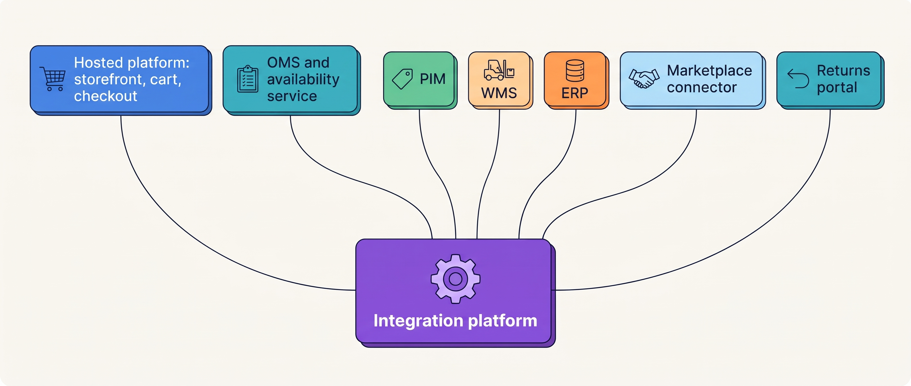
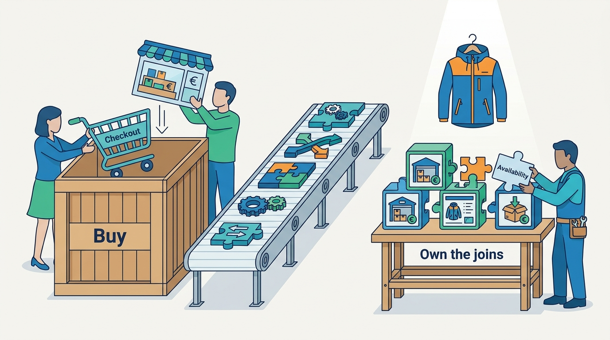
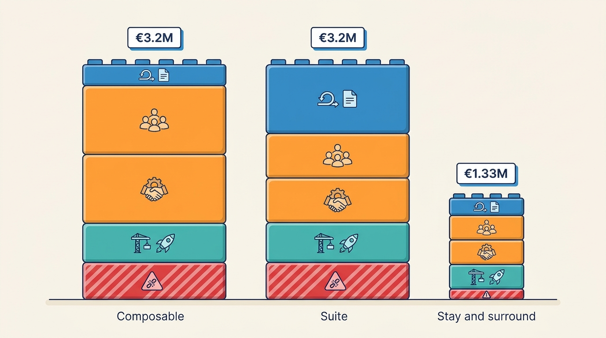
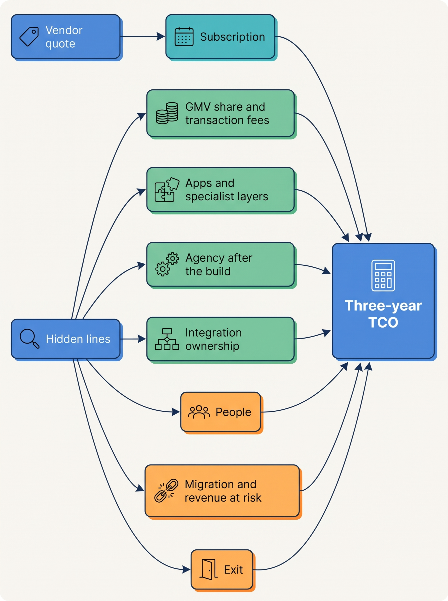

> **IN THIS CHAPTER, YOU WILL:** Learn to choose between a suite, a hosted platform with apps, a composable assembly and custom build, and to price each one honestly, including the cost of leaving.

> **KEY POINTS:**
>
> * **The choice is not one choice.** A merchant covers the commerce capability map with four kinds of parts (a suite, a hosted platform plus apps, assembled services, custom code), and the real decision is which parts to buy, which to assemble and what, if anything, to build. The answer changes with business model, scale stage and team.
> * **The subscription is the smallest line.** Total cost of ownership is dominated by payment fees, agency and partner work, the people who own integrations after launch, and the cost of leaving. A three-year comparison that prices only licenses is wrong by a multiple.
> * **Stay and surround is a legitimate architecture, not a failure to decide.** Kestrel & Pine's 2027 review kept its hosted platform and added an order hub, a product hub and an availability service beside it, because nothing in its checkout differentiates it and everything in its joins does.

> **[FAILURE PATTERNS THIS CHAPTER ADDRESSES](where-commerce-platforms-go-wrong.html):**
>
> * **The Lynchpin** — a platform decision that leaves one vendor, one agency or one connector holding a capability customers depend on, with no exit plan.
> * **The Giant's Boots** — a composable or custom architecture copied from a company a hundred times larger, without its team, its traffic or its reasons.
> * **The Forked Platform** — a bought platform customized so deeply that it can no longer be upgraded, which turns "buy" into "build" without anyone deciding it.

 
Every merchant eventually faces the same meeting. Sales are up, the systems creak, an agency or a vendor has a proposal, and someone asks: **should we move to a new platform?** The question sounds like one decision. It is really four: which capabilities to buy as one bundle, which to buy as separate services and connect, which to build, and which to leave exactly where they are. The answers differ for a founder with one web shop and for a group with six brands, which is why this chapter belongs in a part about decisions that change with scale.

The decision is also the most expensive one in commerce architecture to get wrong, and the hardest to price. A vendor quote lists a subscription. The merchant pays a subscription, plus a share of every payment, plus apps, plus an agency, plus the salaries of the people who keep thirty integrations alive, plus, one day, the cost of leaving. **The visible line is usually the smallest.** This chapter gives you a way to put every line on one page, and a rule for deciding what to build at all.

Kestrel & Pine, the fictional outdoor brand this book follows (see [[meet-kestrel-and-pine]]), ran exactly this meeting in early 2027. The chapter uses its platform review as the worked example, and its decision, Waypoint W4, "stay and surround", as the pattern to understand.

**Where we are in the order's journey.** This chapter sits off the order's path. Every step of Eva's jacket, from the product page to the refund, runs on a system somebody chose: the platform for checkout, the WMS for picking, the returns portal for the exchange. The choices in this chapter decide which systems those are, who runs them, and what it costs to change them later.

## The 2027 Platform Review at Kestrel & Pine

In February 2027, five weeks into her job, Noor Visser (Head of Engineering) was asked by Mara Lindqvist (CEO) for a recommendation on the platform. The Black Friday Oversell had cost about €96,000. The Three-Status Order, the Double Refund and the Price Drift had followed within three months. Two pitches were already on Mara's desk, both citing the Oversell.

An outside consultancy proposed a **composable rebuild**: replace the hosted platform with an API-only commerce engine, build a headless storefront (a storefront that is a separate application talking to the commerce engine only through APIs), and add an order management system, a product information system, a search service and an integration layer around it, over eighteen months. The agency, retained since 2017, proposed something smaller: a **headless rebuild of the three storefronts on the current platform**, about €240,000 over nine months plus a second runtime to operate ([[storefront-architecture]] tells how Noor measured that one and declined it).

Noor added a third option of her own to the comparison, so that the review would not be a choice between two pitches: an **enterprise suite**, one vendor's bundle of storefront, B2B portal, order management and promotions, priced on a share of online sales and implemented by a partner over about twelve months. Nobody had pitched it; she priced it because a suite is the usual alternative a board asks about.

Noor's review, which the rest of this chapter follows, asked three questions in order. **What is actually broken?** Not the checkout: the platform held on Black Friday at 38 orders a minute. What broke was the joins: stock copied through four systems with up to two hours of delay, orders living in four systems, product data in four. **What differentiates Kestrel & Pine?** The products, the brand, the stores, the wholesale relationships, and a next-day delivery promise in the Netherlands. Not the cart, not the checkout, not the storefront's rendering. **What would each option cost over three years, including the people and the exit?** That table is in the TCO section below. The outcome, approved in March 2027 as Waypoint W4, was to **stay on the hosted platform and surround it**: an OMS with an availability module and a PIM beside it, no replatforming, the platform's own POS evaluated in 2028, the whole decision revisited at a 2029 review.

## Four Ways to Cover the Map

[[commerce-capability-map]] lays out everything a commerce platform has to do: storefront, catalog, pricing, promotions, search, inventory, cart and checkout, payments, orders, tax and invoicing, warehouse, shipping, returns, customer service, stores, marketplaces, B2B, EDI, ERP, data. No vendor covers all of it well. The question is how you cover it. There are four basic shapes, and most real landscapes mix them.

| Shape | What you buy | Who runs it | Where the integration burden lands | Typical pricing | Examples (dated in [[commerce-platform-landscape]]) |
| --- | --- | --- | --- | --- | --- |
| **Suite** | One vendor's bundle of many capabilities designed to work together | The vendor's cloud, implemented by a partner | Inside the vendor's data model; the joins to the ERP, WMS and carriers remain yours | Negotiated, often linked to GMV or order volume | SAP Commerce Cloud, Salesforce Commerce Cloud, Adobe Commerce |
| **Hosted platform plus apps** | A multi-tenant storefront, cart, checkout and admin, extended through an app store | The vendor | Pushed to apps and webhooks; the merchant owns what the apps do | Subscription tier plus payment and transaction fees | Shopify, Commerce.com (BigCommerce), Lightspeed eCom |
| **Composable assembly** | API-only services (catalog, cart, checkout, search, content) from one or several vendors; the merchant builds or buys the storefront | Vendor clouds; merchant-built front end | On the merchant: it assembles and owns every join | Subscription with GMV or order caps | commercetools, Elastic Path, Medusa, Saleor |
| **Custom build** | Nothing; the merchant writes the capability | The merchant | Entirely on the merchant | Salaries and hosting | Large retailers' in-house platforms |

Three terms carry this table. **SaaS** (software as a service) is software rented by the month and run by the vendor for many customers at once. **GMV** (gross merchandise value) is the total value of orders through a platform before refunds; several vendors price on it. **Composable** means buying commerce as separate services and assembling them rather than taking one suite; the 2020 acronym **MACH** (microservices, API-first, cloud-native, headless) named the style, though the alliance behind it had reframed its principles as Open, Composable and Connected by 2026 ([[case-composable-movement]]).

Two mixed shapes matter for a merchant of Kestrel & Pine's size. The first is **ERP-centered commerce**, where the ERP (enterprise resource planning: the system that keeps the books, purchasing and stock valuation) is the hub and the web shop is a front end; Odoo, JTL and PlentyONE sell this, and Microsoft documented in September 2026 that its Shopify connector is preinstalled for new Business Central sign-ups ([[erp-and-back-office-integration]]). The second is the **specialist group**: several specialist products under one owner, pre-integrated with one another. Katapull, a Dutch group formed on 31 March 2025 from five companies and grown to eight labels by its acquisition of the warehouse software Picqer on 7 October 2026, is the public example; its own pages claim "4,500+ customers" and "140+ marketplaces" (vendor figures, accessed November 2026). For a Growing or Omnichannel merchant such a group reduces the joins it has to build, at the price of concentrating several layers under one owner.

The fifth shape is the one most merchants actually have, and the one Kestrel & Pine chose deliberately: **a hosted platform surrounded by specialist layers.** The platform keeps storefront, cart and checkout; an OMS, a PIM, a WMS, a returns portal and a channel connector sit beside it; an integration platform joins them. The composable vendors themselves moved toward this shape in 2025–2026: commercetools launched AgenticLift on 21 January 2026 as a way to "layer agentic commerce capabilities on top of your existing commerce solution", and Adobe's documentation of 21 October 2026 describes Commerce Optimizer as a service that "can work alongside an existing Adobe Commerce or third-party commerce backend". When the champions of replacement start selling layers, the layer is the market.

**Figure 1:** *Stay and surround: the hosted platform keeps the shopper-facing core, specialist systems own the facts it cannot own well, and the integration platform joins them; the merchant's job is the joins, not the core.*

## What to Build: Differentiation Against Commodity

The oldest rule in this field is also the most ignored: **build what customers choose you for and nobody sells; buy what every merchant needs; assemble when the joins between systems are themselves the thing you must own.** In plain words, ask of every capability: if we did this better than anyone, would a customer notice? If not, it is a commodity, and somebody rents it cheaper than you can build it.

For Kestrel & Pine the test was short. Shoppers choose it for jackets, for the brand and for the stores. They do not choose it for its cart. A rebuilt checkout would be a large cost to reproduce a thing the platform already does at 38 orders a minute. What a shopper *does* notice is whether the jacket shown as available is actually there, whether the order's status is the same in the e-mail, the app and the store, and whether the exchange arrives in three days. Those are the joins: availability, order state, product data. That is why W1, W2 and W3 buy an availability service, an OMS and a PIM rather than a new storefront, and why W5 makes integration standards the one thing the team builds itself.

| Capability at Kestrel & Pine | Differentiates? | Decision in 2027 | Reasoning |
| --- | --- | --- | --- |
| Storefront, cart, checkout | No | Keep the hosted platform | Commodity at this scale; held on Black Friday |
| Available-to-promise per channel | Yes, to the customer | Buy as a module of the OMS; own the rules | The promise is the product; the computation is commodity |
| One order record across channels | Yes, to the customer and to support | Buy an OMS | A solved category; the ownership decision is the hard part |
| Product content in one place | Yes, to every channel and to agent readiness | Buy a PIM | A solved category |
| Integration contracts and reconciliation | Yes, invisibly | Build the standards; run them on the bought iPaaS | Nobody sells your ownership rules |
| Delivery promise computed from stock and cut-offs | Yes | Compute in the OMS from WMS cut-offs, later | Today a static promise on the page |

**Figure 2:** *Shoppers do not choose Kestrel & Pine for its cart, so checkout is bought; they do notice whether the jacket shown as available is there, so the joins are what it owns.*

The two traps are symmetrical. **Building a commodity** is the Giant's Boots: a merchant copies the architecture of a company with a thousand engineers and spends its fourteen on rendering product pages. **Customizing a bought core until it is a build** is the Forked Platform: every vendor release becomes a project, and the merchant has the costs of building with none of the control ([[extensibility-and-app-ecosystems]] owns the app side of this).

## Total Cost of Ownership: The Lines the Quote Leaves Out

**Total cost of ownership (TCO)** is everything a choice costs over its life, not what the contract says per month. Shopify's own replatforming guide (published 18 March 2026, vendor content) lists migration costs ("data migration, platform licensing, agency or partner fees, staff retraining, and downtime during transition"), ongoing costs ("hosting, security patches, maintenance, custom development, performance testing") and hidden costs ("peak-traffic surcharges, custom checkout development, additional feature licenses, content management overhead, and app or integration fees not in the original quote"). That is a good list, and it is a vendor's list: it omits the two lines a merchant pays most for. **The people who own the integrations after the agency leaves**, and **the exit**: re-exporting data, redirecting URLs, re-integrating everything that pointed at the old system.

The pricing models themselves shape the cost line ([[commerce-platform-landscape]] has the dated figures). A flat tier is cheap to start and forces upgrades on product or variant limits. A subscription with GMV thresholds grows with sales: Commerce.com's Scale plan charges 0.9% above $33,333 of monthly GMV, Shopware requires a paid plan above €1 million of GMV in a rolling year and prices "based on your gross merchandise value", Saleor Cloud charges 0.8% above $200,000 a month (all pricing pages accessed November 2026 and subject to change). An enterprise contract may add "a variable platform fee based on your revenue and business model", as Shopify's Plus documentation puts it. Payment fees are the platform's largest revenue line at Shopify and Lightspeed (Lightspeed reported transaction revenue of $815 million against subscription revenue of $371 million for the year to March 2026), and a merchant who brings its own payment provider pays a transaction fee of 0.2% to 2% on Shopify's tiers. **Pricing encodes the vendor's architecture bet:** GMV pricing assumes the vendor owns checkout; per-order pricing (warehouse and channel tools) assumes it sees every order; per-request pricing (search) assumes it sits in the request path. Peak days cost money on all three.

### The lines, and who usually forgets them

| TCO line | What it is | Who forgets it |
| --- | --- | --- |
| Subscription or license | The monthly fee per tier or contract | Nobody; it is the only line everyone prices |
| GMV share and transaction fees | A percentage of sales, or a fee for using another PSP | The merchant, until sales double |
| Payment processing | PSP fees per transaction; separate from the platform's cut | Rarely forgotten, often assumed to be the platform's problem |
| Apps and specialist layers | Each app or service with its own fee, often per order or per request | The merchant: 41 apps at Kestrel & Pine, 6 unused |
| Agency or implementation partner | Build, then retainer | Priced for the build, not for the years after |
| Integration | Building and running every join; the iPaaS, the connectors, the scripts | Almost always: it is "included" in the build and then owned by nobody |
| People | The engineers and application specialists who own the systems and the joins | Treated as a fixed overhead rather than a cost of the option |
| Migration | Data, URLs, integrations, retraining, and the revenue at risk during cutover ([[replatforming-and-migration]]) | Underpriced by the vendor, who does not pay it |
| Exit | What it costs to leave this option in five years | Nearly always; it is nobody's line item until it is everyone's |

### Kestrel & Pine's three options over three years

The table prices the three options of the February 2027 review (the consultancy's rebuild, the suite Noor costed herself, and stay and surround) over 2027–2029. Every figure is a Kestrel & Pine illustration, built from the ledger's prices where they exist (the platform at €2,300 a month; the agency at €14,000 a month; technology spend of about €2.6 million in 2026) and from labeled assumptions where they do not. Costs common to all three options (the ERP at €3,900, the WMS at €2,100, the marketplace connector at €900, the returns portal at €650 plus €0.95 a return, the iPaaS at €1,200 a month, payment processing, and the existing team) are left out, because they do not change the comparison. The table shows **incremental cost over today's run-rate**, in thousands of euros.

| Line (€ thousands, 2027–2029, illustrative) | A. Composable rebuild | B. Enterprise suite | C. Stay and surround (W4) |
| --- | --- | --- | --- |
| Platform and new service subscriptions | 480 *(assumption: commerce engine with a GMV cap, OMS, PIM, search; after go-live)* | 1,350 *(assumption: 1.5% of about €30M online and marketplace sales; the trade describes suite pricing as 1–3% of GMV, which no suite vendor states publicly)* | 190 *(assumption: OMS with availability module €4,500 and PIM €1,800 a month from mid-2027; the platform's €2,300 continues unchanged)* |
| One-time build, implementation and migration | 1,200 *(assumption: storefront and B2B portal rebuilt, 26,000 variants and order history migrated, 34 integrations rewired)* | 900 *(assumption: partner implementation, data migration, integrations)* | 580 *(OMS €320, PIM €110, integration standards and reconciliation €150; inside the €1.1M Waypoint budget)* |
| Agency or partner retainer, incremental | 216 *(assumption: retainer rises from €14,000 to €20,000 a month, because a headless storefront needs continuous development)* | 144 *(assumption: an implementation partner's retainer of €18,000 a month replaces the agency's €14,000)* | 0 *(the agency's €14,000 continues)* |
| Added people | 765 *(assumption: three engineers for storefront and platform at €85,000 loaded)* | 255 *(assumption: one engineer)* | 510 *(two integration engineers, the rest of the Waypoint budget)* |
| Revenue at risk during cutover | 540 *(assumption: an 8% fall in online sales for one quarter, the Marks & Spencer figure of 2014, on €27M of D2C revenue)* | 540 *(same assumption)* | about 50 *(phased introductions beside a running platform; each step reversible)* |
| **Three-year incremental total** | **about 3,200** | **about 3,190** | **about 1,330** |
| Exit cost at the 2029 review | High: a merchant-built storefront and every join are bespoke | High: GMV contract, suite data model, partner dependency | Moderate: the platform's export plus the OMS and PIM, each with its own export, remain |

Three things stand out, and they generalize beyond the fictional numbers. **The subscription is the smallest line in every column** except the suite's, where GMV pricing turns it into the largest. **People and the agency are the largest lines** in the rebuild, and they persist after the build, which is why an eighteen-month project is a seven-year commitment. **Revenue at risk is a cost**, and the only option that avoids it is the one that never cuts over.

Today's €2.6 million makes the same point from the other side. The subscriptions in the ledger add up to roughly €200,000 a year and the agency to €168,000; the rest is people, hardware, hosting and smaller tools. A platform decision that argues about €2,300 a month is arguing about a few percent of the spend.

**Figure 3:** *Over three years the composable rebuild and the enterprise suite each add about €3.2 million against about €1.33 million for stay and surround; the gap is people, agency and revenue at risk, not subscriptions.*

**Figure 4:** *Total cost of ownership: the quote prices one line; seven others, led by people, agency and exit, decide the total.*

## Lock-In and the Cost of Leaving

**Vendor lock-in** is the condition in which leaving a vendor costs more than staying, whatever the vendor does. It is not a moral failing of vendors; it is the natural result of data, URLs, customizations and integrations accumulating in one place. **Exit cost** is the price of leaving, and it is designed in at purchase or never.

What the platform promises matters here. Shopify's standard Terms of Service (updated 20 October 2026) provide the services "on an 'as is' and 'as available' basis without any warranty", state that Shopify "does not warrant that the Services will be uninterrupted, timely, secure, or error-free", and reserve "the right to modify the Services or any part thereof for any reason, without notice and at any time". Enterprise agreements may add service levels; none is public. Read your own contract, not the marketing uptime.

Regulation now reaches part of this. The EU **Data Act** (Regulation (EU) 2023/2854, applicable from 12 September 2025) requires providers of "data processing services" to enable customers to switch to another provider or to their own infrastructure, to set out switching rights in the written contract, to allow at least 30 days to retrieve data, and, from 12 January 2027, to charge no switching fees at all. Its definition of a data processing service is broad enough to cover SaaS on its face, but whether a hosted commerce platform must therefore offer free switching from 2027 is an open legal question with no guidance or case found as of November 2026; services custom-built for one customer are exempt. The rules point at SaaS platforms; the first cases will tell ([[commerce-regulation]]).

Whatever the law settles, the exit questions are the same, and you ask them before signing:

- **Data.** Can products, variants, prices, customers, orders, gift-card balances and store credit be exported in full, in a documented format, by you, without a ticket? Password hashes usually cannot move; plan for a reset.
- **URLs.** Do you control the domain and can you emit redirects from every old product and category URL? Marks & Spencer's 2014 relaunch is the cautionary case in [[replatforming-and-migration]].
- **Customizations.** Who owns the theme code, the functions, the scripts? If the agency does, the agency is part of the exit.
- **Apps.** Each app holds data (subscriptions, loyalty points, reviews) with its own export, or none.
- **Integrations.** Every connector that points at the platform must be re-pointed; the integration inventory ([[integration-styles]]) is the exit's work list.
- **Contract.** Term, notice, GMV floor, what happens to the fee if you move half your traffic away during a strangler migration.

The Lynchpin is lock-in by another name: a capability customers depend on, running through one vendor, one connector, one agency or one person, with no exit plan. Kestrel & Pine had three in January 2027: the EDI consultant, the agency's scripts, and the ERP partner's platform-to-ERP connector. None was a platform decision; all were consequences of one.

## Decision Criteria

Five criteria decide more than any feature list. They are the first page of the platform decision card in the [[toolkit]].

| Criterion | What to ask | What it pushes toward |
| --- | --- | --- |
| **Business model** | D2C only, or wholesale, stores and marketplaces too? ([[commerce-business-models]]) | A single channel fits a hosted platform; several channels with several stock locations need an OMS whatever the core |
| **Scale stage** | Starting, Growing, Omnichannel or Group? ([[commerce-scaling-stages]]) | Starting and Growing: hosted or ERP-centered; Omnichannel: surround the core; Group: suite versus composable becomes a real question |
| **Team** | How many engineers, and do they own integrations today? | A composable assembly needs a team that owns every join; fourteen people with an agency do not have one |
| **Differentiation** | What would a customer notice if you did it better than anyone? | Build only that; buy the rest |
| **Time and risk** | When is the next peak, and what is the cost of a failed cutover? | Phased introductions over big-bang replacements |

## Trade-Offs

| | Suite | Hosted platform plus apps | Composable assembly | Custom build | Specialist group |
| --- | --- | --- | --- | --- | --- |
| Time to live | 9–18 months with a partner *(industry practice)* | Weeks to months | 12–24 months *(industry practice)* | Years | Months per label |
| Integration burden on the merchant | The joins to ERP, WMS, carriers | The joins, plus governance of apps | All of it | All of it | Reduced inside the group; the joins to everything else remain |
| Upgrade burden | Vendor, if the merchant has not forked the core | Vendor | Per service, continuous | Merchant | Vendor per label |
| Flexibility | High within the suite's model | Bounded by the platform's extension points | Very high | Unlimited | Bounded per label |
| Cost shape | GMV-linked, large partner line | Subscription plus payment share plus apps | Subscriptions with GMV caps, large people line | People | Several subscriptions |
| Exit | Hard: data model and partner | Moderate: export plus re-pointing apps and integrations | Hard: everything bespoke | Hardest | Per label, but one owner across layers |
| Fits when | Group stage with several brands and a platform team; B2B-heavy models | Starting through Omnichannel when checkout is not the differentiator | Group stage with a team that owns joins, or a vendor | The platform is the product | Growing and Omnichannel merchants in the group's market |

My recommendation follows the requirements, so it comes with conditions. **If checkout and storefront are commodities for you, keep a hosted platform and surround it**, buying an OMS, a PIM and a WMS when the business model demands them. **If you have several brands, a platform team and a B2B-heavy model, evaluate a suite and a composable assembly against each other on the people line, not the feature list.** **Build only a capability that customers choose you for and nobody sells**, and even then, build it beside the bought core. The condition that changes all of this is the team: an assembly is a commitment to own every join forever, and a merchant that cannot name the owner of its integrations today should not sign up to own thirty more.

## Across Scale Stages: When It Fits and When It Limits

| Stage | Typical choice | What becomes necessary | Warning signs the choice is outgrown |
| --- | --- | --- | --- |
| **1 — Starting** | A hosted platform or a website builder with commerce; a 3PL; the platform's payments | Nothing beyond the platform's export and your own domain | Variant or product limits on the tier; a second channel keyed in by hand |
| **2 — Growing** | Hosted platform or ERP-centered package; an agency; first marketplace tool, accounting or ERP link, 3PL feed | The integration inventory; a named owner for each connector; the exit questions asked at every new contract | Apps writing stock; the agency owns every script; pricing tier thresholds crossed (platform GMV, PSP volume, per-order quotas) at the same time |
| **3 — Omnichannel** | A hosted platform or suite surrounded by OMS, PIM, WMS, returns and channel tools; an iPaaS; in-house integration engineers | Ownership per fact ([[boundaries-and-systems-of-record]]); the hubs bought, the joins owned; a TCO with the people and exit lines | Replatforming proposed to fix problems that live in the joins; the same incident recurring across channels |
| **4 — Group** | Suite or composable assembly with a platform team; shared services decided brand by brand | The multi-brand platform decision ([[commerce-scaling-stages]]); vendor-scale concerns such as tenancy and extensibility | One stack forced on brands before the benefit is measured, or brands kept apart that should share |

The judgement across the stages: **the right time to replatform is almost never the time the problems appear, because the problems appear in the joins.** Kestrel & Pine's stage-3 incidents (stock, orders, prices, products) were all ownership problems, and ownership is decided by contracts and hubs, not by the storefront. A platform change becomes rational at stage 4, when several brands or a vendor-scale concern (tenancy, extensibility, a team that can own an assembly) makes the core itself the limit.

## In Practice

**The vendors' own turn, 2025–2026.** The clearest public evidence that layers beat replacement for mid-sized merchants comes from the vendors who sell replacement. commercetools, the founding MACH vendor, cut about 10% of staff on 26 February 2025 after missing growth targets, then launched AgenticLift on 21 January 2026 as a layer for "your existing commerce solution". Adobe sells Commerce Optimizer beside a kept backend (documentation of 21 October 2026). Commerce.com reported on 6 August 2026 that revenue was up 0.1% and that B2C replatforming "remains softer than historically". The MACH Alliance's own survey of 600 technology decision-makers (18 February 2026) found 37% citing integration complexity as a primary concern, a finding against the surveyor's interest and the cost line the composable promise omitted.

**Vendors retreat from what they do not do well.** Shopify completed the sale of the majority of Shopify Logistics to Flexport on 6 June 2023 for a 13% equity stake, more than three years ago but still the point: expect your platform vendor to be a payments company first and to push logistics, returns and EDI to partners, which keeps those layers' contracts in your hands at every stage above Starting. Lightspeed's strategic review, closed on 6 February 2025, named North American retail and European hospitality as its growth engines; read a vendor's strategic review as a signal about which products will be funded.

**Reading a vendor claim.** Shopify's enterprise page (accessed November 2026) claims a "33% lower average total cost of ownership" for a surveyed sample of organizations with GMV from $50 million to $500 million. It may be true for the sample; it says nothing about your people line or your exit. Ask for the unit, the date, the definition and the baseline before comparing any two vendors ([[commerce-platform-landscape]]).

**A build decision from the public record.** On 7 August 2009 Target announced it would "build and manage its own online platform", taking back e-commerce technology, fulfillment and guest services from Amazon, which had run Target.com since 2001. The platform launched in 2011 and crashed on the Missoni collection launch of 13 September 2011; the cause was never confirmed publicly, and the sources are fifteen years old. [[replatforming-and-migration]] takes the migration side; the build-or-buy lesson is narrower: a retailer of Target's size had reasons to own its platform (a competitor ran it), and the cost of the decision was paid not in the build but in the first peak.

**Kestrel & Pine's decision record.** Noor wrote W4 as an architecture decision record (ADR), the one-page format Michael Nygard described in November 2011: context as neutral facts in tension, the decision as "we will", status, consequences. Hers read, in short: *Context: the platform held at peak; the joins failed; the team is fourteen with an agency; nothing in checkout differentiates us; a composable rebuild and a suite each cost about €3.2 million over three years with a quarter of online revenue at risk. Decision: we will stay on the hosted platform and add an OMS with an availability module, a PIM and integration standards beside it; we will evaluate the platform's POS in 2028 and revisit this decision in 2029. Consequences: we accept the platform's extension limits and its transaction fees; we own the joins; the agency's scope narrows to the storefront; the exit from the platform remains possible because the hubs we add are systems of record with their own exports.* The record is the artifact: in 2029 the review starts from it rather than from memory.

## When It Goes Wrong

The platform decision fails in slow ways, and the detection is organizational before it is technical.

- **The Lynchpin surfaces at renewal.** The agency owns the theme, the scripts and the knowledge; the renewal arrives with a price. *Detect:* no engineer at the merchant can deploy the storefront. *Recover:* ownership of code and credentials in the contract; a second party able to deploy; the ownership map from [[organizing-commerce-engineering]].
- **The Forked Platform turns buy into build.** An upgrade is skipped because a customization would break; two years later the platform is three versions behind and the vendor's support has lapsed. *Detect:* the last upgrade date, and the list of core files touched. *Recover:* move customizations to supported extension points, one per release; if that is impossible, the real decision is whether to rebuild on the current version or leave.
- **The Giant's Boots are bought with a brochure.** A composable assembly is signed because a far larger retailer has one. *Detect:* the proposal names no owner for the joins after go-live. *Recover:* price the people line; if the merchant cannot staff it, do not sign.
- **The pricing cliff.** Growth crosses a GMV threshold, a per-order quota and a PSP volume tier in the same year; the subscription that was the smallest line doubles. *Detect:* the thresholds written next to the forecast. *Recover:* negotiate at the stage change, not after the invoice.
- **The vendor changes direction.** A strategic review, an acquisition, a retired product (Zalando's Connected Retail technology will be discontinued by 30 June 2027, announced April 2026, with fourteen months' notice; Magento 1's end of life on 30 June 2020 forced merchants to move or run unsupported software). *Detect:* read the vendor's investor and press pages twice a year. *Recover:* the exit questions above, answered before they are urgent.
- **The quote was right and the TCO was wrong.** Integration is "included" in the build and then owned by nobody; incidents appear in the joins a year later. *Detect:* the integration inventory has owners missing. *Recover:* W5: every integration has an owner, a contract, idempotent handling and a reconciliation job.

## What to Take Away

**Established.**

- The visible subscription is a minority of total cost; vendors' own guides (Shopify, March 2026) list migration, ongoing and hidden costs, and pricing models with GMV thresholds and transaction fees are documented on vendor pages as of November 2026.
- The composable vendors and suites themselves sell layers beside an existing core as of 2026 (commercetools AgenticLift, January 2026; Adobe Commerce Optimizer, documented October 2026), and the MACH Alliance's own 2026 survey names integration complexity as the top concern.
- The EU Data Act (Regulation (EU) 2023/2854) applies from 12 September 2025 and prohibits switching charges from 12 January 2027; whether it covers hosted commerce platforms is unsettled.
- Decision records (Nygard, 2011) are the lightweight way to keep a platform decision reviewable.

**Depends on context.**

- Stay and surround is right when checkout and storefront are commodities for the merchant and the problems live in the joins; it is wrong when the core itself limits the business (several brands, vendor-scale tenancy or extensibility needs, a B2B model the platform cannot express).
- A composable assembly fits a team that owns every join and a business whose differentiation lives in the assembly; it is the Giant's Boots for a fourteen-person team with an agency.
- GMV-based pricing aligns the vendor with growth and raises exit cost; it favors high-margin D2C and punishes large, low-margin B2B orders, which is why B2B terms are negotiated separately.
- The specialist-group model reduces joins for merchants in its market and concentrates several layers under one owner; whether that is a benefit depends on the exit terms per label.

**The author's synthesis.**

- I price every platform option on three lines first, people, agency and exit, and only then on the subscription, because the first three decide the total and the last one decides the meeting.
- I treat "build" as a decision about ownership rather than code: the thing worth building at a mid-sized merchant is the rules for who owns which fact and how the copies are reconciled, which no vendor sells.

## Questions to Ask

1. What exactly is broken, and does it live in the core or in the joins between systems?
2. Which capability would a customer notice if we did it better than anyone? Is anyone proposing to build something else?
3. What does each option cost over three years including agency, people, migration, revenue at risk and exit?
4. Who owns each integration the day after go-live, by name?
5. Which pricing thresholds (GMV tier, per-order quota, PSP volume) will growth cross in the next two years, and what happens to the fee?
6. Can we export products, orders, customers and gift-card balances ourselves, in a documented format, today?
7. Who owns the theme code, the scripts and the credentials, and could a second party deploy them?
8. What does the vendor's contract actually promise about availability, deprecation notice and modification without notice?
9. Is there a decision record, and does it name the date and the conditions under which the decision is revisited?

The decision to stay is only half a decision. Kestrel & Pine still has to introduce an OMS and a PIM beside a running platform without creating the very duplicates and gaps the hubs exist to remove. How to move systems without a single cutover date is the subject of [[replatforming-and-migration]].

## Sources and Evidence

*Company, product and investor sources*

- [Ecommerce Replatforming and Migration Guide for 2026](https://www.shopify.com/enterprise/blog/ecommerce-replatforming), Shopify Enterprise blog (Michael Metcalf), 2026-03-18; the vendor's list of migration, ongoing and hidden costs (vendor content).
- [Shopify for Enterprise](https://www.shopify.com/enterprise), Shopify, n.d., accessed 2026-11; the "33% lower TCO" and "20% faster migrations" claims and the $50M–$500M GMV survey sample.
- [Shopify Plus plan](https://help.shopify.com/en/manual/intro-to-shopify/pricing-plans/plans-features/shopify-plus-plan) and [Shopify pricing (EUR)](https://www.shopify.com/pricing), Shopify, n.d., accessed 2026-11; Plus terms, the variable platform fee, third-party transaction fees of 0.2–2%.
- [Shopify Terms of Service](https://www.shopify.com/legal/terms), Shopify, 2026-10-20; "as is", no warranty of uninterrupted service, modification without notice.
- [Shopify completes sale of Shopify Logistics to Flexport](https://www.shopify.com/news/shopify-completes-sale-of-shopify-logistics-to-flexport), Shopify, 2023-06-06; the 13% equity stake and the retreat from logistics.
- [BigCommerce pricing](https://www.bigcommerce.com/essentials/pricing/), Commerce.com, n.d., accessed 2026-11; the 0.9% overage above $33,333 monthly GMV.
- [Commerce.com Q2 2026 results, exhibit 99.1](https://www.sec.gov/Archives/edgar/data/0001626450/000119312526336701/bigc-ex99_1.htm), SEC EDGAR, 2026-08-06; revenue up 0.1% and the softer B2C replatforming remark.
- [Shopware pricing](https://www.shopware.com/en/pricing/), Shopware, n.d., accessed 2026-11; GMV-based plans and the €1 million fair-use line.
- [Saleor pricing](https://saleor.io/pricing), Saleor, n.d., accessed 2026-11; the 0.8% charge above $200,000 monthly GMV.
- [Lightspeed Q4 and FY2026 results](https://www.lightspeedhq.com/news/lightspeed-announces-fourth-quarter-and-full-year-2026-financial-results-and-provides-outlook-for-fiscal-2027/), Lightspeed, 2026-05-21, and [results of strategic review](https://www.lightspeedhq.com/news/lightspeed-announces-results-of-strategic-review-and-third-quarter-2025-financial-results/), 2025-02-06; transaction versus subscription revenue, and the chosen growth engines.
- [commercetools launches AgenticLift](https://commercetools.com/press-releases/commercetools-launches-agenticlift), commercetools, 2026-01-21; a layer "on top of your existing commerce solution".
- [commercetools, a pioneer in headless commerce, lays off dozens of staff](https://techcrunch.com/2025/02/26/commercetools-a-pioneer-in-headless-commerce-lays-off-dozens-of-staff), TechCrunch, 2025-02-26; the February 2025 cut and the missed growth targets.
- [Adobe Commerce platforms and services](https://experienceleague.adobe.com/en/docs/commerce/information-center/explore-platforms-and-services/platform-and-services), Adobe Experience League, 2026-10-21; Commerce Optimizer "alongside an existing Adobe Commerce or third-party commerce backend".
- [MACH Alliance research: 6x more organizations achieve AI ROI with a composable foundation](https://machalliance.org/insights-hub/mach-alliance-research-6x-more-organizations-achieve-ai-roi-with-a-composable-foundation), MACH Alliance, 2026-02-18; 37% cite integration complexity (commissioned survey).
- [Katapull](https://katapull.nl/) and [Katapull acquires Picqer](https://katapull.nl/katapull-breidt-commerce-hub-uit-met-overname-van-picqer/), Katapull, accessed 2026-11 and 2026-10-07; the eight-label group and its vendor-stated customer counts; [Vijf softwarebedrijven bundelen krachten in Katapull](https://www.dutchitchannel.nl/news/603618/vijf-softwarebedrijven-bundelen-krachten-in-katapull), Dutch IT Channel, 2025; the 31 March 2025 formation.
- [Get started with the Shopify Connector](https://learn.microsoft.com/en-us/dynamics365/business-central/shopify/get-started), Microsoft Learn, 2026-09-22; the connector preinstalled for new Business Central sign-ups.
- [Target parts ways with Amazon.com](https://internetnews.com/news/target-parts-ways-with-amazon-com), InternetNews, 2009-08-07, and [Target's website crashes again](https://www.mprnews.org/story/2011/10/25/targets-website-crashes-again), MPR News (AP), 2011-10-25; the build decision and the 2011 outages (evidence older than three years).
- [Zalando consolidates partnership models, Connected Retail to be discontinued](https://fashionunited.com/news/business/zalando-consolidates-partnership-models-connected-retail-to-be-discontinued/2026042371971), FashionUnited, 2026-04-23; the 30 June 2027 discontinuation with notice.
- [Magento 1 reaches EOL](https://www.helpnetsecurity.com/2020/06/29/magento-1-eol/), Help Net Security, 2020; the forced migration (widely reported).

*Standards, regulation and official documentation*

- [Regulation (EU) 2023/2854 (Data Act)](http://publications.europa.eu/resource/celex/32023R2854), EU Publications Office, 2023-12-22; switching rights, the 30-day retrieval period, switching charges prohibited from 12 January 2027, application from 12 September 2025, the custom-built exemption.

*Research and practitioner sources*

- [Documenting Architecture Decisions](https://cognitect.com/blog/2011/11/15/documenting-architecture-decisions), Michael Nygard, 2011-11-15; the ADR format used for W4.
- [EPAM joins newly formed MACH Alliance](https://s202.q4cdn.com/436759741/files/doc_news/2020/06/24/12951.pdf), EPAM, 2020-06-24, and [MACH principles](https://machalliance.org/mach-principles/), MACH Alliance, n.d., accessed 2026-11; the 2020 acronym and the 2026 three-principle reframing.
- [Marks & Spencer Q1: general merchandise sales down](https://www.cnbc.com/2014/07/08/marks-spencer-q1-general-merchandise-sales-down-08-like-for-like-down-15.html), CNBC (Reuters), 2014-07-08; the 8.1% fall in M&S.com sales used as the revenue-at-risk assumption (evidence older than three years).

Kestrel & Pine is fictional; architectural recommendations, labeled inferences and labeled assumptions are the author's judgement.
