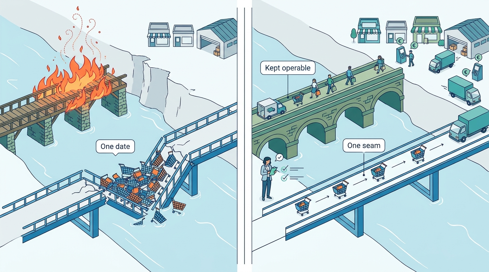
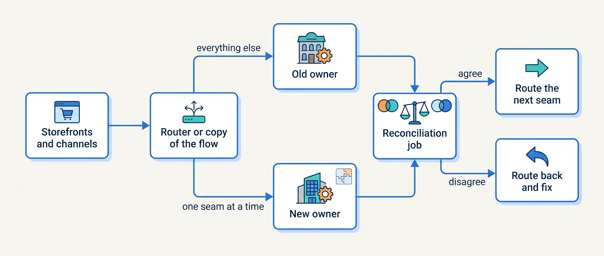
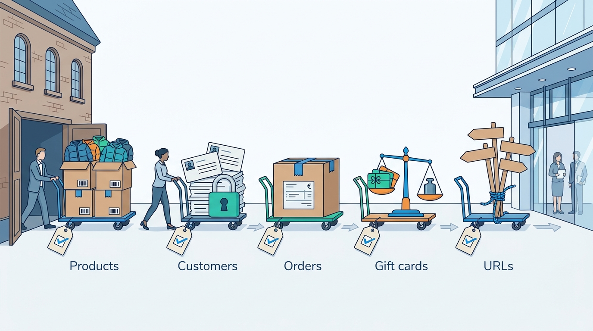
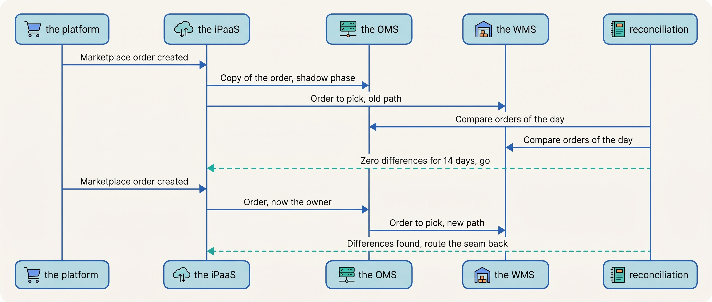

> **IN THIS CHAPTER, YOU WILL:** Learn to plan a platform or hub migration as a sequence of reversible steps rather than one cutover date, with the data, integrations and rollback each handled on purpose.

> **KEY POINTS:**
>
> * **The documented failures were not feature failures.** Target's 2011 in-house platform went down at its first peak (the cause was never confirmed), Finish Line reverted in 2012 after seventeen days, Marks & Spencer lost 8.1% of online sales in the quarter after its 2014 relaunch. Load, performance, timing and customer habit broke them, not missing features, and one recovered only because the old platform was still running.
> * **Migrate along seams, with a bridge that stays up.** The strangler approach moves one channel, one capability or one slice of traffic at a time behind a router or a copy of the flow, runs old and new side by side with a reconciliation that proves they agree, and keeps the old system operable until the new one has met real load.
> * **Data migration is seven migrations.** Products (identifiers must not change), prices (a failed sync goes unnoticed), customers (consent moves, passwords do not), orders (history is read, not re-created), gift cards and credit (liabilities that must balance to the cent), URLs (every old address accounted for) and the integrations (each one re-pointed or mimicked) each need their own plan and check.

> **[FAILURE PATTERNS THIS CHAPTER ADDRESSES](where-commerce-platforms-go-wrong.html):**
>
> * **The Burned Bridge** — everything moves to a new platform on one date, with no way back; this chapter exists to prevent it.
> * **The First Snowfall** — a migrated platform, or a newly introduced hub, meets real load for the first time on the busiest day of the year.
> * **The Spaghetti Junction** — thirty-four integrations, each with its own owner or none, that all have to be re-pointed when the system in the middle changes.

 
During a move to a new order system, both the old and new systems may be able to send work to the warehouse. Let both send the same order and two parcels can leave; stop the old one too early and orders can be missed. A migration changes who is allowed to act while the shop keeps trading. Each step needs a clear transfer of responsibility and a way to recover if that transfer fails.

A plan therefore starts from one question: which system may act on a given fact (here, which system may send an order to the warehouse), and which integrations read or write that fact. It decides how the new system will be populated, how its answers will be compared, when it may act and what happens if the transition fails. Smaller, reversible steps expose those questions before the whole business depends on the new path.

Kestrel & Pine, the fictional outdoor brand, decides in its February 2027 platform review to keep the shop platform (W4, stay and surround, adopted in March: keep the platform and add hubs beside it; [[build-buy-or-assemble]]). It still introduces **product information management (PIM)** in Q3 and an **order management system (OMS)** by Q4. Both migrations happen while roughly 800 storefront orders a day keep arriving. **Where we are in the order's journey:** a jacket order is copied to the new OMS for comparison before that system may send work to the warehouse, and product names, sizes and colors are prepared in the PIM before publication switches to it.

This chapter's answer is to move one **seam** at a time: a channel, a capability or a slice of traffic, so that each step changes the owner of one fact for one part of the business. Copy the flow to the new system in shadow, where nobody acts on it. Run old and new in parallel with a reconciliation that explains each difference by its cause. Migrate each kind of data on its own plan. Cut over with written criteria and a rehearsed way back, and keep the old owner operable through the first peak after cutover.

The chapter first sorts the reasons given for a new platform into good and bad ones. Three documented failures and one avoided case then show the danger of moving on one date, and the plan Kestrel & Pine's Head of Engineering writes for its two hubs shows how to avoid it. The method follows: the strangler approach, what holds in each phase of a migration, the separate data migrations, the integrations, and cutover and rollback. The chapter then follows Kestrel & Pine's 2027 timeline, says how the method changes with scale and ends with what goes wrong. The evidence is dated press reports and company statements, published patterns from Martin Fowler and Thoughtworks, Zalando's engineering posts and Kestrel & Pine's own timeline.

## Reasons to Replatform, and Reasons That Are Not

Before any migration plan comes one question: is a change of platform justified at all? Kestrel & Pine settled it in its February review, and a merchant facing a pitch for a new platform has to settle it too. A platform change is justified when the core itself limits the business and no layer beside it can fix that. It is not justified when the problems live in the joins, which, as [[build-buy-or-assemble]] argues, is where most Omnichannel-stage problems live.

| Reason given | Is it a reason? | What to check first |
| --- | --- | --- |
| "Stock is wrong across channels" | No: an ownership and availability problem ([[inventory-and-availability]]) | Who is the system of record for stock, and how do the others learn about changes |
| "Support can't find an order" | No: an order-hub problem ([[order-management]]) | Whether an OMS beside the platform solves it |
| "The site was slow on Black Friday" | Maybe: find the bottleneck | Usually the integrations, not the platform ([[peak-load-and-reliability]]) |
| "The vendor is ending the product" | Yes, on the vendor's date | The notice period; the export; the end of life of Magento 1, an e-commerce platform product, on 30 June 2020 forced merchants to move or run unsupported, non-compliant software |
| "We have customized the core until it cannot upgrade" | Yes, but the choice is rebuild-on-current-version versus leave | The Forked Platform ([[extensibility-and-app-ecosystems]]) |
| "The platform cannot express our B2B model" | Yes, if a B2B layer beside it cannot either | Price lists, contract prices, punchout (ordering from inside the buyer's purchasing system), approvals ([[b2b-commerce]]) |
| "A competitor runs our platform" | Yes, strategically | Target, 2009: Amazon, a competing retailer, ran Target.com; see below |
| "The agency says so" | No, by itself | Who is paid for the build, and who owns the joins after it ([[organizing-commerce-engineering]]) |

## Three Documented Failures, and What They Share

When a change of platform is justified, or a hub is introduced beside the platform, the danger is in how the move is made. The public record of replatforming is thin, because merchants do not publish post-mortems. Three cases are documented well enough to use. All three are older than a decade, so they describe replaced systems; the lesson is in the shape, not the software.

**Target, 2009–2011.** Amazon, a competing retailer, had run Target.com since 2001. On 7 August 2009 Target announced it would "build and manage its own online platform", taking over its "e-commerce technology platform, fulfillment and guest services operations", to launch before the 2011 holiday season.

The new site launched in August 2011. On 13 September 2011, weeks later, the launch of the Missoni for Target collection crashed Target.com; Target's own banner read "we are suddenly extremely popular", and the site was down most of the day. A second outage of about two and a half hours followed on 25 October 2011, for which Target gave no reason.

Press at the time disagreed on whether the in-house platform or the Missoni demand was the cause, and Target never confirmed it, so the verified chain is the decision, the launch and the two outages, not the root cause. The shape is the First Snowfall on a new platform: the first real peak was the first real test.

**Finish Line, 2012.** The American footwear retailer switched to new e-commerce site technology on 19 November 2012, the week before Thanksgiving. Seventeen days later it reverted to its former platform, "which it had kept operable", according to Retail Dive's report of 8 January 2013. The switch cost about $3 million in quarterly sales, "despite a 25% increase in online sales for the quarter". Finish Line is the one case in this list with a happy ending, and the reason is in one clause: the old platform had been kept operable. The bridge was not burned.

**Marks & Spencer, 2014.** M&S launched a new website in early 2014. Its first-quarter trading statement of 8 July 2014 reported that M&S.com sales fell 8.1% in the quarter; the company had warned in May that the new site would take four to six months to "settle in", and said it had since seen "a gradual improvement in sales performance". Retail Week's commentary of 10 July 2014 called it "a timely reminder of the risks involved in major replatforming programmes". The shape here is different: nothing crashed. Customers had to re-register, the search engines had to re-learn the site, and habit broke. A migration can succeed technically and still cost a quarter.

**The one that avoided it.** Hobbycraft, a British crafts retailer, delayed its website relaunch past Christmas 2012 because it was "too risky to launch the website in peak trading" (Retail Week, 19 February 2013). That is a sourced example of the simplest rule in this chapter: never cut over into a peak.

| Case | Date | What failed | What it cost | Was there a way back? |
| --- | --- | --- | --- | --- |
| Target (US) | Launch August 2011; outages 13 September and 25 October 2011 | Capacity at the first peak (cause not confirmed publicly) | A day of lost sales at a high-profile launch; a second outage; the Target.com president left weeks later | No public evidence of one |
| Finish Line (US) | Switched 19 November 2012; reverted 17 days later | Performance of the new site in the holiday run-up | About $3 million of quarterly sales | **Yes**: the former platform had been kept operable |
| Marks & Spencer (UK) | Relaunch early 2014; results reported 8 July 2014 | Customer habit, search visibility, a four-to-six-month "settling in" | M&S.com sales down 8.1% in the quarter | Not reported; the company chose to settle in rather than revert |
| Hobbycraft (UK) | Relaunch deferred past Christmas 2012 | Nothing: the launch was moved off the peak | A delay | Not needed |

What the cases share is the pattern this book calls **The Burned Bridge**: everything moves on one date, into or near a peak, with the new system meeting real load for the first time in public, and with no rehearsed way back. Finish Line is the Burned Bridge without the burning, and it recovered. The rest of this chapter is the engineering of that clause, "kept operable", generalized, starting with the plan Kestrel & Pine wrote for its two hubs.

**Figure 1:** *Finish Line could turn back in 2012 because its old platform had been kept operable: a migration that keeps the old bridge standing until the new one has carried real load always has a way back.*

## Setting the Scene: Two Hubs Beside a Running Shop

Kestrel & Pine answered the first question in February: keep the platform. It still has two hubs to introduce beside it, and Head of Engineering Noor Visser's plan for them starts from two warnings. The first comes in May 2027, when a first warehouse-to-platform stock comparison finds differences for **2.3% of active variants**, many caused by three apps that wrote stock. The PIM and the OMS will both be loaded from records like these, so Noor treats the result as a warning: loading a new hub from existing records will also load their disagreements unless somebody resolves them.

The second warning is in the migration plans that Kestrel & Pine's two outside partners, its storefront and apps agency and its ERP implementation partner, each proposed. Both name dates, not failure behavior. The agency would load historical orders over a weekend, redirect order export Monday and switch the warehouse feed Tuesday. The ERP partner would export the catalog, import it into the PIM and redirect storefronts. Neither explains how to detect an order sent twice or not sent at all.

Noor's plan, which the rest of this chapter follows, has three rules. **Every step is reversible for at least one peak.** **Old and new run side by side with a job that proves they agree before new takes over.** **The smallest channel moves first.** Each rule answers the Burned Bridge above. So the marketplace channel, 43,000 orders a year, about 120 a day, is the first to be routed through the OMS; the D2C storefronts with 293,000 a year come after; the EDI and manual wholesale orders come last, in December, and the stores wait for the 2028 evaluation of the platform's own till system, which W4 schedules. Black Friday 2027 falls in the middle, inside a **change freeze**: a period in which no system or integration is changed.

## The Strangler Approach for Commerce

Noor's rules apply a published method. The **strangler approach** replaces a system one piece at a time. Put a routing layer in front of the old system, direct one part of its work to the replacement, check the result, then move the next part. Retire the old system when nothing depends on it. This lets the merchant keep trading and learn from each transfer before committing the whole shop. Martin Fowler described the **strangler fig** pattern in 2004 and restated it on 22 August 2024, warning that wholesale replacement plans tend to "go down in flames" because replacement takes time, users need ongoing changes and existing behavior is hard to establish. The name comes from a fig growing around its host tree.

Thoughtworks' *Patterns of Legacy Displacement* (20 July 2021, revised 5 March 2024) names the moves. **Transitional architecture**: temporary components built only to make the migration safe, and removed afterwards. **Event interception**: capture the changes flowing into the old system and send a copy to the new one. **Divert the flow**: route a slice of traffic or a business flow to the new system. **Legacy mimic**: make the new system look like the old one to the integrations that still expect it. **Dark launching**: run the new path without showing its result (the shadow phase below). **Canary release**: a small share of traffic first.

The authors warn that defining "as is" functionality "was a huge effort" and that the alternatives to seam-based decomposition "all too often result in Feature Parity and Big Bang releases". **Feature parity**, rebuilding everything the old system did before switching, is the plan that produces the Burned Bridge, because it postpones every risk to one date.

In commerce the seams are visible and there are three kinds.

- **By channel.** Move the B2B portal first, or the German storefront, or the marketplace orders. Channels are natural slices because each has its own entry point and its own volume, and a merchant can choose the smallest.
- **By capability.** Move search first, or returns, or product content, or availability. This is the stay-and-surround program: each hub is a capability moved from the platform (or from spreadsheets and the ERP) to a new owner.
- **By traffic slice.** A share of sessions, a region, a customer segment. This is the canary, and it needs a router in front of the storefront.

The public example of the strangler in commerce is Zalando's rebuild of its Fashion Store from the monolith (one large application) it called "Jimmy", described in its engineering posts of 16 October 2015 and 5 October 2016. A team put a Go-based router, Skipper, in front of the shop and migrated the page fragment by fragment: header and footer first, then product pages and wish lists, each served by a new team behind the router while the monolith served the rest. The evidence is ten years old and describes a system that has changed since, but the shape is the strangler in production at a large retailer.

**Figure 2:** *The strangler in commerce: a router or a copied flow sends one seam at a time to the new owner, a reconciliation job proves old and new agree, and disagreement routes back instead of forward.*

## How the Pieces Fit During a Migration

A migration is a period in which **two systems hold the same fact and only one of them is allowed to be right.** The design question is which one, for which fact, for how long, and how the others find out. The requirements change by phase.

| Phase | Who owns the fact | Freshness | Consistency check | Latency allowed | What must stay available |
| --- | --- | --- | --- | --- | --- |
| **Shadow** (new system receives a copy; nobody reads it) | Old | Copy within minutes *(assumption)* | Daily reconciliation of counts and samples | Any | Everything on the old path, untouched |
| **Parallel run** (both compute; old result is used) | Old | Both within the same minute | Every record compared; differences listed by cause | Any for the new path | Old path; new path may fail silently |
| **Divert one seam** (new result used for one channel or capability) | New, for that seam only | Live | Reconciliation per seam; the old path still receives the copy | Production latency for that seam | The old path can take the seam back within an hour *(assumption)* |
| **Divert all** | New | Live | Reconciliation continues for one peak | Production | The old system stays operable, read-only or idle, until the peak has passed |
| **Decommission** | New | — | Final reconciliation; archive | — | Exports from the old system kept |

Two mechanisms are proposed for these phases, and they are easy to confuse. **A parallel run** means both systems process the same input and their results are compared, while only one result is acted on. It is the safest way to learn whether the new system agrees with the old one, and it is cheap when the input can be copied (an order created, a product changed). Its weakness is that it finds disagreements, not their causes; the reconciliation job must say *which* records differ and *why* ([[events-consistency-and-reconciliation]]).

**Dual writes** mean one actor writes the same change to both systems. They sound like a parallel run and are the opposite in risk: two writers to two stores, with no transaction across them, produce exactly the partial failures this book spends Part VI on. If the write to the new system fails and the write to the old one succeeds, the systems diverge and nobody is told. Kestrel & Pine already lived this in March 2026, when a pre-order app and the WMS feed both wrote stock in the platform and left two weeks of phantom reservations on 600 variants. **Prefer one writer and a copied flow** (event interception: the change goes to the owner, and an event carries a copy to the other) over two writers, and where dual writes are unavoidable make them idempotent (a repeated write has the same effect as one) and reconciled ([[integration-styles]]).

## Data Migration Is Seven Migrations

With the phases set, the next question is what the new owner is loaded with. A platform's data is not one export. Each kind of data has its own owner, its own identifiers, its own legal constraints and its own way of going wrong. Plan the seven kinds separately.

| Data | What moves | The trap | The check |
| --- | --- | --- | --- |
| **Products and variants** | 3,400 products, 26,000 variants, attributes, media, translations, categories | Identifiers that change: a SKU or GTIN re-keyed in the new system breaks every integration, feed and barcode ([[product-information]]) | Every variant in the new system carries the same SKU and GTIN; counts per status match; a sample of fifty variants compared field by field |
| **Prices and promotions** | Price lists per market and customer group, active promotions, effective dates | A price-list sync that fails silently, as it did for nine days in October 2026 ([[pricing-architecture]]) | Every active SKU's consumer and wholesale price equal in old and new; a report of differences before go-live |
| **Customers** | Accounts, addresses, consent, company accounts and price lists for B2B | Passwords are stored as one-way hashes and usually cannot move; consent must move with its proof; a deletion request mid-migration must reach both systems ([[privacy-and-customer-data]]) | A password reset flow tested before go-live; consent flags counted; the identity map (which old customer record became which new one) kept ([[identity-and-master-data]]) |
| **Orders** | History for support and returns; open orders in flight | Re-creating history fires every side effect again: notifications, stock reservations, invoices. Orders are read, not replayed ([[order-management]]) | History imported read-only with its original numbers; open orders listed and tracked by hand through the cutover window |
| **Gift cards, store credit, loyalty points** | Balances, which are liabilities on the balance sheet ([[commerce-promotions]]) | A balance lost is money owed to a customer with no record; a balance duplicated is money given away twice | Sum of balances in old equals sum in new to the cent, signed off by finance |
| **URLs and search presence** | Every product, category and content address | Missing redirects lose search traffic and bookmarked journeys | Map each old URL to a relevant permanent redirect (an instruction that sends visitors and search engines from the old address to the new one) or an intentional removal; crawl the saved URL list after go-live |
| **Integrations and apps** | Kestrel & Pine's 34 integrations, the flows that read or write the old owner | Each one keeps calling the old endpoint until somebody changes it. This is the Deprecated Endpoint of February 2027 in reverse (then a vendor retired an endpoint an agency script still called; now the merchant moves one) ([[api-contracts-and-versioning]]) | The integration inventory with an owner and a cutover task per flow; a legacy mimic where a flow cannot change in time |

**Figure 3:** *Five of the seven migrations: products, customers, orders, gift cards and URLs each move separately, with their own trap and their own check; prices and integrations follow the same rule.*

The orders row needs a word more. It is tempting to "migrate the orders" by creating them in the new system. Every order created in a commerce system fires something: a confirmation e-mail, a reservation, a fulfillment request, an invoice. Importing 293,000 D2C orders as new orders is 293,000 e-mails. **History is imported as history**, flagged, read-only, with its original numbers and dates, or it is left in the old system behind a read-only link for support.

The URL row needs more than redirects, because search visibility moves too: the links that tell search engines which language version of a page is which, the product data embedded in each page for them, and the rules that say what they may crawl. [[storefront-architecture]] explains these technical search-engine optimization (SEO) requirements. A removed page without a suitable replacement should return “not found” (`404`) or “gone” (`410`), not redirect to the homepage.

## Migrating the Integrations

The table's last row needs a section of its own. The system in the middle changes; the thirty-four flows around it do not know. This is where the Spaghetti Junction bites. At Kestrel & Pine fourteen of the thirty-four touch orders, stock or product data and have to be re-pointed when the OMS and the PIM arrive (an illustrative count). Three rules, all from Waypoint W5 (integration standards: every integration has an owner, a contract and a reconciliation), make that a list of tasks rather than a season of incidents.

- **The inventory first.** Every integration listed with its owner, its direction, its fields, its frequency and the system of record it reads or writes ([[integration-styles]]). A flow with no owner gets one before the migration starts, or it gets switched off.
- **A legacy mimic where a flow cannot change in time.** If the agency's script that reads orders from the platform cannot be rewritten before the OMS takes over, the OMS (or the iPaaS) exposes the same shape at the old address for one more season. The mimic is transitional architecture: it has a removal date.
- **Deprecation with notice, in both directions.** The merchant retires its own old endpoints with a published date, as the marketplace connector's vendor did when it announced in November 2026 the version it retired in February 2027. This time the agency script that missed the connector's notice is on the inventory, with an owner who receives the notice. Others' retirements are read the same way: Zalando announced on 23 April 2026 that its Connected Retail technology, which links physical stores to its marketplace, will be discontinued by 30 June 2027, fourteen months' notice rather than a switch-off ([[api-contracts-and-versioning]]).

## Cutover and Rollback

With the data loaded and the integrations listed, a seam can change owner. A **cutover** is the moment a seam's traffic is routed to the new owner. Even in a strangler migration there are cutovers; they are just small. Each one needs the same five things.

1. **A window and a freeze.** A time with low volume (not a Friday evening in November), a change freeze around it, and a stop on competing changes to the integrations.
2. **Go and no-go criteria written down beforehand.** The reconciliation shows fewer than an agreed number of differences; the parallel run has lasted an agreed period; the rollback has been rehearsed.
3. **A rehearsed rollback.** Not a plan: a rehearsal, timed, in which the seam is routed back and the records created in the new system during the window are reconciled into the old one. Finish Line's "kept operable" is the minimum; a rehearsal is the standard.
4. **Continuity of identifiers.** The order number family does not restart; the last order number in the old system and the first in the new are recorded; a SKU is the same SKU.
5. **A watch.** Orders per minute, failed messages, reconciliation differences and support tickets watched for the first hours and the first peak ([[peak-load-and-reliability]]).

**Figure 4:** *One seam's cutover at Kestrel & Pine: marketplace orders are copied to the OMS in shadow, reconciled against the WMS for two weeks, then routed through the OMS; a difference routes the seam back rather than forward.*

The rollback has a limit that must be stated: **the longer the new system owns a seam, the more records exist only there.** After a week of the OMS owning marketplace orders, routing back means reconciling a week of orders into the platform's view. Keeping the old path receiving the copy narrows that gap, but it does not close it. That is why the old system stays operable through one peak and not forever: the window for a cheap rollback closes on its own.

## In Practice: The OMS and PIM Introductions at Kestrel & Pine

Kestrel & Pine's two hubs use every step so far. The figures below are Kestrel & Pine illustrations; the dates follow Waypoint's timeline (W3: a PIM in Q3 2027; W2: an OMS as the one order hub by Q4 2027).

**The PIM migration, July–September 2027.** The first load combines platform, ERP, spreadsheet and marketplace data. It exposes **1,900 variants with conflicting attributes**, the same kind of disagreement May's stock comparison found, this time in product data. Catalog owner Teun Baas's team resolves those differences before publication, retaining every SKU and GTIN identifier.

The German storefront becomes the first consumer in August. The PIM publishes on a schedule while the platform retains a fallback copy; a nightly job compares them. Dutch and Belgian storefronts and marketplace listings follow in September, then spreadsheets become read-only.

At each step, recovery means stopping publication and keeping the platform's last copy. A catalog correction does not require a single weekend switch for every channel.

**The OMS, August to December 2027.** The table below follows the phases of the table in How the Pieces Fit During a Migration: shadow, then the parallel run, then one row for each diverted seam (marketplace, D2C and wholesale, smallest first) with the change freeze between them, then decommissioning. Its last column says how each step could be reversed, where there was anything to reverse.

| Phase | Dates | What happened | Reversible by |
| --- | --- | --- | --- |
| Shadow | August | Every order from every channel copied to the OMS through the iPaaS; nobody reads it; the WMS feed unchanged | Switching the copy off |
| Parallel run | 1–14 September | The OMS computes routing and status for every order; the reconciliation compares its view with the platform's, the connector's and the WMS's each night; differences listed by cause (a timing gap, a status mapping, a true error) | Nothing to reverse |
| Marketplace seam | 15 September | Marketplace orders (about 120 a day) routed through the OMS to the WMS; the old path kept as the copy; OMS order numbers continue the platform's sequence, with the marketplace's own order id kept as a reference ([[order-management]]) | Routing the seam back; a rehearsed one-hour procedure |
| D2C seam | 13 October | Storefront orders routed through the OMS to the WMS; the platform keeps checkout and the storefront order history, as W2 says | Routing the seam back within the day |
| Change freeze | 15 November – 5 December | Nothing changes; the OMS meets Black Friday (26 November 2027) with the old path still receiving copies and the WMS integration able to take the old path back | The freeze itself |
| Wholesale seam | 8 December | EDI orders from Bergzicht Outdoor (the wholesale customer that orders by EDI) and manual wholesale orders created in the OMS; the ERP receives them from there for invoicing | Routing back to the ERP's order entry |
| Decommission the old order paths | January 2028 | The platform-to-WMS and connector-to-WMS flows retired; exports archived; the stores deferred to the 2028 POS evaluation | Not needed; the peak has passed |

The parallel run is the part worth reading twice. In its first week it found differences on about 1.4% of orders (illustrative), nearly all from two causes: a status mapping (the WMS's "packed" had no equivalent in the platform) and a timing gap (orders created in the last minutes before the nightly comparison). The one true error was an order the connector had delivered twice to the iPaaS: the old path had fulfilled that order twice, while the OMS, with idempotent handling, created it once. **The migration found an existing defect before it caused a new one**, which is the parallel run's quiet payoff.

**The order history.** The 2026 orders were imported into the OMS as history: original numbers, dates and statuses, flagged as imported, with no side effects fired. The platform kept its own order history for the storefront's account pages, as W2 requires. Support looked in one place from October.

## Across Scale Stages: When It Fits and When It Limits

| Stage | What a migration usually is | What becomes necessary | Warning signs |
| --- | --- | --- | --- |
| **1 — Starting** | Moving from a website builder to a hosted platform; changing 3PL | The platform's export and import; the domain in the merchant's name; a redirect map | The old URLs die; the customer list moves without its consent proof |
| **2 — Growing** | A first ERP or accounting link; a marketplace tool; a new PSP | A cutover window outside the peak; the integration inventory, because the first connectors are the ones that break | A cutover planned for November; connectors re-pointed by an agency with no owner afterwards |
| **3 — Omnichannel** | Hubs introduced beside the platform: OMS, PIM, WMS, availability; a channel re-routed | Strangler seams by channel and capability; parallel runs with reconciliation; the old owner kept operable through one peak; data migrated as seven migrations | One weekend planned for an OMS; dual writes to stock; order history "migrated" by re-creating orders |
| **4 — Group** | Replatforming a brand; consolidating brands onto one stack; an acquisition's systems | Brand-by-brand migration order ([[commerce-scaling-stages]]); a platform team that owns the router and the transitional architecture; feature parity resisted per brand | Every brand moved on one date; one brand's customizations rebuilt for all |

Kestrel & Pine's two migrations are those of an Omnichannel merchant moving the owner of a fact. The judgement across all four stages: **the migration technique does not change with scale, but the thing being migrated does.** A Starting-stage merchant moves a shop; an Omnichannel merchant moves ownership of a fact; a Group moves brands. The strangler, the parallel run and the kept-operable old system apply at every stage; what grows is the number of seams and the number of integrations each seam drags along.

## When It Goes Wrong

Kestrel & Pine's migrations went to plan. When one does not, the same failures recur at every stage, each with a way to detect it and a way to recover.

- **Duplicates across the seam.** During the window, an order is created on the old path and its copy on the new, and both reach the WMS. *Detect:* the reconciliation's "in both" list; a customer with two parcels. *Recover:* idempotency on the WMS inbound keyed on the order number; the duplicate canceled before picking; the cause (a retry in the routing layer) fixed before the next seam.
- **The gap.** An order created in the minutes between the last copy and the cutover reaches neither system. *Detect:* the count of orders in the window against the platform's own count. *Recover:* a replay from the platform's order export for the window; one more reason the old owner must stay readable.
- **Stale copies downstream.** The search index, a cache (a stored copy kept for speed) or the data warehouse (the copy used for reporting) still reads the old owner and shows the old product name for a day. *Detect:* the consumers listed in the inventory with their refresh cadence. *Recover:* every consumer re-pointed and refreshed as a cutover task, not an afterthought ([[commerce-search-and-discovery]], [[commerce-data-and-analytics]]).
- **The rollback that cannot roll back.** A week of orders exists only in the new system when a defect appears, past the rollback limit described in Cutover and Rollback. *Detect:* the rollback rehearsal's timing against the records created since. *Recover:* reconcile forward rather than back if the gap is large: fix the defect in the new system and keep going; a rollback after a week is often the riskier move.
- **The vendor outage mid-cutover.** The new hub's vendor, which runs it as a hosted service, has an incident during the window. *Detect:* the watch. *Recover:* the seam routed back; the window rescheduled; the status page's history read before the next one.
- **The redirect map with holes.** Old product URLs return "not found"; search positions fall; the M&S quarter. *Detect:* crawl the old sitemap (the saved list of old URLs) after go-live; watch zero-result searches and visits from search engines by landing page. *Recover:* redirects added in order of traffic; the old sitemap kept live until the crawl is clean.
- **Gift cards that do not balance.** The sum of balances differs by a few hundred euros after the import. *Detect:* the finance sign-off, before go-live. *Recover:* the import re-run from the source; no go-live until the sums match to the cent.
- **The agency script still pointing at the old endpoint.** The Deprecated Endpoint in reverse (the merchant moved the endpoint, and a flow kept calling the old one): two days of stale stock to a marketplace because one flow was not on the list. *Detect:* the integration inventory, complete, with every flow's cutover task ticked. *Recover:* the legacy mimic at the old address for one more season while the script is rewritten.

## What to Take Away

The opening asked how to change who sends work to the warehouse without two parcels or a missed order. Kestrel & Pine's answer was to give each seam one system that may act. In shadow and in the parallel run only the old path sent work; from each seam's date only the OMS did, and the old path kept receiving copies so it could take the seam back through Black Friday. The parallel run even found an order the old path had already sent twice. The documented failures skipped these steps; they did not lack features.

**Established.**

- The documented replatforming failures (Target, 2011; Finish Line, 2012; Marks & Spencer, 2014) broke on capacity, performance, timing and customer habit, not on features, and the one documented recovery depended on the old platform having been kept operable.
- The strangler fig (Fowler, 2004, restated 2024) and the patterns of legacy displacement (Thoughtworks, 2021, revised 2024) are the established alternative to the big bang: seams, transitional architecture, event interception, diverted flows, and resistance to feature parity. Zalando's 2015–2016 fragment-by-fragment shop rebuild is the public commerce example.
- Order history is imported as history, not re-created as orders; gift-card and credit balances are liabilities that must balance to the cent; identifiers (SKU, GTIN, order numbers) do not change in a migration.

**Depends on context.**

- A parallel run is worth its cost when the input can be copied cheaply (orders, product changes) and the reconciliation can explain differences; for a storefront rendering migration, a traffic canary behind a router is the better seam.
- How long the old system stays operable depends on the next peak: through one peak for an order or availability hub; until the crawl is clean for a storefront; until the final reconciliation for a PIM.
- Which seam moves first depends on volume and blast radius: the smallest channel for an order hub, the smallest storefront for a product hub, a region or a segment for a storefront.
- At the Group stage, brand order and feature-parity pressure dominate; at the Starting stage, the URL map and the customer list are most of the risk.

**The author's synthesis.**

- I plan every migration backwards from the first peak the new owner must survive, and I do not let a seam move unless the previous one has been reconciled with every difference explained by a known cause and the route back has been rehearsed with a stopwatch.
- I treat the reconciliation job as the migration's main deliverable rather than its test: it is the thing that stays in production afterwards, and it is what makes the next migration cheaper than this one.

## Questions to Ask

1. What is the seam, and what is the smallest one we could move first?
2. Is there a way back after the cutover, how long does it take, and has anyone rehearsed it?
3. What does the old system do while the new one owns the seam: receive a copy, sit idle, or get switched off?
4. Which reconciliation proves that old and new agree, and does it explain differences by cause?
5. Are there two writers for any fact during the migration, and if so, why?
6. How are orders imported: as history with their original numbers, or re-created with their side effects?
7. Do the gift-card and store-credit balances sum to the same number in both systems, and who signed that off?
8. Does each old URL have the intended redirect or removal response, and who checked the saved URL list afterwards?
9. Which of the thirty-four integrations reads or writes the thing that is moving, who owns each, and which need a mimic?
10. When is the next peak, and what is frozen around it?

Migrations are the moments when a merchant moves from one scale stage to the next and feels it. The next chapter steps back to the stages themselves: which decisions change at each one, what the signals of a stage ending are, and how Kestrel & Pine's own path from a web shop to an omnichannel brand maps onto them. Continue with [[commerce-scaling-stages]].

## Sources and Evidence

*Company, product and investor sources*

- [Target parts ways with Amazon.com](https://internetnews.com/news/target-parts-ways-with-amazon-com), InternetNews, 2009-08-07; the decision to build and manage its own platform (evidence older than three years).
- [Target's website crashes under demand for Italian knitwear](https://www.mprnews.org/story/2011/09/13/target-website-crashes-italian-knitwear), MPR News (AP), 2011-09-13, and [Target's website crashes again](https://www.mprnews.org/story/2011/10/25/targets-website-crashes-again), MPR News (AP), 2011-10-25; the Missoni outage, Target's "extremely popular" notice, and the second outage (evidence older than three years).
- [Finish Line pulls a U-turn online after losing $3 million](https://www.retaildive.com/news/finish-line-pulls-a-u-turn-online-after-losing-3-million/87757), Retail Dive, 2013-01-08; the 19 November 2012 switch, the reversion after 17 days to a platform "kept operable", the $3 million (evidence older than three years).
- [Marks & Spencer Q1: general merchandise sales down 0.8%, like-for-like down 1.5%](https://www.cnbc.com/2014/07/08/marks-spencer-q1-general-merchandise-sales-down-08-like-for-like-down-15.html), CNBC (Reuters), 2014-07-08; M&S.com sales down 8.1%, the May warning of four to six months to settle in (evidence older than three years).
- [Comment: M&S fall in online sales highlights the risks of replatforming](https://retail-week.com/opinion/-comment-mands-fall-in-online-sales-highlights-the-risks-of-replatforming/5062103.article), Retail Week, 2014-07-10; the trade commentary (paywalled beyond the lead).
- [Crafts retailer Hobbycraft to complete delayed digital roll-out by summer](https://retail-week.com/general-merchandise/crafts-retailer-hobbycraft-to-complete-delayed-digital-roll-out-by-summer/5046363.article), Retail Week, 2013-02-19; "too risky to launch the website in peak trading" (evidence older than three years).
- [Magento 1 reaches EOL](https://www.helpnetsecurity.com/2020/06/29/magento-1-eol/), Help Net Security, 2020; the 30 June 2020 end of life and the compliance warning (widely reported).
- [From Jimmy to microservices: rebuilding Zalando's Fashion Store](https://engineering.zalando.com/posts/2015/10/from-jimmy-to-microservices-rebuilding-zalandos-fashion-store.html), Zalando Engineering, 2015-10-16, and [Jimmy to microservices: the journey one year later](https://engineering.zalando.com/posts/2016/10/jimmy-to-microservices-the-journey-one-year-later.html), Zalando Engineering, 2016-10-05; the router-fronted, fragment-by-fragment migration (evidence older than three years; the system has changed since).
- [Zalando consolidates partnership models, Connected Retail to be discontinued](https://fashionunited.com/news/business/zalando-consolidates-partnership-models-connected-retail-to-be-discontinued/2026042371971), FashionUnited, 2026-04-23; a channel technology retired with notice to 30 June 2027.
- [Ecommerce Replatforming and Migration Guide for 2026](https://www.shopify.com/enterprise/blog/ecommerce-replatforming), Shopify Enterprise blog, 2026-03-18; a vendor's list of migration costs including "downtime during transition" (vendor content).

*Standards, regulation and official documentation*

- [Regulation (EU) 2023/2854 (Data Act)](http://publications.europa.eu/resource/celex/32023R2854), EU Publications Office, 2023-12-22; the definitions of switching and exportable data that frame the data-export side of a migration.

*Research and practitioner sources*

- [Strangler Fig Application](https://martinfowler.com/bliki/StranglerFigApplication.html), Martin Fowler, 2024-08-22 (restating a 2004 note); the gradual approach and why wholesale replacement plans fail.
- [Patterns of Legacy Displacement](https://martinfowler.com/articles/patterns-legacy-displacement/), Ian Cartwright, Rob Horn and James Lewis (martinfowler.com), 2021-07-20, revised 2024-03-05; transitional architecture, event interception, divert the flow, legacy mimic, dark launching, canary release, parallel run, and the warning about feature parity and big-bang releases.

Kestrel & Pine is fictional; architectural recommendations, labeled inferences and labeled assumptions are the author's judgement.
