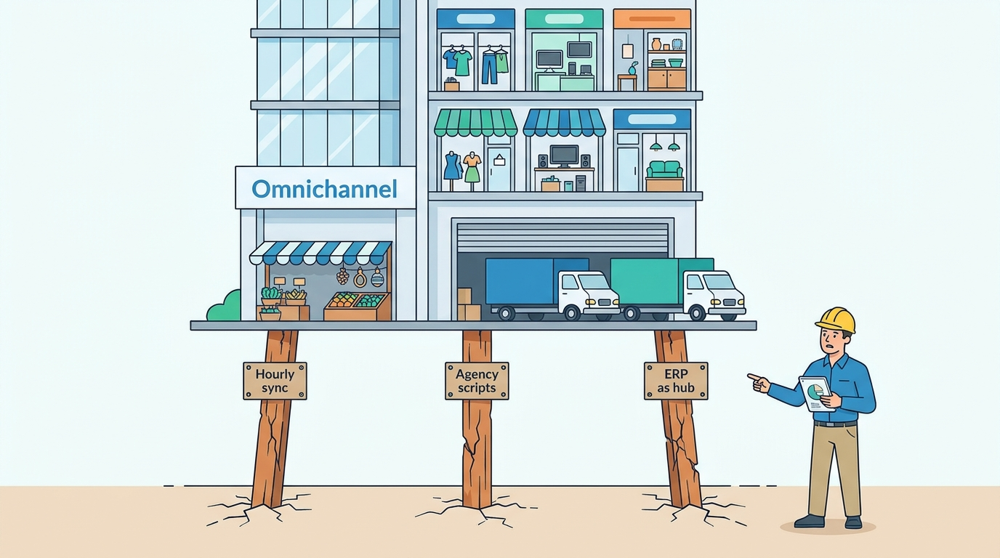
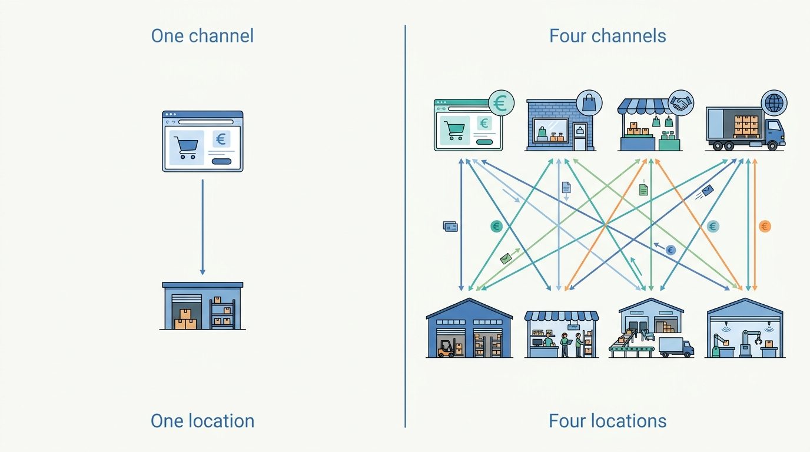
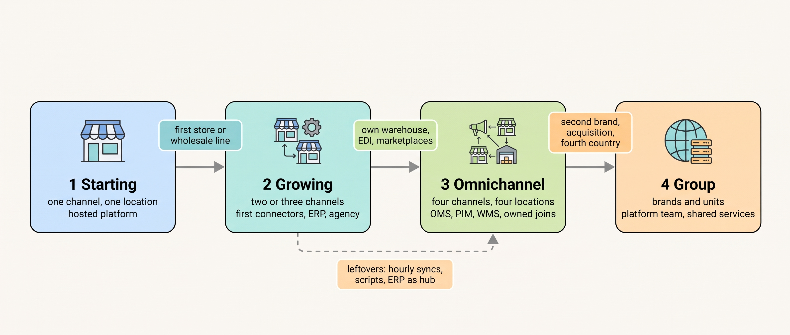
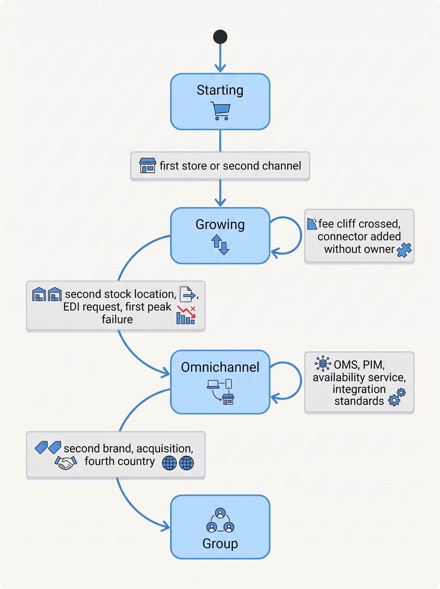

> **IN THIS CHAPTER, YOU WILL:** Read one map of the four scale stages, what each demands in systems, teams and decisions, and the signals that a stage is ending.

> **KEY POINTS:**
>
> * **A stage is a shape, not a revenue number.** The stage changes when the business adds a channel or a stock location that the current systems were not built to keep in step; revenue bands are only rough markers. Kestrel & Pine became Omnichannel in 2023, when stores, wholesale, marketplaces and an own warehouse ran on one stock at the same time.
> * **Each stage leaves systems behind, bought for the stage before.** At Kestrel & Pine, eight of the ten incidents of 2026 and early 2027 came from Growing-stage designs (hourly syncs, agency scripts, the finance system as the hub) running under Omnichannel load. The decision at each stage is which leftovers to retire, not which new tool to add.
> * **The signals arrive before the architecture does.** Vendor fee cliffs (points where a fee or price jumps) and plan thresholds, a second stock location, a retail chain asking for orders by EDI (electronic data interchange), a connector nobody owns, the first "which number is right" meeting and the first peak-day incident each mark a transition months before it is named.

> **[FAILURE PATTERNS THIS CHAPTER ADDRESSES](where-commerce-platforms-go-wrong.html):**
>
> * **The Giant's Boots** — an architecture copied from a Group-stage company, or from a trend, into a Growing- or Omnichannel-stage business that cannot staff it.
> * **The Spaghetti Junction** — the Growing stage's one-off connectors, each built for one new channel, that nobody retires when the Omnichannel stage arrives.
> * **One Size Fits None** — the Group stage's question answered before it is measured: several brands or countries forced onto one stack, or kept apart when they should share.

 
A merchant opens its first store while continuing to sell online. The servers may have ample capacity, but the business now holds stock in two places and may want either channel to fulfill an order. Systems designed for one warehouse must coordinate new decisions. Similar changes arrive with a first wholesale customer, marketplace or second brand, often before raw transaction volume becomes a problem.

Chapter 42 called migrations the moments when a merchant moves from one scale stage to the next and feels it. This chapter looks at the stages themselves. The book uses four **scale stages**: **Starting**, a simple sales operation; **Growing**, with new channels and integrations; **Omnichannel**, coordinating stores, wholesale and online sales; and **Group**, with several brands or business units. The map below brings their recurring decisions together. Use it to recognize transitions, not to copy a larger company's system list.

The stages combine common practice, dated vendor evidence and the fictional example. They are not validated revenue thresholds: the research found no public survey establishing system counts or team sizes by revenue.

**Where we are in the order's journey.** The stages show up even in a single order. Eva buys a jacket at Kestrel & Pine, the fictional outdoor brand. Her order crosses products bought at different stages: the shop platform in 2016, the marketplace connector in 2021, warehouse and finance systems in 2023, the returns portal in 2025. Each still carries the assumptions of the stage it was bought for.

This chapter's claim starts from those assumptions. A stage is a shape, not a revenue band: how many channels sell and how many locations hold stock. At each stage the order record, the stock record and the way systems exchange data move toward a hub that owns each fact. The systems bought for the previous stage keep running, and at Kestrel & Pine they caused most of the incidents of 2026 and early 2027, so the decision at a transition is which of them to retire. Two transition signals in one year, such as a second stock location and a connector nobody owns, mean a stage is ending.

The chapter starts from the one-page stage map Kestrel & Pine's board asks for. It then defines a stage and checks the definition against vendors' price lists, sets the four stages side by side in one map, and says how fresh stock, order status and price must be at each. It goes through the stages one by one, gives the Group stage a table of what to share and what to keep separate, and lists the signals that a stage is ending. It closes by pricing Kestrel & Pine's path and naming three ways a stage mismatch goes wrong: too early, too late and sideways. The evidence is Kestrel & Pine's stage map and costs, vendors' dated price lists, and larger companies' annual reports and engineering accounts.

## Setting the Scene at Kestrel & Pine: The Stage Map

In April 2027 the board asks Head of Engineering Noor Visser for a one-page **stage map**: which planned fixes suit the company now, and what would make them worth revisiting. **Waypoint**, the improvement program launched in March 2027, addresses the 2026 failures.

Noor places Kestrel & Pine at Omnichannel since 2023 and maps its thirteen systems to the stages they came from. A second brand, a fourth country or revenue past about €200 million would prompt a Group-stage review; none is planned for 2027–2028.

One entry on the map was uncomfortable. Of the ten incidents of 2026 and early 2027, Noor could attribute eight to a system or integration designed for the Growing stage (2019–2022) and still running in 2026: the hourly stock sync built when marketplace orders were a few a day; agency scripts written for one channel at a time; the ERP (the enterprise resource planning system that keeps the books, purchasing and stock valuation) as the hub for stock it did not physically hold; the POS (the store till system) synced nightly because, in 2019, there was one store next to head office. The Black Friday Oversell (1,340 units, 1,120 orders, about €96,000) was the most expensive. **The company had moved stage; the architecture had not noticed.** That finding is this chapter's argument.

**Figure 1:** *Eight of Kestrel & Pine's ten incidents traced to Growing-stage designs still carrying Omnichannel load: the company had moved stage; the architecture had not noticed.*

Waypoint therefore retires those leftovers: it adds an **order management system (OMS)**, **product information management system (PIM)** and availability service for current coordination problems. It defers group-wide choices to the 2029 review.

## What a Scale Stage Is, and Is Not

A **scale stage** is a shape of business defined by how many channels sell and how many locations hold stock, because those two numbers decide how many systems must agree about the same facts. A **channel** is any place a customer can buy: a web shop, a store, a wholesale portal, a marketplace, an EDI link (electronic data interchange: orders and invoices exchanged as structured messages between companies' systems). A **stock location** is any place stock physically sits and can be sold from: a back room, a 3PL (a third-party logistics company that stores and ships on the merchant's behalf), an own warehouse, a store, a marketplace's fulfillment center. One channel and one location need no integration. Four channels and four locations need every system to learn, quickly and reliably, what every other system has sold or moved.

**Figure 2:** *One channel and one stock location need no integration; four channels and four locations need every system to learn, quickly and reliably, what every other has sold or moved.*

Chapter 2 defined the stages like this, with revenue bands as rough markers:

| Stage | Typical size | Shape | Kestrel & Pine |
| --- | --- | --- | --- |
| **1 — Starting** | under about €2M revenue | One channel, a hosted platform, founder-run operations, a 3PL or a back room | 2016–2018 |
| **2 — Growing** | about €2M–€20M | Two or three channels, first store or wholesale, first integrations (ERP or accounting, 3PL, marketplace), a small team and an agency | 2019–2022 |
| **3 — Omnichannel** | about €20M–€200M | Stores, wholesale, marketplaces and several countries; own warehouse; a dozen or more systems; the joins become the problem; OMS, PIM and integration standards become necessary | 2023– (now) |
| **4 — Group** | over about €200M, or several brands or business units | Multiple brands, countries or business units; platform teams; shared services vs autonomy; acquisitions; vendor-scale concerns (tenancy, extensibility) | not yet |

The vendors' own price lists mark the same transitions. Their tiers rise with volume, but each tier assumes a different kind of merchant with different decisions to make. Shopify's euro pricing page (accessed November 2026) runs from Basic at €21 a month paid yearly to Plus from €2,100 a month on one- or three-year terms, and its fee for using a payment provider other than its own falls from 2% of each order on Basic to 0.2% on Plus.

Other vendors tier on GMV. **GMV** is gross merchandise value, the total value of orders through a platform before refunds and before the vendor's cut. Shopware's pricing page (accessed November 2026) says its plans are "based on your gross merchandise value (GMV) and further individual factors", with a paid plan required above €1 million GMV in a rolling year. BigCommerce's plan page (accessed November 2026) assigns tiers by trailing-twelve-month GMV and auto-upgrades merchants at $2 million.

The numbers change often; the mechanism does not: a vendor's tiers are a map of which decisions it expects you to make at which size.

What a stage is **not**: a target, a maturity score or a verdict. A merchant can stay at the Growing stage profitably forever; the stage only tells you which problems are now yours.

## The Map: Four Stages Side by Side

This is the chapter's centerpiece. Each row is a question the other chapters answer in depth; the cells say what is typical and what becomes necessary at each stage. Everything in it is industry practice, dated vendor evidence or Kestrel & Pine; where a cell makes a judgement, it is mine. The abbreviations are the book's: a **WMS** (warehouse management system) runs the warehouse; a **PSP** (payment service provider) takes the money; an **iPaaS** (integration platform as a service) is a hosted tool for building flows between systems; a **tenant** is one customer's own instance of a hosted platform; an **SSCC** is the serial shipping container code on a pallet label; **B2B2C** is selling through a partner's consumer channel.

| | **1 — Starting** | **2 — Growing** | **3 — Omnichannel** | **4 — Group** |
| --- | --- | --- | --- | --- |
| **Shape** | One channel, one stock location, founder-run | Two or three channels, a first store or wholesale line, a 3PL or small warehouse | Stores, wholesale, marketplaces, several countries, an own warehouse; a dozen or more systems | Several brands, countries or business units; acquisitions; platform teams |
| **Channels** ([[commerce-business-models]]) | Web shop; perhaps one marketplace | Web shop plus a store, a marketplace or wholesale by e-mail | Four or more, including EDI with a retail chain and marketplace-fulfilled stock | Channels per brand and per country; marketplace *operating* or B2B2C may appear |
| **Storefront and checkout** ([[commerce-platform-landscape]], [[storefront-architecture]]) | Hosted SaaS platform on a monthly plan; a theme; public apps | Same platform, higher tier; an agency customizes the theme; first custom app | Enterprise tier or contract; multi-market in one tenant or several; headless (a separate front end on the platform's APIs) considered and usually declined | Shared front end or per brand; a suite (one vendor's all-in-one product), composable, or the platform plus specialist layers becomes a real choice |
| **Where the order lives** ([[order-management]]) | In the platform | In the platform, with copies in the ERP and the 3PL | Several order records per channel until an **OMS** is introduced | OMS as the hub for all brands, or one per business unit |
| **Where stock truth lives** ([[inventory-and-availability]]) | The platform's stock count | The ERP or the 3PL feed, copied to the platform on a schedule | A **WMS** for the warehouse, the POS for stores, an external location for marketplace fulfillment; an availability service computes what each channel may sell | Stock per brand and region; shared availability rules; allocation between business units |
| **Product data** ([[product-information]]) | The platform's catalog | Platform plus the ERP's item master (its product list) plus spreadsheets | A **PIM** as the system of record; platform, connector and marketplaces consume it | PIM per brand or shared, with a shared attribute model |
| **Fulfillment** ([[warehouse-and-fulfillment]]) | Back room or 3PL | 3PL or a small warehouse run from the ERP's stock module | Own warehouse on a WMS; pallets and SSCC labels for wholesale; marketplace fulfillment programs | Several warehouses, a network, logistics as a shared service |
| **Finance and ERP** ([[erp-and-back-office-integration]]) | Accounting package; the platform exports | A mid-market ERP, often as the integration hub | The ERP kept for finance, purchasing and valuation only; the hub role moves to the OMS and the integration layer | Group ERP with books per legal entity; intercompany flows (sales between the group's own companies) |
| **Integration style** ([[integration-styles]]) | None; the platform's own connectors | Point-to-point connectors, agency scripts, vendor connectors; the first iPaaS flows | Events for stock, orders and prices; an owned integration layer; contracts, idempotency and reconciliation per flow | A platform team runs the integration layer as an internal product; API guidelines; shared event bus |
| **Who builds and runs** ([[organizing-commerce-engineering]]) | The founder and the platform's support; an agency for the theme | The agency builds; a first engineer; nobody owns integrations after launch | A 10–20-person team that owns the joins; the agency as a contributor; named owner per integration and app | Teams per brand or journey, each owning one flow of work end to end; a platform team; vendor management as a function |
| **Pricing and fees you meet** | Monthly plan; blended card rates | Plan upgrades; GMV thresholds; the third-party gateway fee; per-order quotas on tools | Negotiated contracts (platform, PSP, WMS, OMS); interchange-plus pricing (the card networks' fees passed through, plus a fixed margin); several thresholds crossed at once | Group contracts; volume commitments; exit and switching terms |
| **Peak day** ([[peak-load-and-reliability]]) | The platform's problem, not yours | The first integration bottleneck: the order export, the stock sync | A peak plan with orders-per-minute capacity per system, a switch-off order and a reconciliation owner | Shared peak tooling and runbooks across brands |
| **Decisions that become necessary** | Which platform; which PSP; which 3PL | Who owns stock and price truth; the first connector's contract; one tenant or many | OMS, PIM, availability service; integration standards; stay-and-surround or replatform; one definition of an order | Share or separate per brand; platform team or not; acquisition integration playbook; tenancy and residency |
| **Failure patterns that strike** | The Lynchpin (one agency, one person) | The Spaghetti Junction; The Price Nobody Can Explain; The First Snowfall | The Phantom Stock; Schrödinger's Order; The Boomerang; The Familiar Stranger; The Pulled Rug; The Secret Agent | One Size Fits None; The Giant's Boots; The Burned Bridge |
| **Signals the stage is ending** | A second channel or a first store; the 3PL cannot say stock per location | A retailer asks for EDI; a second stock location; a fee cliff; the first "which number is right" meeting | A second brand or business unit; an acquisition; a fourth country with its own books; the platform's tenancy or rate limits bind | (The stage has no end; its question is what to share) |
| **Kestrel & Pine** | 2016–2018: platform, PSP, 3PL in Tiel, agency from 2017 | 2019–2022: POS, Belgium, connector and iPaaS, GTINs, Germany, Ruben Alves | 2023–2027: Duiven on a WMS, ERP, enterprise tier, stores, EDI, returns portal, Peppol e-invoices; Waypoint | Not yet; signals named in the April 2027 stage map |

Three things to notice. **The order record and the stock record move in the same direction**: from "the platform knows" through "the ERP knows, mostly" to "a hub knows, and everything else is a copy." **The integration style changes faster than the systems do**: a merchant can keep its platform for all four stages and still rebuild the joins twice. And **the failure patterns are stage-specific**: the patterns of [[where-commerce-platforms-go-wrong]] about which copy of a fact is true, such as The Phantom Stock and Schrödinger's Order, cluster in the Omnichannel column because that is where the same fact first lives in four systems.

**Figure 3:** *Each stage is entered by adding a channel or a stock location, and each carries the previous stage's systems with it; the dotted arrow is where eight of Kestrel & Pine's ten incidents came from.*

## How Fresh Must a Fact Be? Requirements by Stage

The reason the joins must be rebuilt is that the same fact needs to travel faster and more reliably at each stage. The table below states the requirement for the three facts that cause most incidents. The latencies are illustrative targets, not benchmarks *(assumption)*; the Kestrel & Pine figures are the company's own records.

| Fact | Starting | Growing | Omnichannel | Group |
| --- | --- | --- | --- | --- |
| **Stock a channel may sell** | The platform's own count; freshness is instant because there is one writer | A scheduled copy (hourly is common) from the ERP or 3PL; tolerable while one channel dominates | Seconds to a few minutes, by events, because four channels sell the same unit; Kestrel & Pine's two-hour chain oversold 1,340 units | As Omnichannel, plus allocation rules between brands and regions |
| **Order status** | One record; the customer and support read the same screen | Copies in the ERP and the 3PL; support checks two systems | One state model in an OMS; status events out to the storefront, service tool and marketplaces within minutes; the Three-Status Order (11 tickets, six days) is the failure | One state model across brands, with per-unit order number families |
| **Price** | Set in the platform | Price lists in the platform and the ERP; a sync that can fail silently (the Price Drift: €179 for nine days, about €8,200 lost) | One price source with effective dates; channels consume; parity rules (marketplace prices kept in line with the shop's) | Price books per brand and market with shared governance |

The point is not the numbers. It is that **a requirement met for free at the Starting stage (one writer, one reader) becomes an engineering problem at the Omnichannel stage (four writers, four readers), and the Growing stage's scheduled copies are the bridge that collapses between them.** [[events-consistency-and-reconciliation]] owns the mechanics; [[boundaries-and-systems-of-record]] owns the ownership decision that must come first. This is also why the integration style changes faster than the systems: the platform can stay while its scheduled copies are replaced by events.

## Stage by Stage

### Starting: one channel, rented everything

At the Starting stage the architecture is a purchase, not a design. A hosted SaaS platform (software as a service: rented by the month and run by the vendor) provides storefront, cart, checkout, stock count and order record in one tenant; a PSP takes the money; a 3PL or a back room ships. Shopify's annual report for 2025, filed in February 2026, says most of its merchants subscribe to its Basic and Grow plans while the majority of its GMV comes from Plus and enterprise merchants: the Starting stage is where most merchants are and most volume is not.

What becomes necessary here is small: a platform whose export you could leave with, a PSP whose fees you understand, an app inventory with each app's permissions written down from day one ([[extensibility-and-app-ecosystems]]), and the founder, not the agency, holding the vendor logins. The failure pattern that strikes is **The Lynchpin**: one agency or one person through whom everything runs. Kestrel & Pine retained its agency in 2017; ten years later it still holds the theme, the apps and several scripts, at €14,000 a month.

The signal that the stage is ending is a second channel or a first store. The day the business has stock in two places that both sell, it has an integration problem, whether or not it has an integration.

### Growing: the first joins, built one at a time

The Growing stage adds a store on a POS, a marketplace through a connector, a wholesale line run by e-mail and keyed into an ERP, and often an ERP-centered model where the ERP becomes the hub that every other system syncs with. Microsoft's documentation of 22 September 2026 says its Shopify connector is preinstalled for all new sign-ups to Business Central, its mid-market ERP: the clearest public signal that "a hosted storefront with the ERP as hub" is the mainstream Growing-stage shape in at least one vendor channel.

Each join is built when the channel arrives, by whoever is available: the agency, the ERP partner, the connector vendor, a contractor. Each is correct for the volume of the day. Kestrel & Pine's marketplace connector arrived in 2021 with an hourly stock sync, when marketplace orders were a few a day *(illustrative)*; by 2026 the marketplaces took 43,000 orders a year and the hourly sync was one link in a two-hour chain nobody had decided was the architecture. **The Spaghetti Junction is not built; it accretes.**

This is also the stage where fees change character. A merchant that brings its own PSP to a hosted platform pays the platform's third-party gateway fee; operational tools price per order (Picqer, a Dutch WMS, lists €379 a month including 3,000 orders, then €0.28 an order, accessed November 2026); and open-source platforms stop being free above Shopware's €1 million GMV line. A merchant moving from Growing to Omnichannel typically crosses several thresholds at once, which is why price lists are a transition signal, not just a cost.

The signals that the stage is ending are concrete. A retail chain asks for EDI. A second stock location appears that must be sold from, which vendor guidance converges on as the trigger for an OMS. The first meeting happens in which two reports show two order counts and nobody can say which is right. And the first peak day arrives on which an integration, not the platform, is what fails (**The First Snowfall**). Close behind come a connector nobody can name an owner for, support opening several systems to answer one question, and an app writing a fact another system owns. EDI heads the list because, by value, European business-to-business electronic ordering is still mostly EDI: Eurostat's enterprise statistics for 2024, extracted February 2026, show EDI-type sales at 11.07% of EU enterprise turnover against 8.39% for web sales, so a wholesale line meets EDI before it meets a B2B web shop.

### Omnichannel: the joins become the architecture

At the Omnichannel stage the merchant runs three or four business models on one stock: direct-to-consumer web shops in several countries, stores, wholesale by portal and by EDI, and marketplaces with some stock held by the marketplace itself. Target's annual report for 2025, filed in March 2026, states that its stores fulfilled 97.6% of its merchandise sales, including shipment from stores and store pickup; for a retailer with stores, omnichannel is the business, and an order management system is what makes store stock sellable online. Target does not name its OMS; the mechanism is what matters.

What becomes necessary here is the set of decisions Waypoint makes: a **system of record** per fact (the one system whose value is the truth when copies disagree) for stock, orders and product content ([[boundaries-and-systems-of-record]]); an OMS as the order hub ([[order-management]]); a PIM for product content, which Akeneo's guidance (accessed November 2026) says is signaled by content scattered across teams, manual channel launches and inconsistent storefront data ([[product-information]]); an availability service per channel ([[inventory-and-availability]]); and integration standards with a named owner, a contract, idempotent handling and a reconciliation job per flow ([[events-consistency-and-reconciliation]]). The ERP is demoted from hub to one system among many ([[erp-and-back-office-integration]]).

The temptation at this stage is **The Giant's Boots**. The vocabulary of composable commerce (assembling the platform from separately bought services) and microservices (many small, separately deployed services) is everywhere, and the public examples are companies with hundreds of engineers. Fowler's "MonolithFirst" note of June 2015 argued that even experienced architects "have great difficulty getting boundaries right at the beginning"; Shopify's engineering post of February 2019 explained why a company with over a thousand developers chose a modular monolith (one deployed application with enforced internal boundaries) over microservices. The MACH Alliance, an industry group that promotes composable commerce, published its own survey of 600 decision-makers in February 2026; it reports that 37% cite integration complexity as a primary concern, a figure against the interest of the alliance that commissioned it. For Kestrel & Pine's 14-person technology team the honest reading is: adopt composable per capability (an OMS here, a PIM there) around a kept core, and own the joins. [[commerce-architecture-styles]] and [[build-buy-or-assemble]] work this through.

The signals that the Omnichannel stage is ending are a second brand or business unit, an acquisition, a fourth country with separate books, or the platform's tenancy binding (one tenant's rate limits shared by every app and connector; [[multi-tenancy-and-isolation]]). Shopify's enterprise page (accessed November 2026) cites organizations with GMV of $50 million to $500 million and more as its enterprise band, the nearest public hint of where a vendor sees the top of this stage.

### Group: what to share and what to keep apart

The Group stage is defined by plurality: several brands, business units or countries, each of which could run its own stack. The question is no longer "which systems" but **"which systems are shared, and who owns the shared ones?"**

VF Corporation's annual report for the fiscal year to March 2026 describes a direct-to-consumer business of brand-operated stores, brand e-commerce sites and concession locations across brands such as The North Face and Timberland, at 44% of revenue: one group, many brand storefronts, and a shared question about what sits behind them.

Zalando's 2025 annual report, published March 2026, shows what an acquisition does first: consolidating ABOUT YOU, another online fashion retailer, changed the group's reported figures (the share of GMV from partners selling through Zalando fell to 32.1% from 34.2% by dilution) before any system was touched. An acquisition changes the metrics on day one and the architecture over years.

The failure pattern at this stage is **One Size Fits None**: forcing brands onto one stack without measuring the benefit, or duplicating work they could share. The public cautions against too much autonomy are Zalando's and Uber's. Henning Jacobs' 2020 retrospective on a decade at Zalando (more than 260 engineering teams by 2020) reports that team autonomy over technology produced similar services "written in six languages", which "hurts productivity at scale"; Uber's 2020 account reports about 2,200 microservices needing domains, gateways and layers before a root-cause investigation stopped running through fifty services owned by twelve teams. Both sources are six years old and describe companies far larger than any merchant; the lesson transfers: **autonomy without shared standards produces the Spaghetti Junction at group scale.**

The Group stage's remaining questions are vendor-scale ones: tenancy (one tenant per brand or a tenant of tenants), extensibility (a shared app catalog and an upgrade calendar aligned to vendors' support clocks), data residency (which country the data is stored in), and exit terms. The EU Data Act (Regulation 2023/2854) prohibits switching charges for data processing services from 12 January 2027; whether hosted commerce platforms fall under it is an open legal question as of November 2026, but a group negotiating several contracts should read the switching chapter before signing ([[build-buy-or-assemble]]). The main question, which capabilities to share, is answered by the decision table that follows.

## Multi-Brand and Multi-Country: The Group's Decision Table

Because the Group stage's question is "what to share", it deserves its own table. My default is to share expensive capabilities with common requirements, such as identity, payment contracts, integration tooling, data definitions, peak tooling and security. A platform team can maintain those once for the group. Brands should retain control of storefronts, content, promotions and assortment when those differences matter to their customers. Sharing works only while its common rules leave room for those needs. The cells below are my recommendations with their conditions.

| Capability | Share across brands or units when… | Keep separate when… |
| --- | --- | --- |
| **Storefront and theme** | Brands are positioned alike and share a design system | Brand identity is the product; customers must not see the group |
| **Checkout and PSP contract** | Always share the contract and the fraud rules; volume pricing rewards it | Legal entities or countries require separate merchant accounts (share the provider, not the account) |
| **Catalog and PIM** | Attribute model and data-quality rules; a shared PIM with brand workspaces | Assortments never overlap and teams are in different countries with different seasons |
| **Stock and availability** | Warehouses serve several brands; allocation rules must be one | Brands have separate logistics and no cross-selling |
| **Order hub (OMS)** | One state model, one service tool; customers buy across brands | Business units have incompatible order types (B2B contract orders vs D2C) with no shared fulfillment |
| **Integration layer and data definitions** | Always; this is the platform team's product | Never, in my judgement; separate definitions of "order" per brand is the Group-stage Schrödinger's Order |
| **Peak tooling, security, compliance** | Always | Never |

Two conditions govern the table. If the group acquires rather than builds, every acquired brand arrives with its own stack and the question becomes sequencing, which is a migration ([[replatforming-and-migration]]). And if the group operates a marketplace or a partner program, it has become a platform vendor to other sellers, and the vendor-side concerns of [[multi-tenancy-and-isolation]] apply to it directly.

## The Transition Signals

Each stage section above ended with the signals that the stage is ending; the table below gathers them. Every signal that led to an incident at Kestrel & Pine was visible before that incident.

| Signal | What it usually means | Pattern it precedes | Kestrel & Pine |
| --- | --- | --- | --- |
| A vendor fee cliff or plan threshold is crossed | The vendor expects a different kind of customer; read its tier as a map | — | Enterprise tier in 2023 |
| A second stock location that must be sold from | An availability computation is needed, not a copy | The Phantom Stock | Duiven 2023; stores selling online stock from 2026 |
| A retail chain asks for EDI | Order capture moves into the buyer's systems; chargebacks become possible | The Pulled Rug (contract), The Lynchpin (one EDI consultant) | Bergzicht 2025; the ASN Chargeback 2026 |
| Two reports, two order counts | Three definitions of the same fact; a data-definition owner is needed | Schrödinger's Order (in the data) | The three definitions of "order" |
| A connector nobody can name an owner for | The Growing stage's build-it-when-it-arrives has left orphans | The Spaghetti Junction; The Pulled Rug | The Deprecated Endpoint, February 2027 |
| Support opens several systems to answer one question | No order hub | Schrödinger's Order | The Three-Status Order, 11 tickets |
| An app or script writes a fact another system owns | No ownership rule per fact | The Secret Agent | The App That Wrote Stock, March 2026 |
| The first peak on which an integration fails | The platform scales; the joins do not | The First Snowfall | Black Friday 2026, four-hour WMS queue |
| A second brand, an acquisition, a fourth country | The Group stage's share-or-separate question has arrived | One Size Fits None | Not yet; on the stage map |

The rule I use: **two signals in one year mean the stage has changed, whatever the revenue says.** Kestrel & Pine had six in 2026: stores selling online stock, the ASN Chargeback, the App That Wrote Stock, the Three-Status Order, the Black Friday integration failure, and three definitions of "order". Its shape had changed in 2023; the signals marked that change long before the April 2027 stage map named it.

**Figure 4:** *The transitions are triggered by shape changes, not revenue; the self-loops are where a stage does its work, and where a merchant can stay for years.*

## In Practice: Kestrel & Pine's Path, Priced

The stage map is more persuasive with the costs attached. The figures below are Kestrel & Pine's own, with one illustrative calculation.

**2016–2018, Starting.** One Dutch web shop on the shop platform, one PSP, a 3PL in Tiel, an agency from 2017. The architecture was the vendor's. Nothing from this stage caused a 2026 incident, except the habit it formed: the agency owns the storefront.

**2019–2022, Growing.** The Arnhem store on a cloud POS from a different vendor (2019), synced nightly. Belgium (2020). The Utrecht store, the marketplace connector with its hourly sync, the iPaaS and GTINs on every own-brand item (2021). Germany, the investor and Ruben Alves as lead integration engineer (2022). Every join was built when its channel arrived. Eight of the ten incidents descend from designs of this era; the clearest are the Store Stock Mirage (37 items promised that Utrecht had sold), the Deprecated Endpoint (an unowned agency script) and, in its cadence, the Black Friday Oversell.

**2023–2026, Omnichannel.** Duiven on its own WMS, the ERP and the shop platform's enterprise tier (2023); three more stores and the data warehouse (2023–24); Antwerp, EDI with Bergzicht and the returns portal (2025); Peppol e-invoicing and the Utrecht click-and-collect pilot (2026). The company now had thirteen systems, four order records, four copies of stock and three definitions of "order", and technology spend of about €2.6 million, 5.4% of revenue, high against the 2–4% that secondary sources suggest for store-heavy retailers (no primary benchmark could be verified; a judgement). The incidents of 2026 and early 2027 cost, in round figures, €96,000 (Oversell), €19,400 refunded twice (the Double Refund, most recovered), €8,200 of margin (Price Drift) and €14,200 (ASN Chargeback): about €138,000 of direct cost, before support time and goodwill.

**The fee example.** The fee cliff that matters most to Kestrel & Pine is not the shop platform's subscription (€2,300 a month on the enterprise tier) but payments. On €27.0 million of online D2C revenue, each half a percentage point of blended payment cost (the average rate across all payment methods) is about €135,000 a year *(illustrative arithmetic on Kestrel & Pine's figures)*, nearly as much as the direct cost of all four priced incidents. That is why [[commerce-payments]] and [[build-buy-or-assemble]] treat the PSP contract as an architecture decision, and why a merchant that never renegotiated its Starting-stage card rate pays a transition tax without knowing it.

**2027, still Omnichannel: the stage map.** Waypoint's €1.1 million over two years buys the Omnichannel stage's hubs and standards, retires the Growing stage's chain, and explicitly defers the Group stage. That is the whole use of the stages: not to predict revenue, but to sort decisions by the shape they belong to.

## When It Goes Wrong: Too Early, Too Late, Sideways

A stage mismatch fails in three directions, and each has a detection and a recovery.

**Too early (The Giant's Boots).** A Growing- or Omnichannel-stage merchant adopts an API-only composable core, or a microservices rebuild, on the strength of case studies from companies with platform teams. Detection: the integration layer is the largest line of engineering effort and nobody can say who is on call for it. Recovery: deploy fewer, larger pieces, as Segment, a customer-data company, did in 2018 when it folded more than 140 services back into one (its own account, now eight years old); keep the capabilities that earn their place and return the rest to the platform.

**Too late (The Phantom Stock, Schrödinger's Order).** An Omnichannel-stage merchant runs Growing-stage copies: scheduled syncs, the ERP as the stock hub, order records per channel. Detection is cheap: count the systems that hold stock, count the writers, and run one reconciliation between the warehouse and the platform. Kestrel & Pine's first weekly reconciliation in May 2027 found 2.3% of active variants with a different quantity, most from the apps that wrote stock. Recovery is Waypoint: decide the system of record per fact, add the hubs, convert the chain to events, and keep the reconciliation job forever ([[events-consistency-and-reconciliation]]).

**Sideways (One Size Fits None).** A group forces brands onto one stack by decree, or lets each keep everything, without measuring what sharing would save or cost. Detection: a shared-platform program whose business case is "consolidation" with no per-capability benefit, or as many definitions of "customer" as brands. Recovery: the decision table above, applied per capability, with the shared capabilities run by a team that treats the brands as its customers.

In every direction the recovery runs through the same two tools: an entity–owner table ([[boundaries-and-systems-of-record]]) and a reconciliation job per copy. The stage decides how many rows those tools have, not whether you need them.

## What to Take Away

The chapter opened with a merchant whose first store puts stock in two places, and with Eva's order crossing systems bought in 2016, 2021, 2023 and 2025. Both are changes of shape whose systems keep running until someone decides to retire them. Kestrel & Pine's stage map shows the cost of not deciding: the company had been an Omnichannel business since 2023, while eight of its ten incidents came from Growing-stage designs. Waypoint therefore spends its €1.1 million on retiring them and leaves the Group stage until its signals appear. The useful questions for any merchant are which shape it has now and which stage each system was bought for; revenue answers neither.

**Established.**

- Vendors tier on volume and shape, not headcount: Shopify's plans and third-party gateway fee (2% to 0.2% by tier), Shopware's €1 million GMV line for a paid plan and BigCommerce's GMV-assigned plans (all accessed November 2026) make a merchant's growth visible as fee cliffs and plan thresholds.
- By value, European business-to-business electronic ordering is still mostly EDI (11.07% of EU enterprise turnover against 8.39% for web sales, Eurostat 2024 data), so a wholesale line meets EDI before it meets a B2B web shop, usually at the Growing-to-Omnichannel transition.
- For a retailer with stores, omnichannel fulfillment is the business, not an add-on (Target's stores fulfilled 97.6% of merchandise sales in 2025), and an order hub is what makes store stock sellable online.
- Autonomy without shared standards is costly at group scale: Zalando's 2020 retrospective (services in six languages) and Uber's 2020 domain-oriented redesign (about 2,200 services) are the dated public evidence.

**Depends on context.**

- Whether an OMS, a PIM or a WMS is needed depends on channel and location counts, not order volume: an OMS when a second stock location must be sold from; a PIM when the catalog is published to a third channel in a third format; a WMS when physical operations outgrow the ERP's stock module. A single-channel merchant with high volume may need none of them.
- The revenue bands are markers. A €15 million wholesaler with one warehouse is a simpler shape than a €6 million brand with stores, marketplaces and a 3PL; design for the shape.
- The ERP as integration hub is right at the Growing stage and becomes the bottleneck at the Omnichannel stage, when stores, marketplaces and a WMS need stock faster than the ERP's batch cadence.
- At the Group stage, share what the customer cannot see and what is expensive to duplicate; keep brand-visible capabilities separate until a measured benefit says otherwise.

**The author's synthesis.**

- The first decision at each stage is which leftovers to retire, because the leftover, not the missing tool, is what fails.
- Two transition signals in one year mean the stage has changed, whatever the revenue says; a stage map that lists the signals is worth more to a board than a roadmap of tools.

## Questions to Ask

1. Which stage is the business in by shape (channels and stock locations), and which stage was each of its systems bought for?
2. Which vendor thresholds (plan tier, GMV cap, per-order quota, PSP volume pricing) will the business cross in the next eighteen months, and what does each vendor expect of a customer on the other side?
3. How many systems hold stock today, how many write it, and how often is the warehouse's number compared with the storefront's?
4. Is there one order record, or one per channel? How many systems does support open to answer "where is my order"?
5. Which integrations were built when a channel arrived, by whom, and who owns each one now?
6. Which transition signals from this chapter's table appeared in the last twelve months, and which incident followed each?
7. If a second brand, an acquisition or a fourth country arrived next year, which capabilities would be shared on day one, and who would run them?
8. Which decisions in the current program are for the stage the business is in, which for the stage it was in, and which copy a company much larger, and why?

The stages sort the decisions; people make them. The map's "Who builds and runs" row only sketched the team at each stage. Who owns each system, integration and app, how a 14-person team works with an agency and a dozen vendors, and what governance fits a merchant rather than a software company is the subject of [[organizing-commerce-engineering]].

## Sources and Evidence

*Company, product and investor sources*

- [Shopify pricing (EUR)](https://www.shopify.com/pricing), Shopify, n.d., accessed 2026-11 — plan prices from Basic to Plus and the third-party transaction fee by tier.
- [Shopify Plus plan](https://help.shopify.com/en/manual/intro-to-shopify/pricing-plans/plans-features/shopify-plus-plan), Shopify Help Center, n.d., accessed 2026-11 — Plus base price on one- and three-year terms and the variable platform fee for larger merchants.
- [Shopify for Enterprise](https://www.shopify.com/enterprise), Shopify, n.d., accessed 2026-11 — the $50M–$500M+ GMV band cited for enterprise merchants.
- [Shopify Inc. Form 10-K, fiscal 2025](https://www.sec.gov/Archives/edgar/data/1594805/000159480526000007/shop-20251231.htm), SEC filing, 2026 — most merchants on Basic and Grow; most GMV from Plus and enterprise; the GMV definition.
- [Shopware pricing](https://www.shopware.com/en/pricing/), Shopware, n.d., accessed 2026-11 — GMV-based plans and the €1 million fair-use threshold.
- [BigCommerce pricing](https://www.bigcommerce.com/essentials/pricing/), Commerce.com, n.d., accessed 2026-11 — GMV-assigned plan tiers, the 0.9% overage and the $2 million auto-upgrade.
- [Picqer pricing](https://picqer.com/en/pricing), Picqer, n.d., accessed 2026-11 — per-order pricing of a WMS as an example of operational-layer fees.
- [Target Corporation Form 10-K, fiscal 2025](https://www.sec.gov/Archives/edgar/data/27419/000002741926000016/tgt-20260131.htm), SEC filing, 2026 — stores fulfilled 97.6% of merchandise sales.
- [VF Corporation Form 10-K, fiscal 2026](https://www.sec.gov/Archives/edgar/data/103379/000010337926000030/vfc-20260328.htm), SEC filing, 2026 — a multi-brand group's direct-to-consumer definition and share.
- [Zalando SE Annual Report 2025](https://corporate.zalando.com/sites/default/files/media-download/zalando-se_annual-report-2025_eng_261003_s.pdf), Zalando SE, 2026 — the effect of consolidating ABOUT YOU on group metrics.
- [Get started with the Shopify Connector](https://learn.microsoft.com/en-us/dynamics365/business-central/shopify/get-started), Microsoft Learn, 2026 — the connector preinstalled for new Business Central sign-ups.
- [Top 3 signs you need a PIM](https://www.akeneo.com/blog/top-3-signs-you-need-a-pim/), Akeneo (guest post), n.d., accessed 2026-11 — vendor guidance on PIM triggers; vendor content.
- [Deconstructing the Monolith](https://shopify.engineering/deconstructing-monolith-designing-software-maximizes-developer-productivity), Shopify Engineering (Kirsten Westeinde), 2019 — why a large vendor chose a modular monolith; older than three years.
- [One decade in Zalando tech](https://srcco.de/posts/one-decade-in-zalando-tech.html), Henning Jacobs, 2020 — team counts and the cost of autonomy without standards; older than three years.
- [Introducing Domain-Oriented Microservice Architecture](https://www.uber.com/blog/microservice-architecture/), Uber Engineering, 2020 — about 2,200 services and the cost at the far end of scale; older than three years.
- [Goodbye Microservices](https://www.twilio.com/en-us/blog/developers/best-practices/goodbye-microservices/), Twilio Segment (Alexandra Noonan), 2018 — consolidating 140+ services into one; older than three years.
- [MACH Alliance research: 6x more organizations achieve AI ROI with a composable foundation](https://machalliance.org/insights-hub/mach-alliance-research-6x-more-organizations-achieve-ai-roi-with-a-composable-foundation), MACH Alliance, 2026 — 37% cite integration complexity as a primary concern; commissioned survey.

*Standards, regulation and official documentation*

- [E-commerce statistics (enterprises)](https://ec.europa.eu/eurostat/statistics-explained/index.php?title=E-commerce_statistics), Eurostat, 2026 (2024 reference year) — EDI-type sales 11.07% and web sales 8.39% of EU enterprise turnover.
- [Regulation (EU) 2023/2854 (Data Act)](http://publications.europa.eu/resource/celex/32023R2854), EU Publications Office, 2023 — switching charges prohibited from 12 January 2027; application from 12 September 2025.

*Research and practitioner sources*

- [MonolithFirst](https://martinfowler.com/bliki/MonolithFirst.html), Martin Fowler, 2015 — the difficulty of getting boundaries right early; older than three years.
- [IT Spending and Staffing Benchmarks 2025/2026, Chapter 8: Retail](https://avasant.com/report/it-spending-and-staffing-benchmarks-2025-2026-chapter-8-retail/), Avasant, 2025 — the retail IT-spend benchmark exists but is paywalled; the 2–4% range in the text is judgement.

Kestrel & Pine is fictional; architectural recommendations, labeled inferences and labeled assumptions are the author's judgement.
