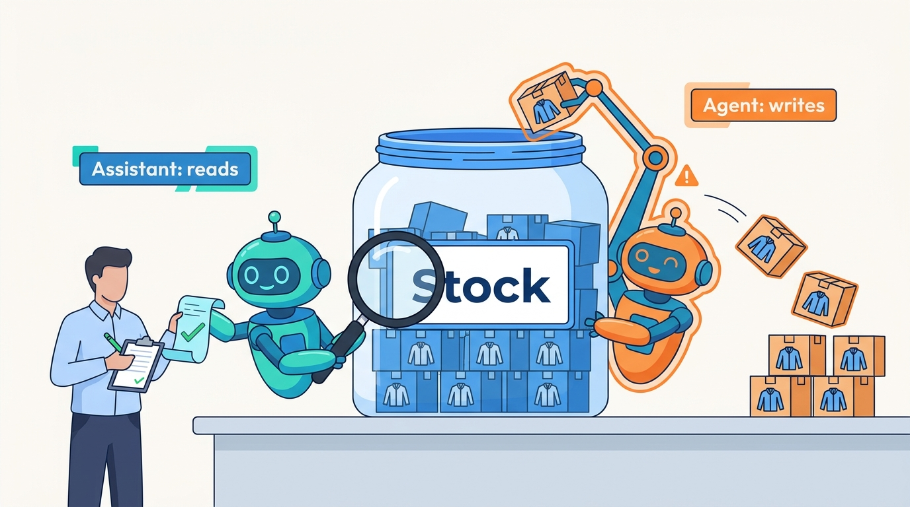
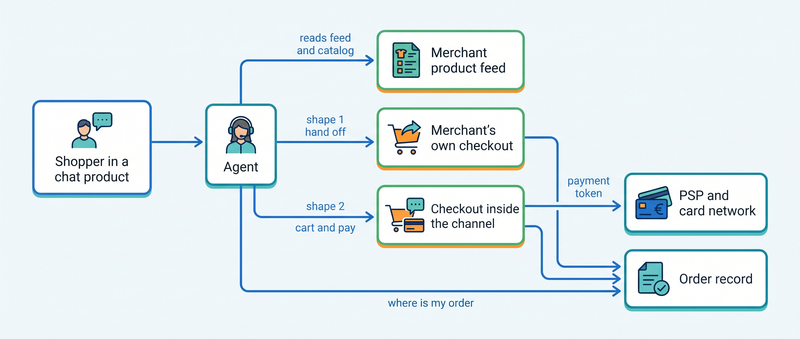
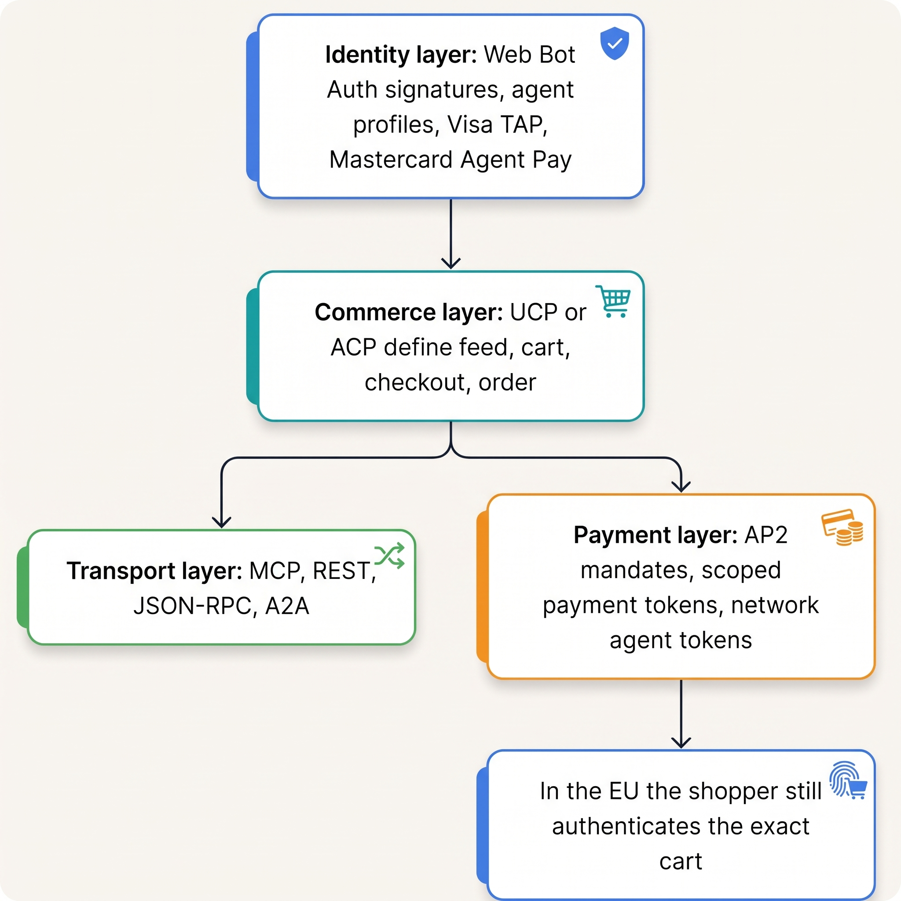
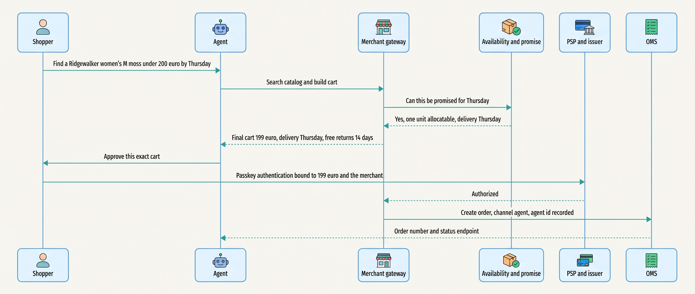
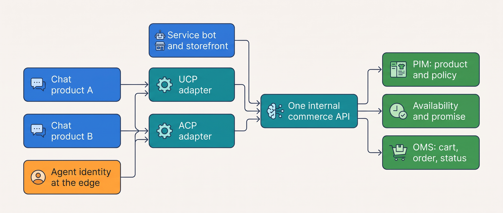
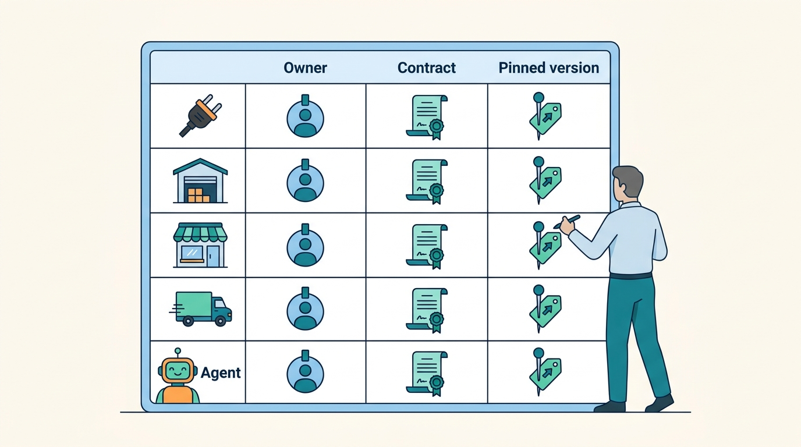

> **IN THIS CHAPTER, YOU WILL:** Separate what AI already does in commerce from what agents are promised to do, read the protocol landscape as of November 2026, and build the readiness list a merchant needs before any agent may buy.

> **KEY POINTS:**
>
> * **Recommending a purchase and making it require different permissions.** AI can suggest products, draft descriptions or flag suspicious payments. Software authorized to place an order, issue a refund or change stock also needs limits, an identity and someone accountable for its actions.
> * **Agentic commerce is real, early, and not yet in Europe.** Between September 2025 and November 2026 the flagship in-chat checkout launched and was pulled back, three protocols (ACP, UCP, AP2) were published with no settled governance, and every live consumer checkout program is limited to the United States, Canada or Australia. European payment rules require the shopper to authenticate the exact cart.
> * **Agent readiness is a data and API program, not an AI program.** Product data from one owner, availability and a delivery promise by API, order status by API, structured policies and an identity for every agent make a merchant ready for any protocol. Kestrel & Pine's Waypoint decision W8 buys exactly that in 2027, and no shopper-facing agent.

> **[FAILURE PATTERNS THIS CHAPTER ADDRESSES](where-commerce-platforms-go-wrong.html):**
>
> * **The Secret Agent** — an AI agent or admin assistant that changes orders, stock, prices or money without its own identity, a named owner and a person's approval is this pattern's newest form.
> * **The Phantom Stock** — an agent channel is the harshest consumer of availability, because a stale copy becomes a promise a third party makes for you.
> * **The Giant's Boots** — building your own shopping agent, or implementing three competing protocols in the storefront, copies the vendors' problem into a fourteen-person team.

 
A shop can use AI to **recommend a jacket** or authorize it to **place an order for that jacket**. A shopper can ignore a recommendation. Placing the order can reserve stock and initiate a payment. Permissions and spending limits bound what the software may commit to; an accountable owner must be able to investigate and correct a mistaken action.

This chapter compares those two uses of AI: **helping someone decide and carrying out the decision**. Both need reliable data. If the stock count is two hours old, an assistant may recommend a sold-out jacket; an agent may order it. The merchant still has to explain the cancellation to the customer. Before adding either, establish where product, price and stock answers come from, and who may change them.

This chapter explains **agentic commerce**, software acting in a shopping or merchant workflow, and the interfaces and controls a merchant needs to support it. Deeper agent design appears in [[tool-ecosystems-and-mcp]], [[side-effects-and-external-actions]] and [[agent-identity-and-least-privilege]].

**Where we are in the order's journey.** A shopper might ask an assistant for a waterproof jacket under €200, delivered by Thursday. Authorized software might then place the order or request an exchange later. Each step needs current product facts, a clear permission and a confirmed result.

## Setting the Scene at Kestrel & Pine: The Agent Test

Kestrel & Pine, the fictional outdoor brand, faces three requests in February 2027. Its agency offers a shopping assistant for **€60,000 to build and €2,500 monthly to run**, both illustrative assumptions. A board observer asks CEO Mara Lindqvist whether shoppers can find the brand in ChatGPT. The platform also enables an AI channel with checkout limited to US shoppers, an assumption modeled on the documented programs below.

Head of Engineering Noor Visser tests the underlying data before judging the proposals. She asks five product questions about the Ridgewalker women's M in moss at two moments: the Black Friday oversell at 20:00 on 27 November 2026 and Eva's order at 21:14 on 13 April 2027.

The existing platform, **warehouse management system (WMS)** and returns portal must supply the answers. An **integration platform as a service (iPaaS)** carries data between them. **Waypoint**, the improvement program, adds **product information management (PIM)** for content and an **order management system (OMS)** for shared orders. The question is whether those records can support a reliable action.

| What an agent asks | Which system answers today | True on 27 Nov 2026, 20:00? | True on 13 Apr 2027, 21:14? |
| --- | --- | --- | --- |
| What is it? | The platform's product record; the waterproof rating only in a spreadsheet | Partly: no rating, three copies of the description | Same |
| Is it in stock? | The platform's stock copy, up to two hours behind the WMS | **No**: sold out at 19:40; the copies said yes until about 20:30 (storefronts) and 21:35 (marketplaces) | Yes, by luck |
| When will it arrive? | A sentence in the theme: "ordered before 22:00, delivered tomorrow" | **No**: the WMS queue was four hours behind | **No**: the 21:00 wave had gone; delivered Thursday, not Wednesday |
| What does it cost delivered, can I return it? | Price in the platform; policies in page text | Price yes; policies not machine-readable | Same |
| Where is my order, can I exchange it? | Platform, WMS via the iPaaS, returns portal: no single answer | The Three-Status Order was two weeks away | Mostly, for one parcel |

Two of five answers were wrong on the Oversell night, one on an ordinary evening, and none came from a system that owned the fact. **An agent would not have fixed any of this; it would have broadcast it.** Noor's memo ended with one line, which became Waypoint decision **W8**: agent readiness, not agents. The agency's assistant was declined; the vendor's AI channel stayed on for discovery only.

## Two Kinds of AI, and Why the Difference Is Architectural

In plain words: A **model** is software trained on data to produce an output from an input: a ranking, a sentence, a score. A **large language model** (LLM) is a model trained on text that can read and write natural language, which is what makes chat assistants possible. An **assistant** is an LLM wrapped in a product that helps a person. An **agent** is an assistant that has been given tools and permission to use them: it can call an API that creates a cart, places an order or changes a stock figure. **Agentic commerce** is the business term for agents that discover, compare and buy on a shopper's behalf, inside a chat product or a marketplace app.

The architectural question is **which actions the software is allowed to carry out**, whatever the vendor calls it. Drafting a description differs from publishing it; suggesting a refund differs from sending the money. [[boundaries-and-systems-of-record]] assigns authority over those facts, and [[organizing-commerce-engineering]] assigns accountable owners. Use the same permission checks as other integrations so an agent cannot bypass a stock or payment limit. Record its actions so the owner can explain and correct a mistaken commitment.

**Figure 1:** *The assistant uses the stock count to suggest a purchase. The agent can place the order and change the stock count, so it needs permission to do so.*

## What AI Already Does in Commerce

Six uses are established. Each is worth having at the right stage, and each has a public record thinner than the marketing.

**Search and recommendations.** Amazon's item-to-item collaborative filtering (recommending from what other shoppers bought together) was described in a 2003 paper; its 2019 history records that a deep-learning model first lost to the old method and a plain bestseller list: **a strong baseline is hard to beat.** Hosted "AI search" adds vector search, which matches meaning so that "waterproof jacket" finds "rain shell"; every published lift is a customer case without a control ([[commerce-search-and-discovery]]). Zalando's assistant, a ChatGPT-based beta in April 2023, had "more than 22 million unique users" in 2026 by its Q3 2026 release (3 November 2026).

**Content.** Generated listings are common (Amazon reported more than 100,000 sellers using its tools in September 2023). The architectural point is where generated text lands: **in the system of record for product content, with a review state, or the channels drift apart** ([[product-information]]).

**Service bots.** Klarna said on 27 February 2024 that its assistant handled 2.3 million conversations in its first month, two thirds of its chats, the work of 700 agents. In May 2025 its CEO told Bloomberg it was rehiring humans because the bots produced "lower quality" output: measure resolution, not **deflection** (the share of contacts a bot absorbs). **A bot is only as good as the APIs behind it**: order status, shipment events, return eligibility and refund state, the same APIs an external agent needs, and the ones Kestrel & Pine's "five tabs" could not provide ([[customer-service-and-notifications]]).

**Fraud.** Scoring belongs in the PSP (the payment service provider that takes the shopper's money) or a specialist; Stripe's Radar page claims a "32% average reduction in fraud" with no accuracy or false-positive rate published. Agents break the premise of bot defense, that a non-human session is hostile ([[commerce-security]]).

**Forecasting.** Deep demand forecasting (Amazon's DeepAR paper, 2017) produces a purchase proposal a buyer approves, and it needs clean sales and stock-out history, which a merchant with six writers of stock does not have.

**AI traffic.** Adobe Analytics reported in January 2026 that visits to US retail sites referred by generative-AI products rose 693% year on year in the 2025 holiday season, growth from an unpublished, small base.

What the six have in common: each reads the merchant's data, and each writes either a derived copy that goes stale or a proposal a person approves. None of them owns a fact.

## Assistants in the Admin: The Secret Agent Wears a Badge

The second place AI arrived is the back office. Shopify announced Sidekick in July 2023 and said on 21 May 2025 that it could run reports, create segments, filter orders and set up discount codes "with the merchant's approval"; its help page (accessed November 2026) describes it editing orders and presenting changes for review before applying them, and its Fall 2026 edition claims daily sessions up 4.2 times year on year, a vendor figure. Shopware (June 2026) and Salesforce (July 2026) followed with their own admin agents.

Three things are the same across all of them: **the assistant acts through the platform's own APIs and permission model**; **every vendor describes a draft-and-review step**; and **the assistant's reach ends where the platform's data ends** (Sidekick cannot see Kestrel & Pine's WMS unless an app exposes it). The review step is a vendor default today and a setting someone can switch off; a merchandiser who lets an assistant "clean up" inventory has recreated the App That Wrote Stock. One writer per fact, and an assistant is not it ([[human-oversight-and-bounded-autonomy]]).

## Agentic Commerce: Fourteen Months, Told in Order

On **16 September 2025** Google announced the **Agent Payments Protocol** (AP2) with more than 60 organizations, built on signed **mandates**: an intent mandate (what the user asked for, with price limits) and a cart mandate (an unchangeable record of the exact items and price). On **29 September 2025** Stripe and OpenAI launched **Instant Checkout** in ChatGPT: US users could buy from US Etsy sellers inside the chat, under the **Agentic Commerce Protocol** (ACP), with a payment token scoped to one merchant and one cart.

On **11 January 2026** Google and Shopify announced the **Universal Commerce Protocol** (UCP), co-developed with Etsy, Wayfair, Target and Walmart, with checkout in Google's AI Mode and Gemini app for US shoppers.

On **6 March 2026** OpenAI said it was "evolving how we approach commerce in ChatGPT", and on 12 March that Instant Checkout "is moving to Apps"; ChatGPT became a discovery channel with checkout on the merchant's own storefront. On **3 November 2026** Zalando announced Zalando Extended, with its own agent planned to check out at a pilot partner in 2027.

In fourteen months the flagship in-chat checkout launched and retreated, three protocols appeared, Shopify replaced its own agent interface (Storefront MCP, May 2025) with UCP endpoints, and no party published a transaction count. **This is the most volatile part of the book, and the reason the chapter is dated to the day.**

Two shapes exist as of November 2026, and the difference decides what a merchant needs.

**Figure 2:** *Discovery with hand-off needs only a correct feed and a stable product URL; checkout inside the channel needs cart, checkout, order and payment-token APIs and an identity for the agent.*

**Discovery with hand-off.** The agent finds and shows the product; the shopper pays on the merchant's checkout, in an in-app browser or a new tab. The merchant needs a correct, fresh **product feed** (a machine-readable export of the catalog: identifier, title, description, URL, image, brand, price, availability, shipping, returns) and nothing else new. This is where a European merchant can be in 2026.

**Checkout inside the channel.** The agent builds the cart and pays, with the merchant remaining the **seller of record** (the party that legally sells, collects VAT and owes the withdrawal right). Google's AI Mode and Gemini, Copilot and Meta's Muse work this way, for shoppers in the United States, with Canada and Australia announced. The merchant needs cart, checkout, order and payment APIs, plus a way to know which agent is calling.

## The Protocols in Plain Words

A **commerce protocol** is a published contract (feed, cart, checkout, order, payment token) that lets any agent talk to any merchant without a bespoke integration, as EDI lets any retailer send any supplier an order ([[edi-and-e-invoicing]]). Four names recur, in layers.

**Figure 3:** *MCP carries the calls, UCP or ACP say what the calls mean, AP2 and the card networks carry the money, and a signature says who is calling; a European checkout adds the shopper's own authentication at the end.*

**MCP (Model Context Protocol)** is the transport: how an agent discovers and calls tools such as "search catalog" or "create cart". It says nothing about what a cart is ([[tool-ecosystems-and-mcp]]).

**ACP** is OpenAI and Stripe's specification: feed, checkout, delegated payment, and since April 2026 cart, orders and authentication. Its repository calls it "in beta", governed by the two founders; its feed upload "currently targets the US".

**UCP** is the Google-led consortium standard: catalog, cart, checkout, identity linking and order, over REST or JSON-RPC with MCP "built in" and AP2 for payment. Its governance council is Google, Shopify and Stripe; its repository shows no version tags. Google said on 16 September 2026 that UCP "enables direct checkout for hundreds of thousands of brands and retailers", which counts enabled merchants, not transacting ones.

**AP2** is the payment layer under UCP: signed mandates that give a "non-repudiable audit trail" of what the shopper authorized. Its repository holds samples and demos.

**Agent identity** is the layer the others assume. Cloudflare proposed **Web Bot Auth** in May 2025: an agent signs each HTTP request and publishes its keys at a well-known address, because "user agent headers alone are easily spoofed". It is now an IETF working-group draft (29 October 2026) and underpins Visa's Trusted Agent Protocol and Mastercard's Agent Pay; Shopify's agent profiles work the same way, where "higher trust tiers unlock broader access, including direct checkout completion". Amazon, which sued Perplexity in November 2025 over its shopping agent, insists third-party agents "operate openly" ([[case-amazon]]; the identity model is in [[agent-identity-and-least-privilege]]).

### Status as of 7 November 2026

Every row is volatile; re-check the primary source before relying on it.

| Protocol or program (owner) | Launched | Status on 7 November 2026 | Buyer markets |
| --- | --- | --- | --- |
| Instant Checkout (OpenAI, Stripe) | 29 Sep 2025 | Pulled back March 2026; "moving to Apps"; discovery with hand-off | US |
| ACP (OpenAI and Stripe as "Founding Maintainers"; Apache 2.0) | 29 Sep 2025 | Beta; latest spec 17 Apr 2026 | Feed "currently targets the US" |
| AP2 (Google with 60+ organizations) | 16 Sep 2025 | Specification and samples; used inside UCP | Payment layer |
| UCP (council: Google, Shopify, Stripe, two seats open) | 11 Jan 2026 | Shopping spec "latest", no version tags; "hundreds of thousands" of merchants enabled | US; Canada and Australia "early next year"; UK later; EU not mentioned |
| Shopify Agentic Storefronts | 10 Dec 2025 | Live; ChatGPT discovery only; direct checkout in Google, Copilot, Meta; Storefront MCP replaced by UCP endpoints; checkout needs signed requests | ChatGPT: must sell to US; Google: US, Canada, Australia |
| Visa Intelligent Commerce and TAP; Mastercard Agent Pay | Apr and Oct 2025 | EU pilots with the shopper authenticating each purchase (Visa July 2026; Mastercard June 2026) | Pilot |
| Worldline, ING, Mastercard | 2 Jun 2026 | One production pilot transaction (Netherlands) | Pilot |
| Zalando Extended | 3 Nov 2026 | Partner products in the app (Westwing pilot); agent checkout planned 2027 | Zalando markets |
| Web Bot Auth (IETF working group) | May 2025; draft -01 29 Oct 2026 | Internet-Draft; deployed by Cloudflare, Visa, Mastercard | n/a |

Read the table for its shape: **no protocol is governed by a standards body, no checkout program has published volumes, and the only live European transactions are pilots with the shopper present.**

## Europe: The Shopper Still Authenticates the Cart

**Strong customer authentication.** Under PSD2's technical standards (Delegated Regulation 2018/389, in force since September 2019), a remote electronic payment needs **SCA**: two of knowledge, possession and inherence (something you know, have, are), **dynamically linked** to one amount and one payee: "any change to the amount or the payee results in the invalidation of the authentication code". None of the exemptions was written for a delegated purchase whose amount is unknown when the shopper delegates.

That is why the European pilots authenticate at the moment of purchase: Worldline and ING's June 2026 transaction completed "only after the consumer explicitly approved it", and Visa's July 2026 pilot authenticated every purchase with a **passkey** (a device-bound credential, usually unlocked by a fingerprint or face, that counts as possession plus inherence).

A March 2026 law-firm note (Osborne Clarke) is plain: agent payments "remain subject to PSD2 and the RTS", with "no special 'extra-regulatory' regime"; the PSD3 texts read for this book do not address agent-initiated payments.

The consequence for architecture is small and strict. **The cart the agent builds must be identical to the cart the shopper authenticates**: price, delivery promise and tax final before the mandate is signed, the no-drift rule of [[cart-and-checkout]]. Unattended delegated purchases in the EU are unproven in public evidence as of November 2026.

**Figure 4:** *A European agent purchase as the 2026 pilots shaped it: the agent builds the cart, the merchant finalizes price and promise, the shopper authenticates that exact cart, and the order carries the agent's identity for service and disputes.*

**The AI Act.** Regulation 2024/1689 applies generally from 2 August 2026. Its Article 50 is the live obligation for commerce: an AI system that interacts with people must tell them so "unless this is obvious", and generated content must be marked as artificial in a machine-readable way. Search and recommendations are not high-risk uses ([[commerce-regulation]]).

**Consumer law.** A CERRE issue paper of July 2026 argues that EU consumer law "implicitly assumes" a human makes the purchase decision; every protocol treats the agent as the consumer's instrument, a working assumption, not settled law.

**For a Dutch, Belgian or German merchant in November 2026, no live consumer channel lets an agent complete a checkout**: ChatGPT has no in-chat checkout anywhere; Google's covers the US, Canada and Australia; Copilot, Meta, Perplexity and Amazon are US-centered; the card-network pilots authenticate the shopper each time; Zalando's agent checkout is planned for 2027. The realistic 2026–2027 work is feed quality, discovery presence, and payment-side readiness through the PSP and the card networks.

## What a Merchant Must Have Before an Agent Can Buy

Agent readiness means the five facts an agent asks for are correct, owned by one system and served by API, work most of this book has already described.

| Fact the agent needs | Owner after Waypoint | Freshness | Consistency | Latency *(assumptions)* | Availability |
| --- | --- | --- | --- | --- | --- |
| Product: title, attributes, GTIN (the barcode number), images, policies | The PIM (W3), published to platform, connector and feed | Hours; feed rebuilt at every publication | One version everywhere; a review state for generated text | Lookup under about 300 ms | Feed served from a cache, never from the PIM |
| Availability per channel | The availability service (W1), from WMS stock events | Minutes (Shopify lets agents cache price and availability for at most 15 minutes) | Available-to-promise with a buffer, not a copy of on-hand stock | Under about 200 ms | Degrade to "check at checkout", never to a stale yes |
| Delivery promise | The promise service (planned 2028) | Per request | The same answer to storefront, marketplaces and agent | Under about 300 ms | Fall back to a conservative lane table |
| Price and policy: price, VAT, shipping, returns | The platform's price list ([[pricing-architecture]]); policies as structured fields | Minutes; ACP asks for a feed update "when a sale starts or ends" | Checkout price equals feed price | Feed | Feed |
| Order status, returns, refunds | The OMS (W2), with the returns portal | Seconds after a shipment event | One state model for every channel | Under about 500 ms | Read model served from the OMS, not the WMS |

Three observations carry the design. **The feed is most of the work, and you may already have it.** The schema.org `Product` vocabulary, Google Merchant Center's specification, OpenAI's ACP feed (nine required fields) and Shopify's catalog ask for the same fields: identifier, GTIN, title, description, URL, image, brand, price, availability, shipping, returns. The new requirement is **freshness for price and availability in minutes, not nightly**. **Availability and the promise are the hard part, and they are not AI work.** An agent cannot negotiate; it reads a figure and either shows the product or does not, so an agent channel is the harshest consumer of the available-to-promise of [[inventory-and-availability]] and the computed promise of [[shipping-and-delivery]]. **Order status is the same API three times**, for the service bot, the order page and the external agent; build it once, on the OMS.

To the list add **an identity and a policy for every agent**: verified agents distinguished from scrapers at the CDN (content delivery network, the edge layer in front of the storefront) or platform level, an allowed set of actions per agent (read the catalog; build a cart; complete checkout only at a trust tier the merchant chose), and no agent writing stock, prices or orders directly. And add **an "agentic" marker on the order** so service, fraud review and consumer-law disclosure can treat the channel on its own terms.

## The Choices and Their Trade-offs

Four realistic postures exist, and they are cumulative: a correct feed; the platform's agent channel, where the vendor carries the protocol churn but sells the platform's view of availability; an agent gateway with adapters over the merchant's own services, so a protocol change is a mapping change; and your own shopping agent, which competes with the largest technology companies for attention with none of their reach. If OpenAI found owning the checkout hard enough to retreat, a fourteen-person team should not volunteer.

**Figure 5:** *The low-regret design: adapters per channel over one internal commerce API, so a protocol that changes or disappears costs a mapping, not a rebuild, and every channel reads the same availability and promise.*

| Posture | What you build | What you depend on | When it fits | When it limits |
| --- | --- | --- | --- | --- |
| Correct feed only | One feed from the product owner, refreshed in minutes | Feed consumers' rules | Every stage; the floor | No order inside a channel |
| Platform's agent channel | Nothing; switch on, review terms | The vendor's channels, countries, exclusions and availability copy | Starting and Growing; Omnichannel while the platform's copy is good enough | Sells stale availability if the platform is not the stock owner; no EU checkout today |
| Agent gateway over own services | Adapters per protocol over one internal API; identity at the edge | Your OMS, PIM, availability and promise being right | Omnichannel with Waypoint-grade services; Group | You carry protocol churn; worthless over copies |
| Own shopping agent | An LLM product with tools and a checkout | Model vendors, every fact above, and shoppers choosing you | Rarely; perhaps a Group with a destination app | The Giant's Boots |

I would hold a merchant at the first two postures until a protocol has stable governance, a European checkout program with published volumes exists, and the merchant's own availability and order truth are better than the platform's copy; revisit in mid-2027. **What not to build yet**: a consumer-facing shopping agent; three protocols natively in the storefront; agent authentication from scratch; any agent or assistant that writes stock, prices or orders directly; any promise through an agent that the storefront cannot keep.

## Across Scale Stages: When It Fits and When It Limits

| Stage | Typical AI use | What becomes necessary | Warning signs |
| --- | --- | --- | --- |
| **Starting** (under about €2M) | The platform's built-in search and assistant; one feed to Google Merchant Center; the PSP's fraud scoring | A correct feed with GTINs and fresh price and stock; multi-factor authentication on the admin; the AI channel for discovery only | Product text edited in three places; the assistant given write permissions "to save time" |
| **Growing** (€2M–€20M) | A hosted search service; reviewed generated descriptions; the platform's agent channel; a bot on the platform's inbox | Feeds from one product owner, refreshed in minutes; structured return and shipping policies | The feed publishes the ERP's hourly stock copy; a repricing app with no floor; the bot cannot read shipment events |
| **Omnichannel** (€20M–€200M; Kestrel & Pine) | AI search shared by storefront and store staff; a bot in front of the OMS and returns portal; forecasting fed by stock events; admin assistants with review | Availability and the computed promise by API; order status by API on the OMS; an agent policy (identity, allowed actions, no writes); an "agentic" order attribute; AI Act disclosure on every bot | Agent and storefront show different availability; agent orders canceled for stock the warehouse never had; "auto-apply" switched on by a team |
| **Group** (over about €200M or several brands) | A shared discovery platform with per-brand indexes; one order-status contract; an agent gateway per brand on one implementation | Per-brand feeds, identities and markets; one payment and disclosure policy per market; a key inventory for every agent credential | Brands implementing protocols separately; agent orders unattributable to a brand; one credential shared across brands |

The readiness list does not change with scale; who assembles it does: the platform at the Starting stage, the merchant across PIM, OMS, WMS and PSP at the Omnichannel stage, a shared service at the Group stage.

## In Practice: Waypoint's W8 at Kestrel & Pine

W8 is written as prerequisites with owners and dates, and a sentence about what will not be built. The figures are Kestrel & Pine illustrations.

| Prerequisite | Owner | Delivered by | How an agent sees it |
| --- | --- | --- | --- |
| Product data from one owner, including the attributes shoppers search for (the Ridgewalker's 20,000 mm waterproof rating lived only in a spreadsheet) | Teun Baas, through the PIM (W3) | Q3 2027: the DE storefront in August, NL/BE and the connector in September | One feed per market from the PIM, with structured shipping and return policies |
| Availability per channel from WMS stock events, with buffers | Daniel Okafor and Ruben Alves, through the availability service (W1) | Q4 2027 | An availability endpoint; feed availability refreshed every 10 minutes *(assumption)* |
| A computed delivery promise | Noor Visser; the May 2027 promise service (transit table plus WMS cut-off and backlog), the promise API in 2028 | 2028 | The same date the storefront shows |
| Order status, returns and refunds by API | The Fulfil and Return team, on the OMS (W2) | Q4 2027, after D2C orders route through the OMS on 13 October | One customer-scoped endpoint, used first by the service tool and the order page |
| An agent policy | Milan Petrov (business), Ruben Alves (technical) | April 2027 | Verified agents may read the catalog; checkout only on the storefront in 2027; no agent or assistant holds a write scope on stock, prices or orders; every agent credential on the ownership map |
| AI disclosure | The Buy team | April 2027 (Article 50 has applied since 2 August 2026) | The service chat says it is automated; generated images are marked |

The policy line cost nothing and mattered most: W8 extends the ownership map of [[organizing-commerce-engineering]] to agents by a single rule: **an agent is an integration**, with a row, an owner, a contract, a pinned API version and a reconciliation. The agency's admin-assistant trial in June 2027 ran under that rule, with auto-apply disabled and every change reviewed; it drafted 1,400 product descriptions for the autumn season, about 60% accepted unchanged, and could not touch stock *(illustrative)*. What W8 does **not** do is also recorded: no storefront shopping agent, no in-channel checkout and no custom protocol work in 2027; the gateway posture is the 2028 plan if a European checkout program exists by then. Mara's answer to the board observer: "We will be the merchant whose answers are right when the agents arrive."

**Figure 6:** *Waypoint's W8 rule: an agent is an integration, with a row on the ownership map, an owner, a contract, a pinned API version and a reconciliation.*

## When It Goes Wrong

**The assistant with a write scope.** A merchandiser enables auto-apply on an admin assistant to "fix negative stock" before a campaign; the assistant sets quantities in the platform while the WMS feed also sets them. This is the App That Wrote Stock, and the detection is the same: the weekly WMS-to-platform reconciliation ([[events-consistency-and-reconciliation]]) and a rule that no assistant credential holds an inventory write scope. Recovery: revoke, overwrite from the system of record, add the credential to the ownership map.

**The stale feed.** The feed is rebuilt nightly from the platform's stock copy; a product sells out at 19:40 and every agent shows it in stock until morning. Detection: a feed-freshness monitor (the age of the last price and stock update per market) and rising agent cancellations. Recovery: availability in the feed from the availability service, refreshed in minutes, and "check at checkout" when the service is down.

**Duplicate orders from agent retries.** An agent's checkout call times out, the agent retries, two orders exist. The remedy is an **idempotency key** (a unique identifier sent with the request, so a repeat has the same effect as the first) on every cart and checkout call, and a daily match of agent orders to PSP authorizations.

**Cart drift before authentication.** The agent shows €199 with Thursday delivery; by the time the shopper authenticates, the promotion has ended, and under dynamic linking the authentication is void. Remedy: hold price, promise and tax for the authentication window, re-quote rather than silently charge, and store the mandate reference and agent identity with the order.

**The protocol pulled back.** A channel you built against disappears or changes its terms within a year, as Instant Checkout did in six months and Shopify's Storefront MCP within twelve: the Pulled Rug of [[api-contracts-and-versioning]] at protocol scale. Remedy: adapters over one internal API and a contract card per channel.

## What to Take Away

**Established.**
- AI in commerce has two kinds: assistants that read and propose (Amazon 2003 and 2019, Zalando 2023 and 2026, Klarna 2024 and 2025) and agents that act. The second adds a writer, and every writer needs an owner.
- As of 7 November 2026, agentic commerce is three protocols without standards-body governance, one flagship checkout pulled back within six months, and no published transaction volumes; every live consumer checkout is limited to the United States, Canada or Australia.
- In the EU, strong customer authentication and dynamic linking apply to agent payments without a special regime (Osborne Clarke, March 2026); the 2026 pilots all authenticate the shopper on the exact cart; the AI Act's Article 50 requires bots to say they are AI from 2 August 2026.
- Every feed specification asks for the same dozen fields; agent identity is converging on signed HTTP requests with a published key directory (Web Bot Auth, an IETF draft).

**Depends on context.**
- Switching on the platform's agent channel depends on whether the platform's availability copy is the stock owner's truth: for a merchant whose platform holds stock, yes, now; for one whose stock lives in a WMS and syncs hourly, for discovery only until the availability service exists.
- Building an agent gateway depends on owning better availability, promise and order truth than the platform, and on an EU checkout program existing; before both it is machinery with no traffic.
- How much an admin assistant may apply without review depends on the fact: generated descriptions with a review state, freely; discounts and segments, with approval; stock, prices and refunds, never.

**The author's synthesis.**
- Agent readiness is the same program as fixing the Phantom Stock and Schrödinger's Order: one owner per fact, availability and promise computed rather than copied, order status from one record. A merchant that does that work is ready for whichever protocol survives; one that chases protocols without it broadcasts its drift.
- Treat every agent as an integration: a row on the ownership map, an identity, a contract, a pinned version, a reconciliation; the Secret Agent is a governance failure first.
- For a European merchant in 2027 the honest plan is feed, discovery, payment-side readiness through the PSP, and a review in mid-2027; anything more is the Giant's Boots, worn early.

## Questions to Ask

1. Which system owns each of the five facts an agent asks for (product, availability, promise, price and policy, order status), and can each be read by API from that system today?
2. How old is the stock figure in our product feed when an agent reads it, and what does the agent see when the availability service is down?
3. Which agent channels has our platform switched on by default, under what terms, for which countries, and which of our products are excluded?
4. Does any assistant, app or agent hold a write scope on stock, prices or orders, and is each agent credential on the ownership map with an owner, a contract and a deprecation date?
5. If an agent's checkout call is retried, do we create one order or two?
6. Is the cart the shopper authenticates identical to the cart the agent built, and how long do we hold price and availability for the authentication window?
7. Do our bots say they are AI, and are generated product images and text marked?
8. Which vendor has published a transaction volume for its agent channel, and when will we re-check the protocol table?

Part X ends here, with the newest kind of actor asking the oldest question in the book: who may make which promise, and which system has to keep it. Part XI tests the argument against the public record of real companies, starting with the platform that serves millions of merchants on one codebase. Continue with [[part-11]].

## Sources and Evidence

*Company, product and investor sources*

- [Stripe and OpenAI launch Instant Checkout](https://stripe.com/newsroom/news/stripe-openai-instant-checkout), Stripe newsroom, 2025 — the launch, US Etsy sellers, the scoped payment token.
- [Agentic Commerce Protocol repository](https://github.com/agentic-commerce-protocol/agentic-commerce-protocol), OpenAI and Stripe, 2025–2026 — beta status, governance, release dates; [Product Feed Spec](https://developers.openai.com/commerce/specs/feed), OpenAI developers, n.d., accessed 2026-11 — required fields, US targeting.
- [OpenAI shifts checkout plans](https://digitalcommerce360.com/2026/03/06/openai-shifts-checkout-plans-agentic-commerce-strategy/), Digital Commerce 360, 2026, and [Shopify says purchases are coming inside ChatGPT](https://www.modernretail.co/technology/shopify-says-purchases-are-coming-inside-chatgpt-through-agentic-storefronts-as-openai-retreats-on-instant-checkout/), Modern Retail, 2026 — the March 2026 retreat and the "integrity of transactions" argument.
- [Announcing Agent Payments Protocol (AP2)](https://cloud.google.com/blog/products/ai-machine-learning/announcing-agents-to-payments-ap2-protocol), Google Cloud, 2025 — mandates and partners; [AP2 repository](https://github.com/google-agentic-commerce/AP2), n.d., accessed 2026-11.
- [Agentic commerce: new AI tools and a protocol](https://blog.google/products/ads-commerce/agentic-commerce-ai-tools-protocol-retailers-platforms/), Google, 2026; [Universal Cart at Google Marketing Live](https://blog.google/products-and-platforms/products/shopping/shopping-updates-google-marketing-live/), Google, 2026; [Google Shopping holiday updates](https://blog.google/products-and-platforms/products/shopping/google-shopping-updates-holiday-shopping/), Google, 2026 — UCP launch, geography, "hundreds of thousands" enabled.
- [ucp.dev](https://ucp.dev/), UCP Authors, 2026; [UCP MAINTAINERS](https://github.com/Universal-Commerce-Protocol/.github/blob/main/MAINTAINERS.md) and [repository](https://github.com/Universal-Commerce-Protocol/ucp), n.d., accessed 2026-11 — capabilities, transports, councils, absence of version tags.
- [The agentic commerce platform](https://www.shopify.com/news/ai-commerce-at-scale), Shopify, 2026; [Winter '26 Edition](https://www.shopify.com/news/winter-26-edition-renaissance), Shopify, 2025; [Fall '26 Edition](https://www.shopify.com/editions/fall2026), Shopify, 2026 — Agentic Storefronts, Sidekick app extensions, the 4.2x figure.
- [Agentic storefronts](https://help.shopify.com/en/manual/online-sales-channels/agentic-storefronts), [ChatGPT channel](https://help.shopify.com/en/manual/online-sales-channels/agentic-storefronts/chatgpt) and [Google channel](https://help.shopify.com/en/manual/online-sales-channels/agentic-storefronts/google), Shopify Help Center, n.d., accessed 2026-11 — buyer geography and product exclusions.
- [Build for agents](https://shopify.dev/docs/agents), [Catalog](https://shopify.dev/docs/agents/catalog) and [Storefront MCP](https://shopify.dev/docs/apps/build/storefront-mcp), shopify.dev, n.d., accessed 2026-11 — agent profiles, trust tiers, cache limits, the MCP-to-UCP replacement.
- [Expanding your AI horizons, Summer '25](https://www.shopify.com/blog/expanding-your-ai-horizons-summer-edition-25), Shopify, 2025; [Sidekick](https://help.shopify.com/en/manual/shopify-admin/productivity-tools/sidekick), Shopify Help Center, n.d., accessed 2026-11; [Summer '23 Edition](https://www.shopify.com/editions/summer2023), Shopify, 2023 — Sidekick's capabilities and review step.
- [Shopware Community Day 2026](https://www.shopware.com/en/press/press-releases/shopware-community-day-2026-shopware-becomes-the-open-commerce-infrastructure-for-the-agentic-era/), Shopware, 2026, and [MCP Server](https://developer.shopware.com/docs/products/tools/mcp-server.md), Shopware developer docs, n.d., accessed 2026-11 — Copilot's agentic mode and the experimental MCP server.
- [Salesforce Agentforce Commerce release](https://www.salesforce.com/ap/news/press-releases/2026/07/06/as-ai-agents-transform-commerce-salesforce-unleashes-its-biggest-agentforce-commerce-release-yet/), Salesforce, 2026; [commercetools launches AgenticLift](https://commercetools.com/press-releases/commercetools-launches-agenticlift), commercetools, 2026; [Adobe Commerce commits to agentic standards](https://glenbrook.com/payments_news/adobe-commerce-commits-to-agentic-commerce-standards/), Glenbrook (relay), 2026; [Adyen Agentic](https://www.adyen.com/press-and-media/adyen-agentic), Adyen, 2026; [Klarna Agentic Product Protocol](https://investors.klarna.com/News--Events/news/news-details/2025/Klarna-Launches-Agentic-Product-Protocol-The-Open-Standard-That-Makes-100M-Products-Instantly-Discoverable-by-AI-Agents/default.aspx), Klarna, 2025; [PayPal and Perplexity launch Instant Buy](https://newsroom.paypal-corp.com/2025-11-PayPal-and-Perplexity-Launch-Instant-Buy), PayPal, 2025 — vendor programs one layer down.
- [Amazon Rufus / Alexa for Shopping](https://www.aboutamazon.com/news/retail/amazon-rufus-ai-assistant-personalized-shopping-features), Amazon, n.d., accessed 2026-11 — the 13 May 2026 rename and Auto-Buy; [Buy for Me](https://www.retaildive.com/news/amazon-buy-for-me-agentic-ai-thirdparty-sites/745047/), Retail Dive, 2025; [Amazon and Perplexity](https://www.engadget.com/ai/amazon-and-perplexity-are-fighting-over-the-future-of-ai-shopping-215445479.html), Engadget, 2025; [Amazon blocks Meta's Muse](https://www.thestar.com.my/tech/tech-news/2026/09/22/amazon-blocks-metas-muse-ai-agent-from-its-retail-site), The Star (Bloomberg), 2026; [Perplexity wins the appeal](https://www.ecomcrew.com/?p=67537), EcomCrew, 2026.
- [Zalando Q3 2026 results](https://corporate.zalando.com/en/financials/zalando-q3-2026-results), Zalando, 2026 — Assistant users and Zalando Extended; [Zalando fashion assistant](https://corporate.zalando.com/en/node/10422), Zalando, 2023.
- [Klarna AI assistant first month](https://www.klarna.com/international/press/klarna-ai-assistant-handles-two-thirds-of-customer-service-chats-in-its-first-month/), Klarna, 2024, and [Klarna rehires humans](https://www.entrepreneur.com/business-news/klarna-ceo-reverses-course-by-hiring-more-humans-not-ai/491396), Entrepreneur (Bloomberg), 2025.
- [Amazon generative AI listings](https://www.aboutamazon.com/news/innovation-at-amazon/amazon-generative-ai-powered-product-listings), Amazon, n.d., accessed 2026-11; [Stripe Radar](https://stripe.com/radar), Stripe, n.d., accessed 2026-11 — vendor claims, labeled as such.
- [Visa: live agentic transactions in Europe](https://www.visa.co.uk/about-visa/newsroom/press-releases.3457328.html), Visa, 2026; [Visa, BILL and Billtrust B2B pilot](https://usa.visa.com/about-visa/newsroom/press-releases.releaseId.22856.html), Visa, 2026; [Cloudflare and payments companies on Trusted Agent Protocol](https://www.cloudflare.com/press/press-releases/2025/cloudflare-collaborates-with-leading-payments-companies-to-secure-and-enable-agentic-commerce/), Cloudflare, 2025.
- [Mastercard unveils Agent Pay](https://newsroom.mastercard.com/news/press/2025/april/mastercard-unveils-agent-pay-pioneering-agentic-payments-technology-to-power-commerce-in-the-age-of-ai), Mastercard, 2025; [Europe is building the foundations for trusted agentic commerce](https://newsroom.mastercard.com/news/europe/en/perspectives/en/2026/europe-is-building-the-foundations-for-trusted-agentic-commerce/), Mastercard, 2026.
- [Worldline and ING complete Europe's first agentic payment in production](https://worldline.com/en/home/top-navigation/media-relations/press-release/pr-2026_06_02_01), Worldline, 2026.
- [Generative AI holiday shopping traffic 2025](https://www.digitalcommerce360.com/2026/01/13/generative-ai-online-holiday-shopping-traffic-2025/), Digital Commerce 360 (Adobe data), 2026.

*Standards, regulation and official documentation*

- [Commission Delegated Regulation (EU) 2018/389](https://publications.europa.eu/resource/celex/32018R0389), 2018 — SCA, dynamic linking and the exemptions.
- [Regulation (EU) 2024/1689 (AI Act)](https://publications.europa.eu/resource/celex/32024R1689), 2024, and [Regulation (EU) 2026/1744 (Digital Omnibus on AI)](https://publications.europa.eu/resource/celex/32026R1744), 2026 — Article 50 and the amended dates.
- [PSD3/PSR final compromise texts are published](https://www.williamfry.com/knowledge/psd3-psr-final-compromise-texts-are-published/), William Fry, 2026 — status of the files.
- [HTTP Message Signatures for automated traffic (draft-ietf-webbotauth-httpsig-protocol-01)](https://datatracker.ietf.org/doc/html/draft-ietf-webbotauth-httpsig-protocol), IETF Web Bot Auth working group, 2026; [Forget IPs: using cryptography to verify bot and agent traffic](https://blog.cloudflare.com/web-bot-auth), Cloudflare, 2025.
- [schema.org Product](https://schema.org/Product), schema.org, 2026, and [Product data specification](https://support.google.com/merchants/answer/7052112), Google Merchant Center, n.d., accessed 2026-11 — feed fields.

*Research and practitioner sources*

- [Agentic payments: a new challenge for Europe's payments ecosystem](https://www.osborneclarke.com/insights/agentic-payments-new-challenge-europes-payments-ecosystem), Osborne Clarke, 2026 — no special regime under PSD2.
- [Agentic AI and consumer protection](https://cerre.eu/publications/agentic-ai-and-consumer-protection/), CERRE (C. Busch), 2026 — the consumer-law questions.
- [The history of Amazon's recommendation algorithm](https://www.amazon.science/the-history-of-amazons-recommendation-algorithm), Amazon Science, 2019 — history, more than three years old.
- [DeepAR](https://arxiv.org/abs/1704.04110), Salinas, Flunkert and Gasthaus, 2017, and [Deep learning based forecasting: a case study from the online fashion industry](https://arxiv.org/abs/2305.14406), Kunz et al., 2023 — forecasting methods, not current systems.

Kestrel & Pine is fictional; architectural recommendations, labeled inferences and labeled assumptions are the author's judgement.
