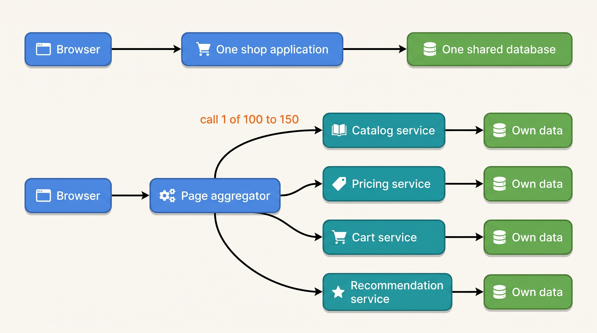
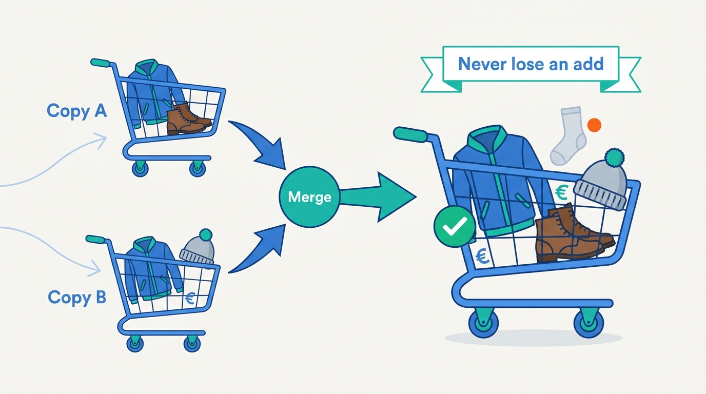
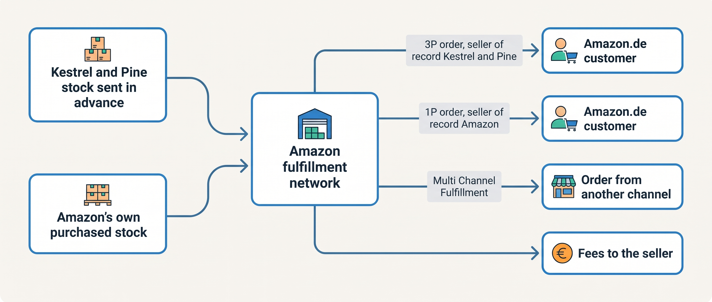
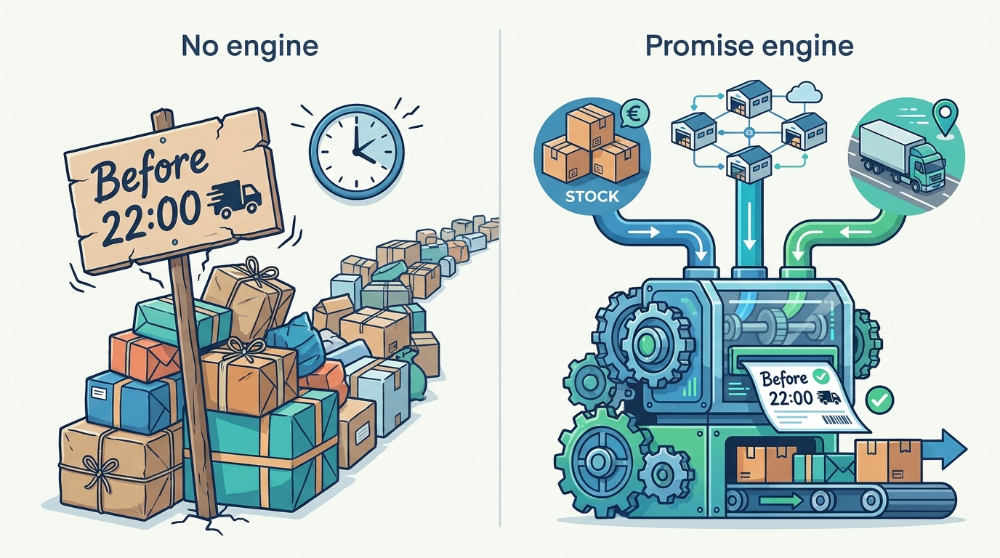
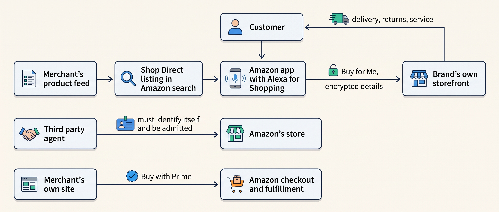

> **IN THIS CHAPTER, YOU WILL:** Read Amazon's own dated accounts of its architecture and business, separate what they document from what people assume, and decide which lessons a merchant can use.

> **KEY POINTS:**
>
> * **Amazon split its shop into services because it hit a wall, not because services were fashionable.** Its 2006 account dates the scaling wall to 2001; by 2007 one page touched 100 to 150 services. The transferable rule is the one that made the split survivable: every team exposes its data only through a service interface, and nobody reads another team's database.
> * **The shopping cart is an availability problem, and the delivery promise is the product.** Amazon's 2007 Dynamo paper encodes a business decision in a data store: an add-to-cart must never be refused, so conflicts are merged later. Its 2024 to 2026 letters put the investment into the network that keeps the promise shown at checkout.
> * **A retailer became a platform by opening its operations, not its storefront.** Prime (2005) and Fulfillment by Amazon (2006) took third-party sellers from 3% of physical sales in 1999 to 58% in 2018 and over 60% since. The same machinery is now exported to other shops and, since 2025, to AI agents, on Amazon's terms.

> **[FAILURE PATTERNS THIS CHAPTER ADDRESSES](where-commerce-platforms-go-wrong.html):**
>
> * **The Giant's Boots** — Amazon's service decomposition is the architecture most often copied without its reasons, which were a scaling wall and hundreds of teams.
> * **The Spaghetti Junction** — the rule Amazon is remembered for, no direct reads of another team's data store, is the cure for a landscape where every system reaches into every other.
> * **The Secret Agent** — Amazon's 2025 position on third-party shopping agents (identify yourself, respect the provider's choice) is the clearest public statement of the rule every merchant will need for automation on its own site.

 
A merchant can sell through Amazon, use its fulfillment services and compete with its own retail offers. Each relationship changes what the merchant controls: the sales rules, the location of stock or the customer relationship. Kestrel & Pine, the fictional outdoor brand, lists jackets on Amazon.de and sends some German marketplace stock to outside fulfillment programs. Understanding the separate roles is necessary to decide which records and commitments its own systems must still track.

Amazon's architecture history is also widely cited. This chapter follows its dated papers, engineering accounts, shareholder letters and annual filings. They explain particular choices about services, carts and fulfillment. **They do not reveal the complete design of today's order, pricing or delivery-promise systems.** Read each account for the problem it actually addresses.

The central architecture evidence comes from **2006–2007** and should be read as history. Financial figures come from 2025–2026 filings; AI features from 2024–2026 announcements. Dates distinguish historical mechanisms from more recent business and product claims.

**Where we are in the order's journey.** Three topics affect a jacket purchase: adding to a cart, calculating a delivery promise and fulfilling an order from marketplace-held stock. [[cart-and-checkout]], [[shipping-and-delivery]] and [[marketplaces-and-channel-integration]] explain those decisions in the merchant's setting.

## How to Read a Case Study in This Book

Claims are marked as **documented**, **widely reported** or **inferred**. Inferences include their reasoning. Secondary coverage remains identified when a primary page could not be retrieved. [[introduction]] explains the book's evidence approach.

Research closed on **7 November 2026**. Unreachable primary pages included Werner Vogels' 2006 ACM Queue interview, the 2004 profile associated with two-pizza teams, the 2005 Prime announcement and a February 2026 delivery release. The chapter identifies where digests or syndicated reporting substitute for those pages.

## 2001: The Front End Hits a Wall

Start with vocabulary. A **monolith** is one deployable application that contains all of the shop's logic (catalog, cart, checkout, orders) and usually one shared database. A **service-oriented architecture**, or SOA, splits the shop into many separately deployed **services**, each owning one function and talking to the others over the network. In plain words: one big program with one database, versus many small programs that call each other.

Amazon's own account of its move from the first to the second is Werner Vogels' 2006 interview in *ACM Queue*, "A Conversation with Werner Vogels". As digested by High Scalability in September 2007, it describes the early shop as a "two-tier monolith" and dates the turning point: "In 2001 it became clear that the front-end application couldn't scale anymore." Amazon moved "to a fully-distributed, decentralized, services platform" that "grew into hundreds of services and a number of application servers that aggregate the information from the services". A single page request touched "between 100-150 services".

Amazon's own 2007 paper on Dynamo, presented at the SOSP conference in October 2007, opens with the same statement in its own words: Amazon "uses a highly decentralized, loosely coupled, service oriented architecture consisting of hundreds of services", and those services have "stringent latency requirements which are in general measured at the 99.9th percentile of the distribution".

That last clause carries the engineering cost of the decision. **Tail latency** at the 99.9th percentile is the response time that only one request in a thousand exceeds. A page assembled from 100 services is only as fast as its slowest call, so Amazon measured every service on its worst thousandth, not its average. The split bought independent teams and independent scaling; it cost a discipline about time budgets that a monolith never needed.

**Figure 1:** *The two shapes in Amazon's 2006 account: one application on one database until 2001, then a page assembled by an aggregator from hundreds of services that each own their data, where the slowest of 100 to 150 calls sets the page's speed.*

The sequence to take from this is **monolith, scaling wall, services**, in that order. The record does not say that Amazon decomposed early, or that services were a goal; it says the front end stopped scaling and the decomposition followed. [[commerce-architecture-styles]] uses this and Zalando's 2015 move as the two dated examples of when a split is justified. The name retellings give the monolith does not appear in any page that could be verified, so it is not used here.

> **INFERENCE, NOT DOCUMENTED:** Amazon's 2001 wall was a wall of both load and people: hundreds of engineers changing one codebase. A merchant at Kestrel & Pine's scale, 293,000 online orders a year with fourteen people in technology, is nowhere near either wall, and nothing in Amazon's record argues for decomposing a shop before it hits one. The lesson transfers at a different altitude: the moment a merchant's product page is assembled from several *systems* (a PIM for content, the ERP for price, the availability service for stock, a reviews app), the merchant inherits Amazon's aggregation problem in miniature, including the tail-latency discipline. That is the Omnichannel stage, and it is where Kestrel & Pine is now.

## The Cart That Never Says No

The Dynamo paper is the one place where Amazon explains a system in enough detail to learn from it, and the system it chose to explain is the shopping cart.

The motivation is stated as a business requirement. Customers "should be able to view and add items to their shopping cart even if disks are failing, network routes are flapping, or data centers are being destroyed by tornados". Dynamo targets "an 'always writeable' data store", meaning one "that is highly available for writes". The reasoning is commercial: a refused add-to-cart is a lost sale, while a cart that is briefly out of date is harmless. So the cart "must allow customers to add and remove items from their shopping cart even amidst network and server failures", which "forces us to push the complexity of conflict resolution to the reads".

Two more terms. **Eventual consistency** means that different copies of a piece of data may disagree for a short time and converge later. **Conflict resolution** is what happens when two copies disagree and the system has to produce one answer. Dynamo's rule for the cart is explicit: "an 'Add to Cart' operation can never be forgotten or rejected". If the latest version of the cart is unavailable, a change made to an older version "is still meaningful and should be preserved" but "shouldn't supersede the currently unavailable state of the cart". When versions diverge, they are merged: an added item is never lost, and the paper acknowledges the price, which is that a deleted item can resurface.

| What the Dynamo paper documents (2007) | What it does not say |
| --- | --- |
| The cart service accepts writes during failures and merges conflicting versions on read | That Amazon runs Dynamo today (the 2007 post says it was internal; the 2012 post says teams moved to managed services) |
| In 2006–2007 the cart service "served tens of millions requests that resulted in well over 3 million checkouts in a single day" | Anything about the order, pricing or checkout systems behind the cart |
| Services are measured at the 99.9th percentile | What the budgets were |
| A business rule (never lose an add) is encoded in a data structure's merge rule | That the same rule is right for orders, payments or stock |

The 2012 sequel is as instructive as the paper. Announcing the managed database service DynamoDB in January 2012, Vogels wrote that Dynamo was "originally built to serve the needs of the shopping cart" but "did nothing to reduce the operational complexity of running large database systems"; Amazon's engineers "strongly preferred simplicity to fine-grained control" and chose managed services instead. A **managed service** is a database run by a provider so the team using it does not operate servers, replication or failover. In plain words: Amazon's own teams would not adopt a correct system that was hard to run. The 2022 USENIX paper on DynamoDB gives the scale of the second generation: during the 66-hour Prime Day event of 2021, calls to DynamoDB peaked "at 89.2 million requests per second" at single-digit-millisecond latency.

> **INFERENCE, NOT DOCUMENTED:** The cart is the one place in a commerce platform where availability beats consistency by design, and the Dynamo merge rule is the book's central idea in miniature: a decision about which promise a system may make (the cart promises to remember every add) encoded where it cannot be forgotten. The opposite rule applies one step later. A checkout that charges twice or an inventory that promises the last Ridgewalker to two customers is the Black Friday Oversell, and those systems need the consistency the cart gives up ([[inventory-and-availability]], [[commerce-payments]]). For Kestrel & Pine the practical reading is short: its hosted platform's cart already behaves this way; a merchant that builds its own storefront should buy a managed, highly available store for the cart rather than reinvent Dynamo; and the 2012 lesson, that operability decides adoption, applies to every system a fourteen-person team is asked to run.

**Figure 2:** *The cart that never says no: diverging copies are merged so an added item is never lost, at the price that a deleted item can resurface (Dynamo, 2007).*

## Teams, Ownership and the Contract as the Only Door

Amazon is as famous for how it organizes engineers as for what they built. Two of the three well-known rules are documented by Amazon; the third is not.

**Two-pizza teams.** Amazon's own DevOps guidance on the AWS documentation site (undated, accessed November 2026) quotes Jeff Bezos: "We try to create teams that are no larger than can be fed by two pizzas. We call that the two-pizza team rule." It ties the size to ownership: the team should see its service "as an end-to-end venture" rather than treating production "as black boxes where they have no visibility". The phrase is commonly dated to a 2004 Fast Company profile, which could not be fetched for this chapter, so the date is secondary. **You build it, you run it**, the rule that the team that writes a service also operates it in production, appears in the 2007 digest of the Vogels interview alongside the team rule.

**The "API mandate".** This is the rule most often quoted in architecture reviews, and it exists in public only as one person's recollection. Steve Yegge, a former Amazon engineer, wrote in October 2011 (in a post preserved as a public gist) that "back around 2002 I think, plus or minus a year" Bezos issued a mandate: "All teams will henceforth expose their data and functionality through service interfaces"; "Teams must communicate with each other through these interfaces"; no other communication, "no direct reads of another team's data store"; the technology "doesn't matter"; and "All service interfaces, without exception, must be designed from the ground up to be externalizable". No page from Amazon that the brief could fetch confirms the memo. Treat it as **widely reported**, not as an Amazon document.

What Amazon has confirmed, in its own words, is the outcome. In September 2006 Vogels wrote that Amazon "continues on the path of opening up all of its services for customers and partners to use", and that with Fulfillment by Amazon "we are now also opening up our fulfillment network for everyone to use". Ten years later, in his 2016 retrospective on AWS, he wrote that the lesson of building management APIs first was one "we had already learned from our experiences with Amazon retail".

An **externalizable interface** is an API designed so that it *could* be offered to outside developers, which forces a clean contract even when only internal teams use it. In plain words: build every internal door as if a stranger might walk through it. That test is the useful part of the mandate, whoever wrote it, and [[api-contracts-and-versioning]] carries it forward with Zalando's written, verifiable guidelines ([[case-zalando]]) as the documented version.

> **INFERENCE, NOT DOCUMENTED:** For a merchant, the rule applies to vendors before it applies to teams. Kestrel & Pine's 34 integrations include agency scripts that read systems directly rather than through contracts, and the ledger's App That Wrote Stock is what happens when a second writer reaches into a system that already has an owner. Waypoint decision W5, a named owner and a contract for every integration, is the merchant-scale form of "no direct reads of another team's data store". At the Omnichannel stage the same rule becomes internal: the availability service of W1 exposes available-to-promise through an API, and nobody reads its tables.

## Fulfillment as a Platform

This is the part of Amazon's record that most changes how a merchant should think, because it is about the business model, and the business model is documented in filings.

Three terms first. In the **first-party** model (1P), Amazon buys stock and is the seller. In the **third-party** model (3P), an independent seller sells on Amazon's site and Amazon takes fees. The **seller of record** is the legal party that sells to the consumer and carries the obligations: the invoice, the value-added tax, the consumer's right to return. **Fulfillment by Amazon** (FBA) is the service in which the seller sends stock to Amazon's warehouses and Amazon picks, packs, ships and handles returns.

The dates are clean. Amazon Prime launched in February 2005 at $79 a year for unlimited two-day shipping (widely reported; the press release was unreachable). Fulfillment by Amazon launched as a beta on 19 September 2006 with a press release promising small and medium-sized businesses "access to Amazon's order fulfillment, customer service, customer shipping offers, and underlying website technology"; third-party items "Fulfilled by Amazon" could qualify for Prime shipping. The two were designed to meet: a seller's item in Amazon's warehouse could carry Amazon's promise.

Bezos' 2018 shareholder letter, published in April 2019, gives the result as a series. Third-party sellers' share of physical gross merchandise sales:

| Year | 1999 | 2002 | 2005 | 2010 | 2012 | 2015 | 2018 |
| --- | --- | --- | --- | --- | --- | --- | --- |
| Third-party share | 3% | 17% | 28% | 34% | 42% | 51% | 58% |

The letter's own comment: "Third-party sellers are kicking our first party butt. Badly." It credits two investments, "Fulfillment by Amazon and the Prime membership program", with having "meaningfully improved the customer experience of buying from independent sellers". Amazon's 2022 and 2024 Small Business Empowerment Reports (published May 2023 and May 2025) say "more than 60%" of sales in Amazon's store come from independent sellers; the 2024 report adds that those sellers "have shipped more than 80 billion items through Fulfillment by Amazon since its 2006 launch" and that Multi-Channel Fulfillment helped "more than 300,000 sellers" ship orders from their other sales channels in the past year. Independent trackers put the unit share at 60 to 62% through 2024 to 2026.

The FY2025 Form 10-K, filed 6 February 2026, defines the model in one sentence: "We offer programs that enable sellers to sell their products in our stores, and fulfill orders using our services. We are not the seller of record in these transactions." Amazon earns "fixed fees, a percentage of sales, per-unit activity fees, interest, or some combination thereof", and designs its stores "to enable hundreds of millions of unique products to be sold by us and by third parties". The same filing gives the scale: net sales of **$716.9 billion** in 2025 (North America $426.3 billion, International $161.9 billion, AWS $128.7 billion), fulfillment expense of **$109.1 billion**, and approximately **1,576,000** full- and part-time employees at 31 December 2025. It does not state a count of fulfillment centers; it reports square footage.

**Figure 3:** *One fulfillment network serves three flows with different sellers of record: Amazon's own stock, a third-party seller's stock under FBA, and orders from channels outside Amazon under Multi-Channel Fulfillment; the stock pool is shared, the legal and financial flows are not.*

> **INFERENCE, NOT DOCUMENTED:** Amazon does not publish how FBA inventory, 1P inventory and Multi-Channel Fulfillment are kept apart inside its systems, so the diagram shows the documented flows, not the implementation. What the record does establish is that a retailer became a platform *through two operational services*, the promise and the warehouse, rather than through any storefront feature. The architectural consequence of running 1P and 3P side by side is one inventory and fulfillment capability serving two seller-of-record models with different invoices, tax treatment, returns obligations and ledgers. That is the split any merchant faces the day it fulfills a marketplace order from the pool that also serves its own shop, and it is why [[marketplaces-and-channel-integration]] treats a marketplace order as a different *kind* of order, not a different source of the same one.

For Kestrel & Pine the relationship runs the other way: it is the third-party seller. The stock it sends to Amazon's program (part of the roughly 40% of German marketplace units that marketplace programs ship) is, in Waypoint decision W1, "a tracked external location": stock Kestrel & Pine owns but does not control, counted separately from Duiven, and sold only on the channel that holds it.

## The Promise Is the Product

If the 2006–2007 sources are about the shop's internals, the 2024–2026 sources are about one thing: delivery speed. Amazon's recent letters and releases describe the shape of the network, and they describe nothing about the software that computes the promise.

Jassy's 2024 shareholder letter (published April 2025) attributes faster delivery "primarily to our regionalization redesign of our fulfillment network", to new placement algorithms and to same-day fulfillment centers, and confirms the starting scope of Prime: "Prime two-day delivery began with one million products and now covers over 300 million items, with tens of millions available in one day or better."

The 2025 letter (released 9 April 2026) reports over one million robots in fulfillment centers, "more than 85 Same Day Fulfillment Centers" that carry the top 90,000 SKUs across the United States, and over $4 billion committed to a rural delivery network.

The 3 February 2026 press release (syndicated; the primary page was unreachable) reports over 13 billion items delivered same or next day worldwide in 2025, over 8 billion of them in the United States, and a 70% rise in items delivered in under a day. These figures will be out of date within a year; they are quoted for their shape, not their size.

Three terms. **Regionalization** means holding stock in the region where it will be ordered, so most orders ship from nearby. A **placement algorithm** decides which warehouse should hold which SKU in what quantity. A **delivery promise** is the date or hour shown at checkout, which becomes a commitment the network has to keep. The 10-K's framing of Prime is commercial and candid: shipping offers and Prime benefits are "effective worldwide marketing tools" that Amazon intends "to continue offering them indefinitely".

| What the promise needs | Amazon's documented answer (2024–2026) | What a merchant at Kestrel & Pine's scale does |
| --- | --- | --- |
| Stock near the customer | Regionalized network; 85+ same-day centers with a curated 90,000-SKU set | One warehouse at Duiven; a static "ordered before 22:00, delivered tomorrow" rule for the Netherlands |
| Deciding where stock sits | Placement algorithms (named, not described) | Buyers decide by season; marketplace stock sent to Germany in advance |
| Capacity to keep the promise | Own delivery network, rural investment, robots | PostNL, bpost, DHL and DPD through the shipping service; the cut-off is the carrier's |
| Measuring the promise | Items delivered same or next day, published yearly | Not measured in 2026 *(ledger: the promise is static)* |

> **INFERENCE, NOT DOCUMENTED:** Amazon's public account makes the promise, not the catalog, the product, and the investment goes into the physical network that keeps it. The transferable idea is not the network. It is that **the promise engine, the logic that decides which date to show, is a first-class system** with inputs from stock, the network and carrier capacity, and that a promise is a commitment the fulfillment side has to be able to keep on the busiest hour of the year. Kestrel & Pine's "ordered before 22:00" rule is a promise with no engine behind it: it was true on an ordinary Tuesday and false on the Friday of Black Friday week, when the WMS queue backed up for four hours. [[shipping-and-delivery]] owns the promise; [[journey-peak-day]] shows what happens when the promise and the capacity part company. Only Amazon's scale justifies 85 single-purpose same-day centers. The idea that transfers is the *curated subset*: a small set of SKUs for which a fast promise is made and kept, rather than one promise for everything.

**Figure 4:** *Kestrel & Pine's "ordered before 22:00" rule is a promise with no engine behind it; the transferable idea is a promise engine fed by stock, the network and carrier capacity.*

## Other Shops, Other Agents: 2022 to 2026

Amazon's most recent moves push the same machinery outward, into other merchants' storefronts and into software that shops on a customer's behalf. Everything in this section changes quickly; product names and fees in particular should be checked against the dated pages before being relied on.

**Buy with Prime** (launched 2022, widely reported) lets a merchant offer Prime delivery and Amazon's checkout on the merchant's own site, with Amazon handling "the payment, processing, storage, picking, packing, and shipping" plus customer service and returns; the product page (accessed November 2026) cites a 16% average lift in revenue per visitor from tests across 167 merchants between July 2023 and June 2024. **Shop Direct** (launched 2025, feeds added 2026) puts products from other stores into Amazon's search results: "over 100 million products from more than 400,000 merchants", synced through existing **product feeds**, structured files of catalog, price and stock, from Feedonomics, Salsify or CEDCommerce.

**Rufus**, Amazon's generative AI shopping assistant, launched as a beta in the US mobile app in February 2024 (per coverage); Amazon's page records that on 13 May 2026 it was renamed **Alexa for Shopping**. Amazon reports that it "helped over 300 million customers in 2025". The 2026 version adds actions: an automatic purchase when an item reaches a target price (a standing instruction that "stay[s] active for six months or until you cancel", with a 24-hour cancellation window), reorders and scheduled recurring purchases.

**Buy for Me** (beta, April 2025) goes further. For items Amazon does not sell, the app shows "Shop brand sites directly"; the customer confirms address, taxes, shipping and payment on Amazon's checkout page, and "Amazon completes the purchase on the brand's site". Amazon passes "encrypted name, address, and payment details" to the brand and "cannot see customers' previous or separate orders from other brands' sites"; the brand "handles delivery, returns, exchanges, and customer service" and chooses whether to participate. The catalog grew "from 65K products at launch to over half a million" and later to "tens of millions". Trade coverage of April 2025 reported that Amazon charged brands no commission at the time.

**Agentic commerce** is the term for software that does not only recommend but acts, placing an order on the customer's behalf. [[ai-and-agentic-commerce]] owns it. What this case adds is Amazon's position on agents it does not control.

In its statement on Perplexity's Comet browser, Amazon wrote that "third-party applications that offer to make purchases on behalf of customers from other businesses should operate openly" and "respect service provider decisions whether or not to participate", that such apps "have the same obligations" as food-delivery apps or online travel agencies, and that it had "repeatedly" asked Perplexity to remove Amazon from Comet, citing a "significantly degraded shopping and customer service experience".

The cease-and-desist letter is dated 31 October 2025; Retail Dive reported on 6 November 2025 that Amazon had sued in Northern California and that Perplexity called the suit a "threat to user choice". The case's status was not checked.

**Figure 5:** *Three documented directions: Amazon exports its checkout and fulfillment to merchants' sites (Buy with Prime), imports merchants' catalogs into its own surface (Shop Direct, Buy for Me), and admits outside agents only on its terms; the merchant's checkout and warehouse become modules behind someone else's demand.*

> **INFERENCE, NOT DOCUMENTED:** Two patterns are visible. First, Amazon exports its promise-keeping machinery to other storefronts and imports other storefronts' catalogs into its own, so that a merchant's checkout and fulfillment become interchangeable modules behind a dominant demand surface. Second, Amazon's rule for outside agents, identify yourself and respect the provider's choice to participate, is the rule every merchant will need for bots on its own site: a documented, authenticated channel for automation (feeds, APIs, a checkout protocol) and a way to refuse automation that will not identify itself. That is the Secret Agent pattern from the other side. For Kestrel & Pine it is Waypoint decision W8 in practice: accurate product data, availability and order status by API first, and no shopper-facing agent of its own in 2027.

## A Nuance: When One Process Beat a Distributed Design

One Amazon post from 2023 is quoted as the reversal of everything above, and the source supports a much narrower claim.

In March 2023 the Prime Video team responsible for audio and video quality monitoring described replacing a **serverless** design, in which small functions run on demand and a managed workflow engine (AWS Step Functions) calls each step and stores intermediate results in object storage, with a single application process. The reason, as summarized by InfoQ on 3 May 2023 (the original post now redirects to a generic page): "running the infrastructure at a high scale was very expensive", the design "supported only around 5% of the expected load", and moving the data in memory instead of through storage cut operational costs by 90%. The team's own framing was that the "distributed approach wasn't bringing a lot of benefits in our specific use case".

That is a cost-and-coupling argument about one internal pipeline, not evidence about the retail site's architecture. The rule it supports, which [[commerce-architecture-styles]] develops, is that **a boundary should be sized to the data that crosses it**: when most of the work is moving bytes between steps, the steps belong in one process. Zalando reached a similar conclusion about a stream-based integration in 2025 ([[case-zalando]]).

## What a Merchant Can Learn, and What Only Amazon Can Do

The table is the author's synthesis; each row names the dated evidence it rests on.

| Lesson | Evidence | Transfers to a merchant? |
| --- | --- | --- |
| Split along ownership lines, and make the contract the only door | 2006 interview digest; 2011 recollection of the mandate | Yes, first as a rule for vendor integrations (no direct reads of another system's data), then for internal services |
| The cart is an availability problem, not a consistency problem | Dynamo, 2007 | Yes; buy, do not build, the highly available store; keep the consistency for stock and payment |
| Operability decides adoption | DynamoDB, 2012 | Yes, at every stage; a fourteen-person team cannot run what Amazon's teams refused to run |
| Fulfillment opened to others turns a retailer into a platform | FBA 2006; 2018 letter series | Partly: the Group stage; an Omnichannel merchant starts by fulfilling marketplace orders from one pool |
| The promise is the product; shape the network to it | 2024 and 2025 letters; February 2026 release | The idea, yes; the network only at Amazon's scale; the curated fast subset transfers |
| Agents must identify themselves and respect participation | Perplexity statement, 2025 | Yes, as a policy and an authenticated channel |
| Size a boundary to the data flow across it | Prime Video, 2023 | Yes |

Only Amazon can do the rest: 85-plus single-purpose same-day centers and a million robots; a 300-million-item two-day catalog; a demand surface that 400,000 merchants feed; a database lineage from Dynamo to DynamoDB. The Giant's Boots pattern is a merchant mistaking the second list for the first.

**What Kestrel & Pine takes from the case.** Three things, each already a Waypoint decision. From the API rule: every integration gets an owner and a contract, and no script reads another system's data directly (W5). From FBA: the stock in Amazon's program is a tracked external location with its own count, sold only on the channel that holds it, never pooled with Duiven in the availability calculation (W1). From the promise: "ordered before 22:00, delivered tomorrow" needs an engine behind it before Black Friday 2027, fed by the WMS's real capacity, or it will be withdrawn on the day it matters most ([[peak-load-and-reliability]]). What it does not take is the architecture: a hosted platform with an OMS, a PIM and an availability service beside it is the right shape for a €48 million merchant ([[build-buy-or-assemble]]).

## Where the Evidence Stops

Be clear about what this chapter could not establish.

- **Today's internals.** No public, dated description exists of Amazon's current order, pricing, promise or inventory systems. The 2006–2007 architecture is history; the Dynamo paper describes a system Amazon said in 2012 its teams had moved away from. Anything you read about "how Amazon's order system works today" is inference.
- **The API mandate** rests on one first-hand recollection from 2011, never confirmed by Amazon in any page fetched. Its content is consistent with Amazon's documented behavior, which is the most that can be said.
- **The monolith's name**, the 2004 dating of the two-pizza rule, the 2005 Prime release and the February 2026 delivery record are widely reported but were not fetched from primary pages. Fulfillment center counts are not in the 10-K, which reports floor area instead.
- **The agent products** (Alexa for Shopping, Buy for Me, Shop Direct) are described as of November 2026; their names, fees and scope have already changed once in 2026 and will again. The Perplexity litigation's outcome was not checked.
- **Costs.** Amazon publishes fulfillment expense in aggregate and nothing about the unit economics of FBA, Prime or same-day delivery.

## What to Take Away

**Established.**

- Amazon's move from a monolith to hundreds of services followed a scaling wall it dates to 2001, and by 2007 a page touched 100 to 150 services measured at the 99.9th percentile (2006 interview digest; Dynamo paper, 2007). Decomposition followed the wall; it did not precede it.
- The shopping cart was built as an "always writeable" store that merges conflicts on read because a refused add-to-cart is a lost sale (Dynamo, 2007); Amazon's own teams then preferred managed services to a system that was hard to operate (DynamoDB, 2012).
- Amazon became a marketplace through Prime (2005) and Fulfillment by Amazon (2006): third-party sellers went from 3% of physical sales in 1999 to 58% in 2018 and "more than 60%" since (2018 letter; 2022 and 2024 reports). Amazon is "not the seller of record" in those sales (10-K, 2026).
- Amazon's stated rule for outside shopping agents is to operate openly and respect a provider's choice to participate (2025 statement).

**Depends on context.**

- "No direct reads of another team's data store" is right for a merchant as a rule about vendors and scripts at every stage; it becomes a rule about internal services only once there are internal services to govern, which for most merchants is the Omnichannel stage or later.
- Availability-over-consistency is right for the cart and wrong for stock, payment and orders. A merchant on a hosted platform inherits the right behavior; one building a storefront must choose it deliberately and buy the store rather than build it.
- Fulfilling other sellers' orders from your own pool is a Group-stage move for most merchants; the Omnichannel-stage version is fulfilling your own marketplace orders from one pool with one promise.
- A computed delivery promise becomes necessary with a second stock location or a cut-off that varies by day; a static promise serves one warehouse on ordinary days and fails on peak days.

**The author's synthesis.**

- The useful Amazon is the narrow one. I would strike "Amazon did microservices" from every design review and replace it with the four documented rules: the contract is the only door, the cart never says no, operability decides adoption, and the promise is the product. Those fit a fourteen-person team; the service count does not.
- The most important Amazon decision for a merchant is not architectural: Amazon opened its *operations* to others and let the storefront follow, which is why a merchant's own warehouse, promise and returns handling are the capabilities worth owning well ([[warehouse-and-fulfillment]]).

## Questions to Ask

1. Which of our integrations read another system's data directly instead of through a documented contract, and who owns each one?
2. If our cart store were unavailable for a minute on Black Friday, would the customer see an error or a slightly stale cart? Which do we want?
3. Where is consistency non-negotiable for us (stock, payment, the order record), and does each of those systems have one writer?
4. Could our team run the systems we are proposing to build, on the busiest night of the year, with the people we have?
5. Which stock do we own but not control (a marketplace program, a 3PL, a store), and is it counted as a separate location in our availability calculation?
6. What is our delivery promise, which system computes it, and what does it know about warehouse capacity and carrier cut-offs today?
7. For which small set of SKUs could we make a faster promise and keep it, instead of one promise for everything?
8. What is our policy for automated buyers and agents on our own site, and do we have an authenticated channel for the ones we want?

Amazon's record ends where its publications end, and the next case has a fuller one. Zalando, the European fashion platform on which Kestrel & Pine also sells, has published its architecture decisions on its own engineering blog for ten years, including the ones it later reversed. Continue with [[case-zalando]].

## Sources and Evidence

*Company, product and investor sources*

- [Amazon Architecture](http://highscalability.com/amazon-architecture) — High Scalability, 2007 (18 September 2007), digest of "A Conversation with Werner Vogels", *ACM Queue*, 2006; the two-tier monolith, the 2001 scaling wall, 100–150 services per page, "you build it, you run it". Primary text not fetched; evidence age 19 years.
- [Dynamo: Amazon's Highly Available Key-value Store](https://www.allthingsdistributed.com/files/amazon-dynamo-sosp2007.pdf) — DeCandia et al., SOSP, 2007 (October); the service-oriented architecture statement, the 99.9th-percentile rule, the always-writeable cart, the merge rule, the 2006–2007 cart volumes.
- [Amazon's Dynamo](https://www.allthingsdistributed.com/2007/10/amazons_dynamo.html) — Werner Vogels, 2007 (2 October); Dynamo was internal and not exposed as a web service.
- [Amazon DynamoDB: a fast and scalable NoSQL database service](https://www.allthingsdistributed.com/2012/01/amazon-dynamodb.html) — Werner Vogels, 2012 (18 January); why Dynamo did not spread and teams preferred managed services.
- [Amazon DynamoDB: A Scalable, Predictably Performant, and Fully Managed NoSQL Database Service](https://www.usenix.org/conference/atc22/presentation/elhemali) — Elhemali et al., USENIX ATC, 2022 (July); 89.2 million requests per second during the 66-hour Prime Day 2021 event.
- [10 Lessons from 10 Years of Amazon Web Services](https://www.allthingsdistributed.com/2016/03/10-lessons-from-10-years-of-aws.html) — Werner Vogels, 2016 (11 March); the API lesson learned "from our experiences with Amazon retail".
- [Fulfilling](https://www.allthingsdistributed.com/2006/09/fulfilling.html) — Werner Vogels, 2006 (19 September); opening services and the fulfillment network to others.
- [Amazon launches Fulfillment by Amazon and WebStore by Amazon](https://press.aboutamazon.com/2006/9/amazon-launches-new-services-to-help-small-and-medium-sized-businesses-enhance-their-customer-offerings-by-accessing-amazons-order-fulfillment-customer-service-and-website-functionality) — Amazon press release, 2006 (19 September); the FBA launch and Prime eligibility for FBA items.
- [Two-Pizza Teams](https://docs.aws.amazon.com/whitepapers/latest/introduction-devops-aws/two-pizza-teams.html) — AWS whitepaper, n.d., accessed 2026-11; the two-pizza rule and end-to-end ownership in Amazon's words.
- [Stevey's Google Platforms Rant](https://gist.github.com/chitchcock/1281611) — Steve Yegge, 2011 (12 October); the only public first-hand recollection of the "API mandate"; not confirmed by Amazon.
- [Inside the Mind of Jeff Bezos](https://www.fastcompany.com/50106/inside-mind-jeff-bezos) — Fast Company, 2004; usual dating of the two-pizza phrase; not fetched.
- [2018 Letter to Shareholders](https://www.aboutamazon.com/news/company-news/2018-letter-to-shareholders) — Amazon / Jeff Bezos, 2019 (April); third-party share series 1999–2018 and the credit to FBA and Prime.
- [2024 Letter to Shareholders](https://www.aboutamazon.com/news/company-news/amazon-ceo-andy-jassy-2024-letter-to-shareholders) — Amazon / Andy Jassy, 2025 (April); regionalization, 1 million to 300 million Prime items, delivery reach.
- [2025 Letter to Shareholders](https://www.aboutamazon.com/news/company-news/amazon-ceo-andy-jassy-2025-letter-to-shareholders) — Amazon / Andy Jassy, 2026 (9 April); robots, 85+ same-day centers with 90,000 SKUs, rural network, Amazon Now.
- [Form 10-K for fiscal year 2025](https://www.sec.gov/Archives/edgar/data/1018724/000101872426000004/amzn-20251231.htm) — Amazon.com, Inc., SEC EDGAR, 2026 (filed 6 February); the seller-of-record statement, fee types, net sales, fulfillment expense, employees, store counts, floor area, Prime as a marketing tool.
- [2022 Small Business Empowerment Report](https://aboutamazon.com/news/small-business/amazon-2022-small-business-empowerment-report) — Amazon, 2023 (May); "more than 60% of sales" from independent sellers.
- [2024 Small Business Empowerment Report](https://www.aboutamazon.com/news/small-business/amazon-2024-small-business-empowerment-report) — Amazon, 2025 (May); 80 billion FBA items since 2006, Multi-Channel Fulfillment sellers, sellers over $1 million.
- [Amazon Steers Third-Party Seller Share To All-Time High](https://www.marketplacepulse.com/articles/amazon-steers-third-party-seller-share-to-all-time-high) — Marketplace Pulse, 2025; independent tracking of the unit share at 60–62%.
- [Amazon Sets New Prime Delivery Speed Record in 2025](https://distributionstrategy.com/2026/02/amazon-sets-prime-delivery-speed-record-in-2025-with-13-billion-same-or-next-day-items/) — syndicated coverage of Amazon's 3 February 2026 release, 2026; 13 billion same- or next-day items; primary release not fetched.
- [Buy with Prime](https://buywithprime.amazon.com/) — Amazon, n.d., accessed 2026-11; scope of the service, integrations and the 167-merchant test.
- [Amazon announces Rufus](https://www.aboutamazon.com/news/retail/amazon-rufus) — Amazon, 2024 (page updated 2026 with the rename to Alexa for Shopping); launch scope and training data.
- [Meet Alexa for Shopping](https://www.aboutamazon.com/news/retail/alexa-for-shopping-ai-assistant) and [How Amazon is using generative and agentic AI to transform shopping](https://www.aboutamazon.com/news/retail/amazon-agentic-ai-gen-ai-shopping) — Amazon, 2026, accessed 2026-11; usage figures, auto-buy, reorders, Buy for Me catalog growth.
- [Buy for Me button on Amazon Shopping app](https://www.aboutamazon.com/news/retail/amazon-shopping-app-buy-for-me-brands) — Amazon, 2025, accessed 2026-11; how the agent purchase works and what the brand keeps.
- [Amazon tests 'Buy for Me' agentic AI shopping tool](https://www.digitalcommerce360.com/2025/04/08/amazon-buy-for-me-agentic-ai-shopping-tool/) — Digital Commerce 360 / Beth Duckett, 2025 (8 April); launch date and the no-commission note.
- [Amazon introduces feeds for Shop Direct](https://www.aboutamazon.com/news/retail/amazon-shop-direct-external-stores) — Amazon, 2026, accessed 2026-11; 100 million products, 400,000 merchants, feed partners.
- [Statement about Perplexity](https://www.aboutamazon.com/news/company-news/amazon-perplexity-comet-statement) — Amazon, 2025 (letter dated 31 October); Amazon's rule for third-party agents.
- [Amazon sues Perplexity over AI shopping agents](https://www.retaildive.com/news/amazon-sues-perplexity-ai-shopping-agents/804871/) — Retail Dive, 2025 (6 November); the lawsuit and Perplexity's response.

*Standards, regulation and official documentation*

- None cited directly; the seller-of-record obligations referred to in the text are treated in [[commerce-regulation]] and [[tax-invoicing-and-ledger]].

*Research and practitioner sources*

- [Prime Video Switches from Serverless to EC2 and ECS to Reduce Costs by 90%](https://www.infoq.com/news/2023/05/prime-ec2-ecs-saves-costs/) — InfoQ / Rafał Gancarz, 2023 (3 May); summary of the March 2023 Prime Video post, whose original URL now redirects.

Kestrel & Pine is fictional; architectural recommendations, labeled inferences and labeled assumptions are the author's judgement.
