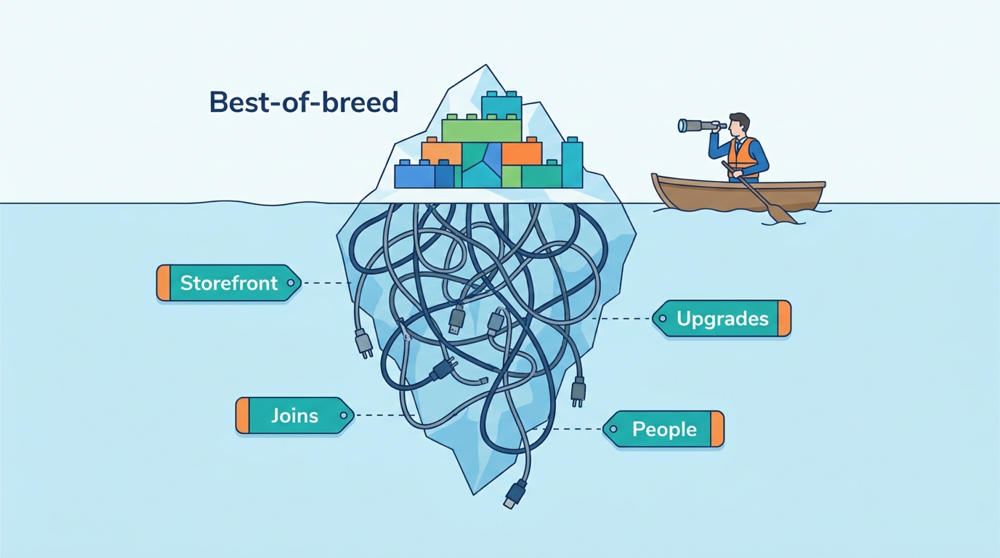
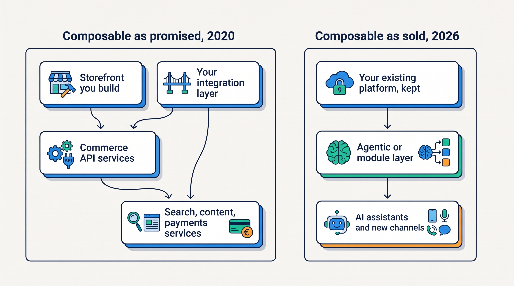
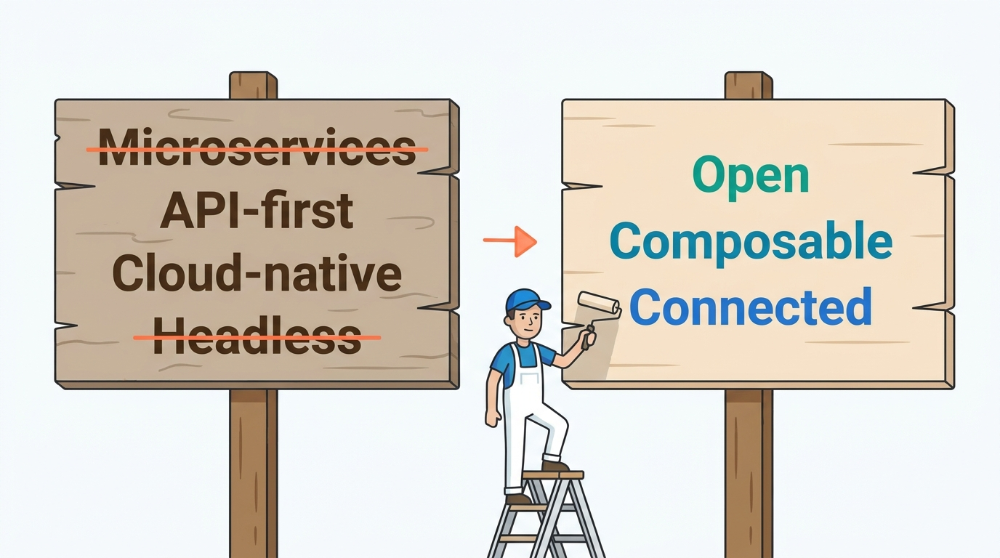
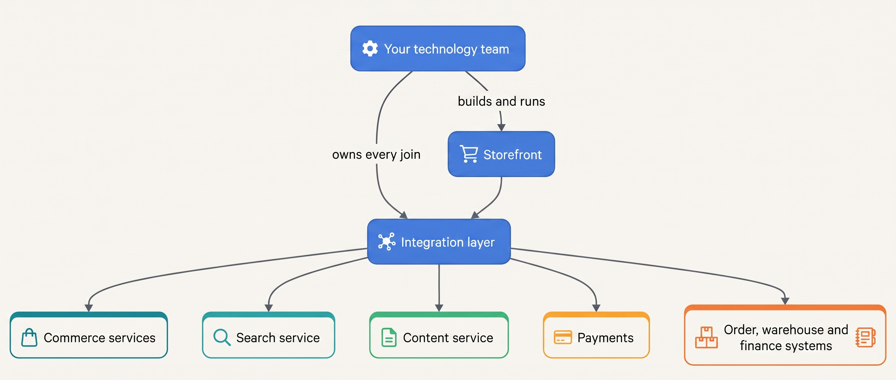

> **IN THIS CHAPTER, YOU WILL:** Test the composable promise against the dated public record of its leading vendors and its own alliance, and learn when assembling commerce from parts is right.

> **KEY POINTS:**
>
> * **The movement's own flagship turned to layers.** commercetools cut staff in February 2025 after missing growth targets, launched AgenticLift in January 2026 "on top of your existing commerce solution", and in July 2026 began selling its order engine and catalog as standalone modules "without replacing their existing platforms".
> * **The mid-market leader went the other way.** Shopware, first among the 1,000 largest German shops in the 2026 EHI study, launched Nexus (an orchestration layer that replaces middleware) and Shopware Payments on PayPal's rails in June 2026: integration and payments pulled into the platform, not decomposed out of it.
> * **The alliance rewrote its principles, and its own survey names the cost.** Between 2023 and 2026 the MACH Alliance's stated principles went from the four-letter acronym to five principles to three, with microservices and headless gone; its February 2026 report found 37% of respondents naming integration complexity as a primary concern. Composable survives as a per-capability practice around a kept core.

> **[FAILURE PATTERNS THIS CHAPTER ADDRESSES](where-commerce-platforms-go-wrong.html):**
>
> * **The Giant's Boots** — composable was defined by vendors whose reference customers were global enterprises with product teams; the same architecture proposed to a €48 million brand is a copy without its reasons.
> * **The Burned Bridge** — the composable pitch of 2020–2023 was a replatforming with one cutover; the vendors' 2026 products are the opposite, layers added beside a kept core.
> * **The Spaghetti Junction** — every capability bought separately is a join to own; the alliance's own survey says integration complexity is its members' primary concern.

 
A merchant wants to replace its search service without replacing checkout and the catalog as well. Buying separate services seems to offer that freedom, but each still depends on shared product identifiers, prices and stock updates. Replacement is practical only if those connections can be changed at an acceptable cost. **Composable commerce** is the approach of assembling separate commerce services, and that cost is central to evaluating it.

In June 2020, four vendors formed the **MACH Alliance** around independently deployed services (microservices), interfaces designed for other programs (API-first), cloud operation and a separate storefront (headless). By December 2023, it had more than 100 members. This case follows dated accounts from commercetools, Shopware, Adobe and the alliance, including later services attached to existing platforms. Their changes help show when assembly solves a merchant's problem and when integration work outweighs the flexibility.

The services may cover catalog, cart, checkout, search or content and come from one or several vendors. **Headless** is a narrower choice: separating the storefront from the commerce engine through an **application programming interface (API)**. A merchant can change that separation without committing to a separate product for every commerce function.

[[commerce-architecture-styles]] and [[build-buy-or-assemble]] explain the design decisions; [[commerce-platform-landscape]] maps the product categories. Here we examine what vendors said and sold over time.

**Where we are in the order's journey.** Eva buys a jacket from Kestrel & Pine, the fictional outdoor brand. Its storefront, cart, checkout and order record can come from one product or several. The composable decision determines who must connect them and operate those connections ([[journey-of-an-order]]).

## What Composable Promised, 2020–2023

EPAM's **24 June 2020** announcement identifies the founding members as commercetools, Contentstack, EPAM and Valtech. It spells out MACH as **Microservices, API-first, Cloud-Native and Headless**. This is historical evidence of the original proposition; later definitions should be read against their own dates.

The original proposition combined four choices: small independently deployed services, capabilities exposed through documented APIs, vendor-operated cloud software, and a separately built or purchased storefront. Merchants were promised easier component replacement and less dependence on a suite's release cycle.

The alliance's **13 December 2023** announcement reported over 100 members and cited a survey of 500 technology leaders: 85% said their MACH share had increased in the prior year. Its applicant totals were internally inconsistent. These are the alliance's own adoption claims, with definitions that must stay attached; they do not establish whether a merchant reduced costs or improved sales by adopting the approach.

| What the 2020 promise says | What it does not say |
| --- | --- |
| Capabilities should be reachable through APIs and replaceable one at a time | Who builds and runs the storefront that no longer ships with the engine |
| A merchant should not be locked into one suite's release cycle | Who owns the joins between the services, and what that costs each year |
| The vendor runs and scales the services | That the merchant's own team must run everything the vendor does not: storefront, integration, identity, content |
| Best-of-breed beats one suite | For which size of merchant, with which team, the difference pays for itself |

The right-hand column is the subject of the rest of this chapter. The promise was true as a description of how large enterprises with product-engineering teams could build; it said nothing about the merchant with fourteen technology staff.

**Figure 1:** *The 2020 promise showed the services; the storefront, the joins, the upgrades and the people who own them sat below the waterline, assigned to nobody.*

## commercetools: From Flagship to Layers

The commerce engine supplies operations such as pricing, carts and orders through APIs, while the merchant chooses the storefront and surrounding components. This separation is the role commercetools plays in the composable model.

**commercetools** was founded in Munich in 2006, acquired by the German retail group REWE in 2015, and funded in 2019 ($145 million from Insight Partners at a $300 million valuation) and 2021 ($140 million led by Accel at $1.9 billion), as TechCrunch summarized in February 2025. It is the composable flagship: founding member of the alliance, a Leader in Gartner's Magic Quadrant for Digital Commerce every year since 2020, and, as of its 22 April 2026 release, past a "$100B GMV run-rate" with more than 600 million orders a year across 36 countries. (**GMV**, gross merchandise volume, is the value of orders through the platform, not the vendor's revenue; a **run-rate** annualizes a recent period and is not a full-year figure.)

The turn is in its releases.

| Date | Event (source) | What changed |
| --- | --- | --- |
| 10 July 2024 | Andrew Burton, formerly of Rapid7, became CEO; founder Dirk Hoerig moved to Chief Innovation Officer; the release cited 2023 GMV of over $30 billion, up 45% (commercetools release) | Operator management for a growth-stage vendor |
| 26 February 2025 | About 10% of staff cut; CEO Burton's memo said the company had not met its "aggressive revenue growth targets" over several quarters, targets that "were never reset for macroeconomic uncertainty"; the CRO and CFO left the executive team (TechCrunch) | The pure composable pitch no longer carried the growth plan |
| 21 January 2026 | AgenticLift launched as the "first standalone agentic offering" (**agentic commerce** is the 2025–2026 term for selling through AI assistants that browse catalogs and buy on a shopper's behalf), letting companies "layer agentic commerce capabilities on top of your existing commerce solution", including homegrown or legacy systems (commercetools release) | A product for merchants who keep a non-composable core |
| 22 April 2026 | Q1 2026 results signed by a new CEO, Doug McNary: $100B run-rate, more than $7 billion of GMV from new enterprise customers in the quarter, same-store sales up 27% (commercetools release) | Growth claimed on new logos and same-store volume |
| 9 June 2026 | "Autonomous Commerce" announced as "the new category for the AI era", with Sphere, "an enterprise commerce platform", and a preview of MosAIc, an operations tool (commercetools release) | The vocabulary moves from composable to autonomous |
| 15 July 2026 | Core Commerce ("enterprise-grade cart and order management") and Product Catalog sold as standalone modules that integrate "with their existing technology stack", so enterprises can adopt capabilities "without replacing their existing platforms" (commercetools release) | The flagship sells itself by the piece, beside a kept backend |
| 22 October 2026 | A Leader in Gartner's 2026 Magic Quadrant for Digital Commerce Platforms (report dated 19 October 2026) "for the seventh consecutive year" (commercetools release) | Analyst standing intact through the turn |

Three things stand out. First, **the vendor's own products now describe the architecture this book recommends for Omnichannel-stage merchants**: a kept core with layers added beside it. AgenticLift and the July 2026 modules are built for stacks that are not composable.

Second, **the sales vocabulary moved on**. The June 2026 release does not sell "composable"; it sells "Autonomous Commerce", a category the vendor says it is introducing. A newcomer should notice that the category changed while the product's shape (API services the merchant assembles or attaches) did not.

Third, **the numbers need their units**. The April 2026 release says "500+ enterprises"; the July 2026 boilerplate says "more than 600 global brands and enterprises", "over $110 billion in annualized GMV" and "over 700 million orders". The April figures were $100 billion and 600 million orders. Either the business grew about 10% in three months or the units differ; the releases do not say which, and neither should you.

> **INFERENCE, NOT DOCUMENTED:** No commercetools release explains why it moved to standalone modules. The sequence (missed growth targets in 2025, then layers and modules in 2026) is consistent with a vendor finding that full replatforming onto an API-only core sells to fewer merchants than its 2020–2023 pitch assumed, and that Commerce.com's August 2026 remark about B2C replatforming being "softer than historically" describes the same market. That reading is mine.

The CEO sequence also has a gap in the public record: founder Dirk Hoerig to Andrew Burton (July 2024) is documented; Doug McNary is the CEO quoted from April 2026; the handover between them was not found in any release fetched for this book.

**Figure 2:** *The 2020 promise asked the merchant to build the storefront and own every join; the 2026 products from the same vendors attach a layer to a platform the merchant keeps.*

## Shopware: The Mid-Market Path

**Shopware**, from Schöppingen in Germany, is the counter-case: an open-source platform whose answer to the composable movement was to pull more into the platform, not less.

Its finances and ownership are documented by its own releases. It was "100% bootstrapped" until February 2022, when Carlyle and PayPal invested USD 100 million, with platform GMV approaching USD 20 billion in 2021 (that release is more than three years old). In late 2025 PayPal raised its stake "from about 11% to more than 40%" by taking over Carlyle's shares, as Shopware's July 2026 boilerplate states and the trade press reported on 23 October 2025 alongside a claim of "more than 50,000 online sellers". On 11 August 2026 Shopware announced that Joachim Weber would become Co-CEO on 17 August and sole CEO on 1 January 2027, with founder Sebastian Hamann becoming Chief Experience Officer and founder Stefan Hamann "Chief Agentic Officer"; the founders keep a majority of shares.

Its market position is specific. The EHI Retail Institute's 2026 report on the 1,000 largest German B2C shops found 12.5% on Shopware, first place for the fifth year (a platform was identified for 60.2% of those shops). W3Techs, which counts websites worldwide, puts Shopware at 0.2% of sites with a known e-commerce technology; both are true, and the difference is the population counted. Analysts placed it as a Visionary in Gartner's 2025 and 2026 Magic Quadrants for Digital Commerce and a Strong Performer, "best fit for B2B organizations" (B2B: business-to-business, selling to other companies), in Forrester's Commerce Solutions Wave of Q3 2026.

The pricing is the first clue to its path. The Community Edition is free; the paid plans (Rise "from €600 a month", Evolve "from €2,400 a month", Beyond on request, November 2026) are "based on your gross merchandise value", and a fair-usage policy requires a paid plan once the shops linked to one account exceed €1 million of GMV in a rolling year. An open-source platform priced on GMV is a platform that wants to sit in the path of every order, which is the opposite of a service you can swap.

The second clue came on 10 June 2026 at Shopware Community Day in Cologne. Shopware announced **Nexus**, "a native, event-driven orchestration layer" with reusable connectors and AI-assisted mapping, which it positions as replacing middleware, and **Shopware Payments**, powered by PayPal's infrastructure, live in Germany and Austria with the EU and US to follow.

The release cited vendor figures that merchants average more than 15 disconnected tools and spend up to 52% of implementation effort wiring them together, and claimed Nexus cuts integration costs by 40%; those are vendor claims without a published method. Nexus is metered: €10 per extra 1,000 executions above the plan's quota (pricing page, November 2026).

In plain words, the **iPaaS** (integration platform as a service: the hosted tool that moves data between systems) that a composable merchant buys separately became a Shopware product, and so did the **PSP** (payment service provider: the company that takes the shopper's payment and settles the money).

> **INFERENCE, NOT DOCUMENTED:** Shopware has not said that Nexus and Payments are a response to the composable movement. Read together with the GMV-based pricing and PayPal's stake, they describe a platform that earns on orders and payments and wants the integration layer inside its own metering. That is the same economic shape as a hosted SaaS platform ([[case-shopify]]), reached from the open-source side; the inference is mine.

What Shopware shows a newcomer is that **"open source" and "composable" are different axes**. Shopware's core is open; its commercial path is to be the hub. A merchant on Shopware at the Omnichannel stage can still buy an OMS or a PIM beside it, but the platform's own direction is to absorb the joins, and the fair-usage line means the hub is paid for once the merchant grows.

## Adobe, the Forks and Commerce.com: Composable as a Deployment Option

Two more vendors show the word being absorbed rather than adopted.

**Adobe Commerce** (the former Magento Commerce, renamed in April 2021 after Adobe's 2018 acquisition of Magento for $1.68 billion) now lists three deployment options on its information center (updated 21 October 2026): on-premises, "on cloud infrastructure" (platform-as-a-service: Adobe runs the hosting, the merchant owns custom code) and "as a Cloud Service" (fully managed SaaS with continuous updates and a headless storefront that Adobe hosts). Beside them, **Adobe Commerce Optimizer** is a SaaS for storefront, catalog and merchandising that "can work alongside an existing Adobe Commerce or third-party commerce backend"; the two SaaS products "don't currently integrate" with each other. Partner reports place both launches in June 2025, after a March 2025 announcement; no Adobe press release was found. Here "composable" has become a layer a suite vendor sells beside any backend, including a competitor's.

The forks tell the open-source side. Community leaders organized in 2021 "concerned about the future of Magento Open Source"; the **Mage-OS** Association was incorporated in Poland in 2022 with a founding board of eight directors and describes its distribution as "independent, community-driven" and "highly compatible" with Magento 2 extensions. Mage-OS 4.0.0 shipped on 30 October 2026, based on Magento 2.4.9; 3.6.0, on 14 October 2026, was a security port of Adobe's October patch. The association "has no shareholders or investors" and lists 216-plus financial contributors and 82-plus professional members (site accessed November 2026). A merchant on Mage-OS has the most freedom of any in this chapter and the longest patch chain: Adobe, then the distribution, then the agency, then the merchant.

**Commerce.com** is the SaaS side of the same story. BigCommerce Holdings renamed itself Commerce.com on 31 July 2025 and, in Digital Commerce 360's account, described the change as moving "away from an all-in-one platform toward an open, composable system that connects to external AI tools"; its CEO said "this is not a cosmetic change". The engine, BigCommerce, stayed. Its results for the quarter ended 30 June 2026, filed with the SEC on 6 August 2026, showed revenue of $84.5 million, up 0.1%, subscription revenue down 1%, and management saying B2C (business-to-consumer) replatforming "remains softer than historically". A vendor adopted the composable vocabulary and, a year later, reported that the market for moving platforms was weak.

## The Alliance Rewrites Its Principles

The clearest evidence of the turn is the alliance's own wording, which changed three times.

| Date | The principles as stated (source) |
| --- | --- |
| June 2020 and December 2023 | "Microservices, API-first, Cloud-Native, and Headless" (EPAM, 2020-06-24); "Microservices based, API-first, Cloud-native SaaS and Headless" (MACH Alliance, 2023-12-13) |
| 5 August 2025 | Five guiding principles, Composable, Connected, Incremental, Open and Autonomous, announced with a move to "end-user leadership" by September 2026 (an appointed end-user president, two end-user ambassadors on the board); the acronym is not restated (MACH Alliance via Silicon UK, 2025-08-05) |
| November 2026 | Three principles: "Open is about what the system is made of — and whether humans and agents can see it, trust it, and verify it"; "Composable means capabilities you can assemble, replace, and evolve independently"; "Connected means designed to be optimized in an ecosystem — not in isolation"; the alliance "certifies ISVs, system integrators, and enablers against these principles" (machalliance.org/mach-principles, accessed 2026-11) |

Microservices and headless, two of the four letters, are no longer principles. "Incremental", which appeared in August 2025, is the word that most contradicts the 2020–2023 pitch, because incremental adoption around a kept core is what the vendors now sell. The 2026 page gives no reason for the change. My reading, labeled as such: **the acronym outlived its expansion**. The parts of the promise that survive (open, composable, connected) are properties a merchant can ask of any platform, including a hosted SaaS one with good APIs; the parts that were dropped were prescriptions about how the vendor's own software should be built, which were never a merchant's concern.

**Figure 3:** *Between 2020 and November 2026 the alliance went from four words to five principles to three: microservices and headless were dropped, and open, composable and connected remained.*

## What the Movement's Own Data Say

The MACH Alliance's Enterprise Technology Report, published 18 February 2026 from a survey of 600 enterprise technology decision-makers in seven markets, reports that 78% of organizations with fully scaled MACH technology see clear return on investment from AI versus 13% in early planning, that 98% of mature composable adopters can support AI at scale versus 33% of early-stage ones, and that 89% say standards and certifications for AI in composable environments are missing. It also reports that **37% cite integration complexity as a primary concern** and 45% flag data privacy and security.

Read it as what it is: a survey commissioned by a vendor alliance, answered by a population that includes its own adopters, with "clear ROI" undefined. The usable finding is the one against interest. Among the people most committed to composable, more than a third name integration complexity as a primary concern. That is the cost line the 2020 promise left out, and the reason the "Spaghetti Junction" pattern is the one most composable merchants meet first.

Shopware's June 2026 figures (more than 15 disconnected tools per merchant; up to 52% of implementation effort spent wiring them) point the same way and carry the same caveat: a vendor selling an integration product has reasons to count integration cost high. No independent, published study with a stated method was found that measures the total cost of a composable assembly against a hosted platform with layers; where this chapter gives costs, they are the author's judgment or Kestrel & Pine illustrations.

## What Composable Actually Costs

A composable assembly has the same bill as any platform, plus lines that the brochure assigns to nobody. The table is my synthesis; the amounts are not from any vendor.

| Cost line | In a hosted platform with layers | In a composable assembly | Who pays it |
| --- | --- | --- | --- |
| **The storefront** | Included: a theme, customized by an agency | Built or bought separately, then kept current with every framework and browser change | Your storefront team or agency, every year |
| **The joins** | Apps and connectors, each with an owner (34 at Kestrel & Pine) | Every pair of services, plus the integration layer that runs them; the alliance's 37% | Your integration team, every day |
| **Upgrades** | The vendor upgrades the core for everyone; you upgrade your apps | The vendors upgrade their services; you upgrade everything you built against them, including the storefront | You, on the vendors' schedules |
| **Identity, content, search** | Often in the platform or one app each | Separate products, each with a contract, an API version and a renewal date | Your vendor manager |
| **Licenses** | Subscription plus a share of sales | Subscription with GMV caps per service (Saleor Cloud: 0.8% above $200,000 a month; commercetools: not public) | The merchant, with more lines to add up |
| **People** | Integration engineers and app owners | Product engineers, platform engineers, integration engineers, and someone to own each service | Headcount that must exist before the first sale |
| **Exit** | Export data, rebuild theme and apps | Every join is yours to rebuild; the storefront moves with you, which is the real benefit | Paid once, if ever |

**Figure 4:** *In a composable assembly the merchant's own team sits at the center, owning the storefront and every join; nothing in the diagram is run by a vendor except the boxes at the edge.*

The storefront line deserves a worked illustration. Kestrel & Pine, the fictional outdoor brand this book follows ([[meet-kestrel-and-pine]]), has three storefront and app engineers out of fourteen technology staff and pays an agency €14,000 a month for its theme, apps and small integrations. A built storefront for three countries, with search, content and checkout integrations, is a product in its own right; assume (an illustration, not a ledger fact) that it needs at least the three engineers full time plus the agency, before any of the 34 existing joins are rebuilt against new APIs. The assembly would not have fewer joins than today; it would have more, and all of them would be Kestrel & Pine's. That is what the fourth column of the table means.

## When Composable Is Right

The record does not say composable is wrong. It says it was oversold to the wrong merchants. The conditions under which it is right are specific.

| Situation | Composable fits when | It limits when |
| --- | --- | --- |
| **Scale stage** | Group: several brands or countries with a platform team and product teams per journey | Starting and Growing: there is no team to own the joins; Omnichannel: only per capability, around a kept core |
| **Differentiation** | The storefront or the checkout is where the business competes, and a built one earns its keep | The storefront is a channel like any other and a theme would do |
| **Team shape** | Product-engineering organization: people who build and run services and storefronts | Integration organization: people who own connectors and contracts (Kestrel & Pine's shape) |
| **Vendor count** | One owner per service and a vendor manager; contracts with versioned APIs and dated deprecations | Each new service adds a renewal, an API version and an owner nobody has named |
| **Reason to move** | A capability the current platform cannot own (a global catalog, an OMS, a B2B engine) is adopted as a service beside it | The reason is an incident that an availability service or an OMS would fix without replatforming |

The per-capability path is the one the vendors themselves now sell and the one an Omnichannel merchant can absorb: keep the platform, add a PIM, an OMS, a search service or an agentic layer as separate services with their own owners, and treat each as a composable step. Kestrel & Pine's Waypoint program is that path under another name. The full assembly is a Group-stage choice, and even there the evidence from commercetools' July 2026 modules is that enterprises want to adopt it "without replacing their existing platforms".

## What Kestrel & Pine Takes From It

Kestrel & Pine's February 2027 consultancy proposal asked fourteen technology staff to operate a separate engine, storefront, search, content system and integration layer. Its illustrative three-year cost was about **€3.2 million** ([[build-buy-or-assemble]]).

**Waypoint**, the improvement program, keeps the hosted platform while buying **order management (OMS)**, availability and **product information management (PIM)** beside it. The warehouse remains authoritative for physical stock, and each integration gets an owner and contract. That selective assembly resembles the later vendor offerings described here. The company will revisit its needs at the 2029 review.

## Where the Evidence Stops

- **commercetools' reasons.** No release explains the turn to layers and modules; the link between the February 2025 cuts and the 2026 product line is my inference. The CEO handover from Andrew Burton to Doug McNary is undated in the fetched record, and the April and July 2026 figures ("500+" versus "more than 600"; $100 billion versus $110 billion) are not reconciled by the vendor.
- **Shopware's strategy.** Shopware has not stated that Nexus and Payments respond to composable, nor published a method behind its "40% lower integration costs" claim; its current merchant count ("more than 50,000" in 2025 press) is not on a Shopware page fetched here; PayPal's exact stake is reported as "more than 40%" or "about 41%".
- **Adobe's dates.** The general-availability date of Adobe Commerce as a Cloud Service and Commerce Optimizer rests on partner reports (June 2025); no Adobe press release was found.
- **The alliance's reasons.** The MACH Alliance's principles page gives no reason for dropping microservices and headless; the 2023 release's applicant figures are internally inconsistent; the 2026 survey's method and sample are the alliance's.
- **Costs.** No independent study with a stated method compares the total cost of a composable assembly with a hosted platform plus layers; every cost figure in this chapter is a labeled judgment or a Kestrel & Pine illustration.
- **Analyst placements.** Gartner's 2026 vendor count was not in the fetched release; the placements of Shopify, Salesforce, SAP and Adobe in the 2025–2026 reports were not found.

## What to Take Away

**Established.**

- The composable promise was defined by vendors in June 2020 as microservices, API-first, cloud-native and headless (EPAM release), and by November 2026 the alliance's principles no longer include microservices or headless (machalliance.org, accessed 2026-11).
- The flagship vendor now sells layers and modules for existing stacks: AgenticLift (21 January 2026) and standalone Core Commerce and Product Catalog "without replacing their existing platforms" (15 July 2026), after a February 2025 staff cut tied to missed growth targets (TechCrunch).
- Shopware, first among the 1,000 largest German B2C shops (EHI 2026), moved integration and payments into the platform with Nexus and Shopware Payments (10 June 2026) and prices its plans on GMV (pricing page, November 2026).
- The alliance's own February 2026 survey found 37% of respondents naming integration complexity as a primary concern.

**Depends on context.**

- A full composable assembly is right for a Group-stage merchant with product and platform teams and a storefront that is itself a competitive product; it is the Giant's Boots for a merchant below that stage or with an integration-shaped team.
- Adopting one capability as a separate service (PIM, OMS, search, an agentic layer) beside a kept platform is right at the Omnichannel stage whenever the platform cannot own that capability well; it limits when the merchant cannot name an owner for the new join.
- Open source and composable are independent choices: Shopware is open and hub-shaped; commercetools is proprietary and service-shaped. Choose on who owns upgrades and joins, not on the license.

**The author's synthesis.**

- The composable movement was right about properties (open APIs, replaceable capabilities, clear ownership) and wrong about prescriptions (rebuild as services, build your own storefront), because the prescriptions were the vendors' reference architecture, not the merchant's need.
- The 2026 products of commercetools, Adobe and Salesforce are the movement's own correction: the kept core with layers beside it is composable as it should have been sold, and it is the shape most merchants should buy.

## Questions to Ask

1. When a vendor or agency says "composable", which of the four 2020 words do they mean, and which of the alliance's three 2026 principles?
2. Who will build and run the storefront that an API-only engine does not ship, and what will that cost each year after launch?
3. For each service in the proposed assembly, who owns the join to the others, its API version and its renewal date?
4. Which capability does our current platform fail to own well, and can it be adopted as one service beside the platform rather than by replacing the platform?
5. Which of the vendor's reference customers is within a factor of ten of our revenue and team size?
6. What does the vendor's own 2026 product line sell to merchants who keep their existing platform, and why would we not buy that instead?
7. What unit, date and definition stand behind every GMV, customer and order figure in the deck, and are the figures in two releases consistent?

The four cases of Part XI end here: a modular monolith that serves millions of merchants, a retailer that became a platform, a microservices pioneer that returned to discipline, and a movement that corrected itself. The reference pages begin with [[domain-coverage]], which maps the research models behind this book to the chapters that cover them.

## Sources and Evidence

**Company, product and investor sources**

- [commercetools appoints new CEO](https://commercetools.com/press-releases/commercetools-appoints-new-ceo), commercetools, 2024 — Andrew Burton's appointment, Dirk Hoerig's move, the 2023 GMV.
- [commercetools, a pioneer in headless commerce, lays off dozens of staff](https://techcrunch.com/2025/02/26/commercetools-a-pioneer-in-headless-commerce-lays-off-dozens-of-staff), TechCrunch, 2025 — the February 2025 cut, the CEO memo, the funding history.
- [commercetools launches AgenticLift](https://commercetools.com/press-releases/commercetools-launches-agenticlift), commercetools, 2026 — the "on top of your existing commerce solution" layer.
- [commercetools reports strong Q1 2026](https://commercetools.com/press-releases/commercetools-reports-strong-q1-2026), commercetools, 2026 — the $100B run-rate, orders, countries, same-store sales, the CEO.
- [commercetools introduces "Autonomous Commerce" category and unveils Sphere](https://commercetools.com/press-releases/commercetools-introduces-autonomous-commerce), commercetools, 2026 — the June 2026 category and platform naming.
- [commercetools launches modular commerce offerings](https://commercetools.com/press-releases/commercetools-launches-modular-commerce-offerings), commercetools, 2026 — standalone Core Commerce and Product Catalog, "without replacing their existing platforms", the boilerplate figures.
- [commercetools named a Leader in the 2026 Gartner Magic Quadrant for Digital Commerce Platforms](https://commercetools.com/press-releases/commercetools-named-a-leader-in-2026-gartner-r-magic-quadrant-tm-for-digital-commerce-as-ai-reshapes-the-market), commercetools, 2026 — the seventh consecutive placement, report dated 19 October 2026.
- [Shopware raises USD 100 million from Carlyle and PayPal](https://www.shopware.com/en/press/press-releases/shopware-raises-usd-100-million-in-growth-capital-from-carlyle-and-paypal/), Shopware, 2022 — the bootstrapped history and 2021 GMV (more than three years old).
- [PayPal increases stake in Shopware](https://ecommercenews.eu/paypal-increases-stake-in-shopware/), Ecommerce News Europe, 2025 — the stake rising to about 41% and the merchant count.
- [Shopware named a Strong Performer in Forrester's 2026 commerce evaluation](https://www.shopware.com/en/press/press-releases/analyst-report-shopware-named-a-strong-performer-in-annual-2026-commerce-solutions-evaluation/), Shopware, 2026 — the Forrester placement and the boilerplate on PayPal's stake.
- [Shopware Community Day 2026](https://www.shopware.com/en/press/press-releases/shopware-community-day-2026-shopware-becomes-the-open-commerce-infrastructure-for-the-agentic-era/), Shopware, 2026 — Nexus, Shopware Payments, the integration-cost claims.
- [Shopware launches Shopware Payments in partnership with PayPal](https://www.shopware.com/en/press/press-releases/shopware-launches-shopware-payments-in-partnership-with-paypal/), Shopware, 2026 — transaction pricing and onboarding through PayPal.
- [New management structure at shopware AG](https://www.shopware.com/en/press/press-releases/new-management-structure-at-shopware-ag/), Shopware, 2026 — the CEO succession and founder roles.
- [Shopware remains market leader in Germany 2026 (EHI)](https://www.shopware.com/en/press/press-releases/for-the-fifth-year-in-a-row-shopware-remains-the-market-leader-in-germany-among-commerce-platforms-in-2026/), Shopware, 2026 — 12.5% of the top 1,000 German B2C shops.
- [Shopware a Visionary in the 2025 Gartner Magic Quadrant](https://shopware.com/en/press/press-releases/shopware-recognized-as-a-visionary-in-the-2025-gartner-magic-quadrant-for-digital-commerce/), Shopware, 2025 — report date and 19-vendor count.
- [Shopware pricing](https://www.shopware.com/en/pricing/), Shopware, n.d., accessed 2026-11 — GMV-based plans, the fair-usage threshold, Nexus metering.
- [Adobe Commerce platforms and services](https://experienceleague.adobe.com/en/docs/commerce/information-center/explore-platforms-and-services/platform-and-services), Adobe Experience League, 2026 — the three deployment options and Commerce Optimizer.
- [Adobe Commerce as a Cloud Service overview](https://experienceleague.adobe.com/en/docs/commerce/cloud-service/overview), Adobe Experience League, 2026 — managed SaaS with the headless storefront.
- [Demystifying Adobe Commerce as a Cloud Service](https://www.rightpoint.com/thought/article/demystifying-adobe-commerce-as-a-cloud-service), Rightpoint, 2025 — the June 2025 launch timing (partner report).
- [Magento](https://en.wikipedia.org/wiki/Magento), Wikipedia, 2026 — the 2018 acquisition and the 2021 rename.
- [Mage-OS home](https://mage-os.org/), [about](https://mage-os.org/about/) and [founding announcement](https://mage-os.org/updates/2022-09-02-the-mage-os-association-has-been-founded), Mage-OS Association, 2022–2026 — the distribution, the association, releases 3.6.0 and 4.0.0.
- [BigCommerce rebrands as Commerce.com](https://www.digitalcommerce360.com/2025/07/31/bigcommerce-rebrands-commerce-dot-com/), Digital Commerce 360, 2025 — the rename and the "open, composable system" framing.
- [Commerce.com Q2 2026 results, exhibit 99.1](https://www.sec.gov/Archives/edgar/data/0001626450/000119312526336701/bigc-ex99_1.htm), Commerce.com via SEC EDGAR, 2026 — revenue growth of 0.1% and the "softer than historically" remark.
- [Saleor pricing](https://saleor.io/pricing), Saleor, n.d., accessed 2026-11 — GMV-capped subscription for an API-only platform.

**Standards, regulation and official documentation**

- [EPAM joins the newly formed MACH Alliance as a founding member](https://s202.q4cdn.com/436759741/files/doc_news/2020/06/24/12951.pdf), EPAM Systems, 2020 — the founding members and the acronym's expansion (more than three years old; the founding document).
- [MACH Alliance surpasses 100 members](https://machalliance.org/newsroom/mach-alliance-surpasses-100-members-as-it-closes-out-milestone-2023), MACH Alliance, 2023 — the 2023 formulation, the survey and the applicant figures.
- [MACH Alliance advances end-user leadership model](https://www.silicon.co.uk/press-release/mach-alliance-advances-end-user-leadership-model-to-guide-enterprise-ai-architecture-evolution), MACH Alliance via Silicon UK, 2025 — the five principles and the governance change.
- [MACH principles](https://machalliance.org/mach-principles/) and [MACH explained](https://machalliance.org/mach-explained), MACH Alliance, n.d., accessed 2026-11 — the three principles as stated in 2026.
- [MACH Alliance Enterprise Technology Report](https://machalliance.org/insights-hub/mach-alliance-research-6x-more-organizations-achieve-ai-roi-with-a-composable-foundation), MACH Alliance, 2026 — the survey figures, including the 37% integration-complexity finding.

**Research and practitioner sources**

- [Usage statistics of e-commerce technologies](https://w3techs.com/technologies/subdetails/ecommerce), W3Techs, 2026 — Shopware's share of websites, contrasted with the EHI population.
- [Kibo named a Leader in The Forrester Wave: Commerce Solutions, Q3 2026](https://kibocommerce.com/news/forrester-wave-commerce-solutions-leader-2026/), Kibo Commerce, 2026 — the ten-vendor count of the wave in which Shopware is a Strong Performer.

Kestrel & Pine is fictional; architectural recommendations, labeled inferences and labeled assumptions are the author's judgement.
