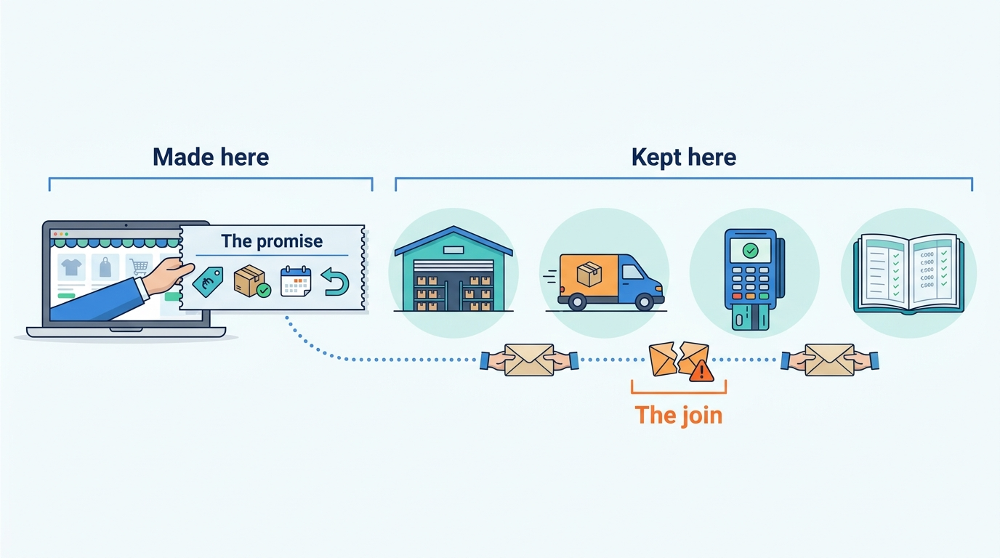
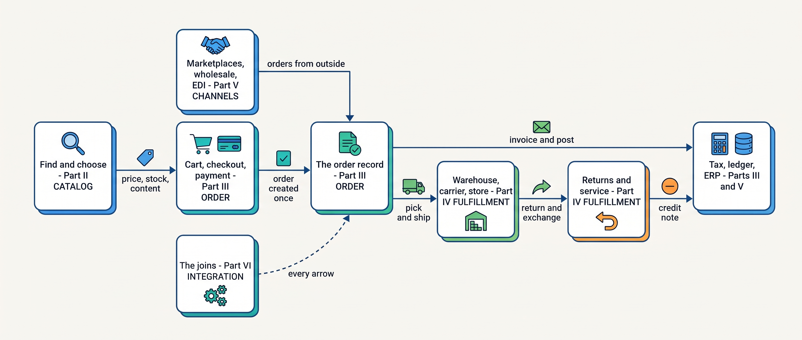

> **IN THIS SECTION, YOU WILL:** Learn who this book is for, what it argues and the patterns in which commerce promises break, why it compares four scale stages and which fictional merchant it follows through them, how its eleven parts follow one order, how to find the chapter for your decision and what the book leaves to others, and how to read its evidence and how current it is.

> **KEY POINTS:**
>
> * **A commerce platform is a promise-keeping machine.** It shows a product and promises a price, "in stock", a delivery date and a return; then a dozen systems owned by different teams and vendors have to keep those promises. It is not one product you buy but the whole set of systems that make and keep promises to a customer.
> * **Most commerce failures are a promise one system made and another could not keep.** A storefront sells a jacket the warehouse no longer has; two systems refund the same return; three systems report three statuses for one order. The failures live in the joins between systems, rarely inside one of them.
> * **Architecture decides who may make which promise, how the others learn of it, and what happens when they disagree.** The right answer changes with the size and shape of the business, so the book follows one fictional merchant as it grows, compares every decision across four scale stages, and says in each chapter what is established, what depends on context and what is the author's view.

 
At 21:14 on 13 April 2027, Eva Janssen in Nijmegen buys a €199 Ridgewalker jacket and two €18 pairs of socks from **Kestrel & Pine, a fictional outdoor brand**. She pays €235 through iDEAL, the Dutch bank-transfer method. The shop confirms order #1072455. For Eva, the next step is waiting for delivery. For the merchant, several systems must now turn that confirmation into the right parcel, delivered when promised.

The shop has promised the described product, an agreed price, available stock, a delivery date and a way to return it. Pricing supplies the amount, the warehouse supplies stock, the carrier helps determine delivery and finance records payment and any refund. The page taking the order depends on those systems' answers. If one is wrong or out of date, checkout can succeed while committing the merchant to a promise it cannot keep.

On Black Friday 2026, the same shop oversold **1,340 units**. The jacket sold out at 19:40, but its storefronts and marketplaces continued selling for up to two hours from out-of-date stock copies. The component systems stayed up. Their handoffs failed the customer.

This book follows Eva's order from discovery to delivery, exchange and accounting. It explains, for readers new to commerce architecture, who should own each fact, how other systems learn about changes and what to do when they disagree. The choices evolve as Kestrel & Pine adds channels, locations and complexity. Read it in order, along that journey, or enter it from the decision on your desk.

## Who This Book Is For

The book is for readers **new to commerce architecture** who need to understand how selling systems fit together and judge changes to them. You may have just joined:

- **A retailer, a brand or a wholesaler**, as an engineer, product manager, analyst or engineering lead, and found a dozen systems that nobody drew.
- **A commerce software vendor**, building one of those systems (a warehouse system, a returns portal, a marketplace connector), and need to understand the systems on either side of yours.
- **An agency or a consultancy**, asked to recommend a platform, a migration or an integration.
- **A leadership role**, as a CTO, head of ecommerce or finance or operations director, and need to know which technology questions are really business questions.

**Starting knowledge.** You should recognize an API, database, message queue and web page. You do not need commerce experience.

**Vocabulary stays local.** Chapters explain the terms their decisions need, such as **SKU**, a code for a sellable variant, or **system of record**, the authoritative home of a fact. They also explain mechanisms such as **idempotency**, making a repeated request have the same effect as one request. The [[glossary]] collects these definitions and links to fuller treatments.

To those readers the book speaks from the position of **an architect who advises growing merchants**. When I give my judgement, I say so in the first person, with my reasons and the conditions under which I would decide differently.

## The Argument: A Promise-Keeping Machine

A commerce platform is usually described as a product you subscribe to, license or assemble. This book uses the word differently: **a commerce platform is the whole set of systems that make and keep promises to a customer**: the storefront, the catalog, pricing, promotions, search, inventory, checkout, payments, the order record, tax and invoicing, the warehouse, the carriers, the stores, the returns process, customer service, the marketplaces, the wholesale portal, the EDI links (electronic data interchange: structured orders and invoices between companies' systems), the ERP (enterprise resource planning, the system that runs finance, purchasing and the books) and the data warehouse.

Seen that way, the platform's job is simple to state and hard to do. **It makes promises in one place and keeps them in another.** The storefront promises; the warehouse, the carrier, the payment provider and the finance system deliver. Between the promise and its keeping sits a handoff, a message from one system to another, and every handoff can be late, lost, duplicated or misread.

That is why the book's central claim is about joins, not components: **most commerce failures are a promise one system made and another could not keep.** The Black Friday oversell was a storefront promising from a two-hour-old copy. Another Kestrel & Pine order showed *Delivered* on the platform, *In picking* in the warehouse and *Not invoiced* in the ERP for six days. The book calls that incident the Three-Status Order: three honest systems describing three different objects, a delivered parcel, an unpicked line and a missing invoice. In a third, the Double Refund, 212 returns were refunded twice, by two systems each entitled to refund the same return.

**Figure 1:** *A commerce platform makes promises in one place and keeps them in another, so most failures happen at a join between systems, not inside one of them.*

Architecture, in this book, is the discipline of answering three questions for every promise:

| Question | What it means in practice | Where the book answers it first |
| --- | --- | --- |
| **Who may make this promise?** | Which system owns the fact the promise rests on (the stock count, the price, the order's status), so its copy wins when copies disagree | [[boundaries-and-systems-of-record]] |
| **How do the others learn of it?** | Whether they call it, receive an event, read a nightly file or copy it by hand, and how fresh their copy must be | [[integration-styles]] |
| **What happens when they disagree?** | Which messages can arrive twice or not at all, what a repeat does, and which job compares the copies and repairs them | [[events-consistency-and-reconciliation]] |

## The Failure Patterns

Commerce platforms break promises through recurring patterns, each of which looked reasonable when chosen. The next page, [[where-commerce-platforms-go-wrong]], unpacks **sixteen** of them. Here are only their names, as an index, in four families:

- **Truth**, a fact with two writers or no owner: **The Phantom Stock**, **Schrödinger's Order**, **The Familiar Stranger**, **The Boomerang** and **The Price Nobody Can Explain**.
- **Integration**, a message with no identifying key, no contract or no owner: **The Spaghetti Junction**, **The Message in a Bottle** and **The Pulled Rug**.
- **Platform and change**, a decision copied from a bigger company or carried out all at once on a single day: **The First Snowfall**, **The Giant's Boots**, **The Burned Bridge**, **The Forked Platform** and **One Size Fits None**.
- **Governance**, a dependency, a deadline or an actor nobody owns: **The Lynchpin**, **The Long Fuse** and **The Secret Agent**.

The patterns travel in chains that usually start at the joins: a Spaghetti Junction of unowned connectors breeds Messages in a Bottle, messages sent once and trusted, which breed Phantom Stock and Boomerangs, returns refunded twice. Kestrel & Pine's Black Friday 2026 met two at once: **The Phantom Stock** in the two-hour-old copy and **The First Snowfall** in a chain of stock syncs that met real load for the first time on the day itself. The Three-Status Order was a Schrödinger's Order; the Double Refund, a Boomerang. Every chapter names the patterns it works on, so you can use the list as an index.

## Four Scale Stages, and Why Every Chapter Compares Them

The three questions (who may promise, how the others learn, what happens when they disagree) are the same for every merchant; the right answers are not. The right architecture for a merchant with one shop and a back room is the wrong one for a group of brands in six countries, and the reverse is just as true. So the book follows one merchant as it grows and compares its decisions across **four scale stages**:

| Stage | Rough size | Typical shape | Kestrel & Pine |
| --- | --- | --- | --- |
| **1 — Starting** | under about €2 million revenue | One channel, a hosted platform, the founders running operations, a third-party logistics provider (3PL) or a back room | 2016–2018 |
| **2 — Growing** | about €2–20 million | Two or three channels, a first store or wholesale line, first integrations (accounting or ERP, 3PL, a marketplace), a small team and an agency | 2019–2022 |
| **3 — Omnichannel** | about €20–200 million | Stores, wholesale, marketplaces and several countries, an own warehouse, a dozen or more systems; the joins become the problem | 2023 to now |
| **4 — Group** | over about €200 million, or several brands or business units | Several brands, countries or business units; platform teams; shared services against autonomy; acquisitions | not yet |

The revenue bands are illustrative markers, not thresholds. **The shape of the business decides the stage**: a €15 million brand with stores, wholesale and two countries already has Omnichannel problems.

Every chapter in the main body of the book has a section titled **"Across Scale Stages: When It Fits and When It Limits"**, with a table that says, for each stage, what is typical, what becomes necessary and which warning signs show you have outgrown an approach. The most common mistake in commerce architecture is not a bad design but one that was right two stages ago, or will be right two stages from now. Kestrel & Pine's 2026 troubles are mostly Growing-stage designs, such as the chain of hourly stock syncs behind the two-hour-old copy, built for fewer channels, still running under Omnichannel load. [[commerce-scaling-stages]] gathers all the stage tables in one place.

## Kestrel & Pine

That merchant is the one the book follows. **Kestrel & Pine is fictional.** Founded in Arnhem in 2016, it earns **€48 million in 2026**: €27 million online across the Netherlands, Belgium and Germany, €12 million wholesale, €6 million in stores and €3 million through marketplaces. It serves 1,100 wholesale accounts, six stores and three marketplaces, bol, Amazon.de and Zalando: the shape of the Omnichannel stage.

Its Duiven warehouse connects to a landscape of thirteen systems and 34 integrations. Orders and product content each live in four places, without shared order or product management. The recurring incidents expose the cost: about €96,000 from overselling, €19,400 refunded twice and €14,200 deducted by a wholesale customer for pallet labels that did not match shipment notices.

In January 2027 **Noor Visser** joins as Head of Engineering. She is the reader's stand-in: experienced in software, new to this merchant's commerce landscape. In March 2027 she launches **Waypoint**, a €1.1 million program that decides ownership first and buys the missing central systems second: the warehouse owns physical stock, an order management system becomes the one order record, a product information management system (PIM) owns product content, integrations get owners, contracts and reconciliation, a comparison of copies, and the company **stays on its hosted platform** rather than replacing it. Its changes land later in 2027, after Eva's order. Chapters cite Waypoint's eight decisions by number, W1 to W8.

Kestrel & Pine is a composite of patterns common among growing omnichannel brands, not a disguise for any company; [[meet-kestrel-and-pine]] introduces it in full. When Noor decides, ask what the equivalent would be in your business.

## The Order's Journey as the Spine

At that merchant the book is organized around **the order's journey**: the path one order takes from a shopper's search to the doorstep, back again as a return, and into the books. Eva's jacket is that order. Its canonical facts never change: ordered Tuesday 13 April 2027 at 21:14, picked and packed at Kestrel & Pine's Duiven warehouse on Wednesday, delivered by PostNL on Thursday 15 April, and exchanged for a size L through the returns portal on Monday 19 April.

## How the Book Is Organized

The parts follow that journey: three preface pages, eleven parts, an appendix tutorial and four reference pages. Each part asks one question:

| Section | The question it answers | Chapters |
| --- | --- | --- |
| **Preface** | What is the book for, how do commerce platforms go wrong, and which merchant do the examples follow? | This page, [[where-commerce-platforms-go-wrong]], [[meet-kestrel-and-pine]] |
| **[[part-1]]** | What is a commerce platform, who sells what to whom, and which system owns which fact? | 1–5: the order's journey, business models, the capability map, systems of record, the 2026 platform landscape |
| **[[part-2]]** | What does the shop sell, at what price and discount, how do shoppers find it, and is it really in stock? | 6–10: product information, pricing, promotions, search, inventory and availability |
| **[[part-3]]** | How does a cart become a paid order with one record, and how does that order reach the books? | 11–14: checkout, payments, order management, tax and invoicing |
| **[[part-4]]** | How is the promise kept in the physical world, and what is the customer told along the way? | 15–19: warehouse, shipping, stores, returns, service and notifications |
| **[[part-5]]** | How do orders from marketplaces, business customers and trading partners join the same order record? | 20–23: marketplaces, B2B, EDI and e-invoicing, the ERP |
| **[[part-6]]** | How do separate systems talk, recover, keep their contracts, mean the same customer and count the same order? | 24–28: integration styles, events and reconciliation, contracts and versioning, identity and master data, analytics |
| **[[part-7]]** | How are the platforms a merchant rents built, shared, extended, rendered and kept up on the peak day? | 29–33: architecture styles, multi-tenancy, extensibility, storefronts, peak load |
| **[[part-8]]** | What do attackers take, whose data is it, and which laws turn into data requirements with a date? | 34–36: security, privacy, regulation |
| **[[part-9]]** | What does the whole book look like for one order, one return, one EDI reorder and one Black Friday? | 37–40: four journeys, each told on two architectures |
| **[[part-10]]** | Which decisions change with scale: platform choice, migration, stage, ownership and AI? | 41–45: build or buy, replatforming, scaling stages, organizing engineering, AI and agents |
| **[[part-11]]** | What did Shopify, Amazon, Zalando and the composable vendors actually build, and what transfers? | 46–49: four dated cases |
| **Appendix** | How does a shopping application use Universal Commerce Protocol, a protocol for commerce exchanges between applications and merchants, from discovery to a confirmed order? | [[ucp-beginners-tutorial]] |
| **Reference** | Which chapter covers which capability, which templates help, what does a term mean, and where is the source? | [[domain-coverage]], [[toolkit]], [[glossary]], [[bibliography]] |

Parts II to V follow the order in the sequence it happens; Part VI is about the arrows between systems. Each chapter has a short paragraph near its top headed **"Where we are in the order's journey"**, so you always know which step of Eva's order you are looking at, or how a chapter off the order's path bears on it.

**Figure 2:** *Eva's order crosses Parts II to V in the order it happens; Part VI covers every arrow between them, and Parts VII to XI step back to look at the platform, the risks, the whole journey, how the decisions change with scale and four real cases.*

**Part I is the one part not to skip.** It introduces the vocabulary, the capability map and the entity–owner table that every later chapter points back to.

Every chapter in Parts II to VIII answers the same five questions: **what problem this solves and why it matters** (business first), **how the components work together**, **which choices exist**, **what trade-offs they introduce**, and **when the approach fits and when it limits**. It opens with a scene at Kestrel & Pine and ends with "What to Take Away", questions to ask in a design review, and its sources.

Where Parts II to V take the journey one step at a time, the four journeys of Part IX run it whole. Each one takes a Kestrel & Pine story with fixed dates and amounts and runs it twice: through the January 2027 architecture, before Waypoint, and through the late-2027 one, after it. The stories are Eva's order ([[journey-consumer-order]]), her exchange ([[journey-return-and-exchange]]), the Bergzicht Outdoor wholesale chain's spring reorder by EDI ([[journey-wholesale-order]]) and Black Friday ([[journey-peak-day]]). **The dates do not change; what changes is whether the promises matched them.** If you learn best from a whole example, read a journey early and come back to the chapters it names.

## Start With the Decision in Front of You

The parts are a learning path for a first reading. If a decision is already on your desk, find the row that matches it, read the chapter in **Start with**, and follow **Then** if you need more. Return to Part I whenever a term or an owner is unclear.

| If you need to decide… | Start with | Then |
| --- | --- | --- |
| Whether to replatform, stay, or add systems beside the current platform, and how to move without a big-bang cutover | [[build-buy-or-assemble]] | [[commerce-platform-landscape]], [[replatforming-and-migration]], [[case-composable-movement]] |
| Why channels keep overselling, and which system should own stock | [[inventory-and-availability]] | [[boundaries-and-systems-of-record]], [[events-consistency-and-reconciliation]], [[journey-peak-day]] |
| Whether you need an order management system, and what it should own | [[order-management]] | [[journey-of-an-order]], [[customer-service-and-notifications]], [[journey-consumer-order]] |
| Whether you need a PIM, and who should own product content | [[product-information]] | [[identity-and-master-data]], [[marketplaces-and-channel-integration]], [[commerce-search-and-discovery]] |
| Why the same product shows different prices in different channels | [[pricing-architecture]] | [[commerce-promotions]], [[commerce-regulation]], [[api-contracts-and-versioning]] |
| How to stop refunds being paid twice or reconciled by hand | [[returns-and-exchanges]] | [[commerce-payments]], [[tax-invoicing-and-ledger]], [[journey-return-and-exchange]] |
| How to connect marketplaces without a second order system | [[marketplaces-and-channel-integration]] | [[order-management]], [[inventory-and-availability]], [[api-contracts-and-versioning]] |
| How to serve wholesale customers and EDI trading partners, and what role the ERP should play | [[b2b-commerce]] | [[edi-and-e-invoicing]], [[erp-and-back-office-integration]], [[journey-wholesale-order]] |
| How to tame dozens of hand-built integrations with no owners | [[integration-styles]] | [[events-consistency-and-reconciliation]], [[api-contracts-and-versioning]], [[organizing-commerce-engineering]] |
| Whether to go microservices, composable or headless | [[commerce-architecture-styles]] | [[storefront-architecture]], [[case-shopify]], [[case-zalando]] |
| How to survive the next Black Friday | [[peak-load-and-reliability]] | [[journey-peak-day]], [[inventory-and-availability]], [[multi-tenancy-and-isolation]] |
| Which apps, scripts or AI agents may write stock, prices or orders | [[extensibility-and-app-ecosystems]] | [[organizing-commerce-engineering]], [[ai-and-agentic-commerce]], [[commerce-security]] |

One row starts somewhere you might not expect: overselling starts with inventory, not with the storefront or the marketplace connector, because the fix is deciding which system owns stock, not making the copies faster.

For the decision itself, the **[[toolkit]]** collects the book's working templates, sixteen in all, from a capability map and an entity–owner table to an integration contract card, a reconciliation card, a peak plan and an architecture decision record. Start with the one that changes the decision you face this week.

## What the Book Leaves to Others

Some decisions belong to other books. Three neighboring subjects appear only where they touch commerce architecture, and each has a book of its own in this collection:

- **Payments and ledgers in depth.** This book covers taking the money as a merchant does: authorization, capture, refunds, webhooks and the match of orders against payouts ([[commerce-payments]], [[tax-invoicing-and-ledger]]). How card networks, acquirers and double-entry ledgers work inside is the subject of *RECONCILED*, starting with [[payments-fundamentals]].
- **Running a marketplace.** This book covers selling on marketplaces as a merchant ([[marketplaces-and-channel-integration]]). Operating one, with its two-sided economics, liquidity, ranking and trust, is the subject of *LISTED*, starting with [[liquidity-and-network-effects]].
- **The internals of AI agents.** This book covers what AI assistants and shopping agents do in commerce as of 2026 and what a merchant must have in place before one touches stock, prices or orders ([[ai-and-agentic-commerce]]). How agents are built, given tools and kept within bounds is the subject of *Architecting Agentic Systems*, starting with [[tool-ecosystems-and-mcp]].

## How to Read the Evidence

Inside a chapter, ask how much weight each sentence carries. Architecture writing becomes unreliable when facts, habits, guesses, opinions, examples and estimates blur into one voice. Every chapter keeps **six kinds of statement** apart:

| Kind of statement | What it is | How to recognize it |
| --- | --- | --- |
| **Documented fact** | A company's public statement, a standard, a regulation, a date, a number from a filing or documentation | Linked inline, with the **year in the sentence** ("Zalando's March 2025 engineering post…"), and listed under Sources and Evidence. Regulations cite the official text and the dates they apply from. |
| **Industry practice** | What merchants and vendors commonly do | Phrased as "commonly" or "a typical pattern is", with no invented percentages |
| **Reference-architecture inference** | How a system is plausibly built, reasoned from engineering principles | When it concerns a real company, it is labeled **INFERENCE, NOT DOCUMENTED** |
| **Recommendation** | My judgement as an architect advising growing merchants | First person ("I would…"), with the reasoning and the conditions under which it does not hold |
| **Illustration** | An example set at Kestrel & Pine | Labeled fictional in each chapter; its numbers agree across the book |
| **Assumption** | An illustrative volume, latency, cost or percentage that is neither documented nor a Kestrel & Pine fact | Marked "assume…" in the text or *(assumption)* in a table; follow the reasoning, do not use it as a benchmark |

Two distinctions are easy to lose. A Kestrel & Pine figure, such as the 24% item return rate, is an illustration, not an industry benchmark. And a recommendation that sounds like a fact, such as "the warehouse is the system of record for physical stock", is still a recommendation, with reasons and exceptions.

**Why claims carry dates.** An undated claim quietly goes stale. In **March 2025** Zalando's engineering blog described replacing a price-and-stock event stream, which could fall up to 30 minutes behind during Cyber Week, with a synchronous read API ([Zalando Engineering, 2025](https://engineering.zalando.com/posts/2025/03/event-driven-to-api.html)); a chapter describing the earlier design without its date would teach the opposite lesson ([[case-zalando]]). Vendor interfaces change on published dates too: on **3 November 2026** the marketplace bol announced that its Offers API v10 stops on 1 February 2027 ([bol partner platform, 2026](https://partnerplatform.bol.com/en/)), and Shopify releases a new API version every quarter ([Shopify API versioning, accessed November 2026](https://shopify.dev/docs/api/usage/versioning)).

Laws run on a timetable too: the EU rule that a price reduction must be shown against the lowest price of the previous 30 days has applied since 28 May 2022 ([Directive (EU) 2019/2161](http://publications.europa.eu/resource/celex/32019L2161)). So every company and regulatory claim carries its date, evidence older than about three years is flagged, and announced features are kept apart from generally available ones.

### Three tiers of take-away

The kinds label single sentences; the tiers label the conclusions a chapter builds from them. Every chapter ends its argument with **"What to Take Away"**, split into three tiers, so you can tell how much weight each conclusion carries:

| Tier | What it holds | How to use it |
| --- | --- | --- |
| **Established** | What the field agrees on, with the evidence or standard behind it (for example, that a message between systems may arrive more than once, so the receiver must handle repeats) | Treat as a starting point; argue with it only with evidence |
| **Depends on context** | Recommendations that hold under stated conditions: a scale stage, a business model, a team size, a vendor | Check the condition against your own business before you adopt it |
| **The author's synthesis** | My own position, marked as such, with the reasoning in one clause | Weigh it, disagree with it, and write down why |

## What the Book Draws On

Behind those statements the book uses three kinds of material, and no others.

- **Public, dated sources.** Filings, engineering posts, developer documentation, standards such as EDIFACT and GS1, legal texts and published research, cited with their year and collected in the [[bibliography]].
- **Verified research briefs.** For each subject area a brief collected the public evidence and tagged each claim by how well it is verified; chapters use only verified or widely reported claims, or claims they checked themselves.
- **Domain models, used as maps only.** I keep a set of domain models, named Productscape, in a separate repository. They are structured descriptions of a merchant platform of the Shopify kind, a retail marketplace of the Amazon kind and a set of specialist commerce products, and they served as research maps of capabilities, roles and data. **They are models inferred from public product behavior, not descriptions of any company**, and nothing in them is used as a fact about Shopify, Amazon or any vendor. [[domain-coverage]] maps every capability in them to the chapter that covers it, and lists what the book adds that the models lack, from integration and reconciliation to scale stages and failure patterns.

**Vendor-neutral by design.** The same restraint applies to products and companies: the book recommends architectures, not products. Kestrel & Pine's systems are named by role ("the platform", "the ERP", "the WMS" (warehouse management system), "the marketplace connector"), never by vendor. Real companies appear as dated cases with their sources: **Shopify** ([[case-shopify]]), **Amazon** ([[case-amazon]]), **Zalando** ([[case-zalando]]), and **commercetools and Shopware** with the composable movement around them ([[case-composable-movement]]). They show what was decided, why and at what size; none of them is presented as the answer.

**No internal material.** Nothing here comes from confidential documents or inside knowledge of any company. Where a chapter needs a situation the public record cannot supply, it uses Kestrel & Pine.

## A Living Journal

Public sources keep changing, so this book is a living journal and a work in progress, which I revise as I learn more through [my work](https://obren.io). Its **research cut-off is 7 November 2026**: facts were checked against public sources up to that date unless a chapter says otherwise. Check the source before relying on a time-sensitive fact. The story at Kestrel & Pine is set in 2027, a year after the cut-off, so where it touches real dates (an API retirement, a law's date of application) it uses the dates published by November 2026.

Every chapter has a "View spec" link in its byline that opens the specification it was written against, including its open questions. Read the book as current thinking with its limits stated, not as a finished text.

I developed the book through AI-mediated authoring: I set the concept, the structure, the chapter contracts and the arguments; AI tools supported research against public sources, drafting from those contracts, consistency checks across chapters and editing; I reviewed and decided. The specs and the scripts that build this site are in the [book's GitHub repository](https://github.com/zeljkoobrenovic/spec-driven-journals). The content, its judgements and its errors are my responsibility.

## Where to Go Next

If you read in order, turn next to [[where-commerce-platforms-go-wrong]] for the sixteen patterns, then to [[meet-kestrel-and-pine]], so that every chapter's opening scene lands in a company you know, and begin Part I with [[journey-of-an-order]]. If a decision is waiting, use the routing table above and come back to Part I when a term is unclear.

Either way, keep Eva's five promises in mind: this jacket, at this price, in stock, on Thursday, returnable. Every chapter is about one of them, and about which system keeps it. The parts, the routing table, the stage comparisons and the kinds of statement are four ways of asking the same thing of a promise: which system makes it, which system keeps it, and how far the answer holds for a business of your shape. Ask that before you ask which product to buy.

## Sources and Evidence

*Company, product and investor sources*

- [From event-driven to API: Zalando's price and stock pipeline](https://engineering.zalando.com/posts/2025/03/event-driven-to-api.html), Zalando Engineering, 2025: event delays of up to 30 minutes during Cyber Week and the move to a synchronous read API.
- [bol partner platform](https://partnerplatform.bol.com/en/), bol, 2026: the announcement on 3 November 2026 that Offers API v10 stops on 1 February 2027.
- [API versioning](https://shopify.dev/docs/api/usage/versioning), Shopify developer documentation, n.d., accessed 2026-11: quarterly API versions and their support period.

*Standards, regulation and official documentation*

- [Directive (EU) 2019/2161 (Omnibus)](http://publications.europa.eu/resource/celex/32019L2161), European Parliament and Council, 2019: the 30-day prior-price rule for price reductions, applied from 28 May 2022.

*Research and practitioner sources*

- Productscape domain models (author's sibling repository, 2026): research maps of capabilities, roles and data, inferred from public product behavior and mapped in [[domain-coverage]]. Not a description of any company's systems.

Company, regulatory and research sources for each topic are listed in the chapter that owns the topic and collected in the [[bibliography]]. Kestrel & Pine is fictional; architectural recommendations, labeled inferences and labeled assumptions are the author's judgement.
