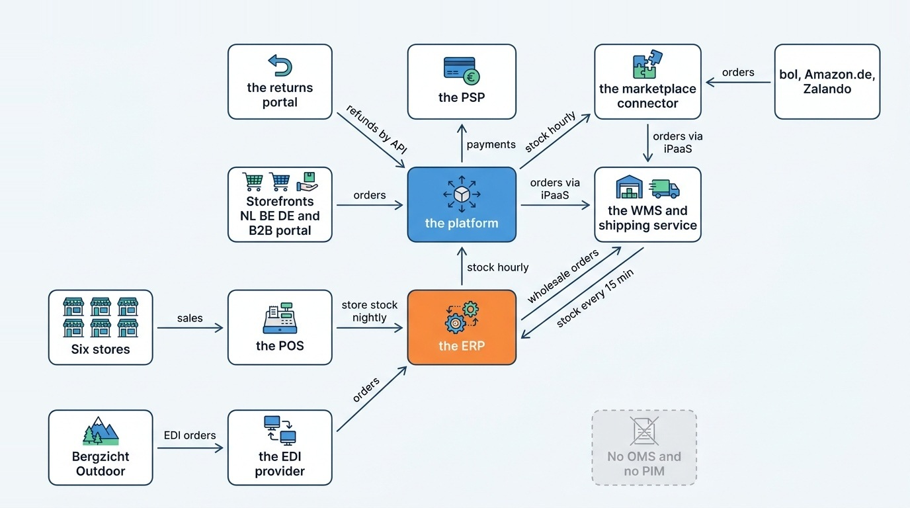
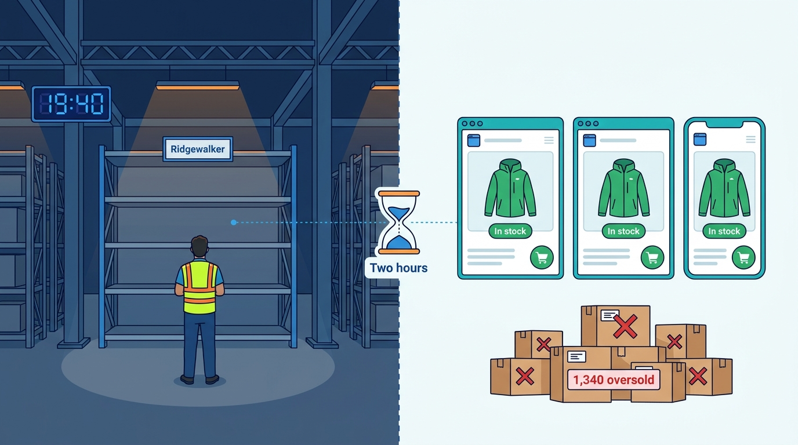
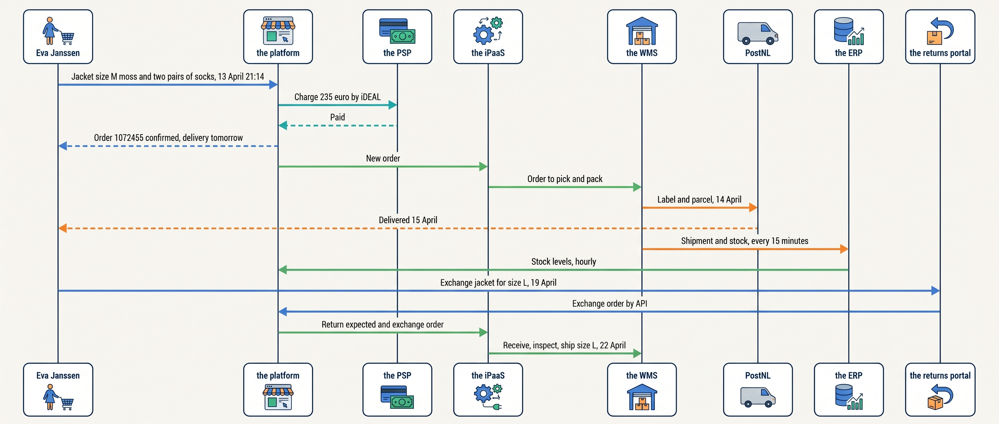

> **IN THIS SECTION, YOU WILL:** Meet Kestrel & Pine, the fictional outdoor brand this book follows, its business, its people, its systems, its ten incidents, the Waypoint program and the recurring order every chapter returns to.

> **KEY POINTS:**
>
> * **Kestrel & Pine is a fictional composite, not a disguised company.** It borrows the shape of many growing omnichannel brands so the book can show real tensions with consistent numbers. Every name, price, figure and incident is invented and recorded in one canonical ledger, the single record every page follows.
> * **Four channels, thirteen working systems, no order hub and no product hub.** Most of the ten incidents on this page are that gap, seen from a different side; in the largest, warehouse stock took up to two hours to reach the channels.
> * **Waypoint decides ownership first and buys the hubs second.** It names a system of record (the one system whose value counts when copies disagree) for stock, orders and product content, then adds an availability service (which computes what each channel may still sell), an order management system and a product information system, and sets integration standards.

 
The previous page used Kestrel & Pine's incidents one at a time, each to illustrate one failure pattern ([[where-commerce-platforms-go-wrong]]). This page gives the merchant whole: a fictional outdoor brand that grows from an online shop into a business with stores, wholesale customers and marketplaces, connecting each new system as the need arises. The company combines common growth patterns. It does not portray a real retailer. Systems are named by role to keep the discussion platform-neutral. One name is narrower than it looks: "the platform" always means one product, the hosted commerce platform that runs the storefronts and checkout, not the whole set of systems the book calls a commerce platform. Named marketplaces and carriers (parcel delivery companies) are real; their dealings with Kestrel & Pine are invented. Keeping its catalog, people, systems and incidents consistent lets you see how one architectural decision affects the next.

Every system at Kestrel & Pine works. But orders begin in four systems, product data is kept in four places and warehouse stock is copied along a chain of four, with no hub for orders or for product data. Eight of the ten incidents come from that: a fact with several copies and no agreed owner. Waypoint, the program approved in 2027, names an owner for each fact first, adds the missing hubs second and keeps the hosted commerce platform it already has.

The page starts with the business: the company at a glance, how it grew, what it sells, through which channels and in what volumes. It then introduces the people and the systems they run, as the new Head of Engineering found them in January 2027, followed by the ten incidents, the Waypoint program and five recurring examples, first among them the order every chapter returns to. A last section says how the chapters use all of it. Each section keeps its invented figures in a table, so you can come back to look up a figure, person, incident or planned change. Terms are explained locally, with links to the chapters that examine them.

## Kestrel & Pine at a Glance

**Kestrel & Pine B.V.** is an outdoor apparel and equipment brand founded in **Arnhem in 2016** by **Mara Lindqvist and Teun Baas**. They retain majority ownership; fictional investor **Veluwe Capital** has held a minority since **2022**. Own-brand clothing and equipment produce about **75%** of revenue; third-party equipment accounts for **25%**. The company sells in euros in the Netherlands, Belgium since 2020 and Germany since 2022.

In **2026**, revenue is **€48.0 million**, gross margin (revenue minus the cost of the goods sold) **54%**, and earnings before interest, tax, depreciation and amortization (**EBITDA**) about **€3.4 million**. Of **310 employees**, 96 work in stores, 88 in the warehouse and 126 at head office; **14** work in technology. Annual technology spend is about **€2.6 million**, or **5.4% of revenue**.

Four business lines share that revenue but place different demands on the company's systems. Two abbreviations appear in the table: **direct-to-consumer (D2C)** means selling through the brand's own storefronts, and **business-to-business (B2B)** means selling to other companies, here shops that resell the goods. The table is the baseline for the examples; [[commerce-business-models]] explains the differences.

| Line | Revenue 2026 | Orders or transactions | Average value | Notes |
| --- | --- | --- | --- | --- |
| **Online D2C storefronts** (NL, BE, DE) | **€27.0M** (NL €18.5M, DE €5.5M, BE €3.0M) | **293,000 orders** | **€92** | Free shipping over €75; "ordered before 22:00, delivered tomorrow" in NL |
| **Wholesale (B2B)** | **€12.0M** | **9,400 orders** | **€1,277** | **1,100 active accounts** (NL 640, BE 210, DE 250); 30-day payment terms |
| **Stores** | **€6.0M** | **118,000 transactions** | **€51** | Six stores |
| **Marketplaces** | **€3.0M** | **43,000 orders** | **€70** | bol, Amazon.de and Zalando, other companies' shopping sites |

The average values in the table differ far more than the goods do. A €51 store receipt, €92 web order and €1,277 wholesale order can contain the same jacket but need different prices, payment terms and fulfillment (picking, packing and shipping the goods).

## How Kestrel & Pine Grew, 2016–2027

The company did not start with four lines, and its history matters because every stage left a system behind, chosen for the stage it was bought in. The book describes four **scale stages** (Starting, Growing, Omnichannel, Group; [[commerce-scaling-stages]] owns them), and Kestrel & Pine has passed through three. The table explains each system and term in the year that first names it.

| Year | What happened | Stage |
| --- | --- | --- |
| **2016** | Founded in Arnhem; one Dutch web shop on a hosted SaaS commerce platform (software as a service: rented by the month and run by the vendor); one payment provider; orders shipped by a third-party logistics company (3PL, a warehouse that stores and ships on a merchant's behalf) in Tiel. | 1 — Starting |
| **2017** | An agency retained for the theme (the storefront's design) and the apps (add-ons from other vendors, installed into the platform). | 1 — Starting |
| **2019** | First store, in Arnhem, on a cloud point-of-sale system (POS, the till software that records store sales) from a different vendor. | 2 — Growing |
| **2020** | Belgium. | 2 — Growing |
| **2021** | The Utrecht store; the marketplace connector (a service that lists products on other companies' shopping sites and brings their orders back); the integration platform (an iPaaS, a hosted tool for building and running the flows that move data between systems); GTINs (the numbers behind product barcodes) on every own-brand item. | 2 — Growing |
| **2022** | Germany; Veluwe Capital's investment; Ruben Alves joins as lead integration engineer. | 2 — Growing |
| **2023** | The Duiven warehouse on its own warehouse management system (the WMS); a finance and back-office system (the ERP, for enterprise resource planning); the platform's enterprise tier with B2B features; the Amsterdam and Nijmegen stores. | 3 — Omnichannel |
| **2024** | The Eindhoven store; the data warehouse (a database that collects the other systems' data for reporting). | 3 — Omnichannel |
| **2025** | The Antwerp store; the returns portal (where customers register a return and get a label); EDI (electronic data interchange: orders and invoices exchanged between companies' systems) with Bergzicht Outdoor, the largest wholesale account. | 3 — Omnichannel |
| **2026** | Peppol e-invoicing (a European network for electronic invoices); the Utrecht click-and-collect pilot (order online, pick up in store); the Black Friday Oversell, when the channels sold 1,340 units the warehouse no longer had. | 3 — Omnichannel |
| **2027** | Noor Visser joins as Head of Engineering (January); Waypoint, the program that answers the incidents, is approved (March). | 3 — Omnichannel |

The revenue bands behind the stages are rough markers (Starting under about €2 million, Growing to about €20 million, Omnichannel to about €200 million, Group beyond that or several brands). The *shape* decides the stage: Kestrel & Pine became Omnichannel in 2023, when it had stores, wholesale, marketplaces, three countries and its own warehouse at the same time, and by 2027 it has thirteen systems to join. The joins are where its problems now live.

## The Catalog and the Products

All of those systems hold data about the same goods. Kestrel & Pine sells **3,400 products** in **26,000 sellable variants**. A product is "the Ridgewalker shell jacket, women's"; a variant is one size in one color of it. The book calls a sellable variant a **SKU** (stock-keeping unit, the thing you can count on a shelf and put in a parcel). About **17,000 variants are active** at any time; two main seasons a year plus carry-over lines bring about **1,200 new variants** per season. Every own-brand SKU has carried a **GTIN** since 2021; third-party SKUs use their brand's GTIN.

The hero product is the **Ridgewalker** shell jacket, in women's and men's cuts, six sizes and four colors including "moss". A few prices recur through the book, all fictional. Consumer prices include value-added tax (VAT) and wholesale prices do not; landed cost is what an item has cost by the time it reaches the warehouse.

| Item | Consumer price (incl. VAT) | Wholesale price (excl. VAT) | Landed cost |
| --- | --- | --- | --- |
| **Ridgewalker** shell jacket | **€199** | **€95** | **€58** |
| **Trailhead** fleece | €119 | €57 | |
| Merino hiking socks | **€18** | **€8.50** | |

Where the product data lives is the first sign of trouble. In January 2027 it lives in **three places**: the platform (storefront content and variants), the ERP (purchasing and costs, in its product list, the item master) and shared spreadsheets (seasonal enrichment, the descriptions and attributes added for each season's products, and translations). The marketplace connector holds a **fourth copy** for listings. Those are the four copies the opening counted. There is **no PIM** (product information management system: one place where product content and attributes are kept and published to every channel). [[product-information]] works this out.

## Channels and Customers

The catalog reaches customers through four channels, one for each business line in the first table, and no single system serves all four.

**Online.** Three localized storefronts (the Netherlands; Belgium in Dutch and French; Germany) run in **one tenant** of the platform, meaning one account on the vendor's shared service with one configuration, theme and set of apps. The Dutch storefront promises next-day delivery for orders before **22:00**, a promise written into the page rather than computed from the warehouse's state. Shoppers pay by iDEAL (the Dutch bank-transfer method most online shoppers there use), card, PayPal, Klarna, Bancontact or Apple Pay.

**Stores.** The six stores do not run on the platform but on the POS. Each holds about **1,800 variants**: Arnhem (2019, the flagship next to head office), Utrecht (2021; click-and-collect pilot since 2026), Amsterdam and Nijmegen (2023), Eindhoven (2024) and Antwerp (2025, where Belgian fiscal receipt rules apply). Store stock is tracked in the POS and copied to the ERP **nightly**. There is **no link between the POS and the platform**, so the click-and-collect pilot is checked by phone and e-mail. Store card payments go through a separate terminal provider ([[stores-and-omnichannel]]).

**Wholesale.** **1,100 active accounts**, mostly independent outdoor shops. **62%** of their orders arrive through the platform's B2B portal (company accounts, price lists, payment terms); **38%** arrive by e-mail or phone and are keyed into the ERP by the wholesale team ([[b2b-commerce]]).

The largest account is **Bergzicht Outdoor**, a fictional Dutch outdoor chain with **38 shops** and a distribution center in **Zwolle**, worth **€2.1 million** a year. Since 2025 Bergzicht orders by **EDI**. Three messages matter in this book, all in EDIFACT, the UN message standard most European EDI uses: the order (**ORDERS**), the invoice (**INVOIC**) and the despatch advice (**DESADV**, also called an ASN, advance shipping notice). A despatch advice tells the buyer what is on its way and on which pallets, each identified by an **SSCC** (serial shipping container code, the 18-digit number on a pallet label).

Some invoices travel electronically by another route: Belgian business customers have received **Peppol** e-invoices since January 2026 ([[edi-and-e-invoicing]]).

**Marketplaces.** Kestrel & Pine also sells through other companies' shopping sites: **bol** (NL and BE), **Amazon.de** and **Zalando** (DE and NL). **The marketplace connector**, a channel integration service, publishes listings, pulls orders and pushes stock levels. About **40%** of marketplace units for Germany are fulfilled by the marketplace's own fulfillment program from stock Kestrel & Pine sends there in advance, a location outside its control ([[marketplaces-and-channel-integration]]).

## The Volumes Every Design Is Sized Against

The book also keeps one set of figures for what flows through those four channels in a year. The first four rows repeat the order counts of the business-line table; the rest are new. Chapters quote these 2026 figures when they size a queue, a sync interval or a peak plan. All are illustrative.

| Measure | 2026 value |
| --- | --- |
| Online D2C orders | **293,000** (about 800 a day on average) |
| Marketplace orders | **43,000** |
| Wholesale orders | **9,400** |
| Store transactions | **118,000** |
| Active variants | about **17,000** of 26,000 |
| Shipped from Duiven | **336,000** parcels plus **9,400** wholesale shipments; **1.9 million units** |
| Returns | **72,000** parcels; item return rate **24%**, order return rate **19%** on D2C; **28%** of returns are exchanges; **61%** of returned items resold as new |
| Black Friday week (23–29 November) | **31,000** D2C orders, **10.6%** of the year's |
| Peak hour (Friday 27 November, 20:00–21:00) | **2,300** orders, **38 per minute**; storefront traffic about **41×** an average hour |
| Delays at peak | stock shown to shoppers up to **two hours** old; orders queued for up to **four hours** before reaching the warehouse, because the WMS vendor's rate limit slowed the integration flow that passed orders to the WMS |

Two numbers deserve a pause. A 24% item return rate means one item comes back for every four shipped, so the return path is a main road, not a side street ([[returns-and-exchanges]]). And the peak hour is nothing like an ordinary one. Storefront traffic runs at about 41 times the average, and a design that works at 800 orders a day meets 2,300 in one hour, once a year, which is what the pattern **The First Snowfall** warns about ([[peak-load-and-reliability]]).

## The People

The business described so far is run by a small cast. Each person owns something the architecture depends on, and most of the book's tensions are between their legitimate goals. All are fictional.

| Person | Role | Pronouns | Owns, or part in the book |
| --- | --- | --- | --- |
| **Mara Lindqvist** | Co-founder and CEO | she/her | The Waypoint budget |
| **Teun Baas** | Co-founder, Chief Product and Brand | he/him | The catalog and the seasons |
| **Noor Visser** | Head of Engineering since January 2027 | she/her | **The reader's stand-in.** Previously lead engineer at a logistics software company; proposed Waypoint |
| **Daniel Okafor** | Head of Operations | he/him | The warehouse, the stores and the carriers |
| **Sanne de Wit** | Finance Director | she/her | The ERP, invoicing and month-end |
| **Milan Petrov** | Ecommerce and Marketplaces Manager | he/him | The storefronts, the apps and the marketplace connector |
| **Lea Moreau** | Head of Wholesale | she/her | The B2B portal and the EDI relationship |
| **Ruben Alves** | Lead Integration Engineer since 2022 | he/him | The iPaaS and the integration inventory (the list of all integrations) |
| **Hanna Berg** | Data Lead | she/her | The data warehouse and metric definitions |
| **Eva Janssen** | A customer in Nijmegen | she/her | The recurring order, the first of the worked examples below |
| **Pieter Smit** | Buyer at Bergzicht Outdoor | he/him | Bergzicht's spring reorder, another of the worked examples |
| the agency | External storefront and apps agency since 2017 | — | The theme, the apps and several scripts |
| the ERP partner | External ERP implementation partner | — | The platform-to-ERP connector |

Noor leads a technology team of **14**: herself, nine engineers (four integration and back-end, three storefront and apps, two data), two product managers and two application support specialists. When a chapter says "you", it usually means Noor: new to this company, not new to engineering, and asked to decide about systems she did not choose.

## The Systems Landscape in January 2027

These are the systems Noor did not choose. The table shows what she finds when she arrives in January 2027. Every system works, each is named here by its role, and two rows have no system at all.

| Area | System | Since | Notes |
| --- | --- | --- | --- |
| Storefront, cart, checkout, B2B portal | **the platform**, a hosted SaaS commerce platform, enterprise tier since 2023 | 2016 | Three storefronts in one tenant; theme customized by the agency; **41** apps, of which **6** unused and **3** write stock |
| Finance and back office | **the ERP** (enterprise resource planning system: the books, purchasing, inventory valuation, invoicing, item master, manual wholesale order entry) | 2023 | The platform-to-ERP connector was built by the ERP partner |
| Warehouse | **the WMS** (warehouse management system: receiving, picking, packing and shipping at Duiven) | 2023 | Orders in from the platform, stock out to the ERP, via the iPaaS |
| Order management | **none** | — | Orders live in the platform, the marketplace connector, the ERP and the POS |
| Product information | **none** | — | Product data in the platform, the ERP, spreadsheets and the marketplace connector |
| Marketplaces | **the marketplace connector** | 2021 | Listings, orders, hourly stock sync |
| Stores | **the POS** | 2019 | Store stock to the ERP nightly; no link to the platform |
| Returns | **the returns portal** (SaaS) | 2025 | Labels, reasons, exchanges; refunds through the platform's API |
| Shipping | **the shipping service** (multi-carrier labels and tracking) | 2023 | Inside the WMS flow |
| Payments | **the PSP** (payment service provider: the company that takes the shopper's payment and settles the money to the merchant) | 2016 | A separate terminal provider for stores since 2019 |
| EDI | **the EDI provider** (a value-added network that relays EDI documents between trading partners) | 2025 | ORDERS, DESADV and INVOIC with Bergzicht; Peppol e-invoices |
| Integration | **the iPaaS** plus agency scripts and vendor connectors | 2021 | **34** integrations; owned by Ruben Alves |
| Data | **the data warehouse** and a BI tool (business intelligence: reports and dashboards) | 2024 | Three definitions of "order" in use |

Not counting the scripts and vendor-built links between them, the table names thirteen systems: one in each of eleven rows, plus the stores' terminal provider and the BI tool. Two rows name none, and those two missing systems explain much of the difficulty. An **order management system (OMS)** would coordinate orders from every channel, with shared payment, fulfillment, delivery and return states. A **product information management system (PIM)** would own descriptions and attributes.

Instead, orders begin in the storefront, marketplace connector, ERP or store till, and product descriptions are maintained four times, as the catalog section showed. Buying a useful system for each new need has left the company without shared ownership ([[boundaries-and-systems-of-record]], [[order-management]]).

**Figure 1:** *Kestrel & Pine's January 2027 landscape: four channels create orders in four different systems, stock travels on a schedule from the WMS to the ERP to the platform to the marketplace connector, and no system holds all orders or all product data.*

The **stock sync chain** in the middle of the figure is the mechanism behind the Black Friday Oversell. The WMS knows what is physically on the shelf. It passes that number on a schedule to the ERP, the ERP passes it to the platform, the platform to the marketplace connector, and the connector to the marketplaces. That is a chain of four systems, each holding its own copy of one number. A unit that leaves the shelf at Duiven can take up to **two hours** to reduce the number a shopper sees on Amazon.de, and in those two hours every channel believes it can still sell the unit. Figure 2 shows what that did on the evening of Black Friday 2026. [[inventory-and-availability]] owns the fix.

**Figure 2:** *The Black Friday Oversell: the Ridgewalker sold out at Duiven at 19:40, but the storefronts and marketplaces kept selling it from a copy up to two hours old, and 1,340 units were oversold.*

## The Problems Kestrel & Pine Starts 2027 With

When Noor starts, every system in that landscape works and the company is profitable. The problems are in the joins, as the stock chain shows. Ten incidents define the position she starts from, most from 2026 and two from her first weeks. Chapters cite them by these fixed numbers, which do not follow the dates; all but one are instances of patterns named on the previous page ([[where-commerce-platforms-go-wrong]]), and each is worked in full by the chapter that owns it.

1. **The Black Friday Oversell** (Friday 27 November 2026). The Ridgewalker sold out at Duiven at 19:40; the storefronts and marketplaces kept selling it for up to two hours. **1,340 units** oversold, **1,120 orders** canceled or delayed, about **€96,000** in cost including goodwill vouchers and marketplace penalties. *The Phantom Stock* and *The First Snowfall*; [[inventory-and-availability]], [[journey-peak-day]].
2. **The Three-Status Order** (December 2026). Order **#1052877** showed *Delivered* in the platform, *In picking* in the WMS and *Not invoiced* in the ERP for six days; one customer opened **11 support tickets**. *Schrödinger's Order*; [[order-management]], [[customer-service-and-notifications]].
3. **The Double Refund** (January 2027). Over three weeks, **212 returns** were refunded twice: once by the returns portal through the platform's API and once by hand in the PSP console. **€19,400** went out twice, most of it recovered. *The Boomerang* and *The Message in a Bottle*; [[returns-and-exchanges]], [[commerce-payments]].
4. **The Price Drift** (October 2026). The German storefront sold the Ridgewalker at **€179** for **nine days** while the marketplace listing and the stores charged **€199**; a price-list sync had failed silently. **410 orders**, about **€8,200** of margin lost, and a price-parity warning from a marketplace, which expects no lower price elsewhere. *The Price Nobody Can Explain*; [[pricing-architecture]].
5. **The ASN Chargeback** (Q3 2026). Bergzicht deducted **€14,200** for despatch advices whose pallet labels did not match what arrived: Kestrel & Pine's DESADV came from the ERP's view of the order, not from what the warehouse packed. *The Pulled Rug* and *The Lynchpin*; [[edi-and-e-invoicing]].
6. **The Store Stock Mirage** (December 2026). Click-and-collect at Utrecht promised **37** items the store had already sold, because store stock reaches the ERP only nightly. *The Phantom Stock*, from the store side; [[stores-and-omnichannel]].
7. **The App That Wrote Stock** (March 2026). A pre-order app adjusted inventory in the platform while the WMS feed also wrote it: two weeks of phantom reservations on **600 variants**. *The Secret Agent* (an unowned writer) and *The Spaghetti Junction*; [[extensibility-and-app-ecosystems]].
8. **The Card-Testing Night** (August 2026). **48,000** bot attempts with stolen card numbers hit the checkout in one night; **€2,900** in PSP fees for declined authorizations (card-approval requests the bank refused, each still charged a fee), and the PSP paused the account for 40 minutes. A trust failure rather than one of the sixteen patterns; [[commerce-security]].
9. **The Familiar Stranger** (a standing condition, not a dated event). Eva Janssen exists as an online account, a POS loyalty customer, a newsletter subscriber and a returns-portal contact, with no shared identifier, so nobody can say she is one person. The pattern has the same name, *The Familiar Stranger*; [[identity-and-master-data]].
10. **The Deprecated Endpoint** (February 2027). The marketplace connector retired an API version on a published date; the agency script that read it had not been updated, and stock to bol was stale for **two days**. *The Pulled Rug*; [[api-contracts-and-versioning]].

Eight of the ten (incidents 1 to 7 and 9) are the same problem: a fact (stock, an order's status, a refund, a price, a shipment's contents, a customer's identity) that lives in more than one system, with no agreed owner and no reliable way for the copies to learn of a change. The other two, the Card-Testing Night (8) and the Deprecated Endpoint (10), start outside, with an attack and a vendor retiring an API version: they are what the outside world does to a landscape nobody watches as a whole. The split is by cause, so incident 10 can share its pattern, The Pulled Rug, with incident 5.

## The Waypoint Program

To answer these incidents, Mara Lindqvist approved **Waypoint** in **March 2027**, on Noor's proposal: **€1.1 million** over 2027–2028 on top of the running technology spend. The table lists its eight decisions, W1 to W8. They are canonical; chapters explain them and never change them. The numbers identify the decisions; the paragraph after the table gives their priority.

| Decision | What changes | When |
| --- | --- | --- |
| **W1 — Stock ownership** | The WMS becomes the **system of record** for physical stock at Duiven: the one system whose value is the truth when copies disagree. The POS becomes the system of record for store stock, and the marketplace fulfillment stock becomes a tracked external location. An **availability service**, bought as a module of the order management system (OMS) that W2 adds, computes **available-to-promise** per channel: what a channel may still sell, which is physical stock minus what is already promised or reserved. It works from stock **events**, messages sent the moment something changes. The sync chain is retired. | Q4 2027 |
| **W2 — One order record** | A bought **OMS** becomes the order hub: every channel's order (platform, marketplaces, EDI, manual wholesale, later stores) is created there, with one state model (one agreed set of order statuses) and one order number family. The platform keeps the checkout and the storefront order history. | Q4 2027 |
| **W3 — Product information** | A **PIM** becomes the system of record for product content and attributes; the ERP keeps costs and purchasing; the platform and the marketplace connector become consumers. | Q3 2027 |
| **W4 — Stay and surround** | Kestrel & Pine **stays on its SaaS platform**; no replatforming. Capabilities the platform does not own well (OMS, PIM, availability) are added beside it. The platform's own POS is evaluated in 2028. | 2027; review 2029 |
| **W5 — Integration standards** | Every integration gets a named owner, a contract (fields, direction, frequency, system of record), **idempotent** handling of repeated messages (receiving a message twice has the same effect as once) and a reconciliation job (a scheduled comparison of two systems' copies that lists the differences); the integration inventory is kept current. Stock, orders and prices move by events instead of periodic copies; products by scheduled publication; finance by daily batch. | From 2027 |
| **W6 — EDI compliance** | SSCC labels generated by the WMS at pack time; DESADV sent from the WMS pack confirmation, not from the ERP; one EDI partner card per trading partner (a record of its identifiers, message and mapping versions, internal owner and compliance rules). | 2027 |
| **W7 — One definition of an order** | The data warehouse adopts one metric definition for order, revenue and return, owned by the Data Lead. | 2027 |
| **W8 — Agent readiness, not agents** | Accurate product data (via the PIM), availability and delivery promise by API, and order status by API are prerequisites; no shopper-facing AI agent (software that shops on a customer's behalf) in 2027. | 2027 |

The table lists the decisions by number, and their dates overlap; the argument is in their priority, in what has to be settled before what. Waypoint decides **who owns each fact** first (the systems of record in W1 and W3, the one definition in W7), then adds the hubs the landscape lacks to hold what was decided (the availability service in W1, the OMS in W2, the PIM in W3), then makes the copies trustworthy (W5, W6). W1 and W3 appear twice because each names an owner and also adds the hub that holds its fact. It does not replace the platform (W4), because the platform is not what failed; the joins failed. [[build-buy-or-assemble]] works the stay-and-surround decision, [[events-consistency-and-reconciliation]] the integration standards. W8 builds on the result: accurate product data, availability and order status are what a later shopping agent would need ([[ai-and-agentic-commerce]]).

## The Recurring Worked Examples

Chapters show these problems and test Waypoint on five stories that recur through the book, four from spring 2027 and one from 2026. Their facts never change, so you can follow one order across many chapters and the numbers will always agree.

**Eva's jacket, the recurring order.** On **Tuesday 13 April 2027 at 21:14**, Eva Janssen in Nijmegen orders on the Dutch storefront: one **Ridgewalker shell jacket, women's, size M, color moss (€199)** and **two pairs of merino hiking socks (€18 each)**. Total **€235**, free shipping, paid by **iDEAL**. Order number **#1072455**; because she ordered before 22:00, delivery is promised for tomorrow, Wednesday.

The order is picked and packed at Duiven on **Wednesday 14 April**, shipped with PostNL and delivered **Thursday 15 April**, a day later than promised, because the static promise ignores that Duiven's last pick wave (the day's last batch of orders released to the pickers) leaves at 21:00 ([[warehouse-and-fulfillment]]).

On **Monday 19 April** she requests an **exchange of the jacket for size L** through the returns portal (too small). The return is received and inspected on **22 April**, graded resellable, and the exchange order ships the same day. If a chapter needs the refund variant instead, it is a refund of **€199** by iDEAL reversal, booked as a credit note (the document that cancels all or part of an invoice). Figure 3 draws the nine days from order to exchange as handoffs between seven systems: the platform, the PSP, the iPaaS, the WMS, PostNL, the ERP and the returns portal.

**Figure 3:** *Eva's jacket crosses seven systems in nine days: the platform sells and takes the money, the iPaaS carries the order to the WMS, PostNL delivers, stock trickles back through the ERP, and the exchange re-enters through the returns portal; every arrow is a handoff that can be late, lost or duplicated.*

This is the order [[journey-of-an-order]] walks step by step and [[journey-consumer-order]] and [[journey-return-and-exchange]] work in full. Every chapter says near its top where in this journey it sits.

**Bergzicht's spring reorder.** Pieter Smit's EDI ORDERS message arrives on **Tuesday 6 April 2027** for **240 units** across **18 SKUs** (Ridgewalker jackets and Trailhead fleeces), worth **€19,860** excluding VAT. It is picked to **three pallets** with SSCC labels; the DESADV is sent at pack confirmation; the pallets reach the Zwolle distribution center on **9 April**; the INVOIC (the EDI invoice) is sent the same day; payment is due **9 May**, on 30-day terms. [[journey-wholesale-order]] and [[edi-and-e-invoicing]].

**The marketplace variant.** On 13 April 2027, the day of Eva's order, one Amazon.de customer orders a Ridgewalker that Kestrel & Pine ships itself from Duiven (seller-fulfilled), and another orders one that the marketplace's fulfillment program ships from the stock sent there in advance. The two orders look alike to the customers and nothing alike to the systems. [[marketplaces-and-channel-integration]].

**The stock reconciliation.** In **May 2027**, the first weekly reconciliation between the WMS and the platform (a job that compares the two systems' quantities and lists the differences) found **2.3%** of active variants with a different quantity, most left behind by the three apps that wrote stock. [[events-consistency-and-reconciliation]].

**Black Friday 2026.** The fifth story is the only one from before Waypoint. It covers the week of 23–29 November and its Friday evening: 31,000 orders, a peak hour of 2,300, the sell-out at 19:40, the two-hour stock lag and the four-hour WMS queue, with the numbers in the volumes table and in problem 1. [[journey-peak-day]], [[peak-load-and-reliability]] and [[warehouse-and-fulfillment]].

The five divide by year. Black Friday 2026, like the ten incidents, is evidence behind Waypoint. The four stories of 2027 fall in April and May, after Waypoint was approved and before its hubs arrive in the second half of the year. Chapters use them to test its priorities: ownership before hubs, then contracts and reconciliation to make every copy trustworthy.

## How the Chapters Use Kestrel & Pine

Because these facts are fixed, every chapter can use Kestrel & Pine in the same way. This page supplies the full reference; individual chapters repeat the facts their examples need. Each chapter opens with a 2027 scene at Kestrel & Pine, then answers its question with concepts, dated public evidence from real companies and standards, and a Kestrel & Pine worked example. Chapters in Parts II to VIII end with a table across the four scale stages, using Kestrel & Pine's own path as one column. The journeys of [[part-9]] follow the recurring orders end to end; the case studies of [[part-11]] leave Kestrel & Pine and test the book against the public record.

Three conventions hold throughout. **Kestrel & Pine is labeled fictional** the first time it appears in a chapter. **Its systems are named by role**, never by vendor, so nothing in the book reads as a recommendation for or against a product. **Its facts come from one canonical record**, so the 1,340 units, the €19,400 and order #1072455 mean the same on every page; numbers that are neither Kestrel & Pine's nor documented are labeled as assumptions.

## What to Take Away

Read together, the three pages of this preface are one argument at three sizes. Taken backwards, from this page to the first, they run from one company (this page) through the patterns many companies share (the previous page) to every commerce platform (the first page). The ten incidents on this page are instances of the patterns the previous page named. Those patterns are promises broken at the joins between systems, which is the first page's claim about every commerce platform. And the priority of Waypoint's decisions (who owns each fact, then the missing hubs, then trustworthy copies, with the platform kept) is that claim written as one company's program. The book opened on two numbers, order #1072455 and 1,340 oversold units. They have returned here as the recurring order and as incident 1, and you can now name the systems behind each. Read each chapter's scene as one more view of this landscape, check its figures against this page, and ask of each Waypoint decision what the equivalent ownership decision would be in your own company.

With the company, its problems and its program introduced, Part I turns to the business before the technology: what the promises are, who makes them and who owns the facts behind them. It begins where Noor began in her first week: by following one order through every system it touches, and asking at each handoff which system made the promise and which one has to keep it. Continue with [[part-1]].

## Sources and Evidence

Kestrel & Pine, Bergzicht Outdoor, Veluwe Capital and every person named here are fictional; all figures are illustrative.
