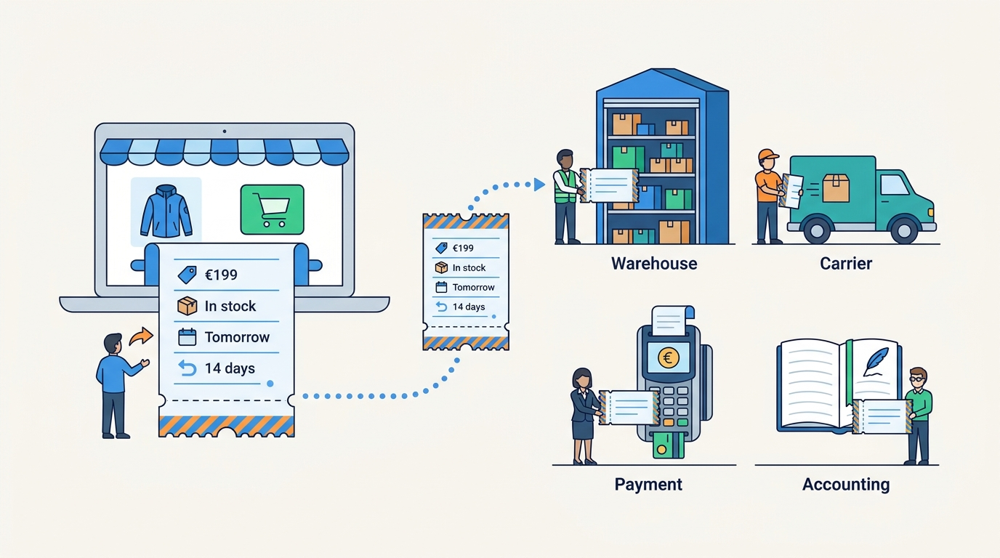
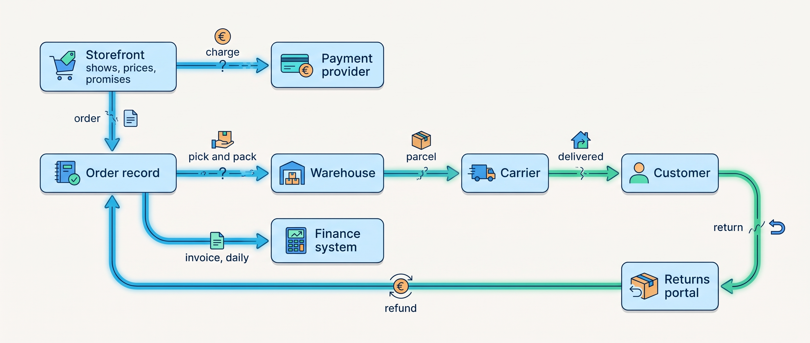
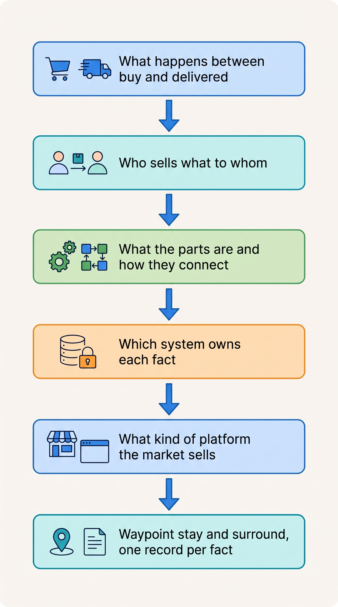

> **KEY POINTS:**
>
> * **A commerce platform is a promise-keeping machine, not one product.** The storefront makes the promises; the warehouse, carrier, payment provider and finance system keep them, and every handoff between them can fail.
> * **Who sells what to whom decides the systems.** Consumer, wholesale, marketplace and store selling make different promises, so they need different systems around a shared core.
> * **Draw the map in capabilities (jobs), then name one record per fact.** Every other value is a copy; choose a platform by the integration work you can own, because every platform moves that work rather than removing it.

 
A shopper places one order, but the warehouse, carrier, payment provider and finance team each have work to do before it is complete. The storefront's promises about product, price, stock, delivery and returns depend on those other systems.

**Figure 1:** *The storefront writes the promises in seconds; the warehouse, the carrier, the payment provider and the finance system have to honour them over days.*

Part I argues that a commerce platform is the whole set of systems that make and keep those promises, and that nearly every failure is a promise one system made and another could not keep. The **shop platform** that runs the webshop is only one of them. Knowing who keeps each promise shows where a failure lies and what must change.

**Figure 2:** *The order's journey as a chain of promises: the storefront makes them early, the other systems keep them late, and every arrow is a handoff that can be late, lost, duplicated or misread.*

The example is **Kestrel & Pine, a fictional outdoor brand** with €48 million in 2026 revenue, thirteen systems, 34 integrations and 41 apps. Orders and product data each live in four places; six writers, systems or people, change warehouse stock. Its **Waypoint** improvement program begins in March 2027 by deciding who owns what and how other systems learn of changes.

Part I asks Kestrel & Pine five questions, each answer giving the next its vocabulary: what happens to an order, who sells what to whom, what the parts are, who owns each fact, and which platforms the market sells.

**Figure 3:** *The five questions of Part I in reading order: each answer is the vocabulary the next question needs, and together they are the reasoning behind Kestrel & Pine's 2027 decisions.*

## Chapters in this part

[[journey-of-an-order]] follows **one purchase through thirteen steps**, through payment, delivery, return and accounting. One jacket order shows the normal path; another, which three systems show at once as delivered, in picking and not invoiced, shows why one status word cannot explain everything.

[[commerce-business-models]] keeps those steps but shows that **the shape of the business decides the systems**: selling one jacket to a consumer, a wholesaler, a marketplace shopper or a store visitor changes who prices, sells, stocks and ships. As it grows, a merchant moves through four scale stages, from Starting to Group, by adding channels, locations, countries and brands, not revenue.

[[commerce-capability-map]] then maps **the jobs a merchant must perform**. Head of Engineering Noor Visser places Kestrel & Pine's systems on it and finds missing capabilities and overlapping writers.

[[boundaries-and-systems-of-record]] assigns **an authoritative owner to each fact**, which the map alone cannot settle. It separates records from copies, explains why systems mean different things by "order", and resolves the six answers about stock that its six writers give.

[[commerce-platform-landscape]] comes last, once jobs are mapped and owners named. Its **seven platform categories** differ mainly in who hosts, upgrades and integrates, and each moves the integration work rather than removing it. Offered two rebuilds, Kestrel & Pine keeps its shop platform and adds what is missing.

## Where to Begin

Kestrel & Pine's problems are unowned facts at the handoffs where the shopper's order breaks; no product fixes that. Read in order from [[journey-of-an-order]]; with one decision to make, start at the chapter that answers it.

## Sources and Evidence

Every public claim in this part is sourced and dated in the chapter that makes it, under that chapter's Sources and Evidence. Kestrel & Pine is fictional; recommendations and labeled assumptions are the author's judgement.
