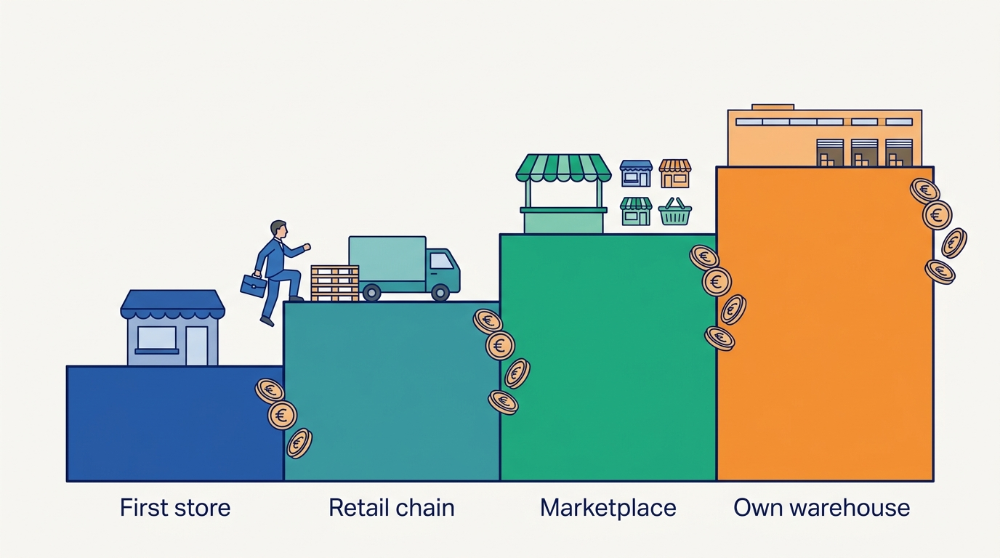
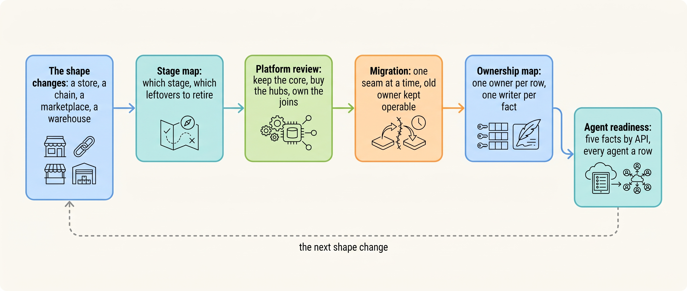
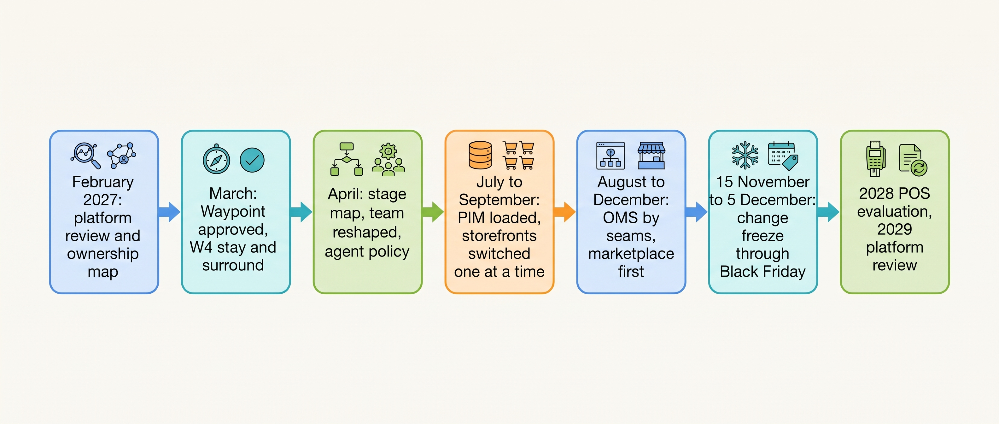

> **IN THIS PART, YOU WILL:** Learn to choose and price a platform strategy, move systems without burning the bridge, read your scale stage and its signals, draw an ownership map that fourteen people will keep, and separate what AI does in commerce today from what agents will need tomorrow.

> **KEY POINTS:**
>
> * **At a growing merchant the problems live in the joins, so the platform decision is mostly about what to leave where it is.** Build only what customers choose you for, buy what every merchant needs, own the joins yourself, and price every option over three years, including the lines the quote leaves out.
> * **A stage is a shape, and a migration is how you cross from one to the next.** Most Omnichannel incidents are Growing-stage designs under Omnichannel load. The move is made one seam at a time, old and new side by side, with the old owner kept operable through one peak.
> * **Ownership is what makes any of it hold.** One row per system, integration and app with a named owner inside the company; one writer per fact; teams shaped around the order's journeys rather than around vendors; and an AI agent treated as one more integration, with an identity, an owner and no write scope on stock, prices or orders.

> **[FAILURE PATTERNS THIS PART ADDRESSES](where-commerce-platforms-go-wrong.html):**
>
> * **The Giant's Boots** — a composable rebuild, a microservices program or a shopping agent copied from a company a hundred times larger, into a fourteen-person team that cannot own it.
> * **The Burned Bridge** — a platform or a hub switched over on one date, into or near a peak, with no rehearsed way back.
> * **The Secret Agent** — a script, an app or an AI assistant that writes stock, prices or orders with no named owner, which the ownership map and the agent policy exist to prevent.

 
Every part so far has described a commerce platform as it stands on one day. **This part is about the decisions a merchant has to make again each time the business changes shape.** A merchant does not grow smoothly. It grows in jumps: the first store, the first retail chain that orders by EDI, the first marketplace, the first warehouse of its own, one day a second brand. Each jump adds a place where stock sits or a channel where it sells, and the money is lost at those transitions, not between them.

**Figure 1:** *A merchant grows in jumps, not smoothly: each jump adds a place where stock sits or a channel where it sells, and the money is lost at the jumps rather than between them.*

Part X sits off the path of the order's journey, but every system Eva Janssen's jacket crosses on 13 April 2027 was bought at a different time for a different company: the platform in 2016, the marketplace connector in 2021, the warehouse system and the finance system in 2023, the returns portal in 2025. This part asks when each should change, how to change it without stopping the shop, who answers for it, and which new kind of actor may write to it next.

Kestrel & Pine, the fictional outdoor brand this book follows, met all five questions in 2027. Two proposals on the CEO's desk would replace the one part that held on Black Friday. Two hubs had to be introduced beside a shop selling 800 orders a day. The board asked which fixes were for the company it is and which for the company it was. Thirteen of its 34 integrations had no named owner in January, and three of its 41 apps wrote stock. And an agency offered to build a shopping assistant. **The claim of this part is that these are decisions about ownership and timing, not about tools**: what to own and what to rent, when and how to move a fact's owner, which leftovers to retire, who answers for each row, and which actor may write.

**Figure 2:** *The five decisions of Part X as one loop: a change of shape is read as a stage, answered by a platform review, carried out as a migration, held in place by an ownership map, and extended to the newest writer, until the shape changes again.*

**Figure 3:** *Kestrel & Pine's 2027 as this part sees it: the decisions are made in the first quarter, carried out seam by seam from July, frozen around the peak, and dated for review rather than treated as final.*

## Chapters in this part

[[build-buy-or-assemble]] decides **how to choose between a suite, a hosted platform with apps, a composable assembly and custom build, and how to price each one honestly**: build what customers choose you for and nobody sells, buy what every merchant needs, assemble when the joins are what you must own, and compare the options over three years on people, agency, migration and exit before the subscription. The case is the February 2027 platform review: a consultancy's composable rebuild and an enterprise suite at about €3.2 million each over three years, against stay and surround at about €1.33 million, written up as decision W4 and reopened in 2029.

[[replatforming-and-migration]] decides **how to move a platform or a hub without one cutover date and no way back**: along seams (a channel, a capability, a slice of traffic), with old and new running side by side and a reconciliation that proves they agree, the old owner kept operable through one peak, and products, customers, orders, gift cards and URLs treated as five migrations. The public cases are Target (2011), Finish Line (2012) and Marks & Spencer (2014); the Kestrel & Pine case is the PIM, loaded in July 2027, and the OMS, given marketplace orders on 15 September, storefront orders on 13 October and wholesale orders on 8 December, with a freeze through Black Friday in between.

[[commerce-scaling-stages]] decides **which architecture decisions change as a business grows, and how to tell that a stage is ending**: a stage is a shape made of channels and stock locations, not a revenue band; each stage leaves behind systems bought for the one before; two transition signals in one year mean the stage has changed, whatever the revenue says. The case is the stage map Noor Visser drew for the board in April 2027: Omnichannel since 2023, with eight of the ten incidents traced to Growing-stage designs.

[[organizing-commerce-engineering]] decides **who owns each system, integration and app, and how a small team works with an agency and a dozen vendors**: an ownership map with a technical owner inside the company on every row and one writer per fact, journey teams plus an integration pair rather than one person per vendor, the accounts, repository and decision records in the merchant's hands, and governance light enough to survive a peak season. The case is the ownership map of February 2027 (thirteen systems, 34 integrations, 41 apps; thirteen integrations without a named owner in January and five still unowned in April) and the team shape of April: Buy, Fulfil and Return, an integration pair, a data pair and a 45-minute architecture hour.

[[ai-and-agentic-commerce]] decides **what AI already does in commerce, what agentic commerce is, and what a merchant must have before an agent can buy**: established AI reads and proposes while an agent acts, and an agent is a new writer; between September 2025 and November 2026 the flagship in-chat checkout launched and retreated, three protocols appeared without settled governance, and no consumer checkout program reached Europe, where the shopper must still authenticate the exact cart. The case is Noor's agent test of February 2027, five questions an agent asks about the Ridgewalker jacket, which became decision W8: agent readiness, not agents.

Begin with [[build-buy-or-assemble]].

## Sources and Evidence

Every public claim in this part is sourced and dated in the chapter that makes it, under that chapter's Sources and Evidence. Kestrel & Pine is fictional; recommendations and labeled assumptions are the author's judgement.
