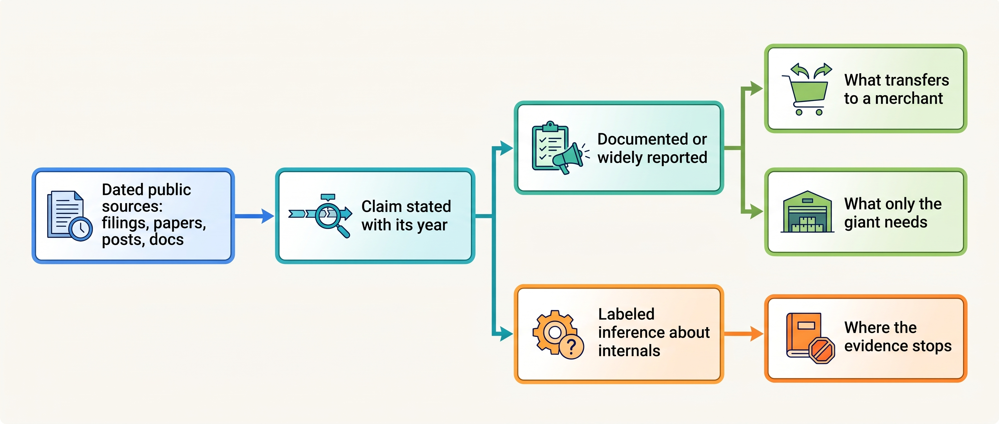
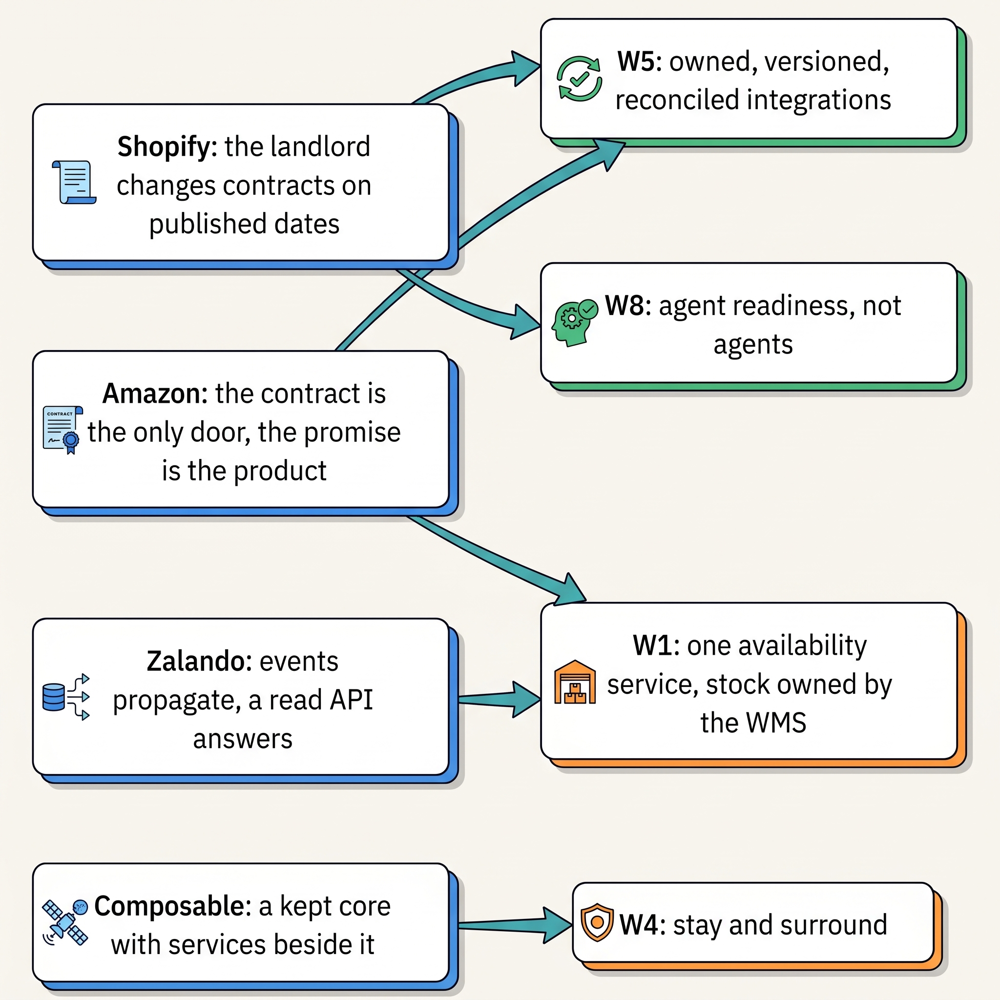

> **KEY POINTS:**
>
> * **The documented record is narrower than the folklore, and more useful.** In the companies' own dated words, the slogans shrink to rules a small team can use.
> * **Every answer was sized to its company.** In a fourteen-person team, Amazon's, Zalando's and the composable vendors' shapes are copies without their reasons.
> * **What transfers is discipline, not machinery.** Dated API versions, reconciled integrations and one owner per fact transfer; pods and a hundred services do not.

 
So far the book has made its argument with a fictional merchant, Kestrel & Pine, and dated examples. Part XI reads that argument against four real companies that design reviews cite in slogans such as "Amazon did microservices" and "go composable". Its chapters take, in order, Shopify, which operates a platform for merchants; Amazon and Zalando, retailers that also host other sellers and fulfill orders; and the composable vendors, which sell separate services that merchants assemble.

The cases use public filings, papers, engineering posts and documentation researched on **7 November 2026**. Claims carry dates. Older posts may describe replaced systems. Unsupported internal explanations are labeled **INFERENCE, NOT DOCUMENTED**. Each case ends with what the evidence could not establish.

**Figure 1:** *How each case is read: every claim is dated and typed, documented claims are split into lessons that transfer and machinery that does not, and inferences lead to a list of what the record does not show.*

Read by these rules, the four records show where a merchant's promises on price, stock, delivery and refunds were kept or broken: at the handoffs between systems. What kept them was a contract for each exchange, one owner per fact, reconciliation, and retiring interfaces only on announced dates.

Kestrel & Pine's fourteen technology staff, running a rented shop platform, cannot reproduce a large platform organization; copying a large company's shape without its reasons is the failure pattern The Giant's Boots. Kestrel & Pine asks whether each practice helps its order flow, and at what operating burden. Each lesson it takes matches a decision its Waypoint program has already made, and the cases check those decisions against real records.

**Figure 2:** *The Giant's Boots: each case is an architecture copied by merchants a hundred times smaller, so each chapter names what only the giant needs.*

**Figure 3:** *What Kestrel & Pine takes from the four cases: each dated lesson confirms a Waypoint decision already made, and none changes its architecture.*

## Chapters in this part

First, [[case-shopify]], the kind of hosted platform Kestrel & Pine rents, examines **modularity, tenant isolation (each shop kept apart in database pods), checkout extensions and integration contracts**. A merchant can adopt dated API versions and reconciliation without copying the vendor's infrastructure.

[[case-amazon]] reads **dated accounts of services, cart design and fulfillment**. The merchant lessons concern reliable contracts, stock that a marketplace holds, kept as its own location and delivery promises computed from operations.

[[case-zalando]] follows **team autonomy, shared API standards and later corrections to that autonomy**. A 2025 price-and-stock example shows why direct queries can replace a delayed event stream for a particular need. The lesson depends on that need, rather than a universal preference for either mechanism.

Last, [[case-composable-movement]] tracks **how vendors' promises and offerings changed**. Separate services can be added beside an existing platform as well as used in a rebuild. Kestrel & Pine's additions beside its platform (an OMS, a PIM, an availability service) show what each costs to integrate and own.

## Where to Begin

In their own dated words, the cases leave rules a small team can use, not shapes to copy. Begin with [[case-shopify]].

## Sources and Evidence

Every public claim in this part is sourced and dated in the chapter that makes it, under that chapter's Sources and Evidence. Kestrel & Pine is fictional; recommendations, labeled inferences and labeled assumptions are the author's judgement.
