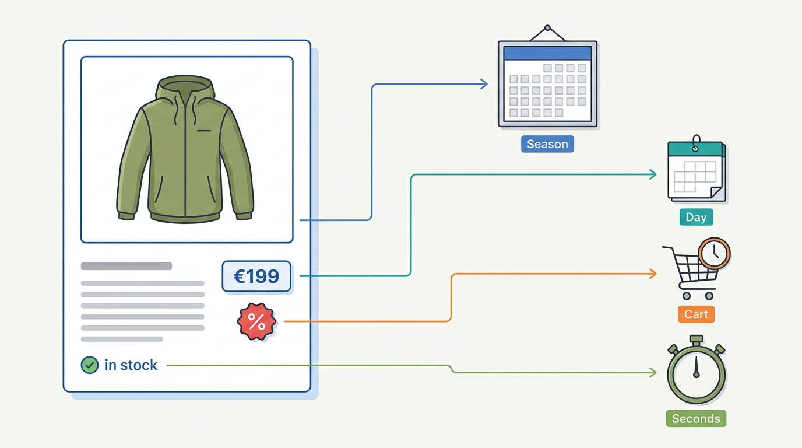
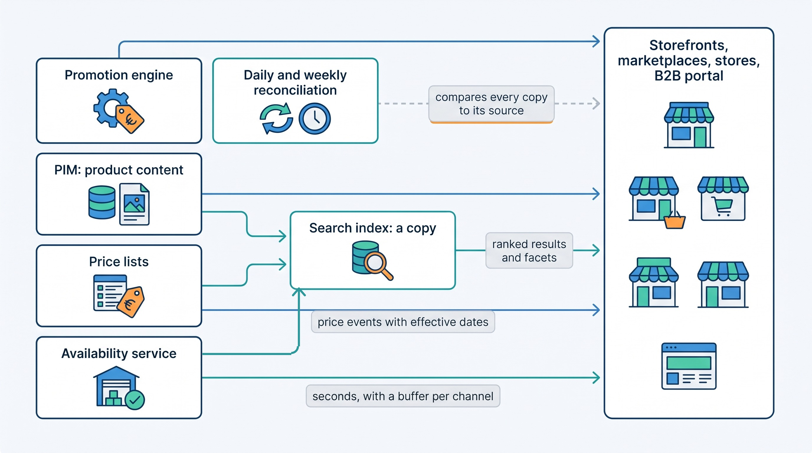

> **IN THIS PART, YOU WILL:** Learn how a commerce platform decides what it sells, what it costs, what is discounted, how shoppers find it and whether it is really in stock, and who owns each of those facts.

> **KEY POINTS:**
>
> * **Catalog facts have different owners and different clocks.** Product content changes with the season and tolerates a day's lag; a price changes daily and carries legal weight in the EU; a discount is decided in the cart; stock changes by the second. One system of record (the system whose value wins when copies disagree) per kind of fact, one path per clock.
> * **Every channel shows a copy, and a copy needs a source, an effective date and a reconciliation.** The German storefront at €179, the search index saying "in stock" and the marketplace selling two hours after the shelf emptied were all copies nobody compared with their source.
> * **A promise is computed by a rule, at a moment, in one place, and then frozen.** The price is selected at checkout and copied to the invoice; the discount is computed once in the cart and allocated to every line; the last unit is committed to exactly one order.

> **[FAILURE PATTERNS THIS PART ADDRESSES](where-commerce-platforms-go-wrong.html):**
>
> * **The Spaghetti Junction** — product content typed into four systems by four teams, so one color has three spellings and no owner.
> * **The Price Nobody Can Explain** — one jacket, eleven prices, seven places, and no rule saying which is the source of which.
> * **The Phantom Stock** — "in stock" computed from a copy of a copy, two hours behind the warehouse, on the busiest evening of the year.

 
Before a shop can take an order, it has to make four promises on one page: this is the product, this is what it costs, this is what is off today, and we have one for you. A fifth sits in the search box: type what you want and we will find it. Part I drew the map of a commerce platform and said every fact needs an owner. Part II is **everything the shopper sees before the cart**, and the first test of that rule, because these facts look alike and are not. A description has many producers and tolerates lag as long as it is complete; a price must be the same in every channel on the same day and, in Europe, keep its own history; a discount is only final once the cart knows the second item and the code; and a stock figure is stale within minutes at peak. Kestrel & Pine, the fictional outdoor brand this book follows, held each of these facts in four or more places in 2026, and each chapter opens with what that cost.

**Figure 1:** *Four facts that sit side by side on one product page run on four different clocks, which is why each needs its own owner and its own path to every channel.*

**Where we are in the order's journey.** Eva's jacket, the recurring order of [[meet-kestrel-and-pine]], has not been ordered yet. Before Eva clicks "add to cart" on 13 April 2027, the Ridgewalker women's, size M, moss, must exist as a variant with a title, a Dutch description, a barcode number and a warehouse code; the search must find it from the words she types; the platform must select €199 from several candidate prices; the free-shipping rule must look at her €235 basket; and something must compute that a unit is available for the Dutch storefront. This part is step zero and step one of [[journey-of-an-order]].

**Figure 2:** *The shape Part II recommends: four kinds of catalog fact with four owners and four clocks, a search index that is openly a copy of all of them, every channel a consumer, and a reconciliation that compares each copy to its source on a schedule.*

## Chapters in this part

[[product-information]] decides **what we are selling and who owns each field of it**: a product, its variants, their SKUs (the merchant's stock codes) and their GTINs (the global barcode numbers), identifiers that never change; one owner per attribute; and when a PIM, a product information management system, earns its place. The case is the Spring/Summer 2027 season typed four times, and Waypoint's W3.

[[pricing-architecture]] decides **where a price is selected and how every channel learns it**: one written selection rule, consumer prices in the platform, wholesale and contract prices in the ERP, every copy dated and reconciled, and price history kept because of the EU's 30-day prior-price rule. The case is the Price Drift of October 2026: €179 on the German storefront for nine days, about €8,200.

[[commerce-promotions]] decides **how discounts, coupons, gift cards and points change the price without breaking the margin or the books**: rules with an order of evaluation and a stop rule, computed once in the cart and allocated to every line. The case is the Black Friday Stacking Bug of 2026: 2,860 orders, about €52,000.

[[commerce-search-and-discovery]] decides **what goes into the search index and what is fetched fresh**: the index is a copy of content, prices, stock and reviews, and a zero-result query is usually a missing attribute or synonym. The case is "waterproof jacket" returning nothing: a zero-result rate of 9.4% brought to 4.1%.

[[inventory-and-availability]] decides **who counts stock, who commits it and who computes "in stock"**: on hand is counted, available is derived, one writer per stock state, stock events instead of hourly copies. The case is the Black Friday Oversell: 1,340 jackets and about €96,000 in one evening, and Waypoint's W1.

Begin with [[product-information]].

## Sources and Evidence

Sources are cited in each chapter; this introduction makes no factual claim of its own. Kestrel & Pine is fictional, and its figures are the same in every chapter.
