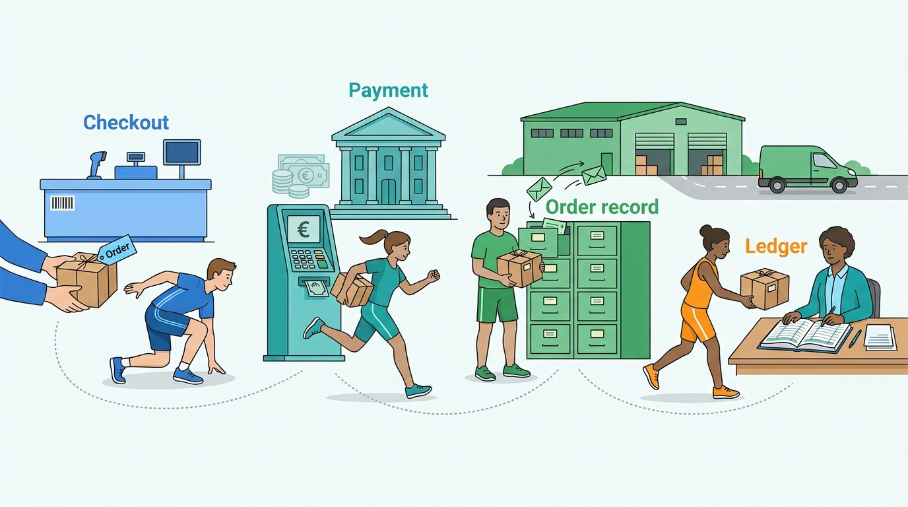
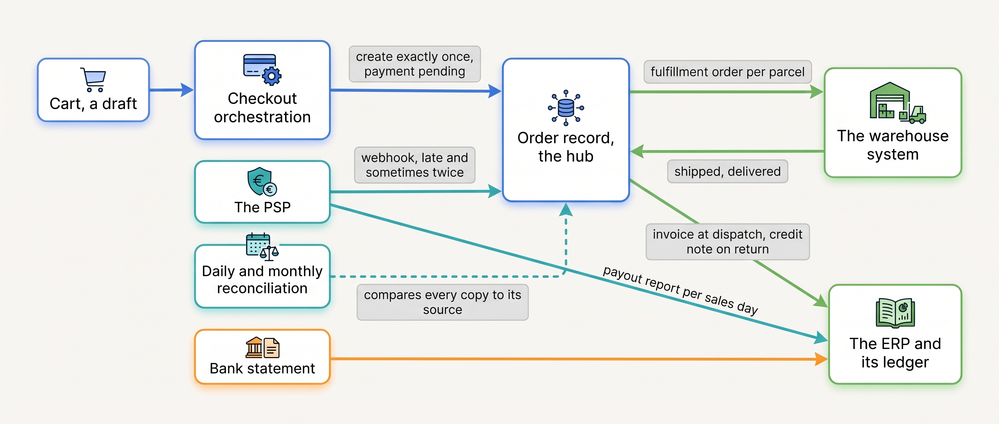

> **IN THIS PART, YOU WILL:** Follow one cart through checkout, payment, the order record and the books, and learn which system owns each step and how the others find out what it did.

> **KEY POINTS:**
>
> * **Checkout is the moment the shop stops promising and starts owing.** The cart is a draft that reserves nothing; checkout asks pricing, promotions, tax, availability, shipping and payment for a final answer and creates the order exactly once, before the bank has replied. It owns none of the facts it writes.
> * **From then on, the truth about the order arrives by message from systems the merchant does not control.** The payment provider's result, the warehouse's shipment confirmation and the carrier's scan come late, out of order and sometimes twice. So the order keeps separate states for money, goods per parcel and returns, every message carries a key, a repeat changes nothing, and a daily job compares the copies.
> * **The order ends as documents with identifiers, each issued by one system.** One writer per action that moves money, one invoice sequence per legal entity, a credit note for every correction, and a monthly match of orders, payouts and the bank.

> **[FAILURE PATTERNS THIS PART ADDRESSES](where-commerce-platforms-go-wrong.html):**
>
> * **The Message in a Bottle** — a payment result or a shipment confirmation sent once and trusted, so an order is paid twice, never paid, or "delivered" while half of it is still being picked.
> * **Schrödinger's Order** — the platform, the warehouse and the finance system each held an honest status of a different object, and nobody held the order's.
> * **The Boomerang** — two systems could refund the same return, neither sent a key the provider could recognize, and the two paths met only in the ledger, a month later.

 
Part II was everything the shopper sees before the cart, each item a promise. Part III is **the moment the promises become an obligation**. In a few minutes the shop asks every system that made a promise for a final answer, takes the shopper's money, and writes one record that the warehouse, the carrier, the service desk and the accountants will all read and change. From then on the merchant owes a parcel, owes the state its tax, and owes its own books an explanation of every euro.

What makes this part different from the catalog is where the truth lives. A price is decided inside the merchant's own systems. Whether a payment succeeded is decided by a **payment service provider** (PSP: the company that offers the payment methods, collects the money through the banks and pays the merchant one net amount a day) and told to the shop by a **webhook**, an HTTP call to the merchant's server that can arrive late, out of order or twice. Whether a parcel left is decided by the warehouse; whether it arrived, by the carrier. The order is the one record every system touches, and it is held in several places at once unless someone decides otherwise. Kestrel & Pine, the fictional outdoor brand this book follows, had not decided in 2026.

**Figure 1:** *One order passes through four owners in Part III: checkout creates it, the payment provider settles it, the order record holds it, and the ledger ends it.*

**Where we are in the order's journey.** Eva's jacket, the recurring order of [[meet-kestrel-and-pine]], enters this part at 21:09 on Tuesday 13 April 2027 as a cart holding a Ridgewalker jacket and two pairs of socks, and leaves it as an invoice posted on 14 April and a payout batch matched at the May close. In between it becomes order #1072455 at 21:14 with its payment pending, is marked paid by the PSP's webhook seconds later, and is handed to the Duiven warehouse; under Waypoint, Kestrel & Pine's 2027 program, it will live in an order management system (OMS), which holds every channel's orders in one record. Picking, delivery and the exchange are Part IV.

**Figure 2:** *The shape Part III recommends: checkout creates the order once; the order is one hub fed by messages from the payment provider, the warehouse and the carrier; the ledger is fed by documents, not events; and a reconciliation compares orders, payouts and the bank on a schedule.*

## Chapters in this part

[[cart-and-checkout]] decides **what checkout must call, in what order, and how it creates the order exactly once**: checkout is a thin, clocked orchestration that owns no price, stock or payment state; the order is created keyed on the cart and the payment, before the bank's answer, and settled by the webhook or a daily job, never by the thank-you page; and platforms withdraw the freedom to edit checkout on purpose, as Shopify's dated timeline from 2023 to 2026 shows. The case is Eva's checkout step by step, from 21:09 to order #1072455 at 21:14, and the Card-Testing Night of August 2026: 48,000 bot attempts, €2,900 in fees, a 40-minute pause of every online sale.

[[commerce-payments]] decides **which systems may move money, with what key, and how the order learns what the provider actually did**: money moves in four stages, authorization, capture, settlement and payout, that each method bends differently (iDEAL has no capture and no chargeback; a card authorization expires in days); the order keeps its own small payment vocabulary, moved only by confirmed events; every refund has one writer and one key; and the card number never touches the merchant's servers. The case is Eva's €235 by iDEAL, and the Double Refund of January 2027: 212 returns refunded by the returns portal and again by hand in the PSP console, €19,400 out twice.

[[order-management]] decides **where the order lives, which states it passes through, and when an order management system is needed**: an order is one record with several state machines, money, goods per shipment and returns, not one status word; the summary of a split order is the state of its least-advanced parcel; routing and splits are cost decisions that need an owner; and an OMS becomes the hub once two of four things are true. The case is the Three-Status Order of December 2026, #1052877: *Delivered* in the platform, *In picking* in the warehouse and *Not invoiced* in the ERP for six days, 11 tickets from one customer, and Waypoint's W2.

[[tax-invoicing-and-ledger]] decides **which system computes the tax, which issues the invoice, and how finance proves every month that orders, payouts and the bank agree**: tax comes from facts the shop owns (the ship-to address, the product's category, the customer's status) and rates it should not own; the invoice is a numbered, immutable legal document issued at dispatch of each shipment by one system per legal entity and corrected only by a credit note; and documents, not webhooks, feed the ledger. The case is Eva's order in the books, net €194.21 and VAT €40.79, and Ardennes Trail Co., the Belgian wholesale customer in Namur whose invoice travels as structured data over Peppol, the European e-invoicing network.

Begin with [[cart-and-checkout]].

## Sources and Evidence

Sources are cited in each chapter; this introduction makes no factual claim of its own. Kestrel & Pine is fictional, and its figures are the same in every chapter.
